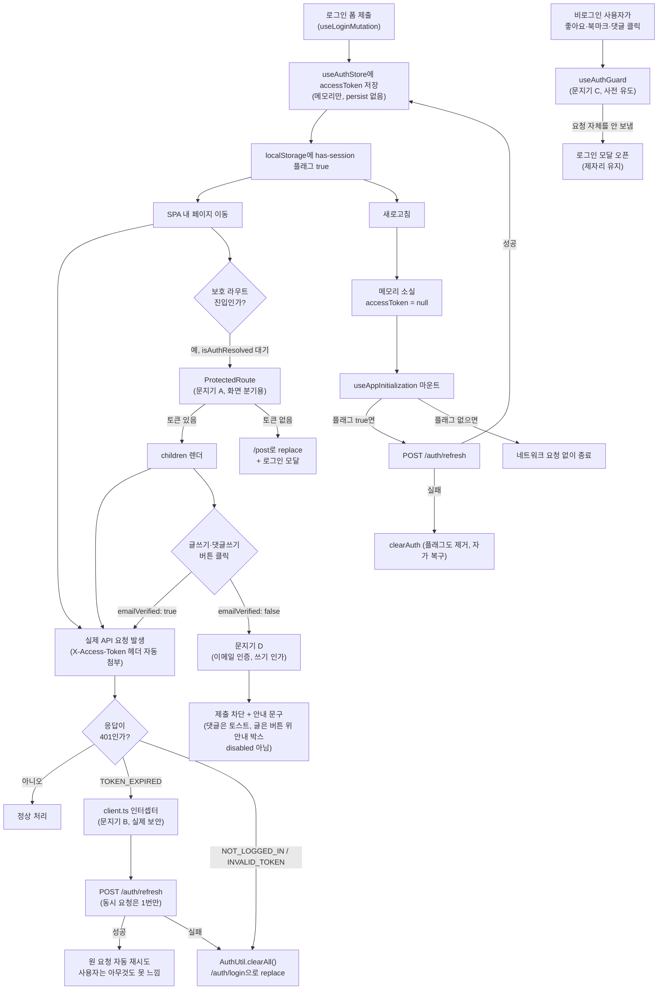
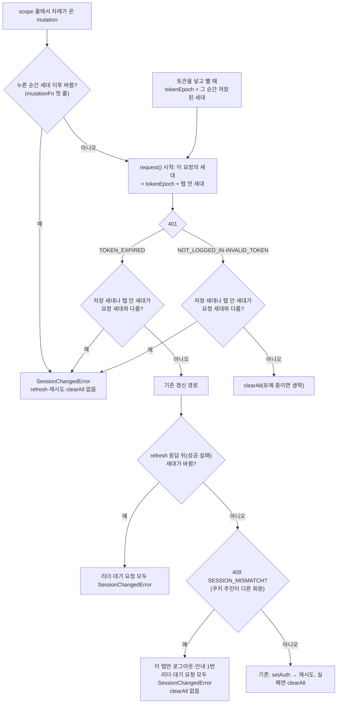
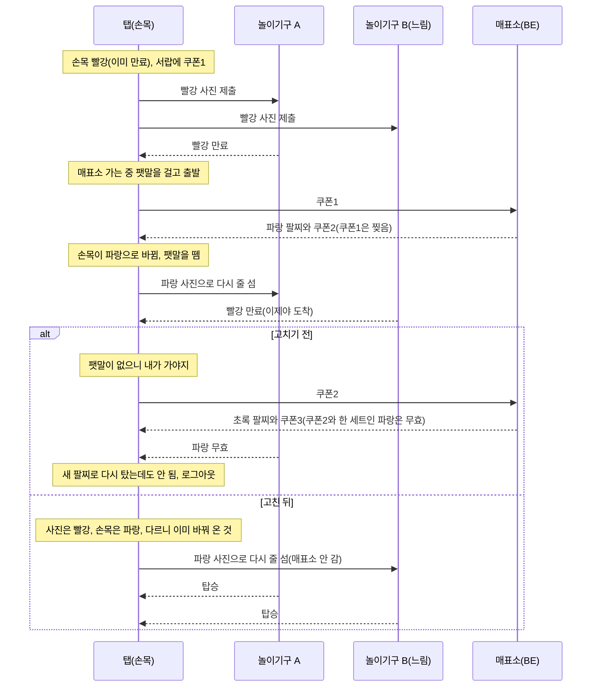
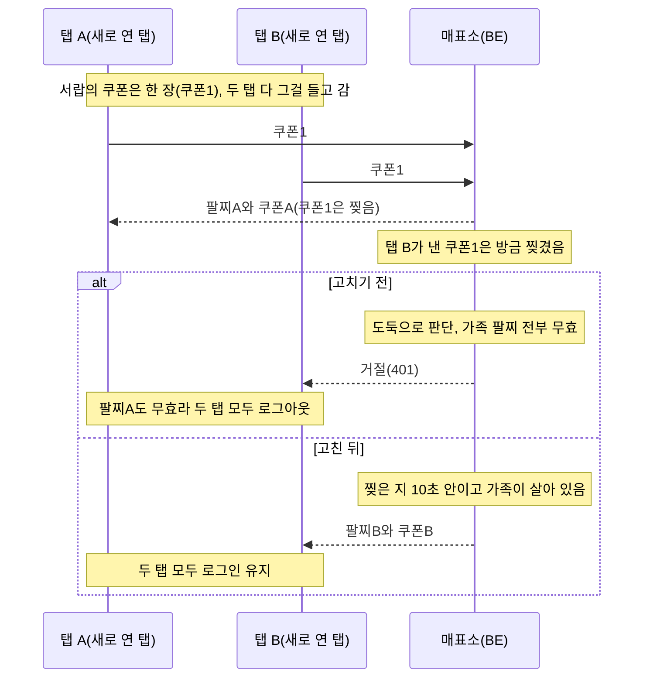
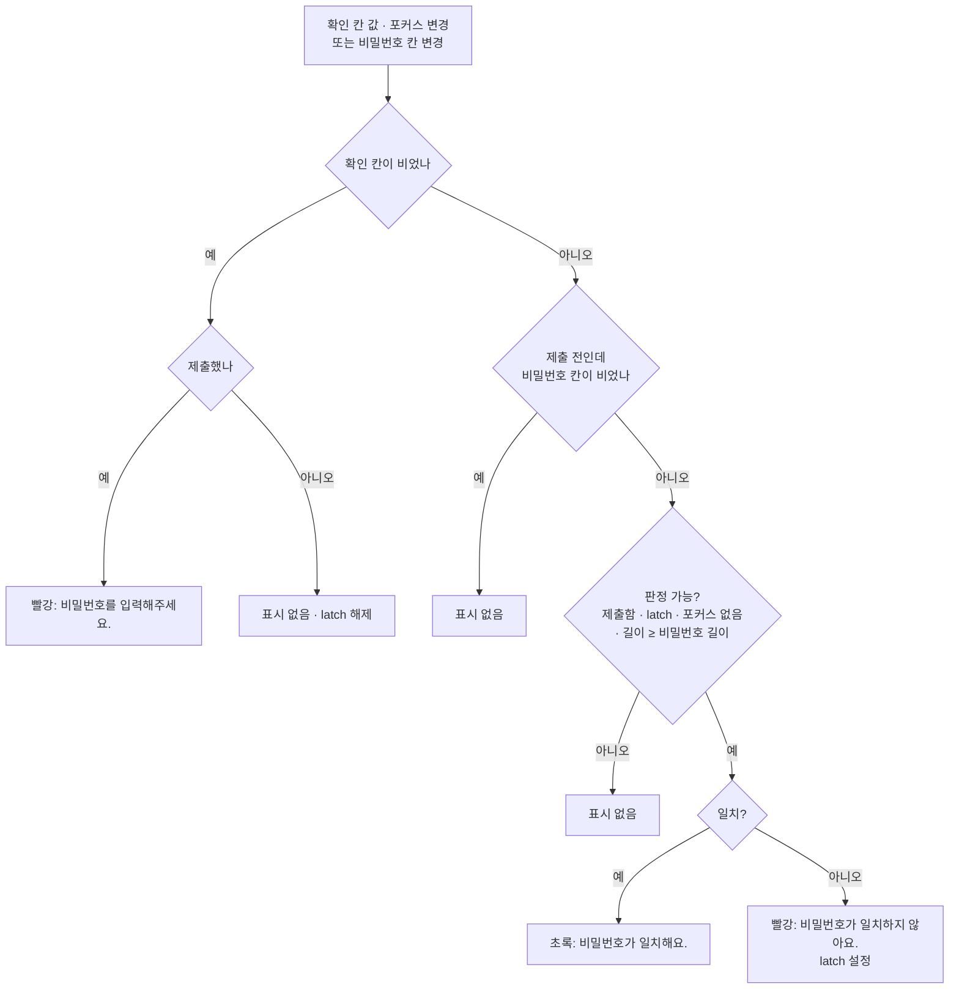
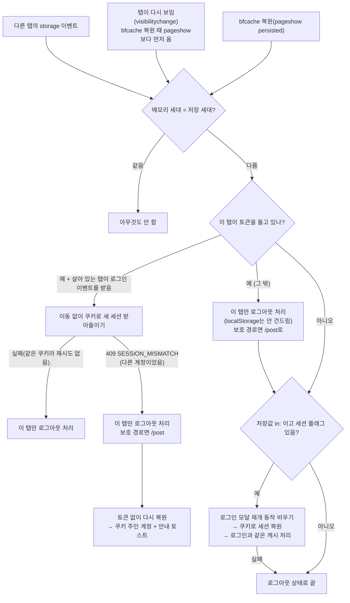

# 인증·인가·세션·토큰 갱신

> 독립 기능 문서(서사형)입니다.
> 대상 독자: 이 레포의 인증 코드를 처음 보거나, 인증 관련 화면/코드에서 이상한 동작을 발견해 원인을 추적해야 하는 개발자(AI 에이전트 포함).
> 읽고 나면: 로그인부터 로그아웃까지 상태가 어디에 저장되고 언제 사라지는지, 만료된 토큰이 왜 서로 다른 두 곳에서 두 번 처리되는지, 그중 어느 쪽이 실제 보안 경계인지, 그리고 로그인한 사람도 글을 못 쓸 때가 있는 이유를 설명할 수 있게 됩니다. 비밀번호를 새로 만드는 폼이 입력 중에 언제 무엇을 보여주는지(§8-G)도 여기서 다룹니다.
> **마지막 검토**: 2026-10-27

---

## 1. 쉬운 설명

이 앱의 인증·인가에는 성격이 다른 **네 개의 독립된 문지기**가 있습니다.

- **문지기 A (`ProtectedRoute`)**: 건물 로비에서 "출입증 있어요?"만 확인하는 안내데스크입니다. 진짜 보안은 안 하고, 있으면 통과시키고 없으면 "1층 로비(공개 피드)로 가서 출입증부터 받으세요"라고 안내만 합니다. 안내데스크를 그냥 지나쳐도 각 사무실 문(BE API)은 따로 잠겨 있습니다.
- **문지기 B (`client.ts`의 401 인터셉터)**: 각 사무실 문에 달린 진짜 자물쇠입니다. 출입증(액세스 토큰)이 만료됐으면 그 자리에서 조용히 새 출입증을 재발급받아(refresh) 문을 열어줍니다. 사용자는 문이 잠깐 안 열렸다는 것조차 눈치채지 못합니다. 재발급도 실패하면 그제서야 "퇴실 처리"(로그아웃)를 합니다.
- **문지기 C (`useAuthGuard`/`useProtectedNavigate`)**: 출입증이 아예 없는 방문객이 사무실 문을 두드리기 **전에** "먼저 출입증부터 받고 오세요"라며 접수처(로그인 모달)로 안내하는 안내원입니다. 문을 두드려서 거절당하는 민망함(에러 토스트, 페이지 이탈) 자체를 막아줍니다.
- **문지기 D (이메일 인증 게이트, `useCreatePost`/`useCreateComment`)**: 출입증은 있지만(로그인은 했지만) 특정 서류 접수창구(글쓰기·댓글쓰기, 글 작성·수정 화면의 링크 미리보기 포함)에는 신원이 한 번 더 확인된 사람만 받아주는 창구 직원입니다. 로비 출입(로그인)과 구경(읽기)은 막지 않고, 제출(쓰기)만 막습니다.

네 문지기는 서로의 존재를 모릅니다. A가 통과시켰다고 B가 안 잠그는 게 아니고, B가 열어준다고 A가 필요 없어지는 것도 아닙니다. **문지기 A는 로비 안내판일 뿐 보안 장치가 아니고, 실제 보안은 전부 문지기 B가 각 문 앞에서 합니다.** 이 구분을 놓치면 "A가 만료된 출입증을 그냥 통과시킨다"를 보안 구멍으로 오진하게 됩니다 — §10에서 실제로 그런 일이 있었습니다. 문지기 D는 A/B/C와 아예 다른 신분증(`useAuthStore`의 로그인 여부가 아니라 계정 캐시의 `emailVerified`)을 봅니다 — 로그인 여부와 이메일 인증 여부는 서로 독립된 두 개의 참/거짓 값입니다.



---

## 2. 전제 지식

이 문서는 다음을 이미 안다고 가정합니다: zustand 기본 사용법, React Query의 `useQuery`/`useMutation`. **JWT 지식은 가정하지 않습니다** — 이 앱의 accessToken은 BE가 발급하는 불투명(opaque) 세션 토큰이라 payload가 없습니다(BE PR #42로 JWT를 폐지하고 서버 관리 세션으로 전환, §3·§6에서 자세히 설명합니다).

가정하지 않는 것 — 필요하면 먼저 읽으세요:

- 이 레포의 3-Layer API 패턴(`*.api.ts` → `*.keys.ts` → `*.queries.ts`), Feature Hook 패턴 → [`docs/FE-ARCHITECTURE.md`](FE-ARCHITECTURE.md) §5·§6
- 히스토리 엔트리 기반 오버레이 관리(로그인 모달이 왜 `location.state`로 열림 상태를 관리하는지) → [`docs/DECISIONS.md`](DECISIONS.md)의 2026-08-07 항목
- 첫 로딩 성능 최적화로 인증 게이팅이 지금 형태가 된 배경 → [`docs/DECISIONS.md`](DECISIONS.md)의 2026-07-25 항목

---

## 3. 사용한 도구·기술

- **기능 자체**: zustand(persist 미들웨어 **의도적으로 미사용** — §6), React Query(계정 정보 캐시), 커스텀 `fetch` 기반 `ApiClient`(axios 아님, 자체 인터셉터 로직 직접 구현), 불투명(opaque) 세션 토큰(accessToken은 BE가 `SecureToken.generate()`로 만드는 32바이트 base64url 무작위 문자열 — payload 없음, JWT 아님. BE PR #42로 JWT 폐지), httpOnly 쿠키(리프레시 토큰, 쿠키명 `__Host-refreshToken`, 최대 7일, BE가 설정·JS 접근 불가)
- **구현·검증 과정에서 쓴 도구**: MSW(`client.test.ts`가 401 응답을 흉내내 인터셉터를 검증), Vitest `vi.waitFor`(비동기 side-effect 검증)

---

## 4. 왜 만들었나

이 문서 이전에는 인증 아키텍처를 한눈에 설명하는 글이 없었고, 관련 결정들이 [`docs/DECISIONS.md`](DECISIONS.md)에 날짜별로 흩어져 있었습니다. 그 결과 2026-09-09, 어떤 세션이 `ProtectedRoute.tsx`의 만료 토큰 처리 로직(§8-A)만 보고 "만료된 토큰을 그대로 통과시키는 버그"로 결론 내렸습니다. 실제로는 `client.ts`의 반응형 인터셉터(§8-B)가 완전히 별개로 이미 그 상황을 처리하고 있었습니다 — 코드 관찰 자체는 정확했지만, 다른 레이어에 이미 있는 방어를 확인하지 않아 결론이 틀렸습니다. 재검증 과정과 정확한 결론은 §10에 전문을 남겼습니다.

이 문서의 목적은 "인증에는 책임이 분리된 여러 레이어가 있고, 한 레이어만 보고 전체를 판단하면 안 된다"는 걸 코드를 다시 뒤지지 않아도 알 수 있게 하는 것입니다.

---

## 5. 구조 — 네 개의 게이트

|               | 게이트 A: `ProtectedRoute`                             | 게이트 B: `client.ts` 인터셉터                                                                               | 게이트 C: `useAuthGuard`/`useProtectedNavigate`                      | 게이트 D: 이메일 인증(쓰기 인가)                                                                                         |
| ------------- | ------------------------------------------------------ | ------------------------------------------------------------------------------------------------------------ | -------------------------------------------------------------------- | ------------------------------------------------------------------------------------------------------------------------ |
| 위치          | `src/app/routes/ProtectedRoute.tsx`                    | `src/shared/api/client.ts`의 `handleTokenExpired` 메서드 + `request()`의 401 분기(`response.status === 401`) | `src/entities/auth/hooks/useAuthGuard.ts`, `useProtectedNavigate.ts` | `useCreatePost.ts`의 `onSubmit`, `useCreateComment.ts`의 `onSubmit`(`guard` 콜백 안) + BE `PostService`/`CommentService` |
| 판단 근거     | 클라이언트 로컬 상태(`useAuthStore.isAuthenticated`)만 | BE의 실제 401 응답 코드                                                                                      | 클라이언트 로컬 상태만                                               | `account.emailVerified`(React Query 계정 캐시, `useAuthStore`와 별개)                                                    |
| BE와 통신     | 안 함(사전 검증 로직 자체가 없음, §8-A)                | 함(`POST /auth/refresh`, 원 요청 재시도)                                                                     | 안 함(애초에 요청을 안 보냄)                                         | 제출 시 함(BE가 403 `EMAIL_NOT_VERIFIED`로 최종 판정, 방어 계층 중복)                                                    |
| 발동 시점     | 보호 라우트가 **렌더**될 때                            | 실제 API 요청이 **401을 받은 뒤**                                                                            | 사용자가 **클릭**했을 때, 요청 전                                    | 글쓰기·댓글쓰기 **제출** 시도 시                                                                                         |
| 책임          | 화면을 보여줄지 말지 분기, 스피너, 로그인 모달 유도    | 요청을 인증시켜 성공시키거나 세션을 끊음                                                                     | 실패할 게 뻔한 요청을 사전에 막고 로그인 유도                        | 미인증 사용자의 쓰기 제출을 막고 안내                                                                                    |
| 실패 시 결과  | `/post`로 replace 이동(+ 조건부 모달)                  | `AuthUtil.clearAll()` → `/auth/login` replace                                                                | 로그인 모달(제자리 유지, 페이지 이동 없음)                           | 안내(댓글은 토스트, 글은 버튼 위 `FormAlert` 박스), 제출 차단(버튼은 `disabled` 아님 — 아래 참고)                        |
| **보안 효과** | **없음.** 우회해도 API가 401을 낸다                    | **실질적 보안 경계**                                                                                         | 없음(UX 편의)                                                        | **부분적.** FE 체크는 UX용이고, 실제 방어는 BE의 403 판정                                                                |

**왜 나뉘어 있나**: 게이트 A는 성능 결정([`docs/DECISIONS.md`](DECISIONS.md) 2026-07-25 항목)의 짝입니다 — `AuthProvider`가 라우터 렌더를 막지 않도록 바꾼 대가로, 복원이 끝나기 전 첫 페인트에서 로그인 사용자가 보호 페이지 새로고침 시 피드로 튕기는 걸 막는 화면 분기 장치로 도입됐습니다. 게이트 B는 "리프레시 토큰은 httpOnly라 JS가 존재·유효성을 전혀 모른다"는 사실에서 나옵니다 — 실제로 요청을 보내 401을 받아봐야 압니다. 게이트 C는 A·B 둘 다 못 막는 상황(비로그인 사용자가 공개 피드에 머문 채 좋아요를 누르는 것)을 막습니다: A는 페이지 단위라 이 상황에 개입 못 하고, B는 요청을 실제로 보내야 발동하는데 그러면 401 → `clearAll()` → 페이지 이탈로 사용자 문맥이 깨집니다. 게이트 D의 1차안은 "이메일 미인증이면 로그인 자체를 막는다"였지만, [GitHub 사례 조사](https://github.com/kamp-us/phoenix/issues/7485)에서 _"쓰기 권한(게시글·댓글)은 인증된 이메일에 게이팅되고, 마찰은 도착이 아니라 첫 '쓰기' 시점에 발생한다"_(번역)는 걸 확인하고 뒤집혔습니다 — 로그인·읽기까지 막으면 가입 직후 이탈이 너무 커진다는 판단입니다. 확정 경위는 `docs/plans/2026-09-28-auth-hardening.md`의 "확정된 결정들" 표를 참고하세요.

### 라우트 그룹 구성 (`src/app/routes/index.tsx`의 `appRoutes`, `:159-263`)

```
RootLayout
├─ AppShellLayout (Public Content Group, 인증 게이트 없음 — has-session 플래그가 있으면 복원까지 스피너)   — /, /post, /post/:id
├─ ProtectedLayout = ProtectedRoute(게이트 A) + AppShellLayout   — /post/submit, /post/edit/:id, /bookmark, /my/comments, /my/account
├─ GuestGuard + PublicLayout (Guest Only)   — /auth/login, /auth/sign-up, /auth/forgot-password, /auth/reset-password
└─ AuthLayout(가드 없음, 로그인·비로그인 공용)   — /auth/verify-email
```

`ProtectedLayout.tsx:4-9`가 `ProtectedRoute`로 `AppShellLayout`을 감쌉니다. **이건 React Router의 레이아웃 라우트라, 보호 그룹 안에서 페이지를 오갈 때(`/post/submit` ↔ `/bookmark`)는 언마운트되지 않습니다.** 게이트 A가 실제로 재평가되는 유일한 순간은 공개/게스트 그룹에서 보호 그룹으로 **처음 진입**할 때뿐입니다.

`GuestGuard`(`routes/index.tsx`의 `GuestGuard` 함수, `:90-104`)는 반대 방향 가드입니다 — 로그인 상태로 `/auth/login`에 오면 이전 경로(`location.state.from.pathname`) 또는 `HOME`으로 돌려보냅니다.

`/auth/verify-email`은 어느 가드에도 속하지 않고 `routes/index.tsx:237-240`에서 `AuthLayout`만 직접 씌워 별도 라우트로 둡니다 — 로그인·비로그인 양쪽 모두 접근 가능해야 하기 때문입니다(로그인 상태면 인증 완료만 안내, 비로그인이면 로그인 유도).

---

## 6. 상태 모델

| 저장소                            | 키/필드                       | 값                                                              | 수명                                                       | JS 접근  |
| --------------------------------- | ----------------------------- | --------------------------------------------------------------- | ---------------------------------------------------------- | -------- |
| zustand `useAuthStore` (메모리만) | `accessToken`                 | 불투명 세션 토큰 또는 `null`(BE 발급, payload 없음 — JWT 아님)  | 탭 수명(새로고침 시 소멸)                                  | 가능     |
| 〃                                | `isAuthenticated`             | `!!accessToken`과 항상 동치                                     | 〃                                                         | 가능     |
| 〃                                | `isAuthResolved`              | 복원 시도가 끝났는지                                            | 〃                                                         | 가능     |
| localStorage                      | `linksphere:auth:has-session` | **boolean 하나뿐**                                              | 영구(자가 복구, 아래 참고)                                 | 가능     |
| localStorage                      | `linksphere:auth:saved-email` | 로그인 폼 "이메일 저장" 값                                      | 영구                                                       | 가능     |
| localStorage                      | `linksphere:auth:last-avatar` | 아바타 URL(선반입용)                                            | 영구(로그아웃 시 제거)                                     | 가능     |
| localStorage                      | `linksphere:auth:epoch`       | 인증 세대 `in:<UUID>`(로그인)·`out:<UUID>`(로그아웃·탈퇴)       | 영구(명시적 로그인·로그아웃마다 새 값, §8-H)               | 가능     |
| 모듈 변수(`auth-epoch.util.ts`)   | `knownEpoch`                  | 이 페이지가 마지막으로 맞춘 세대                                | 페이지 수명(bfcache 복원 때는 멈추기 전 값 그대로)         | 가능     |
| 〃                                | `tokenEpoch`                  | 이 탭이 지금 들고 있는 토큰이 속한 세대(토큰을 넣고 뺄 때 맞춤) | 〃                                                         | 가능     |
| 〃                                | `inTabEpoch`                  | 이 탭에서 명시적으로 로그인·로그아웃한 횟수(저장 실패해도 증가) | 〃                                                         | 가능     |
| httpOnly 쿠키(BE 설정)            | `__Host-refreshToken`         | 리프레시 토큰(불투명)                                           | 최대 7일(BE `MemberSessionService.REFRESH_TOKEN_VALIDITY`) | **불가** |

로그인 폼 이메일 입력의 초기값은 위 `saved-email`뿐 아니라 `location.state.email`의 영향도
받습니다 — 회원가입 화면에서 이메일이 이미 가입된 것으로 확인됐을 때(또는 가입 성공 직후)
"Sign In"/"로그인하러 가기" 링크가 그 이메일을 함께 실어 보내고, `useLogin.ts`의 `useForm` 초기값(`defaultValues.email`)이 이 값을
`saved-email`보다 우선 적용합니다(방금 직접 입력하고 서버가 확인해준 값이 지난 방문의 저장값보다
명확한 의도이기 때문). `saveEmail` 체크박스의 초기 체크 여부는 이 값과 무관하게 `saved-email`
존재 여부만 그대로 반영합니다.

**절대 저장하지 않는 것**: 액세스 토큰(어떤 스토리지에도 없음, 메모리 전용), 리프레시 토큰(JS가 못 만짐), 계정 정보(React Query 캐시에만, `accountKeys.root`) — 게이트 D가 보는 `account.emailVerified`도 이 캐시 안에 있고 `useAuthStore`에는 없습니다.

**비밀번호 변경 시 세션 회전**: `useChangePasswordMutation`(`auth.queries.ts`)의 `onSuccess`가 BE가 새로 발급한 세션으로 `setAuth(data.accessToken)`을 호출합니다 — BE가 비밀번호 변경 시 이 기기를 포함한 세션 회전 계열(familyId)을 새로 만들고 다른 기기의 세션은 전부 폐기하기 때문입니다. 로그인·refresh와 마찬가지로 `useAuthStore`의 `accessToken`을 갱신하는 세 번째 트리거입니다.

`useAuthStore`(`src/shared/store/auth.store.ts:48-80`)는 `devtools` 미들웨어만 쓰고 **`persist`가 없습니다 — 의도적입니다.** `accessToken`은 항상 `isAuthenticated`와 함께 `setAuth`/`setAccessToken`(하위 호환)/`clearAuth`/`clearLocalAuth`에서만 갱신되므로(`auth.store.ts:56-65`, `:67-76`) 두 값은 절대 어긋나지 않습니다. `clearLocalAuth`는 `clearAuth`와 달리 localStorage를 건드리지 않는 메모리 전용 정리로, 다른 탭에서 일어난 변화를 이 탭에 반영할 때만 씁니다(§8-H). **이 등가성이 §8-A의 동작을 결정짓는 핵심 사실입니다.**

`linksphere:auth:has-session` 플래그(`auth.store.ts:17-20`)는 "세션이 있을 가능성"에 대한 힌트일 뿐, 진짜 인증 상태가 아닙니다:

- 플래그만 남고 쿠키가 만료됐다면 → `POST /auth/refresh`가 401 → `clearAuth()`가 플래그를 제거 → **자가 복구**
- 플래그가 없는데 쿠키가 살아있다면 → 다음 로그인 시 복구. **이 비대칭은 의도된 설계**입니다(민감정보를 저장하지 않는 대가로 완벽한 동기화를 포기)

---

## 7. 운영 파라미터

| 파라미터                                   | 값                                                                                                                             | 위치                                                                     |
| ------------------------------------------ | ------------------------------------------------------------------------------------------------------------------------------ | ------------------------------------------------------------------------ |
| 계정 정보(`accountKeys.root`) `staleTime`  | 1일(`STALE_TIME_ONE_DAY`)                                                                                                      | `src/entities/account/api/account.queries.ts`의 `useFetchAccountQuery`   |
| 동시 401 발생 시 실제 refresh 호출 횟수    | 1회(리더-팔로워 큐잉 + refresh가 끝난 뒤 늦게 온 401은 refresh 없이 재시도, §8-B·§9)                                           | `src/shared/api/client.ts`의 `handleTokenExpired` 메서드                 |
| refresh 재시도 상한                        | **1회**(재시도한 요청이 다시 `TOKEN_EXPIRED`를 받으면 refresh를 또 호출하지 않고 실패 처리 — 2026-09-21 추가, §11 항목 1 참고) | `src/shared/api/client.ts`의 `handleTokenExpired`, `retryCount > 0` 가드 |
| 로그아웃 직후 유예 시간(`LOGOUT_GRACE_MS`) | 2초 — §8-E 참고                                                                                                                | `src/shared/utils/logout-grace.util.ts:25`                               |

> 이 표에는 더 이상 "액세스 토큰 만료 판정 여유 마진" 항목이 없습니다 — 그 값을 쓰던
> `isTokenExpired`가 2026-09-29에 삭제됐습니다. 경위는 §10 "후속 — 근본 원인 제거" 참고.

---

## 8. 코드 지도와 자주 하는 수정

### 8-A. 게이트 A가 실제로 하는 일 (그리고 안 하는 일)

게이트 A는 `isAuthResolved`(§6, 앱 부팅 시 1회 복원)를 기다리는 것 말고는 아무 사전
검증도 하지 않습니다:

```ts
// ProtectedRoute.tsx의 렌더 가드 전체
if (!isAuthResolved) {
  return <SpinnerOverlay className="h-screen" />;
}

if (!isAuthenticated) {
  return <Navigate to={ROUTES_PATHS.POST.ROOT} replace ... />;
}

return <>{children}</>;
```

**결론**: 이 앱에는 "만료 토큰의 사전(proactive) 재검증"이 없습니다. 만료 토큰 처리는
전부 게이트 B가 담당합니다. 2026-09-29 이전에는 accessToken이 존재할 때마다
`AuthUtil.isTokenExpired(accessToken)` + `restoreAuth()`를 추가로 거치는 `isVerifying`
게이트가 있었지만, 이 게이트는 `restoreAuth()`가 accessToken 존재만으로 즉시
early-return하는 구조상 애초에 아무 일도 하지 않았고(§10, 2026-09-09 사건에서 이미
확인됨), opaque 토큰으로 전환된 뒤로는 매번 스피너만 한 틱 깜빡이는 부작용까지
생겨 완전히 제거했습니다. 자세한 경위는 §10 "후속 — 근본 원인 제거" 참고.

게이트 B는 BE가 401을 줘야만 작동합니다. 비로그인도 열 수 있는 `GET /post`·`/post/{id}`·`/post/{id}/comment`는
2026-10-20(BE [#104](https://github.com/BAECHAN/link-sphere_BE_NEW/pull/104)) 전까지 만료된 토큰에도 401 대신
비로그인 결과(200)를 줘 여기를 건너뛰었습니다 — §10 "후속 — 공개 조회는 401을 주지 않았다" 참고.

### 8-B. 게이트 B — 반응형 401 인터셉터

```
client.ts의 request() 메서드 — authEpoch = 이 탭 토큰의 세대(저장 세대 + 탭 안 세대, 처음 보낼 때 잡고 재시도에 그대로 넘김)
  if (response.status === 401)
    if (code === TOKEN_EXPIRED)
      return this.handleTokenExpired(...)          → 아래 handleTokenExpired로 위임
    else if (isSessionInvalidCode(code))            → NOT_LOGGED_IN / INVALID_TOKEN
      if (endpoint === /auth/refresh) throw         → refresh 자신은 clearAll 없이 throw(방어용, 아래 설명)
      if (세대가 바뀜) throw SessionChangedError     → 지금 세션과 무관한 401, clearAll 안 함
      else if (!AuthUtil.isLoggingOut()) AuthUtil.clearAll()

client.ts의 handleTokenExpired() 메서드
  if (세대가 바뀜) throw SessionChangedError        → refresh·재시도·clearAll 없음(아래 설명)
  if (지금 토큰 && 지금 토큰 !== sentToken)        → 늦게 도착한 401(이미 누가 갱신함)
    return this.request(endpoint, options, retryCount + 1)   // refresh 없이 재시도
  if (retryCount > 0)                              → 재시도한 요청도 다시 TOKEN_EXPIRED
    refreshSubscribers 비움, clearAll(), 영구 pending Promise 반환(더 재귀하지 않음)
  if (!this.isRefreshing)                          → 리더 경로
    POST /auth/refresh (X-Access-Token = sentToken)  → BE가 쿠키 주인과 같은 회원인지 확인
    if (세대가 바뀜) 받은 토큰 버림 → catch로
    setAuth(accessToken)
    notifySubscribers()                            → 대기 요청들 재시도
    return this.request(endpoint, options, retryCount + 1)   // 원 요청 재시도
    catch → 세대가 바뀌었으면 리더·대기 요청 모두 SessionChangedError
            409 SESSION_MISMATCH면 이 탭만 로그아웃(1번) + 리더·대기 요청 모두 SessionChangedError
            아니면 refreshSubscribers 비움, clearAll(), 영구 pending Promise 반환
  else                                             → 팔로워 경로
    new Promise(subscribeTokenRefresh({ 재시도, 취소 }))   // 취소는 위 catch의 세대 변경 때
```

`sentToken`은 그 요청이 실제로 실어 보낸 `X-Access-Token` 값입니다. 첫 분기가 필요한
이유는 리더의 `finally`가 **재시도 완료를 기다리지 않고** `isRefreshing`을 내리기
때문입니다(`return this.request(...)`를 `await` 없이 반환). refresh가 끝난 뒤에 도착한
401은 대기 큐가 아니라 리더 경로로 들어오는데, 거기서 refresh를 또 부르면 BE가 세션을
회전시키면서(이전 행 폐기, BE `MemberSessionService.rotate`) 첫 refresh 토큰으로 재시도
중이던 요청이 `TOKEN_EXPIRED`를 받고, 재시도 상한에 걸려 로그아웃됩니다. 2026-10-12에
`client.test.ts` Case 1-3으로 재현(수정 전 refresh 2회 + 로그인 이동)한 뒤 이 분기를
추가했습니다.

refresh 자신이 실패하면 BE는 `NOT_LOGGED_IN`/`INVALID_TOKEN`이 아니라 401
`MISSING_REFRESH_TOKEN`(쿠키 없음)·`INVALID_REFRESH_TOKEN`(만료·위조·이미 소비됨)을 줍니다(BE
`GlobalExceptionHandler.kt`, `/auth/refresh`는 `SecurityConfig.kt`의 `permitAll` 목록). 이 코드는 위 401 분기
어디에도 걸리지 않고 일반 `ApiError`로 던져지므로, 의사코드의 `/auth/refresh` 분기는 방어용입니다. 앱 부팅 시
자동 refresh가 조용히 실패하는 것은 `restoreAuth`의 catch가 `clearAuth()`만 하기 때문이고(§8-C), 갱신 중
refresh가 실패하면 위 리더의 catch가 `clearAll()`로 처리합니다.

#### 인증 세대가 바뀐 뒤 돌아온 401

refresh 쿠키는 브라우저에 한 장이라 모든 탭이 같이 씁니다. 요청이 서버에 가 있는 사이 다른 탭에서
로그아웃하고 다른 계정으로 로그인하면, 그 요청이 받은 `TOKEN_EXPIRED`(BE는 폐기된 세션의 토큰에도 이
코드를 줍니다)를 위 경로대로 처리할 때 쿠키는 이미 새 계정의 것입니다 — refresh가 성공하고 원 요청이
**새 계정으로** 다시 나갑니다. 2026-10-14에 이 경로를 막았습니다(§11 항목 10).

- **요청의 세대**: 토큰을 넣고 뺄 때(`setAuth`·`setAccessToken`·`clearAuth`·`clearLocalAuth`) 그 토큰이
  속한 세대를 메모리 `tokenEpoch`에 맞춥니다(`AuthEpochUtil.bindToken`). `request()`가 시작할 때 이 값을
  기억하고, 재시도는 처음 값을 그대로 넘깁니다. 시작할 때 localStorage를 읽지 않는 이유: 다른 탭이 세대를
  쓴 직후 이 탭이 새 세션을 받아들이기 전(§8-H의 refresh 대기 포함)에 시작한 요청은 옛 토큰을 싣고 나가므로
  옛 세대로 잡혀야 합니다.
- **비교**: 401을 받았을 때만 localStorage의 저장 세대와 비교합니다(위 의사코드의 "세대가 바뀜"). 다르면
  갱신·재시도·로그인 화면 이동 없이 `SessionChangedError`(`common.type.ts`)로 끝내고, 화면은 §8-H 동기화가
  맞춥니다. refresh를 기다리던 대기 요청도 함께 끝냅니다 — 영구 pending으로 두면 같은 `scope`의 다음
  요청이 막히고 낙관적 업데이트도 롤백되지 않습니다.
- **localStorage에 못 쓰는 탭**: 저장이 실패하면 같은 탭에서 로그아웃하고 다른 계정으로 로그인해도 저장 세대가
  그대로입니다. 그러면 옛 토큰으로 나간 요청의 `TOKEN_EXPIRED`가 위 "늦게 도착한 401" 분기로 새 계정 토큰으로
  재시도되고(refresh를 건너뛰어 아래 BE 확인에도 닿지 않음), 비로그인 요청의 `NOT_LOGGED_IN`은 방금 한 로그인을
  지우고, 줄 선 mutation은 새 계정으로 나갑니다. 2026-10-16 `client.test.ts` Case 9와 `mutation-auth-epoch.test.ts`로
  재현한 뒤 고쳤습니다. 이제 요청의 세대에는 **탭 안 세대**(`inTabEpoch`, 이 탭의 명시적 로그인·로그아웃 횟수, 메모리)도
  함께 담기고, 저장 세대나 탭 안 세대 중 하나라도 다르면 "세대가 바뀜"입니다(`AuthEpochUtil.hasChangedSince`). 탭 안
  세대는 `markLogin`·`markLogout`에서만 늘어나 refresh로는 바뀌지 않습니다. 다른 탭의 변화를 보는 `isStale`에는 섞지
  않습니다 — 섞으면 쓰기가 실패하는 탭이 자기 로그인을 다른 탭의 변화로 보고 스스로 로그아웃합니다.
- **같은 탭의 변화도 잡힙니다**: 같은 탭에서 로그아웃한 순간 진행 중이던 요청은 전에는 refresh 실패 →
  `clearAll()`로 `/post`에 있던 사용자를 `/auth/login`으로 다시 보냈고, 인라인 로그인 직전에 비로그인으로
  보낸 요청의 `NOT_LOGGED_IN`은 방금 한 로그인을 지웠습니다. 둘 다 세대가 바뀐 뒤 돌아온 401이라 이제
  그냥 끝납니다.
- **세대 키가 없는 사용자**(이 기능 전에 로그인해 한 번도 명시적 로그인·로그아웃을 안 함)는 `null`끼리
  같아 기존 동작 그대로입니다. 첫 명시적 로그인·로그아웃부터 보호됩니다.
- **줄 서 있던 요청**(같은 `scope`의 좋아요·북마크·폴더 고정): 아직 서버에 가지 않았으니 401로는 못 잡습니다. 앞
  요청이 끝나면 query-core가 줄에서 다음 것을 꺼내 실행하는데, 그때는 이미 다른 계정일 수 있습니다. 그래서
  누른 순간의 세대를 전역 `MutationCache` `onMutate`가 기록하고(`queryClient.ts`, 줄을 서도 `onMutate`는
  누른 순간에 돕니다), 그 mutation들의 `mutationFn`이 보내기 직전에 확인해 달라졌으면 보내지 않고
  `SessionChangedError`로 끝냅니다(`mutation-auth-epoch.ts`의 `assertMutationAuthEpochUnchanged`, scope
  mutation 7곳 — 빠뜨리면 ESLint `custom-query-rules/scope-mutation-auth-epoch`가 막습니다). 기록의 키는 query-core가 한 mutation의 `onMutate`와 `mutationFn`에 함께 넘기는 context
  객체입니다(5.90 `mutation.ts`의 `execute`). 실패로 끝나므로 `onError`(롤백)가 돌고, 결과를 기다리던 화면
  (북마크 폴더 대화상자의 행 잠금 등)도 풀립니다.
- **감수한 것**: 다른 탭에서 같은 계정으로 다시 로그인한 순간 진행 중이던 요청도 실패로 끝납니다. 토큰이
  불투명해 같은 계정인지 가릴 수 없습니다.



`SessionChangedError`는 쿼리 재시도 대상이 아니고(`retry-policy.ts` — 새 인증으로 다시 부르는 건 §8-H
동기화의 몫), 토스트는 사용자가 누른 동작(mutation)에만 _"로그인 상태가 바뀌어서 처리되지 않았어요. 다시
시도해 주세요."_ 를 띄웁니다. 조회와 로그아웃 반영 중(`LogoutGraceUtil` 유예)에는 조용합니다 — 그래서 이
문구는 사실상 "다른 탭에서 다시 로그인해 이 탭이 새 세션을 받아들인" 경우에만 보입니다.
`manualErrorHandling` mutation(댓글·글 작성 등)은 각자의 실패 문구를 그대로 띄웁니다.

#### 쿠키 주인이 다른 회원이라 갱신이 거절될 때 (SESSION_MISMATCH)

위 세대 확인이 **다른 탭의** 로그인을 알아채는 것은 이 브라우저의 모든 탭이 세대를 쓸 때뿐입니다. 업데이트 전
번들로 열려 있던 탭이나 localStorage 쓰기가 실패하는 다른 탭에서 다른 계정으로 로그인하면 저장 세대가 그대로라,
위 경로대로 갱신하면 원 요청이 새 계정으로 다시 나갑니다. 그래서 BE도 확인합니다(2026-10-15, BE
`MemberSessionService.rotate`). 같은 탭의 로그인·로그아웃은 저장에 실패해도 탭 안 세대가 알아챕니다(위 "localStorage에
못 쓰는 탭"). FE가 먼저 배포되고 BE가 뒤따르므로, 그 사이에는 BE가 헤더를 읽지 않아 아래 409가 오지 않을 뿐 동작은
이전과 같습니다.

- **FE가 보내는 것**: 리더의 refresh에 원 요청이 보낸 토큰(`sentToken`)을 `X-Access-Token`으로 싣습니다. 지금
  스토어 토큰이 아니라 `sentToken`인 이유: 아래처럼 이 탭을 로그아웃한 뒤 같은 토큰으로 나갔던 요청의 401이 늦게
  오면 스토어에 토큰이 없어, 스토어에서 헤더를 만들면 헤더 없이 갱신되고 BE가 확인을 건너뛰어 그 요청이 새
  계정으로 재실행됩니다(`client.test.ts` Case 8-4가 고정). 다른 요청의 refresh(부트스트랩 등)는 지금처럼 스토어
  토큰을 싣고, 토큰이 없으면 헤더도 없습니다.
- **BE가 하는 것**: 그 토큰의 회원(만료·폐기된 토큰도 행이 남아 있어 조회됩니다)이 refresh 쿠키의 회원과 다르면 새
  토큰을 발급하지 않고 409 `SESSION_MISMATCH`로 답합니다. 비교는 회전·재사용 판정을 마친 뒤 발급 직전에 해서,
  재사용 탐지를 피해 가는 길이 되지 않습니다. 같은 회원의 다른 계열(같은 계정 재로그인·비밀번호 변경)은 통과합니다.
  거절할 때는 앞서 한 refresh 소비도 함께 되돌려 쿠키가 그대로 유효합니다 — 아래 "새로고침하면 쿠키 주인 계정으로
  복원"이 여기에 기댑니다. 되돌리지 않으면 다음 refresh가 이미 쓴 쿠키의 재사용으로 걸려 쿠키 주인 계정까지
  로그아웃됩니다(BE `MemberSessionServiceIntegrationTest`가 실제 Postgres로 고정, BE #98).
- **FE가 받으면**: 이 탭만 로그아웃하고(`AuthUtil.applySessionMismatch` — 보호 경로면 `/post`, 공유 세션 플래그는
  남겨 새로고침하면 쿠키 주인 계정으로 복원) _"다른 탭에서 다른 계정으로 로그인해서 이 탭은 로그아웃했어요.
  새로고침하면 그 계정으로 이어서 쓸 수 있어요."_ 를 1번 띄운 뒤, 리더·대기 요청을 모두 `SessionChangedError`로
  끝냅니다. `clearAll`은 하지 않습니다 — 공유 세션 플래그를 지우면 쿠키 주인 계정의 탭이 새로고침 때 복원되지
  않습니다. 늦게 도착한 같은 토큰의 401은 이미 로그아웃한 뒤라 다시 로그아웃·안내하지 않습니다.
- **그 자리에서 새 계정으로 바꾸지 않는 이유**: 세대가 그대로라 위 세대 확인이 아무것도 막지 못합니다. 옛 토큰으로
  나간 요청의 늦은 401이 위 의사코드의 "늦게 도착한 401" 분기(지금 토큰 ≠ `sentToken`)로 refresh 없이 새 계정
  토큰으로 재시도됩니다.
- **이 확인은 보안 장치가 아닙니다**: 헤더를 보내야 작동하므로, 헤더를 빼면 그냥 건너뜁니다. 정상 클라이언트가
  다른 계정으로 실행하지 않게 막는 정합성 장치입니다. `/auth/refresh`를 `isAuthEndpoint`(헤더를 떼는 목록)에 넣으면
  이 확인이 조용히 꺼집니다(`client.test.ts` "요청 헤더" 그룹이 고정).
- **업데이트 전 번들 탭**: 이 처리가 없는 옛 번들은 409를 일반 갱신 실패로 보고 `clearAll`(로그인 화면 + 공유 세션
  플래그 삭제)로 갑니다. 새 계정으로 실행되는 것보다는 낫고, 새로고침하면 끝나는 일시적인 일입니다.
- **토스트 위치**: 안내는 `AuthUtil.applySessionMismatch`가 띄웁니다. `client.ts`의 refresh catch에서 동기로 불려
  "transport 레이어(`client.ts`)는 UI 토스트를 띄우지 않는다"(`.claude/CLAUDE.md` 에러 핸들링 전략)는 규칙에
  걸리지만, 그 규칙에 이 경우를 예외로 적어 두었습니다(2026-10-15). 그 규칙은 transport·전역 핸들러·개별 훅이 같은
  에러에 각자 토스트를 띄워 두 번 뜨던 버그(2026-06-28 `fc012c7e`)를 막으려고 생겼습니다. 이 안내는 그 목적과
  겹치지 않습니다 — info 토스트이고(중복 방지 id), 같은 순간의 `SessionChangedError` 에러 토스트는 로그아웃 유예로
  꺼집니다. 전역 에러 핸들러로는 옮길 수 없습니다. 이 함수가 throw보다 먼저 캐시를 정리하므로(보호 경로면
  `removeQueries`, 그 밖은 `cancelQueries`) 조회에서 시작된 경우 query-core가 취소로 처리하고 전역 `onError`를 부르지
  않습니다(5.90 `query.ts`의 `fetch` catch). mutation은 핸들러까지 오지만 `manualErrorHandling`(좋아요·북마크)이나
  로그아웃 유예로 조용히 끝납니다.
- **유예 창은 경로와 상관없이 엽니다**: `applySessionMismatch`는 `clearAll`과 같은 2초 유예 창(`markClearedAt`, §8-E)을
  보호 경로 여부와 상관없이 엽니다. 보호 경로가 아니면 정리가 `clearQueries`를 타는데, 그 유예는 재조회가 끝나면
  풀립니다. 화면에 활성 쿼리가 없으면 재조회가 몇 틱 만에 끝나, refresh를 기다리던 mutation의 `SessionChangedError`가
  유예가 풀린 뒤 전역 핸들러에 닿아 안내와 함께 _"로그인 상태가 바뀌어서 처리되지 않았어요."_ 에러 토스트가
  떴습니다(문구 뒤 "다시 시도해 주세요." 생략). 2026-10-16 `session-mismatch-toast.test.ts`로 재현한 뒤(§9) 고쳤습니다.

`TOKEN_EXPIRED`는 "재시도하면 회복 가능"(리프레시), `NOT_LOGGED_IN`/`INVALID_TOKEN`은 "회복 불가능"(즉시 로그아웃)이라는 서로 다른 처방을 받습니다. 이 구분은 `error-code.ts:3-5`에서 코드 자체가 나뉘어 있는 것과 일치합니다.

`src/shared/lib/react-query/config/error-toast.ts`의 `resolveErrorToast()`(mutation·query 전역 에러 핸들러가 공유하는 판정 함수, `queryClient.ts`가 호출)는 `NOT_LOGGED_IN`·`INVALID_TOKEN`·`ACCESS_DENIED`·`EDGE_BLOCKED`·429(코드가 아니라 상태로 판별, `rateLimited` 안내)·404(query 정책만 — `ErrorToastPolicy.skipNotFound`)는 다루지만 **`TOKEN_EXPIRED`는 다루지 않습니다.** 실수가 아니라 설계입니다 — `client.ts`가 그 코드를 절대 밖으로 흘리지 않기(재시도하거나 영구 pending, 세대가 바뀌었으면 `SessionChangedError`로 바꿔 던짐) 때문에 다룰 필요가 없습니다.

#### 토큰 갱신이 겹칠 때 — 팔찌와 쿠폰 비유

위 의사코드만으로는 "왜 그 분기가 필요한가"가 잘 안 보여서, 2026-10-12 #333(같은 탭)·BE #71(여러 탭)을
작업하며 설명한 비유를 남깁니다. 동작의 정본은 위 의사코드와 코드이고, 이 절은 그걸 따라가기 위한 길잡이입니다.

**등장하는 것**

- **입장 팔찌** = access 토큰. 1시간짜리이고 탭마다 하나씩 찹니다. 놀이기구(API)를 탈 때마다 보여줍니다.
- **재발급 쿠폰** = refresh 토큰. 브라우저 전체에 **한 장**뿐이고 모든 탭이 같은 서랍(쿠키)을 씁니다.
- **팔찌와 쿠폰은 한 세트**입니다(BE에서 한 행). 쿠폰을 바꾸면 그 세트의 팔찌도 무효가 됩니다.
- 줄 설 때는 팔찌를 맡기지 않고 **그 순간 팔찌의 사진**을 냅니다. **사진**(그 요청이 보낸 토큰)은 나중에
  바뀌지 않고, **손목**(탭이 지금 들고 있는 최신 토큰)은 매표소에 다녀오면 바뀝니다.

**매표소(BE) 규칙**

1. 쿠폰을 내면 새 팔찌와 새 쿠폰을 주고, 낸 쿠폰은 **찢습니다**(회전).
2. 이미 찢은 쿠폰이 또 오면 "도둑이다"라고 보고 **그 가족의 팔찌를 전부 무효**로 합니다(재사용 탐지). 단,
   찢은 지 **10초 안**이고 가족이 아직 살아 있으면 같은 가족이 동시에 온 것으로 보고 팔찌를 하나 더 줍니다(BE #71).

**문제 1 — 같은 탭에서 늦게 도착한 만료 통보 (#333)**

탭 하나가 놀이기구 A·B에 동시에 줄을 섰고, B 직원은 느립니다(서버 응답이 늦게 오는 경우).



- 원래 있던 "한 명만 매표소에 가고 나머지는 줄 서서 기다리기"(팻말)는 **팻말이 걸려 있는 동안** 온 통보만
  기다리게 합니다. B의 통보는 팻말을 뗀 **뒤**에 와서 그 규칙을 비껴갔습니다.
- 고친 뒤에는 매표소에 가기 전에 "통보받은 사진이 지금 손목과 같은가"를 봅니다. 다르면 누군가 이미 바꿔 온
  것이라 매표소에 다시 가지 않고, 그래서 멀쩡한 파랑 팔찌가 죽을 일이 없습니다. 같으면(둘 다 빨강) 아직 아무도
  안 다녀온 것이라 원래대로 갑니다.

**문제 2 — 여러 탭이 같은 쿠폰을 동시에 냄 (BE #71)**

새 탭은 열리자마자 매표소에 갑니다(§8-C 부트스트랩). 링크 여러 개를 연달아 새 탭으로 열면 두 탭이 같은 쿠폰을
들고 동시에 도착합니다. 탭끼리는 연락할 방법이 없어 FE에서 줄을 세울 수 없으므로 매표소 규칙을 바꿨습니다.



- 10초가 지나서 찢은 쿠폰이 오면 여전히 도둑으로 보고 가족 전체를 무효로 합니다 — 보안 장치는 그대로입니다.
- 이제 한 가족이 팔찌를 여러 개 가질 수 있어서, **퇴장(로그아웃)할 때 그 가족의 팔찌를 전부 회수**합니다.
- 운영에서 확인한 결과(배포 전 `[200, 401]` → 배포 후 `[200, 200]`)와 남은 좁은 틈은 §11 항목 8에 있습니다.

**비유와 실제 대응**

| 비유                        | 실제                                               | 위치                                                       |
| --------------------------- | -------------------------------------------------- | ---------------------------------------------------------- |
| 입장 팔찌                   | access 토큰(1시간)                                 | `useAuthStore`의 `accessToken`, 요청 헤더 `X-Access-Token` |
| 재발급 쿠폰                 | refresh 토큰(최대 7일)                             | httpOnly 쿠키 `__Host-refreshToken`(§6)                    |
| 팔찌와 쿠폰이 한 세트       | BE `member_sessions` 한 행에 access·refresh가 함께 | BE `TableMemberSession.kt`                                 |
| 가족                        | 회전 계열(`family_id`, 로그인 한 번)               | BE `TableMemberSession.kt`                                 |
| 매표소에 가기, 쿠폰 찢기    | `POST /auth/refresh`, 회전(이전 행 폐기)           | BE `MemberSessionService.rotate`                           |
| "매표소 가는 중" 팻말       | `isRefreshing`                                     | `src/shared/api/client.ts:123`                             |
| 줄 서서 기다리기            | `refreshSubscribers` 대기열                        | `src/shared/api/client.ts:124`                             |
| 팔찌 사진                   | `sentToken`(그 요청이 보낸 토큰)                   | `src/shared/api/client.ts:374`(넘기는 곳)                  |
| 사진과 손목 비교            | `currentToken !== sentToken`                       | `src/shared/api/client.ts:219`                             |
| 찢은 지 10초 안이면 하나 더 | 회전 유예 `REUSE_LEEWAY`                           | BE `MemberSessionService.isReuseWithinLeeway`              |
| 퇴장 시 가족 팔찌 전부 회수 | 로그아웃 계열 폐기                                 | BE `MemberSessionService.revokeByRefreshToken`             |

### 8-C. 부트스트랩 (새로고침·최초 로드)

```ts
// useAppInitialization.ts:30-68 요지
if (hasInitialized.current) return; // :38 1회만 실행
prefetchLastAvatar(); // :44 아바타 선반입 (병렬)
if (!accessToken && hasStoredSession()) {
  // :50 플래그 있을 때만
  const restored = await restoreAuth(); // :51
  if (restored) handleAuthRestoreSuccess(); // :53
}
// ... finally
setAuthResolved(true); // :59 성공/실패/미시도 무관 항상
```

비로그인 방문자(플래그 없음)는 네트워크 요청 0회로 즉시 끝납니다. `setAuthResolved(true)`가 `finally`에 있는 게 핵심입니다 — 이게 없으면 게이트 A가 영원히 스피너에 머뭅니다. 공개 그룹의 `AppShellLayout`도 has-session 플래그가 있으면 `isAuthResolved`가 될 때까지 스피너를 띄우므로(복원 전에 공개 목록 요청이 비로그인으로 먼저 나가 본인 비공개 글이 빠지는 레이스 방지) 같은 영향을 받습니다.

부트스트랩 refresh에는 `X-Access-Token`이 없습니다(토큰은 메모리에만 있어 새로고침하면 비어 있음). 그래서 BE의
"쿠키 주인과 같은 회원인가" 확인(§8-B "쿠키 주인이 다른 회원이라 갱신이 거절될 때")을 거치지 않고 쿠키 주인
계정으로 복원됩니다 — 새로 연 탭과 같은 동작이고, 의도한 것입니다.

`useAuth.ts`의 `restoreAuth`는 refresh 성공 시 FCM 토큰도 함께 재등록합니다
(`void reregisterFcmTokenIfGranted();`) — 이 기기의 로그인 세션이 부팅 시점에 복원되면, 새
세션의 회전 계열(familyId)로 FCM 토큰을 다시 등록해야 다음 발송부터 끊기지 않기
때문입니다. 사용자가 아무것도 누르지 않은 때라 알림 권한은 묻지 않고, 이미 허용한 기기만
재등록합니다(#418, `shared/lib/firebase/fcm.ts` 참고, 상세는 `docs/FCM-PUSH-NOTIFICATION.md`).

### 8-D. 게이트 C — 로그인 유도

`loginDialog.store`는 로그인 성공 시 실행할 콜백을 **두 채널로 나눠 갖습니다.** 계약이
서로 반대라 섞으면 안 됩니다.

| 채널            | 계약                                                              | 생산자                                          | `LoginDialog`의 처리                                                         |
| --------------- | ----------------------------------------------------------------- | ----------------------------------------------- | ---------------------------------------------------------------------------- |
| `onSuccess`     | 콜백이 **스스로 navigate**해 이 모달의 히스토리 엔트리를 벗어난다 | `ProtectedRoute.tsx`, `useProtectedNavigate.ts` | 실행 후 `close()`를 부르지 않는다 (navigate가 이미 엔트리를 벗어났다고 가정) |
| `pendingAction` | navigate하지 **않는** 재개 액션                                   | `useAuthGuard` (opt-in일 때만)                  | 먼저 `close()`로 직접 닫고, 그 닫힘이 반영된 뒤에 실행                       |

```ts
// useAuthGuard.ts:25-46 요지 (액션형: 좋아요·북마크·댓글)
if (isAuthenticated) {
  action();
  return;
}
setLoginOnSuccess(undefined); // navigate형 채널은 쓰지 않는다
setPendingAction(options?.resumeAfterLogin ? action : undefined); // opt-in한 액션만 재개
openLoginDialog();

// useProtectedNavigate.ts:18-30 요지 (이동형: 링크 클릭)
if (isAuthenticated) {
  navigate(to);
  return;
}
setLoginOnSuccess(() => navigate(to, { replace: true })); // replace — push하면 orphan 히스토리
openLoginDialog();
```

`replace`를 쓰는 이유는 로그인 모달이 열려 있던 히스토리 엔트리 위에 새 엔트리를 push하면, 그 엔트리가 orphan으로 남아 뒤로가기 시 모달이 재등장하기 때문입니다([`docs/DECISIONS.md`](DECISIONS.md) 2026-08-07 항목).

`pendingAction`을 실행 "직후"가 아니라 "닫힌 뒤"로 미루는 이유는
`src/widgets/layout/login-dialog/hooks/useLoginDialog.ts`의 `runPendingActionAfterDialogCloses`
effect(`:58-74`, #228로 `features/auth/login`에서 이 경로로 이동)가 담당합니다 —
`close()`(`navigate(-1)`)가 반영되기
전에 실행하면 로그인 모달이 아직 떠 있는 채로 다음 모달이 위에 겹칩니다. `resumeAfterLogin`은
서버에 쓰는 액션에는 켜지 않습니다 — 좋아요처럼 **토글**인 액션은 재개 시 로그인 후
갱신된 상태를 기준으로 다시 토글돼 의도와 반대로 취소될 수 있고, 댓글 작성은 클릭 시점
클로저의 `account`가 재개 시점엔 비어 있어 조용히 무반응이 됩니다. 자세한 근거는
[`docs/DECISIONS.md`](DECISIONS.md) 2026-09-11 항목 참고.

**사용처**: `useAuthGuard`는 `LikePostButton.tsx`(좋아요, 재개 안 함), `useBookmarkPostButton.ts`(북마크, `resumeAfterLogin: true`), `LikeCommentButton.tsx`(댓글 좋아요, 재개 안 함), `useCreateComment.ts`(댓글 제출, 재개 안 함)에서 씁니다. `useProtectedNavigate`는 사이드바·하단 탭바의 "등록"·"북마크" 항목(`nav-items.ts:34`, `:41`의 `requiresAuth: true`)과 피드 화면의 등록 버튼(`pages/post/index.tsx`)에서 씁니다.

**바깥 클릭 닫기**: 로그인 모달은 이메일·비밀번호를 **직접 입력했을 때만** 바깥(오버레이) 클릭으로 닫히지 않습니다 — 닫히면 입력이 사라지기 때문입니다. 저장된 이메일로 미리 채워진 값은 입력으로 보지 않습니다(react-hook-form `dirtyFields` 기준). `useLogin`의 `onInputDirtyChange` 옵션 → `LoginForm` → `useLoginDialog`의 `hasUserInput` → `DialogContent`의 `dismissOnOutsideClick` 순으로 전달됩니다. 첫 단계(`useLogin`의 보고)는 `useLayoutEffect`라 입력이 화면에 보이기 전에 모달까지 반영됩니다 — `useEffect`일 때는 입력 직후의 바깥 클릭이 옛 값으로 모달을 닫았습니다(2026-10-13, [`docs/UNSAVED-CHANGES-GUARD.md`](UNSAVED-CHANGES-GUARD.md) §10). ESC·X·뒤로가기는 입력이 있어도 그대로 닫힙니다. 정책 전체와 근거는 [`docs/DECISIONS.md`](DECISIONS.md) 2026-09-30 "바깥 클릭 닫기 정책" 항목 참고.

### 8-E. 로그인·로그아웃 시 React Query 캐시 처리

**로그아웃은 화면이 곧 다른 곳으로 이동하는지에 따라 캐시 처리 방식이 갈립니다**
(`auth.queries.ts`의 `useLogoutMutation` 안 `isProtectedPath` 분기):

| 경로                                      | 호출                             | 캐시 처리                                         | 배경 재요청 | 왜                                                                     |
| ----------------------------------------- | -------------------------------- | ------------------------------------------------- | ----------- | ---------------------------------------------------------------------- |
| 제자리 로그아웃(비보호 경로)              | `clearAuth()` + `clearQueries()` | `resetQueries()`                                  | 있음        | 화면이 남으므로 `isLiked`/`isBookmarked`를 비로그인 상태로 갱신해야 함 |
| 이동 수반(보호 경로 로그아웃 · 세션 만료) | `clearAll()`                     | `clearQueriesWithoutRefetch()`(`removeQueries()`) | 없음        | 화면이 곧 교체돼 재요청이 100% 낭비                                    |

**제자리 로그아웃**(`auth.util.ts`의 `clearQueries()`)은 `queryClient.clear()`가 아니라
`resetQueries()`를 씁니다 — `clear()`는 마운트된 옵저버에 아무것도 알리지 않아 이전
사용자 데이터가 화면에 남기 때문입니다(`clearQueries()` 위 주석). 그 대가로,
`resetQueries()`는 화면에 아직 남아있는 활성 쿼리를 **토큰이 지워진 직후 배경에서
재요청**합니다. 이 재요청은 당연히 401(`NOT_LOGGED_IN`)을 받고, 그 쿼리의 캐시는
`status: 'error'`로 확정됩니다.

이게 왜 문제가 되는가는 조회 훅의 종류에 달려 있습니다. 일반 `useQuery`는
`throwOnError: false`가 전역 기본값(`queryClient.ts`)이라 재마운트 시 캐시가
error여도 정상적으로 재요청됩니다. 반면 **Suspense 훅**(`useSuspenseQuery`/
`useSuspenseInfiniteQuery`)은 캐시가 이미 `error`면 TanStack Query가
`retryOnMount`를 강제로 `false`로 만들고(react-query 5.90.16
`build/modern/errorBoundaryUtils.js`의 `ensurePreventErrorBoundaryRetry` — suspense이고
`QueryErrorResetBoundary`가 리셋되지 않았을 때), query-core `queryObserver`의
`shouldLoadOnMount`가 그 값을 보고 **재마운트해도 네트워크 요청 자체를 내지 않아** 캐시된
옛 에러를 그대로 다시 throw합니다. `gcTime`(기본 5분)이 지나 캐시가 수거될 때까지 이 상태가
풀리지 않습니다. (이 함정은 제자리 로그아웃 경로에서만 생깁니다 — 이동 수반
로그아웃은 애초에 배경 재요청 자체가 없어 캐시가 error로 오염되지 않습니다.)

**이동 수반 로그아웃**(`clearAll()`)은 `clearQueriesWithoutRefetch()`를 씁니다 —
`resetQueries()`에는 `invalidateQueries`의 `refetchType: 'none'`에 해당하는
"재요청은 하지 말고 리셋만" 옵션이 없어서, 대신 `queryClient.removeQueries()`로
캐시를 통째로 파괴합니다. `removeQueries()`도 `clear()`와 마찬가지로 옵저버에
아무것도 알리지 않지만, 이 경로는 뒤따르는 `navigate()`가 그 화면을 통째로
언마운트시키므로 무해합니다.

`isLoggingOut()`은 두 경로 모두의 "로그아웃 직후 구간"을 하나로
묶어 판단합니다 — 제자리 로그아웃은 `resetQueries()` Promise가 도는 동안,
이동 수반 로그아웃은 `clearedAt` 이후 유예 시간(`LOGOUT_GRACE_MS`, 2초) 동안.
SESSION_MISMATCH로 이 탭만 로그아웃할 때(§8-B)는 경로와 상관없이 `clearedAt` 창도 엽니다.
`AuthUtil.isLoggingOut()`(`auth.util.ts`)은 얇은 위임일 뿐, `loggingOut`/`clearedAt`
상태 자체와 `LOGOUT_GRACE_MS`는 의존성이 없는 `logout-grace.util.ts`에 있습니다 —
`error-toast.ts`의 `resolveErrorToast()`(§8-B, mutation·query 전역 에러 핸들러가 공유하는
판정 함수)가 `AuthUtil`을 거치지 않고 이 파일을 직접 참조해, `queryClient.ts` ↔
`auth.util.ts` 순환 참조를 만들지 않기 위해서입니다.
이동 수반 로그아웃은 배경 재요청 자체가 없는데도 유예 창이 필요한 이유는,
로그아웃 시점에 **이미 떠 있던 요청**(어떤 queryFn도 `AbortSignal`을 `apiClient`에
넘기지 않아 `cancelQueries()`로도 실제로 끊기지 않습니다)의 401이 뒤늦게 돌아올
수 있기 때문입니다 — 이 401을 `isLoggingOut()`이 놓치면 `client.ts`의 `request()`
401 분기의 `!AuthUtil.isLoggingOut()` 가드가 풀려 `clearAll()`이 기본값(`/auth/login`)으로 한 번 더
호출되고, 보호 경로 로그아웃이 `/post`에 도착한 직후 로그인 페이지로 튕깁니다. 두
경로 모두 `isLoggingOut()`이 true인 동안은 그 401의 토스트·강제 리다이렉트만 막을 뿐
(`client.ts`의 같은 가드), 제자리 로그아웃 경로의 **캐시가 error 상태로 오염되는
것 자체는 막지 못합니다.**

**로그인**(`auth.queries.ts`의 `useLoginMutation` `onSuccess`)이
제자리 로그아웃이 남긴 이 error 캐시를 정리합니다:

```ts
setAuth(data.accessToken); // 1. 새 토큰 저장
AuthEpochUtil.markLogin(); //    다른 탭·bfcache 페이지가 알아챌 인증 세대 쓰기(§8-H)
void queryClient.resetQueries({
  // 2. 로그아웃이 남긴 에러 캐시만 초기화 — auth.keys.ts: status === 'error' && data === undefined
  predicate: isErroredCacheWithoutData,
});
void queryClient.invalidateQueries(); // 3. 전체 invalidate (활성 쿼리 재조회)
void requestAndRegisterFcmToken(); // 4. FCM 토큰 등록 (브라우저 알림 권한 요청 + 서버 등록)
```

`data === undefined` 조건이 핵심입니다 — 데이터를 들고 있으면서 배경 재요청만
실패한 쿼리(화면은 멀쩡하고 재마운트 시 정상적으로 재요청됨)까지 지우면, 모달을
통한 제자리 로그인에서 이미 떠 있던 화면(예: 게시글 목록)이 로그인 순간
스켈레톤으로 깜빡입니다. **순서도 중요합니다** — `resetQueries()`는 내부적으로
리셋 후 같은 predicate로 재조회를 시도하는데, 리셋 직후엔 상태가 바뀌어 그
predicate가 더 이상 매칭되지 않아 아무것도 다시 부르지 않습니다. 뒤따르는
`invalidateQueries()`(필터 없음, 활성 쿼리 전체 재조회)가 화면에 떠 있던 쿼리의
실제 재요청을 맡습니다.

**새 Suspense 조회를 추가할 때** 이 함정을 기억해야 합니다 — 로그인 시점의 이
리셋이 전제이므로, 새 Suspense 쿼리도 자동으로 이 보호를 받습니다. 별도 조치는
필요 없지만, "왜 로그인 직후에만 이 리셋이 필요한가"를 알아야 향후 유사한
캐시 오염 지점(예: 계정 전환)을 놓치지 않습니다.

**탈퇴 유예 중 복구 안내**(2026-09-29 추가): 회원탈퇴는 즉시 처리되지 않고 14일
유예를 거친다(link-sphere_BE_NEW `AccountDeletionService`). 유예 중인 계정이
로그인에 성공하면 BE가 탈퇴 신청을 자동 취소하고 응답에 `deletionCancelled: true`를
실어 보낸다 - `useLoginMutation.onSuccess`가 위 캐시 처리 뒤 이 값을 보고 복구
안내 토스트(`TEXTS.messages.success.accountDeletionCancelled`)를 띄운다. 캐시
리셋·invalidate와는 무관한 별개 동작이라 위 순서에 영향을 주지 않는다.

### 8-F. 게이트 D — 쓰기 인가(이메일 인증)

```ts
// useCreatePost.ts의 onSubmit 요지
const onSubmit = form.handleSubmit(async (formData: CreatePost) => {
  // BE도 같은 검사를 403 EMAIL_NOT_VERIFIED로 거절하지만(방어 계층 중복), 클릭 가능한
  // 채로 두고 안내만 보여준다(disabled 대신). 다른 실패 안내와 같은 자리(버튼 위 FormAlert)에 남긴다.
  if (account?.emailVerified === false) {
    setSubmitError({ kind: 'form', message: TEXTS.messages.error.emailVerificationRequired });
    return;
  }

  setSubmitError(null);

  try {
    await createPost({ ...formData, url: UrlUtil.normalizeUrl(formData.url) });
  } catch (error) {
    ... // 원인별로 입력칸 아래 또는 버튼 위 안내
    return;
  }
  ...
});
```

`useCreateComment.ts`의 `onSubmit`도 같은 패턴(안내는 `toast.error`)이지만, 이 체크가 `useAuthGuard`의 `guard(() =>
{...})` 콜백 **안쪽**에 있습니다 — 즉 댓글 작성은 게이트 C(비로그인이면 로그인 모달)를
먼저 통과해야 게이트 D(로그인은 했지만 미인증이면 안내)에 도달합니다. 게시글 작성은
`/post/submit` 자체가 게이트 A로 보호되는 라우트라 게이트 C 래핑이 따로 없습니다.

두 훅 모두 버튼을 `disabled`로 막지 않고 **클릭 가능한 채로 두고 안내만 보여줍니다**(댓글은
토스트, 게시글은 버튼 위 `FormAlert` 박스 — 다른 등록 실패 안내와 같은 자리, #309)
— 이 레포의 "폼 검증 실패를 `disabled`만으로 처리하지 않는다" 규칙(`.claude/CLAUDE.md`)과
같은 이유입니다. BE도 동일 판정을 `PostService`/`CommentService`에서 403
`EMAIL_NOT_VERIFIED`(`error-code.ts:19-21`)로 다시 하므로, FE 체크를 우회해도(예: 계정
페이지를 열어둔 채 다른 탭에서 이메일 인증 전 상태로 남은 경우) BE가 최종적으로 막습니다.
BE는 글 작성·수정 폼의 링크 미리보기(`PostService.previewLink`)에도 같은 403을 내므로,
`useCreatePost`·`useUpdatePost`는 미인증이면 미리보기를 아예 요청하지 않습니다
(`useLinkPreview`의 `enabled` 인자에 `account?.emailVerified === true`를 넘김).

미인증 사용자에게는 배너(`EmailVerificationBanner.tsx`, 계정 페이지)와 네비바 배지
(`Navbar.tsx`의 계정 메뉴 버튼 — `aria-label` 분기와 빨간 점, 둘 다 `account?.emailVerified === false` 조건)로 상시 안내가 뜹니다. 재발송은
`useResendEmailVerification.ts`(`useRequestEmailVerificationMutation` 호출)가 처리합니다.

### 8-G. 비밀번호 입력 피드백 (가입·재설정·변경)

게이트와는 별개로, 비밀번호를 **새로 만드는** 세 폼 — 회원가입(`SignUpForm.tsx`), 비밀번호
재설정(`ConfirmPasswordResetForm.tsx`), 비밀번호 변경(`ChangePasswordForm.tsx`) — 은 입력하는
동안 두 가지를 보여줍니다(2026-09-30 도입, 계획
[`docs/plans/2026-09-30-password-live-feedback.md`](plans/2026-09-30-password-live-feedback.md)).

- 비밀번호 칸 아래 **조건 체크리스트** 4항목(8자 이상·영문·숫자·특수문자). 입력 중엔 충족된
  항목만 회색 ○ → 초록 ✓로 바뀌고, 칸을 한 번 벗어났거나 제출한 뒤에야 못 채운 항목이
  빨강 ✗가 됩니다. 한글·이모지(비ASCII)와 65자 이상은 "미완성"이 아니라 "위반"이라 입력
  즉시 문구로 알립니다.
- 확인 칸 아래 **한 줄**. 일치하면 즉시 초록 "비밀번호가 일치해요."(닉네임·이메일 "사용
  가능"과 같은 톤), 불일치는 늦게 — 확인 칸 글자 수가 비밀번호만큼 되거나 칸을 벗어나야
  빨강이 됩니다.

비밀번호 정책 자체(조합 규칙·8~64자·출력 가능 ASCII만)는 바뀌지 않았습니다 —
`auth.schema.ts:8-12`와 BE `member/MemberDTO.kt`(가입 `SignupRequest`)·`auth/AuthDTO.kt`(변경·재설정
요청) 그대로입니다.

**구조**: 폼은 그대로 `mode: 'onSubmit'` + zodResolver입니다. RHF 에러는 제출 차단·첫 에러
포커스·빨간 테두리만 맡고, 화면 문구는 `usePasswordFieldsFeedback`이 입력값에서 직접 계산해
그립니다. 같은 에러가 두 번 뜨지 않도록 `FormInputPassword`의 `hideErrorMessage`로 FormField의
에러 문구는 숨깁니다.

| 역할            | 위치                                                                                                                                                                           |
| --------------- | ------------------------------------------------------------------------------------------------------------------------------------------------------------------------------ |
| 판정(순수 함수) | `src/entities/auth/utils/auth.util.ts`의 `PasswordUtil` — `checkRequirements`(`:29`), `findViolation`(`:39`), `resolveRequirementStates`(`:64`), `resolveConfirmStatus`(`:91`) |
| 상태·연결(훅)   | `src/entities/auth/hooks/usePasswordFieldsFeedback.ts` — 확인 칸 포커스·latch(렌더 중 `setIsConfirmLatched` 조정), 비밀번호 칸의 `deps`(`passwordInputProps`)                  |
| 표시            | `src/entities/auth/ui/PasswordRequirementList.tsx`, `src/entities/auth/ui/PasswordConfirmMessage.tsx`                                                                          |
| shared 확장     | `src/shared/ui/elements/form/FormInputPassword.tsx`의 `useController`(`rules.deps`), `src/shared/ui/elements/form/_base/FormField.tsx:42`(`hideErrorMessage`)                  |
| 길이 상수       | `src/entities/auth/config/auth.const.ts`                                                                                                                                       |

**확인 칸 판정**(`PasswordUtil.resolveConfirmStatus`, `auth.util.test.ts`의 표와 1:1):



판정을 RHF `touched`가 아니라 **지금 포커스가 있는가**로 하는 이유: touched는 한 번 켜지면
계속 켜져 있어, 빈 확인 칸을 Tab으로 지나간 뒤 첫 글자를 치자마자 불일치가 떠 버립니다.

**제출 후 위 칸만 고쳤을 때**: RHF는 제출 후 재검증 결과를 **바뀐 필드 이름에만** 반영합니다
(react-hook-form 7.71 `dist/index.esm.mjs`의 onChange → `_runSchema([name])` 경로, 소스 확인).
그래서 도입 전엔 비밀번호만 고쳐 두 값이 같아져도 확인 칸의 "일치하지 않아요"가 그 칸을 다시
건드릴 때까지 남았습니다 — Baymard가 L.L. Bean 실패 사례로 든 모양과 같습니다(아래 근거).
비밀번호 칸에 `deps: [확인 칸]`을 걸어 확인 칸도 함께 재검증합니다. 도입 전 동작 재현과 수정
확인은 `FormInputPassword.test.tsx`의 deps 유무 두 케이스입니다.

**규칙 단일 출처**: 체크리스트 판정(`PasswordUtil`)과 zod 스키마는 따로 쓰였습니다. 스키마는
확정된 정책 코드라 그대로 두고, `auth.util.test.ts`가 `PasswordUtil.isValid(v)`와
`passwordValidationSchema.safeParse(v).success`를 441개 입력(길이 9종 × 문자 조합 7종 × 끼워 넣는
문자 7종)으로 전수 비교합니다. 체크리스트의 "특수문자"는 스키마의 `[^a-zA-Z0-9]`와 달리 한글·
이모지를 치지 않습니다 — 치면 한글을 칠 때 ✓와 ASCII 위반 문구가 동시에 뜹니다. ASCII만
허용하는 조건 아래서는 두 판정이 같은 집합이라 전체 통과 여부는 같습니다. 변이 확인(직접 측정,
2026-09-30 — 판정 코드를 한 군데씩 바꿔 `auth.util.test.ts`를 실행): 특수문자에서 공백 제외 →
5건 실패, 최대 길이를 63으로 → 6건 실패, 한글을 특수문자로 인정 → 2건 실패(전체 통과 여부가 같아
차등 비교는 통과하고 조건별 표가 잡음).

**왜 이렇게 보여주나(UX 근거)**: 일반 입력칸은 "칸을 벗어난 뒤 검증"이 정석이지만, 새 비밀번호는
예외로 보는 쪽이 다수입니다. 아래 인용은 2026-09-30 조사 때 원문을 열어 확인한 것입니다
(Konjević 글만 Wayback 사본).

- Luke Wroblewski의 회원가입 폼 실험([A List Apart, 2009](https://alistapart.com/article/inline-validation-in-web-forms/))은
  비밀번호에 입력 중 검증(짧은 지연)을 썼고, 이 방식이 _"안전한 비밀번호의 형식처럼 경계가
  엄격한 질문에 가장 잘 맞았다"_ (번역, 생략)고 적습니다.
- NN/g의 Rachel Krause는 [폼 에러 가이드라인](https://www.nngroup.com/articles/errors-forms-design-guidelines/)에서
  _"새 비밀번호처럼 복잡한 입력에서는 입력하는 동안 나타나는 즉시 인라인 검증이 사용자가
  추측하거나 여러 번 확인하는 일을 막아준다"_ (번역, 생략)고 씁니다.
- 다만 틀리기 전에 빨강을 띄우지 않습니다. NN/g의 Kate Kaplan은
  _"입력 중에 에러 메시지를 보여주면 부당한 꾸지람처럼 느껴진다"_ (번역)고 씁니다
  ([Hostile Patterns in Error Messages](https://www.nngroup.com/articles/hostile-error-messages/)).
  그래서 Mihael Konjević의 "reward early, punish late"
  ([Medium, 2016](https://medium.com/wdstack/inline-validation-in-forms-designing-the-experience-123fb34088ce))를
  따릅니다 — 맞는 쪽으로 가는 건 즉시 칭찬하고, 틀린 건 입력이 끝난 뒤 알리고, 이미 틀린 상태를
  고치는 중이면 입력하는 대로 해제합니다.
- 체크리스트: NN/g의 Katie Sherwin은 [비밀번호 생성 가이드](https://www.nngroup.com/articles/password-creation/)에서
  요구사항을 _"필드가 선택된 동안 내내 볼 수 있게"_ (번역) 하라고 하고, 통과 개수를 보여주는
  방식은 _"강도 미터와 같은 게 아니다"_ (번역)라고 구분합니다.
- 확인 칸: Baymard의 [인라인 검증 사용성 테스트](https://baymard.com/blog/inline-form-validation)(2024)는
  첫 칸을 고쳐도 불일치 에러가 남은 L.L. Bean을 실패 사례로, 두 번째 칸을 떠나기 전에 일치
  여부를 알려준 Best Buy를 긍정 사례로 듭니다.
- 유보 의견: GOV.UK [Passwords 패턴](https://design-system.service.gov.uk/patterns/passwords/)은
  _"인라인 검증이 안전한 비밀번호 만들기에 좋은 방법인지는 더 연구가 필요하다"_ (번역)며 판단을
  미룹니다.

실서비스 관찰(2026-09-30, 가입 페이지에 입력만 하고 제출하지 않음): Apple(체크리스트, 빨강은
칸을 벗어날 때), Dropbox(체크리스트, 첫 글자부터 빨강), Stripe(강도 라벨), Google(제출 시 한 줄).
확인 칸 일치 **성공 문구를 띄우는 곳은 관찰한 6곳 중 0곳**이었습니다 — 초록 "일치해요"는 업계
선례가 아니라 이 앱의 닉네임·이메일 톤과 맞춘 선택입니다(사용자 결정).

| 항목           | 채택                               | 채택하지 않은 대안과 이유                                                                                                                                                   |
| -------------- | ---------------------------------- | --------------------------------------------------------------------------------------------------------------------------------------------------------------------------- |
| 요구사항 표시  | 항상 보이는 체크리스트, 가로 한 줄 | 포커스 시 펼침(Apple·Dropbox): 아래 칸이 밀리고 blur 순간 클릭 대상이 움직임. 한 줄 안내+에러: 어떤 조건이 빠졌는지 안 보임. 2열·세로: 폼이 1~3줄 길어짐(기존 안내도 한 줄) |
| 확인 칸        | 일치는 즉시 초록, 불일치는 늦게    | 불일치만(Apple·Google): 닉네임·이메일과 톤이 다름. 매 키 즉시: 첫 글자부터 빨강                                                                                             |
| 표시 상태 출처 | 입력값에서 계산                    | `useSignUp.ts`의 setError 선례: 비동기 서버 결과용 — 동기 판정에 쓰면 effect와 `isSubmitted` 가드가 늘어남                                                                  |
| 규칙 동기화    | 스키마 유지 + 차등 테스트          | 스키마를 규칙 목록에서 조립: 에러 문구 순서와 기존 스키마 테스트가 바뀜                                                                                                     |

배치 시안(A 2열 · B 세로 · C 가로 한 줄)은 Artifact 미리보기
(https://claude.ai/artifact/7msbwHbj9WtYc5ni5jycLq)로 나란히 보고 C를 골랐습니다.

### 8-H. 탭 간 동기화와 bfcache 복원 재확인 (인증 세대)

**왜 필요한가**: 액세스 토큰은 탭 메모리에만 있어서, 한 탭에서 로그아웃해도 다른 탭은 다음 인증
요청에서 401을 받을 때까지 로그인 화면 그대로였습니다. 또 HTML을 `no-cache`로 바꿔 뒤로가기가
bfcache로 복원되면([CACHE-STRATEGY.md](./CACHE-STRATEGY.md) §5.10), 로그아웃 뒤 뒤로가기에 이전 화면이 메모리째 돌아옵니다.
지금까지는 HTML이 `no-store`라 Chrome이 쿠키가 바뀌면 그 페이지를 bfcache에서 내보내 막아 줬습니다
([Chrome — bfcache와 no-store](https://developer.chrome.com/docs/web-platform/bfcache-ccns)).

**인증 세대**([`auth-epoch.util.ts`](../src/shared/utils/auth-epoch.util.ts)): 명시적 로그인은
`in:<UUID>`, 로그아웃·탈퇴는 `out:<UUID>`를 localStorage `linksphere:auth:epoch`에 씁니다. 세션 플래그를
쓴 **뒤에** 씁니다. 토큰 갱신·앱 시작 복원·갱신 실패 정리에서는 바꾸지 않습니다 — 한 탭의 네트워크
오류가 모든 탭을 로그아웃시키지 않게 하려는 것이라, `setAuth`/`clearAuth` 안이 아니라 호출부
(`auth.queries.ts`의 로그인·로그아웃, `account.queries.ts`의 탈퇴)에서 씁니다.

**재확인**([`useAuthEpochSync.ts`](../src/entities/auth/hooks/useAuthEpochSync.ts), `AuthProvider`에서 마운트):



- **새로고침하지 않는 이유**: 작성 중인 폼이 있으면 `beforeunload` 이탈 확인창이 뜨고([UNSAVED-CHANGES-GUARD.md](./UNSAVED-CHANGES-GUARD.md)),
  취소하면 이전 사용자 화면이 남습니다. 그래서 지금의 로그아웃 분기와 같은 제자리 정리를 합니다.
- **`document`에 리스너를 다는 이유**: bfcache 복원 때 `visibilitychange`가 `pageshow`보다 먼저 와서
  (2026-10-14 Chromium 실측), React Query가 옛 토큰으로 재조회하기 전에 정리해야 합니다. TanStack Query는
  `window`에서 듣고, 이벤트는 `document`를 먼저 지납니다.
- **살아 있는 탭이 로그인 이벤트를 받았는데 토큰을 들고 있으면 내보내지 않습니다**: 명시적 로그아웃이
  있었다면 이 탭이 그 `out:` 이벤트를 이미 받아 로그아웃됐을 것이므로, 조용히 세션을 잃은 탭에서 같은
  사람이 다시 로그인한 경우입니다. 내보내면 작성 중이던 폼이 사라집니다. bfcache·탭 복귀 경로는 그 사이
  로그아웃이 있었는지 알 수 없어 엄격하게(로그아웃 처리 뒤 복원) 합니다.
- **같은 사람이 아니었으면**: 받아들이기 refresh는 이 탭이 들고 있던 토큰을 싣고 나가므로, 쿠키 주인이 다른
  회원이면 BE가 409 `SESSION_MISMATCH`로 거절합니다(§8-B "쿠키 주인이 다른 회원이라 갱신이 거절될 때"). 그러면
  위 엄격한 경로와 같이 로그아웃 처리(보호 경로면 `/post`) 뒤 토큰 없이 다시 복원해 쿠키 주인 계정이 되고,
  _"다른 탭에서 로그인한 계정으로 바뀌었어요."_ 를 띄웁니다. 2026-10-15 이전에는 이 경우도 화면을 그대로 둔 채
  조용히 그 계정이 됐습니다(이전 계정으로 쓰던 폼이 새 계정으로 제출될 수 있었음). 세대가 바뀐 경로라 옛 토큰으로
  나간 요청은 §8-B의 세대 확인이 이미 막습니다.
- **복원 실패**는 이 탭만 로그아웃 상태로 둡니다(세션 플래그를 지우지 않음). 앱 시작 복원이 진행 중이면
  (`isAuthResolved=false`) 복원을 그쪽에 맡깁니다.
- **세대가 바뀐 순간 진행 중이던 요청과 줄 서 있던 요청**: 이 동기화가 아니라 요청 쪽이 막습니다. 진행
  중이던 요청은 401을 받으면 `client.ts`가 갱신·재시도 없이 끝내고, 같은 `scope`로 줄 서 있던 좋아요·북마크는
  차례가 왔을 때 보내지 않고 끝납니다(둘 다 §8-B "인증 세대가 바뀐 뒤 돌아온 401").
- **검증**(2026-10-14, 프로덕션 빌드 + bfcache를 켠 Chromium, HTML `no-cache`): 로그인 상태 `/bookmark`도
  bfcache에 들어갔고(막는 사유 없음), 다른 탭 로그아웃 뒤 뒤로가기 → `/post` 비로그인, 다른 계정 로그인 뒤
  뒤로가기 → `/post` 새 계정. 30fps 녹화에서 이전 화면은 한 프레임도 보이지 않았습니다. 탭 간 동기화는
  `e2e/auth-tab-sync.spec.ts`가 고정합니다.

### 자주 하는 수정

| 하고 싶은 것                     | 건드릴 파일                                                                                                                                                                                                                                                      |
| -------------------------------- | ---------------------------------------------------------------------------------------------------------------------------------------------------------------------------------------------------------------------------------------------------------------- |
| 새 보호 페이지 추가              | `route-paths.ts`에 경로 추가 → `route-paths.ts:39-48` `isProtectedPath`에 prefix 추가 → `routes/index.tsx`의 Protected Content Group에 라우트 등록                                                                                                               |
| 로그인 필요한 새 액션(버튼) 추가 | `useAuthGuard()`로 액션을 감싸기(§8-D 패턴)                                                                                                                                                                                                                      |
| 로그인 필요한 새 이동(링크) 추가 | `useProtectedNavigate()` 사용, 또는 `nav-items.ts`에 `requiresAuth: true` 항목 추가                                                                                                                                                                              |
| 새 401 에러 코드 처리 추가       | `error-code.ts`에 상수 추가 → `client.ts`의 `request()` 401 분기(`response.status === 401`) 또는 `error-toast.ts`의 `resolveErrorToast()`에 분기 추가(그 코드가 재시도 가능한지/즉시 로그아웃인지 먼저 결정)                                                     |
| 새 Suspense 조회 화면 추가       | `useSuspenseQuery`/`useSuspenseInfiniteQuery`는 캐시가 error면 재마운트해도 재요청하지 않는다 — §8-E의 로그인 리셋이 전제다                                                                                                                                      |
| 비밀번호 조건 추가·변경          | 정책(`auth.schema.ts`, BE `MemberDTO.kt`·`AuthDTO.kt`)과 체크리스트(`auth.util.ts`의 `REQUIREMENT_TESTS`, `auth.const.ts`의 `PASSWORD_REQUIREMENTS`, `TEXTS.auth.password.requirements`)를 함께 — 한쪽만 바꾸면 `auth.util.test.ts`의 차등 비교가 실패한다(§8-G) |
| 비밀번호를 새로 만드는 폼 추가   | `usePasswordFieldsFeedback(form, { password, confirm })`의 반환값을 `FormInputPassword` 두 개와 `PasswordRequirementList`·`PasswordConfirmMessage`에 펼친다(호출은 `useSignUp.ts`, 펼치는 곳은 `SignUpForm.tsx`의 `passwordFeedback` 참고, §8-G)                 |

---

## 9. 검증 결과

`src/shared/api/client.test.ts`(1069줄, 최상위 `describe` 2개)가 게이트 B와 OAC 대응 헤더
로직을 검증합니다.

**`describe('ApiClient — 인증 오류 처리')`**(`:65-922`, 13 Case)가 게이트 B를 케이스별로
검증합니다:

| Case             | 시나리오                                                      | 확인하는 것                                                                                                       |
| ---------------- | ------------------------------------------------------------- | ----------------------------------------------------------------------------------------------------------------- |
| 1 (`:79-112`)    | 액세스 만료, 리프레시 유효                                    | 재시도 1회 성공, 토스트·이동 없음(`:110` `navigate` 미호출 단언)                                                  |
| 1-1 (`:117-156`) | 동시에 두 요청이 401 `TOKEN_EXPIRED`                          | refresh는 1번만 호출(리더-팔로워 큐잉), 두 요청 모두 재시도 성공                                                  |
| 1-2 (`:162-199`) | refresh 성공 후 재시도한 요청도 다시 `TOKEN_EXPIRED`          | refresh를 다시 호출하지 않고 `clearAll()` + 로그인 이동(§11 항목 1의 2026-09-21 재시도 상한 가드 검증)            |
| 1-3 (`:207-293`) | refresh가 끝난 뒤 늦게 도착한 401 `TOKEN_EXPIRED`             | refresh는 1번만, 늦은 요청은 갱신된 토큰으로 바로 재시도, 두 요청 모두 성공·이동 없음(§8-B)                       |
| 2 (`:298-319`)   | 액세스·리프레시 둘 다 만료                                    | `clearAuth` + `/auth/login` replace 이동                                                                          |
| 2-1 (`:325-357`) | 동시에 두 요청이 401 + refresh 실패                           | refresh 1번, 두 요청 모두 reject 없이 pending, 로그인 이동 1번(§11 항목 3)                                        |
| 3 (`:362-378`)   | 토큰 없이 요청(`NOT_LOGGED_IN`)                               | 로그인 리다이렉트                                                                                                 |
| 4 (`:383-400`)   | 토큰 형식 손상(`INVALID_TOKEN`)                               | Case 3과 동일                                                                                                     |
| 5 (`:405-455`)   | 403 WAF 차단 vs 앱이 낸 정상 `ACCESS_DENIED`                  | `EDGE_BLOCKED`로 오분류 안 됨(it 2개)                                                                             |
| 6 (`:457-467`)   | 응답을 못 받음(오프라인·연결 끊김)                            | `fetch` reject를 `NetworkError`로 바꿔 던짐                                                                       |
| 7 (`:474-652`)   | 요청을 보낸 뒤 인증 세대가 바뀜(it 7개)                       | refresh·재시도·로그인 이동 없이 `SessionChangedError`, 대기 요청도 함께, 방금 한 로그인 유지(§8-B)                |
| 8 (`:659-812`)   | refresh 쿠키 주인이 다른 회원(409 `SESSION_MISMATCH`, it 5개) | refresh에 원 요청 토큰, 이 탭만 로그아웃·세션 플래그 유지·안내 1번, 늦게 온 같은 토큰 401도 재실행 없음(§8-B)     |
| 9 (`:820-921`)   | localStorage에 못 쓰는 탭에서 같은 탭 계정 전환(it 3개)       | 늦은 401·`NOT_LOGGED_IN`·refresh 대기 모두 `SessionChangedError`, 새 계정 재시도·로그인 삭제·토큰 덮기 없음(§8-B) |

Case 8은 `apiClient`를 직접 불러 전역 에러 핸들러를 거치지 않습니다. 그래서 **SESSION_MISMATCH 로그아웃과 전역
에러 토스트가 겹치지 않는지**는 `src/shared/api/session-mismatch-toast.test.ts`가 따로 검증합니다 — 전역 핸들러가 붙은
실제 `queryClient`로 mutation을 실행해, 보호 경로가 아니고 활성 쿼리가 없을 때도 안내만 뜨고 에러 토스트는 뜨지
않는지 봅니다. `applySessionMismatch`의 유예 창(§8-B "유예 창은 경로와 상관없이 엽니다")을 빼면 실패합니다.

Case 9의 줄 선 mutation 쪽(같은 탭 계정 전환 뒤 차례가 온 mutation을 보내지 않음)은
`src/shared/lib/react-query/config/mutation-auth-epoch.test.ts`가 검증합니다.

**`describe('ApiClient — 요청 헤더 (CloudFront OAC 대응)')`**(`:930-1069`, 6 Case) —
2026-09-29 OAC 전환(FE Phase 6, `docs/plans/2026-09-29-oac-lockdown.md`)으로 추가됨,
401 처리와는 무관한 별개 관심사라 최상위 `describe`를 분리했습니다:

| 시나리오(`it()` 제목)                                                        | 확인하는 것                                                           |
| ---------------------------------------------------------------------------- | --------------------------------------------------------------------- |
| `토큰이 있으면 Authorization 대신 X-Access-Token 헤더로 보낸다`              | `Authorization` 대신 `X-Access-Token` 헤더, `Authorization` 헤더 없음 |
| `JSON 바디가 있으면 x-amz-content-sha256 헤더에 바디의 SHA256 해시를 싣는다` | `x-amz-content-sha256`에 바디의 SHA256 해시                           |
| `FormData 바디에는 x-amz-content-sha256 헤더를 붙이지 않는다`                | `x-amz-content-sha256` 헤더 자체를 생략                               |
| `바디 없는 POST(예: refresh)에도 빈 문자열의 해시를 싣는다`                  | 빈 문자열의 고정 해시값(`e3b0c442...`)을 그대로 실음                  |
| `로그인 엔드포인트는 X-Access-Token 헤더를 붙이지 않는다`                    | `isAuthEndpoint` 목록은 `X-Access-Token` 헤더를 붙이지 않음           |
| `refresh 요청에는 X-Access-Token을 그대로 싣는다 - ...`                      | refresh에는 `X-Access-Token`을 그대로 실음(BE 회원 확인용)            |

**동시 401 요청이 refresh를 정확히 1번만 내는지**는 Case 1-1(refresh 도중 도착)과 Case
1-3(refresh가 끝난 뒤 도착)이 함께 검증합니다. **refresh 실패 시 대기 중인 팔로워 요청들의
운명**은 Case 2-1이 고정합니다(§11 항목 3·4).

게이트 A(`ProtectedRoute`)는 `src/app/routes/ProtectedRoute.test.tsx`가 화면 분기 자체(스피너/리다이렉트/모달 조건)를 검증합니다. §8-A의 사실("`restoreAuth`가 실제로 refresh를 호출하지 않는다")도 여기 고정돼 있습니다.

게이트 D는 두 호출부의 테스트 커버리지가 다릅니다. `useCreateComment.test.tsx:189,212`가
`emailVerified: false` 케이스(안내 토스트, `createComment` 미호출)를 검증하지만,
`useCreatePost.test.tsx`(#308부터 존재)에는 이 케이스가 없어 같은 게이팅 로직(`useCreatePost.ts`의 `onSubmit`)은
테스트되지 않습니다 — §11 항목 5 참고.

---

## 10. 시행착오 — "만료 토큰을 그대로 통과시킨다" 오진 (2026-09-09)

### 무엇을 관찰했나

§8-A의 코드를 읽고, "`ProtectedRoute`가 만료된 토큰을 갱신 없이 그대로 통과시킨다"고 정확히 관찰했습니다. 이 관찰 자체는 맞습니다.

### 무엇을 놓쳤나

관찰을 "버그"로 결론 내리기 전에 두 가지를 확인하지 않았습니다:

1. **다른 레이어에 이미 방어가 있는지.** `client.ts`의 반응형 인터셉터(§8-B)가 실제 API 요청 시점에 이미 완전히 처리하고 있었습니다. 만료 토큰으로 보호 페이지에 들어가도, 그 화면이 데이터를 그리려면 반드시 API를 호출하고, 그 요청이 401을 받으면 인터셉터가 조용히 refresh하고 재시도합니다. 사용자는 왕복 1회가 늘어나는 것 외에 아무것도 못 느낍니다.
2. **그 방어가 이미 테스트로 고정돼 있는지.** `client.test.ts` Case 1(`:79-112`, 오진 이전부터 있던 기존 테스트)이 정확히 이 시나리오("액세스 토큰 만료 + 보호된 요청" → 재시도 성공, 이동 없음)를 검증하고 있었습니다.

### 어떻게 정정했나

`docs/DECISIONS.md`의 2026-07-25 항목("`ProtectedRoute`의 대기는 필수다")을 다시 읽어, 게이트 A가 애초에 **성능 최적화(첫 페인트 차단 제거)의 짝으로 도입된 화면 분기 장치**이지 보안 장치가 아니라는 설계 의도를 확인했습니다. `client.ts`를 전문 정독해 게이트 B의 존재와 범위를 파악하고, `client.test.ts`로 그 동작이 이미 검증돼 있음을 확인한 뒤 결론을 뒤집었습니다.

### 일반화되는 교훈

> 한 레이어에서 "방어가 없어 보인다"를 발견하면, **그 방어가 다른 레이어에 있는지부터 확인한다.** 특히 (i) 클라이언트 로컬 상태만 읽는 게이트는 원래 보안 장치가 아닐 수 있고, (ii) 실제 인증은 보통 요청 경로(transport 레이어)에 있으며, (iii) 그 경로에 이미 테스트가 있다면 그것이 의도의 1차 증거다. 설계 결정 기록([`docs/DECISIONS.md`](DECISIONS.md))에 그 코드가 왜 그 모양인지 이미 적혀 있는 경우가 많다 — 코드를 더 파기 전에 문서를 먼저 확인하면 오진 한 라운드를 통째로 아낄 수 있다.

이 레포에는 같은 유형의 선례가 이미 두 건 있습니다 — [`docs/DECISIONS.md`](DECISIONS.md)의 "DevTools 에뮬레이션 아티팩트였다"(2026-08-07) 항목과 "근거 있는 결정인 것처럼 설명했다 — 잘못이었다" 항목. 오진 → 재검증 → 정정은 이 레포에서 반복돼 온 정상적인 워크플로우입니다.

### 후속 — 근본 원인 제거 (2026-09-29)

2026-09-09의 결론("게이트 A의 사전 검증은 아무 일도 하지 않는다, Gate B가 실질적
방어선이다")은 맞았지만, 그 "아무 일도 안 하는" 코드(`isVerifying` 상태 +
`AuthUtil.isTokenExpired` + `restoreAuth()`-on-mount)를 실제로 지우지는 않았습니다.
문서-코드 동기화 감사 중 이 지점을 다시 짚어보니, 이후 BE #42(JWT 폐지 → 불투명
세션 토큰)로 상황이 더 나빠져 있었습니다:

- `isTokenExpired`는 `token.split('.')`로 점 구분자를 세는 JWT 파싱 로직이었는데,
  불투명 토큰(`SecureToken.generate()`, 43자, 점 없음)에 대해 `parts.length < 2`에
  걸려 **항상 `true`를 반환**했습니다.
- 그 결과 `isVerifying`의 lazy initializer(`!!accessToken && isTokenExpired(accessToken)`)는
  §5에서 설명한 "이미 로그인한 상태로 보호 그룹에 처음 진입"할 때마다 **항상**
  `true`로 초기화됐습니다 — 2026-09-09 조사 당시 가정했던 "가끔 만료에 가까울
  때만" 발동하는 게 아니라, 진입할 때마다 매번이었습니다.
- `restoreAuth()`의 early return(`accessToken && isAuthenticated`) 덕분에 실제
  네트워크 요청은 여전히 0회였지만, `isVerifying → setIsVerifying(false)` 한 사이클이
  React 렌더를 최소 한 틱 지연시켜 `SpinnerOverlay`가 매번 짧게 깜빡였습니다 — 순수
  UX 리그레션이고 보안·기능 영향은 없었습니다.

2026-09-09의 결론을 뒤집는 게 아니라 그대로 밀어붙인 조치입니다: "이 게이트가
아무 일도 하지 않는다"가 사실이라면, 아무 일도 하지 않는 코드를 유지할 이유가
없습니다. `ProtectedRoute.tsx`에서 `isVerifying` 상태·effect를 통째로 제거해
`isAuthResolved` 대기만 남겼고, 그 결과 프로덕션 코드에서 유일한 호출부를 잃은
`AuthUtil.isTokenExpired`와 그 전용 테스트(`auth.util.test.ts`의
`describe('AuthUtil.isTokenExpired', ...)`)도 함께 삭제했습니다. §5·§7·§8-A를
이 상태에 맞춰 갱신했습니다. `ProtectedRoute.test.tsx`의 "[설계]" 테스트는
남겨뒀습니다 — 이제는 "early return이 있어서 refresh를 안 부른다"가 아니라
"애초에 그런 시도 자체를 안 한다"는, 더 강한 형태로 같은 결론을 지키는
회귀 가드입니다.

### 후속 — 공개 조회는 401을 주지 않았다 (2026-10-20)

위 "무엇을 놓쳤나" 1번의 전제("그 요청이 401을 받으면 인터셉터가 조용히 refresh")는 로그인이 필요한 API에서만
맞았습니다. 새로고침 없이 하루쯤 둔 피드 탭에서 "나만 볼 수 있는" 칩(`?filter=isPrivate`)을 누르자, 비공개 글이
있는데도 빈 목록이 떴습니다. 새로고침하면 정상이었습니다.

- **경로**: 메모리의 access 토큰은 1시간이면 만료되지만, 이 앱은 만료를 미리 확인하지 않고 그대로 `X-Access-Token`에
  싣습니다(§8-A 결론). BE `SessionAuthenticationFilter`는 만료 토큰에 `exception` 속성만 남기고 통과시키고, `GET /post`가
  `permitAll`이라 401 진입점까지 가지 않았습니다. 요청은 비로그인으로 처리됐고, 비로그인 + `isPrivate`는 항상 거짓
  조건이라 200 + 빈 페이지가 왔습니다. 401이 아니니 게이트 B는 refresh를 부르지 않았고, `isAuthenticated`는 계속
  `true`였습니다.
- **함께 틀어지던 것**: 다른 범위 칩(북마크한·좋아요한·내가 작성한)은 비로그인이면 조건이 무시돼 전체 공개 피드가
  떴고, 기본 피드에서 내 비공개 글이 빠지고, 내 비공개 글 상세는 404가 났습니다. 다른 탭이 refresh를 돌려 이 탭의
  토큰이 폐기된 경우도 같은 경로였습니다(BE는 폐기 토큰도 `TOKEN_EXPIRED`로 판정).
- **재현**: 운영에서 가짜 `X-Access-Token`을 붙인 `GET /api/post?filter=isPrivate`는 200 빈 목록, 같은 토큰으로
  `/api/auth/account`는 401이었습니다.
- **수정 (BE [#104](https://github.com/BAECHAN/link-sphere_BE_NEW/pull/104))**: 세 공개 GET 경로는 토큰 없이 오면
  지금처럼 허용하고, 토큰을 냈는데 만료·무효면 401 `TOKEN_EXPIRED`/`INVALID_TOKEN`을 줍니다. FE 코드는 바꾸지
  않았습니다 — 게이트 B가 그대로 갱신 후 재요청합니다. 로그인 후 7일이 지나 refresh도 만료된 탭은 피드를 다시
  불러올 때 로그인 화면으로 갑니다(전에는 비로그인 피드를 보여줬습니다). 계획과 기각한 대안(FE 사전 갱신, 쿼리
  키에 인증 상태 추가)은 BE `docs/plans/2026-10-20-public-get-expired-token-401.md`에 있습니다.

교훈은 위 "일반화되는 교훈"의 반대 방향입니다 — 다른 레이어의 방어에 기대기로 했다면, **그 방어가 발동하는 조건(여기서는 401)이 모든 경로에서 실제로 만들어지는지**도 확인해야 합니다.

---

## 11. 남은 것

아래는 "버그"라고 단정하지 않고 조사 중 확인한 **사실**만 적습니다.

1. ~~`client.ts`의 `retryCount`가 선언·전달만 되고 상한 검사를 받지 않습니다~~ →
   2026-09-21 수정. `client.ts`의 `handleTokenExpired`에서 `retryCount > 0`이면(이미 한 번 재시도한
   요청이 또 `TOKEN_EXPIRED`를 받으면) refresh를 다시 호출하지 않고 §2의 실패
   경로(`clearAll()` + 영구 pending)로 합류하도록 가드를 추가했다. 재현 테스트:
   `client.test.ts`의 "Case 1-2: refresh 성공 후 재시도한 요청도 다시
   TOKEN_EXPIRED".
2. ~~`/auth/refresh` 요청 자체가 만료된 `Authorization` 헤더를 달고 나갑니다~~ →
   2026-09-21 BE 소스 확인 결과 **무해함이 확정됨**. BE
   `domain/auth/jwt/JwtAuthenticationFilter.kt`는 permitAll 여부와 무관하게 모든
   요청에 걸리지만, 만료된 토큰을 만나면 `request.setAttribute("exception", ...)`만
   하고 예외를 삼킨 뒤 필터체인을 그대로 통과시킨다. 게다가
   `domain/auth/AuthController.kt`의 `refresh` 핸들러는 `@CookieValue("refreshToken")`만
   받고 `Authentication` 파라미터 자체가 없어 그 헤더를 아예 읽지 않는다. 이
   항목이 원래 갖고 있던 "BE 소스가 이 레포에 없어 미검증"이라는 전제가
   해소됐다 — `client.ts`의 `isAuthEndpoint`에 `/auth/refresh`를 추가할
   필요는 없다.

   **2026-09-29 갱신**: FE Phase 6(CloudFront OAC 대응)에서 FE가 보내는 헤더가
   `Authorization` 대신 `X-Access-Token`으로 바뀌었다 - 위 문단의 "만료된
   Authorization 헤더" 서술은 "만료된 X-Access-Token 헤더"로 읽으면 된다. BE
   필터도 `SessionAuthenticationFilter.kt`로 교체됐음을 이번에 직접 읽어
   확인했다(구 `JwtAuthenticationFilter.kt`는 더 이상 없음) - `request.setAttribute("exception",
...)`로 예외를 삼키고 체인을 그대로 통과시키는 동작은 동일하게 유지되고
   있어 위 결론은 그대로 성립한다. `AuthController.kt`의 `refresh` 핸들러
   부분은 이번에 다시 확인하지 않았다 - 2026-09-21 시점 확인 내용을 그대로
   신뢰한다.

   **2026-10-05 재확인**: BE `AuthController.kt`의 `refresh` 핸들러는 지금
   `@CookieValue(REFRESH_COOKIE_NAME)`(쿠키명 `__Host-refreshToken`)만 받고 여전히
   `Authentication` 파라미터가 없다 - 위 결론은 그대로 성립한다.

   **2026-10-15 갱신 — 이제 헤더가 필요하다**: BE의 refresh 회원 확인(§8-B "쿠키 주인이 다른 회원이라 갱신이
   거절될 때")이 배포된 뒤로는 refresh 핸들러가 이 `X-Access-Token`을 읽어 쿠키 주인과 같은 회원인지 확인한다.
   "무해하다"가 아니라 **필요한 헤더**가 됐으므로 `/auth/refresh`를 `isAuthEndpoint`에 넣으면 안 된다 — 넣으면
   확인이 조용히 꺼진다(`client.test.ts` "요청 헤더" 그룹이 고정). 리더의 refresh는 스토어 토큰 대신 원 요청이
   보낸 토큰을 직접 싣는다.

   **2026-10-20 갱신 — 공개 조회는 이제 삼키지 않는다**: 필터가 만료 토큰을 삼키는 동작은 그대로라 `/auth/refresh`에
   대한 위 결론도 그대로다. 다만 같은 동작 때문에 `GET /post`·`/post/{id}`·`/post/{id}/comment`가 만료 토큰에 401 대신
   비로그인 결과를 줬고, BE [#104](https://github.com/BAECHAN/link-sphere_BE_NEW/pull/104)부터 이 세 경로는 401을
   준다(BE `SecurityConfig.kt`의 `exception` 속성 규칙, 경위는 §10 "후속 — 공개 조회는 401을 주지 않았다").

3. **refresh 실패 시 대기 중이던 팔로워 요청들이 영구 pending으로 남습니다.** `client.ts`의
   `handleTokenExpired` catch 블록(`this.refreshSubscribers = []`)이 `refreshSubscribers`를 콜백 호출 없이 비웁니다.
   리더 자신도 같은 catch에서 영구 pending Promise를 반환합니다(`return new Promise(() => {})`).
   **2026-10-12 정리**: 동작은 그대로 두고 이유를 catch 블록 주석으로 남겼습니다 — reject하면
   진행 중이던 mutation마다 전역 핸들러가 실패 토스트를 띄우는데(`error-toast.ts`의
   `resolveErrorToast`), 그 순간 `clearAll()`이 로그인 화면으로 이동시키고 있어 토스트만
   겹칩니다. 동작은 `client.test.ts` Case 2-1이 고정합니다.
4. **동시 401 큐잉(리더-팔로워 메커니즘)의 테스트 공백** — **2026-10-12 해소.** Case 1-1(refresh
   도중 도착, 성공 경로), Case 1-3(refresh가 끝난 뒤 늦게 도착), Case 2-1(refresh 실패
   경로)이 각각 고정합니다(§9 표).
5. **게이트 D(§8-F)의 클라이언트 사전 체크는 `useCreateComment`에만 테스트가 있고
   `useCreatePost`엔 없습니다.** `useCreateComment.test.tsx:182-226`이 `emailVerified:
false` 케이스(요청 미전송, 안내 토스트)를 검증하지만, `useCreatePost.test.tsx`(#308부터
   존재, 등록 성공·실패·URL 칸 에러 3케이스)에는 `emailVerified: false` 케이스가 없어 동일한 게이팅 로직
   (`useCreatePost.ts`의 `onSubmit`)은 어느 쪽으로도 고정돼 있지 않습니다.
6. **비밀번호 입력 피드백(§8-G)의 스크린리더 낭독은 실제 스크린리더로 확인하지 않았습니다.**
   jsdom 테스트는 `aria-describedby`·`aria-live`·항목별 "충족/미충족" 문구가 붙는지까지만 봅니다.
   체크리스트 상태가 바뀔 때 낭독이 과한지(Chromium은 `aria-describedby` 대상을 live
   region처럼 읽는다는 보고가 있음 — 2026-09-30 조사의 Adrian Roselli 글, 재인용), 비어 있을 때
   `sr-only`인 live 문구 줄이 제대로 읽히는지는 VoiceOver 등으로 실측이 필요합니다. 과하면 항목
   문구를 입력이 멈춘 뒤에만 바꾸는 디바운스를 검토합니다.
7. **비밀번호 정책은 NIST SP 800-63B-4와 다릅니다.** 최신판([링크](https://pages.nist.gov/800-63-4/sp800-63b.html), 2025)은 조합 규칙을 금지하고 비밀번호 단일 인증 시 최소 15자를 요구하지만, 이 앱은
   2026-09-28에 조합 규칙 유지·8~64자로 확정했습니다([계획](plans/2026-09-28-auth-hardening.md)).
   §8-G는 표시 방식만 바꿨고 정책은 건드리지 않았습니다 — 재검토는 별도 결정입니다.
8. **탭 사이의 refresh는 FE에서 조율하지 않습니다.** `isRefreshing`은 탭마다 따로인 메모리
   값이고, 액세스 토큰도 탭마다 메모리에만 있습니다(`auth.store.ts`, persist 없음). 그래서:
   - 두 탭이 **같은 순간** refresh하면(새 탭 여러 개를 연달아 열기·탭 복원 — 새 탭은 열릴
     때마다 `useAppInitialization`이 refresh한다) 같은 refresh 쿠키가 두 번 제시됩니다.
     **2026-10-12 해소(BE)**: 예전엔 BE가 진 쪽을 재사용으로 보고 계열 전체를 폐기해 모든 탭이
     로그아웃됐습니다(운영에서 동시 refresh 2개로 `[200, 401]` 재현). 이제 BE가 회전된 지
     10초 안의 재사용은 같은 계열로 새 토큰을 하나 더 발급합니다(배포 후 같은 시험에서
     `[200, 200]`). 근거·보안 트레이드오프는 BE `docs/plans/2026-10-12-refresh-reuse-leeway.md`.
   - 한 탭이 refresh한 순간 다른 탭에서 이미 재시도 중이던 요청(`retryCount` 1)은, 그
     탭의 토큰이 바뀌지 않았으므로 §8-B의 첫 분기를 타지 못하고 재시도 상한에 걸릴 수
     있습니다(코드 추적으로 확인, 재현 테스트는 없음). BE 유예와 무관하게 남아 있습니다.

   **정정(2026-10-12)**: 처음엔 FE에서 [Web Locks API](https://developer.mozilla.org/en-US/docs/Web/API/Web_Locks_API)로
   refresh를 탭 사이에서 줄 세우면 된다고 적었는데, 그것만으로는 부족했습니다. 뒤 탭의 refresh가
   앞 탭이 방금 받은 토큰이 든 세션 행을 폐기해, 앞 탭에서 재시도 중이던 요청이 위 두 번째
   항목처럼 상한에 걸릴 수 있습니다. 또 새 탭의 부트스트랩 refresh(`authApi.refresh()`)는
   `handleTokenExpired`를 거치지 않습니다. 그래서 서버 쪽 유예로 풀었습니다 —
   [Okta](https://developer.okta.com/docs/guides/refresh-tokens/main/)(grace period 기본 30초)·
   [Supabase](https://supabase.com/docs/guides/auth/sessions)(reuse interval 기본 10초)도 같은
   방식입니다.

9. **갱신 뒤 재시도는 대기 요청을 한꺼번에 내보냅니다.** 리더의 재시도와 `notifySubscribers`가 같은
   tick에 돌아, 토큰 만료 중에 쌓인 요청들이 같은 순간 서버에 닿습니다. 2026-10-13 좋아요를 연타한
   토글 요청 두 개가 이렇게 동시에 재시도돼 BE가 500을 냈습니다. **큐는 그대로 두고 대상 단위로
   풀었습니다** — RFC 9110 §15.5.2는 401을 _"요청이 적용되지 않았다"_ (번역,
   [RFC 9110](https://www.rfc-editor.org/rfc/rfc9110.html#section-15.5.2))는 뜻으로 정의해 재시도
   자체는 정당하고, 문제는 같은 대상에 대한 비멱등 요청이 겹친 것이었기 때문입니다. 좋아요는 상태
   지정형 `PUT`/`DELETE`로 바꾸고 같은 대상의 요청을 `scope`로 한 줄로 세웠습니다
   ([`FE-ARCHITECTURE.md`](./FE-ARCHITECTURE.md) §11 "같은 대상의 연속 mutation"). 다른 비멱등
   요청(글 작성 등)이 같은 식으로 겹쳐도 되는지는 그 기능에서 따로 봐야 합니다.

   함께 **`clearAll`이 mutation 캐시도 비웁니다.** 위 3번처럼 refresh가 실패하면 요청이 영구 pending으로
   남는데, pending mutation은 GC로도 지워지지 않아 같은 `scope`의 다음 요청을 영원히 막습니다
   (`auth.util.ts`의 `clearQueriesWithoutRefetch`, `auth.util.test.ts`가 고정).

10. **다른 탭에서 계정이 바뀐 순간 진행 중이던 요청은 새 계정으로 재실행될 수 있습니다**(2026-10-14 설계
    검토에서 확인). 옛 토큰으로 나간 요청이 `TOKEN_EXPIRED`를 받으면 `handleTokenExpired`가
    공유 쿠키(이미 새 계정의 것)로 갱신해 그 요청을 다시 보냅니다(`client.ts`의 `handleTokenExpired`). §8-H의
    동기화가 다른 탭의 로그아웃·로그인을 즉시 반영해 이 구간을 "이벤트 순간 진행 중이던 요청"으로 줄였지만
    없애지는 못했습니다.
    **2026-10-14 해소.** 요청마다 그 토큰이 속한 인증 세대를 기억해 두고, 401 때 저장된 세대가 달라져 있으면
    갱신·재시도·로그인 화면 이동 없이 `SessionChangedError`로 끝냅니다(§8-B "인증 세대가 바뀐 뒤 돌아온 401").
    같은 `scope`로 줄 서 있던 mutation은 차례가 왔을 때 누른 순간의 세대와 비교해 보내지 않고 끝냅니다. 같은 수정으로 두 가지가 함께
    고쳐졌습니다 — 같은 탭에서 로그아웃한 순간 진행 중이던 요청이 `/post`로 옮겨진 사용자를 `/auth/login`으로
    다시 보내던 것, 인라인 로그인 직전에 비로그인으로 보낸 요청의 `NOT_LOGGED_IN`이 방금 한 로그인을 지우던 것.
    수정 전 코드로 먼저 재현한 뒤 고쳤습니다(`client.test.ts` Case 7, 탭 두 개로는 `e2e/auth-tab-sync.spec.ts` —
    수정을 끄면 원 요청이 다시 나가 실패하는 것도 확인, 계획
    [`plans/2026-10-14-session-changed-guard.md`](plans/2026-10-14-session-changed-guard.md)).
    **감수한 것**: 다른 탭에서 **같은 계정으로** 다시 로그인한 순간 진행 중이던 요청도 실패로 끝납니다(전에는
    회복됐습니다). 토큰이 불투명해 같은 계정인지 가릴 수 없고, 사용자가 다시 누르면 됩니다.
    **시행착오**: 처음엔 세대 변경을 반영할 때(§8-H) mutation 캐시를 비워 줄 선 mutation을 버렸습니다. 그러면
    실행은 안 되지만 끝나지도 않아, 그 결과를 기다리던 북마크 폴더 대화상자(한 행을 누른 동안 대화상자 전체를
    잠금, `useBookmarkFolderSelect.ts`의 `pendingKey`)가 닫을 때까지 잠긴 채 남을 수 있었습니다(코드 추적).
    query-core에는 줄 선 mutation을 실행하지 않고 끝내는 공개 API가 없어(5.90 `mutation.ts`의 공개 메서드는
    `setOptions`·`addObserver`·`removeObserver`·`continue`·`execute`뿐), 버리는 대신 실행될 때 보내지 않고
    실패하게 바꿨습니다(같은 날 사용자 결정 "보완 후 병합"). 실패로 끝나니 롤백도 원래 규칙(마지막 요청에서만)대로
    돕니다.
    **서버 쪽 보완 — 2026-10-15 해소.** 세대 확인은 이 브라우저의 모든 탭이 세대를 쓸 때만 작동해, 업데이트 전
    번들 탭·localStorage 쓰기 실패가 남았습니다. 또 §8-H의 "새 세션 받아들이기"가 같은 사람이라고 가정해, 다른
    계정이면 화면을 그대로 둔 채 조용히 그 계정이 되는 것을 이때 찾았습니다. 이제 refresh가 원 요청이 보낸 토큰을
    실어 보내고, BE가 쿠키 주인과 다른 회원이면 409 `SESSION_MISMATCH`로 거절합니다(§8-B "쿠키 주인이 다른 회원이라
    갱신이 거절될 때", 계획 [`plans/2026-10-15-drift-ci-and-refresh-guard.md`](plans/2026-10-15-drift-ci-and-refresh-guard.md)).
    **정정 — 같은 탭은 BE 확인에 닿지 않았다(2026-10-16 해소).** 위 서버 보완은 다른 탭의 계정 변경만 막았습니다.
    localStorage에 못 쓰는 탭이 **같은 탭에서** 로그아웃하고 다른 계정으로 로그인하면, 옛 토큰 요청의 `TOKEN_EXPIRED`는
    "늦게 도착한 401" 분기로 refresh 없이 새 계정 토큰으로 재시도돼 BE 확인을 거치지 않았습니다. 비로그인 요청의
    `NOT_LOGGED_IN`이 방금 한 로그인을 지우는 것, 줄 선 mutation이 새 계정으로 나가는 것, refresh 대기 중이던 응답이 새
    로그인을 덮는 것도 같은 원인입니다. 네 가지를 수정 전 코드로 재현한 뒤(`client.test.ts` Case 9,
    `mutation-auth-epoch.test.ts`), 세대에 메모리 탭 안 세대를 더해 고쳤습니다(§8-B "localStorage에 못 쓰는 탭", 계획
    [`plans/2026-10-16-in-tab-auth-epoch.md`](plans/2026-10-16-in-tab-auth-epoch.md)).
    **감수 사항 완화는 보류**: BE가 같은 회원인지 알려 주므로 위 "같은 계정으로 다시 로그인한 순간 진행 중이던 요청도
    실패"를 풀 수도 있지만 하지 않았습니다 — 세대가 바뀐 뒤에도 갱신을 시도하려면 BE가 "확인했다"를 알리는 계약이
    더 필요하고(토큰이 없거나 행이 없으면 확인을 건너뛰므로 200이 "같은 회원"을 뜻하지 않음), 같은 탭의 받아들이기와
    refresh가 겹치며, 줄 선 요청은 보내기 전에 BE에 물을 수 없어 여전히 실패하고, Case 7을 다시 써야 합니다.
    **새 `scope` mutation**: `mutationFn` 첫 줄에 같은 확인(`assertMutationAuthEpochUnchanged(context)`)을 넣어야
    합니다. 빠뜨리면 ESLint `custom-query-rules/scope-mutation-auth-epoch`(`scripts/lib/scope-mutation-auth-epoch-rule.js`,
    #397)가 error로 막습니다 — 옵션을 변수·스프레드로 넘기면 못 잡습니다([`FE-ARCHITECTURE.md`](./FE-ARCHITECTURE.md)
    §11 "같은 대상의 연속 mutation" 6번). BE 확인은 헤더를 보내야 작동하는 정합성 장치라 보안 경계가 아닙니다.

---

## 12. 용어 사전

- **게이트 A/B/C/D**: 이 문서(§5)에서 붙인 이름. 코드베이스에 이 명칭 자체는 없습니다.
- **`TOKEN_EXPIRED`**: BE가 액세스 토큰의 유효기간이 지났을 때 주는 코드. "재시도하면 회복 가능"으로 취급됩니다.
- **`INVALID_TOKEN`/`NOT_LOGGED_IN`**: 토큰이 없거나 형식이 잘못됐을 때. "회복 불가능"으로 취급되어 즉시 로그아웃됩니다.
- **`EMAIL_NOT_VERIFIED`**: 이메일 미인증 계정이 글쓰기·댓글쓰기(그리고 글 작성·수정 폼의 링크 미리보기)를 시도했을 때 BE가 주는 403 코드(게이트 D, §8-F). `TOKEN_EXPIRED`/`INVALID_TOKEN`/`NOT_LOGGED_IN`과 달리 401이 아니라 403입니다 — 인증 자체는 됐고 권한(인가)만 없는 상태이기 때문입니다.
- **`isRefreshing`/`refreshSubscribers`**: `client.ts`의 동시 401 처리 상태. 첫 401(리더)만 실제로 refresh를 트리거하고, 그 사이 도착한 나머지(팔로워)는 큐에 쌓였다가 리더의 refresh 완료 후 함께 재시도됩니다. refresh가 끝난 뒤 도착한 401은 큐에 들어가지 않고 `sentToken` 비교로 걸러집니다(§8-B).
- **`sentToken`**: `handleTokenExpired`의 인자. 401을 받은 그 요청이 실제로 실어 보낸 `X-Access-Token` 값입니다. 지금 스토어의 토큰과 다르면 "이 요청을 보낸 뒤 이미 누가 갱신했다"는 뜻이라 refresh 없이 재시도합니다. 리더의 refresh에도 이 값을 실어 BE가 쿠키 주인과 같은 회원인지 확인하게 합니다.
- **`SESSION_MISMATCH`**: refresh에 실린 토큰의 회원과 refresh 쿠키의 회원이 다를 때 BE가 주는 409 코드(§8-B). 새 토큰은 발급되지 않고, FE는 그 탭만 로그아웃합니다.
- **`hasBeenAuthenticated`**: `ProtectedRoute`가 "이 마운트에서 한 번이라도 로그인 상태였는가"를 추적하는 state(`useState`, 렌더 중에 맞춤 — 렌더 중에 읽으므로 ref가 아님). 로그아웃/세션만료(true였다가 false)와 애초에 비로그인(처음부터 false)을 구분해, 후자만 로그인 모달을 띄웁니다.
- **`has-session` 플래그**: 리프레시 토큰이 httpOnly라 존재 여부를 JS가 알 수 없으므로 대신 두는 "세션이 있을 가능성" 힌트. 진짜 인증 상태가 아닙니다.
- **인증 세대(epoch)**: 명시적 로그인·로그아웃마다 바뀌는 localStorage 값(`in:`/`out:` + UUID). 다른 탭과 bfcache로 되살아난 페이지가 "내가 알던 뒤로 인증이 바뀌었는가"를 알아채는 데 씁니다(§8-H).
- **`tokenEpoch`**: 이 탭이 지금 들고 있는 토큰이 속한 인증 세대(메모리). 토큰을 넣고 뺄 때 맞추고, `client.ts`가 요청마다 탭 안 세대와 함께 기억해 401 때 지금 저장된 세대·탭 안 세대와 비교합니다(§8-B).
- **탭 안 세대(`inTabEpoch`)**: 이 탭에서 명시적으로 로그인·로그아웃한 횟수(메모리, `auth-epoch.util.ts`). localStorage에 못 써도 늘어나, 요청이 기억한 값과 다르면 같은 탭에서 계정이 바뀐 것으로 봅니다. refresh로는 바뀌지 않고, 다른 탭의 변화를 보는 `isStale`에는 쓰지 않습니다(§8-B).
- **`SessionChangedError`**: 요청을 보낸 뒤 인증 세대가 바뀌어 일부러 처리하지 않고 끝낸 요청의 에러(`common.type.ts`). 재시도하지 않고, 사용자가 누른 동작에만 안내 토스트를 띄웁니다(§8-B).
- **bfcache**: 뒤로/앞으로 이동 때 떠났던 페이지를 메모리(JS 상태 포함)째 복원하는 브라우저 기능. 복원되면 `pageshow` 이벤트의 `persisted`가 `true`입니다.
- **reward early, punish late**: 입력 검증 시점 원칙(§8-G). 맞는 쪽으로 가는 변화는 즉시 알리고, 틀린 것은 입력이 끝난 뒤(칸을 벗어나거나 제출한 뒤) 알린다. 이미 틀렸다고 알린 상태를 고치는 중이면 입력하는 대로 다시 판정한다.
- **latch(확인 칸)**: `usePasswordFieldsFeedback`의 `isConfirmLatched`. 확인 칸에 불일치를 한 번 보여줬다는 표시로, 켜져 있으면 글자 수가 모자라도 매 글자 판정을 이어간다. 일치하거나 확인 칸을 비우면 꺼진다.
- **불투명(opaque) 세션 토큰**: payload에 아무 정보도 담지 않는 무작위 문자열 토큰. BE가
  `SecureToken.generate()`(32바이트 base64url, 43자)로 발급하고 자신의 DB(`member_sessions`
  테이블)로 매 요청마다 진위를 판정합니다. BE PR #42로 JWT(자체 서명 토큰, payload에 `exp`
  등을 담음)를 폐지하고 이 방식으로 전환했습니다 — accessToken·refreshToken 둘 다 이
  방식입니다.

---

## 13. 관련 문서

- [`docs/DECISIONS.md`](DECISIONS.md) 2026-07-25 "첫 로딩: 인증 게이팅 제거, 셸 우선 렌더" — 게이트 A가 지금 형태가 된 배경, `isAuthResolved`·`has-session` 플래그의 설계 근거
- [`docs/DECISIONS.md`](DECISIONS.md) 2026-08-07 "뒤로가기 정책: 오버레이는 히스토리로, 대화상자는 아니다" — 로그인 모달이 히스토리 엔트리로 관리되는 이유, `<Navigate state>` 원자화, `useProtectedNavigate`의 `replace` 이유
- [`docs/DECISIONS.md`](DECISIONS.md) 2026-08-06 "폼 이탈 시 저장하지 않은 내용 보호" — 인증 리다이렉트가 unsaved-changes guard보다 먼저 처리돼야 하는 이유
- [`docs/plans/2026-09-28-auth-hardening.md`](plans/2026-09-28-auth-hardening.md) — JWT 폐지·이메일 인증 게이팅 범위(로그인/읽기 제외, 쓰기만) 등 "확정된 결정들"의 조사 근거 전문
- [`docs/TESTING.md`](TESTING.md) — `client.test.ts`가 왜 존재하고 어떤 스타일로 401 시나리오를 검증하는지
- [`docs/plans/2026-09-30-password-live-feedback.md`](plans/2026-09-30-password-live-feedback.md) — 비밀번호 입력 피드백(§8-G)의 계획 스냅샷: 판단 표, 확인 칸 판정 흐름, 영향 범위
