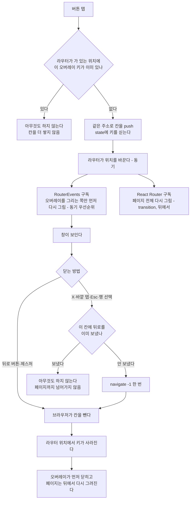
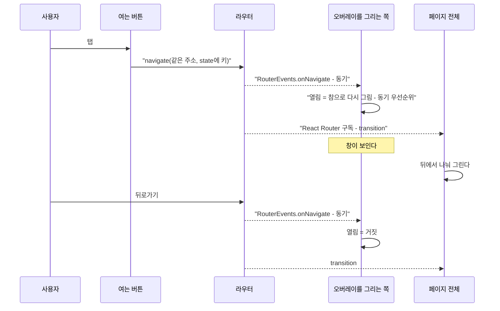

# 뒤로가기 (Back Navigation)

> **문서 성격**: 독립 기능 문서(서사형)
>
> **대상 독자**: 이 레포 FE를 처음 보거나 오랜만에 돌아온 개발자. 특히 화면을 덮는 창·시트·메뉴를
> 새로 만들거나 고치려는 사람.
>
> **읽고 나면**: 화면 요소마다 뒤로가기에 무엇이 일어나야 하는지 표에서 찾고, 새 오버레이를 같은 방식으로
> 더하고, 어긋났을 때 어느 검사가 잡는지 알 수 있다.
>
> **마지막 검토**: 2026-11-10

뒤로가기(브라우저 뒤로 버튼, Android 뒤로 버튼·제스처, iOS 가장자리 스와이프)를 눌렀을 때 화면 요소마다
무엇이 일어나야 하는지의 정본입니다. 요소별 표는 [5장](#화면-요소별-정본-표)에 있고, 다른 문서는 이 표를
가리킵니다.

비교한 안과 고른 이유는 [DECISIONS.md](./DECISIONS.md)의 2026-08-07(계층 구분)·2026-11-03·2026-11-10 항목에
있습니다. 이 문서는 "지금 어떻게 동작하는가"를 다룹니다.

## 1. 쉬운 설명

브라우저는 지나온 화면을 **칸**(히스토리 엔트리)으로 쌓아 둔다. 뒤로가기는 맨 위 칸을 하나 빼고 그 아래
칸의 화면을 보여 준다. 브라우저는 "지금 창이 열려 있다"는 것을 모른다 — 창을 연 채 뒤로가기를 누르면
칸이 빠지면서 페이지가 통째로 바뀐다.

그래서 화면을 덮는 창을 열 때 **같은 주소로 칸을 하나 더 얹는다**. 그 칸에는 "이 창이 열려 있다"는
쪽지(`state`)만 적는다. 뒤로가기를 누르면 그 칸이 빠지는데, 아래 칸도 같은 주소라 페이지는 그대로이고
창만 닫힌다. X 버튼·바깥 탭·Esc로 닫을 때도 앱이 뒤로가기를 한 번 보낸다. 닫는 길이 하나라 칸이 남지 않는다.

## 2. 전제 지식

React Router의 데이터 라우터(`createBrowserRouter`)와 `location.state`, React의 `useSyncExternalStore`·
transition이 무엇인지는 안다고 가정한다.

가정하지 않는 것:

- **왜 요소를 세 계층으로 나눴나**(순간적인 것·화면을 덮는 것·주소가 있는 것) → [DECISIONS.md](./DECISIONS.md)
  2026-08-07 "뒤로가기 정책".
- **왜 `CloseWatcher`를 넣었다가 뺐나** → [DECISIONS.md](./DECISIONS.md) 2026-11-03·2026-11-10, 이 문서 10장.
- **작성 중 이탈 확인**(쓰던 글이 있으면 떠나기 전에 묻는 것) → [UNSAVED-CHANGES-GUARD.md](./UNSAVED-CHANGES-GUARD.md).
- **상세 화면에서 목록으로 돌아갈 때**의 버튼 라벨·스크롤 위치 → [POST-DETAIL-BACK-NAVIGATION.md](./POST-DETAIL-BACK-NAVIGATION.md),
  [FE-ARCHITECTURE.md](./FE-ARCHITECTURE.md) §25.
- **북마크 폴더 창 자체**(무엇을 보여 주고 어떻게 저장하나) → [BOOKMARK.md](./BOOKMARK.md) §5.

## 3. 사용한 도구·기술

기능 자체:

- `react-router-dom` 6.30.3 데이터 라우터 — `navigate(주소, { state, preventScrollReset })`, `navigate(-1)`,
  `v7_startTransition`(`src/app/providers/RouterProvider.tsx:27`)
- `RouterEvents`(`src/shared/lib/router/router-events.ts`) — 라우터의 `subscribe`를 감싼 이 레포의 구독 창구
- React 18.3.1 `useSyncExternalStore` — 라우터가 가 있는 위치를 렌더에서 읽는다
- Radix Dialog — 창·시트의 모양과 Esc·바깥 탭 닫기. 뒤로가기 처리에는 관여하지 않는다

구현·검증 과정에서 쓴 도구:

- Vitest + `renderWithDataRouter`(`src/test/utils.tsx:143`) — 실제 `createMemoryRouter`로 도는 단위 테스트
- Playwright `page.goBack()`·`page.goForward()` — 실제 히스토리 이동으로 보는 e2e
- ESLint `no-restricted-syntax` — 표준을 우회하는 코드를 막는다
- `scripts/back-overlay-measure/measure.mjs` — 여닫는 시간과 다시 그린 컴포넌트 수 측정

## 4. 왜 만들었나

2026-11-10, Android 폰 Chrome에서 북마크 저장 시트·글 등록 폼의 폴더 선택 시트를 연 채 하단 뒤로 버튼을
누르면 시트가 닫히지 않고 이전 페이지로 갔다. 같은 폰에서 왼쪽 메뉴는 뒤로 버튼에 메뉴만 닫혔다.

원인을 따라가 보니 뒤로가기를 받는 방식이 셋이었다.

| 방식             | 원리                                                                | 쓰던 곳                                                    | 실제 뒤로가기로 검사하나 |
| ---------------- | ------------------------------------------------------------------- | ---------------------------------------------------------- | ------------------------ |
| ① 히스토리 칸    | 열 때 같은 주소에 칸을 넣고, 뒤로가기가 그 칸을 뺀다                | 메뉴·로그인 창·이미지 확대·모바일 검색, 시트(데스크톱·iOS) | 한다(`page.goBack()`)    |
| ② 이동 차단      | `useBlocker`가 이동을 막고 확인창을 띄우거나 열린 확인창을 취소한다 | 확인창, 작성 중 이탈 확인                                  | 한다                     |
| ③ `CloseWatcher` | 히스토리를 안 쓰고 브라우저가 넘겨 주는 "닫기 요청"을 받는다        | 시트(Android), 새 폴더·이름 바꾸기 입력(Android)           | 못 한다(Esc로 흉내)      |

고장 난 곳은 모두 ③이었다. 같은 시트가 기기에 따라 ①과 ③으로 갈렸고, ③은 자동 검사가 실제 뒤로 버튼을
누르지 못해 깨져도 알 수 없었다. 그 폰에서 ③이 왜 뒤로 버튼을 못 받는지는 찾지 못했다(2026-11-03에는 실기기에서
동작했다). 그래서 원인을 고치는 대신 **검사할 수 없는 경로를 없애고**, 화면을 덮는 요소는 모든 기기에서 ① 하나로
맞추기로 했다. 요소마다 무엇이 맞는 동작인지 한 곳에 적은 문서도 없어 이 문서를 만들었다.

## 5. 구조

### 화면 요소를 나누는 기준

| 상황                                                | 뒤로가기에 일어나야 하는 일          | 이 레포의 수단                 |
| --------------------------------------------------- | ------------------------------------ | ------------------------------ |
| 주소를 공유할 내용(상세 화면, 폴더 화면, 검색 결과) | 이전 화면으로 간다                   | 실제 URL                       |
| 화면을 덮는 UI 상태(시트·창·메뉴)                   | 그 요소만 닫히고 페이지는 그대로다   | ① 히스토리 칸                  |
| 답을 받고 사라지는 확인창                           | 확인창만 취소되고 페이지는 그대로다  | ② 이동 차단                    |
| 닫으면 쓰던 입력이 사라지는 화면                    | 떠나기 전에 한 번 묻는다             | ② 이동 차단                    |
| 순간적인 것(드롭다운·팝오버·툴팁·토스트)            | 따로 받지 않는다(페이지가 뒤로 간다) | 히스토리에 넣지 않는다         |
| 오버레이 위의 오버레이                              | 만들지 않는다                        | 겹쳐 쌓지 않는 것이 ①의 전제다 |

근거(NN/g·Baymard·WHATWG·WICG 인용과 제품 사례)는 [DECISIONS.md](./DECISIONS.md) 2026-08-07·2026-11-03 항목에
있다. 여기 다시 옮기지 않는다.

### 화면 요소별 정본 표

"계층" 열은 2026-08-07 정책의 이름이다(T0 순간적인 것, T1 화면을 덮는 상태, T2 주소가 있는 내용 — 12장).
"검사" 열은 **실제 뒤로가기**(`page.goBack()`)로 보는 e2e만 적었다. 없으면 없다고 적고, 그 행의 동작을 무엇으로
확인했는지(코드를 읽음, 사용자가 기기에서 확인)를 함께 적었다.

| 화면 요소                                | 계층                | 뒤로가기를 누르면                                                                                 | 수단                                                                                               | 검사                                                                                                                          |
| ---------------------------------------- | ------------------- | ------------------------------------------------------------------------------------------------- | -------------------------------------------------------------------------------------------------- | ----------------------------------------------------------------------------------------------------------------------------- |
| 주소가 있는 화면(상세·폴더·검색 결과 등) | T2                  | 이전 화면으로 간다                                                                                | 실제 URL                                                                                           | `e2e/post-list-scroll-restore.spec.ts`, `e2e/bookmark.mobile.spec.ts` 등                                                      |
| 카드의 북마크 폴더 창                    | T1                  | 창만 닫힌다                                                                                       | ① `useBackClosableOverlay('bookmarkFolderDialogOpen')`                                             | 행렬(`e2e/back-closable-overlay.cases.ts`), `e2e/bookmark-folder-dialog.spec.ts`·`.mobile.spec.ts`                            |
| 글 등록 폼의 폴더 선택 창                | T1                  | 창만 닫히고 폼 입력·선택은 그대로다                                                               | ① `useBackClosableOverlay('postCreateBookmarkFolderOpen')`                                         | 행렬, `e2e/post-create-folder-picker.spec.ts`                                                                                 |
| 폰의 왼쪽 메뉴                           | T1                  | 메뉴만 닫힌다                                                                                     | ① `useHistoryOverlay('sidebarOpen')` — 2단계에서 위와 같은 훅으로 옮긴다                           | `e2e/sidebar-drawer-back.mobile.spec.ts`. 사용자가 Android 폰에서 확인(2026-11-10)                                            |
| 로그인 창                                | T1                  | 창만 닫힌다                                                                                       | ① `useHistoryOverlay('loginDialogOpen')`과 직접 push(`auth.util.ts`, `ProtectedRoute.tsx`) — 2단계 | 연 채 뒤로가기 e2e 없음 — 코드와 단위 `useHistoryOverlay.test.tsx`로 확인(로그인 뒤의 뒤로가기는 `e2e/protected-nav.spec.ts`) |
| 이미지 확대 창                           | T1                  | 창만 닫힌다                                                                                       | ① `useHistoryOverlay('imageViewerOpen')`과 직접 push(`MarkdownContent.tsx`) — 2단계                | 없음 — 코드로 확인(`ImageViewer.tsx:31`)                                                                                      |
| 폰의 검색창                              | T1                  | 검색창만 닫힌다                                                                                   | ① `useMobileSearchPanel`(같은 원리의 별도 구현, 연타·중복 닫기 가드 없음) — 2단계                  | 없음 — 코드로 확인(`useMobileSearchPanel.ts:20-37`)                                                                           |
| 확인창(`openConfirm`·`openAlert`)        | T0                  | 확인창만 취소되고 페이지는 그대로다                                                               | ② `useUnsavedChangesGuard.ts:33`이 이동을 막고 `:86-93`이 확인창을 취소한다                        | 없음 — 코드로 확인. 사용자가 본 동작과 같다(2026-11-10)                                                                       |
| 쓰던 글이 있는 폼(글·댓글·회원가입)      | T2 화면의 이탈 확인 | "작성 중인 내용이 있어요" 확인창이 뜬다                                                           | ② [UNSAVED-CHANGES-GUARD.md](./UNSAVED-CHANGES-GUARD.md)                                           | `e2e/unsaved-changes.spec.ts`, `e2e/signup-unsaved-changes.spec.ts`                                                           |
| 드롭다운·팝오버·툴팁·토스트              | T0                  | 따로 받지 않는다. 페이지가 뒤로 간다                                                              | 히스토리에 넣지 않는다                                                                             | 해당 없음                                                                                                                     |
| 새 폴더·폴더 이름 바꾸기 입력            | T0                  | 따로 받지 않는다. 창 안이면 창이 닫히고, 북마크 페이지면 페이지가 뒤로 간다. 쓰던 이름은 사라진다 | 히스토리에 넣지 않는다. Esc·취소 버튼으로 접는다                                                   | `e2e/bookmark-folder-dialog.mobile.spec.ts`                                                                                   |
| 폰의 댓글 입력 시트 — **기준과 다름**    | T1이어야 한다       | 시트가 접히지 않고 페이지가 뒤로 간다. 쓰던 글이 있으면 이탈 확인이 먼저 묻는다                   | 펼침이 컴포넌트 `useState`다(`MobileCommentBar.tsx:26`)                                            | 없음 — 코드로 확인. 이슈 #590(11장)                                                                                           |

### 히스토리 칸 방식이 동작하는 원리

아래 그림은 1장의 순서도와 달리 **누가 누구에게 언제 알리는가**를 본다.

- **열기** — `useOpenOverlay`(`src/shared/hooks/useBackClosableOverlay.ts:24`)가 지금 주소(`pathname + search`)로
  `state: { [키]: true }`를 실어 push한다. `preventScrollReset`이 없으면 전역 `<ScrollRestoration />`이 새 페이지로
  보고 배경을 맨 위로 올린다.
- **열림 읽기** — `useBackClosableOverlay`(`:60`)가 `useSyncExternalStore`로 `RouterEvents.getLocation()`의 `state`에
  키가 있는지 읽는다. React가 커밋한 위치(`useLocation()`)가 아니라 **라우터가 이미 가 있는 위치**다.
  - 이 앱은 `v7_startTransition`을 켜서, 위치가 바뀌면 React Router가 페이지 전체를 transition으로 다시 그린다.
    `useLocation()`은 그 렌더가 끝나야 바뀐다. 열림을 거기서 읽으면 페이지를 다 그린 뒤에야 창이 뜬다.
  - 라우터는 push하는 자리에서 구독자를 동기로 부르고(`@remix-run/router` 1.23.2 `dist/router.cjs.js:2147, :2184, :2077`),
    외부 스토어 갱신은 React가 항상 동기 우선순위로 처리한다(`react-dom` 18.3.1 `cjs/react-dom.development.js:16154-16159`).
    그래서 오버레이를 그리는 쪽만 먼저 그려지고 페이지 전체는 뒤에서 그려진다.
  - 읽는 값이 키 하나의 참·거짓이라 그 오버레이를 여닫을 때만 바뀐다. 위치 전체를 읽으면 이동마다 바뀐다 —
    목록 "적용 중" 표시(`usePostList.ts`의 `usePostListApplying`)가 `useSyncExternalStore`를 쓰지 않는 이유다.
- **닫기** — `close`(`:65`)가 `navigate(-1)`을 한 번 보낸다. 뒤로 버튼은 브라우저가 같은 일을 한다.
- **가드 두 개**
  - 열기: 라우터가 가 있는 위치에 키가 이미 있으면 push하지 않는다(`:32`). 커밋된 위치로 보면 페이지를 다 그리기
    전의 두 번째 탭이 지나가 칸이 둘 쌓이고, 닫기를 두 번 눌러야 닫힌다.
  - 닫기: 뒤로를 보낸 위치 객체를 모듈 변수에 기억하고(`:10`), 같은 위치에서 다시 불리면 보내지 않는다(`:69`).
    `navigate(-1)`은 늦게 반영돼, 그 사이 닫기가 한 번 더 불리면 뒤로가 두 번 나가 페이지까지 넘어간다.
- **여는 쪽과 그리는 쪽이 다를 때** — 피드는 카드마다 북마크 버튼이 있고 창은 `RootLayout`의 호스트 하나가 그린다.
  버튼은 `useBackClosableOverlayOpen`(`:89`)으로 열기만 하고 열림을 구독하지 않는다. 버튼마다 구독하면 열 때 모든
  버튼이 창과 같은 동기 렌더에 끼어 창이 늦게 뜬다.
- **새로고침** — 칸의 `state`는 브라우저가 기억해 새로고침 뒤에도 "열려 있다". 창이 보여 줄 대상을 메모리에만 둔
  요소는 대상이 없으면 스스로 닫는다(`useGlobalPostBookmarkFolderDialog.ts:19-26`).

### 표준을 벗어나지 못하게 막는 것

| 겹          | 무엇을 막나                                                                                           | 언제 잡히나                                 | 위치                                           |
| ----------- | ----------------------------------------------------------------------------------------------------- | ------------------------------------------- | ---------------------------------------------- |
| 등록부 타입 | 훅의 인자가 `BackClosableOverlayKey`라 등록하지 않은 키는 컴파일되지 않는다                           | `pnpm type-check`                           | `src/shared/config/back-closable-overlay.ts:7` |
| e2e 행렬    | 키를 더하고 사례를 안 적으면 컴파일되지 않는다. 사례를 적으면 데스크톱·폰 두 화면에서 검사 4개가 돈다 | `pnpm type-check`(`tsconfig.e2e.json`), e2e | `e2e/back-closable-overlay.cases.ts:38`, `:94` |
| 금지 린트   | 운영 코드에서 `CloseWatcher`, `history.pushState`·`replaceState`, `popstate` 리스너를 직접 쓰는 것    | `pnpm lint`(pre-commit, CI)                 | `eslint.config.js:95`                          |

행렬의 검사 4개는 이렇다 — ① 열면 칸이 하나 늘고 주소는 그대로다 ② 연 채 뒤로가기를 누르면 오버레이만 닫힌다
③ 화면에서 닫아도 칸이 빠진다(이어서 뒤로가기를 눌러도 한 번에 이전 화면으로 간다) ④ 닫은 뒤 앞으로 가기로 다시
열린 오버레이도 화면에서 닫힌다.

### 새 오버레이를 더하는 절차

1. `src/shared/config/back-closable-overlay.ts`의 유니온에 키를 더한다. 이름은 `<무엇>Open`.
2. 오버레이를 그리는 컴포넌트의 훅에서 `useBackClosableOverlay(키)`의 `isOpen`·`open`·`close`를 쓴다. 열림을
   `useState`나 스토어에 따로 두지 않는다 — 칸과 어긋난다.
3. 여는 버튼이 여럿이고 그리는 쪽이 따로면, 버튼은 `useBackClosableOverlayOpen(키)`만 쓴다.
4. 그리는 쪽이 `lazy` 컴포넌트면 자체 `<Suspense fallback={null}>` 안에 둔다(`RootLayout.tsx:55-60`). react.dev는
   외부 스토어 값으로 렌더를 suspend하는 것을 권하지 않는다 — 스토어 변경은 transition으로 표시할 수 없어
   _"가장 가까운 Suspense fallback을 띄워, 이미 그려진 내용을 로딩 스피너로 바꾼다"_ (번역,
   [useSyncExternalStore](https://react.dev/reference/react/useSyncExternalStore#caveats)). 감싸지 않으면 그 fallback이
   페이지 전체가 된다.
5. 오버레이 안의 링크로 다른 화면으로 떠나게 한다면 그 칸을 `replace`로 교체한다(`Sidebar.tsx:20`의 `useDrawerLink`).
   칸을 남기면 뒤로 돌아왔을 때 오버레이가 다시 열린다.
6. `e2e/back-closable-overlay.cases.ts`에 사례(어느 화면에서 무엇을 눌러 여는가, 무엇이 보이는가, 화면에서 어떻게
   닫는가)를 적는다. 적기 전에는 `pnpm type-check`가 실패한다.
7. 이 문서의 정본 표에 행을 더한다.

다른 오버레이 위에서 여는 요소는 만들지 않는다. 꼭 이어서 열어야 하면 먼저 연 것을 닫고 연다.

## 6. 상태 모델

| 상태                  | 어디에 있나                             | 모양                                                              | 정본                                                                   |
| --------------------- | --------------------------------------- | ----------------------------------------------------------------- | ---------------------------------------------------------------------- |
| 열림                  | 브라우저 히스토리 칸의 `state`          | `{ [키]: true }`. 브라우저에서는 `history.state.usr[키]`로 보인다 | `src/shared/hooks/useBackClosableOverlay.ts`                           |
| 키 목록               | 타입                                    | `BackClosableOverlayKey` 문자열 유니온                            | `src/shared/config/back-closable-overlay.ts`                           |
| 라우터가 가 있는 위치 | `RouterEvents`의 모듈 변수              | React Router의 `Location`. 주입 전이면 `null`                     | `src/shared/lib/router/router-events.ts`                               |
| 뒤로를 보낸 위치      | 훅 파일의 모듈 변수 `backSentLocation`  | `Location` 객체 또는 `null`. 라우터가 앱에 하나라 변수도 하나다   | `src/shared/hooks/useBackClosableOverlay.ts`                           |
| 창이 보여 줄 대상     | 요소마다 따로(카드 창은 zustand 스토어) | `state`에 못 싣는 값은 스토어에 둔다                              | `src/features/bookmark/toggle/hooks/postBookmarkFolderDialog.store.ts` |

React Router는 칸마다 `history.state`에 `{ usr, key, idx }`를 적는다. `usr`가 우리가 넘긴 `state`이고 `idx`는
칸의 순번이다. e2e 행렬은 이 `idx`로 칸이 늘고 줄었는지를 본다(`e2e/back-closable-overlay.cases.ts:75`).

## 7. 운영 파라미터

| 값      | 뜻                                                                                         | 위치                            |
| ------- | ------------------------------------------------------------------------------------------ | ------------------------------- |
| `400`ms | 창이 열린 직후 바깥 탭·닫기 버튼을 무시하는 시간(연타 방지). 뒤로가기는 이 가드와 무관하다 | `src/shared/config/const.ts:38` |

뒤로가기 처리 자체에는 시간·횟수로 조정하는 값이 없다.

## 8. 코드 지도와 자주 하는 수정

| 단계                         | 위치                                                                         |
| ---------------------------- | ---------------------------------------------------------------------------- |
| 키 등록부                    | `src/shared/config/back-closable-overlay.ts:7`                               |
| 열기(칸 넣기, 연타 가드)     | `src/shared/hooks/useBackClosableOverlay.ts:24`                              |
| 열림 읽기                    | `src/shared/hooks/useBackClosableOverlay.ts:60`                              |
| 닫기(뒤로 한 번, 중복 가드)  | `src/shared/hooks/useBackClosableOverlay.ts:65`                              |
| 열기 전용 훅                 | `src/shared/hooks/useBackClosableOverlay.ts:89`                              |
| 라우터 위치 구독             | `src/shared/lib/router/router-events.ts:46`(주입), `:67`(읽기), `:75`(구독)  |
| 라우터 주입·transition 설정  | `src/app/providers/RouterProvider.tsx:16`, `:27`                             |
| 카드 창을 그리는 쪽          | `src/features/bookmark/toggle/hooks/useGlobalPostBookmarkFolderDialog.ts:14` |
| 카드 창을 여는 버튼          | `src/features/bookmark/toggle/hooks/useBookmarkPostButton.ts:31`             |
| 글 등록 폼의 창              | `src/features/post/create/hooks/usePostCreateBookmarkFolderField.ts:39`      |
| e2e 행렬(사례 표, 공통 검사) | `e2e/back-closable-overlay.cases.ts:38`, `:94`                               |
| 금지 린트                    | `eslint.config.js:95`                                                        |
| 단위 테스트용 데이터 라우터  | `src/test/utils.tsx:143`                                                     |
| 측정                         | `scripts/back-overlay-measure/measure.mjs`                                   |

### 자주 하는 수정

| 하려는 것                                     | 방법                                                                                                                                                        |
| --------------------------------------------- | ----------------------------------------------------------------------------------------------------------------------------------------------------------- |
| 새 오버레이를 뒤로가기로 닫히게               | 5장 "새 오버레이를 더하는 절차"                                                                                                                             |
| 단위 테스트에서 오버레이를 연다               | `renderWithDataRouter`로 그린다. `renderWithProviders`의 `MemoryRouter`는 `RouterEvents`에 주입되지 않아 열림이 늘 거짓이다                                 |
| 금지 린트에 걸렸다                            | 오버레이면 위 훅을, 뒤로·앞으로 가기를 알아야 하면 `RouterEvents.onPop`을 쓴다. 테스트 파일은 대상이 아니다(jsdom 주소를 `replaceState`로 맞추는 준비 코드) |
| 열림을 커밋된 위치에서 읽는 방식으로 되돌린다 | `useBackClosableOverlay.ts:60`의 읽기를 `useLocation()`으로 바꾼다. 등록부·행렬·린트는 그대로다. 창은 페이지를 다 그린 뒤에 뜬다(9장 측정의 기준 열)        |
| 여닫는 속도를 다시 잰다                       | `scripts/back-overlay-measure/measure.mjs` 머리 주석의 명령. 기준으로 삼을 커밋의 체크아웃이 하나 더 필요하다                                               |

## 9. 검증 결과

2026-11-10, 1단계(북마크 폴더 창 두 곳) 범위다.

### 자동 검사

| 검사                                                            | 결과                                                                                                                                                                        |
| --------------------------------------------------------------- | --------------------------------------------------------------------------------------------------------------------------------------------------------------------------- |
| 단위 `router-events.test.ts`(신규)                              | 8건. 실제 `createMemoryRouter`로 push·replace·pop이 구독자에게 닿고, 그때 읽은 위치가 `state`까지 새 위치인지 본다                                                          |
| 단위 `useBackClosableOverlay.test.tsx`(다시 씀)                 | 9건. 연타해도 한 칸, 두 번 닫아도 뒤로 한 번, 뒤로가기로 닫힘, 앞으로 가기 뒤에도 닫힘, 페이지를 다시 그리는 일이 끝나지 않아도 먼저 열림                                   |
| 단위 전체(`pnpm test`)                                          | 195개 파일 2,638건 통과                                                                                                                                                     |
| e2e 행렬(`e2e/back-closable-overlay.spec.ts`·`.mobile.spec.ts`) | 키 2개 × 검사 4개 × 프로젝트 2개(데스크톱 `chromium`, Pixel 5 `mobile-chrome`) = 16건 통과                                                                                  |
| e2e "새 목록을 기다리는 동안 창을 열어도 보이던 카드가 남는다"  | 그 사례가 든 `e2e/bookmark-folder-dialog.spec.ts`(5건)를 `--repeat-each=5`로 25건 통과                                                                                      |
| e2e 전체(`pnpm test:e2e`)                                       | 308건 통과. 첫 실행에서는 이 변경이 건드리지 않은 화면의 4건(가입 3건, 폰 검색창 스크롤 1건)이 실패했다. 그 파일 셋만 다시 돌리면 19건, 전체를 다시 돌리면 308건이 통과했다 |
| 등록부 타입이 막는가                                            | 등록부에 키만 더하고 `pnpm type-check`를 돌리면 `e2e/back-closable-overlay.cases.ts`에서 실패한다. 확인하고 되돌렸다                                                        |
| 금지 린트가 막는가                                              | `CloseWatcher`, `history.pushState`, `popstate` 리스너를 쓴 파일을 디스크에 만들어 lint-staged와 같은 명령으로 돌리면 세 규칙이 각각 잡는다. 확인하고 지웠다                |

### 브라우저 녹화

녹화 전용 Playwright 스펙(`/api` 전부 모킹, 폴더 14개)으로 여섯 장면을 찍어 사용자가 확인했다(2026-11-10). 폰 장면은
Pixel 5의 화면 크기와 터치를 흉내 낸 데스크톱 Chromium이고, 뒤로가기는 `page.goBack()`이다.

| 장면                                         | 본 것                                                                               |
| -------------------------------------------- | ----------------------------------------------------------------------------------- |
| 폰, 글 상세에서 북마크 시트                  | 뒤로가기에 시트만 닫히고, 한 번 더 누르면 피드로 간다                               |
| 폰, 글 등록 폼에서 폴더 시트                 | 폴더를 고른 뒤 뒤로가기에 시트만 닫힌다. 쓴 URL과 고른 폴더가 남고 이탈 확인은 없다 |
| 폰, 시트 안에서 새 폴더 이름을 쓰는 중       | 뒤로가기에 시트가 닫히고 피드는 그대로다                                            |
| 폰, 북마크 페이지에서 새 폴더 이름을 쓰는 중 | 뒤로가기에 이전 페이지(피드)로 간다                                                 |
| 데스크톱, 피드에서 폴더 창                   | 뒤로가기에 창만 닫힌다. X로 닫은 뒤 뒤로가기는 한 번에 이전 페이지로 간다           |
| 데스크톱, 글 등록 폼에서 폴더 창             | 폰의 글 등록 폼 장면과 같다                                                         |

### 여닫는 속도(직접 측정)

열림을 라우터가 가 있는 위치에서 읽는 지금 방식과, 커밋된 위치(`useLocation()`)에서 읽던 이전 히스토리 경로를
같은 날 같은 기계에서 쟀다. 스크립트는 `scripts/back-overlay-measure/measure.mjs`, 원자료는
`scripts/back-overlay-measure/results/2026-11-10.json`·`2026-11-10-run2.json`이다.

- **빌드**: 기준은 `origin/main`(`4a229088`), 대상은 같은 커밋에 이 변경을 얹은 것. 둘 다 로컬 운영 빌드를 preview로
  띄우고 `/api`는 전부 모킹했다.
- **화면**: 1280x800, 카드 12장·폴더 25개. Chromium 156.0.8078.4, Apple M4 Pro, Node 24.22.1.
- **지표**: 입력 이벤트 시각부터 창 상태가 바뀐 첫 프레임까지. 컴포넌트 수는 React 커밋 훅으로 셌다.
- **횟수**: 예열 3회 뒤 10회가 한 블록이다. 두 빌드를 번갈아 3블록(블록마다 순서를 바꿈) 재면 조건마다 30회이고,
  같은 측정을 두 번 돌려 60회다. 아래는 60회의 중앙값이다.
- **입력**: 기준 빌드에서 마우스는 히스토리 경로(칸 60/60), 터치는 `CloseWatcher` 경로(칸 0/60)를 탄다. 터치 열은
  `tap()`이라 탭을 클릭으로 바꾸는 시간이 들어 있어 마우스 열과 직접 비교하지 않는다.

|                                        | 기준·마우스(히스토리, 커밋된 위치) | 지금·마우스 | 기준·터치(`CloseWatcher`) | 지금·터치 |
| -------------------------------------- | ---------------------------------- | ----------- | ------------------------- | --------- |
| 열기, 감속 없음                        | 33.4ms                             | 15.6ms      | 31.7ms                    | 32.0ms    |
| 열기, CPU 4배 감속                     | 80.0ms                             | 55.6ms      | 61.7ms                    | 63.8ms    |
| 닫기, 감속 없음                        | 15.3ms                             | 15.4ms      | 32.3ms                    | 32.2ms    |
| 닫기, CPU 4배 감속                     | 33.3ms                             | 17.1ms      | 30.6ms                    | 32.8ms    |
| 열자마자 닫기, 감속 없음               | 30.4ms                             | 9.6ms       | 13.8ms                    | 10.2ms    |
| 열자마자 닫기, CPU 4배 감속            | 39.8ms                             | 18.3ms      | 10.6ms                    | 21.2ms    |
| 창이 뜨기 전에 그린 컴포넌트(4배 감속) | 861                                | 204         | 200                       | 204       |
| 열기 한 번에 그린 컴포넌트 전체        | 1,019                              | 1,169       | 358                       | 1,169     |

- **마우스(데스크톱·iOS가 타던 길)**: 창이 뜨기 전에 그리는 컴포넌트가 861개에서 204개로 줄었다. 전체 수는 더
  많지만(1,169) 나머지는 창이 뜬 뒤 transition으로 돈다. 4배 감속에서 열기부터 커밋이 잦아들 때까지 가장 긴 프레임
  간격(55.6ms)은 열기 시간과 같았다 — 창이 뜬 뒤에 그보다 긴 프레임은 없었다.
- **터치(Android가 타던 길)**: 창이 뜨기 전에 그리는 수가 `CloseWatcher` 경로와 같고(200 대 204), 4배 감속 열기는
  2.1ms(3.4%) 길다. 4배 감속에서 열자마자 닫기는 10.6ms에서 21.2ms로 길어졌다.
- 두 번 모두 페이지 에러 0건, 모킹되지 않은 요청 0건, 닫은 뒤 칸 순번이 열기 전으로 돌아오지 않은 회차 0건이었다.

**판정.** 계획은 "4배 감속 마우스 열기가 기준보다 30% 이상 짧으면 지금 방식을 유지한다"로 정했다. 30%는 이
작업에서 정한 선이고 외부 기준이 아니다.

|              | 기준   | 지금   | 줄어든 비율 | 블록별(10회)        |
| ------------ | ------ | ------ | ----------- | ------------------- |
| 1회차(30회)  | 82.8ms | 56.0ms | 32.4%       | 18.5 · 34.2 · 38.5% |
| 2회차(30회)  | 77.1ms | 55.2ms | 28.4%       | 20.0 · 33.5 · 33.4% |
| 합쳐서(60회) | 80.0ms | 55.6ms | 30.6%       |                     |

선을 한 번 넘고 한 번 못 넘었다. 두 분포는 거의 겹치지 않아(기준 68.6~103.3ms, 지금 49.2~67.4ms, 튄 값 하나씩 제외)
지금 방식이 빠르다는 것은 같고, 흔들리는 것은 30%를 넘느냐뿐이다. 숫자를 사용자에게 보이고 지금 방식을 유지하기로
했다(2026-11-10). 커밋된 위치에서 읽으면 Android는 이전에 타던 `CloseWatcher` 경로보다 느려질 것으로 보았다(터치로는
재지 않았다).

**확인하지 못한 것**

- 실제 Android 폰에서의 동작과 속도. 뒤로 버튼이 히스토리 칸을 뺀다는 근거는 같은 폰에서 메뉴가 닫힌다는 사용자
  확인이다.
- 커밋된 위치에서 읽는 방식을 터치로 잰 값. 위 표의 "기준·마우스" 열에서 미루어 볼 뿐이다.
- 블록마다 줄어든 비율이 흔들린 원인. 두 번 모두 첫 블록에서 기준 빌드가 빨랐다.
- 2026-11-03 측정([DECISIONS.md](./DECISIONS.md))과의 비교. 그때는 페이지 쪽 컴포넌트만 셌고, 스크립트가 남지 않아
  입력을 어떻게 보냈는지 확인할 수 없다. 그 뒤 창을 카드 밖으로 옮긴 변경도 있어 숫자를 나란히 놓지 않는다.

## 10. 시행착오

- **열림을 세 번 옮겼다.** 2026-09-30 전에는 컴포넌트 `useState`라 뒤로가기에 페이지가 넘어갔다. 그날 히스토리
  칸으로 옮겼고(`useHistoryOverlay`), 2026-11-03에는 열 때마다 페이지 전체가 다시 그려져 느리다는 이유로 Android만
  `CloseWatcher`로 뺐다. 2026-11-10에 그 경로가 폰에서 동작하지 않는 것이 보고됐고 원인은 찾지 못했다. 히스토리
  칸을 유지하면서 느린 원인(열림을 커밋된 위치에서 읽는 것)만 없앤 것이 지금 방식이다.
- **"e2e는 Android 뒤로가기를 못 보낸다"는 `CloseWatcher` 경로에만 맞는 말이었다.** 히스토리 칸은 `page.goBack()`이
  뒤로 버튼과 같은 일(칸 빼기)을 한다. 검사할 수 없던 것은 수단을 잘못 골랐기 때문이었다.
- **11-03에 "비공개 `router.subscribe`에 기대야 한다"는 이유로 기각한 안이 지금 방식이다.** 다시 보니 그 구독은
  `RouterEvents`로 이미 여러 곳이 쓰고 있었다. 새 의존이 아니라 있던 의존을 한 곳 더 쓰는 것이었다.
- **닫기 가드를 칸의 `key`로 기억하면 앞으로 가기 뒤에 못 닫는다.** 닫은 뒤 앞으로 가기로 같은 칸에 돌아오면
  `key`는 같아서 "이미 뒤로를 보낸 칸"으로 읽힌다. 브라우저 히스토리는 pop마다 위치를 다시 읽고 그때마다 객체를
  새로 만들어(`@remix-run/router` 1.23.2 `dist/router.cjs.js:441, :510-512`) 객체로 기억하면 풀린다. e2e 행렬의 네
  번째 검사가 이 장면이다. 계획에 있던 테스트용 초기화 함수(`resetBackClosableOverlay`)와 `src/test/setup.ts`의 호출은
  그래서 두지 않았다 — 테스트마다 라우터를 새로 만들어, 앞 테스트가 남긴 위치 객체와 같은 객체가 나올 수 없다.
- **"열기 전용 훅을 쓰는 버튼은 위치가 바뀌어도 다시 그려지지 않는다"는 계획의 서술이 틀렸다.** `useNavigate()`가
  읽는 RouteContext는 위치가 바뀔 때마다 새 값이라(`react-router` 6.30.3 `dist/umd/react-router.development.js:670-674`),
  버튼도 페이지를 다시 그리는 transition에는 들어간다. 빠지는 것은 창을 먼저 그리는 동기 렌더뿐이다. 단위 테스트
  이름과 훅 주석을 그렇게 고쳤다.
- **금지 린트를 테스트 파일에는 걸지 못했다.** 테스트가 jsdom 주소를 맞추려고 `window.history.replaceState`를
  부른다(`auth.util.test.ts` 등). 운영 코드 전용 목록으로 나눴다.
- **창이 열리면 배경이 `aria-hidden`이 된다.** 창 뒤에 이전 카드가 남았는지 보는 e2e가 역할로는 카드를 찾지 못했다.
  숨은 요소까지 찾고(`includeHidden`) 화면에 보이는지는 `toBeVisible`로 따로 본다.
- **새 목록을 기다리는 동안에는 마우스로 카드를 누를 수 없다.** 조건을 바꾸고 0.5초가 지나면 '적용 중' 덮개가
  목록 위에 올라온다. 그 장면의 e2e는 그 시간에 기대지 않도록 키보드로 창을 연다.

## 11. 남은 것

- **2단계** — 메뉴·로그인 창·이미지 확대 창·폰의 검색창을 같은 훅으로 옮기고 `useHistoryOverlay`를 없앤다. 그때
  정본 표의 "검사 없음" 네 칸이 행렬로 채워진다.
- **폰의 댓글 입력 시트** — 뒤로가기로 접을지, 접을 때 쓰던 글을 어떻게 할지 정하지 않았다([#590](https://github.com/BAECHAN/link-sphere_FE_NEW/issues/590)).
- **확인창의 실제 뒤로가기 e2e가 없다.** 동작은 코드로 확인했다(`useUnsavedChangesGuard.ts:33, :86-93`).
- **실제 폰 확인** — 자동 검사는 `page.goBack()`까지다. Android 뒤로 버튼이 히스토리 칸을 빼는 것은 같은 폰에서 메뉴가
  닫힌다는 사용자 확인(2026-11-10)이 근거다.
- **창 안에서 새 폴더 이름을 쓰다 뒤로가기를 누르면 쓰던 이름이 사라진다.** 데스크톱·iOS가 원래 그랬고 Android도
  같아졌다. 바꾸지 않았다.
- **Android에서 `CloseWatcher`가 뒤로 버튼을 못 받은 원인** — 조사하지 않았다. 그 경로를 없앴다.
- **데스크톱 평소 화면에서도 페이지가 뒤로 갔다는 보고** — 직접 해 본 클릭 → 뒤로가기는 창만 닫혀 재현하지 못했다.
  경로가 하나가 된 뒤에도 재현되면 다른 버그로 보고 따로 조사한다.

## 12. 용어 사전

- **칸(히스토리 엔트리)** — 브라우저가 지나온 화면을 쌓아 두는 단위. 뒤로가기는 맨 위 칸을 뺀다.
- **오버레이** — 페이지 위를 덮는 창·시트·메뉴. 주소가 없다.
- **등록부** — 뒤로가기로 닫히는 오버레이의 키 목록(`BackClosableOverlayKey`).
- **행렬** — 등록부의 키마다 같은 검사 4개를 데스크톱·폰 두 화면에서 돌리는 e2e(`e2e/back-closable-overlay.cases.ts`).
- **커밋된 위치** — React가 화면에 반영을 끝낸 위치. `useLocation()`이 돌려준다.
- **라우터가 가 있는 위치** — 라우터가 이미 옮겨 간 위치. `v7_startTransition` 때문에 커밋된 위치보다 먼저 바뀐다.
  `RouterEvents.getLocation()`이 돌려준다.
- **transition** — React가 급하지 않다고 표시한 갱신. 나눠서 그리고, 더 급한 갱신이 오면 양보한다.
- **호스트** — 여는 버튼과 따로, 오버레이를 그리는 한 곳. 카드의 북마크 폴더 창은 `RootLayout`의
  `PostFolderDialogHost`가 그린다.
- **`CloseWatcher`** — Esc나 Android 뒤로 버튼 같은 "닫기 요청"을 받는 브라우저 API. 이 레포는 쓰지 않는다(린트가 막는다).
- **T0·T1·T2** — 2026-08-07 정책의 계층 이름. T0 순간적인 것, T1 화면을 덮는 상태, T2 주소가 있는 내용.

## 13. 관련 문서

- [DECISIONS.md](./DECISIONS.md) — 2026-08-07 "뒤로가기 정책", 2026-11-03 "북마크 폴더 창", 2026-11-10 항목
- [BOOKMARK.md](./BOOKMARK.md) §5 — 북마크 폴더 창
- [UNSAVED-CHANGES-GUARD.md](./UNSAVED-CHANGES-GUARD.md) — 작성 중 이탈 확인(② 이동 차단)
- [POST-DETAIL-BACK-NAVIGATION.md](./POST-DETAIL-BACK-NAVIGATION.md) — 상세 화면의 "뒤로" 버튼
- [FE-ARCHITECTURE.md](./FE-ARCHITECTURE.md) §25 — 스크롤 규칙(URL이 바뀌면 맨 위로)
- [TESTING.md](./TESTING.md) — e2e 파일 목록
- [plans/2026-11-10-back-navigation-standard.md](./plans/2026-11-10-back-navigation-standard.md) — 이 작업의 계획
