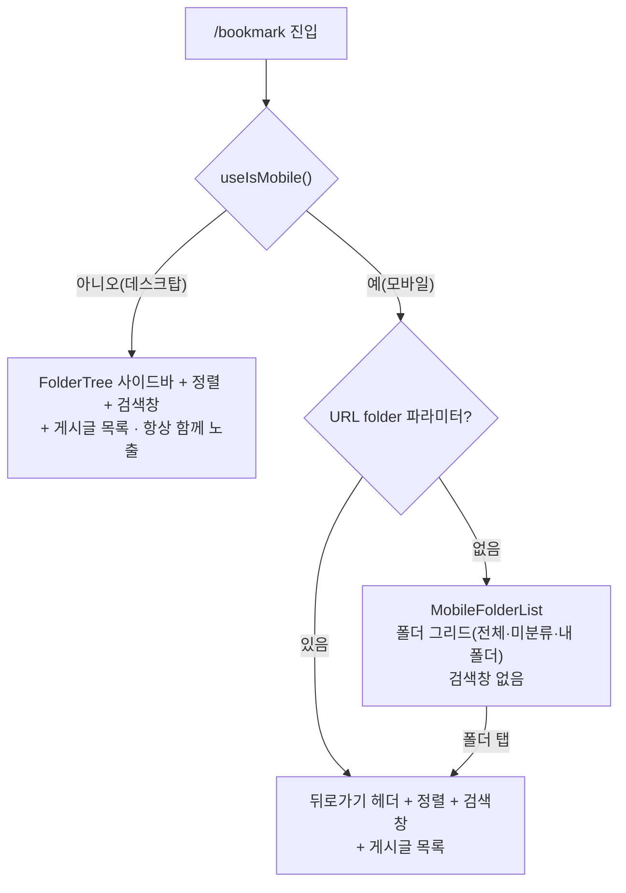

# 북마크 (폴더 관리 + 폴더 내 검색) 기능

> **문서 성격**: 독립 기능 문서(서사형)
>
> **대상 독자**: 이 레포 FE를 처음 보거나 오랜만에 돌아온 개발자.
>
> **읽고 나면**: 북마크 페이지의 반응형 분기·다중 폴더 소속 모델·"최근 저장한 폴더"
> 캐시 구조·폴더 고정 순서를 이해하고, 노출 개수나 정렬 옵션 같은 값을 어디서 바꾸는지 안다.
>
> **마지막 검토**: 2026-11-05

## 1. 쉬운 설명

북마크 폴더는 이메일의 **라벨**과 비슷하다. 메일 한 통에 라벨을 여러 개 붙일 수 있고
라벨이 하나도 없으면 "받은편지함"에만 있는 것처럼 보이듯, 북마크 하나도 **폴더 여러
개에 동시에** 속할 수 있고 어느 폴더에도 없으면 **미분류**로 취급된다(§5 "다중 폴더
소속 모델"). 단, 이 비유는 **마지막 라벨을 뗄 때는 어긋난다** — Gmail은 라벨을 다
떼도 메일이 "전체 편지함"에 남지만, 이 앱은 마지막 폴더에서 빠지면 미분류로 남기지
않고 북마크 자체를 완전히 지운다(§5, §10). 여기서 "마지막"은 화면 기준이다 — 다른
기기에서 붙인 폴더가 서버에 남아 있으면 그 폴더에서만 빠지고 북마크는 남는다
(2026-10-14, §5 행 동작 표). 이미 미분류(폴더가 하나도 안 붙은
상태)인 북마크를 다시 "제거"해도 마찬가지다 — 미분류는 "마지막 라벨을 뗀 상태"와
같은 상태이므로 같은 규칙을 그대로 적용한다(2026-09-11 재결정, §10).

화면은 **화면 폭에 따라 완전히 다르게 그려진다** — 데스크탑은 폴더 사이드바와 게시글
목록이 항상 함께 보이지만, 모바일은 "폴더 목록 화면"과 "그 폴더 안 화면"이 분리된
drill-down 구조다. "웹에는 있는데 모바일엔 없다"처럼 보이는 요소는 대부분 이 분기
차이다.



| 조건                                                | 화면                                                    | 검색창(`BookmarkSearch`) |
| --------------------------------------------------- | ------------------------------------------------------- | ------------------------ |
| 모바일 + `folder` 파라미터 없음(`isMobileListMode`) | `MobileFolderList` — 폴더 그리드(전체·미분류·내 폴더)   | ❌ 없음                  |
| 모바일 + `folder` 선택됨                            | 뒤로가기 헤더 + 정렬 + **검색창** + 게시글 목록         | ✅ 있음                  |
| 데스크탑                                            | `FolderTree` 사이드바 + 정렬 + **검색창** + 게시글 목록 | ✅ 있음                  |

**핵심**: 모바일은 drill-down 구조라 **폴더(전체 폴더 포함)에 진입해야 검색창이
보인다.** 데스크탑은 사이드바+게시글이 항상 함께 보이므로 검색창이 처음부터
노출된다. 즉 두 플랫폼 모두 검색을 지원하며, 노출 시점만 다르다(현재 UX 의도).

## 2. 전제 지식

React Router의 URL 검색 파라미터(`useSearchParams`)와 TanStack Query의 쿼리 키·캐시
무효화 기본 개념은 안다고 가정한다.

가정하지 않는 것:

- React Query 캐시 무효화 전반의 팀 컨벤션(`*.keys.ts`의 `handle*Success` 패턴) →
  [`FE-ARCHITECTURE.md`](./FE-ARCHITECTURE.md)의 "3-Layer API 패턴"
- 이 문서에서 처음 보는 용어(`sessionKey`, `activeFolderKey` 등) → §12 용어 사전
- 코드부터 보고 싶다면 → §8 코드 지도

## 3. 사용한 도구·기술

**기능 자체를 이루는 것**

- **React Router `useSearchParams`**(경유지: [`useSearchParamsDraft`](../src/shared/hooks/useSearchParamsDraft.ts)) —
  검색어(`q`)·선택 폴더(`folder`)·정렬(`sort`)을 URL에 저장해 새로고침·뒤로가기에도 상태가
  유지되게 한다. `useBookmarkPage.ts`(folder/sort, `pages/bookmark/hooks/`)와
  `useBookmarkSearch.ts`(q)는 서로 다른 훅이라 각자 `useSearchParamsDraft`를 호출하지만,
  이 훅이 URL 쓰기 전 pending 의도를 모듈 스코프로 공유해 한쪽이 다른 쪽의 아직 반영 안
  된 변경을 덮어쓰지 않는다(§10). `BookmarkPage.tsx`는 이 훅의 반환값을 받아 렌더링만
  한다(#227, URL 파라미터 처리 로직을 `pages/*/hooks/`로 옮긴 pages-first 원칙).
- **TanStack Query** — 폴더 목록·폴더별 게시글 무한 스크롤·낙관적 업데이트
- **Zod** — `bookmark-folder.schema.ts`의 폴더 생성/수정 요청 스키마·정렬 enum(응답 타입은
  `bookmark-folder.dto.ts`의 BE OpenAPI 생성 타입 alias, §6)
- **Radix Dialog 기반 `BookmarkFolderSelectDialog`** — 데스크탑 중앙 모달 / 모바일 Bottom Sheet
  (`SheetDialogContent`) 공용 프레젠테이션. (2026-09-08 정정: 이전엔 "Popover 기반"으로
  적혀 있었으나 실제 코드는 Popover를 쓴 적이 없다 — `Dialog` + `SheetDialogContent`뿐)

**구현·검증 과정에서 쓴 도구**

- **MSW** — `src/mocks/fixtures/bookmark-folder.fixtures.ts` + `bookmark-folder.handlers.ts`(폴더
  목록 + 소속 3개 엔드포인트 기본 핸들러)
- **Vitest** — §9 검증 결과 참고

## 4. 왜 만들었나

`v0.1.0`(2026-06-28) 이전에는 북마크가 단순 on/off 토글이었다. 저장한 링크가 늘어나면
분류할 방법이 없어 다시 찾기 어려웠다. YouTube Music의 "보관함에 저장" UX(탭 = 즉시
저장, 별도 확인 단계 없음)를 참고해 **폴더 분류 + 즉시 저장** 모델로 바꿨고, 이후
폴더가 많아지면서 폴더 안에서 다시 찾는 문제가 생겨 **폴더 내 검색**(2026-07-11)을
추가했다.

## 5. 구조

### API 엔드포인트

`src/entities/bookmark/folder/api/bookmark-folder.api.ts` 기준(`specClient`의 스펙 경로,
`docs/OPENAPI-CODEGEN.md` §5-2).

| 메서드   | 경로                                                  | 설명                                                                                                                                                                               |
| -------- | ----------------------------------------------------- | ---------------------------------------------------------------------------------------------------------------------------------------------------------------------------------- |
| `GET`    | `/bookmark/folders`                                   | 내 폴더 목록(`bookmarkCount`·`lastUsedAt`·`pinnedAt` 포함, `sortOrder` ASC)                                                                                                        |
| `POST`   | `/bookmark/folders`                                   | 폴더 생성(`sort_order = max+1`)                                                                                                                                                    |
| `PATCH`  | `/bookmark/folders/{id}`                              | 폴더 이름 수정                                                                                                                                                                     |
| `DELETE` | `/bookmark/folders/{id}`                              | 폴더 삭제(**이 폴더에만 있던** 북마크만 미분류로 — 다른 폴더에도 있으면 유지)                                                                                                      |
| `PUT`    | `/bookmark/folders/{id}/pin`                          | 폴더 고정(이미 고정이면 처음 고정한 시각 유지). 응답 `{ id, pinnedAt }`(`FolderPinResponse`, 2026-10-26)                                                                           |
| `DELETE` | `/bookmark/folders/{id}/pin`                          | 고정 해제(이미 해제면 그대로). 응답은 위와 같고 `pinnedAt`이 `null`                                                                                                                |
| `GET`    | `/bookmark/folders/{key}/posts?page&size&sort&search` | 폴더별 게시글 조회(검색 포함)                                                                                                                                                      |
| `POST`   | `/bookmark/{postId}/folders/{folderId}`               | 폴더에 추가(북마크 없으면 자동 생성)                                                                                                                                               |
| `DELETE` | `/bookmark/{postId}/folders/{folderId}`               | 그 폴더에서만 제거(북마크 자체는 유지). `?removeBookmarkIfEmpty=true`면 남은 소속이 없을 때만 북마크도 삭제 — 이 옵션 호출은 `interaction.api.ts`의 `unbookmarkPostFromLastFolder` |
| `DELETE` | `/bookmark/{postId}/folders`                          | 폴더 소속 전부 해제 → 미분류                                                                                                                                                       |
| `PUT`    | `/post/{postId}/bookmark`                             | 북마크 저장(없으면 미분류로 생성, **기존 폴더 소속은 유지**) — `interaction.api.ts`                                                                                                |
| `DELETE` | `/post/{postId}/bookmark`                             | 북마크 해제(소속도 전부 삭제) — `interaction.api.ts`                                                                                                                               |

- `folderKey`(경로의 `{key}`): `'all' | 'uncategorized' | UUID`
- `sort`: `'latest' | 'oldest' | 'title' | 'views' | 'viewed'` — `viewed`(최근 열람순)는
  개인별 열람 기록(BE `post_views` 테이블) 기준. 한 번도 안 연 글은 항상 맨 뒤. 기록은 상세 화면이 뜰 때만 남고
  카드 hover로는 바뀌지 않는다(`docs/POST.md` "조회 1회의 뜻")
- `search`: 값이 있을 때만 쿼리에 붙는다(`bookmark-folder.api.ts`의
  `if (search) searchParams.search = search`)
- 폴더 고정·해제(`PUT`/`DELETE …/pin`)는 "뒤집기"가 아니라 "그 상태로 만들기"라 멱등이다(BE #127,
  `docs/DECISIONS.md` 2026-10-13 좋아요·북마크 결정과 같은 형태). 고정해도 폴더의 `updatedAt`은 바뀌지 않는다
- 폴더 소속 관련 3개 엔드포인트(추가/제거/전체해제)와 북마크 저장·해제(`PUT`/`DELETE`)는 모두
  **멱등** — 이미 그 상태여도 200을 반환한다. 응답은 다섯 엔드포인트 공통으로
  `{ postId, isBookmarked, folderIds }`(`BookmarkFoldersResponse`)
- 저장·해제는 2026-10-13 토글(`POST /post/{postId}/bookmark`)에서 바뀌었다 — 토글은 서버가 "지금의 반대"를
  정해, 다른 기기에서 이미 해제한 북마크를 낡은 화면에서 "제거"하면 되살아났다(§10). 옛 POST 토글은 호출 로그가
  0건인 것을 확인하고 2026-10-14 BE에서 지웠다(BE #92)
- **같은 글의 북마크 요청 5종(저장·해제·폴더 추가·제거·비우기)은 한 줄로 나간다**(`bookmarkPostScope`,
  `bookmark-folder.keys.ts`) — 되돌리기 토스트(8초)가 다이얼로그보다 오래 남아 되돌리기와 다시 연
  다이얼로그의 요청이 겹칠 수 있어서다. 화면 반영은 클릭마다 즉시, 응답 반영·롤백은 그 줄의 마지막
  요청에서만 한다(`isLastPendingBookmarkMutation`, 패턴은 [`FE-ARCHITECTURE.md`](./FE-ARCHITECTURE.md) §11).
  줄에서 기다리는 사이 다른 탭 등에서 계정이 바뀌었으면 그 요청은 보내지 않고 실패로 끝낸다
  (`mutationFn` 첫 줄의 `assertMutationAuthEpochUnchanged`, [`AUTH.md`](./AUTH.md) §8-B "줄 서 있던 요청")

### 다중 폴더 소속 모델

북마크 하나가 **여러 폴더에 동시에 소속**될 수 있다(N:M). 핵심 개념 3가지:

- **미분류 = 소속 폴더가 0개인 상태.** "폴더가 없는 상태"가 아니라 "폴더 중 어디에도
  속하지 않은 상태"다. `post.userInteractions.bookmarkFolderIds: string[]`가 빈
  배열이면 미분류다.
- **`전체` 행에는 숫자를 표시하지 않는다.** 폴더별 개수 합산은 다중 소속에서 중복
  집계되어 부정확하고, 정확한 값을 내려주려면 서버 필드가 필요한데 숫자 자체를 안
  보여주는 쪽으로 결정했다. 다만 **목록 자체는 중복 없이** 한 북마크가 여러 폴더에
  있어도 `전체`에는 한 번만 나온다(BE가 EXISTS 세미조인으로 보장).
- **폴더에서 제거 ≠ 북마크 제거 — 단, 마지막 폴더는 예외.** 소속된 폴더가 2개 이상일
  때 그중 하나에서 빼면 다른 폴더 소속이나 북마크 자체는 그대로다. 하지만 그 폴더가
  유일한 소속(마지막 폴더)이었다면 미분류로 남기지 않고 북마크 자체를 완전 삭제한다
  (2026-09-11 변경, §10 참고) — 되돌리기 토스트로 8초 안에 원복할 수 있다. "마지막"은
  화면 기준이라, 서버에 다른 소속이 남아 있으면 그 폴더에서만 빠지고 북마크는 유지된다
  (2026-10-14, 아래 행 동작 표). 여러
  폴더에서 한꺼번에 빠지는 미분류 행("소속 전부 해제")은 이 규칙과 무관하게 여전히
  북마크를 미분류로 남긴다 — 사용자가 명시적으로 "전체 해제"를 고른 것이지 마지막
  하나를 무심코 뺀 게 아니기 때문이다. 반대로 **이미 미분류인 상태에서** 미분류
  행을 다시 탭하면(소속이 이미 0개) 이건 더 뺄 폴더가 없으므로 "마지막 폴더 탭"과
  동일하게 완전 삭제로 처리한다(2026-09-11 재결정, §10) — "전체 해제로 방금 도착한
  상태"와 "그 상태를 다시 탭한 것"은 다른 사용자 의도로 본다.

### `PostCardBookmarkFolderDialog` 행 동작

`BookmarkPostButton`을 누르면 열리는 모달(`features/bookmark/toggle/ui/PostCardBookmarkFolderDialog.tsx`,
실제 마크업은 `features/bookmark/select/ui/BookmarkFolderSelectDialog`, 제목 "북마크에 저장" —
2026-09-30 이전엔 "보관함"이었으나 북마크와 연결되지 않는다는 피드백으로 바꿨다)의 전체 동작이다. 탭 = 즉시
저장/제거 + 모달 닫힘(확인 단계 없음). 폴더 목록만 스크롤되고, 새 폴더 만들기(헤더
바로 아래)·북마크 제거(하단)는 폴더가 몇 개든 항상 화면에 보인다(2026-09-11 —
전에는 셋 다 같은 스크롤 영역에 있어 폴더가 많으면 두 행이 스크롤 밖으로
밀렸다).

| 행          | 상태                                           | 탭하면                                            | 토스트                                                                                                 |
| ----------- | ---------------------------------------------- | ------------------------------------------------- | ------------------------------------------------------------------------------------------------------ |
| 미분류      | 북마크 아님                                    | 북마크 저장(`PUT`, 미분류로 생성)                 | `{folderName}에 저장했어요.`(미분류)                                                                   |
| 미분류      | 북마크 O, 소속 0개(✓)                          | **북마크 자체를 완전 삭제**(2026-09-11 변경)      | `북마크를 제거했어요.` + 되돌리기 액션(8초)                                                            |
| 미분류      | 북마크 O, 소속 1개 이상                        | 소속 전부 해제                                    | `모든 폴더에서 제거했어요.`                                                                            |
| 폴더 X      | 비소속                                         | 그 폴더에 추가(자동 북마크)                       | `{folderName}에 저장했어요.`                                                                           |
| 폴더 X      | 소속(✓), 다른 폴더도 있음                      | 그 폴더에서만 제거                                | `{folderName} 폴더에서 제거했어요.`                                                                    |
| 폴더 X      | 소속(✓), **마지막 폴더**                       | **북마크 자체를 완전 삭제**(미분류로 남기지 않음) | `{folderName} 폴더에서 제거했어요.` + "마지막 폴더라서 북마크도 함께 제거했어요." + 되돌리기 액션(8초) |
| 폴더 X      | 화면상 마지막 폴더인데 서버엔 다른 소속이 남음 | 그 폴더에서만 제거(북마크 유지, 2026-10-14)       | `{folderName} 폴더에서 제거했어요.`                                                                    |
| 북마크 제거 | 소속 0~1개                                     | 북마크 완전 삭제(소속도 전부)                     | `북마크를 제거했어요.` + 되돌리기 액션(8초)                                                            |
| 북마크 제거 | 소속 2개 이상                                  | 북마크 완전 삭제(소속도 전부)                     | `북마크를 제거했어요.`(되돌리기 없음 — 일괄 복원 범위 밖)                                              |

되돌리기가 실패하면 "되돌리지 못했어요." 에러 토스트를 닫을 때까지 남긴다(2026-11-02,
[#488](https://github.com/BAECHAN/link-sphere_FE_NEW/issues/488)). 되돌리기 토스트는 누르는 순간 닫히고 화면은 누르기
전과 같아, 이 토스트를 놓치면 되돌리지 못한 걸 알 방법이 없다(`usePostCardBookmarkFolderDialog.ts`의 `undoOptions`).

체크된 미분류를 다시 탭하면 폴더 행의 "마지막 폴더 탭"과 똑같이 파괴적 조작이 된다
(2026-09-11 재결정, §10) — 처음엔 "미분류는 되돌릴 폴더가 없어 Undo가 불가능하다"는
이유로 no-op으로 막아뒀지만, 이는 틀린 전제였다: 하단 `북마크 제거` 행이 이미
같은 상태(소속 0개)에서 되돌리기를 제공하고 있었다(`restoreBookmark([])` →
북마크 저장(`PUT`)으로 재생성, 2026-10-13 전엔 토글). 새 메커니즘을 만들지 않고 그 경로를 그대로 위임했다
(`handleSelectUncategorized`가 이미 미분류면 `handleRemove()`를 호출).
`docs/DECISIONS.md`의 같은 날짜 항목("미분류 재탭 no-op 결정 번복") 참고. 소속된
모든 폴더에 **동일한 ✓ 아이콘**이 표시된다(다중 선택 UI가 아니라, 탭할 때마다 즉시
반영되는 방식).

저장·해제의 방향은 다이얼로그가 화면에 보이는 상태(props)로 정해 `setBookmark(true|false)`로 넘긴다
(`useBookmarkFolders.ts`). 화면상 마지막 폴더를 뺄 때만 `setBookmark({ lastFolderId })`로 넘겨
`?removeBookmarkIfEmpty=true` 폴더 제거를 보낸다(`interaction.queries.ts`의 `BookmarkPostTarget`). 2026-10-13 전엔 mutation이 캐시를 뒤져 방향을 다시 계산해, 둘이 어긋나면
"제거"를 눌렀는데 화면엔 저장으로 뜨는 경우가 있었다. 낡은 화면에서 "미분류" 저장을 눌렀는데 서버엔 이미
다른 폴더 소속이 있으면, 서버는 그 소속을 유지하고 화면은 응답의 `folderIds`로 맞춰진다. 이때 토스트는
"미분류에 저장했어요." 대신 "이미 다른 폴더에 저장돼 있어요."를 띄우고, "보기"는 미분류가 아니라 북마크
전체로 보낸다(2026-10-14, `usePostCardBookmarkFolderDialog.ts`의 `handleSelectUncategorized`). 폴더 이름을
넣지 않은 건 드문 경우라 폴더가 여럿일 때의 문구까지 둘 만큼은 아니라고 봐서다(사용자 선택).

### 뒤로가기로 닫히는 열림 상태, 폴더 목록은 hover 때 미리(2026-09-30, 기기별 경로 2026-11-03)

`BookmarkPostButton`의 열기와 목록 프리페치는 `features/bookmark/toggle/hooks/useBookmarkPostButton.ts`가,
창의 열림 상태와 뒤로가기는 RootLayout의 호스트(`useGlobalPostBookmarkFolderDialog.ts`)가 소유한다(버튼 컴포넌트는
JSX만, 호스트는 아래 "시트는 카드 밖 호스트가 그린다(2026-11-03)").

- **뒤로가기 = 모달만 닫기**: 전에는 열림 상태가 컴포넌트 `useState`라 히스토리에 없어서,
  모달을 연 채 뒤로가기를 누르면 모달이 아니라 페이지가 이전으로 넘어갔다(2026-09-30에 고침).
  지금은 `useBackClosableOverlay`(`shared/hooks/useBackClosableOverlay.ts`)가 기기마다 다른 방법으로
  같은 동작을 낸다. 근거·실측·비교한 안은 `docs/DECISIONS.md` 2026-11-03 항목에 있다.

  | 기기                                                        | 여는 방법                                                       | 뒤로가기                                         |
  | ----------------------------------------------------------- | --------------------------------------------------------------- | ------------------------------------------------ |
  | 데스크톱·iOS·구형 Android                                   | `useHistoryOverlay`로 같은 경로에 state 엔트리 push             | 엔트리가 pop되며 모달만 닫힘(2026-08-07 정책 T1) |
  | `CloseWatcher`가 있고 터치가 주 입력인 기기(사실상 Android) | 히스토리 없이 열림 — location이 안 바뀌어 페이지 전체를 안 그림 | `CloseWatcher`의 닫기 요청으로 모달만 닫힘       |

  데스크톱 브라우저 뒤로가기는 HTML 표준상 닫기 요청이 아니라서, 데스크톱은 엔트리가 있어야
  모달만 닫힌다. 그래서 히스토리를 빼는 건 뒤로가기가 닫기 요청으로 오는 기기에서만 한다.
  창은 화면에 하나라 키도 `bookmarkFolderDialogOpen` 하나다. 어느 글의 창인지는 버튼이 스토어에 넣은 대상이
  정한다(2026-11-03 전에는 카드마다 창이 있어 키를 `bookmarkFolderDialogOpen:${postId}`로 게시글마다 따로 뒀다).

- **히스토리 없는 경로의 열림 상태는 카드 밖에 둔다**: 피드 카드는 가상 목록 행 키(열 수·첫 카드 id)
  때문에 화면 회전·목록 밀림에서 다시 마운트된다. 열림 상태를 훅 파일의 작은 스토어에 둬서, 다시
  마운트돼도 모달이 유지된다(히스토리 경로가 엔트리로 유지하는 것과 같다). 다른 이유로 페이지가
  바뀌면 `RouterEvents.onNavigate` 구독으로 닫혀, 그 화면으로 돌아왔을 때 모달만 다시 뜨지 않는다.
  `CloseWatcher`는 호스트가 창이 열려 있는 동안 하나만 만들고 닫히면 정리한다 — 남으면 보이지 않는
  모달이 다음 뒤로가기를 삼킨다. 버튼은 `useBackClosableOverlayOpen`으로 열기만 해 watcher를 만들지 않고 열림도 구독하지 않는다.
- **Esc는 두 번 처리되지 않는다**: Chromium은 취소되지 않은 Esc도 닫기 요청으로 보낸다. Radix의 Esc
  닫기(`@radix-ui/react-dismissable-layer` 1.1.11 `dist/index.mjs:63-65`)와 새 폴더 입력 접기
  (`BookmarkFolderSelectDialog.tsx`의 `onEscapeKeyDown`)가 keydown을 `preventDefault()`해 닫기 요청은 따로 생기지 않는다 — 입력 중 Esc는
  지금처럼 입력만 접는다(`e2e/bookmark-folder-dialog.mobile.spec.ts`).
- **새 폴더·이름 입력 중 Android 뒤로가기는 입력만 접는다(2026-11-03)**: 창 안 새 폴더 입력이 열린 채 뒤로가기를 누르면 취소
  버튼처럼 입력만 접히고(입력한 이름은 버린다) 창은 남는다. 한 번 더 누르면 창이 닫힌다. `useNewFolderInput`이 `useBackCloseRequest`
  (`shared/hooks/useBackClosableOverlay.ts`)로 입력이 열려 있는 동안 `CloseWatcher`를 하나 더 둔다. 북마크 페이지의 인라인
  입력도 같은 규칙을 따른다(아래 "북마크 페이지의 인라인 입력").
  - **`CloseWatcher` 경로(사실상 Android)만 바꿨다(사용자 선택)**. 데스크톱·iOS는 지금처럼 뒤로가기에 창 전체가 닫힌다.
    2026-09-21에 정한 "입력이 열려 있으면 Esc는 입력만 접는다"(아래 "새 폴더 만들기 인라인 폼의 취소")를, HTML 표준이
    같은 닫기 요청으로 묶는 Android 뒤로가기로 넓힌 것이다.

    | 출처                                                                                      | 내용                                                                                                                             | 이 결정에서                                        |
    | ----------------------------------------------------------------------------------------- | -------------------------------------------------------------------------------------------------------------------------------- | -------------------------------------------------- |
    | [Android custom back](https://developer.android.com/guide/navigation/custom-back)         | _"여러 단계에 `BackHandler`가 켜져 있으면 가장 안쪽 것만 뒤로가기를 가로챈다"_ (번역). 기본 예제가 뒤로가기로 패널을 접는 코드다 | Android는 안쪽 상태부터 닫는 게 플랫폼 표준        |
    | [WICG close-watcher](https://github.com/WICG/close-watcher/blob/main/README.md)           | _"`CloseWatcher`가 여러 개 활성이면 가장 최근에 만든 것만 이벤트를 받는다"_ (번역)                                               | 웹 표준도 같은 모델                                |
    | [Apple HIG Sheets](https://developer.apple.com/design/human-interface-guidelines/sheets)  | 시트 안 뒤로 버튼은 _"여러 단계 흐름의 이전 단계로 가는 것이며, 시트를 닫기 위한 것이 아니다"_ (번역). 시트는 아래로 쓸어 닫는다 | iOS에는 뒤로가기로 시트 안 상태를 접는 관행이 없다 |
    | [Baymard(Christian Holst, 2020-07-20)](https://baymard.com/blog/back-button-expectations) | _"접힌 콘텐츠는 일반적으로 `history.pushState()`로 새 '페이지'처럼 구현해서는 안 된다"_ (번역)                                   | iOS·데스크톱에 히스토리 엔트리를 더 쌓지 않는다    |
    | [NN/g(2022-09-18)](https://www.nngroup.com/articles/accidental-overlay-dismissal/)        | _"오버레이 위에 오버레이를 쌓지 말라"_ (번역). 창 안에서 입력이 펼쳐지는 경우는 다루지 않는다                                    | 입력은 두 번째 오버레이가 아니라 이 금지와 무관    |

  - **입력용 watcher는 입력이 열려 있는 동안 한 번만 만든다**. [WHATWG close watcher](https://html.spec.whatwg.org/multipage/interaction.html#close-requests-and-close-watchers)는
    watcher를 그룹으로 묶고, 닫기 요청은 _"groups의 마지막 항목"_ (번역)만 처리한다. watcher를 만든 뒤 사용자 조작이 있어야
    다음 watcher가 새 그룹이 되고, 조작 없이 만들면 마지막 그룹에 합쳐져 한 번에 같이 닫힌다(악용 방지). 입력용 watcher는
    "새 폴더 만들기" 탭 뒤에 만들어져 창 watcher와 다른 그룹이 된다. 핸들러가 렌더마다 바뀌어도 다시 만들지 않고 최신
    핸들러를 ref로 읽는다(`useIntersectionObserver.ts`와 같은 방식). StrictMode(dev)는 effect를 지웠다 다시 만들지만 `destroy`가
    허용 그룹 수를 줄이지 않아 새 그룹을 그대로 받는다 — Chromium `close_watcher.cc`는 계획을 검증한 서브에이전트가 읽은 것이고,
    직접 확인한 근거는 dev 서버(StrictMode)에서 도는 아래 e2e가 통과한다는 것이다.
  - **생성 요청 중의 뒤로가기는 받지 않는다(사용자 선택)** — 취소 버튼이 요청 중 비활성인 것과 같다. 접어도 요청은 계속 가서
    성공하면 폴더가 만들어지고 선택된다(카드는 저장 후 창이 닫힘). 받지 않은 요청도 watcher를 끝내므로, 그 뒤 생성이 실패하면
    다음 뒤로가기는 창 전체를 닫는다.
  - **북마크 페이지의 인라인 입력도 같다(같은 날 사용자 요청)**. 폴더 목록의 새 폴더 카드(`useCreateFolderCard`)와 사이드바 새
    폴더 입력(`useInlineCreateFolderInput`)은 취소 버튼처럼 접고, 이름 바꾸기(`useRenameBookmarkFolder` — 사이드바 행·모바일
    카드·폴더 화면 제목이 같이 쓴다)는 Esc처럼 원래 이름으로 되돌린다(저장하지 않는다). 창과 달리 바깥에 watcher가 없어,
    고치기 전에는 뒤로가기가 히스토리를 거슬러 지금 화면을 떠났다(폴더 목록이면 이전 페이지, 폴더 화면이면 폴더 목록). 이제
    첫 뒤로가기는 입력만 접고, 다음 뒤로가기가 지금처럼 이전 화면으로 간다.
    - 입력이 열렸는지가 훅 안의 상태(`creating`·`renaming`)라 `useBackCloseRequest(handler, enabled)`의 `enabled`로 그 상태를
      넘겨, 열린 동안만 watcher를 둔다. 새 폴더 카드·이름 바꾸기 메뉴·연필을 누른 뒤에 켜지므로 창 안 입력과 같은 그룹 규칙을 받는다.
    - 사이드바는 데스크톱 배치지만 터치가 주 입력인 Android 태블릿에서도 보여 같은 규칙을 따른다. 마우스가 주 입력인 기기에서는
      아무것도 하지 않는다.
    - 생성·저장 요청 중의 뒤로가기는 창과 같이 받지 않는다.
  - e2e(`bookmark-folder-dialog.mobile.spec.ts`)는 입력 중 닫기 요청이 입력만 접고 한 번 더 오면 창을 닫는지, 생성 요청 중의
    닫기 요청이 입력을 접지 않는지 본다. `bookmark-inline-input-back.mobile.spec.ts`는 북마크 페이지의 새 폴더 카드·카드 이름
    바꾸기·제목 이름 바꾸기와 요청 중 두 장면을 본다. 둘 다 Android 뒤로가기 대신 위와 같은 취소되지 않은 Esc를 쓴다
    (`e2e/mocks/close-request.ts`의 `sendCloseRequest`).

- **로그인 후 재개**: 비로그인으로 누르면 `useAuthGuard`가 로그인 모달을 띄우고 `open`을
  재개 액션으로 맡긴다. `useLoginDialog`가 로그인 모달의 `navigate(-1)`이 반영된 **뒤에** 재개
  액션을 실행하므로 두 모달이 겹치지 않는다. 히스토리 없는 경로에서는 재개가 스토어에 키를 넣는
  것이라, 그사이 카드가 다시 마운트됐어도 열린다. 재개 액션은 클릭 시점의 북마크 상태를 담고 있어, 카드가 열린 창의
  대상이 되는 순간 로그인 뒤 다시 받은 상태를 스토어에 다시 넣는다(`useBookmarkPostButton.ts`의 layout effect).
- **남은 한계(히스토리 없는 경로만)**: 모달이 열린 채 세션이 만료되면 제자리 로그인 창 push로
  모달이 닫히고, 다시 로그인해도 다시 뜨지 않는다(히스토리 경로에서는 다시 뜬다). Firefox
  Android가 뒤로 버튼을 닫기 요청으로 보내는지는 확인하지 못했다.
- **hover 프리페치**: 전에는 모달이 열려야(`enabled: open`) `GET /bookmark/folders`를 시작해,
  작게 뜬 모달이 목록이 들어오며 늘어났다. 지금은 아이콘의 `onMouseEnter`·`onFocus`에서
  `prefetchBookmarkFolderList`(`bookmark-folder.queries.ts`, `useBookmarkFolderListQuery`와 같은
  키·queryFn)를 부른다. 비로그인이면 401이 `clearAll` + 로그인 화면 이동(`client.ts`)으로 이어지므로
  로그인 상태에서만 부른다. staleTime(3분) 안에서는 재요청하지 않는다. 미리 받기가 실패해도 창이 닫혀 있으면
  토스트를 띄우지 않고, 창이 열릴 때 목록 자리 골격부터 다시 요청해 그때 실패하면 토스트를 띄운다(2026-11-03
  [#491](https://github.com/BAECHAN/link-sphere_FE_NEW/issues/491) 후속 — 전에는 hover마다 같은 실패 토스트가 한 장씩
  쌓였다). 한 번 연 창은 닫힌 채 마운트돼(호스트가 남겨 둔다 — 2026-11-03 전에는 카드마다 처음부터) 꺼진 구독자(`enabled: false`)로 목록을 지켜보므로, 미리 받기가 단
  `manualErrorHandling`은 창이 다시 그려질 때 지워진다(query-core 5.90.16 `queryObserver.js:94`, 처음엔
  `prefetchQueryQuietly`만 썼다가 녹화에서 토스트가 그대로 떠 발견). 그래서 목록 조회와 미리 받기에 모두
  `meta.silentWhenInactive`를 달고, 전역 핸들러가 실패 순간 켜진 구독자가 없으면 조용히 끝낸다
  (`isUnwatchedQueryFailure`, [`FE-ARCHITECTURE.md`](./FE-ARCHITECTURE.md) §13). 창이 열려 있는 동안 실패하면(미리
  받는 중에 열어 요청을 이어받은 경우 포함) 토스트가 한 번 뜨고, 열었다가 요청이 끝나기 전에 닫으면 알리지 않는다.
  북마크 페이지 사이드바는 목록을 켜진 채 구독해 거기서의 실패는 그대로 알린다(2026-11-03 사용자 선택).
- **로딩 중에도 목록 자리를 먼저 잡는다(2026-09-30)**: hover가 없는 모바일은 첫 탭에서
  여전히 목록을 기다린다. 그동안 모달이 헤더만 있는 작은 시트로 떴다가 목록이 오면
  늘어나던 것을, 실제 목록과 같은 자리를 먼저 그리는 방식으로 바꿨다(`BookmarkFolderSelectDialog.tsx`의
  `FolderListLoading`). 목록 없이 그릴 수 있는 "새 폴더 만들기"·"미분류"·하단 destructive 행은
  **비활성으로** 바로 보여주고, "내 폴더" 제목과 폴더 3줄 자리에는 골격(`Skeleton`)을 둔다. 행
  높이는 `FolderRow`와 같게 고정하고, 골격만 `DelayedFallback`으로 500ms 뒤 보여준다. 폴더
  수는 목록이 와야 알 수 있어, 폴더가 3개보다 많거나 적으면 도착할 때 그만큼 조금 늘거나 준다.
  사용자가 실제 컴포넌트 스크린샷으로 비교해 골랐다.

  | 안                         | 로딩 중                                 | 결과                                                                                                   |
  | -------------------------- | --------------------------------------- | ------------------------------------------------------------------------------------------------------ |
  | 화면 진입 시 미리 불러오기 | 피드·상세 진입 때 목록을 받아 둠        | 기각 — 북마크를 안 쓰고 글만 등록하고 나가는 경우에도 매번 요청이 나간다(사용자 판단)                  |
  | 이전 동작                  | 헤더만 있는 작은 시트 + 500ms 뒤 스피너 | 목록이 오면 크게 늘어남                                                                                |
  | **골격 먼저**              | 고정 행(비활성) + 폴더 골격 3줄         | **채택** — 행 자리가 그대로 이어져 높이 차이가 가장 작다. 게시글 목록의 `PostCardSkeleton`과 같은 방식 |
  | 빈 자리 + 스피너           | 목록 영역 높이만 잡고 가운데 스피너     | 기각 — 높이는 비슷하지만 빈 화면이 한 번에 채워진다                                                    |

  고정 행을 비활성으로 둔 이유: 평소 행과 똑같이 그리면, 느린 네트워크에서 "미분류"를 눌렀을 때
  아무 반응이 없어 고장처럼 읽힌다. "미분류" 아이콘은 `FolderRow`처럼 `span`으로 감싼다 — `Button`은
  svg가 직접 자식이면 좌우 여백을 줄여(`has-[>svg]:px-3`) 목록이 도착할 때 아이콘이 옆으로 튄다.

- **목록을 받지 못하면(2026-11-03)**: 목록을 한 번도 받지 못하고 실패하면 "미분류" 아래 폴더 자리에 "폴더 목록을
  불러오지 못했어요." 안내와 [다시 시도]를 둔다(모양은 `LoadMoreError`와 같다). 전에는 평소 목록 화면으로 넘어가
  폴더가 하나도 없는 사람처럼 보였고, 미분류 개수는 `?? 0` 때문에 0으로 틀리게 떴으며, 다시 받으려면 창을 닫았다
  열어야 했다. 실패를 알리는 건 전역 토스트뿐이었다.
  - 목록 없이 되는 "미분류" 저장·"새 폴더 만들기"·하단 destructive 행은 그대로 쓸 수 있게 두고, 미분류 개수만 감춘다.
  - 다시 시도는 `refetch()`다. 데이터가 없으면 다시 받을 때 상태가 pending으로 돌아가(query-core 5.90.16
    `query.js:391-399`) 위 골격 화면부터 보인다. 받아 둔 목록이 있는 상태에서 다시 받기가 실패하면 그 목록을 그대로
    보인다. 실패 토스트는 지금처럼 함께 뜬다 — 피드·북마크 글 목록도 화면 안내와 토스트가 같이 뜨고, 이 조회는 사이드바와
    같은 쿼리라 창에서만 끄기 어렵다.
  - 창을 연 순간 오프라인이라 요청이 멈춘 경우(`fetchStatus` paused)도 `isLoading`이 거짓이라 같은 "미분류 0" 화면이
    떴다. 골격 조건을 `isPending`(데이터 없음)으로 바꿔 멈춘 동안 골격을 보이고, 다시 연결되면 저절로 받는다(북마크 글
    목록의 "오프라인"과 같은 원인·처리).

  | 안                     | 실패한 동안 할 수 있는 것                        | 결과                                                                  |
  | ---------------------- | ------------------------------------------------ | --------------------------------------------------------------------- |
  | 이전 동작              | 미분류 저장(개수 0으로 틀림)·새 폴더·북마크 제거 | 창 안에서 실패를 알 수 없고, 다시 받으려면 창을 닫았다 열어야 한다    |
  | **폴더 자리에만 안내** | 미분류 저장·새 폴더·북마크 제거·다시 시도        | **채택** — 저장이 이 창의 주된 일이고, 미분류 저장은 목록 없이도 된다 |
  | 본문 전체를 안내로     | 다시 시도·북마크 제거                            | 기각 — 화면은 가장 단순하지만 목록 없이도 되는 저장까지 막는다        |

  사용자가 세 화면을 실제 클래스로 그린 미리보기에서 비교해 골랐다(2026-11-03). 근거:
  - NN/g는 _"오류가 생긴 곳 가까이에 오류 메시지를 보여 준다"_, _"문제만 알리는 것으로는 부족하다. 해결 방법을
    제시한다"_ 고 쓴다(번역, [NN/g Error-Message Guidelines](https://www.nngroup.com/articles/error-message-guidelines/)).
    두 안 모두 해당한다.
  - GitHub Primer의 선택 패널 지침은 _"기본 값을 불러오지 못하면 오류 자리 표시를 보여 사용자에게 알린다"_ 고 쓰고, 예시에
    다시 시도 링크를 둔다(번역, [Primer SelectPanel](https://primer.style/product/components/select-panel/guidelines/)).
  - 같은 Primer의 [Degraded experiences](https://primer.style/product/ui-patterns/degraded-experiences/)는 _"페이지의 주요
    경험에 영향을 주지 않는 장애라면, 방해를 줄이도록 기능이 줄어든 페이지를 보여 주는 것이 가장 좋다"_ 고 쓴다(번역).
    채택안 쪽 근거지만, 페이지를 다룬 글이라 대화상자에 그대로 들어맞지는 않는다.

- **바깥 클릭은 닫힘 유지**: 폴더 탭은 즉시 저장이라 닫혀도 잃는 것이 없고, 새 폴더 이름
  입력은 잃어도 된다고 판단했다(`dismissOnOutsideClick` 기본값 그대로). 확인창·로그인 모달과의
  비교는 `docs/DECISIONS.md` 2026-09-30 "바깥 클릭 닫기 정책" 참고.

### 열린 직후 클릭 무시(더블클릭 관통 방지, 2026-09-24 도입 → 2026-09-29 공용화)

트리거(`BookmarkPostButton`·`PostCreateBookmarkFolderField`의 버튼)를 더블클릭/더블탭하면
두 번째 클릭이 방금 뜬 모달의 폴더 행 위에 떨어져 의도치 않게 저장/삭제되는 문제가
있었다 — 모바일 바텀시트는 화면 하단 70vh를 덮고, 데스크톱 중앙 모달도 폼 가운데의
트리거와 겹친다. 같은 원리로 두 번째 클릭이 모달 바깥(오버레이)에 떨어지면 열리자마자
닫히는 변형 증상도 있었다. 같은 증상이 확인창(⋮ 메뉴 → "삭제")에서도 제보돼
(무의식적인 두 번째 탭이 확인창의 취소/삭제 버튼이나 오버레이에 떨어짐), 2026-09-29부터
`useOpenClickGuard(open)`(`shared/hooks/useOpenClickGuard.ts`)를 이 모달 한 곳이 아니라
공용 `shared/ui/atoms/dialog.tsx`의 `DialogContent`로 올렸다 — 모든 Dialog 기반
모달(이미지 뷰어, 로그인 모달 등)에 공통 적용된다. 확인창(Alert/Confirm)은 2026-09-30부터
`shared/ui/atoms/alert-dialog.tsx`(Radix AlertDialog)를 쓰며, 같은 가드를 그 안에 따로 갖는다.

`useOpenClickGuard`는 `open`이 `true`가 된 시점을 기준으로 가드 여부를 반환한다.
`dialog.tsx`는 이 훅을 `DialogPortal` **안쪽**의 `DialogContentPanel`에서 `useOpenClickGuard(true)`로
부른다 — Radix `DialogPortal`은 자식을 열릴 때만 마운트하므로 "마운트 시점 = 열린 시점"이
성립한다. `DialogContent` 함수 본문에서 부르면 닫혀 있어도 실행되기 때문에 시계가 페이지
첫 렌더 시점에 찍혀 가드가 꺼진다(2026-09-29 공용화 때 실제로 이렇게 들어가 하루 동안
꺼져 있었다 — §10 "공용화한 열림 가드가 미리 렌더된 모달에서 꺼져 있던 문제"). `useClickGuard`(연타 방지, `shared/hooks/useClickGuard.ts`)와
시계 기준이 다르다: `useClickGuard`는 가드 함수 자신의 마지막 통과 시점을,
`useOpenClickGuard`는 열린 시점을 기준으로 삼는다 — 모달 안의 행·버튼처럼 서로 다른
여러 요소가 위험군이라 "같은 핸들러의 재호출"이 아니라 "열린 직후"를 가드해야 하기
때문이다. `DialogContent`의 `onClickCapture`(모달 안 클릭 차단, `preventDefault`+
`stopPropagation`)와 `onPointerDownOutside`(오버레이 클릭 차단)로 배선돼 있다.
`preventDefault`를 함께 거는 이유는 로그인 모달의 폼·링크처럼 React 이벤트 차단만으로는
막히지 않는 네이티브 동작(submit, `<a>` 네비게이션)까지 이 atom을 거치기 때문이다.

### 모바일 시트의 딤과 닫힘(2026-11-03)

모바일 시트(카드 북마크 버튼, 링크 등록 폼의 폴더 선택)는 뒤 화면을 32%만 어둡게 하고, 딤과 시트가 같은 300ms
곡선으로 함께 열리고 닫힌다. 시트는 아래로 밀리기만 하고 흐려지거나 줄지 않는다. 데스크톱 중앙 모달과 다른 모달
(로그인·확인창·이미지 뷰어)은 그대로다.

- **왜** — "닫힐 때 깜빡이고, 어두웠다 밝아지는 게 부담된다"는 피드백이었다. 녹화로 확인한 원인은 둘이다. 딤이
  80%라 흰 화면이 밝기 20%까지 내려갔다 돌아오고(알파 합성 계산), 딤(기본 150ms)이 시트(200ms)보다 먼저 사라져
  흐려진 시트만 잠깐 남았다. 시트에는 중앙 모달용 흐림·축소가 밀기와 함께 남아 있었다.
- **값** — 딤 32%는 Material 3가 바텀시트 딤에 쓰는 `ScrimTokens.ContainerOpacity = 0.32f`([androidx 소스](https://github.com/androidx/androidx/tree/androidx-main/compose/material3/material3/src/commonMain/kotlin/androidx/compose/material3/tokens))다.
  곡선 `cubic-bezier(0.32, 0.72, 0, 1)`은 [vaul](https://github.com/emilkowalski/vaul/tree/main/src)(`style.css`)이
  드로어와 딤에 함께 쓰는 값이다. 50%·40% 안과 닫힘만 200ms로 줄이는 안을 실제 화면 캡처 위에 나란히 놓고 사용자가
  골랐다(비교와 기각 이유는 `docs/DECISIONS.md` 2026-11-03).
- **어디서** — `SheetDialogContent.tsx`가 `DialogContent` 대신 `DialogPortal`·`DialogOverlay`·`DialogContentPanel`을
  직접 조립하고, `SHEET_TIMING`을 딤과 시트 둘 다에 붙인다(형제 요소라 한쪽에만 두면 다른 쪽이 기본값으로 먼저
  사라진다). 중앙 모달의 흐림·확대는 `dialog.tsx`의 `DIALOG_CONTENT_MOTION`으로 떼어 `DialogContent`만 붙인다.
- **동작 줄이기** — 이동이 빠지면 밀기만 하는 시트는 흐려지지도 않고 툭 사라진다. 그래서 `globals.css`의 동작 줄이기
  블록이 투명도 시작·끝값도 0으로 둬 고치기 전처럼 시트가 제자리에서 흐려지며 닫힌다.
- **회귀 검사** — `e2e/bookmark-sheet-motion.mobile.spec.ts`가 닫힘을 150ms에 멈춰 딤·시트의 끝 시각·곡선, 시트의
  투명도·크기, 동작 줄이기의 페이드를 읽는다. 기존 모달 클래스가 그대로인지는 `dialog.test.tsx`·
  `SheetDialogContent.test.tsx`가 본다.

북마크 페이지에서 시트 안 "북마크 제거"·폴더 빼기를 누르면 카드와 함께 시트가 닫힘 애니메이션 없이 사라지는 문제는
이 변경으로 고쳐지지 않았다 — 바로 아래 소절에서 고쳤다.

### 시트는 카드 밖 호스트가 그린다(2026-11-03)

카드의 북마크 버튼이 여는 폴더 선택 창(데스크톱 모달·모바일 시트)은 카드 안이 아니라 RootLayout에 하나만 있는
호스트가 그린다. 카드가 목록에서 빠져도 창은 닫힘 애니메이션을 끝까지 하고, 요청이 실패하면 열린 채 남는다.

- **왜** — 북마크 페이지(폴더 글 목록)에서 폴더 빼기·"북마크 제거"를 누르면 낙관적 갱신이 카드를 목록에서 바로
  뺀다(`bookmark-folder.queries.ts`의 `removePostFromFolderPostsCache`). 창이 카드 안에 있어 카드와 함께 언마운트됐고,
  딤·시트가 한 프레임에 사라졌다. 요청이 실패하면 롤백 재조회로 카드가 돌아오며 창이 새로 마운트돼 아래서 다시
  올라왔다. React는 _"컴포넌트를 제거할 때 그 state를 파괴한다"_ (번역,
  [Preserving and Resetting State](https://react.dev/learn/preserving-and-resetting-state)) — 닫힘 애니메이션을 하려면
  창이 카드보다 오래 살아야 한다. 대안 비교와 공식 문서 근거는 `docs/DECISIONS.md` 2026-11-03.
- **구조** — 버튼(`useBookmarkPostButton.ts`)은 열 대상(`postId`·`isBookmarked`·`bookmarkFolderIds`)을 스토어
  (`postBookmarkFolderDialog.store.ts`)에 넣고 `useBackClosableOverlayOpen`으로 열기만 한다. RootLayout이 lazy로 두는
  `PostFolderDialogHost`(`widgets/bookmark/post-folder-dialog`)가 `GlobalPostBookmarkFolderDialog`에 창을 넘기고
  (§26 위층 조립), 이 컴포넌트가 고정 키로 열림·뒤로가기를 맡아 스토어 대상으로 `PostCardBookmarkFolderDialog`를
  그린다. 게시글마다 `key`로 새로 그려, 카드마다 창이 있던 때처럼 뮤테이션·스냅샷이 다른 글로 이어지지 않는다.
- **최신 상태** — 대상 카드가 마운트돼 있는 동안 북마크 상태를 layout effect로 스토어에 넣는다(칠하기 전에 반영). 카드가
  빠지면 마지막 값으로 그려진다. 대상은 닫혀도 비우지 않는다 — 닫힘 애니메이션 도중 내용이 사라지지 않게
  (`imageViewer.store.ts`와 같은 이유).
- **보이는 모습(사용자 확인)** — 북마크 페이지에서 탭하면 32% 딤 너머로 카드가 먼저 빠지고, 시트는 응답 뒤 딤과 함께
  닫힌다. 실패하면 딤 뒤에서 카드가 빠졌다 돌아오고 시트는 그대로다. 낙관적 갱신은 그대로 두기로 했다(0.2배속 전후
  녹화를 보고 2026-11-03 사용자 선택).
- **새로고침** — 창을 연 채(히스토리 경로) 새로고침하면 스토어가 비어 어느 글의 창인지 모르므로, 호스트가 그 엔트리를
  닫는다. 전에는 같은 키를 가진 카드가 창을 다시 열었다.
- **회귀 검사** — `e2e/bookmark-folder-host.spec.ts`·`.mobile.spec.ts`가 폴더 빼기 성공이면 창이 `closed`를 거쳐
  사라지는지, 실패면 창 노드가 빠졌다 다시 들어오지 않는지 본다(고치기 전 코드에서 4건 모두 실패 확인).
  `GlobalPostBookmarkFolderDialog.test.tsx`가 열기·동기화·다른 카드 무시·카드 언마운트·새로고침·로그인 뒤 재개를 본다.

### 창 높이 — 창 전체에 상한(2026-11-03)

폴더 선택 창(카드 북마크 버튼, 링크 등록 폼)은 창 전체가 세로 모바일 화면에서 보이는 높이의 70%를 넘지 않는다.
가로로 돌린 폰과 데스크톱의 중앙 모달은 화면 높이에서 위아래 16px씩 뺀 만큼을 넘지 않는다. 제목·"새 폴더 만들기"·
"북마크 안 함"(또는 "북마크 제거")·확인 줄은 그대로 두고, 폴더 목록만 남는 높이로 줄어 스크롤한다.

- **왜** — Android에서 "글 등록 폼의 창이 화면 밖으로 벗어나는 것 같고 닫힐 때 글자가 움직여 보인다, 피드 창은 너무
  높다, 가로로 보면 더 벗어난다"는 제보였다. 높이 상한이 폴더 목록에만(모바일 `max-h-[70vh]`, 데스크톱 `max-h-96`)
  있어서, 위아래 고정 줄이 그 위에 더해졌다. 직접 잰 값은 아래 표다(Playwright Pixel 5 에뮬레이션, 폴더 12개. 열린 뒤
  창의 `getBoundingClientRect()`를 읽었다 — 회귀 검사 e2e도 같은 방식으로 잰다. 고친 뒤 값은 같은 클래스를 CSS로 입혀 쟀다).

  | 화면                    | 고치기 전 창 높이 / 화면 | 고친 뒤                         |
  | ----------------------- | ------------------------ | ------------------------------- |
  | 세로 393×727, 피드 카드 | 624 / 727(86%)           | 509(70%), 목록 8행 보임         |
  | 세로, 글 등록 폼        | 734 / 727, 위 7px 잘림   | 509(70%), 목록 6행 보임         |
  | 가로 851×393, 피드 카드 | 500 / 393, 위아래 53px   | 361, 위아래 16px 여백, 목록 5행 |
  | 가로, 글 등록 폼        | 610 / 393, 위아래 108px  | 361, 위아래 16px 여백, 목록 3행 |

  등록 폼은 설명 한 줄·"북마크 안 함"·확인이 더 붙어 고정 줄이 224px(피드 카드는 114px)다. 가로로 돌린 폰은 폭이
  768px 이상이라 `useIsMobile`이 false여서 바텀시트가 아니라 중앙 모달이 뜨는데, 목록 하나가 384px라 화면 높이(393px)와
  거의 같았다 — 제목·닫기·확인이 화면 밖이라 뒤로가기나 딤 탭으로만 닫을 수 있었다. MDN은 _"`vh`는 `lvh`와 같으며, 큰
  뷰포트 크기를 기준으로 한다"_ (번역, [MDN &lt;length&gt;](https://developer.mozilla.org/en-US/docs/Web/CSS/length))고 쓴다.
  큰 뷰포트는 주소창이 숨은 높이라, 주소창이 보이는 실제 폰은 위 에뮬레이션보다 더 넘친다.

- **닫힐 때 글자가 움직여 보인 것** — 닫힘을 0.2배속으로 프레임마다 기록해도 창은 통째로 내려가고 창 안 내용과 페이지
  스크롤(0)은 그대로였다. 그래서 화면 위로 잘려 있던 제목이 닫힐 때 미끄러져 들어오는 모습으로 추정한다. 넘치지 않는
  피드 창은 자연스럽다는 제보와도 맞는다. 주소창이 있는 실제 화면은 에뮬레이션으로 재현할 수 없어 실기기 확인을 기다린다.
- **값** — 70%는 실제 화면에 60·70·80%를 입혀 나란히 놓고 사용자가 골랐다(2026-11-03). 60%는 등록 폼 목록이 4행뿐이고,
  80%는 shadcn/ui Drawer가 아래쪽 시트에 쓰는 값(`max-h-[80vh]`, [drawer.tsx](https://github.com/shadcn-ui/ui/blob/main/apps/v4/registry/new-york-v4/ui/drawer.tsx))이지만
  지금보다 6%p만 낮다. 참고한 다른 선례는 둘이다. Apple UIKit 시트의 중간 단계는 _"화면 높이의 대략 절반"_ (번역,
  [medium()](<https://developer.apple.com/documentation/uikit/uisheetpresentationcontroller/detent/medium()>))이다.
  Material Components Android 바텀시트는 기본이 내용에 맞춤(`fitToContents` true)이다([BottomSheet.md](https://github.com/material-components/material-components-android/blob/master/docs/components/BottomSheet.md)).
- **가로 화면** — 바텀시트로 바꾸지 않고 중앙 모달을 화면 안에 넣었다. 바텀시트면 폭 851px를 다 덮고 높이는 더 줄어든다.
  Apple UIKit도 중간 단계 시트를 _"세로 폭이 좁은 환경(compact height)에서는 쓰지 않는다"_ (번역, 위 medium() 문서)고 한다.
- **어디서** — `SheetDialogContent.tsx`가 창을 `flex flex-col`로 쌓고 `SHEET_MAX_HEIGHT`(`max-h-[70dvh]`)·
  `MODAL_MAX_HEIGHT`(`max-h-[calc(100dvh-2rem)]`)를 분기별로 붙인다. 목록(`BookmarkFolderSelectDialog.tsx`)은
  `min-h-0 overflow-y-auto`로 남는 높이만 쓰고, 데스크톱만 `max-h-96`을 남겨 넓은 화면의 높이는 그대로다. `dvh`를 쓰는
  이유는 지금 보이는 높이라서다. 창이 열린 동안에는 페이지 스크롤이 잠겨 주소창이 바뀌지 않는다.
- **회귀 검사** — `e2e/bookmark-sheet-height.mobile.spec.ts`가 세로·가로에서 두 창이 화면 안에 있고(세로는 70% 이하),
  제목·닫기·확인이 화면에 보이는지 잰다(고치기 전 코드에서 4건 모두 실패 확인). 클래스 집합은 `SheetDialogContent.test.tsx`가 본다.

### 새 폴더 만들기 인라인 폼의 취소(2026-09-21)

"새 폴더 만들기"를 탭한 뒤 이름을 입력하면 폼에서 빠져나갈 방법이 없었다(Escape로도
`handleBlur`(입력이 있으면 no-op)로도 안 닫혔다). 세 곳(저장 모달·데스크톱 사이드바·
모바일 카드) 모두에 취소 버튼을 추가했다 — `variant="ghost"`, 생성 버튼 왼쪽,
확인창 없이 즉시 입력을 버리고 폼을 접는다. 근거는
[NN/g "Cancel vs Close"](https://www.nngroup.com/articles/cancel-vs-close/)(취소
버튼이 필요한 이유)와 [NN/g "Reset and Cancel Buttons"](https://www.nngroup.com/articles/reset-and-cancel-buttons/)
(버튼을 늘릴 때의 위계 비용) — 상세 비교는 `docs/DECISIONS.md` 2026-09-21 항목 참고.

- **데스크톱 사이드바(`FolderTree.tsx`)만 2줄로 바뀐다** — 사이드바 폭(`w-60`=240px)에서
  `[입력][취소][생성]` 한 줄이면 입력 텍스트 영역이 66px만 남아 placeholder(`새 폴더
이름`, ~77px)가 잘린다. 입력을 위, `[취소][생성]` 행을 아래로 나눴다.
- **모바일 카드(`MobileFolderList.tsx`)의 버튼은 세로가 아니라 가로로 나열한다** —
  세로로 쌓으면 카드 높이가 늘어 `grid` row 전체가 커지고 옆 카드까지 함께 늘어난다.
- **취소 버튼에 `onMouseDown={(e) => e.preventDefault()}`가 있다** — 입력이 빈
  상태로 취소를 누르면 `mousedown`이 blur를 먼저 발생시켜(`handleBlur`가
  `!name`일 때 폼을 닫음) 뒤따르는 `click`이 유실된다. 결과는 같아 보이지만(둘 다
  폼을 접음) 핸들러가 실제로 실행되지 않아 나중에 취소에 로직이 붙으면 조용히
  안 돈다.
- **저장 모달(`BookmarkFolderSelectDialog.tsx`)의 Escape는 `SheetDialogContent`의
  `onEscapeKeyDown`이 소유한다** — Radix `Dialog`는 document capture 단계에서
  ESC를 가로채므로(`react-use-escape-keydown`), Input의 `onKeyDown`에서
  `stopPropagation()`을 해도 이미 늦어 모달 전체가 닫혔다. 생성 폼이 열려 있을
  때만 `preventDefault()`로 dismiss를 막고 폼을 접는다 — 폼이 닫혀 있을 때의
  기존 "ESC로 모달 닫기"는 그대로 유지된다. Android 뒤로가기도 같은 규칙으로 폼만 접는다 — 세 곳 모두(2026-11-03, 위
  "뒤로가기로 닫히는 열림 상태"의 "새 폴더·이름 입력 중 Android 뒤로가기").

### "최근 저장한 폴더" 상단 구획(split menu)

폴더 목록 순서를 고정할지 최근 사용순으로 올릴지에 대한 결론이다. [Sears &
Shneiderman(1994)](https://dl.acm.org/doi/10.1145/174630.174632)의 split menu
연구를 따라 **상단에 최근 저장한 폴더 최대 3개를 별도
구획으로 보여주되, 아래 본 목록 순서는 절대 바꾸지 않는다.** 상단 구획의 폴더도 아래
본 목록에서 빼지 않고 그대로 중복 표시한다 — 빼면 본 목록의 나머지 위치가 흔들려
공간기억이 깨지기 때문이다.

**순서 고정은 모달에만 적용한다.** `BookmarkFolderSelectDialog`(열고 닫을 때마다 새
세션)은 열려 있는 동안 순서를 고정해 공간기억을 지키지만, 상시 마운트 화면
(`FolderTree`·`MobileFolderList`)은 페이지 방문 내내 떠 있어 "다시 열기" 같은 세션
경계가 아예 없다 — 그 화면에서까지 순서를 얼리면 폴더에 저장해도 새로고침 전까지
반영되지 않는 버그가 된다(2026-09-21, §10). 그래서 이 두 화면은 스냅샷 없이 매 렌더
최신 `folderList`로 다시 계산한다. 모달의 스냅샷 로직은
`entities/bookmark/folder/hooks/useRecentBookmarkFolders.ts`가, 선정 로직(노출 조건
포함)은 `entities/bookmark/folder/utils/bookmark-folder.util.ts`의 `pickRecentFolders`가
공통으로 담당한다 — 상시 화면은 이 `pickRecentFolders`를 직접 호출해 스냅샷 단계를
건너뛴다. 노출 조건 자체(전체 폴더 수와 무관하게 "최근 구획과 본 목록이 완전히
같아지는 경우"만 배제)는 §7로 뺐다.

### 고정 — 내 폴더 맨 위로(2026-10-26)

"최근 저장한 폴더"는 3개까지라, 예전에 쓰던 폴더를 바로 보고 싶을 때는 내 폴더 목록에서 찾아야 했다. 그래서
사용자가 ⋮ 메뉴로 고른 폴더를 "내 폴더" 맨 위로 올린다. 고정 상태는 서버(`bookmark_folders.pinned_at`, BE #127)에
저장해 모바일과 PC가 같은 순서를 본다. 처음(10-26)에는 고정한 폴더를 별도 "고정한 폴더" 구획에 한 번 더 모았는데,
커밋 전에 목업을 나란히 비교한 뒤 사용자가 내 폴더 맨 위 방식으로 바꿨다(10-27). 서버 저장·배치·표시를 고른 근거와
기각한 대안은 `docs/DECISIONS.md` 2026-10-26 항목에 있다.

| 무엇               | 동작                                                                                                                                                                                     |
| ------------------ | ---------------------------------------------------------------------------------------------------------------------------------------------------------------------------------------- |
| 보이는 곳          | 데스크톱 사이드바(`FolderTree`), 모바일 그리드(`MobileFolderList`), 저장 다이얼로그(`BookmarkFolderSelectDialog` — 카드 저장·글 등록 모두)의 "내 폴더"                                   |
| 내 폴더 안 순서    | 고정한 폴더가 먼저, 고정한 순서대로(`pinnedAt` 오름차순, 같으면 `sortOrder`). 새로 고정한 폴더는 고정 묶음 맨 아래에 붙는다. 나머지는 `sortOrder` 그대로라 해제하면 원래 자리로 돌아간다 |
| 고정 묶음과 나머지 | 구분선·라벨 없음 — 핀 아이콘이 한 열에 모여 경계가 보인다(목업 비교 후 사용자 선택)                                                                                                      |
| 최근 구획과의 관계 | 영향 없음. 고정한 폴더도 최근 구획에 나올 수 있다(위 split menu의 중복 표시와 같다)                                                                                                      |
| 조작               | 사이드바 행·모바일 카드의 ⋮ 메뉴 맨 앞 "고정"/"고정 해제". 다이얼로그에는 조작이 없고 표시만 한다                                                                                        |
| 표시               | 행 왼쪽 북마크 아이콘 자리에 핀 아이콘(스크린 리더 "고정됨"). 최근 구획 행에도 붙는다. 이름 칸 폭은 고정 여부와 상관없이 같다                                                            |
| 성공 피드백        | "{이름} 폴더를 고정했어요." / "{이름} 폴더 고정을 해제했어요." 토스트 — 아래쪽 폴더를 고정하면 그 행이 맨 위로 옮겨 가 화면 밖으로 사라질 수 있어서다                                    |
| 실패 피드백        | 화면을 되돌리고 목록을 다시 받은 뒤 "폴더를 고정하지 못했어요." / "폴더 고정을 해제하지 못했어요." 토스트. 되돌아간 행이 화면 밖일 수 있어 닫을 때까지 남긴다(2026-11-02, #488)          |
| 상한               | 없음                                                                                                                                                                                     |

**고정하면 본 목록 순서가 바뀐다.** 위 split menu 원칙("아래 본 목록 순서는 절대 바꾸지 않는다")의 예외다. 시스템이
알아서 순서를 바꾸는 게 아니라 사용자가 직접 고른 결과라서 받아들였다(`docs/DECISIONS.md` 2026-10-26).

**연타와 실패 처리**는 좋아요·북마크와 같은 "같은 대상의 연속 mutation" 형태다(`docs/FE-ARCHITECTURE.md` §11).
같은 폴더의 고정 요청은 `mutationKey`·`scope`(`['folder', 'pin', <폴더 id>]`)가 같아 한 줄로 서고, 응답으로 교정하거나
되돌리고 토스트를 띄우는 건 그 줄의 마지막 요청만 한다. 같은 폴더가 최근 구획과 내 폴더에 두 번 그려져 훅 인스턴스가
둘이어도 키가 같아 함께 센다. 성공·실패 토스트는 컴포넌트가 아니라 `useSetBookmarkFolderPinMutation`의
`onSuccess`·`onError`가 띄운다 — `mutate(vars, { onSuccess })`에 두면 누른 행이 언마운트될 때 실행되지 않는다
(CLAUDE.md "React Query 라이프사이클 주의").

**다이얼로그에서는 내 폴더 순서를 매번 다시 계산한다.** 최근 구획은 지금처럼 열 때 스냅샷을 찍지만, 내 폴더 정렬은
스냅샷 없이 매 렌더 계산한다. 다이얼로그 안에서는 고정을 바꿀 방법이 없어 열린 동안 바뀌는 건 다른 기기에서 고정한
드문 경우뿐이다(§11).

**고정·해제할 때 움직임 — 메뉴가 다 닫힌 뒤 보내고, 옮겨 간 폴더로 부드럽게 스크롤한다(2026-10-27).** 처음에는 ⋮
메뉴에서 고르는 즉시 요청을 보냈다. 그러자 닫히던 메뉴가 옮겨 간 행을 따라가 "고정 해제"로 바뀐 채 사라졌다(§10).
그래서 세 안을 데스크톱·모바일로 녹화해 나란히 비교했고, 사용자가 A2를 골랐다.

| 안           | 동작                                                                                                                                  | 녹화에서 본 것                                                                                                                  |
| ------------ | ------------------------------------------------------------------------------------------------------------------------------------- | ------------------------------------------------------------------------------------------------------------------------------- |
| A            | 메뉴가 다 닫힌 뒤 요청을 보낸다. 화면은 브라우저의 스크롤 고정(scroll anchoring)이 옮겨 간 폴더로 한 프레임 만에 옮긴다               | 메뉴는 제자리에서 사라진다. 화면이 순간이동하듯 점프한다                                                                        |
| **A2(채택)** | A에 더해 목록 컨테이너의 스크롤 고정을 끄고(`[overflow-anchor:none]`), `useFollowFocusOnReorder`가 옮겨 간 폴더로 부드럽게 스크롤한다 | 목록이 굴러가며 폴더가 간 곳이 보인다(데스크톱 약 0.24초). 모바일은 거리가 짧아 A와 차이가 작다                                 |
| A+B          | A에 더해 옮겨 간 항목이 옛 자리에서 새 자리로 미끄러진다(0.25초)                                                                      | 데스크톱은 행 배경이 투명해 날아가는 행의 글자가 다른 행 글자와 겹친다. 모바일 2열 그리드는 카드 8장이 모두 대각선으로 엇갈린다 |

[NN/g "애니메이션의 목적"](https://www.nngroup.com/articles/animation-purpose-ux/)은 애니메이션이 _"방향 감각을 잃지
않게 한다"_ (번역)고 쓰면서, _"쓸데없는 애니메이션은 사용자를 산만하게 하고 짜증 나게 한다"_ (번역)고도 쓴다.
A2는 앞쪽 목적만 남기고, A+B의 엇갈림은 뒤쪽에 가깝다고 판단했다.

- "동작 줄이기"를 켠 기기는 `ScrollUtil.getBehavior()`대로 바로 이동한다.
- 포커스가 목록 밖에 있으면(최근 구획 행에서 고정) 따라가지 않는다. 사용자가 누른 최근 행은 제자리라서다.
- 모바일 카드에는 `scroll-mt-(--navbar-height)`를 둬, 따라간 카드가 상단바 뒤에 숨지 않는다(`CommentList.tsx`와 같은 방식).

### 사이드바 "새 폴더 만들기" 위치 — 상단 고정

`FolderTree`(데스크톱 사이드바)에서 "새 폴더 만들기"는 상단 고정 블록의 마지막
줄(전체·미분류·[최근 저장한 폴더]·**새 폴더 만들기**·"내 폴더" 라벨 순)에 있다 —
폴더 개수와 무관하게 항상 한 번에 보이고, 스크롤해도 움직이지 않는다. 폴더 선택
모달(`BookmarkFolderSelectDialog`)도 같은 이유로 헤더 바로 아래(상단)에 둔다 —
2026-09-11에 먼저 정한 위치를 2026-09-22에 사이드바에도 뒤늦게 맞췄다(경위는 §10
"'내 폴더' 라벨이 스크롤에 같이 밀리고..." 참고). "내 폴더" 라벨도 같은 상단
블록에 고정돼 있어 스크롤은 그 아래 폴더 행에만 적용된다.

### 폴더 이름 길이 — 15자, 한 줄 말줄임 대신 줄바꿈(2026-10-27)

**문제.** 폴더 이름은 다섯 자리에 나온다. 사이드바 행(`FolderTree`), 모바일 폴더 카드(`MobileFolderList`), 폴더 화면
제목(모바일·데스크톱, `BookmarkPage`), 폴더 선택 창 행(`BookmarkFolderSelectDialog`)이다. 전부 한 줄 + 말줄임(`truncate`)이었고,
길이 제한은 BE의 100자(DB `varchar(100)`)뿐이었다. 그래서 "자바스크립트 심화 학습 자료"(14자)가 사이드바와 모바일 카드에서
"자바스크립트 심화…"로 잘렸다. 한글·영문·공백은 글자 폭이 달라 "몇 자"만으로는 화면 폭을 맞출 수 없다.

**실측**(직접 측정, Pretendard 1.3.9 · Chromium). FE `public/fonts`를 띄운 페이지에서 글자 폭을
`getBoundingClientRect`로 쟀고, 칸 폭은 각 컴포넌트의 클래스 값(`w-60`, `px-3`, `gap-3`, `size-9` 등)으로 계산했다.
14px에서 한글은 모두 12.1px이고, 영문 소문자는 평균 7.1px, 대문자는 9.0px, 공백은 3.5px이다. `W`는 12.8px로 한글보다 넓고
`i`는 3.1px이다.

| 자리                              | 이름 칸 폭                    | 한글만    | 영문 소문자만 |
| --------------------------------- | ----------------------------- | --------- | ------------- |
| 모바일 폴더 카드(360px 폰, 2열)   | 108px · 14px 굵게             | 8자       | 15자          |
| 데스크톱 사이드바(`w-60`)         | 126px(Windows 스크롤바 111px) | 10자(9자) | 17자          |
| 모바일 폴더 제목                  | 160px · 20px 굵게             | 9자       | 15자          |
| 폴더 선택 창(데스크톱 `max-w-sm`) | 270px                         | 22자      | 38자          |

**대안 비교.** 2026-10-27 네 안을 실제 폭과 Pretendard로 나란히 그린 미리보기를 보고 사용자가 C를 골랐다.

| 안                                | 잘림                          | 쓸 수 있는 길이           | 진 이유 / 채택 이유                                                                                     |
| --------------------------------- | ----------------------------- | ------------------------- | ------------------------------------------------------------------------------------------------------- |
| 지금(100자 · 한 줄 말줄임)        | 긴 이름은 잘림                | 100자                     | 사이드바·카드에서 이름을 다 못 본다                                                                     |
| A. 한 줄 · 8자                    | 없음(360px 이상 폰)           | 어떤 글자든 8자           | 화면에 들어가는 "React 공부 자료"(12자)도 막힌다. 영문·공백이 손해                                      |
| B. 한 줄 · 화면 폭(글꼴로 잰 폭)  | 없음(360px 이상 폰)           | 한글 약 8자, 영문 약 15자 | "몇 자까지"로 안내할 수 없고, BE는 폭을 못 재 같은 규칙을 둘 수 없다. 글꼴 로딩·OS별 이모지 폭에 기댄다 |
| (기각) 한 줄 · 트위터식 가중치 16 | 남음                          | 한글 2, 나머지 1로 16     | 영문 소문자 16자가 모바일 카드·Windows 사이드바에서 잘렸다(실측). 폭을 보장하지 못한다                  |
| **C. 줄바꿈 · 15자(채택)**        | 없음(어느 폭이든 줄만 늘어남) | 15자                      | 가장 좁은 자리에서 보통 2줄, 짧은 단어 뒤에 아주 긴 단어가 붙을 때만 3줄. FE·BE가 같은 규칙을 쓴다      |

트위터식 가중치는 [twitter-text 설정](https://github.com/twitter/twitter-text/blob/master/config/v3.json)(기본 가중치 200,
U+0000~U+10FF 등만 100 — 한글 음절은 2자)을 본뜬 것이다. 공정하게 "세는" 방법이지 폭을 맞추는 방법이 아니었다.

줄바꿈 쪽 근거:

> 잘림은 사용자에게 유용한 정보를 숨길 위험이 있으므로, 줄바꿈(텍스트가 끊겨 여러 줄로 이어지게 하는 것)이 더 나은지 항상
> 검토할 가치가 있다. (…) 내비게이션 항목, 제목, 라벨, 오류 메시지, 힌트 텍스트, 알림은 자르지 않는다. (번역)
>
> — Maersk Design System, https://designsystem.maersk.com/content/truncation/

PatternFly도 _"내비게이션 항목에는 쓰지 않는다"_ 고 하고, 잘린 항목에는 전체 문자열을 보여 주는 툴팁을 항상 달라고 한다(번역,
[PatternFly Truncate 디자인 지침](https://www.patternfly.org/components/truncate/design-guidelines)). 폴더 이름이 나오는 사이드바
항목과 폴더 제목이 정확히 그 두 자리다. 툴팁은 호버가 없는 터치 기기에서 쓸 수 없어 대안이 되지 못했다.

**동작.**

- 상한은 `BOOKMARK_FOLDER_NAME_MAX_LENGTH`(15) 하나다. 앞뒤 공백을 뺀 뒤 코드포인트로 센다. BE
  [`BookmarkFolderLimits.MAX_NAME_LENGTH`](https://github.com/BAECHAN/link-sphere_BE_NEW/blob/main/src/main/kotlin/com/example/linksphere/domain/interaction/BookmarkFolderLimits.kt)도 같은 값·같은 셈법(`BookmarkFolderService`가 trim 뒤 `codePointCount`)이다.
  값이 같은지는 `bookmark-folder.contract.test.ts`가 스펙의 `maxLength`와 대조한다(`docs/OPENAPI-CODEGEN.md` §5-6). `string.length`는 이모지
  하나를 2로 세므로 쓰지 않는다.
- 입력 여섯 곳(사이드바·모바일 카드·폴더 선택 창의 새 폴더, 사이드바·모바일 카드·폴더 화면 제목의 이름 변경 — 제목은
  2026-10-28에 더해졌다)이 모두 `BookmarkFolderUtil.nameLengthError`로 검사한다. 넘치면 입력 바로 아래에
  이유(`TEXTS.validation.folderNameTooLong`, 상한과 지금 길이)를 띄우고 `aria-invalid`를 건다. 2026-11-04부터는 넘기 전에도
  여섯 곳 모두 글자 수(`n / 15자`)를 늘 보인다(아래 "폴더 이름 글자 수"). 생성 버튼은 막는다 — 이유가 입력 아래에 늘 보이므로 CLAUDE.md의 "disabled만으로 처리하지
  않는다" 조건을 충족한다(선례: `CommentForm.tsx`의 댓글 길이 안내). Enter도 보내지 않는다.
- 이름 변경은 넘친 채로 바깥을 눌러도(blur) 입력을 닫지 않는다. 쓰던 이름이 사라지지 않게 하려는 것이다. Escape는 지금처럼
  원래 이름으로 되돌린다. 이미 15자를 넘는 예전 이름은 고치지 않고 닫으면 요청 없이 그대로 닫힌다.
- 표시는 `whitespace-normal`(Button의 `whitespace-nowrap`을 푼다) + `min-w-0`(공백 없는 긴 이름도 칸 안에서 끊기게)이다. 줄바꿈
  위치는 전역 규칙(`globals.css`의 `word-break: keep-all` + `overflow-wrap: break-word`)을 따라 어절 단위다. 사이드바와 모바일
  카드는 2026-10-28부터 2줄에서 자른다(아래 "폴더 이름 줄 수").
- 예외: 글쓰기 화면의 폴더 요약(`PostCreateBookmarkFolderField`, 고른 폴더 이름을 쉼표로 이은 한 줄)은 말줄임을 그대로 둔다.
  여러 이름의 요약이라 한 줄로 두는 편이 낫다.
- 이미 저장된 15자 초과 이름이 있어도 그대로 남고 여러 줄로 보인다(DB 컬럼은 `varchar(100)` 그대로). 다만 2026-10-27 운영
  DB를 직접 집계해 보니 폴더 37개(사용자 4명) 중 가장 긴 이름이 8자라, 15자를 넘는 이름은 0개였다. 읽기 전용 계정
  (`psql "service=linksphere-ro"`)으로 이름은 읽지 않고 `char_length(btrim(name))`만 셌다.

### 폴더 이름 줄 수 — 2줄에서 말줄임(2026-10-28)

**문제.** 위 줄바꿈 뒤로 이름 줄 수(1~3줄)에 따라 높이가 들쭉날쭉했다. 360px 폰에서 이름 6개로 잰 값이다(직접 측정, Playwright
모킹 화면에서 `getBoundingClientRect`).

- 모바일 카드: 줄마다 카드 높이가 114·134·114px로 달랐다. 같은 줄 두 카드의 개수 숫자 위치도 위에서 65px·85px로 달랐다.
  3줄이 되는 건 "JS 프론트엔드성능최적화자료"처럼 짧은 어절 뒤에 칸보다 긴 어절이 붙을 때다(`JS / 프론트엔드성능 / 최적화자료`).
- 데스크톱 사이드바: 행이 36·56·76px였다.
- 폴더 화면 제목은 360px 폰에서 최대 3줄(81px)이었고, 데스크톱은 15자도 한 줄로 들어갔다.

**대안 비교.** 2026-10-28 실제 화면에 CSS만 덧입혀 찍은 시안을 나란히 보고 사용자가 골랐다.

| 자리        | 안                                      | 결과(실측)                                     | 채택·기각 이유                                                                              |
| ----------- | --------------------------------------- | ---------------------------------------------- | ------------------------------------------------------------------------------------------- |
| 모바일 카드 | **2줄 자리 확보 + 넘치면 말줄임(채택)** | 카드 전부 114px, 개수 위치 전부 85px           | 카드 크기와 숫자 위치가 모두 같다. 3줄 이름만 잘린다                                        |
| 모바일 카드 | 개수만 카드 맨 아래로                   | 같은 줄 안에서만 맞음, 줄마다 114·134px        | 줄마다 높이가 여전히 다르다                                                                 |
| 모바일 카드 | 긴 이름만 글씨 줄이기(14→12px)          | 12px로도 3줄, 그 카드 줄만 122px(나머지 114px) | 어절 단위 줄바꿈이라 줄어도 줄 수가 안 준다. 그 카드만 글씨가 작다                          |
| 사이드바    | **2줄까지 + 넘치면 말줄임(채택)**       | 행 36·56px                                     | 76px 행이 없어진다. 세로 목록이라 높이가 달라도 옆 칸과 어긋나지 않는다                     |
| 사이드바    | 모든 행에 2줄 자리                      | 행 전부 56px                                   | 한 줄 이름이 위로 떠 아이콘·숫자와 어긋나고, 한 줄 행마다 20px 커진다                       |
| 사이드바    | 2줄 이상인 이름만 12px, 행은 36px       | 행 전부 36px                                   | 선례를 못 찾았고 그려진 뒤 줄 수를 재는 코드가 필요하다(아래). 글씨 크기가 두 가지로 섞인다 |
| 사이드바    | 한 줄 말줄임                            | 행 전부 36px                                   | #424 이전 방식. 사이드바에서 한글 약 10자까지만 보인다(위 표)                               |
| 폴더 제목   | **자르지 않음(유지)**                   | 360px 폰 최대 3줄                              | 카드·사이드바를 자르므로 전체 이름을 보는 자리다. 15자라 3줄을 넘지 않는다                  |

근거:

- [Wikimedia Codex 디자인 시스템](https://doc.wikimedia.org/codex/latest/style-guide/content-overflow.html)은 말줄임표를
  _"컴포넌트 높이가 중요할 때 일관성을 유지하려고"_, _"칩 모음이나 버튼 묶음처럼 요소 묶음의 높이 차이를 막으려고"_ 쓰라고 하고,
  _"높이 통일이 중요하지 않은 요소"_ 에는 쓰지 말라고 한다(번역). 카드 격자는 앞쪽, 세로 목록인 사이드바는 뒤쪽에 가깝다 —
  사이드바를 자르는 건 높이 통일 때문이 아니라 76px 행을 없애려는 것이다.
- 줄바꿈으로 행 높이가 달라지는 사이드바는 선례가 있다. [Shopify Polaris](https://github.com/Shopify/polaris-react/pull/7619)
  내비게이션은 줄바꿈이 기본이고, 한 줄 말줄임은 옵션(`truncateText`)이다.
- 사이드바를 2줄에서 자르는 건 위 "폴더 이름 길이"에 옮긴 Maersk·PatternFly 지침(내비게이션 항목은 자르지 말라)과 다르다.
  잘리는 건 3줄이 되는 이름뿐이고, 전체 이름은 폴더를 열면 제목에 나오므로 받아들였다(사용자 결정 2026-10-28).

**툴팁은 달지 않는다**(사용자 결정 2026-10-28). Codex는 _"잘린 텍스트에는 툴팁을 지원해 필요할 때 전체 내용을 볼 수 있게
한다"_(번역)고 하고, [Carbon](https://carbondesignsystem.com/patterns/overflow-content/)도 말줄임에 툴팁을 붙인다 — 그 지침과는
다르다. 대신 전체 이름은 폴더를 누르면 제목에서 볼 수 있다. 말줄임은 보이는 글자만 자르므로 화면 읽기 프로그램은 전체 이름을
읽는다. 참고로 [WCAG 1.4.12 이해 문서](https://www.w3.org/WAI/WCAG22/Understanding/text-spacing.html)도 _"말줄임표가 링크를
포함한 콘텐츠 구획의 일부이면, 잘린 텍스트가 링크된 페이지에서 드러나는"_ 경우를 허용하지만(번역), 이 문장은 사용자가 글자
간격을 늘렸을 때 잘리는 경우를 다룬다 — 처음부터 2줄에서 자르는 우리 경우와 같은 상황은 아니다.

**글씨 줄이기를 기각한 경위.** CSS만으로는 "2줄이 됐는지" 알 수 없어, 그려진 뒤 높이를 읽고 글씨를 바꾸는 코드가 필요하다.
그 비용을 쟀다(직접 측정, Playwright로 사이드바를 띄우고 줄 수 읽기 → 글씨 바꾸기 → 다시 레이아웃을 `performance.now()`로
5번 재 가운데 값, 바뀌는 행은 절반). 시간 대부분은 바뀐 글씨로 레이아웃을 한 번 더 하는 데 들었다.

| 폴더 수 | 추가 시간(CPU 제한 없음) | 추가 시간(CPU 4배 느리게) |
| ------- | ------------------------ | ------------------------- |
| 6       | 0.2ms                    | 1.3ms                     |
| 100     | 1.5ms                    | 9.3ms                     |
| 500     | 9.2ms                    | 44.9ms                    |

폴더 개수 상한은 BE에 없고(`BookmarkFolderService.kt`), 사이드바는 목록을 가상화하지 않는다. 그리기 전에 재면
[react.dev](https://react.dev/reference/react/useLayoutEffect)가 말하듯 `useLayoutEffect`가 _"브라우저가 화면을 다시 그리는 것을
막아"_(번역) 첫 화면이 그만큼 늦고, 그린 뒤에 재면 14px로 잠깐 보였다가 줄어든다. 보통 폴더 수에서는 작은 값이지만, 줄 수를 재서
글씨를 줄이는 제품·디자인 시스템은 찾지 못했고(조사 범위: Carbon·Polaris·Apple HIG·Material 계열 문서·Slack 등) 이름 변경·창
크기 변경 때마다 다시 재야 해 기각했다.

**동작.**

- 모바일 카드 이름: `line-clamp-2 min-h-[2lh]`(`MobileFolderList.tsx`의 `FolderCard`). `2lh`는 그 요소 줄 높이의 2배라 글꼴
  크기가 바뀌어도 2줄 자리를 지킨다. "새 폴더" 카드(`CreateFolderCard`)도 같은 `min-h-[2lh]`를 둬 마지막 줄에 혼자 남아도 높이가
  같다.
- 사이드바 이름: `line-clamp-2`만(`FolderTree.tsx`의 `FolderItem`). 최근 구획도 같은 `FolderItem`이라 함께 적용된다.
- 바꾸지 않은 자리: 폴더 화면 제목(자르지 않음), 폴더 선택 창 행(위 "폴더 이름 길이" 표대로 한 줄에 22자가 들어가
  15자는 한 줄).

### 폴더 화면에서 이름 바꾸기(2026-10-28)

**문제.** 폴더를 연 채로 이름을 바꾸려면 사이드바(데스크톱)나 폴더 목록(모바일)으로 돌아가 ⋮ 메뉴를 열어야 했다. 2026-10-27
사용자가 상세 화면에서도 이름을 고칠 수 있게 해 달라고 했다.

**동작.**

- 실제 폴더를 연 화면에서 제목 바로 뒤에 연필 버튼(`EditButton`, 32px)이 붙는다. 전체·미분류·아직 못 불러온 폴더(제목
  `'폴더'`)에는 없다 — 바꿀 대상이 없다.
- 누르면 제목 자리에 지금 이름이 든 입력이 열린다. Enter나 바깥을 누르면 저장하고, Esc는 취소한다. Android 뒤로가기도 Esc처럼
  취소한다(2026-11-03, "뒤로가기로 닫히는 열림 상태"). 입력 옆 취소·저장 버튼으로도 한다(2026-11-04, 아래 "이름 바꾸기
  취소·저장 버튼"). 15자를 넘으면 입력 아래 이유를 보여 주고 닫지 않는다. 사이드바·카드와 같은 훅(`useRenameBookmarkFolder`)이라
  동작이 갈리지 않는다.
- 저장은 기존 `useUpdateBookmarkFolderMutation`(낙관적 갱신)이라 사이드바·카드·제목이 함께 바뀐다. 실패하면 되돌리고
  "이름 변경에 실패했어요." 토스트가 뜬다.
- 편집을 열 때(`startRename`) 입력값을 지금 이름으로 다시 맞춘다. 데스크톱에서는 사이드바와 제목이 같은 폴더를 동시에
  그리는데, 예전 훅은 처음 그릴 때 이름을 한 번만 담아 한쪽에서 바꾼 뒤 다른 쪽을 열면 옛 이름이 떴다.
- 모바일에서 두 줄 제목을 편집하면 한 줄 입력으로 바뀌는 만큼 헤더가 54px에서 36px로 줄어, 아래 검색창·목록이 약 17px
  올라간다. 열고 닫을 때 한 번씩이라 그대로 둔다(사용자 결정 2026-10-28).

**편집 모양.** 두 안을 실제 화면에서 찍어 나란히 보고 사용자가 골랐다(2026-10-28). 수치는 직접 측정(Playwright 모킹 화면에서
`getComputedStyle`·`getBoundingClientRect`, 14자 이름).

| 안                       | 모바일 360px                                                | 데스크톱 1280px                   | 결과                |
| ------------------------ | ----------------------------------------------------------- | --------------------------------- | ------------------- |
| A. 제목 글꼴 그대로      | 20px 굵게. 칸이 224px라 이름 앞이 잘린다("ㅅ크립트 심화 …") | 20px 굵게, 칸 552px. 다 들어간다  | **데스크톱에 채택** |
| B. 카드와 같은 기본 입력 | 16px. 이름이 다 보인다                                      | 14px. 편집을 열면 글자가 작아진다 | **모바일에 채택**   |

데스크톱 입력은 `md:text-screen-title`로 제목 크기를 쓴다. 처음(#440)에는 tailwind-merge 3.4.0이 역할 토큰
`text-screen-title`을 글자 크기로 알아보지 못해 — `twMerge('text-muted-foreground', 'text-screen-title')`가 앞의 색 클래스를
지운다, 즉 색으로 본다 — Input 기본 `text-base md:text-sm`과 함께 남기고, 그쪽이 이겨 모바일 16px·데스크톱 14px로 나왔다
(직접 측정). 그래서 important(`!`)로 지켰는데, 같은 원인이 다른 화면 4곳도 틀리게 그리고 있어 `cn()`에 글자 크기 토큰을
등록하는 쪽으로 고치고 important를 뺐다(2026-10-28, `docs/DESIGN-SYSTEM.md` §10). e2e `bookmark-folder-title-rename.spec.ts`가
입력과 제목의 글자 크기가 같은지 본다.

**근거와 다른 결정.** 조사한 근거는 연필보다 ⋮ 메뉴 쪽이었다. 사용자가 이 근거를 보고 연필을 골랐다(2026-10-28).

- [Pinterest 도움말](https://help.pinterest.com/en/article/edit-a-board)은 보드를 연 화면에서 데스크톱은 _"보드 이름 옆
  말줄임표 아이콘을 누른다"_, 모바일은 _"화면 오른쪽 위 말줄임표 아이콘을 누른다"_ 고 안내한다(번역) — 메뉴 안에서 고친다.
- [NN/g](https://www.nngroup.com/articles/contextual-menus-guidelines/)는 맥락 메뉴가 _"필요할 때 찾을 수 있되 핵심 흐름을
  방해하면 안 되는 보조·낮은 우선순위 옵션에 가장 알맞다"_ 고 한다(번역). 같은 글은 사용자들이 _"⋮·⋯ 아이콘은 알아보더라도
  정보 향기가 낮아 그 뒤에 어떤 옵션이 숨어 있는지 잘 몰랐다"_ 고도 쓴다(번역).
- 그 자리 편집 지침은 자주 고치는 데이터를 전제로 한다. [Atlassian](https://atlassian.design/components/inline-edit/usage)은
  _"작업 항목 페이지처럼 정보를 자주 갱신해야 하는 화면에서 쓴다"_, [PatternFly](https://www.patternfly.org/components/inline-edit/design-guidelines)는
  쓸 때로 _"데이터를 자주 갱신해야 한다"_ 를 든다(번역). 폴더 이름은 자주 바꾸지 않는다.
- 참고로 폴더 화면에서 ⋮ 메뉴를 쓰면 지금은 항목이 "이름 수정" 하나뿐이다. 상세 화면의 삭제·고정은 이번 범위 밖이다(§11).

**공용 버튼.** 연필은 `shared/ui/elements/EditButton.tsx`(ghost 아이콘 버튼, lucide `Pencil`)로 만들어 다른 화면에서도
쓰게 했다(사용자 요청). 이름은 `ActionButton`·`ToggleButton`처럼 `<역할>Button`이다. 마우스를 올리면 뜨는 힌트는 `title`
속성이다 — 이 레포에서 아이콘 버튼 힌트를 단 선례가 `PostCard.tsx`의 잠금 버튼(`title` + `aria-label`)뿐이고,
`TooltipWrapper`는 비활성 이유를 알리는 데만 쓴다.

**터치 크기.** 연필·정렬 버튼 모두 32px로, 같은 줄 뒤로 버튼과 맞췄다. `responsive-ux` skill이 권하는 44px보다 작다. 같은
줄 크기에 맞춰 줄인 선례는 모바일 칩을 28px로 되돌린 결정이다(`docs/DECISIONS.md` 2026-09-06 "모바일 칩 높이 되돌림").
[WCAG 2.5.8](https://www.w3.org/WAI/WCAG22/Understanding/target-size-minimum.html)의 최소 24px는 넘는다. 2026-11-04
#518에서 페이지 전체와 함께 터치 기기 44px로 올렸다(아래 "터치 기기 버튼 44px").

### 모바일 정렬 아이콘(2026-10-28)

**문제.** 모바일 폴더 화면에서 정렬 칸(`SelectTrigger w-32`, 128px)이 제목과 같은 줄을 차지해, 15자 이름이 360px 폰에서
최대 3줄이 됐다(위 "폴더 이름 줄 수"). 사용자는 정렬을 아래 줄로 내리지 말고 같은 줄에 두자고 했다(2026-10-28).

**동작.**

- 모바일 정렬은 글자 없이 ↕ 아이콘(lucide `ArrowUpDown`)만 있는 버튼이다(32px, 2026-11-04부터 44px — 아래 "터치 기기 버튼 44px"). 기본(최신 북마크순)이 아니면 아이콘 오른쪽 위에
  점(`bg-primary`)을 찍는다.
- 누르면 지금과 같은 목록이 버튼 오른쪽 끝에 맞춰(`align="end"`) 열리고, 고른 항목에 체크가 붙는다. 화면 오른쪽 끝 버튼이라
  왼쪽 맞춤이면 목록이 화면 밖으로 밀린다.
- 글자가 없어 화면 읽기 프로그램이 지금 값을 모르므로, 버튼 이름에 넣는다("북마크 정렬 기준 선택, 지금 제목순",
  `TEXTS.ariaLabels.bookmarkSortSelectCurrent`). 점은 `aria-hidden`이다 — 상단바 계정 버튼의 점(`Navbar.tsx`)과 같은 방식이다.
- 아이콘만 두려고 공용 `SelectTrigger`에 `hideIcon`(기본 false)을 더해 ▾를 숨긴다. 데스크톱 정렬은 그대로다.
- "최신 등록순"(글 등록일) 정렬은 더하지 않는다(사용자 결정 2026-10-28). 지금 "최신 북마크순·오래된순"은 둘 다 북마크한
  시각 기준이다.

**근거와 다른 결정.** 지금 정렬을 겉에 글자로 보여 주라는 지침이 많다. 사용자가 이 근거를 보고 아이콘을 골랐다(2026-10-28).

- [GitLab Pajamas](https://design.gitlab.com/components/sorting)는 _"드롭다운 트리거 버튼의 글자는 선택된 정렬 옵션의 글자다"_
  라고 한다(번역).
- [Apple HIG 팝업 버튼](https://developer.apple.com/design/human-interface-guidelines/pop-up-buttons)도 _"메뉴에서 항목을 고르면
  메뉴가 닫히고, 버튼은 지금 선택을 나타내도록 내용을 갱신할 수 있다"_ 고 쓴다(번역).
- [NN/g](https://www.nngroup.com/articles/icon-usability/)는 _"거의 모든 아이콘이 가진 모호함을 넘으려면, 그 맥락에서 의미를
  분명히 하도록 아이콘 옆에 텍스트 라벨이 있어야 한다"_ 고 한다(번역).
- 정렬 아이콘에 "기본값 아님"을 점으로 표시하라는 지침은 찾지 못했다. 점은 "기본과 다르다"만 알려 주고, 무엇으로 정렬됐는지는
  목록을 열어야 보인다.
- 폴더 화면 제목 이름을 바꾸는 동안은 ↕를 숨긴다(2026-11-04, 아래 "이름 바꾸기 취소·저장 버튼"). 같은 날 ←도 숨겼다(아래
  "터치 기기 버튼 44px").

### 이름 바꾸기 취소·저장 버튼(2026-11-04)

**문제.** 이름 바꾸기 입력에는 Enter·바깥 누르기(저장)와 Esc·Android 뒤로가기(취소)뿐이었다. iOS 터치에는 Esc도 뒤로가기
닫기 요청도 없어, 바꾸던 이름을 버리려면 글자를 다 지우고 바깥을 눌러야 했다(빈 이름이면 요청 없이 원래 이름으로 돌아간다).
사이드바·모바일 카드·폴더 화면 제목 세 곳에 취소·저장 버튼을 붙였다.

**동작.**

- 취소는 원래 이름으로 돌아가고 요청을 보내지 않는다(`cancelRename`, Esc와 같다).
- 저장은 Enter와 같다(`submitRename`). 이름이 비었거나 15자를 넘으면 꺼진다. 넘었을 때는 입력 아래에 이유가 늘 보이므로
  `disabled`로 막는다(`.claude/CLAUDE.md` "폼 검증 실패를 버튼 `disabled`만으로 처리하지 않는다"의 예외 조건 — 이유가 이미
  상시 보인다).
- 바깥을 누르면 저장하는 동작은 그대로다. 저장 중에는 두 버튼이 꺼지고 저장 버튼에 스피너가 돈다.

**모양.** 자리마다 폭이 달라 모양이 다르다. 실제 화면을 찍어 나란히 보고 사용자가 골랐다(2026-11-04).

| 자리                              | 모양                                                     | 이유                                                                                                                                                                                                     |
| --------------------------------- | -------------------------------------------------------- | -------------------------------------------------------------------------------------------------------------------------------------------------------------------------------------------------------- |
| 모바일 폴더 카드                  | 입력 아래 [취소][저장] 글자 버튼, 카드 폭을 반씩         | 새 폴더 카드와 같은 모양                                                                                                                                                                                 |
| 사이드바(데스크톱·폰 가로·태블릿) | 입력 아래 줄 오른쪽에 취소 [저장] 글자 버튼              | 같은 줄이면 입력이 175px에서 103px로 줄어 14자 이름이 5자만 보였다(폭이 `w-60`으로 고정이라 늘 같다). 아래 줄은 자리가 남아 글자로 쓴다 — 새 폴더 입력과 같은 모양(위 "새 폴더 만들기 인라인 폼의 취소") |
| 모바일 폴더 화면 제목             | 입력과 같은 줄 ✕ ✓ 아이콘, 편집하는 동안 ←·↕를 다 숨긴다 | 헤더 높이를 바꾸지 않는다. ↕ 자리를 입력에 내준다(아래 비교)                                                                                                                                             |
| 데스크톱 폴더 화면 제목           | 입력과 같은 줄 취소 [저장] 글자 버튼                     | 칸이 넓어 글자가 들어가고 헤더 높이도 그대로다                                                                                                                                                           |

사이드바는 처음에 아래 줄 ✕ ✓ 아이콘이었다. 녹화를 본 사용자가 "버튼이 아래 줄로 내려가면 글자로, 같은 줄에 둬도 입력이
넉넉하면 오른쪽 아이콘으로"로 정해 글자로 바꿨다(2026-11-04). 사이드바는 같은 줄이 넉넉한 폭이 없어 아래 줄 글자 하나만 쓴다.

아이콘 버튼에는 화면 읽기 이름(`aria-label`)으로 "취소"·"저장"을 단다. 제목은 버튼 하나가 모바일에서 아이콘(`md:hidden`),
데스크톱에서 글자(`max-md:hidden`)를 보인다 — Tailwind `md`가 페이지 분기(`useIsMobile`의 `MOBILE_MEDIA_QUERY`)와 같은 경계다.

**모바일 제목 비교.** 처음에는 짧은 이름("읽을거리")으로 두 안(아래 줄 글자 버튼·같은 줄 아이콘)을 찍어 보여 드렸고 사용자가
같은 줄 아이콘을 골랐다. 구현하자 기존 e2e "14자 이름이 입력에서 다 보인다"(위 "폴더 화면에서 이름 바꾸기"의 10-28 결정)가
실패해, 긴 이름으로 다시 찍어 보여 드리고 다시 골랐다. 수치는 직접 측정(Playwright 모킹 화면에서 입력 `clientWidth`, 14자
"자바스크립트 심화 학습 자료" — 다 보이려면 222px이 필요하다).

| 안                              | 360px           | 393px(Pixel 5)  | 결과                                                                                            |
| ------------------------------- | --------------- | --------------- | ----------------------------------------------------------------------------------------------- |
| (버튼 없던 때)                  | 222px · 다 보임 | 255px · 다 보임 | —                                                                                               |
| 아래 줄 글자 버튼               | 222px · 다 보임 | 255px · 다 보임 | 기각 — 편집하는 동안 헤더가 한 줄 커지고 ←·↕가 두 줄 가운데로 내려간다                          |
| 같은 줄 ✕ ✓ ↕                   | 150px · 9자     | 183px · 11자    | 기각 — 커서가 끝에 있어 이름 앞부분이 가려진다                                                  |
| **같은 줄 ✕ ✓, 편집 중 ↕ 숨김** | 190px · 12자    | 223px · 다 보임 | **채택**(사용자 선택) — 편집 중에 ↕를 누르면 입력이 빠지며 편집이 먼저 끝나 그사이 쓸 일이 없다 |

위 수치는 macOS Chromium 값이다. CI(Linux)에서는 같은 이름이 2px 넓게 그려져 393px에서도 1px 넘쳤고, 지우기 버튼을 안 쓰는
입력의 오른쪽 빈 여백을 줄여 고쳤다(§10 "제목 입력에 ✕ ✓를 붙이자 CI에서만…"). 지금은 360px 폰에서 14자 이름의 앞 1자
남짓이 가려진다. 15자 이름은 버튼이 없던 때도 360px에서 잘렸다(251px 필요).

**근거.**

- [Atlassian Inline edit](https://atlassian.design/components/inline-edit/usage)는 _"마우스를 쓸 때 컨트롤은 늘 필드 끝에
  보여야 한다. 예를 들어 왼쪽에서 오른쪽으로 읽는 언어에서는 오른쪽 아래다"_ 라고 쓴다(번역). 사이드바의 아래 줄 오른쪽이 이
  자리다. 같은 글은 바깥 누르기 저장에 대해 _"요소를 벗어나면 필드 내용이 저장되지만, 그것만으로는 바로 알기 어렵다"_ 고 하고
  _"동작 버튼은 가능한 한 늘 보이게 둔다"_ 고 권한다(번역).
- [NN/g "Cancel vs Close"](https://www.nngroup.com/articles/cancel-vs-close/)는 _"저장하고 닫기만 하도록 강요하지 않고 빠져나갈
  길을 주려면 따로 취소 버튼을 두는 것이 중요하다"_ 고 한다(번역).
- 이 레포 선례: 새 폴더 입력 세 곳의 [취소][생성](위 "새 폴더 만들기 인라인 폼의 취소"), 댓글 수정 폼의 [✕ 취소][✓ 저장]
  (`features/comment/update/ui/CommentEditForm.tsx`).

**취소를 누르는 순간 저장이 먼저 나가지 않게.** 입력은 바깥으로 포커스가 빠지면 저장한다(`onBlur={submitRename}`). 버튼을
누르면 mousedown에서 포커스가 버튼으로 옮겨 가며 blur가 click보다 먼저 와, 취소를 눌렀는데 저장된다. 취소 버튼의
`onMouseDown`에서 `preventDefault()`로 포커스 이동을 막는다 — 새 폴더 취소와 같은 방법이다(`docs/DECISIONS.md` 2026-09-21).
새 폴더에서는 놓쳐도 폼이 그냥 접혔지만, 여기서는 놓치면 바꾸던 이름이 저장된다. e2e가 마우스 클릭과 Chromium 터치
에뮬레이션(`tap()`) 둘 다로 PATCH가 0건인지 본다. iOS Safari 실기기는 확인하지 못했다(§11).

**←·↕를 숨기는 방법.** 편집 중인 제목이 `data-renaming`을 달고, 모바일 헤더(`group/header`)의 ←·정렬 버튼이
`group-has-[[data-renaming]]/header:hidden`으로 숨는다. 편집 상태를 페이지로 끌어올리지 않아 `BookmarkFolderTitle`의 props가
그대로다. `:has()`는 `globals.css`의 `hover-or-open`과 `button.tsx`가 이미 쓴다.

**터치 크기.** 처음에는 이웃 버튼과 같은 크기(제목 32px, 카드·사이드바 28px)로 맞췄고(사용자 결정), 같은 날 #518에서
페이지 전체와 함께 터치 기기 44px로 올렸다(아래 "터치 기기 버튼 44px").

### 터치 기기 버튼 44px(2026-11-04, #518)

**문제.** 북마크 페이지 버튼은 이웃끼리 크기를 맞춰 28·32·36px였다. 이 레포 기준은 주 입력이 터치인 기기에서 44px다
(`responsive-ux` skill "터치 타깃"). [WCAG 2.2 SC 2.5.5 Target Size (Enhanced)](https://www.w3.org/WAI/WCAG22/Understanding/target-size-enhanced)는
_"포인터 입력 대상의 크기는 적어도 44×44 CSS 픽셀이다"_ 라고 쓴다(번역, 예외 4가지 생략, AAA 등급).

**바꾼 것.** 터치에서만 44px이고, 마우스를 쓰는 데스크톱은 그대로다(`md:pointer-fine:`로 되돌린다, 선례 `CommentItem.tsx`).
폰 쪽 카드·헤더는 모바일 배치(md 미만)에서만 그려져 되돌리는 클래스 없이 44px다. 범위는 사용자가 골랐다(2026-11-04, 이슈에
적은 7곳 + 태블릿에서 더 찾은 곳). 크기는 직접 측정이다(Playwright 모킹 화면, Pixel 5 393px·800×1280 터치, 보이는 버튼의
`getBoundingClientRect`).

| 자리                      | 요소                                         | 전            | 후   |
| ------------------------- | -------------------------------------------- | ------------- | ---- |
| 폰 폴더 목록              | 카드 ⋮                                       | 28px          | 44px |
| 폰 폴더 카드              | 새 폴더·이름 바꾸기 [취소][생성/저장]        | 높이 28px     | 44px |
| 폰 폴더 화면 헤더         | ← · 연필 · ↕                                 | 32px(↕ 32×36) | 44px |
| 폰 폴더 화면 제목 편집    | ✕ ✓                                          | 32px          | 44px |
| 사이드바(태블릿·폰 가로)  | 전체 · 미분류 · 폴더 행 · "+ 새 폴더 만들기" | 높이 36px     | 44px |
| 사이드바                  | ⋮                                            | 36px          | 44px |
| 사이드바                  | 새 폴더·이름 바꾸기 [취소][생성/저장]        | 높이 28px     | 44px |
| 폴더 화면(태블릿·폰 가로) | 제목 연필 · 편집 [취소][저장] · 정렬 선택    | 32·36·36px    | 44px |

**편집하는 동안 ←도 숨긴다.** 44px ←·✕·✓를 한 줄에 두면 입력이 좁아져 14자 이름("자바스크립트 심화 학습 자료", macOS 202px·
Linux 204px 필요)이 393px에서 잘린다. 10-28 결정("14자 이름이 다 보인다", 위 "폴더 화면에서 이름 바꾸기")을 지키려 ↕처럼
←도 편집하는 동안 숨긴다(사용자 선택, 2026-11-04). 편집 중에 목록으로 가려면 ✕·✓로 먼저 끝낸다. Android 뒤로가기는 지금처럼
편집 취소다. 입력 `clientWidth`는 직접 측정이다(버튼에 인라인 크기를 넣고 전환 애니메이션이 끝난 뒤 잼).

| 안                               | 393px 입력      | 360px 입력           | 결과                                   |
| -------------------------------- | --------------- | -------------------- | -------------------------------------- |
| (전) 32px 버튼, ↕만 숨김         | 223px · 다 보임 | 190px · 앞 1자 남짓  | —                                      |
| 44px, ← 유지                     | 187px · 앞 1자  | 154px · 앞 3자       | 기각 — 10-28 결정과 그 e2e를 바꿔야 함 |
| **44px, 편집 중 ←·↕ 숨김(채택)** | 231px · 다 보임 | 198px · 첫 글자 일부 | **채택**(사용자 선택)                  |

**아이콘 자리 맞춤.** 상자가 커져도 아이콘은 전 자리 근처에 둔다. ←는 `-ml-3.5`로 화면 가장자리에, ↕는 `-mr-1.5`로 전과 같은
자리에 두고, ↕의 점은 `top-[9px] right-[11px]`로 아이콘과의 거리를 전과 맞췄다. ↕는 `SelectTrigger`의 `data-[size=default]:h-9`가
높이를 36px로 묶어 `min-h-11`로 올린다. 카드 ⋮는 카드 모서리(`top-0 right-0`)에 붙여 아이콘이 전보다 4px만 안쪽으로 온다 —
누르는 자리는 이름 첫 줄 위 4px까지 덮는다. 사이드바 ⋮가 커진 만큼(36→44px) 터치에서는 폴더 이름 칸이 8px 좁다.

**폰 카드 폼을 열면 아래 줄이 24px 밀린다.** 폰 카드의 새 폴더·이름 바꾸기 폼은 아이콘(+ / 북마크·핀)과 글자 수(아래 "폴더
이름 글자 수")를 한 줄에 두고 그 아래 입력·버튼을 쌓는다. 버튼을 44px로 올리면 폼 카드가 122→138px가 돼 일반 카드(112~114px)보다
커지고, 폼을 여는 순간 아래 줄 카드가 24px 밀린다(고치기 전 8px). 15자를 넘으면 이유 줄이 생겨 178px다. 이 밀림을 받아들였다
(사용자 선택, 2026-11-04). 처음에는 폼을 연 동안 아이콘 줄을 빼 110px로 줄이는 안을 골랐는데, 같은 날 먼저 병합된 글자 수(#526)가
그 줄을 자리로 써 지킬 수 없게 됐다. 높이는 직접 측정이다(Playwright 모킹, 393·360px 같음, 폼을 열기 전후 셋째 카드의 `top`).

| 안                                       | 폼 카드 높이 | 아래 줄이 밀리는 정도 | 결과                                                         |
| ---------------------------------------- | ------------ | --------------------- | ------------------------------------------------------------ |
| (전) 28px 버튼 + 아이콘·글자 수 줄       | 122px        | 8px                   | —                                                            |
| **44px 버튼 + 아이콘·글자 수 줄(#526)**  | 138px        | 24px                  | **채택**(사용자 선택)                                        |
| 44px 버튼, 아이콘만 빼고 글자 수만 위 줄 | 134px        | 20px                  | 기각 — 아이콘(핀·+ 표시)을 잃고 4px만 준다                   |
| 폼 버튼만 28px로 둠                      | 122px        | 8px                   | 기각 — 그 두 버튼이 44px 미만으로 남는다                     |
| 글자 수를 버튼 줄에, 버튼은 ✕ ✓ 아이콘   | —            | —                     | 기각 — 154px가 필요한데(50 + 44 + 44 + 간격) 안쪽 폭은 133px |

길이를 넘었을 때 [저장]을 누르면 토스트로 알리는 안도 봤지만 두지 않았다. 숫자와 이유 문구가 입력 옆에 늘 보이고, NN/g는 토스트가
_"수동적인 알림에는 적절하지만, 검증이든 다른 것이든 오류 메시지를 구현하기에는 나쁜 방법"_ 이라고 쓴다(번역,
[NN/g](https://www.nngroup.com/articles/indicators-validations-notifications/)). Material 3도 _"웹에서는 인라인 피드백이 함께 있지
않으면 저절로 사라지는 스낵바를 쓰지 말라"_ 고 쓴다(번역, [M3 Snackbar](https://m3.material.io/components/snackbar/guidelines)).
밀림은 사용자가 누른 직후라 web.dev가 _"사용자 조작에 반응해 생긴 이동은 (...) 대체로 괜찮다"_ 고 하는 경우다(번역,
[web.dev CLS](https://web.dev/articles/cls)). 휴대폰에서는 카드 안 대신 아래 시트에서 입력하는 구성은 #530에서 따로 본다.

**범위 밖.**

- 입력칸(카드 32px, 사이드바 28px, 제목 37px) — 열면 바로 포커스가 가서 손가락으로 누를 일이 적다(사용자 선택).
- 게시글 카드 버튼(24~32px)·상단바(32~36px) — 피드와 같이 쓰는 컴포넌트라 바꾸면 피드도 바뀐다.
- 폰 폴더 화면의 검색 입력과 [검색] 버튼(높이 40px) — 버튼은 북마크 전용(`BookmarkSearch.tsx`)이지만 피드와 같이 쓰는
  입력(`SearchInput`)과 높이를 맞춘 짝이라 함께 뒀다.
- 폴더 목록을 못 불러왔을 때의 "다시 시도"(32px).

**재발 방지.** e2e `touch-targets.mobile.spec.ts`가 태블릿(800px)·폰(393px) 장면에서 위 버튼이 44px 이상인지(아이콘 버튼은
가로·세로 둘 다), `touch-targets.spec.ts`가 마우스 데스크톱에서는 44px 미만 그대로인지, `bookmark-rename-buttons.mobile.spec.ts`가
편집 중 ←·↕가 숨는지 본다.

### 폴더 이름 글자 수(2026-11-04)

**문제.** 15자 상한(위 "폴더 이름 길이")은 넘었을 때만 "(지금 N자)"로 알렸다. 몇 자까지 쓸 수 있는지는 넘어 봐야 알았다.
댓글 입력에 글자 수를 늘 보이게 한 같은 날 작업(`docs/COMMENT.md` §5 "입력칸 아래 글자 수")에서 같은 처리가 필요한 곳으로
폴더 이름 입력 여섯 곳을 함께 골랐다. 상시 표시로 바꾼 근거와 기각한 안은 `docs/DECISIONS.md` 2026-11-04 항목이 정본이다.

**동작.**

- 여섯 곳 모두 `n / 15자`를 늘 보인다. 새 폴더는 0, 이름 바꾸기는 지금 이름 길이에서 시작한다. 컴포넌트는 댓글과 같은
  `CharacterCount`(`shared/ui/elements/CharacterCount.tsx`), 뒤에 붙는 "자"는 `TEXTS.bookmark.folder.nameCountSuffix`다.
- 세는 법은 검사와 같다. `BookmarkFolderUtil.nameLength`(앞뒤 공백을 뺀 코드포인트)를 `nameLengthError`도 쓰므로, 숫자가
  16이 되는 순간 이유 문구가 뜬다. 앞뒤 공백은 세지 않는다(`" 가 "`는 1).
- 넘으면 숫자 색만 `text-destructive`로 바뀐다. 이유 문구·`aria-invalid`·생성/저장 막기는 그대로다 — 색만으로는 정보를
  전하지 않는다.
- 입력의 `aria-describedby`가 숫자를 가리켜 포커스할 때 읽힌다. id는 훅이 `useId`로 만든 `nameCountId`다. 입력하는 동안
  읽어 주는 live region은 두지 않았다(키마다 읽으면 소음이다).

**자리.** 자리마다 버튼 배치(위 "이름 바꾸기 취소·저장 버튼")가 달라, 실제 화면에 숫자를 넣어 찍은 시안을 나란히 보고
사용자가 골랐다(2026-11-04). A는 입력 아래 줄 오른쪽, B는 높이를 늘리지 않는 자리다. 수치는 직접 측정(Playwright 모킹
화면, 모바일 393px·데스크톱 1280px, 입력·이유·버튼을 감싼 요소의 `getBoundingClientRect` 높이와 입력 `clientWidth`).

| 자리                            | 고른 안                                        | 잰 값(입력 중)                                        | 이유                                                                                                                                 |
| ------------------------------- | ---------------------------------------------- | ----------------------------------------------------- | ------------------------------------------------------------------------------------------------------------------------------------ |
| 사이드바 새 폴더·이름 바꾸기    | **B. 버튼 줄 왼쪽**                            | B 68px(지금과 같음) · A 88px                          | 입력 아래 버튼 줄의 빈 왼쪽을 쓴다. 입력 폭(207·175px)은 두 안이 같다                                                                |
| 모바일 카드 새 폴더·이름 바꾸기 | **B. 폴더 아이콘 줄 오른쪽**                   | B 122px(같음) · A 146px, 넘칠 때 B 162px · A 194px    | 카드가 좁아(입력 131px) A는 넘침 이유가 숫자 옆으로 밀려 4줄로 접히고 같은 줄 이웃 카드까지 커졌다. 숫자가 입력 위에 오는 것이 단점  |
| 폴더 선택 창 새 폴더            | **A. 아래 줄 오른쪽**(넘치면 이유 문구 오른쪽) | A 72px · B 52px(같음)                                 | 입력·취소·생성이 한 줄이라 같은 줄(B)에 두면 입력이 221px에서 170px(넘치면 163px)로 준다                                             |
| 폴더 화면 제목(모바일·데스크톱) | **A. 아래 줄 오른쪽**                          | 모바일 36→56px, 데스크톱 37→57px. B는 데스크톱만 37px | 모바일은 같은 줄에 자리가 없다(입력 223px, 위 "모바일 제목 비교"). 데스크톱 같은 줄(B)은 입력이 446px에서 395px(넘치면 388px)로 준다 |

**제목은 편집하는 동안 헤더가 20px 커진다.** 취소·저장 버튼은 헤더 높이를 지켰는데(위 "모바일 제목 비교"에서 아래 줄
버튼을 기각한 이유), 글자 수 줄이 그만큼을 다시 쓴다. 헤더가 세로 가운데 맞춤(`items-center`)이라 ←(모바일)와 정렬
선택(데스크톱)이 약 10px 내려갔다가 편집이 끝나면 돌아온다. 시안에 이 값을 적어 보여 드렸고 사용자가 A를 골랐다.

### 폴더 글 목록 조회가 실패했을 때(2026-11-03, #491)

- **첫 페이지 실패**: 빈 상태("아직 북마크가 없어요.") 대신 피드와 같은 오류 문구(`ErrorState` +
  `TEXTS.messages.error.fetchPosts`)를 보여준다. 목록 쿼리(`useBookmarkFolderPostsInfiniteQuery`)가 suspense가 아니라
  실패해도 에러 경계로 가지 않고 `data`만 비어, 전에는 `posts.length === 0` 빈 상태로 떨어졌다 — 전역 에러 토스트가
  사라지면 북마크가 하나도 없는 것처럼 보였다. 판정은 `useBookmarkPostList.ts`의 `isFirstPageFailed`(실패했고 데이터가
  없음), 분기는 `BookmarkPostList.tsx`의 빈 상태 분기 바로 앞이다. 피드처럼 다시 시도 버튼은 두지 않는다 — 창
  포커스(`refetchOnWindowFocus`)·폴더 변경 때 다시 요청한다(사용자 선택, 2026-11-03).
- **다음 페이지 실패**: 자동 요청을 멈추고 목록 끝에 "더 불러오지 못했어요. [다시 시도]" 행을 둔다. 피드·내 댓글과
  같은 규칙이라 판정과 근거는 [`POST.md`](./POST.md) "다음 페이지 실패 처리"가 정본이다.
- **오프라인**: 첫 조회가 보내지지 않고 멈추면(`fetchStatus` paused) 빈 상태 대신 스피너를 보여주고, 다시 연결되면
  받는다. 스피너 조건이 `isLoading`(받는 중이면서 데이터 없음)이라 멈춘 동안은 거짓이어서 "아직 북마크가 없어요."로
  떨어졌다 — 지금은 `isPending`(데이터 없음)을 쓴다(`useBookmarkPostList.ts`, 2026-11-03 #491 후속).
- **사이드바 폴더 행 hover 미리 받기 실패**: 토스트 없이 실패한 쿼리를 지우고, 폴더를 열 때 새로 요청한다
  (`prefetchBookmarkFolderPosts` → `prefetchInfiniteQueryQuietly`, 상세 카드 hover와 같은 방식 — 폴더 글은 열기
  전에 지켜보는 구독자가 없어 이것만으로 조용하다). 전에는 행을 지날 때마다 같은 실패 토스트가 쌓였다.
- 검증: `useBookmarkPostList.test.tsx`(다음 페이지 실패 뒤 재요청 없음·다시 시도·재조회 대기·첫 페이지 실패 판정·
  오프라인), `bookmark-folder.queries.test.ts` "북마크 hover 미리 받기"(폴더 목록·폴더 글 hover가 실패해도 토스트 0장·
  쿼리 지움, 닫힌 창이 지켜보는 동안 hover 실패 0장, 열었다가 요청 중에 닫으면 0장·다시 열면 골격부터 1장, 미리 받는 중
  창·목록이 열린 뒤 실패하면 토스트 1장), `query-client.test.ts` "꺼진 구독자만 있는 조회", `e2e/list-fetch-failure.spec.ts`
  (폴더 글 500 → 오류 문구, 빈 상태 문구 없음).

### 사이드바·모바일 폴더 목록을 받지 못했을 때(2026-11-03)

데스크톱 사이드바(`FolderTree`)와 모바일 폴더 목록(`MobileFolderList`)은 같은 폴더 목록 쿼리를 `useFolderSections.ts`로
나눠 쓴다. 폴더 선택 창(§5 "목록을 받지 못하면")과 같은 원칙으로 고쳤다 — 목록 없이 되는 일은 그대로 두고, 폴더가
나올 자리에만 안내와 다시 시도를 둔다.

- **전에는**: 목록을 한 번도 받지 못하고 실패하면 "전체·미분류·새 폴더 만들기"만 남아(모바일은 "내 폴더" 제목 + "새
  폴더" 카드) 폴더가 0개인 사람과 똑같았다. 실패를 알리는 건 전역 토스트뿐이었고, 다시 받으려면 탭을 다시 보거나
  새로고침해야 했다. 글 목록은 따로 받아 평소처럼 나왔다.
- **지금은**: "폴더 목록을 불러오지 못했어요." 안내와 [다시 시도]를 데스크톱은 스크롤 영역(새 폴더 만들기 아래), 모바일은
  "내 폴더" 제목 아래에 둔다. 모바일 "새 폴더" 카드는 목록 없이도 만들 수 있어 그 아래 그대로 둔다. 판정은
  `isFolderListFailed`(실패 + 데이터 없음), 다시 시도는 `refetch()`라 데이터가 없으면 pending으로 돌아가 스피너부터 보인다
  (창과 같다). 미분류 개수는 데이터가 없으면 원래 `undefined`라 실패해도 0으로 뜨지 않았다 — 바꾸지 않았다.
- **오프라인**: 요청이 멈추면(`fetchStatus` paused) `isLoading`이 거짓이라 빈칸이었다. 기다리는 화면을 `isPending`으로 판단해
  첫 로딩과 같은 스피너를 보이고, 다시 연결되면 저절로 받는다. 모바일은 첫 로딩처럼 그동안 "새 폴더" 카드도 가려진다.
- **데스크톱 "내 폴더" 라벨은 폴더가 1개 이상일 때만** 보이는 조건 그대로다. 실패 때도 라벨을 보이는 안과 실제 클래스로
  그린 미리보기에서 나란히 비교해 사용자가 안내만 두는 쪽을 골랐다(2026-11-03) — 창과 같은 모양이고, 안내 문구가 이미
  "폴더 목록"이라 라벨과 뜻이 겹친다.
- 그대로 둔 것: 폴더 URL(`?folder=<id>`)로 들어와 실패하면 제목이 "폴더"(`TEXTS.bookmark.folder.fallbackName`)로 보이고
  이름 바꾸기 연필이 없다(`useBookmarkPage.ts`) — 글 목록은 나오고, 목록을 다시 받으면 제목도 바뀐다.
- 검증: `FolderTree.test.tsx`·`MobileFolderList.test.tsx`(각 3건 — 500이면 안내·다시 시도와 목록 없이 되는 항목, 다시
  시도하면 요청이 한 번 더 나가 목록, 오프라인이면 스피너 → 다시 연결되면 목록). 6건 모두 수정 전 코드에서 실패했다.

### 링크 등록 폼의 폴더 선택(`PostCreateBookmarkFolderField`) — 이 페이지가 아닌 다른 화면

`src/features/post/create/ui/PostCreateBookmarkFolderField.tsx`는 `/bookmark` 페이지가
아니라 **링크 등록 폼**(`CreatePostForm`)에 있는 필드다. `PostCardBookmarkFolderDialog`와
같은 `features/bookmark/select/ui/BookmarkFolderSelectDialog`를 쓰고 주입하는 콜백만 다르다(두 feature는
창을 직접 import하지 않고 위층 — 각각 `PostFolderDialogHost`(RootLayout 호스트)·`PostSubmitPage` — 이 `renderFolderSelect`로 넘긴다,
`docs/FE-ARCHITECTURE.md` §26) —
저장 동작을 콜백으로 넘기는 쪽이 즉시 저장인지 지연 선택인지에 따라 핵심 동작이 갈린다.

|                         | `PostCardBookmarkFolderDialog`(PostCard — 피드·상세·북마크 공용)     | `PostCreateBookmarkFolderField`(등록 폼)                                            |
| ----------------------- | -------------------------------------------------------------------- | ----------------------------------------------------------------------------------- |
| 대상                    | 이미 존재하는 북마크                                                 | 아직 만들어지지 않은 게시글                                                         |
| 행 탭                   | 즉시 API 호출로 저장/제거 + 모달 닫힘                                | 폼의 `bookmark`/`folderIds` 값만 변경, 모달 안 닫힘                                 |
| 확정 시점               | 탭하는 순간                                                          | 등록 제출(`POST /post`) 시 BE가 한 번에 처리                                        |
| 확인 버튼               | 없음                                                                 | 있음(하단 고정, 지연 선택을 닫아 확정)                                              |
| 하단 destructive 행     | `북마크 제거`(열 때 북마크였을 때만)                                 | `북마크 안 함`(항상 노출) — 탭하면 확인 없이 바로 모달을 닫음                       |
| 미분류 재탭             | 북마크 완전 삭제 + 되돌리기(2026-09-11)                              | "북마크 안 함"으로 되돌림 — API 호출이 없어 되돌리기 불필요                         |
| 최근 저장한 폴더 구획   | 있음                                                                 | 있음                                                                                |
| 행별 pending 스피너     | 있음                                                                 | 없음(핸들러가 동기라 표시될 틈이 없음)                                              |
| 열림 상태·뒤로가기      | `bookmarkFolderDialogOpen`(호스트 하나) — 뒤로가기는 모달만 닫음(§5) | `postCreateBookmarkFolderOpen` — 뒤로가기는 모달만 닫음(2026-09-30, §5 기기별 경로) |
| 폴더 목록 미리 불러오기 | 아이콘 hover/focus 때 — 로그인 상태일 때만                           | 필드 hover/focus 때(2026-10-01) — 보호 라우트라 로그인 확인 없음                    |

폼 스키마(`entities/post/model/post.schema.ts`의 `createPostSchema`)에
`bookmark: boolean`, `folderIds: string[]` 두 필드가 있고, 등록 성공 시
`useCreatePostMutation`이 이 값을 보고 폴더 캐시를 조건부로 무효화한다 — 북마크와 함께
등록했으면 `handleBookmarkToggleSuccess`(폴더 목록 + 폴더별 게시글, §6 상태 모델). 등록이
`FOLDER_NOT_FOUND`나 폴더를 고른 등록의 `FORBIDDEN`으로 실패하면 고른 폴더가 그사이 삭제됐거나
내 폴더가 아니라는 뜻이라, `onError`가 `handleBookmarkFolderDeleteSuccess`로 폴더 목록을 다시
받게 한다(낡은 목록이면 다시 골라도 같은 폴더가 보이기 때문이다).

등록 폼 모달의 열림 상태는 `usePostCreateBookmarkFolderField`가 `useBackClosableOverlay`로
관리한다(2026-09-30, 기기별 경로 2026-11-03). 데스크톱·iOS에서는 같은 경로(`/post/submit`)의
히스토리 엔트리라, 경로가 바뀌지 않는 이동이어서 작성 중 이탈 확인(`useUnsavedChangesGuard`의
`shouldBlockNavigation`)이 막지 않는다. Android 터치 기기에서는 뒤로가기가 `CloseWatcher`의
닫기 요청으로 와서 이동 자체가 없다. 어느 쪽이든 모달을 연 채 뒤로가기를 누르면 확인창 없이
모달만 닫히고, 입력과 폴더 선택은 그대로 남는다. 선택은 탭하는 즉시 폼 값에 반영되기 때문이다.
모달을 닫은 뒤 한 번 더 누르면 그때 이탈 확인이 평소대로 동작한다.

폴더 목록은 카드 북마크 버튼과 같이 트리거에 hover하거나 focus가 갔을 때 미리 불러온다
(2026-10-01, `usePostCreateBookmarkFolderField`의 `handlePrefetch`). 화면에 들어올 때 불러오지
않는 이유는 위 "로딩 중에도 목록 자리를 먼저 잡는다"의 표와 같다 — 북마크를 안 쓰고 등록만
하는 경우에도 매번 요청이 나간다. 대신 이 필드는 등록 버튼 위에 전체 너비로 놓여 있어서,
마우스로 등록 버튼까지 내려가다 지나치기만 해도 요청이 1번 나갈 수 있다(이후 staleTime
3분 동안은 다시 요청하지 않는다). 사용자가 이 트레이드오프를 알고 승인했다. 모바일은 hover가
없어 탭할 때 바로 focus가 가므로, 첫 탭에는 지금처럼 골격 화면이 보인다.

## 6. 상태 모델

### `bookmarkFolderKeys` 쿼리 키 계층 (`entities/bookmark/folder/api/bookmark-folder.keys.ts`)

```typescript
const rootKey = ['folder'] as const;

bookmarkFolderKeys.root; // ['folder']
bookmarkFolderKeys.list; // ['folder', 'list']              — 폴더 목록(사이드바·그리드·선택기)
bookmarkFolderKeys.postsRoot; // ['folder', 'posts']              — 모든 폴더별 게시글 쿼리의 공통 조상
bookmarkFolderKeys.posts(folderKey, sort, search);
// ['folder', 'posts', folderKey, sort ?? 'latest', search ?? '']

bookmarkFolderMutationKeys.pin(folderId); // ['folder', 'pin', folderId] — mutationKey이자 scope.id('folder:pin:<id>')
```

무효화는 `bookmarkFolderInvalidateQueries`(`all`/`list`/`postsRoot`/`posts`)를 통해서만
하고, 실제로 "이런 변경 후엔 뭘 무효화하는지"는 같은 파일의 `handle*Success`·`handle*Failure` 함수
8개가 결정한다(고정 실패 뒤 목록을 다시 받는 `handleBookmarkFolderPinFailure`는 2026-10-26 추가) — 예를 들어 `handleBookmarkFolderChangeSuccess`(폴더 소속 변경 후)는
`bookmarkFolderKeys.list` + `bookmarkFolderKeys.postsRoot` + `post.detail`/`post.list`까지
무효화한다. 원본은 옮겨적지 않는다 — 정확한 최신 목록은 `bookmark-folder.keys.ts`를 직접
확인한다.

### `BookmarkFolder` 타입 (`entities/bookmark/folder/model/bookmark-folder.dto.ts`)

**정정(2026-09-29)**: 이전 버전은 이 절을 "`BookmarkFolder` 스키마
(`bookmark-folder.schema.ts`)"로 서술하며 `createdAt`/`updatedAt`을 Zod 필드로
나열했으나 둘 다 틀렸다 — `bookmark-folder.schema.ts`에는 `BookmarkFolder`용 Zod
스키마가 없고(생성/수정 요청 스키마 `createBookmarkFolderSchema`만 있다), 응답
타입 `BookmarkFolder`는 `bookmark-folder.dto.ts`에서 BE OpenAPI 스펙 생성 타입
(`components['schemas']['FolderResponse']`, `shared/api/generated/openapi.gen.ts`)에
얇은 alias를 씌운 타입이다. `schema.ts`는 이 타입을 재수출(`export type { BookmarkFolder, ... }`)만
한다. 런타임 파싱(`.parse()`)도 하지 않으므로 애초에 Zod 스키마가 아니다.

| 필드            | 타입                       | 비고                                                                        |
| --------------- | -------------------------- | --------------------------------------------------------------------------- |
| `id`            | `string`(uuid)             |                                                                             |
| `name`          | `string`                   |                                                                             |
| `sortOrder`     | `number`                   |                                                                             |
| `bookmarkCount` | `number`                   |                                                                             |
| `lastUsedAt`    | `string \| null`(optional) | 이 폴더에 마지막으로 저장한 시각(ISO 문자열). 한 번도 저장 안 됐으면 `null` |
| `pinnedAt`      | `string \| null`(optional) | 고정한 시각(ISO 문자열, 서버 시간대 KST). 고정 안 했으면 `null`(2026-10-26) |

고정·해제 응답은 `BookmarkFolderPinResponse`(`{ id, pinnedAt }`, 같은 파일)다. 단건 `FolderResponse`를 돌려주지 않는
이유: 생성·수정 응답의 `lastUsedAt`은 항상 `null`이라, 그걸로 목록 캐시의 폴더를 덮으면 최근 구획 순서가 깨진다.
낙관적 갱신은 `pinnedAt`만 바꾸고 이미 고정이면 처음 시각을 유지한다. 브라우저 시간대가 KST가 아니면 낙관적
값(`dayjs().format()`)이 서버 값과 몇 시간 어긋날 수 있지만, 응답이 오면 서버 값으로 교정된다.

`createdAt`/`updatedAt` 필드 자체가 없다 — BE `FolderResponse`에 그 필드가 없다.
타입이 이미 `string`으로 선언돼 있어 "타입은 Date인데 런타임은 문자열"이라는 괴리는
지금은 없다 — 다만 여전히 `Date` 메서드를 직접 호출하지 말고 `dayjs(value)`로
감싸야 한다(CLAUDE.md의 `new Date()`/`.getTime()` 금지 규칙,
`entities/bookmark/folder/utils/bookmark-folder.util.ts`의 `pickRecentFolders` 참고).
BE 스펙도 `lastUsedAt`을 optional + null 허용으로 표기하고(`shared/api/generated/openapi.json`의
`FolderResponse`, #139 이후 — #419로 스펙이 OpenAPI 3.1이 된 뒤로는 `nullable: true` 대신
`"type": ["string", "null"]`), 런타임은 Jackson `JsonInclude.ALWAYS`라 키가 항상 있고 값이
`null`로 온다 — `bookmark-folder.dto.ts`의 타입 넓히기는 이제 생성 타입과 같은 모양이다(파일 상단 주석 참고).

### 카드 북마크 시트 스토어 (`features/bookmark/toggle/hooks/postBookmarkFolderDialog.store.ts`, 2026-11-03)

RootLayout 호스트가 어느 글의 창을 그릴지 담는 Zustand 스토어다(§5 "시트는 카드 밖 호스트가 그린다"). 열림 여부는
여기 없다 — 고정 키 `POST_BOOKMARK_FOLDER_DIALOG_KEY`(`'bookmarkFolderDialogOpen'`)로 `useBackClosableOverlay`가 맡는다.

| 상태·액션       | 모양                                                  | 비고                                                                                               |
| --------------- | ----------------------------------------------------- | -------------------------------------------------------------------------------------------------- |
| `target`        | `{ postId, isBookmarked, bookmarkFolderIds } \| null` | 처음엔 `null`. 닫혀도 비우지 않는다(닫힘 애니메이션 도중 내용 유지, `imageViewer.store.ts` 선례)   |
| `setTarget(t)`  | 버튼 클릭 때 대상을 통째로 바꾼다                     | `useBookmarkPostButton`의 클릭(로그인 뒤 재개 포함)                                                |
| `syncTarget(t)` | `t.postId`가 지금 대상이고 값이 다를 때만 덮는다      | 대상 카드의 layout effect가 부른다. 다른 글이거나 같은 값이면 아무것도 안 한다(구독자 재렌더 없음) |

## 7. 운영 파라미터

폴더 고정(2026-10-26, §5 "고정 — 내 폴더 맨 위로").

| 파라미터           | 값                                                                         | 실제 위치                                                                               |
| ------------------ | -------------------------------------------------------------------------- | --------------------------------------------------------------------------------------- |
| 내 폴더 순서       | 고정한 폴더(`pinnedAt` 오름차순, 같으면 `sortOrder`) → 나머지(`sortOrder`) | `orderPinnedFirst`(`entities/bookmark/folder/utils/bookmark-folder.util.ts:68`)         |
| 순서를 적용하는 곳 | 사이드바·모바일, 저장 다이얼로그                                           | `useFolderSections.ts:22`(사이드바·모바일), `useBookmarkFolderSelect.ts:44`(다이얼로그) |
| 고정 개수 상한     | 없음                                                                       | —                                                                                       |

"최근 저장한 폴더" 상단 구획 노출 기준. 고정 여부와 상관없이 전체 폴더로 고른다.

| 파라미터                                     | 값    | 실제 위치                                                                                                                                                                                |
| -------------------------------------------- | ----- | ---------------------------------------------------------------------------------------------------------------------------------------------------------------------------------------- |
| 상단 구획 노출 최소 "저장 이력 있는" 폴더 수 | 3     | `entities/bookmark/folder/utils/bookmark-folder.util.ts:19`의 `wouldDuplicateMyFoldersSection`(`pickRecentFolders`가 호출) — 별도 상수 없이 `RECENT_BOOKMARK_FOLDER_COUNT`를 그대로 쓴다 |
| 상단 구획 노출 제외 조건(완전 일치)          | —     | 전체 폴더 수가 `RECENT_BOOKMARK_FOLDER_COUNT`(3)와 같을 때만 예외로 숨김(아래 설명)                                                                                                      |
| 상단 구획 고정 노출 개수                     | 3     | `entities/bookmark/folder/config/bookmark-folder.const.ts`의 `RECENT_BOOKMARK_FOLDER_COUNT`                                                                                              |
| 열린 직후 클릭 무시 시간                     | 400ms | `shared/config/const.ts`의 `DOUBLE_CLICK_GUARD_MS`(위 "열린 직후 클릭 무시" 소절)                                                                                                        |
| 폴더 이름 최대 길이(코드포인트)              | 15    | `entities/bookmark/folder/config/bookmark-folder.contract.ts:9`의 `BOOKMARK_FOLDER_NAME_MAX_LENGTH`(BE `BookmarkFolderLimits.MAX_NAME_LENGTH`와 같은 값, 계약 테스트가 대조)             |

둘 다 만족해야 상단 구획이 뜬다(0개 아니면 3개, 1~2개인 중간 상태는 없음) — 개수가
흔들리면 아래 본 목록의 시작 위치도 흔들리기 때문이다.

**"완전 일치" 제외 조건(2026-09-21)**: 최근 구획은 최대 3개까지만 보여주므로, 전체
폴더 수가 정확히 3개(=저장 이력 있는 폴더 전부)면 최근 구획과 "내 폴더" 본 목록이
정렬 기준(최근=`lastUsedAt`, 본 목록=`sortOrder`)만 다른 채 완전히 같은 3개를 두 번
보여주게 된다. 이전엔 별도 상수(`MIN_BOOKMARK_FOLDER_COUNT_TO_SHOW_RECENT = 6`)로 이
경우를 가렸는데, 그 "6"이라는 값 자체가 코드 주석 한 줄이 유일한 근거였고
`docs/DECISIONS.md`에도 비교·확정한 항목이 없어 **출처 미상**이었다. 지금은 그 상수를
없애고 `folderList.length === RECENT_BOOKMARK_FOLDER_COUNT`일 때만 예외로 숨긴다 —
NN/g [The Same Link Twice on the Same Page](https://www.nngroup.com/articles/duplicate-links/)의
_"사용자는 두 항목이 중복이라는 걸 모르기 때문에 결국 둘 다 훑어보게 되고, 분석량이
사실상 두 배가 된다"_(번역)는 근거를 따른다. 폴더가 4개 이상이면 본 목록이 최근
구획(3개 고정 상한)보다 항상 많아 완전 일치가 구조적으로 불가능하므로, 이 조건은
정확히 폴더 3개인 경우에만 작동한다. 대안 비교는 `docs/DECISIONS.md`의 "2026-09-21"
항목 참고.

폴더 선택 창 높이(2026-11-03, §5 "창 높이 — 창 전체에 상한").

| 파라미터                            | 값                                 | 실제 위치                                                                     |
| ----------------------------------- | ---------------------------------- | ----------------------------------------------------------------------------- |
| 세로 모바일 시트 창 전체 상한       | 보이는 화면 높이의 70%(`70dvh`)    | `shared/ui/elements/dialog/SheetDialogContent.tsx:24`의 `SHEET_MAX_HEIGHT`    |
| 중앙 모달(가로 폰·데스크톱) 창 상한 | 화면 높이 − 2rem(위아래 16px 여백) | `SheetDialogContent.tsx:25`의 `MODAL_MAX_HEIGHT`                              |
| 데스크톱 폴더 목록 상한             | 384px(`max-h-96`)                  | `features/bookmark/select/ui/BookmarkFolderSelectDialog.tsx:154`·`:291`(로딩) |

## 8. 코드 지도와 자주 하는 수정

```
src/
├── pages/
│   └── bookmark/
│       ├── BookmarkPage.tsx              # 3분기 렌더링만(JSX) — 로직은 아래 useBookmarkPage(#227).
│       │                                 # 모바일 정렬은 ↕ 아이콘 + 기본 아님 점(§5 "모바일 정렬 아이콘")
│       └── hooks/
│           └── useBookmarkPage.ts        # folder/sort/q URL 파라미터 wiring + activeFolderKey +
│                                         # currentFolder(지금 연 폴더 객체, 제목 이름 바꾸기용)
├── widgets/
│   └── bookmark/
│       ├── bookmark-search/
│       │   ├── hooks/
│       │   │   └── useBookmarkSearch.ts  # q URL 파라미터 읽기·쓰기(useSearchParamsDraft 경유, §3)
│       │   └── ui/
│       │       └── BookmarkSearch.tsx    # 검색 위젯(JSX) — 로직은 useBookmarkSearch
│       ├── bookmark-post-list/
│       │   ├── hooks/
│       │   │   └── useBookmarkPostList.ts  # 무한스크롤 쿼리 + 그리드 가상화(useWindowGridVirtualizer)
│       │   └── ui/
│       │       └── BookmarkPostList.tsx    # search prop 소비 + 실패·빈 상태 분기(§5 "폴더 글 목록 조회가 실패했을 때"). 카드(renderPost)와 그
│       │                                   # 치수(grid = POST_CARD_GRID)는 BookmarkPage가 넘긴다
│       ├── post-folder-dialog/
│       │   └── ui/
│       │       └── PostFolderDialogHost.tsx # 카드 북마크 시트 호스트 조립(§26) — RootLayout이 lazy로
│       │                                    # 하나 둔다. 창 마크업 BookmarkFolderSelectDialog를 넘긴다(2026-11-03)
│       └── folder-tree/
│           ├── hooks/
│           │   ├── useFolderSections.ts  # 폴더 목록 조회 + "최근 저장한 폴더" 계산 + 내 폴더를
│           │   │                         # 고정한 폴더 먼저로 정렬(§5) —
│           │   │                         # useFolderTree(데스크탑)·useMobileFolderList가 위임.
│           │   │                         # 스냅샷 없이 매 렌더 최신으로 계산한다(2026-09-21).
│           │   │                         # 목록 실패 판정·다시 시도(isFolderListFailed·retryFolderList, §5)
│           │   ├── useFolderTree.ts      # FolderTree(데스크탑 사이드바) 루트 — useFolderSections
│           │   │                         # 위임 + prefetchFolder
│           │   ├── useMobileFolderList.ts # MobileFolderList 루트(useFolderSections 그대로) +
│           │   │                          # CreateFolderCard(생성 토글) 훅
│           │   ├── useFollowFocusOnReorder.ts # 고정·해제로 순서가 바뀌면 포커스가 든 폴더로
│           │   │                          # 부드럽게 스크롤(§5) — useFolderTree·useMobileFolderList가 호출
│           │   ├── useFolderActions.ts   # 폴더 고정(pin)·이름변경(rename)·삭제(delete) — FolderItem·
│           │   │                         # FolderCard 공유. 이름변경은 features/bookmark/rename의
│           │   │                         # useRenameBookmarkFolder를 그대로 돌려준다. 고정은 ⋮ 메뉴가 다 닫힌 뒤 보낸다
│           │   │                         # (queuePinToggle → handleMenuCloseAutoFocus, §10). 삭제 확인창은 emphasis: 'confirm'
│           │   │                         # (docs/DECISIONS.md 2026-09-29 항목). 삭제 성공 토스트
│           │   │                         # "폴더를 삭제했어요."는 entity meta.successMessage(2026-10-21)
│           │   └── useCreateFolderForm.ts # 폴더 생성 폼 코어 로직 — 사이드바·모바일 카드 공유. 글자 수
│           │                              # (nameLength·nameCountId)도 여기서 돌려준다(§5 "폴더 이름 글자 수")
│           └── ui/
│               ├── FolderTree.tsx            # 데스크탑 사이드바 (폴더 트리, 전체 행은 숫자 없음).
│               │                             # "내 폴더" 목록만 자체 스크롤(§10). 생성 폼은
│               │                             # 2줄 + 취소 버튼(§5, 2026-09-21). ⋮ 메뉴는 공용
│               │                             # HoverKebabMenu(shared/ui/elements) 사용
│               └── MobileFolderList.tsx      # 모바일 폴더 그리드 (drill-down). 생성 카드는
│                                              # 버튼 가로 행 + 취소(§5, 2026-09-21). ⋮ 메뉴도
│                                              # 같은 HoverKebabMenu 사용
│                                              # 위 둘 + BookmarkFolderSelectDialog(아래) 모두 "최근 저장한
│                                              # 폴더" + "내 폴더" 두 구획 포함(§5). 고정한 폴더는 핀
│                                              # 아이콘을 달고 내 폴더 맨 위에 온다. 행·카드의 ⋮ 메뉴
│                                              # 맨 앞이 고정/고정 해제
├── features/
│   ├── bookmark/                     # 2026-09-08 post/bookmark에서 승격 — entities/widgets/
│   │   │                             # pages와 bookmark 도메인 그룹을 통일
│   │   ├── rename/
│   │   │   ├── hooks/
│   │   │   │   └── useRenameBookmarkFolder.ts # 이름 바꾸기 로직(15자 검사·글자 수·Enter/Esc·저장 중복 방지) —
│   │   │   │                                 # 폴더 화면 제목과 useFolderActions(사이드바·카드)가 같이 쓴다(§5)
│   │   │   └── ui/
│   │   │       └── BookmarkFolderTitle.tsx  # 폴더 화면 제목 + 연필(EditButton). 편집 중에는 입력 —
│   │   │                                    # 모바일 기본 입력, 데스크톱 제목 크기(§5 "폴더 화면에서 이름 바꾸기")
│   │   │                                    # + 같은 줄 취소·저장(모바일 ✕ ✓, 데스크톱 글자), data-renaming 표시
│   │   ├── select/
│   │   │   ├── hooks/
│   │   │   │   ├── useBookmarkFolderSelect.ts # BookmarkFolderSelectDialog의 로직(조회·생성 입력 펼침·
│   │   │   │   │                             # 행별 pending 상태 + handleCancelCreate로 취소, 2026-09-21)
│   │   │   │   └── useNewFolderInput.ts       # "새 폴더 만들기" 입력값·글자 수·생성 요청. 아래 Dialog 파일의
│   │   │   │                                 # NewFolderInput만 쓴다 — 모달 훅에 두면 한 글자마다 모달
│   │   │   │                                 # 본문과 폴더 행 전부가 다시 그려졌다(2026-11-03)
│   │   │   └── ui/
│   │   │       └── BookmarkFolderSelectDialog.tsx # JSX만 — 폴더 선택 모달/바텀시트 공용
│   │   │                                         # 프레젠테이션. PostCardBookmarkFolderDialog·
│   │   │                                         # PostCreateBookmarkFolderField가 공유하고 저장
│   │   │                                         # 동작만 콜백으로 주입받는다. Escape 소유권은
│   │   │                                         # SheetDialogContent의 onEscapeKeyDown(§5, 2026-09-21).
│   │   │                                         # 로딩 중 골격 화면은 같은 파일의
│   │   │                                         # FolderListLoading(§5, 2026-09-30)
│   │   └── toggle/
│   │       ├── hooks/
│   │       │   ├── useBookmarkFolders.ts             # add/remove/clear/저장·해제 라우팅
│   │       │   │                                     # (미분류 재탭은 해제(DELETE), 화면상
│   │       │   │                                     # 마지막 폴더는 setBookmark({ lastFolderId })로
│   │       │   │                                     # ?removeBookmarkIfEmpty=true 제거 — 서버에
│   │       │   │                                     # 다른 소속이 남으면 북마크 유지, §5)
│   │       │   ├── postBookmarkFolderDialog.store.ts # 시트를 띄울 글 스냅샷(target) + 고정 열림 키
│   │       │   │                                     # (닫혀도 비우지 않음, §5 "시트는 카드 밖 호스트가")
│   │       │   ├── useBookmarkPostButton.ts          # target 설정 + 열기(useBackClosableOverlayOpen)
│   │       │   │                                     # + 대상일 때 최신 상태 동기화 + 인증 가드
│   │       │   │                                     # + hover 프리페치(§5, 2026-09-30)
│   │       │   ├── useGlobalPostBookmarkFolderDialog.ts # 호스트의 열림 상태·뒤로가기
│   │       │   │                                     # (useBackClosableOverlay 고정 키, 대상 없는
│   │       │   │                                     # 열린 엔트리 정리)
│   │       │   └── usePostCardBookmarkFolderDialog.ts # 즉시 저장 동작 + 토스트 분기 + 닫힘
│   │       │                                         # 애니메이션 중 버튼 깜빡임 방지 스냅샷
│   │       │                                         # (PostCardBookmarkFolderDialog 전용)
│   │       └── ui/
│   │           ├── BookmarkPostButton.tsx            # 카드의 북마크 버튼(JSX만) — 클릭 시
│   │           │                                     # 호스트의 시트를 연다(창은 그리지 않음)
│   │           ├── GlobalPostBookmarkFolderDialog.tsx # 호스트 — target으로 PostCardBookmarkFolderDialog를
│   │           │                                     # 그린다(key=postId, 2026-11-03)
│   │           └── PostCardBookmarkFolderDialog.tsx  # JSX만(2026-09-08, BookmarkFolderModal에서
│   │                                                 # 개명 — 아래 BookmarkFolderSelectDialog와
│   │                                                 # 이름이 겹쳐 호출 맥락(PostCard) 접두사를
│   │                                                 # 붙임. 2026-09-30 …Modal→…Dialog 재개명)
│   │                                                 # — 로직은 usePostCardBookmarkFolderDialog,
│   │                                                 # 모달 마크업은 BookmarkFolderSelectDialog(아래)에 위임 —
│   │                                                 # PostFolderDialogHost가 renderFolderSelect로 넘긴다(§26)
│   └── post/
│       └── create/
│           ├── hooks/
│           │   └── usePostCreateBookmarkFolderField.ts # 등록 폼 bookmark/folderIds 필드 제어 +
│           │                                           # 지연 선택 핸들러 + hover 프리페치(§5)
│           │                                           # (PostCreateBookmarkFolderField 전용)
│           └── ui/
│               └── PostCreateBookmarkFolderField.tsx   # JSX만(2026-09-08, BookmarkFolderField에서
│                                                       # 개명 — 위와 같은 이유) — 로직은
│                                                       # usePostCreateBookmarkFolderField
├── entities/
│   └── bookmark/
│       └── folder/
│           ├── api/
│           │   ├── bookmark-folder.api.ts     # 폴더 CRUD + 고정·해제 + 소속 추가/제거/전체해제 + 폴더별 게시글 API
│           │   ├── bookmark-folder.queries.ts # useBookmarkFolderListQuery, mutations (낙관적
│           │   │                             # 갱신 공용 헬퍼 포함). 고정·해제는
│           │   │                             # useSetBookmarkFolderPinMutation(:211, §5)
│           │   └── bookmark-folder.keys.ts    # §6 쿼리 키 + cross-invalidation
│           ├── model/
│           │   ├── bookmark-folder.schema.ts  # 생성/수정 요청 Zod 스키마 + BookmarkFolder 등
│           │   │                              # 응답 타입 재수출(원본은 dto.ts)
│           │   └── bookmark-folder.dto.ts     # §6 BookmarkFolder 등 응답 타입 원본(BE OpenAPI
│           │                                  # 생성 타입에 얇은 alias)
│           ├── config/
│           │   ├── bookmark-folder.const.ts   # RECENT_BOOKMARK_FOLDER_COUNT
│           │   ├── bookmark-folder.contract.ts # BOOKMARK_FOLDER_NAME_MAX_LENGTH(BE와 같은 값)
│           │   └── bookmark-folder.contract.test.ts # 위 값 ≡ 스펙 maxLength
│           ├── utils/
│           │   ├── bookmark-folder.util.ts      # pickRecentFolders — "최근 저장한 폴더" 선정 로직(§7)
│           │   │                                # + nameLength(:44)·nameLengthError(:49) — 폴더 이름 글자 수·길이 검사(§5)
│           │   │                                # + isPinned(:61)·orderPinnedFirst(:68) — 내 폴더 고정 순서(§5, §7)
│           │   └── bookmark-folder.util.test.ts # 임계값·완전 일치 배제·정렬·이름 길이·고정 순수 로직 테스트
│           └── hooks/
│               └── useRecentBookmarkFolders.ts # 모달(BookmarkFolderSelectDialog) 전용 스냅샷 로직
│                                               # (§5, §10) — 상시 화면은 위 folder-tree/hooks/
│                                               # useFolderSections.ts가 대신 pickRecentFolders를 직접 호출
└── shared/
    ├── api/client.ts                     # apiClient — 공통 HTTP 클라이언트
    ├── ui/atoms/
    │   └── select.tsx                    # SelectTrigger hideIcon — 모바일 정렬 아이콘이 ▾를 숨길 때
    ├── ui/elements/
    │   ├── CharacterCount.tsx            # 공용 글자 수(n / 15자) — 폴더 이름 입력 여섯 곳(§5, 댓글과 공용)
    │   ├── EditButton.tsx                # 공용 연필 버튼(label을 aria-label·title에 함께) — 폴더 화면 제목
    │   └── SearchInput.tsx               # 공통 검색 입력 (아이콘 + 단축키 Kbd)
    └── config/
        ├── api.ts                        # bookmark 엔드포인트
        └── texts.ts                      # TEXTS — placeholders.bookmarkSearch 등 문구 상수
```

테스트: `src/mocks/fixtures/bookmark-folder.fixtures.ts`,
`src/mocks/handlers/bookmark-folder.handlers.ts`(폴더 목록 + 소속 3개 엔드포인트 기본
핸들러), §9의 9개 테스트 파일(`find src/widgets/bookmark src/features/bookmark -name
"*.test.*" | wc -l`로 재확인, 2026-10-28).

이 문서에서 파일명만으로 등장하는 식별자의 위치: `activeFolderKey`는
`useBookmarkPage.ts:47`(`pages/bookmark/hooks/`)의 로컬 변수(`folderKey ?? 'all'`,
#227로 `BookmarkPage.tsx`에서 이동), `sessionKey`는 `useRecentBookmarkFolders`의
세 번째 매개변수(`entities/bookmark/folder/hooks/useRecentBookmarkFolders.ts:38`)다.

### 자주 하는 수정

| 하고 싶은 것                          | 방법                                                                                                                                                                                                                                                                                                                     |
| ------------------------------------- | ------------------------------------------------------------------------------------------------------------------------------------------------------------------------------------------------------------------------------------------------------------------------------------------------------------------------ |
| "최근 저장한 폴더" 노출 개수 조정     | `entities/bookmark/folder/config/bookmark-folder.const.ts`의 `RECENT_BOOKMARK_FOLDER_COUNT`(§7의 최소 저장 이력 폴더 수와 완전 일치 배제 조건도 이 값을 그대로 참조하므로 함께 검토)                                                                                                                                     |
| 정렬 옵션 추가                        | `bookmark-folder.schema.ts`의 `bookmarkFolderSortEnum` + `useBookmarkPage.ts`의 `VALID_SORTS`(드롭다운·URL 파싱) + `BookmarkPage.tsx`의 `SORT_LABELS` + `TEXTS.bookmark.folder.sort.*`에 값 추가 + BE 대응 필요 — `VALID_SORTS`를 빠뜨리면 드롭다운에 안 뜨고 `?sort=새값`이 `latest`로 떨어진다                         |
| 폴더 내 검색 빈 상태 문구 변경        | `TEXTS.bookmark.empty.searchNoResult`(`shared/config/texts.ts`)                                                                                                                                                                                                                                                          |
| 모바일 감지 기준 변경                 | `src/shared/hooks/useIsMobile.ts`의 `matchMedia` 브레이크포인트                                                                                                                                                                                                                                                          |
| 고정한 폴더끼리의 순서 변경           | `bookmark-folder.util.ts`의 `orderPinnedFirst` 정렬 — BE에는 고정 순서 필드가 없고 `pinnedAt`만 있으므로, 사용자가 직접 순서를 바꾸게 하려면 BE 컬럼·API부터 필요하다                                                                                                                                                    |
| 고정·해제 뒤 따라가는 스크롤 변경     | `useFollowFocusOnReorder.ts`의 `scrollIntoView` 옵션. 끄려면 훅 호출과 함께 `FolderTree.tsx`·`MobileFolderList.tsx` 목록 컨테이너의 `[overflow-anchor:none]`도 뺀다 — 그러면 브라우저 스크롤 고정이 한 프레임 만에 따라간다(§5 A안)                                                                                      |
| 고정 아이콘 모양·위치 변경            | `FolderTree.tsx`의 `FolderItem`, `MobileFolderList.tsx`의 `FolderCard`(둘 다 `useFolderActions`의 `isPinned`로 왼쪽 아이콘을 바꾼다), `BookmarkFolderSelectDialog.tsx`의 `renderFolderIcon`(`FolderRow`의 `icon` prop으로 넘긴다)                                                                                        |
| 새 폴더 만들기 취소 동작 변경         | 세 곳 각각의 `handleCancel`/`handleCancelCreate` — `useBookmarkFolderSelect.ts`, `useFolderTree.ts`(`useInlineCreateFolderInput`), `useMobileFolderList.ts`(`useCreateFolderCard`)                                                                                                                                       |
| 폴더 이름 최대 길이 변경              | BE `BookmarkFolderLimits.MAX_NAME_LENGTH`를 먼저 바꿔 배포하고, FE `pnpm codegen:fetch && pnpm codegen` 뒤 실패하는 `bookmark-folder.contract.test.ts`를 따라 `bookmark-folder.contract.ts`의 `BOOKMARK_FOLDER_NAME_MAX_LENGTH`를 맞춘다. 늘리면 가장 좁은 자리(360px 폰 카드)에서 줄 수가 늘어난다(§5 "폴더 이름 길이") |
| 폴더 이름 보이는 줄 수 변경           | 모바일 카드는 `MobileFolderList.tsx` `FolderCard`의 `line-clamp-2 min-h-[2lh]`와 `CreateFolderCard`의 `min-h-[2lh]`를 같은 숫자로, 사이드바는 `FolderTree.tsx` `FolderItem`의 `line-clamp-2`를 바꾼다(§5 "폴더 이름 줄 수")                                                                                              |
| 이름 바꾸기 동작 변경(Enter·Esc·검사) | `features/bookmark/rename/hooks/useRenameBookmarkFolder.ts` 한 곳 — 폴더 화면 제목과 사이드바·카드(`useFolderActions`)가 같이 바뀐다                                                                                                                                                                                     |
| 폴더 화면 편집 입력 모양 변경         | `BookmarkFolderTitle.tsx`의 `Input` `className`. `cn()`이 역할 토큰을 글자 크기로 알아 Input 기본 크기(`md:text-sm`)를 같은 변형(`md:`)끼리 바꾼다(§5 "폴더 화면에서 이름 바꾸기")                                                                                                                                       |
| 이름 바꾸기 취소·저장 버튼 위치 변경  | 사이드바 `FolderTree.tsx` `FolderItem`, 카드 `MobileFolderList.tsx` `FolderCard`, 제목 `BookmarkFolderTitle.tsx`. 취소의 `onMouseDown` `preventDefault()`를 빼면 취소가 저장이 된다. 모바일 제목 편집 중 ←·↕ 숨김은 `BookmarkPage.tsx`의 `group-has-[[data-renaming]]/header:hidden`(§5 "이름 바꾸기 취소·저장 버튼")    |
| 폴더 이름 글자 수 자리 변경           | `<CharacterCount>` 여섯 곳: 사이드바 `FolderTree.tsx:244`·`:399`, 카드 `MobileFolderList.tsx:180`·`:298`, 선택 창 `BookmarkFolderSelectDialog.tsx:474`, 제목 `BookmarkFolderTitle.tsx:116`. 세는 법(`nameLength`)을 바꾸면 이유 문구도 바뀐다(§5 "폴더 이름 글자 수")                                                    |
| 터치 버튼 크기 변경                   | 폰은 `BookmarkPage.tsx` 모바일 헤더·`MobileFolderList.tsx`의 `size-11`·`h-11`, 사이드바·태블릿은 `md:pointer-fine:`로 마우스에서 되돌린다. e2e `touch-targets*.spec.ts`도 같이(§5 "터치 기기 버튼 44px")                                                                                                                 |
| 모바일 정렬 점 조건·위치 변경         | `BookmarkPage.tsx` 모바일 분기의 `sort !== 'latest'`와 점 `span`의 `top-[9px] right-[11px] size-[7px]`(10-28 승인 시안의 아이콘 기준 자리를 11-04 44px 상자에 옮긴 값). 기본 정렬을 바꾸면 이 조건도 같이 바꾼다                                                                                                         |
| 폴더 선택 창 높이 변경                | `SheetDialogContent.tsx`의 `SHEET_MAX_HEIGHT`(세로 모바일)·`MODAL_MAX_HEIGHT`(중앙 모달). 목록에 상한을 다시 두지 않는다 — 위아래 고정 줄이 더해져 화면을 넘는다(§5 "창 높이"). 바꾸면 `e2e/bookmark-sheet-height.mobile.spec.ts`의 `maxRatio`도 맞춘다                                                                  |
| 테스트 실행                           | `npx vitest run src/entities/bookmark/folder src/widgets/bookmark/folder-tree src/features/bookmark/toggle src/features/bookmark/rename src/features/post/create/ui/PostCreateBookmarkFolderField.test.tsx`                                                                                                              |

## 9. 검증 결과

관련 테스트 5개 파일, 50개 테스트 모두 통과(2026-09-08 재확인, 3형제 로직 분리·개명 후):
`useRecentBookmarkFolders.test.ts`(7) · `bookmark-folder.schema.test.ts`(16) ·
`bookmark-folder.queries.test.ts`(8) · `PostCardBookmarkFolderModal.test.tsx`(8) ·
`PostCreateBookmarkFolderField.test.tsx`(11) — 로직을 훅으로 옮기고 컴포넌트를
개명(`FolderSelector`→`BookmarkFolderModal`, `BookmarkFolderPicker`→`BookmarkFolderField`)했지만
각 테스트의 단언은 한 줄도 바뀌지 않았다. 같은 날 두 번째 개명(`BookmarkFolderModal`→
`PostCardBookmarkFolderModal`, `BookmarkFolderField`→`PostCreateBookmarkFolderField` —
`entities/bookmark/folder/ui/FolderPickerModal`(현재 `BookmarkFolderSelectDialog`)과
이름·JSDoc이 겹쳐 구분이 안 된다는 지적에 따라 호출 맥락 접두사를 붙임)에서도, 세 번째
개명(2026-09-09, entities/bookmark/folder/ 전체 export에 BookmarkFolder 접두사를
통일하면서 `FolderSelectModal`→`BookmarkFolderSelectModal`, `useFolderSelect`→
`useBookmarkFolderSelect`로 재개명)에서도, 그리고 네 번째 개명(2026-09-09, 파일명
`folder.api.ts` 등 6개 역할 파일 + mocks 2개 + `useRecentFolders.ts`를 `bookmark-folder.*`/
`useRecentBookmarkFolders.ts`로 통일 — export명은 이미 세 번째 개명에서 BookmarkFolder로
바뀌었는데 파일명만 뒤처져 있던 것을 바로잡음)에서도 동일하게 5개 파일·50개 테스트
그대로 재확인됐다.

이 절의 기록은 당시 이름 그대로 둔다 — 2026-09-30 Dialog 명칭 통일
(`docs/FE-ARCHITECTURE.md` §18)로 `PostCardBookmarkFolderModal`·`BookmarkFolderSelectModal`은
각각 `PostCardBookmarkFolderDialog`·`BookmarkFolderSelectDialog`로 다시 개명됐다.

**2026-09-11 갱신** — 마지막 폴더 완전 삭제 변경(§5, §10) 이후 관련 테스트 7개 파일,
58개 테스트 통과: 위 5개 파일 중 `PostCardBookmarkFolderModal.test.tsx`(8→9, 마지막
폴더 케이스를 분리하고 되돌리기 검증 추가) · `PostCreateBookmarkFolderField.test.tsx`(11,
마지막 폴더 케이스 기대값만 변경) 외 나머지 3개는 그대로, 그리고 이번에 추가된
`entities/interaction/api/interaction.queries.test.ts`(6, §10의 방향 계산 버그
회귀 테스트 2건 포함)와 `entities/bookmark/folder/api/bookmark-folder.queries.test.ts`(8,
`resolveCurrentBookmarkState` 변경에도 회귀 없음 확인). 전체 스위트(`pnpm test`)
54개 파일 349개 테스트, `pnpm type-check`·`pnpm lint` 모두 통과.

**2026-09-11 갱신(2)** — 미분류 재탭 no-op 결정 번복(§5, §10, `docs/DECISIONS.md`)
이후 관련 테스트 6개 파일, 61개 테스트 통과: `PostCardBookmarkFolderModal.test.tsx`(9→12,
no-op 테스트를 완전 삭제+되돌리기 검증으로 교체하고 미북마크·소속 있음·삭제 실패
케이스 3건 추가) · `PostCreateBookmarkFolderField.test.tsx`(11, no-op 테스트 기대값만
변경) · `interaction.queries.test.ts`(6→7, 미분류 해제 시 `/bookmark?folder=uncategorized`
목록 캐시에서 카드가 제거되는지 검증하는 테스트 추가) 외 나머지 3개는 변경 없음.
전체 스위트 55개 파일 358개 테스트, `pnpm type-check`·`pnpm lint` 모두 통과. 같은
작업에서 `BookmarkFolderSelectModal.tsx`의 레이아웃(새 폴더 만들기·북마크 제거
고정, §5)도 함께 바꿨지만 이쪽은 로직 변경이 없어 기존 테스트가 그대로 통과했다.

**2026-09-21 갱신** — 상시 화면(사이드바·모바일 그리드)의 "최근 저장한 폴더" 갱신
누락 수정(§5, §10) + 노출 임계값을 "완전 일치 배제"로 재정의(§7) + 사이드바 자체
스크롤(§10) 이후 신규 `bookmark-folder.util.test.ts`(4) ·
`useFolderSections.test.ts`(3) 추가, `useRecentBookmarkFolders.test.ts`는 새 임계값과
맞지 않게 된 기존 케이스 1건을 제거하고 나머지 6건은 무수정 통과. 그 외
`PostCardBookmarkFolderModal.test.tsx`·`PostCreateBookmarkFolderField.test.tsx`·
`useFolderTree.test.ts`·`useMobileFolderList.test.ts`도 무수정 통과. `pnpm type-check`·
`pnpm lint` 모두 통과. 실제 브라우저(Playwright, `tester_new_999` 계정에 폴더 10개
생성)로 새로고침 없는 즉시 갱신과 사이드바 자체 스크롤을 모두 실측 확인했다 —
이 과정에서 Navbar와 사이드바가 44px 겹치던 기존 버그(이번 변경으로 만든 게 아님)도
함께 발견해 `top` 오프셋을 조정해 고쳤다.

**2026-09-21 갱신(2)** — 새 폴더 만들기 취소 버튼 추가 + Escape가 모달째 닫히던 버그
수정(위 §5 신설 절) 이후 `useFolderTree.test.ts`(5→6, 취소 시 입력 버리고 `onClose`
호출 검증 추가) · `useMobileFolderList.test.ts`(6→7, 취소 시 `creating`/`name` 리셋
검증 추가) · `PostCreateBookmarkFolderField.test.tsx`(11→14, 취소 클릭 1건 + Escape
회귀 2건 — 생성 폼이 열려 있을 때/닫혀 있을 때 각각) 통과. `PostCardBookmarkFolderModal.test.tsx`·
`useCreateFolderForm.test.ts`는 무수정 통과. 전체 스위트 73개 파일 427개 테스트,
`pnpm type-check`·`pnpm lint` 모두 통과. 실제 브라우저(Playwright, `tester_new_999`
계정)로 세 곳(저장 모달·데스크톱 사이드바·모바일 375px 카드) 모두 실측 —
데스크톱 사이드바는 **입력이 빈 상태**에서도 취소가 정상 동작함을 확인했다
(blur가 click보다 먼저 발생해 유실될 수 있는 경합, 위 §5 참고).

**2026-09-22 갱신** — "내 폴더" 라벨을 상단 고정 블록으로 이동, "새 폴더 만들기"를
하단에서 상단으로 재배치(§10). 순수 JSX 재배치라 `FolderTree.tsx`엔 단위 테스트가
없어(스토리도 없음) 자동 테스트 영향 없음, 전체 스위트 73개 파일 422개 테스트
무수정 통과. `pnpm type-check`·`pnpm lint`도 통과. 실제 브라우저(Playwright, 같은
`tester_new_999` 계정)로 스크롤 중 상단 블록(최근 저장한 폴더·새 폴더 만들기·
"내 폴더" 라벨)이 완전히 고정된 상태를 유지하고 내부 스크롤이 페이지 스크롤로 새지
않는 것을 확인했다.

**2026-09-21 갱신(2)** — ⋮ 메뉴 트리거를 click 오픈으로 바꾼 뒤(§10) 전체 스위트
73개 파일 426개 테스트 무수정 통과, `pnpm type-check`·`pnpm lint` 모두 통과. 새로
추가한 `e2e/bookmark-folder-menu-press-drag.spec.ts`가 수정 전 코드에서는 실패하고
수정 후에는 통과함을 실측 확인했고, 데스크톱 43개 + 모바일 7개(§10에서 밝힌 임시
config 기준) e2e 전체가 무회귀로 통과했다 — `bookmark.mobile.spec.ts`(MobileFolderList
포함)·`post-update.spec.ts`·`post-visibility.spec.ts`(PostCard 제어형 메뉴)·
`account-update.spec.ts`(Navbar 계정 메뉴)까지 이 컴포넌트를 쓰는 4곳을 모두 덮는다.

**2026-10-13 갱신** — 토글을 저장·해제(`PUT`/`DELETE`)로 바꾸고 같은 글의 북마크 요청을 한 줄로 세운
뒤(§5, §10) 관련 테스트 6개 파일, 69개 테스트 통과: `interaction.queries.test.ts`(26→32, 북마크 9→15 —
본문 없는 PUT/DELETE, 이미 그 상태면 수 그대로, 낡은 화면 응답의 `folderIds` 반영, 해제→저장→해제 세 번
연타의 순서·마지막 확정, 중간 실패는 롤백 안 함·마지막 실패는 무효화, 폴더 추가 직후 해제가 순서대로
나감) · `PostCardBookmarkFolderDialog.test.tsx`(15, 토글 핸들러를 PUT/DELETE로 바꾸고 "제거 + 되돌리기"를
DELETE → PUT 순서로 단정) · `bookmark-folder.queries.test.ts`(8, 무수정 통과). 마지막 확정 조건
(`isLastPendingBookmarkMutation`의 `=== 1`)을 `>= 1`로 일부러 꺼 보면 새 연타 테스트 3건이 실패하는 것을
확인했다. 전체 스위트 115개 파일 1290개 테스트, e2e 115개, `pnpm type-check`·`pnpm check` 모두 통과.

**2026-10-14 갱신** — 낡은 화면 저장 토스트 수정(§5) 뒤 `PostCardBookmarkFolderDialog.test.tsx`(15→16):
서버 응답에 기존 폴더 소속이 있으면 "이미 다른 폴더에 저장돼 있어요." + 보기가 북마크 전체로 가는지 확인하는
테스트를 추가했다(수정 전 코드에서는 "미분류에 저장했어요."로 실패). 일반 미분류 저장 테스트에는 보기가
미분류로 가는지 단언을 더했다.

**2026-10-14 갱신(2)** — 마지막 폴더 해제를 서버 판단으로 바꾼 뒤(§5, §10) `PostCardBookmarkFolderDialog.test.tsx`(16→17): 마지막 폴더 탭이 북마크째 해제가 아니라 폴더 제거 API에 `removeBookmarkIfEmpty=true`로 나가는지 단정하도록 기존 테스트를 바꾸고, 서버에 다른 소속이 남은 응답이면 설명·되돌리기 없는 일반 제거 토스트만 뜨는 테스트를 추가했다(둘 다 수정 전 코드에서 실패 확인). `interaction.queries.test.ts`(32→33): 마지막 폴더 해제가 화면은 즉시 해제로 바꾸고, 다른 소속이 남은 응답이면 그 소속으로 교정되는지.

**2026-10-26 갱신** — 폴더 고정(§5 "고정 — 내 폴더 맨 위로") 추가 뒤 관련 테스트가 늘었다(괄호는 병합 전 main → 이 PR).

- `bookmark-folder.util.test.ts`(8→13): `isPinned`, `orderPinnedFirst`의 고정 폴더 `pinnedAt` 오름차순 + 나머지 원래 순서,
  같은 시각이면 `sortOrder`, 고정 0개면 그대로, 전부 고정이면 고정 순서만
- `useFolderSections.test.ts`(3→4): 언마운트 없이 고정이 반영되면 내 폴더 맨 위로 오고, 최근 구획은 고정과 상관없이
  그대로인지
- `useFolderActions.test.ts`(12→16): 고정 안 된 폴더는 PUT, 고정된 폴더는 DELETE. 메뉴에서 고르기만 하고 아직 안
  닫혔으면 보내지 않고, 고르지 않고 닫으면 보내지 않으며, 한 번 고르면 한 번만 보낸다
- `useFollowFocusOnReorder.test.ts`(신규 3): 순서가 바뀌면 포커스가 든 항목으로 스크롤하고, 순서가 그대로이거나
  포커스가 목록 밖이면 스크롤하지 않는다
- `bookmark-folder.queries.test.ts`(8→13): PUT/DELETE, 즉시 반영 뒤 서버 값으로 교정, 이미 고정이면 시각 유지,
  성공 토스트는 응답 뒤 한 번, 실패 시 롤백·재조회·토스트 1회, 고정→해제→고정 세 번 연타의 최종 상태와 토스트 1회
- `PostCardBookmarkFolderDialog.test.tsx`(17→19): 내 폴더 맨 위에 고정 폴더가 오고 "고정한 폴더" 구획이 없는지,
  열린 동안 최근 구획은 그대로이고 내 폴더 순서는 매번 계산되는지
- `useRecentBookmarkFolders.test.ts`(6): 고치지 않고 통과했다. 엔티티 훅 시그니처를 바꾸지 않았다는 증거다.

전체 스위트 132개 파일 1465개 테스트, e2e 148개(`CI=1`, 재시도 0), `pnpm type-check`·`pnpm lint`·`pnpm check:deps`·
`pnpm check:docs`가 모두 통과했다.

브라우저는 Playwright로 녹화했다. 모킹 서버는 상태를 갖고, 고정 API는 1초 지연을 둔다. 확인한 것은 여섯 가지다.

1. 폴더 14개 중 맨 아래 폴더를 고정하면 내 폴더 맨 위로 오고 성공 토스트가 뜬다. 최근 구획은 그대로다.
2. 최근 구획 행에서 고정하면 고정 묶음 아래에 붙고 최근 행에도 핀이 붙는다. 해제하면 원래 자리(맨 아래)로 돌아간다.
3. 새로고침 뒤에도 남고, 카드 저장·글 등록 다이얼로그의 내 폴더 맨 위에도 고정 폴더가 온다.
4. 고정한 폴더의 이름 변경(입력 중에도 핀 유지)·삭제가 반영된다. 오프라인 고정은 맨 위로 갔다가 되돌아가고 토스트가 뜬다.
5. 창 높이 650px에서 폴더 행만 스크롤되고 "내 폴더" 라벨은 사이드바 안에서 제자리다. 다크 모드도 확인했다.
6. 모바일 그리드에서 아래쪽 긴 이름 카드를 고정하면 내 폴더 맨 위로 오고 토스트가 뜬다.

고정·해제 움직임(§5)은 따로 A·A2·A+B 세 안을 데스크톱(폴더 14개 중 맨 아래)·모바일(카드 8장 중 맨 아래)에서 고정했다가
해제하며 녹화해 비교했다. 고른 A2에서는 두 화면 모두 메뉴가 제자리에서 사라진 뒤, 옮겨 간 폴더로 화면이 따라갔다.
데스크톱은 스크롤 영역이 약 0.24초 동안 맨 위로 굴러갔고, 모바일은 카드가 상단바 바로 아래에 보였다.

**2026-10-27 갱신** — 폴더 이름 15자 제한·줄바꿈(§5 "폴더 이름 길이", #424)과 함께 추가된 테스트(테스트 수·전체 스위트
결과는 기록하지 않았다):

- `bookmark-folder.util.test.ts`의 `nameLengthError` — 15자까지는 문구 없음, 16자부터 상한·지금 길이 문구, 앞뒤 공백은 세지
  않음, 이모지는 BE `codePointCount`처럼 한 글자
- `useCreateFolderForm.test.ts` — 15자를 넘기면 입력 아래 이유를 돌려주고 요청을 보내지 않는다
- `useFolderActions.test.ts` — 15자를 넘기면 요청 없이 편집을 열어 둔 채 이유를 보여 준다, 이미 15자를 넘는 예전 이름은
  고치지 않고 닫으면 그대로 닫힌다
- e2e `bookmark-folder-name.spec.ts` — 긴 이름이 사이드바와 폴더 제목에서 잘리지 않는다, 상한을 넘기면 입력 아래에 이유를
  보여 주고 생성을 막는다
- e2e `bookmark-folder-name.mobile.spec.ts` — 360px 폰의 폴더 카드와 폴더 제목에서 긴 이름이 잘리지 않는다

**2026-10-27 갱신** — 맨 아래에서 사이드바가 밀리던 문제(§10)를 고치며 e2e `bookmark-sidebar-sticky.spec.ts`(글 1개·30개, 2건)를
더했다. 수정 전 코드에서 2건 모두 실패하고 수정 후 통과했다. 전체 스위트 132개 파일 1471개 테스트, e2e 153개(`CI=1`, origin/main 위로 rebase 뒤),
`pnpm type-check`·`pnpm lint`·`pnpm check:deps`·`pnpm check:docs`가 모두 통과했다. 녹화에서는 글 1개 폴더가 휠을 굴려도 움직이지
않았고(내릴 수 있는 거리 0px), 글 30개 폴더는 끝까지 내려도 사이드바 위 끝이 80px, 아래 빈칸이 16px 그대로였다.

**2026-10-28 갱신** — 폴더 이름 2줄 말줄임(§5 "폴더 이름 줄 수")과 함께 e2e 두 파일을 고쳤다. `isFullyVisible`이 세로로
잘린 글자도 보게 했고, 3줄이 되는 이름("JS 프론트엔드성능최적화자료")으로 2건을 더했다.

- `bookmark-folder-name.spec.ts` — 사이드바에서는 2줄로 잘리고, 폴더 제목에서는 다 보인다
- `bookmark-folder-name.mobile.spec.ts` — 한 줄·두 줄·세 줄 이름 카드와 "새 폴더" 카드의 높이가 같고, 세 줄 이름은 2줄로 잘린다

수정 전 코드(origin/main의 `FolderTree.tsx`·`MobileFolderList.tsx`)에서 새 2건은 "2줄이어야 하는데 3줄"로 실패하고, 수정 후
통과했다. 이름 6개 모킹 화면(위 "폴더 이름 줄 수"와 같은 이름)에서 다시 재 보니 사이드바 행은 36·56px 두 가지, 360px 폰 카드는
"새 폴더" 카드까지 전부 114px, 개수 위치는 전부 85px였다. 전체 스위트 132개 파일 1471개 테스트, e2e 156개(`CI=1`, 재시도 0),
`pnpm type-check`·`pnpm lint`·`pnpm check:deps`·`pnpm check:docs`가 모두 통과했다.

**2026-10-28 갱신** — 폴더 화면에서 이름 바꾸기·모바일 정렬 아이콘(§5)과 함께 테스트를 더했다.

- `useRenameBookmarkFolder.test.ts` — 다른 곳에서 이름이 바뀐 뒤 편집을 열면 입력에 새 이름이 들어간다. 저장·검사·Esc는
  `useFolderActions.test.ts`의 이름 변경 8건을 고치지 않고 그대로 통과시켜, 로직을 옮긴 전후가 같음을 확인했다
- e2e `bookmark-folder-title-rename.spec.ts`(5건) — 연필 → 지금 이름이 든 입력 → Enter로 저장하면 PATCH 본문·제목·사이드바가
  바뀐다, 입력 글자 크기가 제목과 같다, Esc는 저장하지 않는다, 16자는 이유를 보여 주고 닫지 않는다, 전체·미분류에는 연필이 없다
- e2e `bookmark-folder-title-rename.mobile.spec.ts`(1건) — 14자 이름이 입력에서 잘리지 않고 다 보이고, 저장하면 제목이 바뀐다
- e2e `bookmark-sort-icon.mobile.spec.ts`(2건) — 기본은 점 없음, 제목순을 고르면 URL·버튼 이름이 바뀌고 점이 생긴다, 열린
  목록의 지금 정렬에 체크가 붙는다

수정 전 `BookmarkPage.tsx`(HEAD)로 돌리면 새 e2e 8건 중 7건이 실패했다. "전체·미분류에는 연필이 없다"는 그때도 연필이 없어
통과한다. 입력 클래스를 처음 쓴 `h-auto text-screen-title md:text-screen-title`로 돌리면 글자 크기 단언이 "20px이어야 하는데
14px"로, 모든 화면에 제목 크기(`h-auto text-screen-title!`)를 쓰면 모바일 단언이 "잘려 보임"으로 실패했다. 모킹 화면에서 잰 입력은
모바일(360px) 16px·36px, 데스크톱(1280px) 20px 굵게·37px이었다. 전체 스위트 133개 파일 1472개 테스트, Storybook 55개 파일 194개 테스트,
e2e 164개(`CI=1`, 재시도 0), `pnpm type-check`·`pnpm lint`·`pnpm check:deps`·`pnpm check:docs`·`pnpm format:check`가 모두 통과했다.

**2026-11-03 갱신** — 폴더 선택 창의 기기별 경로(§5, #504). 터치 경로는 단위 `useBackClosableOverlay.test.tsx`(10건)와 e2e
`bookmark-folder-dialog.mobile.spec.ts`(Pixel 5, 5건)가 보고, 히스토리 경로는 기존 데스크톱 e2e 21건을 고치지 않고 통과시켜
그대로임을 확인했다. 병합·배포 뒤 사용자가 Android 실기기에서 다음을 확인했다 — 문제 없음.

- 피드·상세에서 창을 연 채 뒤로가기를 누르면 창만 닫히고, 한 번 더 누르면 이전 페이지로 간다
- 창을 연 채 가로로 돌려도 창이 남고, 그 뒤 뒤로가기를 누르면 창만 닫힌다
- 비로그인으로 누른 뒤 로그인하면 창이 저절로 열린다
- 글 등록에서 창을 연 채 뒤로가기를 누르면 확인창 없이 창만 닫히고, 한 번 더 누르면 이탈 확인창이 뜬다

**2026-11-03 갱신(2)** — 폴더 목록을 받지 못했을 때의 안내와 오프라인 골격(§5 "목록을 받지 못하면"). `PostCardBookmarkFolderDialog.test.tsx`(19→22)에 세 건을 더했다 — 목록이 500이면 폴더 자리에 안내와 다시 시도가 뜨고 미분류 저장·새 폴더 만들기·북마크 제거는 눌러진다, 다시 시도를 누르면 요청이 한 번 더 나가 목록이 그려진다, 오프라인이면 미분류가 비활성 골격으로 남고 다시 연결되면 목록이 그려진다. 세 건 모두 수정 전 코드에서 실패했다. 녹화 전용 Playwright 스펙(모킹, 응답 1.2초 지연)으로 피드 카드의 실패→다시 시도, 오프라인→다시 연결, 글 등록 폼의 실패 화면을 찍어 사용자가 확인했다. 전체 스위트 163개 파일 1918개 테스트와 `pnpm check`(type-check·lint·format·deps)·`pnpm check:docs`가 통과했다.

**2026-11-03 갱신(3)** — 북마크 페이지 사이드바·모바일 폴더 목록의 실패 안내와 오프라인 스피너(§5 "사이드바·모바일 폴더 목록을 받지 못했을 때"). 새 `FolderTree.test.tsx`·`MobileFolderList.test.tsx`(각 3건) — 목록이 500이면 안내와 다시 시도가 뜨고 전체·미분류·새 폴더 만들기는 눌러진다(데스크톱은 "내 폴더" 라벨 없음, 모바일은 새 폴더 카드 유지), 다시 시도를 누르면 요청이 한 번 더 나가 목록이 그려진다, 오프라인이면 스피너가 돌고 다시 연결되면 목록이 그려진다. 6건 모두 수정 전 코드에서 실패했다. 고치기 전 화면과 고친 뒤 화면(데스크톱·Pixel 5 각각 실패→다시 시도, 오프라인→다시 연결)을 녹화 전용 Playwright 스펙(모킹, 응답 1.2초 지연)으로 찍어 사용자가 확인했다. 전체 스위트 165개 파일 1924개 테스트와 `pnpm type-check`·`pnpm lint`·`pnpm check:deps`·`pnpm check:docs`가 통과했다.

**2026-11-03 갱신(4)** — 창을 카드 밖 호스트로 옮김(§5 "시트는 카드 밖 호스트가 그린다"). 새 테스트는 다음과 같다.

- 단위: `GlobalPostBookmarkFolderDialog.test.tsx`(신규 6건)가 열기·열린 동안 동기화·다른 카드 무시·카드 언마운트 뒤 같은 창
  노드 유지·대상 없는 열린 엔트리 닫기·로그인 뒤 재개의 최신 상태를 본다. 마지막 건은 버튼 훅의 `isTarget` 의존을 빼면
  실패하는 것을 확인했다. `useBackClosableOverlay.test.tsx`(10→13)는 열기 전용 훅이 히스토리 경로에서 같은 엔트리를
  push하는지, 터치 경로에서 watcher를 만들지 않는지(호스트만 1개), 열고 닫아도 다시 렌더되지 않는지 본다.
- e2e: `bookmark-folder-host.spec.ts`·`.mobile.spec.ts`(신규 각 2건)가 북마크 페이지 폴더 빼기(응답 500ms 지연)에서
  창 수명을 `MutationObserver`로 기록한다. 성공이면 카드가 빠진 뒤에도 창이 보이다가 `closed` → `removed` 순서로
  사라지고, 실패(500)면 카드가 돌아오고 창 기록이 비어 있다. 고치기 전 코드에서 4건 모두 실패했다(성공은 `closed` 없이
  `removed`, 실패는 `removed` → `added`).
- 렌더 수(직접 측정): dev 서버, Pixel 5 에뮬레이션(터치 경로), 카드 12장, 5회. React DevTools 훅으로 커밋마다 파이버를
  돌며 이번 커밋에서 일한 컴포넌트를 셌다. 포털과 창 서브트리를 뺀 페이지 쪽 값은 같은 카드 열기 4→5, 다른 카드로 바꿔
  열기 4→9, 아래 카드로 스크롤해 열기 89→94(가상 목록이 스크롤로 다시 그림), 닫기 4→1이다. 창까지 넣은 합계는 열기
  169~293 → 172~257, 닫기 169 → 166으로 비슷하다. #504의 24건은 로컬 운영 빌드에서 잰 값이라 직접 비교하지 않는다.
- 번들(`vite build` 출력, 압축 전): 진입 청크 144.26→144.73kB. 창 청크 18.95kB가 `BookmarkFolderSelectDialog` 9.61kB와
  `PostFolderDialogHost` 4.07kB로 나뉘었다.

전체 단위 167개 파일 1938건(#510 위로 rebase한 뒤), e2e 212건(chromium·mobile-chrome), `pnpm check`·`pnpm check:docs`가 통과했다. 0.2배속 전후
녹화(성공·실패, Pixel 5)로 사용자가 모습을 확인했다.

**2026-11-03 갱신(5)** — 새 폴더·이름 입력 중 Android 뒤로가기는 입력만 접음(§5 "뒤로가기로 닫히는 열림 상태").

- e2e: `bookmark-folder-dialog.mobile.spec.ts`(5→7)에 두 장면을 더했다 — 입력 중 닫기 요청이 입력만 접고(창 `data-state`
  open, `history.length` 그대로) 한 번 더 오면 창을 닫는다, 생성 요청(POST를 붙잡아 둠) 중의 닫기 요청은 입력을 접지 않고
  500 응답 뒤에도 입력이 남는다. 두 건 모두 고치기 전 코드에서 첫 닫기 요청에 창이 닫혀 실패했다. "새 폴더" 장면 세 건(새 두
  건과 기존 Esc 한 건)을 10회씩 반복해 30회 모두 통과했고, 데스크톱·호스트·글 등록 폼 e2e(`bookmark-folder-dialog`·
  `bookmark-folder-host`·`post-create-folder-picker`·`bookmark`)는 고치지 않고 통과했다.
- e2e: `bookmark-inline-input-back.mobile.spec.ts`(신규 5건) — 폴더 목록 새 폴더 카드는 접히고 주소·`history.length` 그대로,
  카드 이름 바꾸기와 폴더 화면 제목 이름 바꾸기는 원래 이름으로 돌아가고 PATCH를 보내지 않음(제목은 폴더 화면 주소 그대로),
  생성·저장 요청(POST·PATCH를 붙잡아 둠) 중의 닫기 요청은 입력을 접지 않음. 동작을 보는 세 건(새 폴더 카드·카드 이름·제목
  이름)은 고치기 전 코드에서 입력이 남아
  실패했다(요청 중 두 건은 고치기 전에도 통과 — 무시 규칙이 깨지지 않는지 지키는 용도). 10회씩 반복해 50회 모두 통과했고,
  북마크 e2e 전체(`e2e/bookmark*`, 데스크톱·모바일)와 `post-create-folder-picker`·`touch-targets.mobile` 55건이 통과했다.
- 단위: `useBackClosableOverlay.test.tsx`(13→17)가 데스크톱(터치 아님)에선 watcher를 만들지 않는지, 핸들러가 바뀌어도
  watcher가 하나이고 마지막 핸들러를 부르는지, 언마운트하면 정리하는지, `enabled`가 켜진 동안만 watcher를 두는지 본다.
- 녹화 전용 Playwright 스펙(모킹, Pixel 5)으로 창의 두 장면과 북마크 페이지 세 입력을 찍어 사용자가 모습을 확인했다.

전체 단위 167개 파일 1943건, `pnpm type-check`·`pnpm lint`·`pnpm check:deps`·`pnpm check:docs`가 통과했다.

**2026-11-04 갱신** — 이름 바꾸기 취소·저장 버튼(§5).

- e2e `bookmark-rename-buttons.spec.ts`(신규 5건, 데스크톱) — 사이드바·폴더 화면 제목의 취소는 원래 이름으로 돌아가고
  PATCH 0건, 저장은 바꾼 이름으로 PATCH 1건, 빈 이름·16자에서 저장이 꺼지고 16자는 이유를 보여 준다.
- e2e `bookmark-rename-buttons.mobile.spec.ts`(신규 5건, Pixel 5, `tap()`) — 카드 취소·제목 ✕는 PATCH 0건, 카드 저장·제목
  ✓는 PATCH 1건, 제목을 바꾸는 동안 ↕가 숨고 끝나면 돌아온다.
- 세 컴포넌트의 취소 `onMouseDown` `preventDefault()`를 잠깐 빼고 돌리면 취소 4건(사이드바·제목 데스크톱, 카드·제목 모바일)이
  모두 "PATCH 1건"으로 실패했다 — 테스트가 blur 저장 경합을 잡는다.
- 처음 같은 줄 ✕ ✓ ↕로 구현했을 때 기존 `bookmark-folder-title-rename.mobile.spec.ts`("14자 이름이 입력에서 다 보인다")가
  실패했다. 편집 중 ↕를 숨긴 뒤 고치지 않고 통과한다.
- 북마크 e2e 전체(`e2e/bookmark*`, 데스크톱·모바일 60건)가 통과했다.

전체 단위 167개 파일 1943건, `pnpm type-check`·`pnpm lint`·`pnpm check:deps`가 통과했다.

**2026-11-04 갱신** — 폴더 이름 글자 수(§5).

- `bookmark-folder.util.test.ts`의 `nameLength` — 빈 이름 0, 앞뒤 공백 뺌(`'  가  '` 1), 이모지 15개 15, `'React 공부'` 8.
- `useCreateFolderForm.test.ts` — 0에서 시작하고, 앞뒤 공백을 붙인 15자는 15·이유 없음, 16자는 16·이유 있음(숫자가 넘는
  순간과 이유가 뜨는 순간이 같다). 제출하면 0으로 돌아간다.
- `useRenameBookmarkFolder.test.ts` — 지금 이름 길이에서 시작하고, 고쳤다가 취소하면 그 길이로 돌아간다.
- e2e `bookmark-folder-name.spec.ts`(2건 추가) — 새 폴더 입력의 설명(`aria-describedby`)이 `0 / 15자` → 공백 붙인 15자
  `15 / 15자`(`aria-invalid` false) → 16자 `16 / 15자`(true), 폴더 화면 제목 이름 바꾸기가 14자 이름에서 `14 / 15자`로 시작.
- 녹화 전용 Playwright 스펙(모킹, 데스크톱 1280px·Pixel 5)으로 여섯 곳에서 15자 → 16자(빨간 숫자와 이유) → 15자를 찍어
  사용자가 모습을 확인했다.
- 북마크 e2e 전체(`e2e/bookmark*`, 데스크톱·모바일 62건)가 통과했다. 기존 `bookmark-folder-title-rename.mobile.spec.ts`의
  "14자 이름이 입력에서 다 보인다"도 고치지 않고 통과한다(숫자가 아래 줄이라 입력 폭이 그대로다).

**2026-11-04 갱신(2)** — 터치 기기 버튼 44px(§5 "터치 기기 버튼 44px", #518).

- 고치기 전 모킹 화면(Pixel 5 393px·800×1280 터치)에서 보이는 버튼을 모두 재 44px 미만 자리를 찾았다 — 위 표의 "전" 열이다.
  고친 뒤 같은 방법으로 다시 재 북마크 페이지에서 44px 미만 버튼이 남지 않은 것을 확인했다(범위 밖으로 둔 게시글 카드·상단바·
  검색 버튼·"다시 시도" 제외).
- e2e `touch-targets.mobile.spec.ts` — 태블릿 2건(사이드바 행·⋮·"+ 새 폴더 만들기"·제목 연필·정렬, 사이드바·제목의 새 폴더·이름
  바꾸기 폼 버튼)과 폰 2건(카드 ⋮와 카드 폼 버튼, 헤더 ←·연필·↕와 제목 편집 ✕ ✓)을 더했다. 고치기 전 크기가 28·32·36px라
  모두 44px 단언에 걸린다(빼고 돌려 보지는 않았다).
- e2e `touch-targets.spec.ts` — 마우스 데스크톱에서 사이드바 버튼·제목 연필·정렬이 44px 미만 그대로인지 1건을 더했다.
- 고치기 전 코드(8ce4bfe6)를 임시 워크트리에 띄워 같은 장면을 찍고, 버튼 상자와 크기를 표시해 전·후를 나란히 놓은 화면과 폰·
  태블릿 흐름 녹화(모킹)를 사용자가 확인했다. 데스크톱 마우스는 전·후가 같았다.
- e2e `bookmark-rename-buttons.mobile.spec.ts` — "편집 중 ↕가 숨는다"를 ←·↕ 둘 다로 넓혔다. 14자 이름이 다 보이는지 보는
  `bookmark-folder-title-rename.mobile.spec.ts`는 고치지 않고 통과한다.
- 폰 카드 폼은 처음에 "폼을 연 동안 아이콘을 빼 밀림 0"으로 만들고 e2e로 목록 높이를 지켰다. 병합 직전 글자 수(#526)가 먼저
  들어와 그 아이콘 줄을 자리로 쓰게 돼, 리베이스한 화면에서 세 안(그때 승인한 안·#526 자리 그대로·아이콘만 뺌)을 나란히 찍어
  다시 물었다. 사용자가 #526 자리 그대로(밀림 24px)를 골라 아이콘 빼기와 그 e2e를 거뒀다(§5 "터치 기기 버튼 44px").
- #526 위로 리베이스한 뒤 `touch-targets*`와 북마크 e2e 전체(`e2e/bookmark*`, 데스크톱·모바일) 71건이 통과했다.

전체 단위 168개 파일 1970건, `pnpm type-check`·`eslint src e2e`·`pnpm check:deps`·`pnpm check:docs`가 통과했다.

## 10. 시행착오

### "최근 저장한 폴더"가 삭제 후 옛 값으로 굳어 있던 문제

게시글을 삭제하고 북마크 페이지로 돌아오면, 새로고침 전까지 폴더의 게시글 개수와
"최근 저장한 폴더" 구획이 삭제 전 값 그대로 보이는 문제가 있었다.

원인은 BE·React Query 무효화가 아니라 `useRecentBookmarkFolders`의 스냅샷 방식이었다 —
세션 중 순서를 고정하려던 의도(split menu 공간기억, §5)가 `BookmarkFolder` **객체 전체**
(카운트 포함)를 얼렸고, 스냅샷 시점도 `isLoading`(캐시가 없을 때만 `true`) 기준이라
재방문 시엔 stale 캐시로 곧장 확정돼버려 뒤이은 refetch 결과가 반영되지 않았다.

수정: 스냅샷 대상을 **폴더 id 목록만**으로 좁히고(순서는 고정, `bookmarkCount` 등
값은 매 렌더 최신 `folderList`에서 재조회 — §6 상태 모델의 "id 목록만 스냅샷" 서술이
이 결과다), 스냅샷 시점을 `isFetching`이 꺼지는 순간(재검증 완료 후)으로 옮겼다.
더불어 `useDeletePostMutation`에만 없던 낙관적 폴더 카운트 감소를 다른 북마크 변경
mutation과 동일한 패턴으로 추가해, invalidate 응답을 기다리는 동안의 순간적인 stale
노출도 없앴다.

영향 파일(당시 경로): `entities/folder/model/`의 `useRecentFolders.ts`(현재
`entities/bookmark/folder/hooks/useRecentBookmarkFolders.ts`),
`widgets/bookmark/folder-tree/ui/FolderTree.tsx`,
`widgets/bookmark/folder-tree/ui/MobileFolderList.tsx`,
`features/post/bookmark/ui/`의 `FolderSelector.tsx`(현재
`features/bookmark/toggle/ui/PostCardBookmarkFolderDialog.tsx`), `entities/post/api/post.queries.ts`.

### 마지막 폴더에서 뺐는데 "북마크 제거"를 눌러도 반응이 없어 보이던 문제

사용자가 폴더 1곳에만 있던 북마크를 그 폴더에서 뺀 뒤(미분류가 됨), 완전히
지우려고 `북마크 제거` 행을 눌렀는데 **아무 반응이 없는 것처럼** 보였다. 폴더
소속이 남은 상태에서 같은 행을 눌러도 완전 삭제가 아니라 **미분류로 옮겨간 것처럼**
보였다.

원인은 `useBookmarkPostMutation`(`entities/interaction/api/interaction.queries.ts`)의
낙관적 갱신이 현재 북마크 상태(`wasBookmarked`)를 계산할 때 `postKeys.detail`과
`bookmarkFolderKeys.postsRoot`만 확인하고, 정작 메인 피드 목록 캐시(`postKeys.listRoot`)는
**조회는 해놓고 방향 계산에는 쓰지 않았다.** 상세 페이지나 `/bookmark` 페이지를 거치지
않고 메인 피드에서만 조작하면 두 캐시 모두 비어 있어 `wasBookmarked`가 항상 `false`로
잘못 계산됐다 — "제거" 클릭인데 코드는 "추가" 방향으로 패치했다. 서버(토글 API)는
정상적으로 완전 삭제를 처리했지만, 잘못된 낙관적 패치가 원래 상태와 우연히 같거나
(미분류였던 경우 — 변화 없어 보임) 폴더 소속만 비우고 `isBookmarked`는 그대로 둬서
(폴더 소속이 있던 경우 — 미분류로 옮겨간 것처럼 보임) 화면에 잘못 반영됐다.

수정: `bookmark-folder.queries.ts`의 `resolveCurrentBookmarkState`(원래
`useAddBookmarkFolderMutation` 등 폴더 소속 뮤테이션 3종의 헬퍼)에 `postKeys.listRoot`
폴백을 추가하고 `export`해, `interaction.queries.ts`가 자체 계산 대신 이 함수를 쓰도록
통합했다. 두 곳에 흩어져 있던 같은 종류의 방향 계산 로직을 하나로 합쳐 재발을 막는다.

이 조사 과정에서 "마지막 폴더에서 빠지면 미분류로 남는다"는 기존 설계 자체도 다시
검토해, 미분류로 남기지 않고 완전 삭제 + 되돌리기로 바꿨다(§5, 2026-09-11).

영향 파일: `entities/interaction/api/interaction.queries.ts`,
`entities/bookmark/folder/api/bookmark-folder.queries.ts`,
`features/bookmark/toggle/hooks/useBookmarkFolders.ts`,
`features/bookmark/toggle/hooks/usePostCardBookmarkFolderDialog.ts`,
`features/bookmark/select/hooks/useBookmarkFolderSelect.ts`,
`features/post/create/hooks/usePostCreateBookmarkFolderField.ts`.

### 미분류 재탭 no-op 근거가 실제로는 틀렸던 문제

바로 위 시행착오("마지막 폴더에서 뺐는데...")를 고치면서 "미분류 재탭은 no-op으로
막되 근거만 갱신한다"고 결정했었다(당시 근거: "미분류는 되돌릴 대상이 없어 Undo가
불가능한 파괴적 조작이 되므로 막는다"). 그런데 **같은 커밋에서 이미** 그 되돌리기를
구현해두고 있었다 — 하단 `북마크 제거` 행이 소속 0~1개일 때 제공하는 되돌리기
(`restoreBookmark([])` → `toggleBookmark()`로 재생성)가 정확히 "미분류 상태의
Undo"였다. no-op 근거를 다시 쓰는 과정에서 몇 줄 위/아래에 이미 짜둔 구현을
놓친 것이다.

사용자가 "미분류를 다시 누르면 반응이 없다"고 다시 문제 제기하면서 이 모순이
드러났다. 수정: no-op 가드를 제거하고, 이미 미분류일 때는 폴더 행의 "마지막 폴더
탭"과 동일하게 하단 `북마크 제거` 행(`handleRemove`)에 위임했다 — 새 코드를 만들지
않고 이미 있던 경로를 재사용했다. 등록 폼도 대칭으로 맞췄다(§5). 자세한 대안 비교와
결정 근거는 `docs/DECISIONS.md`의 같은 날짜 "미분류 재탭 no-op 결정 번복" 항목 참고.

영향 파일: `features/bookmark/select/hooks/useBookmarkFolderSelect.ts`,
`features/bookmark/toggle/hooks/useBookmarkFolders.ts`,
`features/bookmark/toggle/hooks/usePostCardBookmarkFolderDialog.ts`,
`features/post/create/hooks/usePostCreateBookmarkFolderField.ts`.

같은 작업에서 `BookmarkFolderSelectDialog.tsx`의 새 폴더 만들기·북마크 제거 행이
폴더 목록과 같은 스크롤 영역에 있어 폴더가 많으면 화면 밖으로 밀리는 문제도 함께
발견해 고쳤다(§5) — 로직 변경이 아니라 레이아웃 변경이라 별도 시행착오로 두지
않는다.

### `setFolderKey`/`setSort`/`applySearch`의 mutation 제거

`BookmarkPage.tsx`(`setFolderKey`/`setSort`/`goToFolderList`/`redirectWhenFolderMissing`)와
`useBookmarkSearch.ts`(`applySearch`)는 원래 `useSearchParams()`가 돌려주는 공유
URLSearchParams 인스턴스를 `.set()`/`.delete()`로 직접 고쳐 썼다. 게시글 목록
(`docs/SEARCH.md` §10)에서 같은 패턴이 필터 칩 URL을 간헐적으로 되돌리는 버그의 원인임을
확인하면서, 북마크도 같은 구조적 결함을 안고 있는지 코드로 추적했다.

북마크는 게시글 목록과 달리 `BookmarkPostList`가 `useInfiniteQuery`(suspense 아님)를 써서
"필터 변경 → 커밋 지연" 구간 자체가 거의 없다 — 그래서 이 mutation이 실사용에서 URL을
유실시키는 사례는 드물다. 그런데도 고친 이유는 `BookmarkPage`(folder/sort)와
`useBookmarkSearch`(q)가 **서로 다른 `useSearchParams()` 인스턴스**를 각자 mutate하는
구조 자체가 잘못됐기 때문이다 — 같은 URL이라는 공유 자원을 두 컴포넌트가 사본처럼
다루면, 정지 구간이 조금이라도 겹치는 순간(느린 네트워크, React 18 concurrent 렌더의
한 틱) 한쪽이 다른 쪽의 아직 반영 안 된 변경을 인지하지 못하고 덮어쓸 수 있다.

`usePostList.ts`와 함께 [`useSearchParamsDraft`](../src/shared/hooks/useSearchParamsDraft.ts)로
옮겨 mutation을 제거했다. pending 의도를 훅 인스턴스별 `useRef`가 아니라 모듈 스코프에 둔
것도 이 이유 때문이다 — `useRef`로는 서로 다른 컴포넌트가 pending을 공유할 수 없다.
`history` 정책(`setFolderKey`/`goToFolderList`는 push, `setSort`/`applySearch`/
`redirectWhenFolderMissing`은 replace)은 그대로 유지했다. 대안 비교와 근거는
`docs/DECISIONS.md`의 "2026-09-14" 항목 참고.

### 상시 화면에서는 스냅샷이 영영 안 풀리던 문제

폴더를 새로 만들고 미분류 글을 그 폴더로 옮겨도, 데스크톱 사이드바(`FolderTree`)와
모바일 폴더 그리드(`MobileFolderList`)의 "최근 저장한 폴더" 구획이 새로고침 전까지
갱신되지 않았다. React Query 무효화는 정상이었다 —
`handleBookmarkFolderChangeSuccess`(`bookmark-folder.keys.ts`)가 `['folder','list']`를
무효화하고 서버가 갱신한 `lastUsedAt`이 실제로 들어왔다.

원인은 이번에도 `useRecentBookmarkFolders`의 세션 스냅샷이었지만, §10 첫 번째
시행착오("삭제 후 옛 값으로 굳어 있던 문제")와는 다른 지점이었다 — 그때는 **스냅샷
대상이 과했던** 게 원인(객체 전체를 얼려 카운트까지 고정)이었고, 이번엔 **세션
경계가 아예 없는 화면에 세션 개념을 적용한 것**이 원인이었다. `sessionKey`가 바뀔
때만 순서를 재계산하는데, 사이드바·모바일 그리드를 담당하는 `useFolderSections`
(`widgets/bookmark/folder-tree/hooks/useFolderSections.ts`)가 `sessionKey`를 넘기지
않아 `undefined`로 고정되고, `snapshottedForSessionRef.current === undefined`가
영원히 참이 됐다. 모달(`useBookmarkFolderSelect.ts`)은 `open`을 넘겨 열 때마다 새
세션이 되므로 정상이었다.

수정: 상시 마운트 화면만 스냅샷 없이 `BookmarkFolderUtil.pickRecentFolders`를 매
렌더 직접 호출하도록 바꿨다(§5). "세 화면 전부 스냅샷 해제"도 검토했으나, 등록 폼
모달(`PostCreateBookmarkFolderField`)은 열린 채로 새 폴더를 만들 수 있어 6번째
폴더 생성 시 열려 있는 모달 안에서 상단 구획이 끼어들며 행이 밀리는 오탭 위험이
새로 생겨 채택하지 않았다. "저장 직후에만 재배열"(TanStack Query mutation cache
기반)도 검토했으나, mutation cache 기본 gcTime 5분(`@tanstack/query-core`의
`removable.ts`, node_modules 소스로 직접 확인) 때문에 아무 조작 없이 5분 뒤
트리거가 흔들려 막으려던 문제를 다른 형태로 재생산할
뿐이었다. 대안 비교는 `docs/DECISIONS.md`의 "2026-09-21" 항목 참고.

영향 파일: `widgets/bookmark/folder-tree/hooks/useFolderSections.ts`,
`entities/bookmark/folder/hooks/useRecentBookmarkFolders.ts`(JSDoc만).

### 노출 임계값 "6"이 출처 미상이었고 완전 일치 배제로 재정의한 경위

위 스냅샷 문제를 고치는 과정에서, 상단 구획 노출 조건 중 하나였던
`MIN_BOOKMARK_FOLDER_COUNT_TO_SHOW_RECENT = 6`의 근거를 다시 확인했다. 이 "6"은
`bookmark-folder.const.ts`의 코드 주석 한 줄(_"이보다 적으면 전체가 한 화면에 보여
상단 구획이 이득 없이 중복만 늘린다"_)이 유일한 설명이었고, `docs/DECISIONS.md`에도
이 숫자를 비교·확정한 항목이 없었다 — 출처 미상이었다.

전체 폴더 수 조건을 없애면 어떻게 되는지 실제로 따져보니, 최근 구획은 최대
`RECENT_BOOKMARK_FOLDER_COUNT`(3)개까지만 보여주므로 "본 목록 = 최근 구획"이 되는
지점은 **전체 폴더가 정확히 3개**일 때뿐이었다(4개부터는 본 목록이 항상 더 많아
완전 일치가 구조적으로 불가능). 이 완전 일치 케이스는 NN/g의 중복 콘텐츠 연구로
직접 뒷받침된다(§7 인용 참고) — 그래서 별도 "최소 전체 폴더 수" 상수를 두는 대신,
`pickRecentFolders`에 `folderList.length === RECENT_BOOKMARK_FOLDER_COUNT`일 때만
숨기는 조건 하나로 대체했다. 이제 "저장 이력 3개 이상"이면서 "폴더 총수가 3이
아닌" 경우 상단 구획이 뜬다 — 이전보다 훨씬 이른 폴더 개수(4개)에서부터 노출된다.

수정: `entities/bookmark/folder/config/bookmark-folder.const.ts`에서
`MIN_BOOKMARK_FOLDER_COUNT_TO_SHOW_RECENT`를 제거하고, `bookmark-folder.util.ts`의
`pickRecentFolders`에 완전 일치 배제 조건을 인라인으로 추가했다(§7). 대안("그대로
0으로 바꿔 예외 없이 노출")과의 비교는 `docs/DECISIONS.md`의 "2026-09-21" 항목 참고.

영향 파일: `entities/bookmark/folder/config/bookmark-folder.const.ts`,
`entities/bookmark/folder/utils/bookmark-folder.util.ts`.

### 폴더가 많을 때 사이드바 아랫부분에 도달할 수 없던 문제

데스크톱 사이드바에서 폴더가 많으면 "내 폴더" 아랫부분을 보려면 **페이지 전체**
스크롤을 끝까지 내려야 했다. 원인은 `BookmarkPage.tsx`가 `FolderTree`에 넘기는
`sticky top-4 self-start` 클래스에 높이 상한과 자체 스크롤이 없었던 것이다 —
`sticky`는 위치를 고정할 뿐 내부 스크롤을 만들지 않으므로, 폴더 목록이 뷰포트보다
길면 아랫부분이 화면 밖에 남고 페이지 전체를 스크롤해야만 닿을 수 있었다.

`BookmarkFolderSelectDialog`가 같은 문제를 이미 겪고 해결한 선례가 있었다
(2026-09-11, 위 "같은 작업에서 새 폴더 만들기·북마크 제거 행이..." 문단, `docs/DECISIONS.md`
"2026-09-11" 항목) — 목록만 스크롤시키고 상시 노출돼야 할 행은 스크롤 밖에 고정하는
방식이다. 사이드바에도 같은 판단을 적용했다: 전체·미분류·최근 저장한 폴더는 상단
고정, "내 폴더" 목록만 자체 스크롤, "새 폴더 만들기"는 하단 고정(**2026-09-22
재배치됨 — 아래 "'내 폴더' 라벨이 스크롤에 같이 밀리고..." 항목 참고**). 실제
Tailwind 클래스를 그대로 쓴 정적 목업을 만들어 "패널 전체 스크롤" 안과 나란히
비교한 뒤 이 안으로 확정했다(§9 원칙, `docs/DECISIONS.md` "2026-09-21" 항목).

구현 중 `FolderTree`의 `sticky top-4`가 `Navbar`(`sticky top-0 h-16`)와 44px 겹치는
기존 버그(이번 변경으로 만든 게 아니다)를 Playwright 실측으로 발견했다 — 스크롤
중 패널이 고정될 때 상단 44px이 Navbar 뒤로 가려졌다. 목록 자체 스크롤을 구현하며
`top`도 `top-[calc(var(--navbar-height)+1rem)]`로 함께 조정해 해소했다.

수정(당시): `FolderTree.tsx`를 상단 고정 블록(`shrink-0`) + 내부 스크롤 블록
(`min-h-0 flex-1 overflow-y-auto`) + 하단 고정 블록(`shrink-0`) 3단 구조로 바꾸고,
`BookmarkPage.tsx`의 `className`에 `h-[calc(100vh-var(--navbar-height)-2rem)]`와
새 `top` 값을 추가했다. **하단 고정 블록은 2026-09-22에 없어졌다** — 아래 항목 참고.

영향 파일: `widgets/bookmark/folder-tree/ui/FolderTree.tsx`, `pages/bookmark/BookmarkPage.tsx`.

### "내 폴더" 라벨이 스크롤에 같이 밀리고 "새 폴더 만들기"가 하단이었던 문제

위 항목(2026-09-21)에서 사이드바 스크롤을 처음 구현할 때 "내 폴더" 라벨을 스크롤
영역 **안쪽**(폴더 행들과 같은 컨테이너)에 두고, "새 폴더 만들기"는 하단 고정
블록에 뒀다. 실사용 화면(스크린샷)으로 확인해보니 두 가지 문제가 있었다 — ① 라벨이
섹션 헤더처럼 보이는데 스크롤하면 폴더 행과 함께 밀려 올라가 버렸다. ② "새 폴더
만들기"를 누르려면 폴더가 많을 때 끝까지 스크롤해야 했다.

②를 조사하며 이미 이 레포 안에 반대 사례가 있다는 걸 발견했다 — 폴더 선택 모달
(`BookmarkFolderSelectDialog.tsx`)은 2026-09-11에 정확히 같은 고민(스크롤 중 상시
노출 행을 어디 둘지)을 하고 "새 폴더 만들기"를 **헤더 바로 아래(상단)**에 두기로
했다(`docs/DECISIONS.md` 2026-09-11 항목, "생성 발견성 최상" 근거로 채택 — 하단
안은 "모바일에서 파괴 액션(북마크 제거)이 엄지 위치에 노출됨" 때문에 기각). 그런데
사이드바를 만들 때는 모달에서 "목록만 스크롤 + 상시 노출 행은 스크롤 밖 고정"이라는
**구조**만 가져오고, "생성 버튼을 정확히 어디 둘지"는 따로 비교하지 않은 채 하단으로
뒀다 — 모달의 하단 기각 사유(파괴 액션 엄지 노출)는 사이드바엔 애초에 해당하지
않는데도.

외부 근거도 상단을 가리킨다 — Shopify Polaris 디자인 시스템(GitHub 소스로 직접
확인: https://github.com/Shopify/polaris-react/pull/11796/files):

> _"Place add actions at the bottom of a list unless the list will likely be long"_
> (목록이 짧으면 하단) / _"Place add actions in the header in long lists of resources"_
> (길거나 스크롤되는 목록이면 헤더=상단)

우리 사이드바는 방금 스크롤을 도입한 대상이라 정확히 후자 조건에 해당한다.

수정: `FolderTree.tsx`의 상단 고정 블록 끝에 `<CreateFolderInput />`과 divider,
"내 폴더" 라벨을 추가하고, 스크롤 영역 안쪽에서는 라벨을 제거해 폴더 행만 남겼다.
기존 하단 고정 블록(`<div className="shrink-0"><CreateFolderInput /></div>`)은
통째로 제거해 `<aside>`의 직속 자식이 [상단 고정 블록, 스크롤 영역] 2개로
줄었다 — 별도 하단 블록은 더 이상 없다.

영향 파일: `widgets/bookmark/folder-tree/ui/FolderTree.tsx`.

### ⋮ 메뉴를 누른 채 손이 밀리면 "이름 수정"이 오발동해 그냥 사라진 것처럼 보이던 문제

폴더 ⋮ 메뉴를 누르면 메뉴가 떴다가 아무 일도 없이 즉시 사라진다는 제보를 받았다.
드래그로 착각하기 쉬운 증상이었지만, 이 레포에는 드래그 앤 드롭 기능이 아예 없다 —
`draggable` 속성·DnD 라이브러리 모두 0건. 실제로는 사람이 클릭할 때 손이 몇 px
움직이는 것(불가피한 동작)이 방아쇠였다.

Radix `DropdownMenu` 2.1.16 소스를 직접 읽어 원인을 추적했다:
`DropdownMenuTrigger`가 `onPointerDown`(누르는 순간, 떼기 전)에서 즉시 메뉴를 열고
(`@radix-ui/react-dropdown-menu/dist/index.mjs:74`), `MenuItem`은 `onPointerUp`에서
`if (!isPointerDownRef.current) event.currentTarget?.click()` —
그 항목에서 직접 누르지 않았어도 거기서 손을 떼면 클릭을 강제 발동한다
(`@radix-ui/react-menu/dist/index.mjs:398`). 손이 몇 px만 밀려 "이름 수정" 항목
위에서 손을 떼면 `startRename()`이 실행돼 행이 `<Input>`으로 바뀌지만, 이름이
그대로라 `submitRename`이 API 호출 없이 조용히 원복한다(`useFolderActions.ts`의 `submitRename` 안 `!next || next === folder.name` 분기)
— 그래서 사용자에겐 "메뉴가 떴다 그냥 사라진" 것으로만 보였다.

이 패턴은 WCAG 2.2 SC 2.5.2(Pointer Cancellation, Level A)가 명시적으로 막는
동작이고, Radix 저장소에도 같은 지적([#3124](https://github.com/radix-ui/primitives/issues/3124)
등)이 open 상태로 쌓여 있다. 대안 비교와 반대 근거(Radix·MUI가 pointerdown을 쓰는
이유)는 `docs/DECISIONS.md` 2026-09-21 "⋮ 메뉴 트리거" 항목에 남겼다.

수정: `shared/ui/atoms/dropdown-menu.tsx`의 `DropdownMenu`/`DropdownMenuTrigger`를
감싸 open 상태를 직접 들고 Radix Root에 controlled로 넘겼다. 트리거는 `onPointerDown`
에서 항상 `preventDefault()`로 Radix의 내부 열기 핸들러를 막고, `onClick`(=pointerup
후)에서만 연다. 컴포넌트 하나를 고쳐 이걸 쓰는 4곳(폴더 메뉴 데스크톱·모바일, 게시글
카드 메뉴, 계정 메뉴)이 함께 낫는다.

이 원인 체인 중 "손이 밀렸을 때 실제로 항목이 강제 클릭되는지"는 실제 Playwright로
먼저 재현해 확정했다(수정 전 실패, `e2e/bookmark-folder-menu-press-drag.spec.ts`) —
트리거를 누른 채 실제 렌더된 "이름 수정" 항목 좌표까지 마우스를 이동시켰다 뗀 뒤
`document`의 `click` 이벤트를 직접 관찰하는 방식이다. 이 세션 환경에는 실제 백엔드가
없어(포트 8080 미가용) 로그인 계정으로 하는 수동 브라우저 녹화 검증(`browser-
verification` skill)은 수행하지 못했다 — 대신 mock 네트워크 기반 e2e로 데스크톱·
모바일 50개 스펙 전체가 무회귀로 통과함을 확인했다.

영향 파일: `shared/ui/atoms/dropdown-menu.tsx`, `shared/ui/atoms/dropdown-menu.stories.tsx`,
`e2e/bookmark-folder-menu-press-drag.spec.ts`(신규).

### 스크롤바가 먹은 폭 때문에 "내 폴더" 숫자가 한쪽만 밀리던 문제

위 두 항목(2026-09-21, 2026-09-22)에서 사이드바를 상단 고정 블록 + "내 폴더" 자체
스크롤 영역으로 나눈 뒤, classic 스크롤바(마우스를 연결한 macOS·Windows) 환경에서
새 증상이 나왔다 — 스크롤바는 아래 목록 블록에만 붙는데, 그 컨테이너의 콘텐츠 폭만
스크롤바 폭(≈15px)만큼 좁아져 폴더 개수 숫자의 오른쪽 끝이 위쪽 "최근 저장한 폴더"
숫자보다 왼쪽으로 밀렸다. 트랙패드만 쓰는 macOS는 오버레이 스크롤바라 폭을 안 먹어
증상이 없었다 — 실사용 스크린샷(마우스 연결 환경)으로 처음 발견됐다.

세 가지 안을 실제 Tailwind 클래스·`globals.css` 토큰을 그대로 쓴 정적 목업으로 나란히
비교했다(§9 원칙, https://claude.ai/artifact/WPhA6X2W2UbLQDC5MTtpzb):

1. **단일 스크롤 컨테이너 + sticky 헤더** — `aside` 전체를 하나의 스크롤 컨테이너로
   합치고 상단 블록을 `sticky top-0`으로 붙인다. 정렬이 구조적으로 보장되지만
   2026-09-21/09-22에 확정한 "상단 고정 블록 + 별도 스크롤 영역" 구조 자체를 다시
   바꾸는 안이라 기각했다.
2. **양쪽에 `scrollbar-gutter: stable`** (채택) — 구조는 그대로 두고 두 블록 모두
   스크롤바 자리를 미리 예약한다.
3. **스크롤 영역의 스크롤바를 숨김** — 아래 숫자가 위 라인으로 올라가 요청받은 방향과
   일치하지만, 폴더가 더 있다는 시각적 신호가 사라져 기각했다.

채택한 2번의 근거는 MDN이다:

> _"When using classic scrollbars, the gutter will be present if `overflow` is `auto`,
> `scroll`, or `hidden` even if the box is not overflowing. When using overlay
> scrollbars, the gutter will not be present."_
>
> — MDN, [scrollbar-gutter](https://developer.mozilla.org/en-US/docs/Web/CSS/scrollbar-gutter)

즉 스크롤바가 없는 상단 블록도 `overflow-hidden` + `scrollbar-gutter: stable`만
있으면 거터가 잡혀 아래 블록과 폭이 같아지고, 오버레이 스크롤바 환경에서는 애초에
양쪽 다 거터가 안 생겨 지금처럼 문제가 없다. Baseline 2024(2024-12)라 Safari 18.1
이하에서는 속성이 무시돼 지금과 동일한 상태로 남는다(새 퇴행이 아니다).

이 안은 스크롤이 없을 때도 사이드바 오른쪽에 ~15px 여백이 상시 생기는 대가가
있다 — 미리보기로 확인한 뒤 감수하기로 했다.

수정: `FolderTree.tsx`의 상단 고정 블록과 "내 폴더" 스크롤 영역 두 곳에
`[scrollbar-gutter:stable]`을 추가했다. 상단 블록에는 `overflow-hidden`도 함께
추가했다 — 원래도 `aside` 자체가 `overflow-hidden`이고 상단 블록은 좌우 패딩 없이
그 안쪽을 그대로 채우므로(`px-3`는 행 안쪽에만 있음) 새 경계가 기존 aside 경계보다
타이트해지지 않는다. ⋮ 드롭다운(`DropdownMenuContent`)은
`shared/ui/atoms/dropdown-menu.tsx`에서 `DropdownMenuPrimitive.Portal`로 감싸져
body에 렌더되므로 이 overflow에 영향받지 않는다(코드 확인, 소스:
`shared/ui/atoms/dropdown-menu.tsx`). 이름 변경 `Input`의 focus ring이 실제로
잘리지 않는지는 위 코드 근거로 판단했을 뿐, 이 세션 환경에는 BE가 없어(포트 8080
미가용, 위 "⋮ 메뉴를 누른 채…" 항목과 같은 제약) `browser-verification` skill의
로그인 기반 실측 녹화는 하지 못했다 — 다음에 이 화면을 만질 때 실제로 열어 확인할
가치가 있다.

기존 보관함 e2e 4개(`e2e/bookmark-folder-delete.spec.ts`,
`e2e/bookmark-folder-menu-press-drag.spec.ts`, `e2e/bookmark.spec.ts`,
`e2e/bookmark.mobile.spec.ts`)로 무회귀를 확인했다. 이 정렬 자체를 재현하는 신규
e2e는 추가하지 않았다 — 재현하려면 스크롤을 유발할 폴더 30개 이상의 새 픽스처·새
mock 라우트에 더해, Playwright 기본 headless Chromium이 켜는 `--hide-scrollbars`
(스크롤바 폭을 0으로 만들어 이 버그 자체가 안 나타난다)를 이 스펙 파일에서만 해제
하는 비표준 launchOptions까지 새로 들여야 한다 — 크래시·데이터 손실이 아닌 순수
CSS 정렬 버그 하나에 들이기엔 과한 인프라라고 판단했다.

이 조사 중 스크롤바와는 무관한 별개 정렬 차이를 하나 더 발견했다 — `미분류`
(`FixedItem`)의 카운트는 폴더 행(`FolderItem`)의 카운트보다 이미 36px 오른쪽에
있다. `FolderItem`의 카운트 오른쪽에 ⋮ 메뉴 버튼(`size-9`=36px)이 항상 자리를
차지하기 때문이다 — 2026-09-11에 "⋮ 메뉴는 카운트와 자리를 공유하지 않는다"고
의도적으로 정한 것(위 "⋮ 메뉴를 누른 채…" 항목 이전, `FolderTree.tsx`의 `FolderItem`
주석 참고)이라 이번 수정 범위에 넣지 않았다.

영향 파일: `widgets/bookmark/folder-tree/ui/FolderTree.tsx`.

### 공용화한 열림 가드가 미리 렌더된 모달에서 꺼져 있던 문제

2026-09-30, "400ms 안에 바깥을 눌렀는데도 북마크 모달이 닫힌다"는 제보를 받았다.
2026-09-29에 `useOpenClickGuard`를 `DialogContent`로 공용화한 뒤였다.

코드만 읽어서는 원인이 안 보여 Playwright로 먼저 재현했다. 모달을 연 뒤 50·150·250·350ms에
오버레이를 클릭하는 4개 시나리오가 데스크톱에서 전부 실패했다(모달이 닫힘). document 캡처
리스너로 이벤트를 찍어 보니 열린 지 약 190ms 뒤의 `pointerdown` 한 번에 모달이 사라졌다 —
가드가 아예 동작하지 않은 것이다. 같은 스펙에서 트리거 더블클릭만은 통과했는데, 이건 가드
덕이 아니라 Radix `DismissableLayer`가 바깥 `pointerdown` 리스너를 `setTimeout(0)` 뒤에
붙여서 그보다 빨리 온 두 번째 클릭을 못 본 것이었다.

원인: 공용화 때 `useOpenClickGuard(true)`를 `DialogContent` 함수 본문에서 불렀다. "마운트
시점 = 열린 시점"을 전제한 호출인데, 이 모달처럼 `<Dialog open={false}>`로 **미리 렌더돼
있는** 모달에서는 `DialogContent` 함수가 닫혀 있을 때도 실행된다(Radix가 열릴 때만
마운트하는 건 `DialogPortal`의 자식 쪽이다 — `@radix-ui/react-dialog/dist/index.mjs:87`의
`<Presence present={forceMount || context.open}>`). 그래서 시계가 페이지 첫 렌더 시점에 한 번
찍히고 끝나, 열 때는 이미 400ms가 한참 지나 있었다. 같은 구조인 로그인 모달(`RootLayout`에
상시 렌더)·이미지 뷰어도 같이 꺼져 있었고, 열 때 처음 마운트되는 Alert/Confirm만 정상이었다.
기존 `dialog.test.tsx`는 모든 케이스를 처음부터 `open`으로 렌더해 이 차이를 못 잡았다.

수정: 가드와 이벤트 처리 코드를 `DialogPortal` 안쪽의 `DialogContentPanel`로 옮기고,
`DialogContent`는 Portal·Overlay·Panel을 조립만 하게 했다(로직 변경 없음). "닫힌 채 마운트 →
시간 경과 → 열기 → 즉시 바깥 pointerdown" 단위 테스트를 추가해 수정 전 실패·수정 후 통과를
확인했고, 재현 스펙 12개(데스크톱·모바일 뷰포트)도 전부 통과했다. 가드가 실제로 켜지면서
로그인 모달이 뜬 뒤 400ms 안에 "로그인"을 누르던 e2e(`guest-guard.spec.ts`) 1건이
깨져 다른 스펙과 같은 `waitForTimeout(DOUBLE_CLICK_GUARD_MS)` 대기를 넣었다.

영향 파일: `shared/ui/atoms/dialog.tsx`, `shared/ui/atoms/dialog.test.tsx`,
`e2e/guest-guard.spec.ts`, `e2e/bookmark-folder-dialog.spec.ts`(신규).

### 낡은 화면에서 "제거"를 누르면 북마크가 되살아나던 문제

2026-10-13, 좋아요 연타 500(`docs/POST.md` §10)을 고치면서 같은 구조인 북마크 토글을 함께 살폈다. 토글
(`POST /post/{postId}/bookmark`)은 서버가 "지금의 반대"를 정한다. 다른 기기에서 이미 해제한 글을 이 기기의
낡은 화면에서 "북마크 제거"로 누르면, 서버엔 북마크가 없으니 새로 만들었다.

조사하면서 같은 뿌리의 문제가 세 가지 더 나왔다.

- **방향을 두 곳에서 따로 정했다** — 다이얼로그(`useBookmarkFolders.ts`)는 화면 props로 저장/제거를 고르고,
  `useBookmarkPostMutation`(`interaction.queries.ts`)은 캐시로 방향을 다시 계산했다. 둘이 어긋나면 "제거"를
  눌렀는데 화면엔 저장으로 떴다.
- **같은 글의 요청이 겹쳤다** — 되돌리기 토스트(8초)는 다이얼로그가 닫혀도 남는다. 되돌리기 요청이 진행 중일 때
  다이얼로그를 다시 열어 행을 누르면 요청 두 개가 동시에 나가 늦게 도착한 쪽이 이겼다. 정정: 좋아요 계획
  (`docs/plans/2026-10-13-like-concurrency.md`)은 "북마크는 같은 탭에서 동시 토글이 생기지 않는다"고 봤는데,
  이 경로를 놓친 판단이었다.
- **성공 응답을 버렸고, 수를 무조건 ±1 했다** — 서버 결과가 낙관적 값과 다르면 상세·피드가 틀린 채 남았다.

수정(BE PR #85 → FE): 좋아요와 같은 방식으로 저장 `PUT`·해제 `DELETE`를 쓰고, 호출부가 원하는 상태를
`setBookmark(true|false)`로 넘긴다. 저장은 기존 폴더 소속을 건드리지 않는다(`addBookmarkFolder`와 같은 방식,
근거는 `docs/DECISIONS.md` 2026-10-13 북마크 항목). 같은 글의 북마크 요청 5종(저장·해제·폴더 추가·제거·비우기)은
`bookmarkPostScope`로 한 줄에 세우고, 응답 반영·롤백은 그 줄의 마지막 요청에서만 한다. 다섯 mutation이 한
scope를 나눠 써서 `mutationKey` 대신 `scope.id`로 센다(`isLastPendingBookmarkMutation`).

테스트에서 걸린 점: "폴더 추가 직후 해제" 테스트가 처음엔 마지막 확정 조건이 켜진 상태에서도 실패했다. 폴더 추가
응답을 풀어준 시점에 해제 요청이 아직 줄에 서지 않아, 추가가 자기가 마지막이라고 판단한 것이다. 실제 사용에서도
같다 — 줄에 선 요청만 센다. 그래서 테스트를 "추가가 서버에 닿음 → 해제 클릭(화면 반영 확인) → 추가 응답 풀기 →
무효화 없음 단정 → 해제 응답 풀기" 순서로 고쳤다.

영향 파일: `entities/interaction/api/interaction.{api,keys,queries}.ts`, `entities/interaction/model/interaction.dto.ts`,
`entities/bookmark/folder/api/bookmark-folder.{keys,queries}.ts`, `entities/bookmark/folder/@x/interaction.ts`,
`features/bookmark/toggle/hooks/useBookmarkFolders.ts`, `mocks/handlers/post.handlers.ts`, 테스트 2개 파일.
계획: [`docs/plans/2026-10-13-bookmark-set-state.md`](./plans/2026-10-13-bookmark-set-state.md).

### 마지막 폴더를 빼면 다른 기기가 추가한 폴더까지 지워지던 문제

위 전환 뒤에도 남아 있던 같은 계열의 문제다(2026-10-14). 다이얼로그는 화면이 아는 소속이 하나뿐이면 "마지막
폴더"로 보고 북마크째 해제(`DELETE /post/{postId}/bookmark`)했다. 화면이 낡아 다른 기기가 그사이 폴더 B에도
추가해 뒀다면, 북마크 삭제의 FK cascade로 B 소속까지 말없이 지워졌고 되돌리기는 A만 복구했다.

수정(BE PR #89 → FE): 폴더 제거 API에 `removeBookmarkIfEmpty` 옵션을 더해, 서버가 소속을 뺀 뒤 남은 소속이
없을 때만 북마크를 지운다(`NOT EXISTS` 조건 DELETE 한 문장). FE는 마지막 폴더 해제를 `useBookmarkPostMutation`에
`{ lastFolderId }`로 넘겨, 화면은 지금처럼 즉시 해제로 바꾸고 요청만 이 옵션으로 보낸다. 다른 소속이 남았다는
응답이 오면 마지막 요청 확정 단계에서 그 소속으로 교정되고, 토스트는 일반 제거("개발 폴더에서 제거했어요.")만
띄운다. 근거와 기각한 대안(FE만 고치기·그대로 두기)은 계획
[`docs/plans/2026-10-14-last-folder-keeps-others.md`](./plans/2026-10-14-last-folder-keeps-others.md).

영향 파일: `entities/interaction/api/interaction.{api,queries}.ts`, `features/bookmark/toggle/hooks/useBookmarkFolders.ts`,
`features/bookmark/toggle/hooks/usePostCardBookmarkFolderDialog.ts`, `mocks/handlers/bookmark-folder.handlers.ts`,
테스트 2개 파일.

### ⋮ 메뉴가 옮겨 간 행을 따라가며 "고정 해제"로 바뀐 채 사라지던 문제(2026-10-27)

모바일 녹화에서 아래쪽 카드를 고정하자, 닫히던 ⋮ 메뉴가 맨 위로 옮겨 간 카드를 따라가 "고정 해제"로 바뀐 채
사라졌다. 카드가 순간이동하는 것과 겹쳐 정신없어 보였다. 원인은 설치본 소스로 확인했다.

1. 낙관적 갱신이라 고르는 즉시 행이 맨 위로 옮겨 간다.
2. 메뉴는 닫히는 애니메이션(tw-animate-css 1.4.0 `animate-out` 기본 0.15초)이 끝날 때까지 마운트돼 있다
   (`@radix-ui/react-presence` 1.1.5 `dist/index.mjs:80`·`:99`, animationend 때 언마운트).
3. 그동안 Popper의 `autoUpdate`(`@radix-ui/react-popper` 1.2.8 `dist/index.mjs:95-97`)가 트리거가 움직인 걸 감지해
   (`@floating-ui/dom` 1.7.4 `:615` `layoutShift`) 메뉴를 새 자리로 옮긴다. 메뉴 문구는 `isPinned`를 따라 "고정 해제"가 된다.

**고친 방법** — 메뉴 항목은 고른 것만 표시하고(`queuePinToggle`), 요청은 메뉴가 다 닫힌 뒤 `onCloseAutoFocus`에서
보낸다(`handleMenuCloseAutoFocus`). 이 콜백은 내용이 언마운트될 때(`@radix-ui/react-focus-scope` 1.1.7
`dist/index.mjs:87-96`) `DropdownMenuContent`가 부른다(`@radix-ui/react-dropdown-menu` 2.1.16 `dist/index.mjs:113-117`).
`HoverKebabMenu`에 이 콜백을 넘기는 `onCloseAutoFocus` prop을 더했다.

**그다음 발견: 화면이 점프했다** — 메뉴가 닫히며 포커스가 ⋮ 버튼으로 돌아온 뒤 순서가 바뀌자, 화면이 한 프레임 만에
옮겨 간 폴더로 점프했다. 녹화 브라우저에서 매 프레임 스크롤 위치를 기록해 원인을 좁혔다(직접 측정, 데스크톱 사이드바).

| 조건                                      | 스크롤 위치(px)                 |
| ----------------------------------------- | ------------------------------- |
| 그대로                                    | 203 → 0, 한 프레임              |
| 우리 `scrollIntoView`를 빈 함수로 바꿈    | 203 → 0, 한 프레임(그대로 점프) |
| 목록에 `overflow-anchor: none`            | 203 → 0, 약 230ms에 걸쳐 줄어듦 |
| 순서 변경 없이 `scrollTo({ behavior })`만 | 203 → 0, 약 230ms에 걸쳐 줄어듦 |

점프는 우리 코드가 아니라 브라우저의 스크롤 고정이 만들었다. 기준점이 포커스가 든 행이라는 건 점프한 위치로 미뤄
본 것이다. 이 측정을 바탕으로 §5의 세 안을 녹화해 비교했다. A+B를 위해 만든 미끄러짐 코드는 A2를 고른 뒤 지웠다.

**옛 설명 정정** — 10-26 녹화 설명은 데스크톱 목록이 따라 올라간 이유를 Radix가 ⋮ 버튼으로 포커스를 돌려줘서라고
적었다. 그건 요청을 즉시 보내던 때의 이야기다. 지금은 위 순서대로 `useFollowFocusOnReorder`가 따라간다.

### 맨 아래까지 내리면 사이드바 "전체" 행이 상단바 뒤로 숨던 문제(2026-10-27)

폴더 고정 녹화(#430) 중 글이 적은 폴더를 조금 내리자 데스크톱 사이드바 맨 위 "전체" 행이 상단바 뒤로 들어갔다.
재 보니 글 수와 상관없이 페이지 맨 아래에서는 늘 같았다(직접 측정, 창 1280×800·650, 글 1·3·30개, 모킹 녹화 스펙).

| 스크롤 위치       | 사이드바 위 끝 | 사이드바 아래 빈칸 |
| ----------------- | -------------- | ------------------ |
| 맨 아래가 아닐 때 | 80px           | 16px               |
| 맨 아래           | 32px           | 64px               |

상단바 아래 끝이 64px이라 맨 아래에서는 사이드바 위 32px가 가렸고, "전체" 행은 24px가 가렸다.

**원인** — CSS 명세는 sticky 상자를 _"위치 상자가 containing block 안에 머무는 한에서"_ 만 옮긴다고 쓴다(번역,
[CSS Positioned Layout 3 §3.4](https://www.w3.org/TR/css-position-3/#stickypos-insets)). 사이드바의 containing block은
`BookmarkPage.tsx`의 바깥 줄(`flex gap-6`)이고, 이 줄은 `AppLayout.tsx:71` main의 아래 여백 `md:pb-16`(64px) 위에서 끝난다.
그런데 사이드바 높이식 `h-[calc(100vh-var(--navbar-height)-2rem)]`(2026-09-21, 위 "폴더가 많을 때..." 항목)은 붙어 있을 때
아래 여백을 16px로 잡는다. 맨 아래에서는 남는 48px만큼 사이드바가 줄 끝에 밀려 올라갔다. 글이 적으면 내릴 수 있는 거리가
그 48px뿐이라 조금만 내려도 맨 아래였다.

**고친 방법** — 두 안을 실제 화면에 CSS를 넣어 찍어 비교한 뒤 사용자가 B를 골랐다.

| 안                                        | 바꾸는 것                           | 결과                                                      |
| ----------------------------------------- | ----------------------------------- | --------------------------------------------------------- |
| A. 사이드바 높이를 48px 줄임              | 높이식 `-2rem` → `-5rem`            | 안 밀린다. 아래 빈칸이 늘 64px이고 폴더가 한 줄 덜 보인다 |
| **B. 바깥 줄을 아래 여백까지 늘림(채택)** | 바깥 줄 `-mb-16`, 게시글 칸 `pb-16` | 안 밀린다. 모양은 지금과 같다(아래 빈칸 16px)             |

B의 대가는 바깥 줄이 `AppLayout`의 여백 값을 알아야 한다는 점이다. 그 자리에 주석을 남겼다(A도 높이식에 같은 값이 들어가
마찬가지다). 두 안 모두 글이 적은 폴더에서 괜히 48px 내려가던 스크롤이 없어진다(내릴 수 있는 거리 48 → 0px). 마지막 글과
맨 위로 버튼 사이 여백 64px은 게시글 칸이 그대로 갖는다.

**재발 방지** — e2e `bookmark-sidebar-sticky.spec.ts`가 글 1개·30개에서 끝까지 내린 뒤 "전체" 행 윗부분 바로 안쪽 점에 그
행이 그려져 있는지(`elementFromPoint`) 본다. 수정 전 코드에서는 두 경우 모두 실패했다.

영향 파일: `pages/bookmark/BookmarkPage.tsx`, `e2e/bookmark-sidebar-sticky.spec.ts`(신규).

### 제목 입력에 ✕ ✓를 붙이자 CI에서만 14자 이름이 1px 넘친 문제(2026-11-04)

폴더 화면 제목에 같은 줄 ✕ ✓를 붙인 PR(#520)에서 기존 e2e "연필로 연 입력에 긴 이름이 잘리지 않고 다 보이고…"
(`bookmark-folder-title-rename.mobile.spec.ts`)가 CI에서만 실패했다. 로컬(macOS)에서는 통과했다.

**원인** — 393px(Pixel 5) 입력이 223px이 됐는데, `Input`은 지우기 버튼 자리로 오른쪽 여백을 늘 32px(`pr-8`) 둔다. 글자가
들어갈 칸은 223 − 12 − 32 = 179px이었다. 같은 14자 이름("자바스크립트 심화 학습 자료")을 macOS Chromium은 178px, CI와 같은
Linux Chromium은 180px로 그려 Linux에서만 1px 넘쳤다(직접 측정 — Playwright 1.64.0 공식 Docker 이미지
`mcr.microsoft.com/playwright:v1.64.0-noble`에서 호스트 vite에 붙여 `clientWidth`·`scrollWidth`와 캔버스 `measureText`를 찍었다.
글꼴은 둘 다 Pretendard가 불러와진 뒤였다). 커밋 전에 잰 "다 보이려면 222px"(§5 "모바일 제목 비교")은 macOS 값이라 여유가
1px뿐이었다.

**고친 방법** — 이 입력은 지우기 버튼(`onClear`)을 쓰지 않아 오른쪽 32px가 늘 비어 있었다. 오른쪽 여백을 왼쪽과 같은
12px(`pr-3`)로 줄였다(`BookmarkFolderTitle.tsx`). 입력 상자 크기와 위치는 그대로고, 글자 칸만 199px로 넓어졌다. 같은 Docker
환경에서 393px은 `scrollWidth` 223 = `clientWidth` 223으로 다 보이고, 360px은 입력 190px에 204px가 필요해 앞 1자 남짓이 가려진다
(고치기 전은 2자 남짓). 데스크톱 제목 입력도 같은 `pr-3`를 받지만 칸이 넓어 보이는 차이는 없다.

**재발 방지** — 기존 e2e가 CI에서 이 경우를 잡는다. 로컬 macOS에서는 1~2px 차이를 놓칠 수 있으니, 입력 폭을 줄이는 변경은
여유를 몇 px 남겼는지 같이 본다.

영향 파일: `features/bookmark/rename/ui/BookmarkFolderTitle.tsx`.

## 11. 남은 것

- `북마크 제거` 행의 되돌리기는 삭제 전 소속이 0~1개일 때만 제공된다(§5). 소속이
  2개 이상이었으면 되돌리기 없이 완전 삭제만 된다 — 일괄 복원은 순서·부분 실패 처리가
  필요해 범위 밖으로 미뤘다.
- 모바일은 hover가 없어 첫 탭에서는 폴더 목록을 여전히 기다린다(이후 staleTime 3분 동안은
  캐시로 즉시 뜬다). 기다리는 동안 모달이 늘어나는 문제는 골격 화면으로 줄였지만(§5), 폴더
  수가 3개와 다르면 도착할 때 조금 늘거나 준다.
- 폴더 고정(2026-10-26)에서 이번 범위 밖으로 둔 것: 고정한 폴더끼리 순서를 직접 바꾸기(드래그), 저장 다이얼로그
  안에서 고정·해제.
- 폴더 이름 변경이 실패하면 `useUpdateBookmarkFolderMutation`이 이름 변경 직전의 목록 전체로 되돌린다. 그 사이
  고정·해제가 성공했다면 그 결과도 다음 목록 재조회 전까지 화면에서 되돌아가 보인다(서버 값은 그대로).
- 저장 다이얼로그가 열려 있는 동안 다른 기기에서 폴더를 고정하면, 그 폴더가 열린 채로 내 폴더 맨 위로 옮겨 간다
  (최근 구획 스냅샷은 그대로다) — 열린 동안 순서를 고정한다는 원칙(§5 split menu)의 드문 예외다.
- 폴더 화면에서는 이름만 바꿀 수 있다(§5 "폴더 화면에서 이름 바꾸기"). 삭제·고정은 여전히 사이드바·카드의 ⋮ 메뉴에서만
  된다 — 상세에서 삭제하면 목록으로 돌아가는 처리가 새로 필요해 범위 밖으로 뒀다. 편집을 닫은 뒤 포커스를 연필 버튼으로
  되돌리는 것도 하지 않는다(사이드바·카드도 지금 하지 않는다).
- 창을 연 버튼이 목록에서 빠지면(북마크 페이지 폴더 빼기) 창이 닫힌 뒤 포커스가 `body`로 간다. W3C APG는 _"연 요소가
  더 이상 없으면 논리적 흐름을 잇는 다른 요소에 포커스를 둔다"_ (번역, [Dialog (Modal)](https://www.w3.org/WAI/ARIA/apg/patterns/dialog-modal/))고
  한다. 창을 호스트로 옮긴 2026-11-03 작업(§5) 범위 밖으로 뒀다.
- 새 폴더·이름 입력 중 Android 뒤로가기(2026-11-03, §5)는 사용자가 Android 실기기에서 확인했다(#516, 2026-11-04). 남긴 것:
  - 키보드가 떠 있을 때 첫 뒤로가기가 키보드만 내리는지(그렇다면 창을 닫기까지 세 번 누른다)는 결과를 따로 받지 않았다.
  - Firefox Android가 뒤로가기를 닫기 요청으로 보내는지 모른다(`docs/DECISIONS.md` 2026-11-03 창 항목과 같은 한계).
  - 생성 요청 중 Esc는 입력을 접는다(`onEscapeKeyDown`에 요청 중 검사가 없다). 뒤로가기와 달리 요청을 막지 않는데,
    이번 범위 밖으로 뒀다.
- 이름 바꾸기 취소·저장 버튼(2026-11-04, §5)에서 확인하지 못한 것과 남긴 것:
  - iOS Safari 실기기에서 취소를 탭할 때 `onMouseDown` `preventDefault()`가 blur 저장을 막는지 보지 못했다. Chromium 터치
    에뮬레이션(`tap()`)에서는 막는다. 막지 못하면 취소를 눌러도 바꾸던 이름이 저장된다.
  - 360px 폰의 폴더 화면 제목 입력에서는 14자 이름의 첫 글자가 조금 가려진다(§5 "터치 기기 버튼 44px").
- 터치 기기 버튼 44px(2026-11-04, §5)에서 남긴 것: 폰 카드 폼을 열면 아래 줄이 24px 밀린다(15자를 넘으면 더). 휴대폰에서는
  카드 안 대신 아래 시트에서 입력하는 구성을 #530에서 따로 본다.
- 폴더 이름 글자 수(2026-11-04, §5)에서 확인하지 못한 것과 남긴 것:
  - 한국어 VoiceOver·TalkBack이 포커스할 때 `n / 15자` 설명을 어떻게 읽는지 실기기로 듣지 못했다. 자동 검사는
    접근 가능한 설명(`toHaveAccessibleDescription`)까지만 본다.
  - 모바일 카드는 숫자가 입력 위(아이콘 줄)에 있어, 입력 아래에 두라는 GOV.UK 권고(`docs/DECISIONS.md` 2026-11-04)와 다르다.
    높이를 지키려고 사용자가 고른 자리다.

## 12. 용어 사전

- **`useBackClosableOverlay`** — `shared/hooks/useBackClosableOverlay.ts`. 뒤로가기로 닫히는 오버레이의 열림 상태
  (`{ isOpen, open, close }`). 마운트 때 기기를 보고, `CloseWatcher`가 있고 터치가 주 입력이면 히스토리 없이, 아니면
  `useHistoryOverlay`로 연다(§5)
- **`useBackClosableOverlayOpen`** — 같은 파일. 열기 함수만 돌려준다 — `CloseWatcher`를 만들지 않고, 그 경로에서는 열림도
  구독하지 않는다(히스토리 경로는 `useHistoryOverlay`가 location을 구독한다). 카드 버튼이 쓰고, 같은 키로 `useBackClosableOverlay`를 쓰는 호스트가 열림을 보고 watcher를 하나만 둔다(§5)
- **`useBackCloseRequest`** — 같은 파일. 열린 창이나 페이지 안에서 펼친 상태를 뒤로가기로 먼저 접는다. `CloseWatcher` 경로
  기기에서만 호출한 컴포넌트가 마운트돼 있고 `enabled`(기본 켜짐)인 동안 watcher를 하나 두고, 닫기 요청에 마지막 렌더의
  핸들러를 부른다. 새 폴더 입력(`useNewFolderInput`·`useCreateFolderCard`·`useInlineCreateFolderInput`)과 이름 바꾸기
  (`useRenameBookmarkFolder`)가 쓴다(§5)
- **`GlobalPostBookmarkFolderDialog`** — `features/bookmark/toggle/ui/`. 카드 북마크 창의 호스트. 스토어 대상(§6)으로
  `PostCardBookmarkFolderDialog`를 그리고 열림·뒤로가기는 `useGlobalPostBookmarkFolderDialog`가 맡는다(이름 선례
  `GlobalImageViewer`)
- **`PostFolderDialogHost`** — `widgets/bookmark/post-folder-dialog/ui/`. 위 호스트에 창 마크업(`BookmarkFolderSelectDialog`)을
  넘기는 조립 컴포넌트(§26). RootLayout이 `lazy`로 하나 둔다
- **`dvh`·`lvh`** — CSS 길이 단위. `dvh`는 지금 보이는 화면 높이, `lvh`는 주소창이 숨은 큰 화면 높이의 1%다. `vh`는
  `lvh`와 같아 주소창이 보이는 폰에서는 실제보다 크게 잡힌다 — 폴더 선택 창 상한이 `dvh`를 쓰는 이유(§5 "창 높이").
- **`CloseWatcher`** — 브라우저 API. Esc나 Android 뒤로가기 같은 "닫기 요청"이 오면 `onclose`를 부른다. 데스크톱 브라우저
  뒤로가기는 닫기 요청이 아니다. Safari·iOS는 지원하지 않는다(§5, `docs/DECISIONS.md` 2026-11-03)

- **`activeFolderKey`** — `useBookmarkPage.ts:47`(`pages/bookmark/hooks/`)의 로컬 변수
  (#227로 `BookmarkPage.tsx`에서 이동). URL의 `folder` 파라미터를
  `BookmarkFolderKey`(`'all' | 'uncategorized' | UUID`)로 정규화한 값(`folderKey ?? 'all'`)
- **`sessionKey`** — `useRecentBookmarkFolders`의 세 번째 매개변수(`unknown` 타입). 값이
  바뀔 때마다 "최근 저장한 폴더" 스냅샷을 새로 찍는다. 지금은 모달
  (`BookmarkFolderSelectDialog`)이 유일한 호출부고 열림 상태를 넘겨 열 때마다 새
  세션으로 취급한다. 상시 마운트 화면(`FolderTree`·`MobileFolderList`)은 애초에 세션
  경계가 없어 이 훅을 쓰지 않고, `useFolderSections`가 `BookmarkFolderUtil.pickRecentFolders`를
  직접 호출해 매 렌더 최신으로 계산한다(2026-09-21, §10)
- **`apiClient`** — `src/shared/api/client.ts`의 공통 HTTP 클라이언트
- **`TEXTS`** — `src/shared/config/texts.ts`의 문구 상수 객체
- **`BookmarkFolderSelectDialog`** — `features/bookmark/select/` 소유의 공용 폴더 선택 프레젠테이션(§8 코드 지도).
  2026-09-08 이전 이름은 `FolderPickerModal`("Picker") — Radix 드롭다운 원자
  (`shared/ui/atoms/select.tsx`)와 무관하게, 내부 props(`onSelectFolder` 등)가 이미
  "select" 어휘를 쓰고 있어 접미사를 "Select"로 통일해 `FolderSelectModal`이 됐다.
  2026-09-09에 entities/bookmark/folder/ 전체 export를 `BookmarkFolder` 접두사로
  통일하면서 다시 `BookmarkFolderSelectModal`로 개명했다(features 레이어가 이미
  전부 이 접두사를 쓰는데 entities만 안 쓰던 불일치를 해소). 2026-09-30 Dialog 명칭
  통일(`docs/FE-ARCHITECTURE.md` §18)로 지금 이름이 됐다.
- **`PostCreateBookmarkFolderField`** — §5 "링크 등록 폼의 폴더 선택" 참고. 등록 폼
  전용이고, PostCard(피드·상세·북마크 공용)의 `PostCardBookmarkFolderDialog`와는 별개 컴포넌트다
  (2026-09-08 이전에는 각각 `BookmarkFolderPicker`·`FolderSelector`로, 그 뒤
  `BookmarkFolderField`·`BookmarkFolderModal`로 불렸으나 `entities/bookmark/folder/ui/FolderPickerModal`
  (현재 `BookmarkFolderSelectDialog`)과 이름·설명이 겹쳐 구분이 안 돼 호출 맥락 접두사
  `PostCreate`·`PostCard`를 붙여 다시 개명했다)
- **`bookmarkPostScope`** — `entities/bookmark/folder/api/bookmark-folder.keys.ts`. 같은 글의 북마크 요청
  5종이 함께 쓰는 TanStack Query mutation `scope`(`{ id: 'bookmark:<postId>' }`). 같은 `scope.id`의 mutation은
  시작한 순서대로 하나씩 서버에 나간다(§5)
- **`isLastPendingBookmarkMutation`** — 같은 파일. 지금 끝나는 북마크 요청이 그 줄의 마지막인지 판정한다.
  응답 반영·롤백은 이 값이 참일 때만 한다
- **`setBookmark`** — `useBookmarkFolders.ts`가 `useBookmarkPostMutation`의 `mutateAsync`에 붙인 이름.
  `true`면 저장(`PUT`), `false`면 해제(`DELETE`), `{ lastFolderId }`면 화면상 마지막 폴더 해제
  (`?removeBookmarkIfEmpty=true` 폴더 제거 — 서버에 다른 소속이 남으면 북마크 유지, `interaction.queries.ts`의
  `BookmarkPostTarget`)
- **`pinnedAt`** — `BookmarkFolder`의 필드(§6). 폴더를 고정한 시각, 고정 안 했으면 `null`. 값이 있으면 고정 상태다
  (`BookmarkFolderUtil.isPinned`)
- **`orderPinnedFirst`** — `entities/bookmark/folder/utils/bookmark-folder.util.ts`. 내 폴더 목록을 고정한 폴더
  먼저(`pinnedAt` 오름차순, 같으면 `sortOrder`), 나머지는 받은 순서 그대로 이어 붙여 돌려준다(§5, §7)
- **`useSetBookmarkFolderPinMutation`** — `entities/bookmark/folder/api/bookmark-folder.queries.ts`. 폴더 하나의
  고정·해제 mutation. `mutate(true)`면 고정(`PUT`), `mutate(false)`면 해제(`DELETE`). 성공·실패 토스트까지 이 훅이 띄운다
- **`queuePinToggle` / `handleMenuCloseAutoFocus`** — `useFolderActions.ts`. ⋮ 메뉴에서 "고정"/"고정 해제"를 고르면
  앞의 것이 표시만 해 두고, 메뉴가 다 닫힌 뒤 뒤의 것(`HoverKebabMenu`의 `onCloseAutoFocus`)이 실제로 요청을 보낸다(§10)
- **`useFollowFocusOnReorder`** — `widgets/bookmark/folder-tree/hooks/useFollowFocusOnReorder.ts`. 넘긴 순서가 바뀌면
  컨테이너의 직계 자식 중 포커스가 든 항목으로 부드럽게 스크롤한다(§5)
- **스크롤 고정(scroll anchoring)** — 화면 위쪽 내용이 바뀌어도 보고 있던 내용이 밀리지 않게 브라우저가 스크롤 위치를
  알아서 고치는 기능. CSS `overflow-anchor: none`으로 끈다. 폴더 목록에서는 이 기능이 고정 직후 점프를 만들어 껐다(§10)
- **`isLastPendingPin`** — 같은 훅 안의 지역 함수. 지금 끝나는 고정 요청이 그 폴더 줄의 마지막인지 판정한다
  (`isLastPendingBookmarkMutation`과 같은 역할)
- **`useRenameBookmarkFolder`** — `features/bookmark/rename/hooks/useRenameBookmarkFolder.ts`. 폴더 하나의 이름 바꾸기 상태
  (`renaming`·`name`·`nameError`)와 `startRename`·`submitRename`·`cancelRename`·`handleRenameKeyDown`을 돌려준다. 폴더 화면
  제목과 `useFolderActions`(사이드바·카드)가 같이 쓴다(§5)
- **`BookmarkFolderUtil.nameLength`** — `entities/bookmark/folder/utils/bookmark-folder.util.ts`. 폴더 이름을 앞뒤 공백을 뺀
  코드포인트로 센 길이. 입력 옆 글자 수와 `nameLengthError`(15자 초과 이유 문구)가 같이 쓴다(§5 "폴더 이름 글자 수")
- **`nameLength` / `nameCountId`** — `useCreateFolderForm`·`useRenameBookmarkFolder`가 돌려주는 값(선택 창의
  `useNewFolderInput`은 `newFolderNameLength`·`newFolderNameCountId`). 지금 이름의 글자 수와, 글자 수 요소에 붙이고 입력의
  `aria-describedby`가 가리키는 id(`useId`)다
- **`CharacterCount`** — `shared/ui/elements/CharacterCount.tsx`. `current / max` 뒤에 `suffix`를 붙여 보이고, 넘으면 색만
  `text-destructive`로 바꾸는 공용 글자 수 요소. 댓글(`docs/COMMENT.md`)과 같이 쓴다
- **`data-renaming`** — 폴더 화면 제목이 이름 입력을 여는 동안 다는 표시. 모바일 헤더가 이것을 보고 정렬(↕)을 숨긴다(§5
  "이름 바꾸기 취소·저장 버튼")
- **`BookmarkFolderTitle`** — `features/bookmark/rename/ui/BookmarkFolderTitle.tsx`. 폴더 화면의 `h1` 제목. 실제 폴더면 연필
  버튼을 달고, 누르면 그 자리에서 이름 입력으로 바뀐다. 전체·미분류에서는 제목만 그린다(§5)
- **`EditButton`** — `shared/ui/elements/EditButton.tsx`. 연필 아이콘만 있는 공용 버튼. `label`을 화면 읽기 이름(`aria-label`)과
  마우스 힌트(`title`)에 함께 쓴다(§5)

## 13. 관련 문서

- 날짜별 변경 로그: [HISTORY.md](./HISTORY.md) — 2026-06-28 "북마크 폴더 관리 기능 도입",
  2026-07-11 "북마크 페이지 내 검색 기능 추가"
- 모바일 내비게이션(하단 탭바) 결정 배경: [DECISIONS.md](./DECISIONS.md)
- 캐시 무효화 전반의 팀 컨벤션: [FE-ARCHITECTURE.md](./FE-ARCHITECTURE.md)
