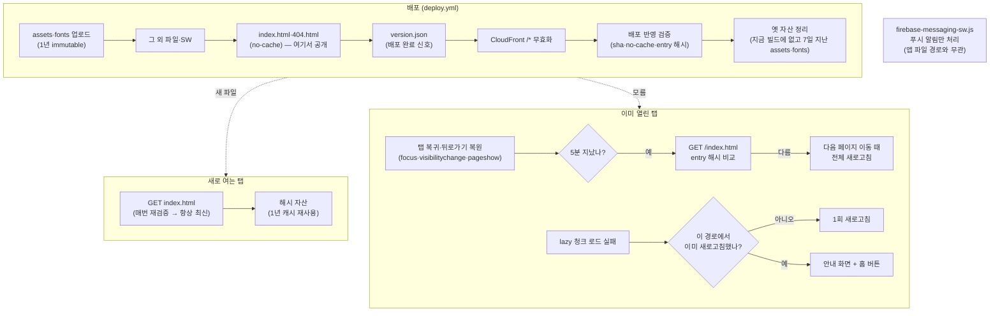

# 배포 후 옛 화면이 남는 곳과 캐시 전략 (Cache Strategy)

> **문서 성격**: 독립 기능 문서(서사형)
>
> **대상 독자**: "배포했는데 저는 아직 옛 화면이에요"라는 신고를 받은 사람, 또는 배포·캐시
> 설정을 처음 만지는 이 레포 FE 개발자.
>
> **읽고 나면**: 배포 뒤에도 옛 버전이 남을 수 있는 자리를 구분하고, 이 레포가 각 자리를 어느
> 파일·어느 값으로 다루는지 알고, 신고가 오면 어디부터 확인할지, 파일 종류별 캐시 정책을 어떻게
> 바꾸는지 안다.
>
> **마지막 검토**: 2026-10-27

배포는 서버(S3·CloudFront)의 파일을 바꾸는 일이지, 사용자 브라우저에 이미 있는 파일과 이미
실행 중인 코드를 바꾸는 일이 아니다. [2weekhun의 Threads 글](https://www.threads.com/@2weekhun/post/Dec8KBXkzYM)은
옛 버전이 남을 수 있는 곳을 정적 파일·HTML·이미 열린 페이지·Service Worker 네 군데로 나누고,
캐시부터 지우기 전에 어디에 남았는지 먼저 구분하라고 권한다. 이 문서는 그 네 군데를 뼈대로 이
레포가 각 자리를 어떻게 다루는지와 그렇게 정한 이유를 한 곳에 모은다. 각 기능의 세부 동작은 원래
문서에 두고 여기서는 링크로 가리킨다.

## 1. 쉬운 설명

Threads 글은 HTML을 입구에 비유한다 — _"입구가 옛날이면 새 파일이 있어도 못 갑니다"_
([Threads 글](https://www.threads.com/@2weekhun/post/Dec8KBXkzYM)의 카드 문구). 식당으로 옮기면 이렇다.

- **HTML은 입구에 붙은 메뉴판**이다. 손님(브라우저)은 메뉴판에 적힌 요리 이름(`/assets/js/index-<해시>.js`)대로
  주방에 주문한다. 메뉴판이 옛것이면 주방에 새 요리가 있어도 옛 요리를 주문한다 — 그래서 메뉴판은
  받을 때마다 최신이어야 한다.
- **해시 붙은 JS·CSS는 이름표에 제조 번호가 찍힌 재료**다. 내용이 바뀌면 번호(해시)가 바뀌어 다른
  재료가 되므로, 같은 번호의 재료는 1년을 보관해도 헷갈릴 일이 없다.
- **이미 앉아서 먹고 있는 손님(열린 탭)**은 메뉴판이 바뀐 걸 모른다. 누군가 알려줘야 하고, 알려줘도
  식사(지금 화면)를 빼앗지 말고 다음 주문(다음 페이지 이동) 때 새 메뉴판을 줘야 한다.
- **메뉴판을 새로 붙이는 순서**도 중요하다. 새 메뉴판을 먼저 붙이고 재료를 나중에 들여오면, 그
  사이 손님은 아직 없는 요리를 주문한다(배포 원자성).
- **배달 대행(Service Worker)**이 따로 재료를 쌓아 두는 가게라면 거기도 확인해야 하지만, 이 레포의
  Service Worker는 알림만 전달하고 재료를 쌓아 두지 않는다.

| 옛 버전이 남는 자리             | 왜 남나                                | 이 레포의 대응(자세히는 §5)                              |
| ------------------------------- | -------------------------------------- | -------------------------------------------------------- |
| ① 정적 파일(JS·CSS·이미지·폰트) | 브라우저가 한 번 받은 파일을 다시 쓴다 | 내용이 바뀌면 URL이 바뀐다(해시·버전 경로) → 1년 캐시    |
| ② HTML                          | HTML이 어떤 파일을 받을지 정한다       | 쓸 때마다 재검증(`no-cache`), 배포마다 CloudFront 무효화 |
| ③ 이미 열린 탭                  | 실행 중인 JS는 배포로 바뀌지 않는다    | 탭 복귀 때 새 배포 감지 → 다음 페이지 이동 때 새로고침   |
| ④ Service Worker                | 설치·대기·활성화라는 별도 생명주기     | 푸시 전용이라 앱 파일을 캐시하지 않는다(해당 없음)       |
| + 배포 순서                     | HTML이 아직 없는 파일을 가리킬 수 있다 | 자산을 먼저, HTML과 `version.json`을 마지막에 올린다     |



## 2. 전제 지식

**가정하는 것**: 브라우저가 서버에 파일을 요청하고 응답을 받는다는 정도의 HTTP 기초, 이 레포가
S3에 올린 정적 파일을 CloudFront로 서빙한다는 사실.

**가정하지 않는 것**과 먼저 볼 곳:

- HTTP 캐시가 응답을 저장하고 재사용하는 방식 → [MDN HTTP 캐싱](https://developer.mozilla.org/en-US/docs/Web/HTTP/Guides/Caching),
  지시어별 의미는 [MDN `Cache-Control`](https://developer.mozilla.org/en-US/docs/Web/HTTP/Reference/Headers/Cache-Control)과 §12 용어 사전
- 배포 워크플로 전체 단계와 수동 재실행 → [DEPLOY.md](./DEPLOY.md) "워크플로우 상세 단계"
- 열린 탭의 새 배포 감지·적용 세부 → [NEW-VERSION-RELOAD.md](./NEW-VERSION-RELOAD.md)
- `/version` 화면과 배포 후 CI 검증 → [BUILD-VERSION.md](./BUILD-VERSION.md)

## 3. 사용한 도구·기술

**기능 자체를 이루는 것**

- **`Cache-Control` 응답 헤더** — S3 객체 메타데이터로 파일 종류별로 지정한다(`aws s3 cp/sync --cache-control`)
- **Vite 해시 파일명** — 빌드 산출물 이름에 내용 해시를 붙인다(`vite.config.ts`)
- **CloudFront** — 관리형 캐시 정책, 배포마다 무효화, SPA 폴백용 CloudFront Function 2개([DEPLOY.md](./DEPLOY.md) "CloudFront Function" 절)
- **`sessionStorage`** — 새로고침 루프를 막는 기록 2종(§6)
- **Zustand `useAppVersionStore`** — 새 배포 감지 결과를 적용 훅에 넘긴다
- **AWS CLI `s3api`** — 옛 자산 정리(`list-objects-v2`, `delete-objects`)

**구현·검증 과정에서 쓴 도구**

- **`curl -I`·AWS API 조회** — 운영 응답 헤더와 CloudFront 설정 실측(§9)
- **Playwright** — `route.abort()`로 청크 로드 실패 재현, `page.clock`으로 5분 간격 건너뛰기
- **`performance.getEntriesByType('navigation')[0].notRestoredReasons`** — bfcache 미복원 사유 측정(§5.10)

## 4. 왜 만들었나

2026-10-14 위 Threads 글을 계기로 이 레포의 처리를 업계 표준과 대조했다. 관련 사실이
[DEPLOY.md](./DEPLOY.md)·[NEW-VERSION-RELOAD.md](./NEW-VERSION-RELOAD.md)·[BUILD-VERSION.md](./BUILD-VERSION.md)에
흩어져 있어, 옛 화면 신고가 오면 세 문서를 다 읽어야 원인 후보를 좁힐 수 있었다. 대조하다 결함도
찾았다 — 배포 중 흰 화면이 날 수 있는 업로드 순서, 한 번도 실행되지 않던 청크 실패 리스너, 운영에
공개되던 번들 분석 파일 등(§10). 이를 PR 5개로 고친 뒤(#366·#368·#369·#370·#371) 고친 뒤의
사실로 이 문서를 썼다.

## 5. 구조

각 자리를 "개념 → 업계 표준 → 이 레포 → 판정" 순서로 본다. `deploy.yml`은 자주 바뀌어 여기서는
스텝 이름으로 가리키고, 줄 번호는 §7·§8 표에만 둔다.

### 5.1 정적 파일(JS·CSS·이미지) — 내용이 바뀌면 URL을 바꾼다

- **개념**: 같은 URL이면 브라우저는 같은 파일로 본다. 내용이 바뀔 때 URL도 바꾸면(Cache Busting)
  옛 파일과 새 파일이 다른 자원이 되므로, 오래 캐시해도 새 버전 전달을 막지 않는다.
- **업계 표준**: web.dev는 버전 정보가 들어 있고 내용이 바뀌지 않는 URL에
  _"`Cache-Control: max-age=31536000`을 붙이라"_ (번역, [web.dev HTTP 캐시](https://web.dev/articles/http-cache))고
  쓰고, MDN의 Cache Busting 예시도 `/assets/*`에 `max-age=31536000, immutable`을 둔다
  ([MDN](https://developer.mozilla.org/en-US/docs/Web/HTTP/Reference/Headers/Cache-Control)).
- **이 레포**: Vite가 JS를 `assets/js/[name]-[hash].js`로, 폰트·이미지·CSS도 해시를 붙여
  내보낸다([vite.config.ts:90-100](../vite.config.ts#L90-L100)). 배포의 "Upload to S3" 스텝이
  `public, max-age=31536000, immutable`로 올린다.
- **판정**: 표준과 같다.

### 5.2 폰트 — 해시 대신 경로에 버전

- **개념**: `public/`의 파일은 Vite가 해시를 붙이지 않는다. 해시 없는 파일을 1년 캐시하면, 파일을
  바꿔도 브라우저는 최대 1년 동안 옛 파일을 쓴다.
- **업계 표준**: §5.1과 같은 원칙 — 내용이 바뀌면 URL도 바뀌어야 오래 캐시할 수 있다.
- **이 레포**: 폰트는 경로에 버전을 넣는다(`/fonts/pretendard-1.3.9/`). 폰트를 바꿀 땐 같은 경로를
  덮어쓰지 않고 디렉터리 버전을 올려 URL을 바꾼다(교체 절차는 [DEPLOY.md](./DEPLOY.md) 워크플로 6번).
  1년 캐시를 쓰되 **매 배포 다시 올린다**(약 3MB) — 다시 올리지 않으면 업로드 시각이 처음 올린 때에
  고정돼, 버전을 올린 배포에서 옛 폰트가 7일을 기다리지 않고 바로 정리된다(§5.8, #371).
- **판정**: 표준과 같은 효과. Vite 해시화(패키지에서 직접 import)는 preload 19개(`index.html`)와
  로딩 순서가 바뀌어 Lighthouse 재측정이 필요해 기각했다(2026-10-14 사용자 결정).

### 5.3 HTML — 입구는 항상 최신으로

- **개념**: HTML은 어떤 JS·CSS를 받을지 알려주는 출발점이다. HTML이 옛 entry 청크를 가리키면 새
  파일이 서버에 있어도 사용자는 옛 파일로 들어간다.
- **업계 표준**: MDN과 Vite([Load Error Handling](https://vite.dev/guide/build#load-error-handling))는
  `index.html`에 `no-cache`를 권한다. MDN에 따르면 `no-cache`는 _"저장은 하되 재사용할 때마다 원
  서버에 확인"_ (번역, [MDN](https://developer.mozilla.org/en-US/docs/Web/HTTP/Reference/Headers/Cache-Control))하라는
  뜻이지 저장 금지가 아니다(Threads 글도 이 오해를 짚는다).
- **이 레포**: `no-cache`로 올린다(2026-10-14부터, 그 전에는 `no-cache, no-store, must-revalidate` —
  MDN은 이런 조합이 결국 가장 엄격한 `no-store`와 같다고 설명한다). 배포 검증이 `no-cache`가 있고
  `no-store`가 다시 붙지 않았는지 매번 확인한다([DEPLOY.md](./DEPLOY.md) 8번).
- **CDN 쪽**: CloudFront 캐시 정책은 오리진(S3)이 `no-cache`·`no-store`를 보내도 정책의 최소 TTL만큼 엣지에
  둔다([AWS 만료 문서](https://docs.aws.amazon.com/AmazonCloudFront/latest/DeveloperGuide/Expiration.html), 값은 §7) —
  그래서 배포마다 `/*`를 무효화한다. AWS는 자주 바뀌는 파일에는 무효화보다 버전 붙은 파일명을 우선
  쓰라고 권하는데([AWS 무효화 문서](https://docs.aws.amazon.com/AmazonCloudFront/latest/DeveloperGuide/Invalidation.html)),
  해시 자산이 그 방식이고 무효화는 이름을 바꿀 수 없는 HTML 등을 위한 보조다.
- **판정**: 표준과 같다. `no-store`에서 바꾼 이유와 안전장치는 §5.10.

### 5.4 배포 순서 — HTML이 가리키는 파일이 먼저 있어야 한다

Threads 글의 네 군데에는 없지만 §5.3의 반대편이다 — HTML이 너무 일찍 새것이 되면 아직 없는
파일을 가리킨다.

- **업계 표준**: Netlify는 _"모든 변경이 올라가기 전에는 공개 URL에 아무것도 반영되지 않는다"_
  (번역, [Netlify 배포 개요](https://docs.netlify.com/site-deploys/overview/))는 원자적 배포를 기본으로 한다.
- **이 레포**: S3에는 원자적 전환이 없으므로 "Upload to S3" 스텝의 순서로 흉내 낸다 — 해시 자산과
  폰트를 먼저, `index.html`·`404.html`과 `version.json`("배포 완료" 신호)을 마지막에 올린다. 정확한
  순서는 [DEPLOY.md](./DEPLOY.md) 워크플로 6번이 정본이다.
- **판정**: 해시 자산에 대해서는 표준과 같은 효과다. 해시 없는 public 파일(favicon·manifest 등)은
  HTML보다 먼저 제자리에서 덮어써지므로 원자적이지 않다(바뀌어도 화면이 깨지지 않는 파일들이다).
  예전 순서(HTML 먼저)의 21.6초 공백은 §10.

### 5.5 이미 열린 탭 — 알아채고, 다음 이동 때 바꾼다

- **개념**: 이미 로드된 JS는 브라우저에서 실행 중이라 배포로 바뀌지 않는다. 열린 탭과 서버의 버전이
  어긋나는 상태를 version skew라 하고, 결국 페이지를 다시 불러와야 새 HTML과 자산을 받는다.
- **업계 표준**: Vercel은 버전 불일치를 감지하면 전체 페이지 새로고침으로 넘기고, 그래서
  _"사용자는 다음 전체 페이지 이동 때 최신 버전을 받는다"_ (번역, [Vercel Skew Protection](https://vercel.com/docs/skew-protection)).
  옛 배포 자산은 기본으로 그 배포가 만들어진 때부터 하루 동안 계속 서빙한다(같은 문서의 Maximum Age).
- **이 레포**: 같은 구조다. 탭으로 돌아오거나 뒤로가기로 bfcache에서 되살아날 때(창 `focus`,
  `visibilitychange` → visible, `pageshow` persisted 중 하나, 5분 간격)
  서버의 `index.html`을 다시 받아 entry 해시를 비교하고, 다르면 다음 pathname 이동 때 전체
  새로고침한다. 세부는 [NEW-VERSION-RELOAD.md](./NEW-VERSION-RELOAD.md). 옛 자산은 7일 보존한다(§5.8).
- **판정**: 표준과 같다(보존 기간은 더 길고, 기준점은 다르다 — §5.8).

### 5.6 청크 로드 실패 안전망

- **개념**: 감지보다 먼저 옛 탭이 정리된 청크를 요청하거나 네트워크가 끊기면 lazy 청크 로드가
  실패한다. 이때 화면을 그대로 두면 사용자는 고장으로 본다.
- **업계 표준**: Vite는 이때 `vite:preloadError` 이벤트를 보내고, 문서는 이 이벤트에서 새로고침하는
  예시를 든다([Vite Load Error Handling](https://vite.dev/guide/build#load-error-handling)).
- **이 레포**: 그 리스너([main.tsx:15](../src/main.tsx#L15))와 에러 경계([AppErrorFallback.tsx](../src/shared/ui/elements/AppErrorFallback.tsx)의 `isReloadPending`,
  라우트에서는 [RouteErrorBoundary.tsx](../src/app/routes/RouteErrorBoundary.tsx)가 이것을 그린다)가 같은 판단
  `ChunkReloadUtil`을 쓴다 — 경로별로 세션당 1회만 새로고침하고([chunk-reload.util.ts:23](../src/shared/utils/chunk-reload.util.ts#L23)),
  새로고침하고도 또 실패하면 "문제가 발생했어요" 화면과 홈 버튼을 보여준다. 페이지 단위
  플래그([chunk-reload.util.ts:8](../src/shared/utils/chunk-reload.util.ts#L8))는 리스너가 새로고침을 건 직후
  렌더된 에러 경계가 "이미 시도함"으로 오판해 에러 화면을 깜빡이지 않게 한다.
- **판정**: 표준과 같고, 두 번째 실패 처리를 더했다.

### 5.7 Service Worker — 이 레포에선 해당 없음

- **개념**: Service Worker는 설치 → 대기 → 활성화라는 별도 생명주기가 있어, 새 버전이 설치돼도 기존
  워커가 탭을 잡고 있는 동안 기다린다([web.dev 생명주기](https://web.dev/articles/service-worker-lifecycle)).
  앱 파일을 캐시하는 워커라면 옛 화면의 또 다른 원인이 된다.
- **이 레포**: [`public/firebase-messaging-sw.js`](../public/firebase-messaging-sw.js) 하나뿐이고 FCM 푸시
  알림만 처리한다 — fetch 핸들러·Cache API·`skipWaiting`이 없어 앱 파일을 붙잡아 두지 않는다. 워커
  파일 자체는 `no-store`로 올린다. 자세히는 [FCM-PUSH-NOTIFICATION.md](./FCM-PUSH-NOTIFICATION.md).
- **판정**: 해당 없음. 나중에 오프라인 캐시(PWA)를 넣으면 이 자리를 다시 봐야 한다.

### 5.8 배포 산출물 정리

- **개념**: 열린 탭을 위해 옛 해시 청크를 남겨 두면, 그대로는 무기한 쌓인다.
- **업계 표준**: Vercel은 옛 배포를 정해진 기간(기본 하루) 동안만 서빙하고, 보존 정책으로 지운다(§5.5 링크).
- **이 레포**: 업로드 때는 옛 청크를 지우지 않고, 배포 반영 검증 뒤 "옛 자산 정리" 스텝이 "지금 빌드에
  없고 마지막 업로드가 7일 넘은" `assets/`·`fonts/`만 지운다([prune-assets.js:10](../scripts/lib/prune-assets.js#L10),
  [DEPLOY.md](./DEPLOY.md) 9번).
  - 7일은 그 파일이 **마지막으로 배포에 포함된 뒤**부터 센다. 배포마다 지금 빌드 파일을 전부(폰트
    포함) 다시 올려 업로드 시각이 갱신되기 때문이다. 그래서 배포 간격이 7일을 넘으면 다음 배포 직후
    직전 빌드 청크가 바로 지워지고, 그때 열려 있던 탭은 다음 이동 때 1회 새로고침된다(§5.5의 동작과
    같은 결과).
  - 날짜만 보는 S3 lifecycle 규칙은 배포가 끊기면 지금 쓰는 파일까지 지워 쓰지 않는다.
  - 정리는 부수 작업이라 실패해도 배포 run은 성공으로 끝나고 경고 주석(`::warning::옛 자산 정리 실패`)만 남는다.
  - 번들 분석 파일 `dist/stats.html`은 로컬 빌드에서만 만들고(CI 빌드에선 끔), 미리 압축한 `.gz`는
    만들지 않는다 — CloudFront가 응답을 직접 압축해 쓰이지 않았다.
- **판정**: 표준과 같은 방향(보존 기간은 사용자 결정으로 7일).

### 5.9 비교표(2026-10-14, 고친 뒤 기준)

| 자리           | 업계 표준                                         | 이 레포                                     | 판정 |
| -------------- | ------------------------------------------------- | ------------------------------------------- | ---- |
| 해시 자산      | 해시 URL + 1년 캐시                               | 같음                                        | ✅   |
| 폰트           | 내용이 바뀌면 URL도 바뀌게                        | 경로 버전 + 1년 캐시                        | ✅   |
| HTML           | `no-cache`(재사용 전 재검증)                      | 같음(2026-10-14 `no-store`에서 전환, §5.10) | ✅   |
| CDN            | 버전 파일명 우선, 무효화는 보조                   | 해시 자산 + 배포마다 `/*` 무효화            | ✅   |
| 배포 원자성    | 모든 파일이 올라간 뒤 공개                        | 업로드 순서로 보장(해시 자산 기준)          | ✅   |
| 열린 탭        | 불일치 감지 → 다음 이동 때 새로고침, 옛 자산 보존 | 같음, 7일 보존                              | ✅   |
| 청크 실패      | `vite:preloadError`에서 새로고침                  | 경로별 1회 + 소진 시 안내 화면              | ✅   |
| Service Worker | 생명주기 관리                                     | 푸시 전용, 해당 없음                        | ✅   |
| 산출물 정리    | 옛 배포를 기간 지나면 정리                        | 빌드에서 빠진 뒤 7일 지나면 정리            | ✅   |

### 5.10 HTML을 `no-store`에서 `no-cache`로 바꾼 이유(2026-10-14 사용자 결정)

처음(같은 날 오전)에는 `no-store`를 유지하기로 했다. 아래 "잃는 것"을 막을 장치가 없었기 때문이다. 그 장치를
만든 뒤(#376) 전환했다.

- **얻는 것 — 뒤로가기 즉시 복원(bfcache)**: `no-store`였던 운영 페이지는 Chrome 154에서 bfcache로 복원되지
  않았고, 사유는 `response-cache-control-no-store`·`response-cache-control-no-store-with-js-network-request`·
  `masked`였다(§9). HTML 헤더만 `no-cache`로 바꿔 같은 흐름을 재면 복원됐다(§9, Playwright Chromium 143). API
  응답도 `no-store`(Spring 기본)지만, Chrome 문서는 이를 _"no-store 페이지가 보낸 fetch·XHR의 응답이 no-store면
  그 페이지도 bfcache에서 내보낸다"_ (번역, [Chrome — bfcache와 no-store](https://developer.chrome.com/docs/web-platform/bfcache-ccns))고
  써서 HTML이 `no-store`일 때만 해당한다. 모바일은 본문 링크를 같은 탭으로 열어 외부 사이트에서 돌아올 일이 많다.
- **잃는 것과 막는 장치**: Chrome은 `no-store` 페이지를 _"쿠키나 다른 인증 수단이 바뀌면 bfcache에서 내보낸다"_
  (번역, 같은 문서). `no-cache`에는 이 보호가 없어, 다른 탭에서 로그아웃한 뒤 뒤로가기로 로그인 상태 화면이
  메모리째 돌아올 수 있다. 그래서 명시적 로그인·로그아웃마다 바뀌는 **인증 세대** 값을 두고, 탭 복귀·bfcache
  복원(`pageshow` persisted) 때 이 탭이 알던 값과 다르면 그 자리에서 로그아웃 처리·세션 복원을 한다
  ([AUTH.md](./AUTH.md) §8-H). 새 배포 감지도 `pageshow`(persisted) 때 다시 확인한다(§5.5).
- **이미 있던 보완**: 전체 재로드 뒤에도 목록 위치를 복원한다([useWindowGridVirtualizer.ts:353](../src/shared/hooks/useWindowGridVirtualizer.ts#L353)의 `pagehide` 스냅샷).
- **측정하지 않은 것**: Safari·Firefox의 bfcache 동작, 모바일 실기기.

## 6. 상태 모델

옛 버전이 남을 수 있는 자리와 그것을 비우는 방법. 이 문서가 다루는 앱 쪽 상태는 sessionStorage 키
2종(청크 새로고침 기록은 2026-03-14, 감지 기록은 2026-09-09 #51에서 생겼다)과 모듈 변수 1개(2026-10-14
#366)다.

| 자리                                                  | 무엇이 남나                            | 얼마나                                | 비우는 방법                                                                                  |
| ----------------------------------------------------- | -------------------------------------- | ------------------------------------- | -------------------------------------------------------------------------------------------- |
| 브라우저 HTTP 캐시                                    | 해시 자산·폰트                         | 1년                                   | URL이 바뀌면 자동으로 안 씀                                                                  |
| 브라우저 HTTP 캐시                                    | HTML(`index.html`·`404.html`)          | 저장하되 쓸 때마다 재검증(`no-cache`) | 서버 응답이 바뀌면 그 자리에서 새 것                                                         |
| 브라우저 HTTP 캐시                                    | `version.json`·SW                      | 저장 안 함(`no-store`)                | —                                                                                            |
| 브라우저 HTTP 캐시                                    | 그 외 public 파일(favicon·manifest 등) | 캐시 헤더가 없어 브라우저 판단        | 배포마다 덮어씀(바뀌어도 화면 영향 적음)                                                     |
| bfcache                                               | 떠난 페이지 전체(JS 메모리 포함)       | 브라우저 판단(Chrome은 최대 수 분)    | 복원 때 인증 세대·새 배포를 다시 확인(§5.10)                                                 |
| CloudFront 엣지                                       | 모든 파일                              | 정책 TTL(값은 §7)                     | 배포마다 `/*` 무효화                                                                         |
| S3                                                    | 지금 빌드 + 옛 `assets/`·`fonts/`      | 마지막 배포 포함 후 7일               | 옛 자산 정리 스텝                                                                            |
| 탭 메모리                                             | 실행 중인 JS 번들                      | 탭을 닫거나 새로고침할 때까지         | 감지 → 다음 이동 때 새로고침                                                                 |
| `sessionStorage` `linksphere:version:last-detected`   | 마지막으로 감지한 entry                | 탭 세션                               | 같은 값 재감지 루프 가드([storage-keys.ts:28](../src/shared/config/storage-keys.ts#L28))     |
| `sessionStorage` `linksphere:chunk-reload:<pathname>` | 그 경로에서 새로고침했음               | 탭 세션                               | 청크 실패 새로고침 루프 가드([storage-keys.ts:34](../src/shared/config/storage-keys.ts#L34)) |
| 모듈 변수 `isReloadInFlight`                          | 이 페이지에서 새로고침을 걸었음        | 페이지 수명                           | 새로고침되면 초기화([chunk-reload.util.ts:8](../src/shared/utils/chunk-reload.util.ts#L8))   |

`useAppVersionStore`(감지 결과)의 shape는 [NEW-VERSION-RELOAD.md](./NEW-VERSION-RELOAD.md) §6.

## 7. 운영 파라미터

| 값                                                                                                | 위치                                                                                                                           | 의미                               |
| ------------------------------------------------------------------------------------------------- | ------------------------------------------------------------------------------------------------------------------------------ | ---------------------------------- |
| `public, max-age=31536000, immutable`                                                             | [deploy.yml:91](../.github/workflows/deploy.yml#L91)(assets), [:98](../.github/workflows/deploy.yml#L98)(fonts)                | 해시 자산·폰트 1년 캐시            |
| `no-cache`                                                                                        | [deploy.yml:121](../.github/workflows/deploy.yml#L121)(`index.html`), [:127](../.github/workflows/deploy.yml#L127)(`404.html`) | 저장하되 쓸 때마다 재검증          |
| `no-cache, no-store, must-revalidate`                                                             | [deploy.yml:115](../.github/workflows/deploy.yml#L115)(SW), [:132](../.github/workflows/deploy.yml#L132)(`version.json`)       | 저장 안 함                         |
| 무효화 경로 `/*`                                                                                  | [deploy.yml:135](../.github/workflows/deploy.yml#L135) 스텝                                                                    | 배포마다 엣지 캐시 비움            |
| 캐시 정책 `Managed-CachingOptimized`(최소 TTL 1초·기본 86400초·최대 31536000초, `Compress: true`) | CloudFront 콘솔(파이프라인이 배포하지 않음, [infra/cloudfront/snapshot.json](../infra/cloudfront/snapshot.json)에 스냅샷)      | 엣지 TTL — 아래 명령으로 다시 조회 |
| 감지 간격 5분                                                                                     | [useAppVersionCheck.ts:9](../src/shared/hooks/useAppVersionCheck.ts#L9)                                                        | 탭 복귀 때 재확인 최소 간격        |
| 옛 자산 보존 7일                                                                                  | [prune-assets.js:10](../scripts/lib/prune-assets.js#L10)                                                                       | 정리 기준                          |

CloudFront 캐시 정책 값 조회(읽기 전용). 배포 ID는 GitHub 시크릿 `CLOUDFRONT_DISTRIBUTION_ID`와 같은
값이고, 모르면 `aws cloudfront list-distributions --query 'DistributionList.Items[].[Id,Aliases.Items]'`로 찾는다.

```bash
aws cloudfront get-distribution-config --id <배포 ID> \
  --query 'DistributionConfig.DefaultCacheBehavior.CachePolicyId' --output text
aws cloudfront get-cache-policy --id <정책 ID> \
  --query 'CachePolicy.CachePolicyConfig.[Name,MinTTL,DefaultTTL,MaxTTL]'
```

배포 설정 전체·정책·Function 코드·WAF 규칙은 `pnpm check:cloudfront`가 커밋된 스냅샷과 비교한다
([DEPLOY.md](./DEPLOY.md) "CloudFront 설정 스냅샷과 차이 검사").

## 8. 코드 지도와 자주 하는 수정

### 옛 화면 신고가 오면 — 진단 순서

캐시부터 지우지 말고 옛 버전이 어느 자리에 남았는지 먼저 가린다(Threads 글의 결론과 같다).

1. **문제가 된 그 탭이 어느 빌드인가** — 그 탭에서 F12 콘솔의 `[BUILD] <sha>` 줄([main.tsx:20](../src/main.tsx#L20))을
   보고, `https://linksphere.click/version.json`의 sha와 비교한다. 다르면 ③ 열린 탭이다 — 탭으로
   돌아온 뒤(5분 간격) 다른 페이지로 이동하면 새로고침되고, 바로 고치려면 새로고침한다. 주의:
   그 탭에서 주소를 직접 입력해 `/version`을 열면 탭이 새로 로드돼 이 증거가 사라진다.
2. **새로 연 탭도 옛것인가** — 새 탭에서 `/version`([BUILD-VERSION.md](./BUILD-VERSION.md))을 열어 배너가
   여전히 "배포와 달라요"면 ② HTML·엣지 문제다. `curl -sI https://linksphere.click/index.html`의
   `cache-control`이 `no-cache`인지, 마지막 배포 run이 성공했는지(무효화 포함) 본다. 뒤로가기로 돌아온
   화면만 옛것이면 bfcache 복원이다 — 복원 때 새 배포를 다시 확인해 다음 페이지 이동 때 새로고침된다(§5.10).
3. **흰 화면·에러 화면이었나** — 청크 403이면 배포 중이었는지(run 로그의 업로드 시각), 7일 지나
   정리된 청크인지 확인한다(§5.4·§5.8).
4. **Service Worker** — DevTools Application 탭에 `firebase-messaging-sw.js`만 있어야 한다(④). 다른
   워커가 있으면 누군가 캐시하는 워커를 추가한 것이다.

버킷이 다시 커진다면 배포 run 로그에서 `::warning::옛 자산 정리 실패`를 찾는다(§5.8).

### 코드 지도

| 단계                  | 위치                                                                                                                                                                                            |
| --------------------- | ----------------------------------------------------------------------------------------------------------------------------------------------------------------------------------------------- |
| 해시 파일명           | [vite.config.ts:90-100](../vite.config.ts#L90-L100)                                                                                                                                             |
| 업로드 순서·헤더      | [deploy.yml:82-133](../.github/workflows/deploy.yml#L82-L133)("Upload to S3")                                                                                                                   |
| 무효화·배포 반영 검증 | [deploy.yml:135](../.github/workflows/deploy.yml#L135), [:142](../.github/workflows/deploy.yml#L142)                                                                                            |
| 옛 자산 정리          | [deploy.yml:200](../.github/workflows/deploy.yml#L200), [prune-old-assets.js](../scripts/prune-old-assets.js), [prune-assets.js](../scripts/lib/prune-assets.js)                                |
| 새 배포 감지·적용     | [useAppVersionCheck.ts:94-96](../src/shared/hooks/useAppVersionCheck.ts#L94-L96), [useNewVersionReload.ts:28](../src/shared/hooks/useNewVersionReload.ts#L28)                                   |
| 청크 실패 새로고침    | [main.tsx:15](../src/main.tsx#L15), [chunk-reload.util.ts](../src/shared/utils/chunk-reload.util.ts), [AppErrorFallback.tsx](../src/shared/ui/elements/AppErrorFallback.tsx)(`isReloadPending`) |

### 자주 하는 수정

| 하고 싶은 것                             | 방법                                                                                                                                                                                                                                                                                                                                                                                                                                                                    |
| ---------------------------------------- | ----------------------------------------------------------------------------------------------------------------------------------------------------------------------------------------------------------------------------------------------------------------------------------------------------------------------------------------------------------------------------------------------------------------------------------------------------------------------- |
| `public/`에 오래 캐시할 새 디렉터리 추가 | assets·fonts와 같은 형태로 한다. ① 경로에 버전을 넣는다 ② "Upload to S3"에 헤더를 지정한 동기화를 `--delete` 동기화 **앞**(HTML 업로드보다도 앞)에 둔다 — 뒤에 두면 이미 올라간 객체라 건너뛰어 헤더가 안 붙는다 ③ `--delete` 동기화에 `--exclude "<디렉터리>/*"`를 더한다 — 빼면 옛 버전 디렉터리가 바로 지워진다 ④ 옛 버전을 정리하려면 `PRUNE_PREFIXES`([prune-assets.js:13](../scripts/lib/prune-assets.js#L13))에 넣고, 그 동기화는 매 배포 다시 올리게 둔다(§5.2) |
| 폰트 교체                                | [DEPLOY.md](./DEPLOY.md) 워크플로 6번의 폰트 항목(디렉터리 버전 올리기)                                                                                                                                                                                                                                                                                                                                                                                                 |
| HTML 캐시 헤더 변경                      | 먼저 §5.10의 결정을 확인한다 — `no-store`로 되돌리면 bfcache 복원이 꺼지고, 저장·재사용을 허용하는 쪽(`max-age` 등)으로 가면 새 배포 감지가 무너진다. 바꾼다면 `deploy.yml`의 `index.html`·`404.html` 업로드 2곳, 배포 반영 검증 ②(`no-cache` 필수·`no-store` 금지)와 그 주석, [DEPLOY.md](./DEPLOY.md) "배포 반영 검증하는 법", [BUILD-VERSION.md](./BUILD-VERSION.md)의 검증 서술, 이 문서의 §1 표·§5.3·§5.9·§5.10·§6·§7을 함께 고친다                                |
| 옛 자산 보존 기간 변경                   | [prune-assets.js:10](../scripts/lib/prune-assets.js#L10)의 `RETENTION_DAYS`와 함께 경계 테스트(`src/test/scripts/prune-assets.test.ts`의 7일 경계 시각), `deploy.yml` "옛 자산 정리" 주석, `scripts/prune-old-assets.js` 머리말, [DEPLOY.md](./DEPLOY.md) 9번, 이 문서의 §5.5·§5.8·§6·§7을 고친다                                                                                                                                                                       |
| 감지 간격·트리거 변경                    | [NEW-VERSION-RELOAD.md](./NEW-VERSION-RELOAD.md) §8                                                                                                                                                                                                                                                                                                                                                                                                                     |

## 9. 검증 결과

모두 2026-10-14 직접 측정했다.

- **운영 응답 헤더**(`curl -I`, HTML 전환 전): `index.html`·`version.json`·`firebase-messaging-sw.js`는
  `no-cache, no-store, must-revalidate`, entry 청크와 폰트는 `public, max-age=31536000, immutable`,
  없는 청크는 S3 403(XML). 전환 뒤 `index.html`·`404.html`은 `no-cache`이고 배포 검증 ②가 매번 확인한다.
- **CloudFront 설정**(AWS API `GetDistributionConfig`·`GetCachePolicy`): 기본 비헤이비어
  `Managed-CachingOptimized`, `Compress: true`, viewer-request·viewer-response Function 각 1개,
  배포 레벨 `CustomErrorResponses` 없음.
- **업로드 공백**: 고치기 전 [run 38515585972](https://github.com/BAECHAN/link-sphere_FE_NEW/actions/runs/38515585972)는
  `index.html`이 그 HTML이 가리키는 entry 청크보다 21.6초 먼저 올라갔다. 고친 뒤
  [run 38522198959](https://github.com/BAECHAN/link-sphere_FE_NEW/actions/runs/38522198959)는 `index.html`이
  마지막 자산보다 23.4초 뒤에 올라갔다.
- **청크 실패**(프로덕션 빌드 + Playwright, #366 녹화): 첫 실패 → 1회 새로고침 후 정상 표시, 재실패 →
  안내 화면·홈 버튼(새로고침 정확히 1회), `vite:preloadError` → 1회 새로고침·재발생 시 무반응.
- **탭 복귀 감지**(프로덕션 빌드 + Playwright, #368): hidden 0건, visible 1건, 이어진 focus 추가 0건.
  headless Chromium은 실제 탭 전환 때 가시성 이벤트를 보내지 않아 상태를 바꿔 넣었다.
- **bfcache**(운영 `/post` → `/version` → 뒤로):
  - HTML `no-store`(전환 전): Chrome 154에서 미복원, 사유는 `response-cache-control-no-store`·
    `response-cache-control-no-store-with-js-network-request`·`masked`.
  - 같은 흐름을 Playwright Chromium 143(기본으로 꺼진 bfcache를 `ignoreDefaultArgs`로 켬)으로 재며 문서 응답
    헤더만 바꿔 비교: 가로채기 없이 `no-store` → 미복원(위와 같은 사유), 가로채기 + `no-store`(대조군) → 같음,
    가로채기 + `no-cache` → **복원**(`pageshow.persisted=true`). 복원 때 이벤트는 `resume` →
    `visibilitychange(visible)` → `pageshow(persisted)` 순이었다.
  - 프로덕션 빌드 + HTML `no-cache`에서 로그인 상태 `/bookmark`도 복원됐다(막는 사유 없음). 다른 탭
    로그아웃·계정 변경 뒤 뒤로가기는 인증 세대로 그 자리에서 맞춰졌고, 30fps 녹화에서 이전 화면은 한 프레임도
    보이지 않았다([AUTH.md](./AUTH.md) §8-H, #376).
- **정리**([#369 첫 배포](https://github.com/BAECHAN/link-sphere_FE_NEW/actions/runs/38533245689)): 13,309개 삭제,
  버킷 15,196개·167MB → 2,028개·48.5MB(`aws s3 ls --recursive --summarize`), `stats.html` 200 → 403,
  `.gz` 업로드 0건.
- **폰트**(#370): `index.html`의 폰트 참조 20개(preload 19 + stylesheet 1) 모두 실재, `/post`에서 폰트
  요청 20건 정상, 옛 경로 요청 0건, 본문 `Pretendard`.

## 10. 시행착오

| 날짜       | 무엇                                                                                                                                                                                                                | 어떻게                                                                                                                      |
| ---------- | ------------------------------------------------------------------------------------------------------------------------------------------------------------------------------------------------------------------- | --------------------------------------------------------------------------------------------------------------------------- |
| 2026-03-02 | SW 파일이 `.gz`로도 만들어져 등록 실패, SW가 CloudFront 기본 캐시에 걸려 갱신 안 됨                                                                                                                                 | SW 압축 제외·무캐시 개별 업로드([FCM-PUSH-NOTIFICATION.md](./FCM-PUSH-NOTIFICATION.md) §10)                                 |
| 2026-03-14 | 새 배포 뒤 옛 청크 요청이 실패                                                                                                                                                                                      | 청크 실패 자동 새로고침 도입 — 다만 리스너의 이벤트 이름이 `vite:preload-error`로 틀려 실제로는 실행되지 않았다(10-14 발견) |
| 2026-05-23 | 옛 청크를 지워 열린 탭이 실패, 그 요청에 `index.html`이 200으로 와서 JS 파싱 실패                                                                                                                                   | `index.html` 무캐시 분리, `assets/`를 `--delete` 없이 동기화(`46727dc`)                                                     |
| 2026-07-28 | 배포 레벨 사용자 정의 오류 응답이 API 403/404와 없는 청크까지 `index.html` 200으로 가림                                                                                                                             | CloudFront Function으로 교체 — 확장자 있는 경로는 S3 오류 그대로([DEPLOY.md](./DEPLOY.md))                                  |
| 2026-08-07 | 라우트 에러 경계가 없어 청크 새로고침이 도달 불가                                                                                                                                                                   | `RouteErrorBoundary` 추가로 처음 실제 동작(`a7fd55c`, CHANGELOG 0.11.0)                                                     |
| 2026-09-09 | 열린 탭은 실패하지 않는 한 옛 화면에 머묾                                                                                                                                                                           | 새 배포 감지·적용([NEW-VERSION-RELOAD.md](./NEW-VERSION-RELOAD.md), #51)                                                    |
| 2026-10-14 | Threads 글 대조 중 발견: HTML 먼저 업로드(21.6초 공백), 리스너 이름 오타, 2번째 실패 시 무한 스피너, 감지 트리거가 `focus` 하나, `stats.html` 공개, 쓰이지 않는 `.gz`, 옛 자산 무기한 누적, 해시 없는 폰트 1년 캐시 | #366·#368·#369·#370                                                                                                         |
| 2026-10-14 | 이 문서의 리뷰에서 발견: 폰트 동기화의 `--size-only`(#370)가 업로드 시각을 고정해, 폰트 버전을 올리는 배포에서 옛 폰트가 7일을 기다리지 않고 바로 지워짐                                                            | 폰트도 매 배포 다시 올림(#371)                                                                                              |
| 2026-10-14 | HTML `no-store` 때문에 뒤로가기가 bfcache로 복원되지 않음. 바꾸면 로그아웃 뒤 뒤로가기로 이전 화면이 메모리째 돌아오는 문제가 생김                                                                                  | 인증 세대로 탭 간 동기화·복원 재확인을 먼저 만들고(#376) HTML을 `no-cache`로 전환, 복원 때 새 배포도 다시 확인              |

## 11. 남은 것

- **Safari·Firefox의 bfcache** — 측정은 Chromium만 했다. 복원 때 확인은 `visibilitychange`와 `pageshow`
  둘 다 들어 어느 쪽이 먼저 와도 동작하게 했다. 측정은 §3의 `notRestoredReasons`(Chromium 계열)나 `pageshow`의
  `persisted`로 한다.
- **CloudFront 설정은 여전히 콘솔·CLI로 바꾼다** — 2026-10-14부터 스냅샷과 차이 검사(`pnpm check:cloudfront`)로
  변경을 git에 남기고, 2026-10-15부터 매일 CI가 같은 검사를 돌려 차이가 있으면 이슈를 연다. 콘솔 변경 자체를 막지는
  못하고 하루 안에 알려 줄 뿐이다([DEPLOY.md](./DEPLOY.md) "CloudFront 설정 스냅샷과 차이 검사").
- **실제 탭·앱 전환 때의 가시성 이벤트** — headless에서 재현하지 못했다. 모바일 기기 실측은 없다. React Query
  재조회는 TanStack 기본대로 `visibilitychange`만 보고(2026-10-14 `focus`/`blur`로 덮어쓰던 훅을 뺐다), 새 배포
  감지는 `focus`·`visibilitychange`를 모두 듣는다.

## 12. 용어 사전

- **Cache Busting** — 내용이 바뀌면 파일 URL을 바꿔 캐시된 옛 파일이 쓰이지 않게 하는 방식(해시 파일명, 경로 버전)
- **`Cache-Control`** — 응답을 캐시해도 되는지, 얼마나, 어떻게 재사용할지 정하는 HTTP 헤더
- **`max-age`** — 응답을 서버에 묻지 않고 재사용해도 되는 초 단위 기간
- **`immutable`** — 신선한 동안 내용이 바뀌지 않으니 재검증하지 말라는 표시
- **`no-cache`** — 저장은 하되 재사용 전마다 서버에 확인하라는 뜻(저장 금지가 아니다)
- **`no-store`** — 어떤 캐시에도 저장하지 말라는 뜻
- **재검증** — 캐시된 응답이 아직 최신인지 서버에 묻는 것. 바뀌지 않았으면 서버가 `304`만 돌려준다
- **오리진** — CloudFront가 파일을 가져오는 원본 서버. FE는 S3 버킷이다
- **캐시 비헤이비어** — CloudFront에서 경로 패턴별로 캐시 정책·Function을 묶은 설정. FE는 기본 비헤이비어, `/api/*`는 따로다
- **최소 TTL** — CloudFront 캐시 정책에서 오리진 헤더와 상관없이 엣지에 두는 최소 시간
- **무효화(invalidation)** — CloudFront 엣지에 캐시된 파일을 만료 전에 지우는 것
- **SPA 폴백** — 앱 라우트 경로(`/post/1` 등)를 `index.html`로 돌려주는 처리. 이 레포는 viewer-request Function이 하고, 없는 경로의 상태 코드는 viewer-response Function이 404로 바꾼다
- **viewer-request·viewer-response** — CloudFront Function이 실행되는 시점. 요청이 엣지에 들어올 때와 응답이 나갈 때다
- **entry 청크** — `index.html`의 `<script type="module">`이 가리키는 시작 JS 파일(`/assets/js/index-<해시>.js`)
- **lazy 청크** — 페이지에 처음 들어갈 때 동적 import로 받는 JS 조각
- **preload** — `index.html`의 `<link rel="preload">`로 브라우저가 미리 받게 하는 파일(여기서는 자주 쓰는 폰트 조각 19개)
- **version skew** — 클라이언트와 서버(여기서는 열린 탭과 배포된 파일)가 서로 다른 버전으로 동시에 도는 상태
- **원자적 배포** — 새 버전의 모든 파일이 준비된 뒤에 한 번에 공개하는 배포
- **bfcache** — 뒤로/앞으로 이동 때 떠났던 페이지를 메모리에서 그대로 복원하는 브라우저 기능
- **`masked`** — bfcache 미복원 사유 중, 다른 출처 iframe이나 브라우저 고유 사유처럼 페이지에 공개되지 않는 사유
- **`pageshow`·`persisted`** — 페이지가 보일 때 발생하는 이벤트와, 그 페이지가 bfcache에서 복원됐는지 나타내는 속성
- **루프 가드** — 같은 이유로 새로고침이 반복되지 않게 남기는 `sessionStorage` 기록(§6)
- **감지·적용** — 새 배포를 알아채는 단계와 실제로 새로고침하는 단계([NEW-VERSION-RELOAD.md](./NEW-VERSION-RELOAD.md))

## 13. 관련 문서

- [NEW-VERSION-RELOAD.md](./NEW-VERSION-RELOAD.md) — ③ 열린 탭의 감지·적용 세부
- [BUILD-VERSION.md](./BUILD-VERSION.md) — `/version` 화면과 배포 후 CI 검증(진단 2단계)
- [DEPLOY.md](./DEPLOY.md) — 업로드 순서·옛 자산 정리·폰트 교체를 포함한 배포 절차(업로드 순서의 정본)
- [FCM-PUSH-NOTIFICATION.md](./FCM-PUSH-NOTIFICATION.md) — ④ Service Worker
- [plans/2026-10-14-cache-strategy.md](./plans/2026-10-14-cache-strategy.md) — 이 작업의 계획(조사 결과·결정 원본)
- 외부: [2weekhun Threads 글](https://www.threads.com/@2weekhun/post/Dec8KBXkzYM), [MDN HTTP 캐싱](https://developer.mozilla.org/en-US/docs/Web/HTTP/Guides/Caching), [MDN Cache-Control](https://developer.mozilla.org/en-US/docs/Web/HTTP/Reference/Headers/Cache-Control), [web.dev HTTP 캐시](https://web.dev/articles/http-cache), [Vite Load Error Handling](https://vite.dev/guide/build#load-error-handling), [Netlify 배포 개요](https://docs.netlify.com/site-deploys/overview/), [Vercel Skew Protection](https://vercel.com/docs/skew-protection), [Chrome bfcache와 no-store](https://developer.chrome.com/docs/web-platform/bfcache-ccns)
