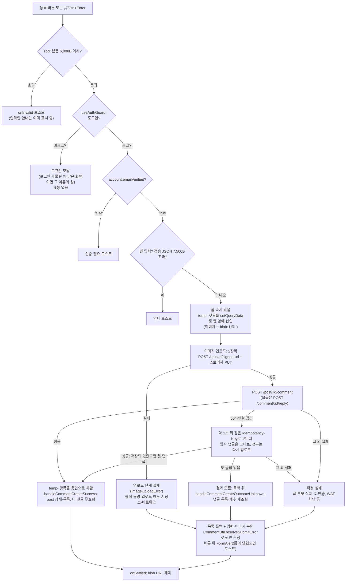
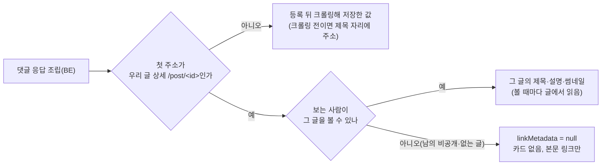
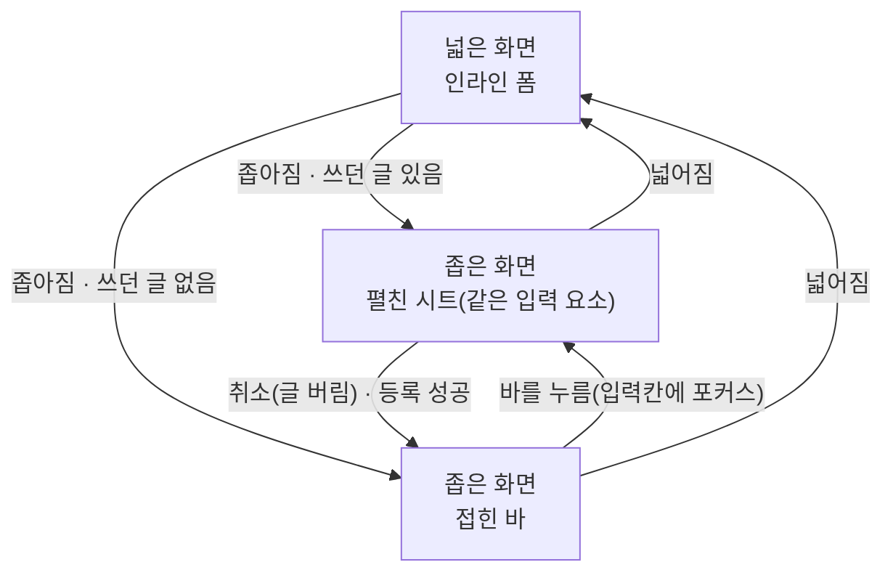
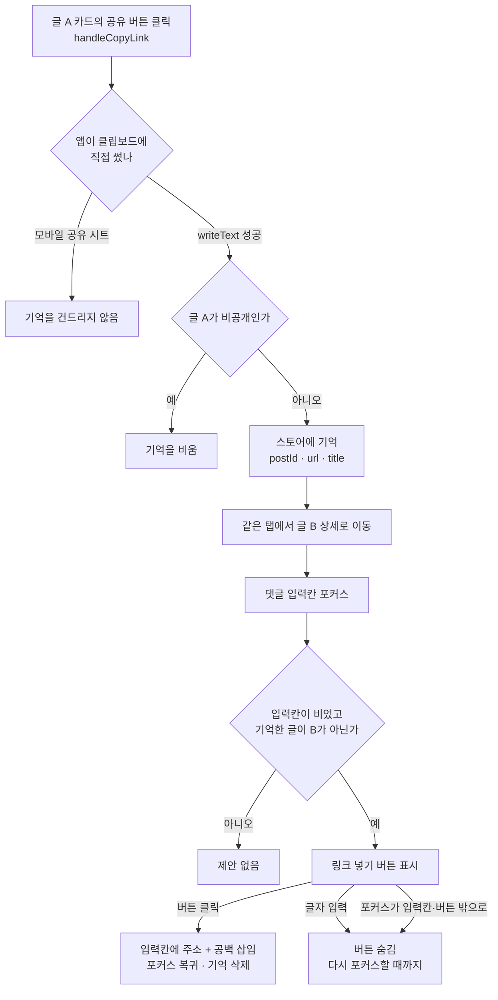

# 댓글 (작성·답글·수정·삭제·좋아요·내 댓글) 기능

> **문서 성격**: 독립 기능 문서(서사형)
>
> **대상 독자**: 이 레포 FE를 처음 보거나 오랜만에 돌아온 개발자.
>
> **읽고 나면**: 댓글이 등록되기 전 화면에 먼저 뜨는 이유(낙관적 업데이트), 길이 상한이
> 두 겹(6,000B·7,500B)인 이유, 입력칸 아래 글자 수를 한글 기준으로 세는 이유, 이미지가 본문 끝에
> URL로 붙는 저장 방식, 업로드·등록이 실패했을 때 원인별로 무엇을 안내하는지, "내 댓글"에서
> 원글의 그 댓글로 이동하는 방식, 복사한 글 링크를 입력칸이 제안하는 조건을 이해하고, 상한·장수·캐시 무효화 범위·실패
> 문구를 어디서 바꾸는지 안다.
>
> **마지막 검토**: 2026-11-20

게시글 상세(`/post/:id`) 하단의 댓글 섹션과, 내가 쓴 댓글을 모아보는 "내 댓글"
화면(`/my/comments`)을 다룬다. 게시글 자체(목록·상세·작성)는
[`POST.md`](./POST.md)가 다룬다.

## 1. 쉬운 설명

댓글 작성은 **메신저에서 메시지를 보내는 것**과 비슷하다. 전송 버튼을 누르면 서버
답을 기다리지 않고 내 메시지가 대화창에 반투명하게 먼저 뜨고, 서버가 받았다고 답하면
진짜 메시지로 조용히 바뀐다. 전송이 실패하면 반투명 메시지가 사라지고 입력창에 쓰던
글이 되돌아오며, 등록 버튼 바로 위에 실패 원인과 할 일이 남는다(§5 "실패 안내").

다른 점이 둘 있다.

- **보내기 전에 크기를 잰다** — CloudFront 앞단의 WAF(웹 방화벽)가 8,192바이트를 넘는
  요청을 앱에 닿기도 전에 막는다. 그래서 FE가 미리 본문 바이트(6,000B)와 실제 전송
  바이트(7,500B)를 두 번 잰다(§5 "길이 상한"). 본문 상한은 입력칸 아래에 `57 / 2,000자 · 한글 기준`처럼
  늘 보인다.
- **이미지는 본문의 일부다** — 첨부 이미지는 스토리지에 먼저 올리고, BE가 그 공개
  URL을 본문 끝에 한 줄씩 이어붙여 저장한다. 별도 이미지 테이블이 없다(§5 "이미지").



## 2. 전제 지식

TanStack Query의 `setQueryData`·`invalidateQueries`와 낙관적 업데이트(`onMutate`→롤백),
React Hook Form + zod resolver의 기본 동작은 안다고 가정한다.

가정하지 않는 것:

- 이 레포의 3-Layer API(`*.api.ts`→`*.keys.ts`→`*.queries.ts`)와 크로스 엔티티 무효화 →
  [`FE-ARCHITECTURE.md`](./FE-ARCHITECTURE.md) §5, 낙관적 업데이트 규약은 같은 문서 §11
- 비로그인 유도(`useAuthGuard`)와 이메일 인증 게이트 → [`AUTH.md`](./AUTH.md) §5
  "네 개의 게이트"(게이트 C·D)
- 작성 중 이탈 경고 → [`UNSAVED-CHANGES-GUARD.md`](./UNSAVED-CHANGES-GUARD.md)
- 처음 보는 용어(`temp-` id, 톰스톤, `EDGE_BLOCKED` 등) → §12 용어 사전
- 서비스 전체 지도 → [`ONBOARDING.md`](./ONBOARDING.md)

## 3. 사용한 도구·기술

**기능 자체를 이루는 것**

- **TanStack Query** — 댓글 트리 조회(`useSuspenseQuery`), 내 댓글 무한 스크롤
  (`useSuspenseInfiniteQuery`), 작성·답글·좋아요 낙관적 업데이트
- **React Hook Form + Zod** — 작성·수정 폼이 공유하는 바이트 상한 스키마
  (`commentContentFormSchema`)
- **`useImageAttachments`**(`src/shared/hooks/useImageAttachments.ts`) — 붙여넣기·파일
  선택·드래그앤드롭 첨부, 장수·용량 검증
- **스토리지 직접 업로드** — `uploadImageAndGetUrl`(리사이즈 → 서명 URL 발급 → PUT)
- **`IntersectionObserver`** — 내 댓글 다음 페이지 선반입
- **`ResizeObserver`** — 모바일 댓글 바 높이만큼 토스트 위치를 올림
- **Zustand**(`useCopiedPostLinkStore`) — 공유 버튼으로 복사한 글 링크를 탭 메모리에 기억(§5 "복사한 글 링크 넣기")

**구현·검증 과정에서 쓴 도구**: Vitest + MSW(`src/mocks/handlers/comment.handlers.ts`),
Playwright e2e(`page.route()` 모킹) — §9 참고.

## 4. 왜 만들었나

링크를 공유하는 서비스에서 댓글은 "이 글 왜 좋은지/어디가 틀렸는지"를 남기는 유일한
대화 수단이다. 처음엔 단순 텍스트 CRUD였고, 쓰면서 부딪힌 문제를 하나씩 풀며 지금
모양이 됐다.

- **느림** — 등록 후 서버 응답(당시엔 링크 프리뷰 크롤링 포함)과 목록 재조회를 기다려야
  댓글이 보였다 → 2026-08-03 낙관적 업데이트로 전환(`595b678`). 지금 BE는 링크 프리뷰를
  커밋 후 별도 Lambda에서 크롤링한다(BE `CommentService.kt` 주석, `CommentPostProcessService`).
- **이미지 첨부 발견성** — 붙여넣기로만 첨부할 수 있어 모바일에선 사실상 불가능했다 →
  2026-08-10 버튼·드래그앤드롭, 최대 5장(`docs/DECISIONS.md` 2026-08-10)
- **원인 불명의 403** — 긴 댓글·태그가 섞인 댓글이 CloudFront WAF에 막혔다 →
  2026-09-06 앱 상한 + `EDGE_BLOCKED` 안내(§10)
- **"내가 어디 달았지"** — 내가 쓴 댓글을 다시 찾을 방법이 없었다 → 2026-09-14
  "내 댓글" 화면(`63b6881`, PR #90)

## 5. 구조

### API 엔드포인트

경로 정의는 `src/shared/config/api.ts:49-56`, 호출은 `src/entities/comment/api/comment.api.ts`.

| 메서드   | 경로                         | 용도                                                                                       |
| -------- | ---------------------------- | ------------------------------------------------------------------------------------------ |
| `GET`    | `/post/{postId}/comment`     | 게시글의 댓글 트리(루트 + `replies`) 전체, 페이지네이션 없음                               |
| `POST`   | `/post/{postId}/comment`     | 루트 댓글 등록 `{ content, images: string[] }`                                             |
| `POST`   | `/comment/{commentId}/reply` | 답글 등록(바디 동일)                                                                       |
| `PATCH`  | `/comment/{commentId}`       | 수정 `{ content, images: [...기존 URL, ...새 업로드 URL] }`                                |
| `DELETE` | `/comment/{commentId}`       | 삭제                                                                                       |
| `PUT`    | `/comment/{commentId}/like`  | 좋아요(멱등, `entities/interaction`이 소유)                                                |
| `DELETE` | `/comment/{commentId}/like`  | 좋아요 취소(멱등). 옛 `POST` 토글은 2026-10-14 제거(BE #92)                                |
| `GET`    | `/comment/my?cursor&size`    | 내 댓글(`postId`·`postTitle` 포함). 첫 쪽은 `cursor` 없이, 다음 쪽은 응답의 `nextCursor`로 |

응답 타입은 BE OpenAPI 생성 타입의 alias다(`src/entities/comment/model/comment.dto.ts`).
`Comment`는 `linkMetadata`의 nullable과 `replies` 재귀를 직접 override한다 — 이유는 그
파일 주석(9-17줄)에 있다.

### 목록 — 트리 2단, 루트만 최신순

- `useCommentList`(`src/widgets/comment/comment-list/hooks/useCommentList.ts:14-30`)가
  루트 댓글만 `createdAt` 내림차순으로 다시 정렬한다. 답글은 서버가 준 순서 그대로다.
- 상세에 들어가면 댓글은 게시글과 동시에 요청된다(§5 "내 댓글" 절의 해시 이동, 기다림 줄이기 항목).
- 헤딩 옆 개수(`countComments`, 같은 파일 6-8줄)는 답글과 **삭제된 톰스톤까지** 센다 —
  `PostCard`의 `commentCount`와 맞추기 위해서다.
- 답글은 한 단계만 허용한다. 답글 버튼 조건은
  `depth < 1 && !isDeleted && !isOptimistic`
  (`src/widgets/comment/comment-list/ui/CommentItem.tsx:40`, `canReply`) — 답글에는
  답글 버튼이 없다.
- 삭제된 댓글(`isDeleted`)은 원래 본문이 아니라 BE가 바꿔 넣은 "삭제된 댓글입니다."가
  흐린 이탤릭으로 보이고, 액션 줄은 사라진다(같은 파일 41줄·88줄, BE 치환은 §5 "삭제").
  게시글 작성자가 쓴 댓글엔 "작성자" 배지가 붙는다(66-70줄).
- `temp-`로 시작하는 낙관적 항목은 `opacity-60`이고 좋아요·답글·수정·삭제를 숨긴다 —
  아직 실제 id가 없어 서버 액션을 걸면 404가 나기 때문이다(37-39줄 주석과 코드).

### 작성 — 즉시 반영, 실패 시 복원

`useCreateComment`(`src/features/comment/create/hooks/useCreateComment.ts`)의 제출 순서는
§1 순서도와 같다. 구현상 짚을 점:

1. **검증은 세 군데로 나뉜다** — zod(본문 6,000B, 실패 시 `form.handleSubmit`의 두 번째 인자인
   `onInvalid` 콜백 토스트), `account.emailVerified === false` 토스트(`guard` 콜백 안), `getCommentSubmitError`(빈 입력·
   전송 7,500B). 빈 입력 판정은 이미지만 있어도 통과다.
2. **줄바꿈 정규화** — CRLF·CR을 LF로 바꾼 뒤 잰다(`onSubmit`의 `replace(/\r\n/g, '\n')`). 붙여넣은 Windows 텍스트가
   바이트를 부풀리지 않게 한다.
3. **폼은 즉시 비우고, 닫기는 미룬다** — `reset()`·`clearAllImages()`를 먼저 하고(`onSubmit`, `submitComment` 호출 직전)
   폼을 닫는 `onSuccess`는 `mutateAsync`가 성공한 뒤에 부른다(`submitComment`).
   답글 폼·모바일 바는 성공 시 언마운트되는데, 지금 닫으면 실패했을 때 입력을 되돌리고
   원인을 안내할 자리가 사라진다. `mutate` 콜백 대신 `mutateAsync`를 기다리는 이유는 아래
   "실패 안내"의 "폼이 닫힌 뒤 실패하면"을 본다.
4. **실패 복원은 덮어쓰지 않는다** — 요청이 도는 사이 사용자가 새 글을 쓰기 시작했으면
   본문을 되돌리지 않고, 이미지도 비어 있을 때만 되돌린다(`submitComment`의 `catch`). 복원한 뒤 원인
   안내를 남긴다(아래 "실패 안내").
5. **낙관적 삽입** — `useCreateCommentMutation`(`src/entities/comment/api/comment.queries.ts`)이
   `temp-<uuid>` 댓글을 목록 맨 앞에, 같은 파일의 `useCreateReplyMutation`이 부모의
   `replies` 끝에 넣는다. 성공하면 id로 응답과 치환하고 목록은 재조회하지 않는다.

버튼 비활성화는 **빈 입력일 때만**이다(`src/features/comment/create/ui/CommentForm.tsx`의 `canSubmit`).
길이 초과는 버튼을 막지 않고 인라인 안내 문구 + `aria-invalid`로 보여준 뒤, 눌렀을 때
zod가 막는다 — 이유는 `.claude/CLAUDE.md` Critical Rules의 "폼 검증 실패를 버튼
`disabled`만으로 처리하지 않는다" 항목과 §10. 빈 상태에서 ⌘/Ctrl+Enter를 누르면 답글 폼이
여러 개 열려 있을 수 있어 그 폼 자체를 화면 중앙으로 스크롤하고 1.3초 강조한다
(`highlightEmptyForm`).

등록 단축키(⌘/Ctrl+Enter)가 조합 중에 오면 그 자리에서 제출하지 않는다(조합·IME는 §12). `CommentForm`의 `onKeyDown`이
`isComposing`을 보고 `submitAfterCompositionRef`에 예약만 해 두고, 조합이 끝났다고 브라우저가 알리는 `compositionend`
(`onCompositionEnd`)에서 제출한다. 제출은 입력란을 바로 비우는데(위 3번), 조합 중에 비우면 브라우저가 뒤이어 확정하는 마지막
글자가 빈 입력란에 다시 들어가기 때문이다(§10 "한글 조합 중 ⌘+Enter"). 예약은 바로 이어지는 조합 종료까지만 유효하다 — 그
전에 다른 키가 오면 풀려, 나중의 글자 확정이 쓰다 만 댓글을 등록하지 않는다. 조합 중이 아닌 단축키는 누른 자리에서 제출한다.

이탈 가드 키는 `comment-create:${postId}:${parentId ?? 'root'}`(useCreateComment.ts의
`useUnsavedChanges` 호출)이다. 동작은 [`UNSAVED-CHANGES-GUARD.md`](./UNSAVED-CHANGES-GUARD.md) 참고.

### 길이 상한 — 두 겹인 이유

| 검사                        | 무엇을 재나                                    | 언제                   | 위치                                                    |
| --------------------------- | ---------------------------------------------- | ---------------------- | ------------------------------------------------------- |
| 본문 상한 6,000B            | `content` 원본의 UTF-8 바이트(한글 2,000자)    | 타이핑 중 + 제출 시    | `commentContentFormSchema`, `MAX_COMMENT_CONTENT_BYTES` |
| 전송 상한 7,500B            | `JSON.stringify({ content, images })`의 바이트 | 제출 직전              | `CommentUtil.estimateCommentPayloadBytes`               |
| WAF `SizeRestrictions_BODY` | 요청 바디 전체 8,192B                          | CloudFront(앱 도달 전) | AWS 관리형 룰, 손대지 않음                              |

본문 바이트만 재면 줄바꿈이 JSON에서 `\n`(2바이트)로 늘어나는 것과 이미지 URL 몫을
놓친다. 그래서 실제 전송될 JSON과 같은 모양을 만들어 다시 잰다. 아직 업로드 전인
이미지는 URL을 모르므로 200바이트 자리표시자로 채운다(`src/entities/comment/utils/comment.util.ts:130-140`).

**입력칸 아래 글자 수(2026-11-04)** — 작성·답글·수정 폼은 입력칸 바로 아래 오른쪽에 본문 상한까지 얼마나 썼는지를
`57 / 2,000자 · 한글 기준`처럼 0부터 늘 보인다(모바일·데스크톱 같음). 전에는 넘었을 때만 안내 문구가 나왔다.

- **한글 기준으로 센다** — 상한이 글자가 아니라 바이트라, 숫자는 `ceil(UTF-8 바이트 ÷ 3)`이다
  (`CommentUtil.countHangulEquivalentChars`). 한글은 1자에 1씩, 영어·숫자·공백은 3자에 1씩, 이모지는 2씩 오른다.
  "한글 기준" 표기가 이 차이를 설명한다. 실제 글자 수로 세면 영어 3,000자를 쓴 사람은 `3,000 / 2,000`에서도
  등록이 되고, 반대로 상한을 2,000자로 바꾸면 영어·코드 댓글 한도가 1/3로 준다(운영의 가장 긴 댓글은 영어 로그
  3,389자였다). 판단 근거는 `docs/DECISIONS.md` 2026-11-04.
- **넘는 순간이 규칙과 같다** — `ceil(b ÷ 3) > 2,000`은 `b > 6,000`과 같다. 바이트 상한이 3의 배수일 때만
  성립하므로 상한을 바꿀 때 3의 배수로 둔다(`comment.util.test.ts`의 경계 동치 테스트가 지킨다).
- **넘으면 색만 바뀐다** — 숫자가 `text-muted-foreground`에서 `text-destructive`로 바뀌고, 이유는 왼쪽의 기존
  문구(`TEXTS.validation.commentContentTooLong`)가 말한다. 색만으로 뜻을 전하지 않기 위해서다. 제출 차단·
  `aria-invalid`·토스트는 그대로다.
- **화면 읽기 프로그램** — 입력칸의 `aria-describedby`가 카운터를 가리켜(id는 `useId`), 포커스할 때 숫자를 읽는다.
  키 입력마다 읽게 하는 live region은 두지 않았다.
- **전송 상한은 반영하지 않는다** — 줄바꿈·이미지까지 더한 7,500B는 제출 때만 잰다. 그래서 카운터는 상한 안인데
  제출이 `commentPayloadTooLarge`로 막히는 경우가 있다(§11).

컴포넌트는 `src/shared/ui/elements/CharacterCount.tsx`(문구·색만 담당, 세는 방법은 부르는 쪽이 정한다)다.

**왜 6,000B인가** — 이미지 URL 5개(약 650B)와 JSON 봉투를 더해도 8,192B 벽 안에 여유 있게 들어가도록
잡은 값이다(`src/entities/comment/config/comment.const.ts:4-14` 주석). 7,500B는 그 벽 대비 약 700B 여유를 둔
전송 상한이다. 값이 지금으로 정해진 경위는 §10을 본다.

그래도 WAF에 막히면 403이 HTML로 온다. `client.ts`는 JSON 파싱에 실패한 403을
`EDGE_BLOCKED`로 분류하고(`src/shared/api/client.ts:96-105`), 댓글 폼은
`CommentUtil.resolveSubmitError`가 이 코드를 "보안 정책에 막혔다"는 문구로 바꿔 버튼 위에
남긴다(아래 "실패 안내"). 전역 토스트를 쓰는 다른 화면은 토스트 판정이 같은 문구를
`meta.errorMessage`보다 먼저 고른다(`src/shared/lib/react-query/config/error-toast.ts`의 `resolveErrorToast` 중
`EDGE_BLOCKED` 분기). WAF 룰을 완화하면 안 되는
이유는 `.claude/CLAUDE.md` Critical Rules의 WAF 항목에 있다.

### 이미지 — 본문 끝에 URL을 붙이는 저장 방식

- 첨부는 `useImageAttachments({ maxCount: 5 })`가 받는다. 허용 형식(JPG·PNG·GIF·WEBP·AVIF·SVG,
  `src/shared/config/image-format.ts`) 밖의 파일, 30MB 초과(리사이즈하지 않는 SVG·GIF는 10MB 초과),
  5장 초과는 토스트로 거른다. 허용 형식과 SVG·GIF 상한은 업로드 버킷 설정(`allowed_mime_types`,
  `file_size_limit` 10MB)과 맞춘 값이다 — 버킷보다 넓으면 고를 때는 통과해도 업로드에서 거부된다.
- 업로드는 요청 직전 `uploadCommentImages`(`src/entities/comment/api/comment.api.ts:10-22`)가
  **2장씩** 처리한다. `createImageBitmap`이 디코드된 픽셀 수만큼 메모리를 쓰기 때문에
  동시 디코드를 줄이려는 것이고, 결과 배열은 입력 순서를 유지한다.
- 장마다 `uploadImageAndGetUrl`(`src/shared/lib/upload/uploadImageAndGetUrl.ts:48-68`)이
  1600px WebP로 리사이즈 → `POST /upload/signed-url` → 스토리지 `PUT` → `publicUrl`을
  돌려준다. 원본은 저장하지 않는다. 예외로 SVG는 항상, GIF는 댓글 업로드 기본값
  (`skipGifResize = true`)에서 리사이즈 없이 원본을 올린다
  (`src/shared/lib/image/resizeImage.ts:16-21`, 47-48줄) — 그래서 상한이 10MB로 따로 있다.
- BE가 `content` 끝에 URL을 이어붙여 저장한다 — 본문이 있으면 빈 줄 하나 뒤에, 이미지
  URL은 한 줄에 하나씩(BE [`CommentService.kt`](https://github.com/BAECHAN/link-sphere_BE_NEW/blob/main/src/main/kotlin/com/example/linksphere/domain/comment/CommentService.kt)
  `buildFinalContent`). FE는 낙관적 항목을 같은 규칙으로
  조립하고(comment.queries.ts의 `buildOptimisticComment`), 수정 폼은 역함수
  `splitContentImages`(`src/shared/lib/content/imageContent.ts:17-41`)로 텍스트와 이미지
  줄을 다시 나눈다. 닫힌 코드 블록 안의 주소는 화면에 글자로만 보이므로 이미지 줄로 치지 않고
  본문으로 둔다(`src/shared/lib/content/codeBlock.ts`, `MarkdownContent`도 같은 규칙으로 그린다).
  테이블을 분리하지 않은 이유는 `docs/DECISIONS.md` 2026-08-10 항목.
- 렌더링은 `MarkdownContent`가 이미지 확장자 URL과 `blob:` URL을 이미지로 그린다.
  스토리지 이미지는 Supabase 변환 주소(`/render/image/`, 800px 정사각)로 받는다. 이 변환이
  실패하면 `AttachmentImage`가 원본 주소(`/object/`)로 한 번 더 받는다 — Supabase 공식 문서상
  이미지 변환은 Free 플랜에 없는 기능이라(_"Pro Plan 이상에서 활성화돼 있다"_ (번역),
  [Image Transformations](https://supabase.com/docs/guides/storage/serving/image-transformations)),
  지금은 동작해도(2026-10-28 직접 확인) 언제 막힐지 모른다. 아바타(`UserAvatar`)도 같은 순서로
  받고, 원본까지 실패하면 닉네임 첫 글자를 보여 준다.

### 링크 카드 — 외부 링크는 크롤링값, 우리 글 링크는 그 글의 값(2026-11-19)

본문에 이미지가 아닌 주소가 있으면 본문 아래에 링크 카드(썸네일·제목·설명·주소)가 붙는다. 카드는 응답의
`linkMetadata`를 그대로 그리고, 값이 `null`이면 그리지 않는다(`CommentItem.tsx`의 `comment.linkMetadata` 조건,
수정 폼은 `CommentEditForm.tsx`의 `linkMetadata` 조건). FE는 값을 어디서 왔는지 구분하지 않는다 — 두 경로는 BE가 나눈다.



- **외부 링크**: 댓글 등록·답글·수정 뒤 BE 후처리 잡이 주소를 크롤링해 저장하고, 응답은 그 저장값을 싣는다.
  크롤링이 끝나기 전에 받은 응답은 제목 자리에 주소가 들어 있다.
- **우리 글 링크**(`https://linksphere.click/post/<id>`, `www.`·끝 `/`·쿼리·`#comment-…` 포함): 우리 글 주소는 어떤 글이든 같은
  SPA 껍데기 `index.html`(`<title>Link Sphere</title>`, og 태그 없음)을 돌려줘 크롤링하면 제목이 전부 "Link Sphere"였다.
  그래서 BE가 크롤링하지 않고, 응답을 만들 때마다 글 테이블에서 보는 사람이 볼 수 있는 글의 제목·설명·썸네일을 읽는다.
  글을 고치거나 비공개로 바꾸면 다음 조회부터 카드가 바뀐다. 남의 비공개 글·없는 글이면 `linkMetadata`가 `null`이라 카드가
  없고, 비로그인은 공개 글만 본다. 등록·수정 응답에도 같은 값이 실려 목록을 다시 받지 않아도 카드가 바로 보인다.
- 주소 끝에 마침표·쉼표·괄호나 조사가 붙어 글 id가 깨지면 우리 글로 보지 않아 크롤링 경로를 탄다("Link Sphere" 카드).
- 판정 규칙·기각한 대안(저장할 때 복사, 브라우저가 글마다 조회)·테스트는 BE
  [`docs/plans/2026-11-19-comment-post-link-preview.md`](https://github.com/BAECHAN/link-sphere_BE_NEW/blob/main/docs/plans/2026-11-19-comment-post-link-preview.md)(BE #224)가
  정본이다.
- **누르면 어디로 가나(2026-11-19)**: 댓글 목록에서 지금 사이트의 글 상세 주소면 카드와 본문 링크 모두 같은 탭에서 앱 안으로
  이동한다(`Link`). 판정은 `UrlUtil.toInAppPostPath`(`src/shared/utils/url.util.ts`)가 BE와 같은 규칙으로 하되, 사이트 주소
  상수가 없어 지금 페이지의 호스트와 비교한다 — dev(localhost)에서는 운영 주소가 다른 사이트로 보여 새 탭으로 열린다.
  - ⌘/Ctrl·가운데 클릭은 `Link`가 브라우저에 넘겨 새 탭으로 열린다.
  - 쓰던 댓글이 있는데 다른 글로 가면 이탈 가드가 "작성 중인 내용이 있어요" 확인창을 띄운다(사용자 선택). 같은 글 안의
    `#comment-…`는 막지 않고, `replace` + `preventScrollReset`으로 그 댓글까지 스크롤한다(아래 "해시 이동",
    [`FE-ARCHITECTURE.md`](./FE-ARCHITECTURE.md) §25).
  - 다른 사이트 링크와 작성·수정 폼 미리보기의 링크·카드는 지금처럼 새 탭이다(폰 본문 링크는 같은 탭 새로 읽기). 고치는
    도중이라 떠날 일이 드물고, 앱 안 이동이면 거의 매번 확인창이 뜬다(사용자 선택). 그래서 `MarkdownContent`의
    `inAppPostLinks`는 기본값이 꺼져 있고 댓글 목록(`CommentItem`)만 켠다.
  - 계획은 [`docs/plans/2026-11-19-post-link-in-app-and-og.md`](./plans/2026-11-19-post-link-in-app-and-og.md) Phase 1.

### 수정 — 기존 이미지는 URL로, 새 이미지는 파일로

`useUpdateComment`(`src/features/comment/update/hooks/useUpdateComment.ts`):

- 편집 시작 시점에 `splitContentImages`로 한 번만 스냅샷을 뜬다(53-54줄). 기존 이미지는
  URL 썸네일로, 새로 붙인 것은 `File`로 따로 관리한다.
- 기존 이미지 장수를 `reservedCount`로 넘겨 합계 5장을 지킨다(100줄).
- 전송 상한 계산에 기존 URL을 실제 길이로 포함한다(39-41줄).
- PATCH 바디의 `images`는 `[...남은 기존 URL, ...새 업로드 URL]`이다(comment.api.ts 60-61줄).
- 성공 시 응답을 통째로 넣지 않고 `content`·`linkMetadata`만 병합한다
  (comment.queries.ts의 `patchCommentRecursively`를 `useUpdateCommentMutation`의 `onSuccess`가 부른다). PATCH 응답은
  `replies`·`likeCount`·`isLiked`를 항상 기본값으로 주기 때문에 통째로 넣으면 답글이
  사라지고 좋아요가 리셋된다. 병합 뒤 `handleCommentUpdateSuccess`가 목록을 한 번 더
  무효화한다(정합성 백스톱).
- 작성과 달리 **낙관적이지 않다** — 응답이 와야 폼이 닫힌다. 실패하면 폼을 닫지 않고
  버튼 위에 원인을 남긴다(아래 "실패 안내").

### 실패 안내 — 원인과 할 일을 버튼 위에

등록·답글·수정이 실패하면 `CommentUtil.resolveSubmitError`
(`src/entities/comment/utils/comment.util.ts:32-105`)가 원인을 판정하고, 폼 훅이 그 문구를
`failureMessage`로 들고 있다가 첨부 썸네일과 버튼 사이의 `FormAlert`에 남긴다
(`CommentForm.tsx`·`CommentEditForm.tsx`의 `{failureMessage && <FormAlert>…}`). 세 mutation은 `manualErrorHandling`이라
전역 토스트는 뜨지 않는다. 안내는 입력을 고치거나 첨부를 바꾸거나 다시 제출하면 지워진다. 첨부는 파일이 형식·크기·개수
검증을 통과해 실제로 들어갔을 때만 바뀐 것으로 본다(`useImageAttachments`의 `onFilesAdded`, 2026-11-03
[#491](https://github.com/BAECHAN/link-sphere_FE_NEW/issues/491) 6번). 전에는 첨부 핸들러를 부르기만 해도 지워, bmp처럼
검증에 걸린 파일을 넣어도 고친 게 없는데 안내가 사라졌다. 이미지를 빼는 것은 지금처럼 바로 지운다.
위치(버튼 바로 위)는 게시글 폼과 같은 자리로, 시안을 나란히 비교해 정했다
(`docs/DECISIONS.md` 2026-10-06).

판정은 **어느 단계에서 실패했는가**부터 나눈다. 업로드 단계는 본 요청을 보내기 전이라
댓글이 저장되지 않은 게 확실하고, 본 요청 단계의 504·연결 끊김은 서버에 저장됐을 수도
있다. 같은 429·네트워크 실패라도 안내가 달라야 해서, 업로드 단계 실패는
`uploadImageAndGetUrl`이 `ImageUploadError`로 따로 감싼다
(`src/shared/lib/upload/uploadImageAndGetUrl.ts:13-39`).

| 단계    | 원인                                                         | 판별 근거                                                                                                                                                                                                                                            | 문구 키(`TEXTS.messages.error.*`)                                                                                                                                                                                                                                                                                                            |
| ------- | ------------------------------------------------------------ | ---------------------------------------------------------------------------------------------------------------------------------------------------------------------------------------------------------------------------------------------------- | -------------------------------------------------------------------------------------------------------------------------------------------------------------------------------------------------------------------------------------------------------------------------------------------------------------------------------------------- |
| 업로드  | 허용 밖 형식                                                 | 서명 URL `UNSUPPORTED_IMAGE_TYPE`, 스토리지 `statusCode` "415"                                                                                                                                                                                       | `uploadSubmit.imageUnsupportedType`                                                                                                                                                                                                                                                                                                          |
| 업로드  | 10MB 초과                                                    | 스토리지 `statusCode` "413"                                                                                                                                                                                                                          | `uploadSubmit.register.imageTooLarge`                                                                                                                                                                                                                                                                                                        |
| 업로드  | 업로드 한도(회원당 시간당 30회)                              | 서명 URL 429 + `Retry-After`(없으면 분 없는 문구)                                                                                                                                                                                                    | `uploadSubmit.register.imageRateLimitedIn(분)`·`imageRateLimited`                                                                                                                                                                                                                                                                            |
| 업로드  | 저장소 혼잡·장애                                             | 스토리지 429·5xx(544 DB 타임아웃 포함)                                                                                                                                                                                                               | `uploadSubmit.register.storageUnavailable`                                                                                                                                                                                                                                                                                                   |
| 업로드  | 연결 끊김                                                    | `fetch` reject → `NetworkError`                                                                                                                                                                                                                      | `uploadSubmit.register.network`                                                                                                                                                                                                                                                                                                              |
| 본 요청 | 결과 모름(등록·답글만)                                       | 504, `NetworkError`                                                                                                                                                                                                                                  | `commentSubmit.outcomeUnknown` + 목록 재조회                                                                                                                                                                                                                                                                                                 |
| 본 요청 | 1분 안에 같은 내용을 또 등록(등록·답글만, BE 필수화 뒤 발생) | 키가 다른데 같은 대상·같은 본문이면 BE가 409 `DUPLICATE_COMMENT`                                                                                                                                                                                     | `commentSubmit.duplicate` + 목록 재조회                                                                                                                                                                                                                                                                                                      |
| 본 요청 | 글 삭제 / 답글 대상 삭제 / 수정 대상                         | `POST_NOT_FOUND` / 답글의 `COMMENT_NOT_FOUND` / 수정의 `COMMENT_NOT_FOUND`·`COMMENT_DELETED`                                                                                                                                                         | `commentSubmit.postDeleted`·`parentDeleted`·`commentDeleted`                                                                                                                                                                                                                                                                                 |
| 본 요청 | 요청 한도·동시 실행 포화                                     | 429(댓글 API엔 앱 레이트리밋이 없어 Lambda 동시 실행 포화 등)                                                                                                                                                                                        | `rateLimited`                                                                                                                                                                                                                                                                                                                                |
| 본 요청 | 이메일 미인증·WAF 차단·로그인 필요                           | `EMAIL_NOT_VERIFIED`·`EDGE_BLOCKED`·`NOT_LOGGED_IN`·`INVALID_TOKEN`                                                                                                                                                                                  | 기존 문구 그대로                                                                                                                                                                                                                                                                                                                             |
| 본 요청 | 로그인이 풀려 저장하지 못함(2026-10-28)                      | `SessionExpiredError` — 보내는 사이 로그인이 만료됨(`ErrorUtil.isSessionExpired`, `CommentUtil.resolveSubmitError`를 거치지 않음). 로그인이 풀린 채 그 화면에 남아 누르면 요청 전에 `useAuthGuard`가 그 이유의 로그인 창을 연다(등록·답글·수정 공통) | 입력만 남기고 끝낸다. 폼 안 `signedOutBeforeSave`("로그인이 풀렸어요. 로그인한 뒤 저장해 주세요.")는 로그인이 풀린 채 남아 있고 쓴 내용이 있는 동안 `useSignedOutNotice`가 띄우고, 다시 로그인하면 사라진다. 다시 로그인하라는 안내는 그 자리에 뜬 로그인 창이 맡는다([`AUTH.md`](./AUTH.md) §8-I). 폼이 닫힌 뒤면 토스트 없이 조용히 끝낸다 |
| 본 요청 | 권한 없음                                                    | `ACCESS_DENIED`                                                                                                                                                                                                                                      | `accessDenied`                                                                                                                                                                                                                                                                                                                               |
| 첨부    | 첨부 처리 중 직접 던진 안내                                  | `UserFacingError`(이미 `TEXTS`로 쓴 문구)                                                                                                                                                                                                            | 그 문구 그대로                                                                                                                                                                                                                                                                                                                               |
| 그 외   | 나머지                                                       | —                                                                                                                                                                                                                                                    | `commentSubmit.createFailed`·`updateFailed`                                                                                                                                                                                                                                                                                                  |

- **수정 폼은 끝맺음이 "저장"이다** — 업로드 단계 문구는 `register`(등록)·`save`(저장) 두
  벌이 있고, 수정 폼과 프로필 사진은 `save`를 쓴다. 수정은 결과를 몰라도 다시 보내면 같은
  내용으로 덮어쓸 뿐이라 결과 모름 안내 대신 일반 안내(`save.network`·`updateFailed`)를 쓴다.
- **수정은 자동으로 1번 더 보낸다** — 응답을 못 받으면 약 1초 뒤 같은 PATCH를 1번 더 보내고(`FE-ARCHITECTURE.md` §28), 또 응답이
  없으면 위 일반 안내와 함께 댓글 목록을 다시 받는다(`handleCommentUpdateSuccess`). 등록·답글도 같은 키로 1번 더 보낸다(아래).
- **스토리지 원인은 본문에 있다** — Supabase Storage는 500이 아닌 오류를 HTTP 400으로 보내고
  원래 상태 코드는 본문 `statusCode`에 남긴다([storage 서버 `http` 폴더의 `error-handler.ts`](https://github.com/supabase/storage/tree/master/src/http),
  413·415·544 정의는 [`internal/errors` 폴더의 `codes.ts`](https://github.com/supabase/storage/tree/master/src/internal/errors),
  2026-10-06 소스 확인). 그래서 `upload.api.ts`의 `resolveStorageFailureReason`이 본문을 먼저 읽고,
  없으면 HTTP 상태로 판정한다.
- **같은 시도는 같은 키로 보낸다** — 등록·답글 요청에 `Idempotency-Key`를 싣는다(`comment.queries.ts`의 `mutationFn`). 응답을 못
  받으면 약 1초 뒤 같은 키로 자동으로 1번 더 보내고(그동안 임시 댓글은 화면에 그대로다), 실패해 복원된 입력을 그대로 다시 보내도
  같은 키다. 그래서 첫 요청이 저장됐어도 댓글이 둘이 되지 않고 기존 댓글이 돌아온다. 그 댓글은 이미 재조회로 목록에 있을 수 있어
  `settleTempComment`가 임시 댓글만 걷어낸다. 본문이나 첨부를 고치면 새 키다(`docs/FE-ARCHITECTURE.md` §27). 첨부가 있으면 시도마다
  이미지를 다시 올리고, 먼저 올린 파일은 아래 "실패한 업로드의 파일" 절차대로 BE 정리 작업이 지운다.
- **결과 모름이면 목록을 다시 불러온다** — 다시 보낸 요청까지 응답을 못 받은 경우다. 504면 CloudFront가 기다림을 끊었을 뿐 서버는
  저장을 마쳤을 수 있다. 낙관적 댓글을 롤백한 뒤 `handleCommentCreateOutcomeUnknown`
  (`src/entities/comment/api/comment.keys.ts:37-42`)이 목록과 댓글 수를 다시 불러와, 실제로
  저장됐다면 다시 보이게 한다. 입력은 그대로 복원되니 목록을 보고 판단하면 된다.
- **폼이 닫힌 뒤 실패하면 토스트로 대신 알린다** — `mutate` 콜백은 요청 도중 컴포넌트가
  언마운트되면 불리지 않는다. 전역 토스트를 끈 지금 그대로 두면 답글 폼을 취소하거나 모바일
  바를 접은 뒤의 실패가 조용히 묻힌다. 그래서 `mutateAsync`를 기다리고, 그 시점에 폼을
  떠났으면(`useHasLeftPage` — 언마운트됐거나 라우터 경로가 바뀜) "댓글을 등록하지 못했어요" 같은 제목과
  같은 이유를 담은 토스트를 닫을 때까지 남긴다. 제출 때 입력을 비워 다른 곳에 실패 흔적이 없기
  때문이다. 경로까지 보는 이유와 토스트 모양은 [`UNSAVED-CHANGES-GUARD.md`](./UNSAVED-CHANGES-GUARD.md) §5
  "떠난 뒤 실패 토스트"(2026-11-02, [#488](https://github.com/BAECHAN/link-sphere_FE_NEW/issues/488)).
- **연결 끊김 판별** — `client.ts`·`upload.api.ts`가 `fetch` 호출 자리의 reject만
  `NetworkError`로 바꾼다. 예전에는 Chrome 문구 `'Failed to fetch'`만 비교했다
  (`ErrorUtil.isServerError`는 두 방식을 모두 본다).
- **프로필 사진도 같은 문구를 쓴다** — `account.queries.ts`의 `resolveAccountUpdateErrorMessage`가
  업로드 단계의 연결 끊김·429를 `save` 문구로 토스트한다. 업로드 뒤 저장 요청의 응답을 끝내 못 받으면
  공용 `outcomeUnknown` 문구다([`MYPAGE.md`](./MYPAGE.md) §5).

### 삭제 — 확인 후 서버 판단을 기다린다

`useDeleteComment`(`src/features/comment/delete/hooks/useDeleteComment.ts:13-22`)가
`openConfirm`을 띄우고 확인 시 `mutateAsync`로 지운다.
낙관적 반영은 없고, 성공하면 `handleCommentDeleteSuccess`가 댓글 목록·내 댓글·게시글
상세·게시글 목록을 무효화한다. 같은 때 `onSuccess`가 "댓글을 삭제했어요." 토스트를 직접 띄운다 — 확인창이 닫힌 뒤
재조회가 끝날 때까지 화면이 그대로라서다(2026-10-21, 판단 기준은
`.claude/skills/texts-conventions/SKILL.md` "성공 토스트 표시 기준" 축 4). 아래 404와 문구가 갈려
`meta.successMessage`로는 표현할 수 없다.

**이미 없는 댓글(404 `COMMENT_NOT_FOUND`)은 실패로 치지 않는다.** "이미 삭제된 댓글이라 화면을 갱신했어요." 정보 토스트 1개만 띄우고
성공과 같은 캐시를 무효화한다(2026-11-04 사용자 결정, 비교한 제품·대안은 [`POST.md`](./POST.md)의
"이미 없는 글·댓글을 지우면"). 글 작성자가 글을 지우면 내 댓글도 FK cascade로 함께 사라지는데, 이때는 "삭제했어요"가
사실이 아니라 이 문구를 쓴다. 이 경우 댓글 목록 재조회도 404(`POST_NOT_FOUND`, BE `CommentService.getComments`)이고, 캐시가
있는 suspense 쿼리는 재조회가 실패해도 오류를 던지지 않고 이전 데이터를 그대로 그린다(`@tanstack/react-query` 5.90.16
`build/modern/suspense.js:2`의 `defaultThrowOnError`). 그래서 `useDeleteCommentMutation`이 캐시에서 그 댓글을 직접
뺀다(`removeCommentRecursively`, 답글은 부모의 `replies` 안에서).

**이때 글 화면은 그대로 남는다.** 상세 재조회의 404도 같은 이유로 화면을 바꾸지 않아, 글이 지워졌어도 떠나기 전까지는 글이
보인다(글이 지워진 뒤 열어 둔 탭의 기존 동작, 이번에 바꾸지 않음). 떠났다 돌아오면 "삭제됐거나 볼 수 없는 포스트예요" 안내가
뜬다.

서버가 실패라고 답하면(500 등) 실패 토스트이고, 이어서 `handleCommentDeleteFailure`로 같은 캐시를 다시 받는다. 응답을 못
받으면(연결 끊김·504) 약 1초 뒤 같은 요청을 한 번 더 보내 결과대로 안내하고, 또 응답이 없으면 "삭제됐는지 확인하지
못했어요." 토스트 뒤 같은 캐시를 다시 받는다(동작과 근거는 [`POST.md`](./POST.md)의 "응답을 못 받으면", 글과 같다). 로그인
만료로 끝났으면 다시 받지 않는다. 톰스톤으로 남은 댓글은 행이 있어 다시 지워도 204라 "삭제했어요"다.

답글이 없는 댓글은 행 자체가 지워져 목록에서 사라지고, 답글이 있는 댓글은 본문을
"삭제된 댓글입니다."로 바꾼 `isDeleted: true` 톰스톤으로 남는다. 이 분기는 BE
`deleteComment`가 `existsByParentId`로 정한다(BE
[`CommentService.kt`](https://github.com/BAECHAN/link-sphere_BE_NEW/blob/main/src/main/kotlin/com/example/linksphere/domain/comment/CommentService.kt)
`deleteComment`, 문구 상수는 `DELETED_COMMENT_CONTENT`, 조회 응답에서도 같은 상수로 내려준다). FE는 그
결과를 재조회로 받기만 한다. `e2e/comment-delete.spec.ts`가 두 경우를 모킹으로 재현해
검증한다.

### 좋아요 — 낙관적 반영, 실패는 조용히 롤백

`LikeCommentButton`이 `useAuthGuard`로 감싸 feature 훅 `useLikeComment`
(`src/features/comment/like/hooks/useLikeComment.ts`)를 부르고, 이 훅이
`useLikeCommentMutation`(`src/entities/interaction/api/interaction.queries.ts`)을
그대로 돌려준다. 버튼은 `ToggleButton`이라 400ms 안의 재클릭을 무시하고, 요청 중 `disabled`는 두지
않는다(낙관적 반영 중 흐려지는 깜빡임을 피하려고 — [`POST.md`](./POST.md) §5 "좋아요"와 같은 결정, 2026-10-02).

- 누르면 지금 상태의 반대(`mutate(!isLiked)`)를 원하는 상태로 보낸다 — 켜기는 `PUT`, 끄기는 `DELETE`다
  (2026-10-13, 토글에서 전환).
- `onMutate`에서 트리를 재귀로 돌며 그 댓글의 `isLiked`를 원하는 값으로, `likeCount`를 ±1한다(이미 그
  상태면 그대로).
- 연타는 게시글 좋아요와 같이 처리한다 — 같은 댓글의 요청은 `scope`로 한 줄로 보내고, 롤백은 마지막 요청이
  실패했을 때만 한 뒤 `handleLikeCommentFailure`로 그 글의 댓글 목록을 무효화한다
  ([`POST.md`](./POST.md) §5 "좋아요").
- `meta: { manualErrorHandling: true }`인데 자체 토스트도 없다 — 실패하면 화면만 원래대로
  돌아가고 아무 안내가 없다.
- 성공 후 무효화·응답 반영이 없다. 응답에 `likeCount`가 없어 낙관적 값이 그대로 정답으로 남는다.

### 내 댓글(`/my/comments`)

- `MyCommentPage`(`src/pages/mycomment/MyCommentPage.tsx`) → `MyCommentList` →
  `useMyCommentList`. 보호 경로다(`src/shared/config/route-paths.ts:45`).
- `useSuspenseMyCommentsInfiniteQuery`(comment.queries.ts)가 10개씩 가져온다. 첫 쪽은 `cursor` 없이, 다음 쪽은 직전 응답의
  `nextCursor`로 받고([BE `docs/PAGINATION.md`](https://github.com/BAECHAN/link-sphere_BE_NEW/blob/main/docs/PAGINATION.md)), `select`에서 쪽 경계 중복 id를 걸러 낸다.
- 다음 페이지는 목록 끝 감시 요소가 화면 아래 1200px 안에 들어오면 미리 부른다
  (`src/widgets/comment/my-comment-list/hooks/useMyCommentList.ts:24`). 진행 중인 요청이 있거나 직전 요청이
  실패했으면 감시를 끈다. 다음 페이지가 실패하면 감시 요소 자리에 "더 불러오지 못했어요. [다시 시도]" 행을 둔다
  (2026-11-03, #491) — 전에는 감시가 다시 켜질 때마다 관찰자가 새로 생겨 감시 요소가 보이는 즉시 같은 요청을 또
  보냈다. 피드·북마크와 같은 규칙이라 판정과 근거는 [`POST.md`](./POST.md) "다음 페이지 실패 처리"가 정본이다
  (`useMyCommentList.test.tsx`).
- 첫 조회가 실패하면 에러 화면(`TEXTS.comment.myList.loadError`)이다. 화면을 떠날 때 데이터 없이 실패한 목록을 지워
  다시 들어오면 새로 요청한다(아래 "조회 실패 뒤 다시 들어오기").
- 가상화하지 않는다 — 카드가 가볍고 Ctrl+F를 살리려는 판단(`docs/DECISIONS.md` 2026-09-19
  가상화 항목의 "범위 밖").
- 카드(`src/widgets/comment/my-comment-list/ui/MyCommentCard.tsx`)는 본문을 `splitContentImages`로
  나눠 텍스트만 3줄까지 보여주고, 첨부 이미지는 원글 배지 옆에 개수(🖼 N)로만 알린다. 이미지만
  있는 댓글은 본문 자리에 "사진 N장"을 흐리게 띄운다. 2026-10-02 전까지는 본문을 그대로 그려
  스토리지 URL이 글자로 보였다 — 개수 표시·작은 썸네일·텍스트만 세 안을 실제 카드 스타일로
  나란히 비교해 카드 높이가 지금과 같은 개수 표시안을 골랐다(`e2e/my-comments.spec.ts`).
- 카드는 `/post/${postId}#comment-${id}`로 링크한다
  (`src/widgets/comment/my-comment-list/ui/MyCommentCard.tsx`의 `Link`). 카드에 마우스를 올리거나
  포커스하면 원글과 그 댓글 목록을 미리 받는다(`useMyCommentCard`, 2026-10-15) — 누르면 항상 특정 댓글로
  가서 댓글 목록이 와야 스크롤할 수 있으므로, 게시글 카드 💬 hover와 같은 방식이다(아래 "기다림 줄이기").

**해시 이동**: 상세의 `CommentList`가 `location.hash`로 대상을 찾아
`scrollIntoView({ behavior: ScrollUtil.getBehavior(), block: 'start' })`하고 연한 배경으로 잠시 강조한다(아래 "강조 방식")
(`src/widgets/comment/comment-list/ui/CommentList.tsx`의 `scrollToHashedComment` effect — `behavior: 'smooth'`
리터럴은 ESLint가 막는다, 아래 "스크롤 방식"). 대상 요소는
`CommentItem` 루트의 `id="comment-<id>"`이고, sticky navbar에 가리지 않도록
`scroll-mt-[calc(var(--navbar-height)_+_24px)]`를 둔다(CommentItem.tsx 45·51줄). 상세의
돌아가기 버튼 라벨은 [`POST-DETAIL-BACK-NAVIGATION.md`](./POST-DETAIL-BACK-NAVIGATION.md)가
다룬다.

- **카드 댓글 아이콘(`#comments`, 2026-10-14)** — 피드·북마크·상세 카드의 💬은
  `/post/:id#comments`로 간다(`PostCard.tsx:345`). 대상은 댓글 제목과 데스크톱 작성 폼을 감싼
  컨테이너(`formContainerRef`)라 배경 강조 없이 플로팅 버튼처럼 부드럽게 스크롤한 뒤 입력창에 포커스한다.
  모바일은 인라인 폼이 없어 제목까지만 오고 하단 바는 접힌 채다.
- **`#comments`는 DOM id가 아니라 신호다** — 같은 id의 요소가 있으면 react-router
  `ScrollRestoration`이 이 effect보다 먼저 그 요소로 즉시 점프해(캐시가 있는 재방문·상세 안 클릭)
  부드러운 스크롤이 안 보였다(시안 녹화로 확인). 그래서 `CommentList`가 해시(`COMMENT_SECTION_HASH`,
  `src/entities/comment/config/comment.const.ts:50`)를 보고 ref로 찾는다. 상세 안 💬은 `replace`
  (돌아가기가 같은 글로 가지 않게)와 `preventScrollReset`(ScrollRestoration이 맨 위로 올렸다
  내려오지 않게)을 함께 준다.
- **피드 숫자가 옛값인 글은 상세 숫자로 가른다(2026-11-04)** — 피드를 보는 사이 댓글이 달리면 카드 숫자는 0인데 실제로는 댓글이
  있다. hover가 심은 빈 목록(아래 "기다림 줄이기")을 그대로 그리면 "첫 번째 댓글을 남겨보세요!" 뒤에 댓글이 나타나고, 짧은 문서에서
  스크롤이 멈춰 제목이 navbar보다 223px 아래에 남았다(직접 측정, 데스크톱 1280×720 e2e). 상세 응답에는 최신 숫자가 있으므로
  (BE `PostResponseAssembler.kt`의 `countByPostId`), 심은 목록을 다시 받는 중에 상세 숫자가 0보다 크면 제목에 그 숫자를 보여 주고
  빈 안내 대신 뼈대로 자리를 잡는다(`useCommentList.ts`의 `isAwaitingComments`, `CommentItemSkeleton.tsx`). 뼈대는 처음부터 높이를
  차지해 스크롤이 응답 전에 끝나고, 0.5초 안에 응답이 오면 보이지 않는다. 상세 숫자가 0인 글은 지금처럼 빈 안내가 바로 보인다.

  네 안을 같은 화면으로 녹화해 나란히 비교했고(응답 150ms·1500ms) 사용자가 D를 골랐다. 운영 댓글 응답은 75~283ms였다(직접 측정,
  댓글 0개 글에 개발 PC에서 curl 6회).

  | 안                   | 다시 받는 동안                                | 결과                                                                                                                                                                                                                                                                                                                           |
  | -------------------- | --------------------------------------------- | ------------------------------------------------------------------------------------------------------------------------------------------------------------------------------------------------------------------------------------------------------------------------------------------------------------------------------ |
  | A 빈 안내 뒤 재조정  | "댓글 0" + 빈 안내, 스크롤 2번                | 기각 — 사용자가 녹화를 보고 "나중에 올 거라는 믿음이 생겨야 될 것 같은데 깜빡이는 느낌이 더 강하다"고 했다. 상세 카드는 💬 15인데 제목은 "댓글 0"으로 어긋나기도 한다                                                                                                                                                          |
  | B 스피너(0.5초 뒤)   | "댓글 15" + `CenteredSpinner`, 응답 뒤 스크롤 | 기각 — 응답 전까지 글 맨 위에 머물러 긴 글은 스피너가 화면 밖이다. [NN/g](https://www.nngroup.com/articles/skeleton-screens/)는 스피너가 _"보통 단일 모듈에 가장 잘 맞는다"_, 뼈대는 _"전체 화면이 로딩될 때 더 낫다"_ (번역)고 써서 이 구분만 보면 스피너 쪽이다. 여기서 갈린 것은 자리를 잡아 스크롤을 먼저 끝낼 수 있느냐다 |
  | C 뼈대(바로)         | "댓글 15" + 뼈대 즉시, 바로 스크롤            | 기각 — 실제 응답 속도에서는 뼈대가 스쳐 간다. 같은 글은 1초 미만이면 _"뼈대 화면이나 스피너가 필요 없다"_, _"빠르게 깜빡이는 페이지는 사용자가 따라가지 못한다고 느끼게 할 수 있다"_ (번역)고 쓴다                                                                                                                             |
  | **D 뼈대(0.5초 뒤)** | "댓글 15" + 같은 자리를 비워 둠, 바로 스크롤  | 채택 — 0.5초는 이 레포의 로딩 표시 지연(`LOADING_INDICATOR_DELAY_MS`, 근거는 [`DECISIONS.md`](./DECISIONS.md) 2026-10-15 "피드 필터 정지 구간")과 같다                                                                                                                                                                         |

  한계:
  - 틀린 빈 안내를 직접 다룬 연구는 찾지 못했다. 위 NN/g 글은 로딩 표시 일반에 관한 것이다.
  - 상세 캐시(3분) 안에 달린 댓글은 상세 숫자도 옛값이라 A처럼 보인다. 이때만 다시 받은 댓글이 도착해 문서가 길어지면 폼 컨테이너로 한 번
    더 스크롤한다(`CommentList.tsx`의 `realignAfterSeedRefetch`). 정말 빈 글이면 움직이지 않고, 그 뒤 내가 쓴 첫 댓글로 끌어오지도 않는다.
    이 경우에 응답이 늦고 그 사이 직접 스크롤했다면 한 번 되돌아갈 수 있고, 동작 줄이기를 켰으면 두 번 점프한다.
  - 뼈대로 자리를 잡은 글은 다시 맞추지 않아 기다리는 사이 직접 스크롤해도 끌려가지 않는다. 대신 댓글이 1~2개이고 내용이 길면, 문서는 더
    길어졌는데 제목이 107~150px 덜 올라간 채로 남는다(직접 측정, 데스크톱 1280×720 e2e). 입력창은 화면 안에 있고 포커스된다. 짧은 댓글이면
    제목이 문서 끝까지 올라간 위치라 차이가 없고, 3개 이상이면 내용이 길어도 차이가 없다.

- **스크롤 방식은 브라우저 기본 `smooth`(2026-10-14)** — 세 안을 같은 화면으로 녹화해 나란히
  비교했다(애니메이션 시간은 직접 측정, dev 서버·Playwright chromium). 기기에서 "동작 줄이기"를
  켠 사용자에게는 미끄러지지 않고 바로 이동한다(`ScrollUtil.getBehavior()`,
  `src/shared/utils/scroll.util.ts` — 댓글 화면의 스크롤 4곳 모두 같다).

  | 안                           | 애니메이션                  | 결과                                                                                                                                                                                                                                                                                                                                                                                                                                                                        |
  | ---------------------------- | --------------------------- | --------------------------------------------------------------------------------------------------------------------------------------------------------------------------------------------------------------------------------------------------------------------------------------------------------------------------------------------------------------------------------------------------------------------------------------------------------------------------- |
  | A 즉시(`behavior: 'auto'`)   | 0ms                         | 기각 — "갑자기 댓글이 보이면 당황하고, 화면이 확 바뀌면 거부감이 든다"(사용자 피드백). NN/g의 Laubheimer는 앵커 링크의 부드러운 스크롤이 _"콘텐츠가 모두 한 페이지 안에 있다는 것과 그것이 페이지의 어디에 있는지를 보여준다"_ (번역, [The Role of Animation and Motion in UX](https://www.nngroup.com/articles/animation-purpose-ux/))고 쓴다                                                                                                                              |
  | B 직접 만든 250ms(ease-out)  | 216~234ms                   | 기각 — `scrollTo`·`scrollIntoView`에는 지속시간 옵션이 없어([MDN](https://developer.mozilla.org/en-US/docs/Web/API/Window/scrollTo)) 프레임마다 위치를 옮기는 코드를 직접 짜야 하고, 💬 하나만 다른 댓글 화면 스크롤과 방식이 달라진다. 지속시간 조절은 [GSAP ScrollToPlugin](https://gsap.com/docs/v3/Plugins/ScrollToPlugin/) 같은 애니메이션 라이브러리의 몫이다                                                                                                         |
  | **C 브라우저 기본 `smooth`** | 데스크톱 416ms·모바일 500ms | 채택 — 플로팅 버튼·내 댓글 이동과 같은 방식이고, [Bootstrap](https://getbootstrap.com/docs/5.3/getting-started/accessibility/)·[Tailwind](https://tailwindcss.com/docs/scroll-behavior)도 브라우저 기본 `scroll-behavior: smooth`를 쓴다. 다만 Laubheimer는 _"400ms는 아주 느린 애니메이션이라 큰 화면을 가로지르는 큰 움직임에만 쓴다"_ (번역, [Executing UX Animations](https://www.nngroup.com/articles/animation-duration/))고 쓰므로, 기다림은 아래 미리 받기로 줄였다 |

- **기다림 줄이기(2026-10-14)** — 게시글을 기다리며 멈추는 `PostDetailContent` 안에 `CommentList`가
  있어, 게시글이 와야 댓글을 요청하는 순차 요청이었다. 두 가지로 줄였다.
  - 상세 진입: 상세 라우트(`PostDetailRoute`, `src/app/routes/AppRoutes.tsx:251`)가
    `usePrefetchComments`(`src/entities/comment/api/comment.queries.ts:162`)를 불러 댓글을
    게시글과 동시에 요청한다. 처음엔 `PostDetailPage`가 경계 바깥에서 불렀다. 2026-10-26부터는 lazy 페이지
    청크도 기다리지 않도록 라우트로 옮겼다([`PERFORMANCE.md`](./PERFORMANCE.md) "LCP 데이터 요청 시점").
    `CommentList`는 같은 키의 캐시를 읽어 다시 요청하지 않는다
    ([TanStack Query 프리페치 가이드](https://github.com/tanstack/query/blob/main/docs/framework/react/guides/prefetching.md)의 "게시글 + 댓글" 예시와 같은 구조).
  - 💬 hover·focus: `handlePrefetchDetailWithComments`(`src/widgets/post/post-card/hooks/usePostCard.ts:168`)가
    게시글과 `prefetchComments`(`src/entities/comment/api/comment.queries.ts`)를 미리 받는다. 제목 링크는 `::after`가
    카드 전체를 덮어 카드 위를 지나가기만 해도 발동하므로, 게시글은 바로 받고 댓글은 카드에 100ms 머물렀을 때만 받는다
    (`COMMENTS_PREFETCH_HOVER_DELAY_MS`, 떠나면 취소). 2026-11-04 전에는 게시글만 받았는데, 상세가 댓글을 기다리느라
    첫 화면을 최대 500ms 미뤄 데스크톱에서 빈 화면이 133ms 남았다(→ 19ms, [`PERFORMANCE.md`](./PERFORMANCE.md) "상세 첫 진입 빈 화면").
  - 댓글이 0개인 글(2026-11-04): 받아도 빈 응답이라 💬·제목 모두 요청 대신 빈 목록을 캐시에 심는다(`seedEmptyComments`).
    심은 값은 오래된 값(`updatedAt: 0`)이라 상세가 응답을 기다리지 않고 그린 뒤 한 번 다시 받는다. 피드를 불러온 뒤 달린
    댓글은 상세 숫자로 알아 뼈대로 기다린다(위 "해시 이동"). 알림으로 `#comment-<id>`에 들어왔으면 댓글이 도착할 때 스크롤한다
    (`CommentList.tsx`의 `totalCount` 의존성). 다시 받기가 실패하면 에러 화면 대신 빈 안내가 남고 서버 에러면 토스트가 뜬다. 근거는 [`PERFORMANCE.md`](./PERFORMANCE.md) 같은 절.

  클릭부터 도착까지(직접 측정, API당 300ms 목 응답, 3회 반복):

  | 방식                             | 0.4초 hover 후 클릭 | 바로 클릭 |
  | -------------------------------- | ------------------- | --------- |
  | 순차 요청(이전)                  | 약 1.15초           | 약 1.18초 |
  | + 동시 요청                      | 약 0.86초           | 약 0.88초 |
  | + 동시 요청 + 💬 hover 미리 받기 | 약 0.53초           | 약 0.81초 |

  운영(linksphere.click)에서도 쟀다(2026-10-15 직접 측정 — 비로그인, 1280×800, 각 5회 중앙값, RUM 수집
  요청은 막음). 게시글·댓글 요청이 클릭 약 20ms 뒤 함께 나갔고, 응답은 각각 약 0.21초·0.20초였다.

  | 방식                | 스크롤 시작(데이터 준비) | 도착   |
  | ------------------- | ------------------------ | ------ |
  | 바로 클릭           | 0.32초                   | 0.74초 |
  | 0.4초 hover 후 클릭 | 0.08초                   | 0.50초 |

  예전 순차 요청이었다면 같은 응답 시간으로 약 0.87초였을 것이다 — 이전 버전은 이미 내려가 직접 재지 못했고,
  잰 응답 시간을 이어 붙인 추정이다. RUM으로는 이런 화면 안 동작을 잴 수 없다(`docs/RUM.md` "남은 것").

- **한 엔트리에 한 번만** — 오버레이(이미지 뷰어·북마크 폴더 창 등, `useBackClosableOverlay`)는
  해시를 빼고 push해서, 닫는 뒤로가기(POP)에서 해시가 되살아난다(2026-11-10부터 모든 기기가 같은
  방식으로 push한다 — [BACK-NAVIGATION.md](./BACK-NAVIGATION.md)). 그때마다 다시 스크롤하면
  보던 자리에서 대상으로 끌려가므로(가드를 빼면 17px → 763px, `e2e/comment-icon-scroll.spec.ts`)
  처리한 `location.key`를 ref에 기억해 같은 엔트리면 건너뛴다. 새로고침·다른 화면에서 돌아오기는
  다시 마운트돼 ref가 비므로 예전처럼 다시 이동한다. 같은 가드가 StrictMode의 effect 재실행도
  건너뛰므로 강조 해제 타이머는 cleanup에서 취소하지 않는다(취소하면 강조가 남는다).
- **강조 방식(2026-10-31)** — 대상 댓글에 `bg-accent` 배경을 깔고 `ring-8 ring-accent`로 배경을
  8px 넓혀 칠한다(그림자라 레이아웃은 그대로다). 200ms에 나타나고, 1.6초 뒤 링 색을 `ring-transparent`로
  바꾸고 배경을 빼서 크기 변화 없이 600ms 동안 흐려진다. 마지막 타이머가 페이드용 클래스를 떼는데,
  그 600ms는 `duration-600`과 같은 값이어야 한다(`motion-ux` skill "exit 애니메이션 동기화 함정").
  "동작 줄이기"를 켜도 페이드는 남는다 — 전역 규칙이 배경색·그림자 트랜지션은 남기기 때문이다
  (`src/app/globals.css`의 `prefers-reduced-motion` 블록). 전에는 `ring-2 ring-primary ring-offset-2`를
  1.6초 뒤 트랜지션 없이 뗐다. 라이트 모드에서 `--primary`가 거의 검정(neutral-900)이라, 테두리가
  진하게 나타났다가 갑자기 사라지는 게 거슬린다는 피드백을 받아 세 안을 나란히 재생해 비교했다
  ([미리보기](https://claude.ai/artifact/R8GzQjRZT1qsfNMjSBwjyD)).

  | 안                       | 모양                                    | 결과                                                                                                                         |
  | ------------------------ | --------------------------------------- | ---------------------------------------------------------------------------------------------------------------------------- |
  | A 그대로                 | 진한 링, 바로 나타나고 바로 사라짐      | 기각 — 피드백의 대상                                                                                                         |
  | B 연한 링 + 페이드       | `ring-primary/30`, 같은 시간으로 페이드 | 기각 — 연해져도 링 모양이라 포커스 링·댓글 폼 드래그 표시(`CommentForm.tsx`의 `ring-2 ring-primary`)처럼 "선택됨"으로 읽힌다 |
  | **C 연한 배경 + 페이드** | `bg-accent` + `ring-8 ring-accent`      | 채택(2026-10-31 사용자 선택). 사라지는 시간은 300·600·1000ms를 비교해 600ms를 골랐다                                         |

  배경을 칠했다가 흐리게 지우는 방식에는 37signals의 "Yellow Fade Technique"(Matthew Linderman, 2004)라는
  선례가 있다. 이 글은 이 기법을 _"페이지에서 최근 바뀐 부분을 은근히 비추는 깔끔한 방법"_ (번역,
  [원문](https://signalvnoise.com/archives/000558.php))으로 소개한다. 다만 이 글이 다루는 것은 수정 뒤
  새로고침된 화면에서 바뀐 곳을 보여 주는 경우라, 링크로 특정 댓글에 도착하는 이 경우와 똑같지는 않다.
  `motion-ux` skill은 UI 애니메이션을 300ms 이하로 권하지만, 그 기준은 클릭에 바로 반응하는 애니메이션에
  대한 것이다. 이 강조는 사용자가 끝나기를 기다리는 동작이 아니라서 600ms로 정했다.

### 작성 칸 하나, 배치 둘

`CommentList`는 최상위 댓글 작성 칸(`CommentComposer`)을 화면 폭과 상관없이 "댓글 N" 제목 아래 한 자리에 그린다. 작성
칸은 폭(`useIsMobile()`, 경계 768px)에 따라 배치만 바꾼다. 답글·수정 폼은 폭으로 자리가 바뀌지 않아 해당 없다.

| 폭                    | 배치                                          | 핵심 동작                                                                                                 |
| --------------------- | --------------------------------------------- | --------------------------------------------------------------------------------------------------------- |
| 좁은 화면(768px 미만) | 탭바 위 고정 바(접힘), 누르면 하단 시트(펼침) | 접힘 `z-panel`, 펼침 `z-scrim`. 바 높이만큼 `--toast-offset-bottom`을 올려 토스트가 바 위에 뜨게 함       |
| 넓은 화면             | 목록 위 인라인 폼                             | 멀리 내려간 뒤 폼으로 돌아가려면 우하단 맨 위로(↑) → 본문 아래 💬(댓글 수) 버튼(아래 "맨 위로 버튼" 참고) |

아래 그림은 1장의 순서도(등록 한 번의 흐름)와 달리 **작성 칸이 어느 배치로 그려지는가**만 본다.



- **폭이 경계를 넘어도 쓰던 글이 남는다(2026-11-19)** — 글·첨부·실패 안내·이탈 확인 등록은 `useCommentComposer`
  (`src/features/comment/create/hooks/useCommentComposer.ts`)가 `useCreateComment`를 한 번 불러 갖고, 화면
  (`CommentForm.tsx`의 `CommentFormView`)은 받은 것만 그린다. 폼을 감싸는 `div`는 두 배치에서 같은 자리의 같은 요소이고
  클래스만 바뀐다(`CommentComposer.tsx`의 `CommentComposerSession`). 그래서 React가 폼을 새로 만들지 않아 입력칸의
  글·커서·포커스·미리보기 펼침이 이어진다. react.dev는 _"제거되거나 같은 자리에 다른 컴포넌트가 그려지면 React는 그
  state를 버린다"_ (번역, 가져오기 에이전트가 읽어 온 문장의 재인용,
  [Preserving and Resetting State](https://react.dev/learn/preserving-and-resetting-state))고 쓴다. 저장소 안의 같은
  방식은 `SheetDialogContent.tsx`다(두 폭의 트리 모양이 같아 클래스만 바뀐다). 전에는 폭마다 다른 폼을 그려 경계에서
  글이 사라졌다(§10 "창 폭이 경계를 넘으면").
- **쓰던 글이 있으면 좁은 화면 시트를 펼쳐 둔다** — 시트의 펼침은 세 값 가운데 하나다(`useCommentComposer.ts`의
  `sheet`). `collapsed`는 접힘, `pressed`는 접힌 바를 눌러 펼침, `held`는 쓰던 글이 있어 펼쳐 둠이다. 좁은 화면에서
  접혀 있는데 쓰던 글이나 첨부가 있으면 그 렌더에서 `held`로 바꾼다. 시트를 그리는 조건은
  `isMobile && sheet !== 'collapsed'`(`isSheetOpen`)이고, 접히는 때는 위 그림대로 취소·등록 성공·폭 경계뿐이다. 여기서 네
  가지가 나온다.
  - 쓰던 글이나 첨부가 있는 채 좁아지면 시트가 펼쳐진 채 나오고, 없으면 접힌 바로 나온다.
  - 넓은 화면에서 등록한 직후 좁혔다가 실패해 글이 되돌아오면, 그 글이 접힌 바 뒤에 숨지 않고 펼친 시트에 보인다.
  - 등록 응답을 기다리며 새로 쓴 글은 등록이 성공해도 시트와 함께 남는다. 전에는 성공하면 시트가 접히며 그 글이 사라졌다.
  - 이렇게 펼쳐 둔 시트는 글을 다 지워도, 등록을 눌러 입력칸이 비워져도 접히지 않는다. 눌러 펼친 시트와 같다. 글이
    있는지를 그리는 조건에 바로 쓰면 그 순간 입력칸이 사라진다(§10 "창 폭이 경계를 넘으면").
- **포커스는 눌러 펼칠 때만 준다** — 접힌 바를 누르면 입력칸에 포커스가 간다(`useCreateComment`의 `autoFocus`에
  `sheet === 'pressed'`를 넘긴다). 폭이 바뀌어 시트가 된 경우에는 옮기지 않는다. 입력칸에 있던 포커스는 같은 요소라
  그대로이고, 없던 포커스를 주면 폰을 돌리기만 해도 화면 키보드가 올라올 것으로 봤다(실기기에서 확인하지 않은 판단이다).
- **바깥에서 주는 포커스(`#comments`)는 넓은 화면 인라인 폼만 받는다** — 카드의 💬로 들어오면 `CommentList`가 작성 칸의
  `focus()`를 부른다. 좁은 화면에서는 시트가 펼쳐져 있어도 받지 않는다(`CommentComposer.tsx`가 `ref`를 넓은 화면에서만
  넘긴다). 전에도 좁은 화면은 받지 않았고, 그 동작을 그대로 뒀다.
- **좁은 화면의 "취소"는 쓰던 글을 버리고 접는다** — `CommentComposer`가 작성 세션을 새 `key`로 다시 시작해 글·첨부·실패
  안내·펼침을 한꺼번에 비운다. 요청이 돌던 중이었다면 그 실패는 닫힌 폼의 것이라 토스트로 간다(위 "실패 안내"). 넓은
  화면 인라인 폼의 "취소"는 전과 같이 쓰던 글과 첨부만 비운다(`CommentForm.tsx`의 `handleClearDraft`, 쓰던 것이 있을 때만
  보인다). 뒤로가기로 시트를 접는 것과 접을 때 쓰던 글을 어떻게 다룰지는 이슈 #590이
  다룬다([`BACK-NAVIGATION.md`](./BACK-NAVIGATION.md) "폰의 댓글 입력 시트" 행).
- **시트는 CSS 폭 조건으로 숨기지 않는다** — 시트 클래스에는 `md:hidden`이 없고, 어느 배치로 그릴지는 `isMobile` 하나만
  정한다. 창이 넓어진 것을 CSS는 바로 알고 React는 `matchMedia`의 `change` 알림을 받은 뒤에 안다. 그사이 시트가
  CSS로 숨으면 브라우저가 입력칸의 포커스를 뺀다(§10 "창 폭이 경계를 넘으면"). 접힌 바에는 입력이 없어 `md:hidden`을
  그대로 둔다.
- 모바일 헤더 검색이 열리면 바·시트를 **언마운트하지 않고** `hidden`으로만 숨긴다
  (`src/features/comment/create/ui/CommentComposer.tsx`의 `isMobileSearchOpen && 'hidden'`). 이탈 가드는 같은
  pathname 이동을 통과시키므로, 언마운트하면 쓰던 글이 경고 없이 사라진다.
- 펼친 시트의 `z-scrim`은 사이드바 백드롭과 같은 층이다 — 미해결 충돌(§11), 근거는
  [`DESIGN-SYSTEM.md`](./DESIGN-SYSTEM.md) §4.
- 작성 칸은 댓글 목록의 `space-y-6` 형제 목록 **밖**에 둔다(CommentList.tsx `CommentListContent`의 제목 칸 안, 이유를
  적은 주석 아래). 좁은 화면의 바·시트는 `fixed`라 자리를 차지하지 않는데, 형제 목록 안에 두면 그려졌다 사라질 때마다
  24px 레이아웃이 흔들린다(§10).
- 펼친 시트에도 입력칸 아래 글자 수 줄(§5 "입력칸 아래 글자 수")이 늘 있어 시트가 24px(글자 16px + 간격 8px) 높다.
  토스트 자리는 `ResizeObserver`가 시트 높이를 따라 다시 잡는다(2026-11-04 직접 측정: 빈 시트 229px → 토스트 자리
  237px, 입력 뒤 288px → 296px, 늘 시트 높이 + 8px).
- 펼친 시트는 화면의 70%를 넘지 않고, 그 안의 입력칸은 40%에서 멈춘다(아래 "시트 높이").

### 입력칸 아래 순서 — 첨부와 버튼은 한 줄(2026-11-20)

작성·답글·수정 폼은 입력칸 아래를 이 순서로 그린다: 글자 수 → 미리보기 → 첨부 썸네일 → 실패 안내 → **도구 줄**(왼쪽 이미지
첨부 버튼, 오른쪽 취소·등록). 전에는 첨부 버튼과 취소·등록 버튼이 줄을 하나씩 차지해 폼이 40px 더 높았다(§9 "입력칸 아래
도구 줄").

- 도구 줄은 왼쪽에 내용을 바꾸는 도구, 오른쪽에 마무리 동작을 둔다. 첨부는 `ghost`, 등록은 기본 버튼이라 모양이 다르고 양 끝에
  떨어져 있다.
- 글자 수는 입력칸 바로 아래 그대로다(`docs/DECISIONS.md` 2026-11-04 "길이 상한이 있는 입력에 글자 수를 늘 보인다"). 글자 수까지
  도구 줄에 넣는 안과, 글자 수와 첨부를 한 줄에 두는 안은 사용자가 고르지 않았다(비교:
  [`plans/2026-11-19-comment-form-toolbar-row.md`](./plans/2026-11-19-comment-form-toolbar-row.md)).
- 썸네일은 도구 줄 위에 둔다. 첨부 버튼 아래(왼쪽 칸)에 두면 좁은 화면에서 취소·등록 버튼 폭만큼 좁아진다. 그래서 공용 부품을
  첨부 버튼(`ImageAttachmentButton`)과 썸네일 목록(`ImageAttachmentPreviews`)으로 나눠 두 줄에 따로 놓는다.

### 내 댓글 메뉴 — 수정·삭제는 이름 줄 ⋮에(2026-11-20)

내 댓글의 수정·삭제는 이름 줄(닉네임·작성자 배지·시간) 오른쪽 끝 ⋮ 메뉴(`KebabMenu`, 접근명 "댓글 메뉴")에 있다. 그 아래 동작
줄에는 좋아요·답글 달기만 남는다. 전에는 네 버튼이 한 줄에 있었는데 줄이 접히지 않아, 오른쪽 끝이 화면 폭과 상관없이 381px에
놓였다. 그래서 381px보다 좁은 폰(360·375px 등)에서는 페이지 전체가 가로로 밀렸다(§9 "내 댓글 메뉴").

- 글 카드의 ⋮(`PostCard.tsx`)와 같은 방식이고 모든 폭에서 같다. YouTube도 내 댓글의 수정·삭제를 ⋮에 둔다 — _"댓글 오른쪽 위를
  가리킨다. 더보기를 누른다. 수정 또는 삭제를 고른다"_ (번역, [YouTube 고객센터](https://support.google.com/youtube/answer/6000964)).
- 버튼 여백만 줄이는 안(약 32px)은 320px에서 여전히 넘치고, 좁은 폭에서 라벨을 숨기는 안은 NN/g의 _"아이콘 라벨은 사용자가
  아무것도 하지 않아도 늘 보여야 한다"_ (번역, [Icon Usability](https://www.nngroup.com/articles/icon-usability/))와 어긋나 고르지
  않았다(비교: [`plans/2026-11-20-comment-owner-menu.md`](./plans/2026-11-20-comment-owner-menu.md)).
- ⋮는 터치 기기에서 44px이고 넓은 폭 + 마우스에서만 32px로 줄인다. 음수 마진으로 이름 줄 높이(20px)를 밀어 올리지 않는다 —
  내 댓글과 남의 댓글의 간격이 같다. 대신 터치 영역이 본문 첫 줄 오른쪽 끝과 몇 px 겹친다.
- ⋮는 내 댓글을 내가 볼 때만 보인다. 그만큼(⋮ 44px + 간격 8px) 이름 칸이 좁아져 좁은 폰의 내 답글에서는 긴 닉네임이 더 일찍
  말줄임된다. 잘린 이름을 보는 사람은 본인뿐이라 그대로 두었다(사용자 결정, §9 표).
- 수정을 고르면 메뉴가 닫히며 ⋮가 사라지고, 포커스는 수정 폼 입력칸(`autoFocus`)으로 간다. 삭제를 고르면 메뉴가 닫히고 확인
  창이 뜬다(§5 "삭제").

### 모바일 시트 높이 — 시트 70%, 입력칸 40%(2026-11-04)

**긴 댓글을 넣어도 펼친 시트가 화면 안에 있고, 글자 수·넘침 안내·등록 버튼이 늘 보인다.** 입력칸은 화면 높이의 40%에서
멈추고 그 안에서 스크롤한다. 미리보기를 펼치거나 이미지를 붙여 그래도 길어지면, 시트가 70%에서 멈추고 안쪽이 스크롤된다.

- **전에는** 입력칸(`Textarea`)이 `field-sizing-content`로 내용만큼 커지는데 최대 높이가 없었고, 시트에도 없었다. 직접
  측정(Pixel 5 크기 393×727, 모킹 데이터): 한글 기준 299에서 시트가 754px, 2,001에서 2,770px가 돼 글 앞부분이 화면
  위로 잘렸다. 시트가 `z-scrim`이라 상단 바도 덮었다. 글자 수 표시(§5 "입력칸 아래 글자 수")를 녹화하다 찾았다.
- **어디서 막나** — `CommentComposer.tsx`의 `SHEET_MAX_HEIGHT`(`max-h-[70dvh] overflow-y-auto overscroll-contain`)와
  `SHEET_TEXTAREA_MAX_HEIGHT`(`[&_textarea]:max-h-[40dvh]`). `CommentFormView`는 넓은 화면 인라인 폼·답글도 같이 쓰므로
  입력칸 상한은 시트에서 자식 선택자로만 건다. `overscroll-contain`은 시트를 끝까지 굴렸을 때 뒤의 글 화면이 따라
  스크롤되지 않게 한다. 70%는 북마크 폴더 시트(`SheetDialogContent.tsx`의 `SHEET_MAX_HEIGHT`, [`BOOKMARK.md`](./BOOKMARK.md)
  §5 "창 높이")와 같은 값이다. 40%는 이 화면에서 입력칸 아래 줄(글자 수·미리보기 접힘·이미지 첨부·버튼)이 다 보이도록 골랐다. 2026-11-20부터 첨부와 버튼이 한 줄이라 그 줄들은 40px 줄었다.
- **입력칸만 막으면 안 된다** — 입력칸 밖에도 미리보기(펼치면 본문 전체)와 첨부 이미지가 시트를 키운다. 그래서 시트 상한도
  같이 둔다. #515의 북마크 시트가 얻은 교훈과 같은 이유다(안쪽만 막으면 고정 줄이 더해져 넘친다).

비교한 안(직접 측정, 시안은 실제 앱 화면에 각 안의 CSS를 넣어 찍었다):

| 안                                                                   | 시트 높이(299 / 2,001) | 글자 수·등록 버튼       | 결과              | 이유                                                                                         |
| -------------------------------------------------------------------- | ---------------------- | ----------------------- | ----------------- | -------------------------------------------------------------------------------------------- |
| 지금(상한 없음)                                                      | 754 / 2,770px          | 보이지만 시트 위가 잘림 | —                 | 글 앞부분을 볼 방법이 없다                                                                   |
| 시트만 70%                                                           | 509 / 509px            | 시트를 굴려야 보임      | 기각              | 캐럿을 따라 시트가 스크롤돼 입력칸 아래(글자 수·넘침 안내·버튼)가 가려진다. 299에서도 그렇다 |
| 시트를 상단 바 아래까지(`max-h-[calc(100dvh-var(--navbar-height))]`) | 663 / 663px            | 등록 버튼은 굴려야 보임 | 기각              | 글 본문을 거의 다 덮고, 2,001에서는 글자 수도 가려진다                                       |
| **시트 70% + 입력칸 40%**                                            | 499 / 499px            | 늘 보임                 | 채택(사용자 선택) | 입력칸 안에서 스크롤. 미리보기를 펼치면 시트 509px에 안쪽 2,204px로 시트가 스크롤된다        |
| `<meta name="viewport">`에 `interactive-widget=resizes-content`      | —                      | —                       | 기각              | 앱 전체의 뷰포트 동작을 바꾸는 설정이라 이 시트 하나를 위해 쓰지 않았다                      |

"커지다가 상한에서 멈추고 안에서 스크롤"은 브라우저와 다른 플랫폼이 이미 쓰는 동작이다. MDN은 `field-sizing: content`
입력이 _"최대 크기 한도(포함 요소의 크기나 CSS로 정한 값)에 닿으면 더 커지지 않고, 그때부터 모든 내용을 보려면 스크롤해야
한다"_ (번역, [MDN field-sizing](https://developer.mozilla.org/en-US/docs/Web/CSS/field-sizing))고 쓴다. Android Compose의
여러 줄 입력도 _"한 줄을 넘으면 최대 줄 수 높이까지 커진 뒤 세로로 스크롤하기 시작한다"_ (번역,
[androidx 소스](https://github.com/androidx/androidx/tree/androidx-main/compose/foundation/foundation/src/commonMain/kotlin/androidx/compose/foundation/text/input)의
`TextFieldLineLimits.MultiLine`).

**화면 키보드가 떴을 때는 확인하지 못했다**(§11). Chrome 블로그는 Chrome 108부터 Android 기본 동작에서 _"뷰포트 단위
계산값은 그대로다"_, _"`position: fixed` 요소는 제자리에 남고 화면 키보드에 가려질 수 있다"_ (번역,
[Chrome 블로그](https://developer.chrome.com/blog/viewport-resize-behavior))고 쓴다. 키보드가 떠도 `dvh`가 줄지 않으므로,
실제 휴대폰에서 시트 위아래가 어디에 걸리는지는 봐야 안다. Playwright에는 화면 키보드가 없다.

### 복사한 글 링크 넣기 — 클립보드를 읽지 않고 앱이 기억한다(2026-11-19)

**데스크톱에서 글 카드의 공유 버튼으로 복사한 글의 링크를, 다른 글의 빈 댓글 입력칸에 포커스하면 `링크 넣기 · <글 제목>`
버튼으로 제안한다.** 누르면 입력칸에 그 글의 주소가 들어가고 포커스는 입력칸에 남는다. 다른 글을 댓글에 걸 때 붙여넣기
한 번을 줄이려는 것이다. 클립보드는 읽지 않는다. 앱이 복사해 줄 때 무엇을 복사했는지 기억해 둘 뿐이다.

아래 그림은 등록 전에 입력칸을 채우는 흐름이다(§1 순서도는 등록 요청의 흐름이다).



| 단계 | 동작                                                                                                                     | 위치                                                                                                                 |
| ---- | ------------------------------------------------------------------------------------------------------------------------ | -------------------------------------------------------------------------------------------------------------------- |
| 기억 | 공유 버튼이 `navigator.clipboard.writeText`에 성공하면 `{ postId, url, title }`을 넣는다. 비공개 글이면 기억을 비운다    | `src/widgets/post/post-card/hooks/usePostCard.ts`의 `rememberCopiedLink`, `src/shared/store/copiedPostLink.store.ts` |
| 제안 | 입력칸에 포커스한 뒤 아직 글자를 입력하지 않았고, 입력칸이 비었고, 기억한 글이 지금 글이 아닐 때만 버튼을 그린다         | `src/features/comment/create/hooks/useCopiedPostLinkSuggestion.ts`의 `suggestedLink`                                 |
| 넣기 | 입력칸 값을 `주소 + 공백 한 칸`으로 바꾸고, 제안을 내리고, 기억을 지우고, 포커스를 입력칸으로 돌린다(등록 버튼이 켜진다) | 같은 훅의 `insertSuggestedLink`, `src/features/comment/create/ui/CommentForm.tsx`의 `handleInsertSuggestedLink`      |

- **기억하는 것은 앱이 직접 복사한 공개 글의 링크뿐이다** — 모바일(UA로 판정)의 공유 버튼은 OS 공유 시트를 여는데,
  `navigator.share`는 값 없이 끝나는 Promise만 돌려줘([MDN](https://developer.mozilla.org/en-US/docs/Web/API/Navigator/share#return_value))
  사용자가 "복사"를 골랐는지 알 수 없다. 원본 링크 복사(`handleCopyOriginalUrl`)는 외부 주소라 대상이 아니다. 비공개 글은
  작성자 말고는 열 수 없어(BE `PostVisibility.kt`) 기억하지 않는다. 비공개 글을 복사하면 그 전에 기억한 링크도 비운다 —
  "방금 복사한 링크"가 이미 그 글로 바뀌었기 때문이다.
- **이 탭의 메모리에만 둔다** — `persist` 없는 zustand 스토어다(§6). 새로고침하거나 탭을 닫으면 사라지고, 새 탭으로 연 글에는
  없다. 시간 제한은 없다. 제안을 쓰면 지워지고, 다른 글을 복사하면 그 글로 바뀐다. 로그아웃해도 남지만 담긴 것은 누구에게나
  보이는 공개 글의 주소와 제목이다.
- **글자를 입력하면 내린다** — 입력칸의 `onInput`에서 내리고, 입력칸을 벗어났다 다시 포커스해야 돌아온다. 다 지우거나 등록해
  빈 칸이 돼도 바로 돌아오지 않는다(등록 뒤 `useCreateComment`는 입력칸에 다시 포커스하지 않는다). 한 번 지나친 제안을 등록
  직후 다시 내밀지 않으려는 것이다.
- **포커스가 입력칸·버튼 밖으로 나가면 내린다**(2026-11-19 바꿈) — 입력칸과 버튼을 감싼 `div`의 `onBlur`
  (`handleSuggestionAreaBlur`)가 `relatedTarget`이 그 `div` 안인지 본다. React의 `onBlur`는 버블링해 자식의 포커스 이동이
  부모로 온다(_"브라우저의 `blur`와 달리 React의 `onBlur`는 버블링한다"_ (번역,
  [react.dev](https://react.dev/reference/react-dom/components/common#common-props))). Tab으로 버튼에 가면 남고, 다른 폼·빈
  곳을 누르거나 창을 바꾸면 내린다. 입력칸을 다시 누르면(창을 바꿨다 돌아오면 브라우저가 포커스를 돌려줘) 다시 켜진다. 그래서
  맨 위 폼과 답글 폼에 함께 보이지 않는다.
- **마우스로 누르는 동안 입력칸 포커스를 지킨다** — 버튼의 `onMouseDown`에서 `preventDefault()`한다. 그러지 않으면 누르는
  순간 입력칸이 포커스를 잃는데, Safari는 클릭한 버튼에 포커스를 주지 않아(_"대부분의 브라우저는 클릭한 버튼에 포커스를 주지만,
  Safari는 설계상 그렇지 않다"_ (번역, [MDN `<button>`](https://developer.mozilla.org/en-US/docs/Web/HTML/Reference/Elements/button#clicking_and_focus),
  요약 에이전트를 거쳐 받은 원문)) 포커스가 밖으로 나간 것으로 보여 클릭 전에 버튼이 사라진다. 최근 검색어 드롭다운
  (`RecentSearchDropdown.tsx`)이 같은 방식이다. 처음(#659)에는 이 문제를 피하려고 포커스를 잃어도 내리지 않았는데, 그러면 두
  폼에 버튼이 함께 남아 바꿨다.
- **Enter는 가로채지 않는다** — 이 입력칸의 Enter는 줄바꿈이다. [W3C APG 콤보박스 패턴](https://www.w3.org/WAI/ARIA/apg/patterns/combobox/)은
  Enter로 제안을 받아들이는 경우를 _"자동완성 제안이 팝업에서 선택된 상태"_ (번역)로 한정한다. 이 버튼은 목록에서 고르는
  제안이 아니라 입력칸 옆의 버튼이라, 키보드로는 Tab으로 가서 누른다.
- **주소 뒤에 공백을 둔다** — 링크 인식이 공백 전까지를 주소로 본다(`src/shared/ui/elements/MarkdownContent.tsx`의
  `URL_PATTERN`). 공백이 없으면 이어 쓴 글자가 링크에 붙는다.
- **자리** — 입력칸 안 왼쪽 아래다(`CommentForm.tsx`의 `{suggestedLink && …}` 블록). 폼 높이가 변하지 않는다. 감싼 줄은
  `pointer-events-none`이라 버튼 밖을 누르면 입력칸에 커서가 들어가고, 버튼이 놓인 자리를 누르면 링크가 들어간다. 이미지를
  끌어다 놓는 동안은 `DropTargetOverlay`가 그 위를 덮는다.
- **모양·문구** — `Button variant="outline"`에 `--info` 색 테두리·글자와 링크 아이콘(`Link2`)을 얹었다. 제목이 길면 버튼이
  입력칸 폭에서 멈추고 제목 뒤가 잘리므로 동작("링크 넣기")을 앞에 둔다. 제목이 빈 글은 `복사한 글 링크 넣기`다
  (`TEXTS.comment.form.insertCopiedLink`·`insertCopiedLinkUntitled`).
- **화면 읽기 프로그램** — 제안이 나타났다고 알리는 영역(live region)은 두지 않는다. 버튼은 입력칸 바로 다음 탭 순서다.
  글자 수 표시(위 "입력칸 아래 글자 수")가 같은 이유로 알림 역할을 주지 않았다.
- **쓰는 폼** — `CommentForm`을 쓰는 세 곳 모두다: 데스크톱 인라인 폼, 답글 폼, 좁은 창의 하단 시트. 답글 폼과 시트는
  열리면서 입력칸에 포커스하므로 열자마자 제안이 보인다. 수정 폼(`CommentEditForm`)은 빈 칸으로 시작하지 않아 대상이 아니다.

**왜 클립보드를 읽지 않나.** 처음 요청은 "LinkSphere 링크를 클립보드에 들고 있을 때 붙여넣기 버튼을 보여 주자"였다. 웹
페이지가 클립보드 내용을 아는 방법은 `read()`·`readText()`로 읽는 것뿐이고, 읽는 순간 브라우저가 확인 절차를 띄운다
(2026-11-19 문서 조사, 실기기로는 확인하지 않았다).

| 브라우저                      | 포커스 때 읽으면                                               |
| ----------------------------- | -------------------------------------------------------------- |
| Chrome·Edge(데스크톱·Android) | 처음 한 번 `clipboard-read` 권한 창, 허용 뒤에는 조용히 읽힌다 |
| Safari(iPhone·Mac)            | 읽을 때마다 "붙여넣기" 말풍선. 같은 출처가 쓴 내용이면 생략    |
| Firefox(125부터)              | Safari와 같다                                                  |

[MDN Clipboard API](https://developer.mozilla.org/en-US/docs/Web/API/Clipboard_API#security_considerations)는 Firefox·Safari에
대해 _"붙여넣기 확인은 같은 출처의 클립보드 내용을 읽을 때는 생략되지만, 다른 출처의 내용에는 생략되지 않는다"_ (번역)고 적는다.
WebKit은 이렇게 설명한다.

> 시스템 클립보드의 내용을 같은 보안 출처의 페이지가 썼다면 프로그램에 의한 클립보드 접근도 자동으로 허용된다. 둘 다
> 아니면 WebKit은 사용자가 붙여넣기를 진행할 수 있는 플랫폼 전용 UI를 보여 준다. iOS에서는 붙여넣기 항목 하나만 있는
> 말풍선 막대다. (번역)
>
> — WebKit 블로그 "Async Clipboard API", https://webkit.org/blog/10855/async-clipboard-api/

즉 "클립보드에 LinkSphere 링크가 있을 때만 버튼을 보여 주기"는 읽기 전에는 할 수 없고, 읽으면 링크가 아닐 때도 확인 창이
뜬다. 그래서 읽는 대신 앱이 써 준 것을 기억하는 쪽으로 갔다.

| 안                                                        | 결과              | 이유                                                                                                                |
| --------------------------------------------------------- | ----------------- | ------------------------------------------------------------------------------------------------------------------- |
| 포커스 때 클립보드를 읽어 LinkSphere 링크면 버튼 표시     | 기각              | Safari·Firefox는 링크가 아니어도 포커스할 때마다 말풍선이 뜨고, Chrome은 권한 창부터 뜬다                           |
| 붙여넣기 버튼을 늘 표시                                   | 기각              | LinkSphere 링크일 때만 보여 줄 수 없다                                                                              |
| `#`을 입력하면 글 목록을 띄워 고르기(GitHub 방식)         | 기각              | 이미 복사해 둔 링크를 넣는 요청과 다른 필요를 푼다                                                                  |
| 제안이 보일 때 Enter로 넣기                               | 기각(사용자 결정) | 위 "Enter는 가로채지 않는다"                                                                                        |
| 모든 탭에서 기억(`localStorage`, 1시간 또는 10분)         | 기각(사용자 결정) | 이 탭 안에서만 기억하기로 했다                                                                                      |
| 모바일 공유 시트로 건넨 링크도 기억                       | 기각(사용자 결정) | 시트에서 "복사"를 골랐는지 알 수 없어, 다른 앱으로 보낸 링크까지 제안하게 된다                                      |
| **앱이 직접 복사한 공개 글 링크를 이 탭에서 기억해 제안** | 채택(사용자 결정) | 확인 창이 없고, 기억한 값이 LinkSphere 글이라는 것이 확실하다. 대신 주소창·다른 앱에서 복사한 링크는 못 돕는다(§11) |

자리·문구·모양은 실제 클래스와 색 토큰으로 만든 시안(Storybook 목업, 라이트·다크·좁은 폭)을 나란히 보고 골랐다. 수치는 그
시안에서 직접 쟀다. 글자 대비는 시안 화면의 배경색과 글자색을 캔버스에 겹쳐 RGB로 바꾼 뒤 WCAG 대비 식으로 계산했다.

| 고른 것 | 후보                                        | 결과              | 이유                                                                                           |
| ------- | ------------------------------------------- | ----------------- | ---------------------------------------------------------------------------------------------- |
| 자리    | 글자 수 줄 왼쪽                             | 기각              | 버튼이 뜰 때 폼이 6px 커지고, 좁은 폭에서 긴 제목이 219px에서 잘린다                           |
| 자리    | **입력칸 안 왼쪽 아래**                     | 채택(사용자 선택) | 폼 높이가 그대로다. 대신 버튼이 놓인 자리를 누르면 커서가 아니라 링크가 들어간다               |
| 자리    | 입력칸과 글자 수 줄 사이의 별도 줄          | 기각              | 제목이 가장 많이 보이지만 버튼이 뜰 때 폼이 30px 커진다                                        |
| 문구    | `'<제목>' 링크 넣기`                        | 기각              | 제목이 길면 뒤의 "링크 넣기"가 잘린다                                                          |
| 문구    | **`링크 넣기 · <제목>`**                    | 채택(사용자 선택) | 제목이 잘려도 동작이 남는다                                                                    |
| 문구    | `복사한 글 링크 넣기`(제목 없음)            | 기각              | 길이는 일정하지만 어떤 글인지 보이지 않는다. 제목이 빈 글에만 쓴다                             |
| 모양    | `ActionChip`(검정 채움, 낮춘 보조색)        | 기각              | 사용자 피드백: 눌러야 하는 것인지 모르겠다                                                     |
| 모양    | 앱의 다른 버튼과 같은 무채색 테두리 버튼    | 기각              | 사용자가 파란색 테두리 버튼을 제안했다                                                         |
| 모양    | 파란 배경 칩(`bg-info` + 흰 글자)           | 기각              | 다크 모드에서 글자 대비가 2.65:1이었다                                                         |
| 모양    | 밑줄 글자                                   | 기각              | 밑줄은 보통 이동하는 링크의 표시다                                                             |
| 모양    | **파란 테두리 + 파란 글자**                 | 채택(사용자 선택) | 속은 입력칸과 같은 색이고 올리면 옅은 파란 배경이 깔린다. 글자 대비 4.6:1(라이트)·6.16:1(다크) |
| 모양    | 파란 테두리 버튼에 옅은 파란 배경을 늘 깔기 | 기각              | 라이트 모드 글자 대비가 4.03:1로 4.5:1에 못 미쳤다                                             |
| 모양    | 파란색 채움                                 | 기각              | 대비는 4.6:1·7.48:1로 충분했지만 사용자가 테두리 쪽을 골랐다                                   |

계획과 조사 원문은 [`plans/2026-11-19-comment-copied-link-chip.md`](./plans/2026-11-19-comment-copied-link-chip.md)에 있다.

### 맨 위로 버튼 — 데스크톱에만, 댓글 이동 버튼 대신(2026-10-27)

상세의 우하단 플로팅 자리는 **데스크톱에서만 맨 위로(`BackToTopButton`)가 쓴다. 모바일 상세에는 두지 않는다.**
그 전까지 이 자리는 데스크톱 전용 "댓글 쓰기로 이동" 버튼(`ScrollToCommentFormButton`)이었고, 상세에는
맨 위로가 없었다(등록 화면을 상세로 잘못 읽어 숨기던 조건까지 포함한 경위는 PR #429).

- **조건** — `src/app/layouts/app-layout/AppLayout.tsx`의 `showBackToTopButton`(글 등록·수정이 아니면 그린다)과,
  상세일 때(`isPostDetailPage`) 감싸는 `max-md:hidden`. 폭 경계를 JS가 아니라 Tailwind `md`(48rem)로 둔 것은
  버튼 자신의 세로 위치(`bottom-20 md:bottom-6`)가 같은 경계에서 바뀌기 때문이다.
- **댓글로 가는 길** — 본문 아래 💬(댓글 수) 버튼이 맡는다(`PostCard.tsx`의 `COMMENT_SECTION_HASH` 링크). 데스크톱은
  폼으로 스크롤한 뒤 입력창에 포커스한다(위 "해시 이동").
- **잃은 것** — 댓글을 한참 읽다가 작성 폼으로 가는 동작이 한 번(💬 플로팅)에서 두 번(↑ 뒤 💬)이 됐다.

근거는 두 가이드라인과 서비스 11곳 조사다. NN/g는 맨 위로 버튼을 이렇게 쓰라고 한다.

> 4화면보다 긴 페이지에는 맨 위로 버튼을 쓴다. 페이지 오른쪽 아래에 고정된 맨 위로 버튼을 둔다. 섹션마다
> 링크를 여러 개 넣지 말고 페이지당 고정된 맨 위로 링크 하나를 둔다. (번역, 지침 세 줄을 이어 붙임)
>
> — NN/g, Hoa Loranger, "Back-to-Top Button Design Guidelines"(2017), https://www.nngroup.com/articles/back-to-top/

같은 글은 Home 키 같은 기본 수단을 두고 _"기술에 밝은 독자는 알지 몰라도 대부분의 사용자는 모른다"_ (번역)고
쓴다. [Material Design 3 FAB 가이드](https://m3.material.io/components/floating-action-button/guidelines)는
_"한 화면에 FAB를 여러 개 두지 않는다"_ (번역)고 한다 — 이 문구는 2026-10-27 조사 에이전트가 브라우저로 열어
옮긴 것의 재인용이다(페이지가 스크립트로만 그려져 이 문서를 쓰며 직접 다시 열지 못했다).
[WCAG 2.4.11](https://www.w3.org/WAI/WCAG22/Understanding/focus-not-obscured-minimum.html)은 고정 요소가
키보드 포커스를 받은 요소를 완전히 가리지 않을 것을 요구한다 — 고정 요소를 쌓을수록 그 위험이 커진다.

서비스 조사는 2026-10-27 조사 에이전트가 Playwright로 서비스마다 글 하나를 로그아웃 상태로 열어 본 것이다.

| 방식        | 서비스                                                 | 맨 위로                     | 댓글 입력                          |
| ----------- | ------------------------------------------------------ | --------------------------- | ---------------------------------- |
| 포털 방식   | 네이버 뉴스, 다음 뉴스                                 | 오른쪽 아래 플로팅 **하나** | 본문 흐름 안(또는 별도 페이지)     |
| 블로그 방식 | velog, dev.to, 브런치, 티스토리, 네이버 블로그, Medium | **없음**                    | 하단 고정 바·측면 레일의 댓글 버튼 |

플로팅 버튼 둘을 쌓은 곳은 없었다. 데스크톱 상세(인라인 폼)는 포털 방식, 모바일 상세(하단 댓글 바)는 블로그
방식과 구조가 같다. 맨 위로 버튼을 출시했다가 없앤 사례는 찾지 못했다.

| 안                             | 데스크톱       | 모바일            | 결과     | 이유                                                                                                                                                                 |
| ------------------------------ | -------------- | ----------------- | -------- | -------------------------------------------------------------------------------------------------------------------------------------------------------------------- |
| 변경 전                        | 💬 폼으로 이동 | 없음              | 기각     | 우하단 버튼의 뜻이 상세에서만 달랐다. 댓글로 가는 길은 본문 아래 💬가 이미 있다                                                                                      |
| **하나로 바꾸기**              | ↑              | 없음              | **채택** | 포털 방식 선례와 같고, 목록 화면과 같은 자리·같은 규칙이 된다                                                                                                        |
| 쌓기                           | 💬 위, ↑ 아래  | —                 | 기각     | 11곳 중 선례 없음, M3의 "FAB 하나"와 어긋나고 포커스를 가릴 위험이 커진다                                                                                            |
| 모바일에도 ↑(위로 스크롤할 때) | —              | 댓글 바 위에 잠깐 | 기각     | 블로그 방식 6곳 모두 없음. 실제 컴포넌트로 만든 미리보기에서 ↑가 마지막 댓글의 "삭제" 버튼을 가렸다. NN/g가 말하는 "위로 올리려 할 때만" 노출이지만 선례는 못 찾았다 |

### 조회 실패 뒤 다시 들어오기(2026-11-03, #491 3번)

댓글 목록(`useSuspenseComments`)과 내 댓글(`useSuspenseMyCommentsInfiniteQuery`)은 suspense 쿼리라, 데이터 없이 실패하면
5분 안에 다시 들어와도 요청 없이 같은 에러 화면이 떴다. 지금은 화면을 떠날 때 지운다.

- 댓글: `PostDetailRoute`(`src/app/routes/AppRoutes.tsx`)가 `useRemoveErroredCommentsOnLeave(id)`를 부르고, 그 훅이
  `commentRemoveQueries.erroredList`(`comment.keys.ts`)로 그 글의 댓글 목록만 지운다.
- 내 댓글: `MyCommentList`가 에러 경계 밖에서 `useRemoveErroredMyCommentsOnLeave()`를 부르고,
  `commentRemoveQueries.erroredMy`가 `commentKeys.myRoot`만 정확히 지운다(같은 `comments` 루트의 글별 목록은 그대로).
- 지우는 조건은 실패 + 데이터 없음 + 보는 화면 없음(`isUnusedFailedQuery`). 1쪽을 받고 다음 쪽만 실패한 내 댓글은 남는다.
- 알림 토스트로 상세에서 다른 상세로 가면 `CommentList`가 그대로 남아, `AsyncBoundary`에 `resetKeys={[postId]}`를 둬
  앞 글의 에러 화면을 푼다.
- 문제·원인·대안 비교는 [`POST.md`](./POST.md) "조회에 실패한 화면에 다시 들어오기"가 정본이다.

### 캐시 무효화 범위

`src/entities/comment/api/comment.keys.ts`가 정본이다.

| 이벤트                        | 댓글 목록(`list`)          | 내 댓글(`myRoot`) | 게시글 상세·목록    |
| ----------------------------- | -------------------------- | ----------------- | ------------------- |
| 작성·답글                     | ❌ (낙관적으로 직접 갱신)  | ✅                | ✅ (`commentCount`) |
| 작성 결과 모름(504·연결 끊김) | ✅ (롤백 뒤 재조회)        | ✅                | ✅ (`commentCount`) |
| 작성 거절(409 중복)           | ✅ (롤백 뒤 재조회)        | ✅                | ✅ (`commentCount`) |
| 수정                          | ✅ (병합 뒤 백스톱)        | ✅                | ❌                  |
| 삭제                          | ✅                         | ✅                | ✅                  |
| 좋아요                        | ✅ (마지막 요청 실패 때만) | ❌                | ❌                  |
| 프로필 변경                   | ✅ (`root` 전체)           | ✅                | —                   |

게시글 쪽은 `entities/post/@x/comment.ts`가 공개한 `postInvalidateQueries`로만 건드린다.
프로필 변경 시 무효화는 `entities/account`가 `src/entities/comment/@x/account.ts`를 거쳐
부른다([`MYPAGE.md`](./MYPAGE.md) §6).

## 6. 상태 모델

### `commentKeys` 계층(`src/entities/comment/api/comment.keys.ts:4-12`)

| 키                         | 값                     | 데이터                                       |
| -------------------------- | ---------------------- | -------------------------------------------- |
| `commentKeys.root`         | `['comments']`         | (무효화 기준점)                              |
| `commentKeys.list(postId)` | `['comments', postId]` | `Comment[]` — 루트 배열, 각자 `replies` 보유 |
| `commentKeys.myRoot`       | `['comments', 'my']`   | 무한 쿼리 페이지(`MyCommentListResponse[]`)  |

`myRoot`는 `list`와 같은 `['comments', …]` 아래라, `root` 무효화 한 번에 둘 다 걸린다.

### 낙관적 항목의 수명

| 단계        | 캐시 상태                                                   | 화면                                  |
| ----------- | ----------------------------------------------------------- | ------------------------------------- |
| `onMutate`  | `temp-<uuid>` 항목 삽입, 이미지는 `blob:` URL               | 반투명, 액션 줄 없음                  |
| `onSuccess` | 같은 자리를 서버 응답으로 치환                              | 불투명, 액션 줄 표시                  |
| `onError`   | 삽입 전 스냅샷으로 통째로 복원(결과 모름이면 이어서 재조회) | 항목 사라짐, 폼에 입력 복원·실패 안내 |
| `onSettled` | `URL.revokeObjectURL`로 blob 해제                           | —                                     |

### 폼 훅 반환값

`useCreateComment`·`useUpdateComment`는 `form`·`onSubmit`·`contentValue`·`isOverLimit`·
`contentLength`(한글 기준 글자 수)·`contentCountId`(입력칸 `aria-describedby`와 카운터 `id`를 잇는 `useId` 값)·
`failureMessage`(버튼 위 실패 안내, 없으면 `null`)와 첨부 핸들러 묶음을 돌려준다. `useUpdateComment`만 `canSubmit`(빈 입력·요청 중이면
`false`)을 직접 계산해 준다. `useCreateComment`만 `hasInput`(쓰던 글이나 첨부가 있는가)을 돌려준다 — 이탈 확인 등록에 쓰는
값과 같고, `useCommentComposer`가 좁은 화면 시트를 펼쳐 둘지 볼 때 쓴다(§5 "작성 칸 하나, 배치 둘"). 원본 시그니처는 각
파일을 본다.

최상위 작성 칸의 상태는 `useCommentComposer`가 갖는다. `useCreateComment`를 한 번 불러 그 결과를 `draft`로 돌려주고, 안에
`sheet`(좁은 화면 시트의 펼침 `collapsed`·`pressed`·`held`, 폭이 경계를 넘으면 `collapsed`) 상태를 둔다. 그 밖에 `isMobile`·`isSheetOpen`·
`isMobileSearchOpen`·`floatingRef`(토스트 자리를 재는 바·시트 요소)·`expand`를 돌려준다. 답글 폼은 `CommentForm`이
`useCreateComment`를 직접 불러 폼마다 상태를 따로 갖는다.

### 복사한 글 링크(`src/shared/store/copiedPostLink.store.ts`)

| 조각                           | 값                              | 누가 쓰나                                                                       |
| ------------------------------ | ------------------------------- | ------------------------------------------------------------------------------- |
| `copiedPostLink`               | `{ postId, url, title }`·`null` | `useCopiedPostLinkSuggestion`이 읽어 제안 여부를 정한다                         |
| `rememberCopiedPostLink(link)` | 기억을 그 글로 바꾼다           | `usePostCard`(공개 글 복사 성공 뒤)                                             |
| `clearCopiedPostLink()`        | 기억을 비운다                   | `usePostCard`(비공개 글 복사 뒤), `useCopiedPostLinkSuggestion`(링크를 넣은 뒤) |

`persist`를 쓰지 않아 탭 메모리에만 있다. 쓰는 쪽(widgets)과 읽는 쪽(features)이 함께 가져올 수 있는 층이라 `shared/store`에
뒀다. 제안을 보일지(`isOffering`)는 폼마다 따로인 `useState`라 스토어에 없다.

## 7. 운영 파라미터

| 파라미터                     | 값                   | 실제 위치                                                                                                                                    |
| ---------------------------- | -------------------- | -------------------------------------------------------------------------------------------------------------------------------------------- |
| 댓글당 최대 이미지           | 5장                  | `src/entities/comment/config/comment.contract.ts:6`                                                                                          |
| 내 댓글 페이지 크기          | 10                   | `src/entities/comment/config/comment.const.ts:2`                                                                                             |
| 본문 상한                    | 6,000B(한글 2,000자) | `src/entities/comment/config/comment.const.ts:14`                                                                                            |
| 글자 수 상한(표시용 파생값)  | 2,000자(6,000B ÷ 3)  | `src/entities/comment/config/comment.const.ts:24`                                                                                            |
| 전송 상한                    | 7,500B               | `src/entities/comment/config/comment.const.ts:35`                                                                                            |
| 업로드 전 이미지 URL 추정치  | 200B                 | `src/entities/comment/config/comment.const.ts:42`                                                                                            |
| 이미지 동시 업로드 수        | 2                    | `src/entities/comment/api/comment.api.ts:14`                                                                                                 |
| 리사이즈 최대 변 길이        | 1600px               | `src/shared/lib/upload/uploadImageAndGetUrl.ts:50`                                                                                           |
| 원본 파일 상한               | 30MB                 | `src/shared/lib/image/resizeImage.ts:13`                                                                                                     |
| SVG·GIF(리사이즈 안 함) 상한 | 10MB(버킷과 같게)    | `src/shared/lib/image/resizeImage.ts:21`                                                                                                     |
| 해시 이동 강조 시간          | 1600ms               | `src/widgets/comment/comment-list/ui/CommentList.tsx`의 `scrollToHashedComment` 안 `setTimeout`                                              |
| 해시 이동 강조 페이드        | 200ms / 600ms        | 나타남·사라짐. 같은 effect의 `duration-200`·`duration-600` 클래스. 사라짐 값은 안쪽 정리 `setTimeout(600)`과 함께 바꾼다                     |
| 빈 제출 강조 시간            | 1300ms               | `src/features/comment/create/ui/CommentForm.tsx`·`src/features/comment/update/ui/CommentEditForm.tsx`의 `highlightEmptyForm` 안 `setTimeout` |
| 내 댓글 선반입 거리          | 아래 1200px          | `src/widgets/comment/my-comment-list/hooks/useMyCommentList.ts:24`                                                                           |
| 해시 도착 여백               | navbar + 24px        | `src/widgets/comment/comment-list/ui/CommentItem.tsx:51`                                                                                     |
| 댓글 뼈대 최대 개수          | 10                   | `src/widgets/comment/comment-list/ui/CommentItemSkeleton.tsx:7`                                                                              |
| 댓글 뼈대 표시 지연          | 500ms                | `LOADING_INDICATOR_DELAY_MS`(`src/shared/config/const.ts:11`)                                                                                |
| 모바일 바 ↔ 토스트 간격      | 8px                  | `src/features/comment/create/hooks/useCommentComposer.ts:8`                                                                                  |
| 모바일 시트 높이 상한        | 화면의 70%(`70dvh`)  | `src/features/comment/create/ui/CommentComposer.tsx:22`                                                                                      |
| 모바일 시트 입력칸 높이 상한 | 화면의 40%(`40dvh`)  | `src/features/comment/create/ui/CommentComposer.tsx:23`                                                                                      |
| 작성 칸 배치가 바뀌는 폭     | 768px 미만이면 좁음  | `MOBILE_MEDIA_QUERY`(`src/shared/config/const.ts:44`) — 앱 전체가 같이 쓰는 값이다                                                           |

**함께 바꿔야 하는 값**:

- 본문 상한을 바꾸면 BE `CommentLimits.MAX_CONTENT_BYTES = 6_000`(BE
  [`CommentLimits.kt`](https://github.com/BAECHAN/link-sphere_BE_NEW/blob/main/src/main/kotlin/com/example/linksphere/domain/comment/CommentLimits.kt), `CommentService`가 등록·답글·수정에서 각각 검사)과 안내 문구
  `TEXTS.validation.commentContentTooLong`("한글 2,000자", `src/shared/config/texts.ts`)도
  함께 고친다. BE 값은 스펙에 `x-max-bytes`로 실리고, 어긋나면 `comment.contract.test.ts`가 FE 상수와 문구를
  가리키며 실패한다(`docs/OPENAPI-CODEGEN.md` §5-6, 2026-11-02 전에는 자동 확인 장치가 없었다). 새 값은 3의 배수로
  둔다 — 입력칸 글자 수(`MAX_COMMENT_CONTENT_HANGUL_CHARS`)가 이 값을 3으로 나눠 만들어져, 3의 배수가 아니면 글자 수는
  상한 안인데 제출이 막히는 구간이 생긴다(§5 "입력칸 아래 글자 수").
- 장수 상한은 BE `CommentLimits.MAX_IMAGES = 5`(같은 파일, 등록·답글·수정에서 검사)와 같아야 한다. 스펙의
  `maxItems`와 다르면 같은 테스트가 실패한다.
- 7,500B는 WAF 8,192B 벽에서 약 700B 여유를 둔 값이다. 올리면 그 여유가 준다.

## 8. 코드 지도와 자주 하는 수정

| 단계                            | 파일:줄                                                                                                                                        |
| ------------------------------- | ---------------------------------------------------------------------------------------------------------------------------------------------- |
| 목록 정렬·개수                  | `src/widgets/comment/comment-list/hooks/useCommentList.ts:6-30`                                                                                |
| 목록 렌더·해시 이동·진입점 배치 | `src/widgets/comment/comment-list/ui/CommentList.tsx`의 `CommentListContent`·`CommentList`                                                     |
| 댓글 한 개(액션·답글 폼·재귀)   | `src/widgets/comment/comment-list/ui/CommentItem.tsx:87-223`                                                                                   |
| 내 댓글 메뉴(수정·삭제)         | `CommentItem.tsx:135-154`의 `KebabMenu`(§5 "내 댓글 메뉴")                                                                                     |
| 링크 카드                       | `CommentItem.tsx:31-78`의 `LinkCard`, `src/features/comment/update/ui/CommentEditForm.tsx:121-141`(수정 폼). 값은 BE가 고른다(§5)              |
| 우리 글 링크를 앱 안에서 열기   | `src/shared/utils/url.util.ts`의 `toInAppPostPath`, `src/shared/ui/elements/MarkdownContent.tsx`의 `InAppPostLink`·`inAppPostLinks`(§5)        |
| 댓글이 오는 중인 자리(뼈대)     | `src/widgets/comment/comment-list/ui/CommentItemSkeleton.tsx`                                                                                  |
| 작성 검증·제출·복원             | `src/features/comment/create/hooks/useCreateComment.ts`의 `getCommentSubmitError`·`useCreateComment`                                           |
| 작성 폼 UI                      | `src/features/comment/create/ui/CommentForm.tsx`의 `CommentFormView`(화면)·`CommentForm`(답글용, 상태를 직접 가짐)                             |
| 첨부 버튼·썸네일·도구 줄        | `src/shared/ui/elements/ImageAttachmentButton.tsx`, `ImageAttachmentPreviews.tsx`, 두 폼의 `flex items-center justify-between` 줄              |
| 등록 단축키·조합 중 예약        | `src/features/comment/create/ui/CommentForm.tsx`의 `submitByShortcut`·`<Textarea>`의 `onKeyDown`·`onCompositionEnd`                            |
| 최상위 작성 칸(인라인·바·시트)  | `src/features/comment/create/ui/CommentComposer.tsx`의 `CommentComposerSession`·`CommentComposer`, 상태는 `hooks/useCommentComposer.ts`        |
| 복사한 글 링크 기억             | `src/widgets/post/post-card/hooks/usePostCard.ts`의 `rememberCopiedLink`, `src/shared/store/copiedPostLink.store.ts`                           |
| 복사한 글 링크 제안·넣기        | `src/features/comment/create/hooks/useCopiedPostLinkSuggestion.ts`, `CommentForm.tsx`의 `{suggestedLink && …}` 블록                            |
| 상세의 맨 위로 버튼 조건        | `src/app/layouts/app-layout/AppLayout.tsx`의 `showBackToTopButton`·`isPostDetailPage`                                                          |
| 수정 검증·제출                  | `src/features/comment/update/hooks/useUpdateComment.ts`의 `getCommentUpdateSubmitError`·`useUpdateComment`                                     |
| 삭제 확인                       | `src/features/comment/delete/hooks/useDeleteComment.ts:9-28`                                                                                   |
| 좋아요 버튼·feature 훅          | `src/features/comment/like/ui/LikeCommentButton.tsx`, `src/features/comment/like/hooks/useLikeComment.ts`                                      |
| 좋아요 낙관적 반영              | `src/entities/interaction/api/interaction.queries.ts`의 `useLikeCommentMutation`, 실패 무효화는 `interaction.keys.ts`                          |
| API·이미지 업로드               | `src/entities/comment/api/comment.api.ts:10-67`                                                                                                |
| 쿼리·낙관적 업데이트            | `src/entities/comment/api/comment.queries.ts`(파일 전체 — `buildOptimisticComment`부터 `useUpdateCommentMutation`까지)                         |
| 키·무효화 핸들러                | `src/entities/comment/api/comment.keys.ts:4-54`                                                                                                |
| 바이트 스키마·전송량 추정       | `src/entities/comment/model/comment.schema.ts:8-15`, `src/entities/comment/utils/comment.util.ts:130-140`                                      |
| 실패 원인 판정                  | `src/entities/comment/utils/comment.util.ts:24-105`, `src/shared/utils/error.util.ts:71-105`                                                   |
| 한글 기준 글자 수·카운터        | `src/entities/comment/utils/comment.util.ts:147-149`, `src/shared/ui/elements/CharacterCount.tsx`의 `CharacterCount`                           |
| 업로드 단계 실패 분류           | `src/shared/lib/upload/uploadImageAndGetUrl.ts:13-39`, `src/shared/api/upload.api.ts:15-37`                                                    |
| WAF 403 분류·문구               | `src/shared/api/client.ts:96-105`, `src/shared/lib/react-query/config/error-toast.ts`의 `resolveErrorToast`(`EDGE_BLOCKED` 분기)               |
| 내 댓글 목록·카드               | `src/widgets/comment/my-comment-list/ui/MyCommentList.tsx:12-59`, `src/widgets/comment/my-comment-list/ui/MyCommentCard.tsx`의 `MyCommentCard` |
| 떠날 때 실패 정리               | `comment.keys.ts`의 `commentRemoveQueries`, `src/entities/comment/hooks/useRemoveErrored*OnLeave.ts`                                           |
| UI 문구                         | `src/shared/config/texts.ts`의 `TEXTS.comment`                                                                                                 |

### 자주 하는 수정

| 하고 싶은 것             | 방법                                                                                                                                                                                                                                                                                                                |
| ------------------------ | ------------------------------------------------------------------------------------------------------------------------------------------------------------------------------------------------------------------------------------------------------------------------------------------------------------------- |
| 이미지 장수 변경         | BE `CommentLimits.MAX_IMAGES`를 먼저 바꿔 배포하고, FE codegen 뒤 `comment.contract.ts`의 `MAX_COMMENT_IMAGES`를 맞춘다. 늘리면 7,500B 전송 상한 안에 들어가는지 다시 계산                                                                                                                                          |
| 본문 길이 상한 변경      | BE `CommentLimits.MAX_CONTENT_BYTES`를 먼저 바꿔 배포하고, FE codegen 뒤 `comment.const.ts`의 `MAX_COMMENT_CONTENT_BYTES`와 `TEXTS.validation.commentContentTooLong`을 한 커밋에서 맞춘다(§7 "함께 바꿔야 하는 값"). WAF 8,192B를 넘기는 값은 불가(`.claude/CLAUDE.md` WAF 항목)                                    |
| 답글 깊이 늘리기         | BE 변경이 먼저다 — BE `CommentService.kt`가 답글에 대한 답글을 "Max Depth 1"로 거절한다(답글 등록의 Depth Check). FE도 `CommentItem.tsx:40`의 `depth < 1`만으로는 안 되고, `useCreateReplyMutation`이 루트의 `replies`만 찾으므로(comment.queries.ts의 `useCreateReplyMutation` `onMutate`·`onSuccess`) 함께 고친다 |
| 루트 정렬을 오래된순으로 | `useCommentList.ts:16-18`의 비교 순서를 뒤집는다. 낙관적 삽입 위치(맨 앞)도 함께 맞춘다                                                                                                                                                                                                                             |
| 무효화 범위 조정         | `comment.keys.ts`의 `handleComment*Success`만 고친다(feature 훅에서 직접 무효화 금지)                                                                                                                                                                                                                               |
| 해시 이동 정렬·강조 시간 | `CommentList.tsx`의 `scrollToHashedComment`(`block`·강조 `setTimeout` 시간·페이드 `duration-*`), 도착 여백은 `CommentItem.tsx:51`                                                                                                                                                                                   |
| 실패 문구 바꾸기         | `texts.ts`의 `messages.error.commentSubmit`(본 요청)·`uploadSubmit`(업로드 단계, 등록·저장 두 벌). 새 원인을 나누려면 `CommentUtil.resolveSubmitError`에 분기를 더한다                                                                                                                                              |
| 글자 수 문구·자리 바꾸기 | 숫자 뒤 문구는 `TEXTS.comment.form.contentCountSuffix`, 자리는 `CommentForm.tsx`·`CommentEditForm.tsx`의 `<CharacterCount>`를 감싼 줄(두 폼을 함께 고친다). 세는 방법은 `CommentUtil.countHangulEquivalentChars`                                                                                                    |
| 모바일 시트 높이 바꾸기  | `CommentComposer.tsx`의 `SHEET_MAX_HEIGHT`(시트)·`SHEET_TEXTAREA_MAX_HEIGHT`(입력칸). 입력칸 상한을 올리면 2,001자에서 글자 수·등록 버튼이 시트 밖으로 밀리는지 `e2e/comment-sheet-height.mobile.spec.ts`로 확인한다(§5 "시트 높이")                                                                                |
| 링크 넣기 문구·모양 변경 | 문구는 `TEXTS.comment.form.insertCopiedLink`·`insertCopiedLinkUntitled`, 색·크기·자리는 `CommentForm.tsx`의 `{suggestedLink && …}` 블록. 색을 바꾸면 라이트·다크 글자 대비를 다시 잰다(§5 "복사한 글 링크 넣기"의 시안 표)                                                                                          |
| 링크 넣기 제안 조건 변경 | `useCopiedPostLinkSuggestion.ts`의 `suggestedLink` 식과 `handleContentFocus`·`handleContentInput`·`handleSuggestionAreaBlur`. 버튼의 `onMouseDown`을 빼면 Safari에서 클릭 전에 버튼이 사라진다(§5)                                                                                                                  |
| 링크 기억 대상·범위 변경 | 무엇을 기억할지는 `usePostCard.ts`의 `rememberCopiedLink`, 어디에 둘지는 `copiedPostLink.store.ts`. 새로고침 뒤에도 남기려면 스토어에 `persist`가 필요한데, 탭 안에서만 기억하기로 한 사용자 결정(§5)을 먼저 다시 묻는다                                                                                            |
| 좋아요 실패 시 안내 추가 | `useLikeCommentMutation`의 `meta.manualErrorHandling`을 빼면 전역 토스트가 뜬다                                                                                                                                                                                                                                     |
| 모바일 상세에도 맨 위로  | `AppLayout.tsx`에서 상세일 때 붙는 `max-md:hidden`을 뺀다. 버튼이 하단 댓글 바·댓글의 수정·삭제를 가리지 않는지 먼저 확인한다(§5 "맨 위로 버튼")                                                                                                                                                                    |
| 테스트 실행              | `npx vitest run src/entities/comment src/features/comment`, e2e는 `pnpm test:e2e e2e/comment.spec.ts`                                                                                                                                                                                                               |

## 9. 검증 결과

2026-10-02 이 문서를 쓰며 아래 명령을 다시 돌려 8개 파일 52개가 모두 통과했다(댓글
파일 + `client.test.ts` + `useImageAttachments.test.ts`).

```bash
npx vitest run src/entities/comment src/features/comment \
  src/shared/api/client.test.ts src/shared/hooks/useImageAttachments.test.ts
```

댓글 전용분은 다음과 같다(개수는 2026-10-02 실행 기준. 2026-10-27에 `it(` 선언을 다시 세어 보니 `comment.queries.test.ts` 10개, `useCreateComment.test.tsx` 10개, `useUpdateComment.test.tsx` 7개로 늘었다 — 이 날은 테스트를 다시 돌리지 않았다).

| 파일                                                          | 개수 | 확인하는 것                                                                |
| ------------------------------------------------------------- | ---- | -------------------------------------------------------------------------- |
| `src/entities/comment/api/comment.queries.test.ts`            | 8    | 낙관적 삽입·치환·롤백(루트·답글), 수정 시 좋아요·답글 보존, 수정 후 무효화 |
| `src/entities/comment/api/comment.api.test.ts`                | 2    | 5장 업로드 시 동시 2개 제한, 순서 유지                                     |
| `src/features/comment/create/hooks/useCreateComment.test.tsx` | 6    | 즉시 비움, 실패 복원, 새 입력 보호, 6,000B·7,500B 차단, 이메일 미인증 차단 |
| `src/features/comment/update/hooks/useUpdateComment.test.tsx` | 6    | 원본 초기화, `canSubmit`, 초과 시 버튼 미차단·제출 차단, 전송량 차단, 성공 |
| `src/features/comment/create/ui/CommentComposer.test.tsx`     | 18   | 2026-11-19 기준. 아래 "폭 경계" 문단 참고                                  |

`EDGE_BLOCKED` 분류는 `src/shared/api/client.test.ts`와
`src/shared/lib/react-query/config/error-toast.test.ts`가 다룬다.

실패 안내(§5 "실패 안내")는 2026-10-06에 따로 확인했다.

- 단위 테스트: 분류 표는 `src/entities/comment/utils/comment.util.test.ts`, 스토리지 응답 판정은
  `src/shared/api/upload.api.test.ts`, 안내가 버튼 위에 그려지고 입력을 고치면 사라지는 것은
  `src/features/comment/update/ui/CommentEditForm.test.tsx`가 본다. 첨부 이미지가 복원돼도 안내가 남는지,
  폼이 닫힌 뒤(다른 화면을 불러오는 동안 포함) 실패하면 토스트로 대신 알리는지는 `useCreateComment.test.tsx`·
  `useUpdateComment.test.tsx`가 본다. 실패 뒤 첨부가 검증에 걸리면 안내가 남고 실제로 들어가면 지워지는지(2026-11-03)도
  두 파일과 `useImageAttachments.test.ts`(`onFilesAdded`), e2e `comment-failure-attachment.spec.ts`가 본다 — 수정 전에는
  셋 다 실패했다(직접 실행).
- 브라우저 녹화(모킹, 운영 데이터 미사용): 업로드 한도·10MB 초과·504 결과 모름·답글 대상 삭제·수정 대상
  삭제·답글 폼을 닫은 뒤 실패·모바일 바 연결 끊김·프로필 사진 업로드 한도의 8개 화면에서 문구와 위치를
  확인했다.

e2e(이번에 다시 돌리지 않았다, 파일 기준):

- `e2e/comment.spec.ts` — 작성 후 상세는 즉시, 목록은 재방문 시 댓글 수 반영
- `e2e/comment-delete.spec.ts` — 답글 없는 댓글 삭제 시 3개 캐시 감소, 답글 있는 댓글은
  톰스톤으로 남고 카운트 유지, 글이 함께 지워져 이미 없는 댓글(404)의 정보 안내와 화면 제거, 응답이 끊기면 1회 다시 보내
  이미 삭제 안내(404), 두 번 다 끊기면 댓글을 두고 확인하지 못했다고 안내
- `e2e/guest-guard.spec.ts` — 비로그인 작성 시도 → 로그인 모달, `POST` 요청 없음
- `e2e/post-detail-search-overlay.mobile.spec.ts` — 검색을 열면 댓글 바가 사라지고, 닫으면
  쓰던 내용이 남음

맨 위로 버튼(§5)은 2026-10-27 `src/app/layouts/app-layout/AppLayout.test.tsx`(목록·북마크·내 댓글·계정은 보이고,
상세는 `max-md:hidden` 감쌈 안, 등록·수정은 없음)와 `e2e/scroll-to-top-detail.spec.ts`(데스크톱 — 내리면 나타나고
누르면 scrollY 0)·`e2e/scroll-to-top-detail.mobile.spec.ts`(모바일 — 300px 넘게 내려도 없음)를 돌려 모두 통과했다.

해시 이동은 2026-10-14 `e2e/comment-icon-scroll.spec.ts`(데스크톱 5개)·
`e2e/comment-icon-scroll.mobile.spec.ts`(1개)·`e2e/post-detail-comment-prefetch.spec.ts`(3개)를
추가해 돌렸고 모두 통과했다 — 피드·북마크·상세 카드 💬 → "댓글 N" 제목이 navbar 바로 아래·입력창
포커스, 상세 💬은 누르기 전 위치보다 위로 튀지 않고 돌아가기 한 번에 피드, 오버레이를 열고 닫아도
제자리, `#comment-<id>` 스크롤과 링 해제, 모바일은 제목까지·바 접힘, 상세 진입 때 게시글 응답 전에
댓글 요청(총 1회), 💬 hover는 게시글·댓글을, 제목 hover는 게시글만 미리 받음. 엔트리 가드·`replace`·
`preventScrollReset`·포커스·타이머 cleanup·`usePostDetailPrefetch` 호출·💬 `onMouseEnter`를 하나씩
되돌리면 해당 테스트가 실패하는 것도 확인했다. 2026-10-26 댓글 미리 받기를 라우트(`PostDetailRoute`)로
옮긴 뒤에는 `e2e/post-route-prefetch.spec.ts`가 페이지 청크를 붙잡아 둔 채 댓글이 요청되는지(총 1회)를
확인하고, 라우트의 미리 받기를 빼면 실패하는 것도 확인했다. 2026-11-04 제목 hover도 머물면 댓글을 받게 바꾸면서
`post-detail-comment-prefetch.spec.ts`는 5개가 됐다. 제목에 머물면 댓글까지 받고, 카드 빈 곳(설명)도 같은 링크라 미리
받고, 지나가기만 하면 게시글만 받는다. 떠날 때 취소하는 코드나 댓글 미리 받기를 빼면 해당 테스트가 실패했다. 같은 날
0개 글은 빈 목록을 심게 바꾸면서 이 스펙은 7개가 됐고, 모바일 탭(`post-detail-comment-prefetch.mobile.spec.ts`)과
`CommentList.test.tsx`(스크롤 6개, 대기 표시 5개), `comment.queries.test.ts`의 `seedEmptyComments`(5개)가 늘었다. `totalCount` 의존성,
덮어쓰기 가드, `updatedAt: 0`을 하나씩 빼면 해당 테스트가 실패했다. 스크롤 스펙(`comment-icon-scroll` 데스크톱·모바일)은 목록 숫자를
실제 댓글 수에 맞추고, 피드·상세 숫자가 모두 옛값(0)인 경우와 피드 숫자만 옛값인 경우를 따로 두었다. 다시 맞추기를 끄면 앞의 2개와
북마크 테스트(픽스처 숫자가 0)가 실패했고, `totalCount > 0` 조건을 빼면 "정말 빈 글" 단위 테스트가 실패했다. 뼈대는 9가지 변경을
하나씩 넣어 모두 실패를 확인했다: 해시 스크롤 의존성을 제목 숫자로 바꾸기, `isFetching`·`commentCount > 0` 조건 빼기, 제목에 상세 숫자를
안 쓰기, 지연 없이 보이기, 개수 상한 빼기(이상 단위), 지연 동안 자리를 안 잡기, 대기 중에도 빈 안내 보이기(이상 e2e 데스크톱·모바일), 뼈대
경로에서도 다시 맞추기(단위, e2e 데스크톱).

입력칸 아래 글자 수(§5)는 2026-11-04 직접 실행했다.

- 단위 테스트: `comment.util.test.ts`(빈 값 0·`abc` 1·`가` 1·이모지 2, 5,999/6,000/6,001B → 2,000/2,000/2,001,
  경계 동치), `CharacterCount.test.tsx`(천 단위 쉼표, 15/15는 기본 색·16/15는 `text-destructive`, 입력칸 설명으로
  읽힘), 두 폼 훅 테스트(한글 2,000자에서 초과 아님, 하나 더 쓰면 2,001·초과, 수정 폼은 이미지 줄을 뺀 본문 길이에서
  시작), `CommentForm.test.tsx`(처음 `0 / 2,000…`, `abcd` 입력 뒤 `2 / 2,000…`). 스토리 6개는 `pnpm test:storybook`의
  axe 검사를 통과했다.
- 브라우저 녹화(모킹, 운영 데이터 미사용): 모바일 시트(0 → 한글 9 → ` abc` 붙여 10 → 2,001에서 빨간색·이유 문구·
  등록 시 토스트), 데스크톱(2,000은 기본 색, `a` 하나 더 → 2,001), 답글(0 → 10), 수정(8 → 12), 다크 모드 모바일.
  카운터 오른쪽 끝이 입력칸 오른쪽 끝과 맞는 것(모바일 377px, 데스크톱 1208px)과 시트 토스트 자리(§5 "작성 칸 하나,
  배치 둘")를 `getBoundingClientRect`로 쟀다.

모바일 시트 높이(§5)는 2026-11-04 직접 실행했다.

- e2e `e2e/comment-sheet-height.mobile.spec.ts` 2건: 한글 기준 2,001을 넣어도 시트가 화면 안(위 끝 ≥ 0, 아래 끝 ≤ 화면,
  높이 ≤ 70%)이고 입력칸이 안에서 스크롤되며 넘침 안내·`2,001 / 2,000…`·등록 버튼이 화면에 다 보인다. 미리보기를
  펼쳐도 시트는 화면 안이고, 시트를 굴리면 등록 버튼까지 간다. 고치기 전 코드에서는 둘 다 실패했다(시트 위 끝 −2,043px,
  미리보기를 펼치면 −3,749px).
- 브라우저 녹화(모킹): 짧은 글은 시트 288px 그대로, 2,001이면 시트 499px·입력칸 291px, 넘침 토스트는 화면 위
  (`Toaster`가 `top-center`)에 떠서 시트와 겹치지 않는다(162px 떨어짐). 미리보기를 펼치면 시트 509px에 안쪽 2,204px,
  시트를 끝까지 굴려도 뒤의 글 화면은 움직이지 않았다(`scrollY` 0 → 0).

폭 경계(§5 "작성 칸 하나, 배치 둘")는 2026-11-19 직접 실행했다.

- e2e `e2e/comment-draft-resize.spec.ts` 6건: 넓은 화면에서 쓴 글이 좁혀도 펼친 시트에 남고 포커스도 그대로이며 다시
  넓혀도 남는다. 쓰던 글이 없으면 좁힐 때 접힌 바만 보인다. 좁은 화면 시트에서 쓴 글이 넓혀도 남는다. React가 넓어진
  것을 300ms 늦게 알아도 입력칸의 포커스가 남는다. 첨부 이미지도 남는다. 좁은 화면에서 취소한 글은 넓혔다 좁혀도
  되살아나지 않는다. 창 폭은 `page.setViewportSize`로 1280px ↔ 700px를 오갔다. 고치기 전 코드에서는 그때 있던 5건 중
  3건(넓음 → 좁음, 좁음 → 넓음, 첨부 이미지)이 실패했다.
- 단위 테스트 `CommentComposer.test.tsx` 18건: `MobileCommentBar.test.tsx`에서 옮긴 4건(검색 오버레이 중 숨김·상태 보존,
  토스트 자리 — 단언은 그대로 두고 준비 단계에 좁은 화면으로 바꾸는 줄만 더했다), 경계 5건(넓음 → 좁음과 좁음 →
  넓음에서 같은 입력 노드·포커스, 이탈 확인 등록 유지, 쓰던 글이 없으면 접힌 바, 빈 시트를 넓혔다 좁히면 접힌 바),
  바·시트 6건(눌러 펼치면 포커스, 취소는 글을 버림, 등록 직후 좁아졌다 실패하면 되돌아온 글이 펼친 시트에 보임, 등록에
  성공하면 접히지만 응답을 기다리며 새로 쓴 글이 있으면 같은 입력칸이 포커스를 쥔 채 남음, 폭이 바뀌어 펼쳐진 시트는
  글을 다 지워도 접히지 않음, 그 시트에서 등록하면 응답을 기다리는 동안 펼친 채이고 성공하면 접힘), `#comments` 포커스
  3건(넓은 화면은 받음, 좁은 화면은 접혀 있든 펼쳐져 있든 받지 않음). 끝의 바·시트 2건은 시트 조건이
  `expanded || draft.hasInput`이던 코드에서 실패했다(§10 "창 폭이 경계를 넘으면").
- 구현을 일부러 깨 본 것: 쓰던 글이 있을 때 `held`로 바꾸는 줄을 끄면 단위 5건·e2e 3건이, 그 줄을 effect로 미루면 단위
  2건이(입력칸이 새로 만들어진다), 폼을 감싸는 `div`에 폭마다 다른 `key`를 주면 단위 2건·e2e 2건이 실패했다(`key`
  실험은 펼침을 세 값으로 바꾸기 전 코드에서 했다). 시트에 `md:hidden`이 있던 때에는 늦은 알림 e2e가 3번 중 3번
  실패했고, 뺀 뒤에는 30번 중 30번 통과했다. 계획이 깨는 방법으로 들었던 "폭 경계에서 펼침 기록을 지우는 것을 effect로
  미루기"는 실패하는 테스트가 없었다(단위 18건, e2e 6건을 3번씩 18회 통과). 지우는 시점만 한 렌더 늦을 뿐 화면 결과가
  같은 변경이라서다.
- 관련 e2e 묶음(댓글 작성·삭제, 시트 높이, 해시 이동, 댓글 미리 받기, 실패 뒤 첨부, 결과 모름, 검색 오버레이, 가로
  화면, 이탈 확인과 위 새 스펙. 47건)을 재시도 없이 3번씩 돌려 141회 모두 통과했다. 바깥 포커스를 넓은 화면만 받게 한
  수정 뒤에 2번씩(94회), 펼침을 세 값으로 바꾼 마지막 수정 뒤에 1번(47회) 다시 돌려 모두 통과했다. 기존 단언은 고치지
  않았다.
- 브라우저 녹화(모킹, 운영 데이터 미사용): 1280px에서 쓰던 글이 700px에서 펼친 시트에 남고 이어 쓴 뒤 다시 넓혀도 남는
  것, 쓰던 글이 없으면 접힌 바가 되는 것, 좁은 화면 시트에서 쓴 글이 넓혀도 남는 것. 시트는 화면 아래 끝에(왼쪽 0, 폭
  700px, 아래 끝 800px), 접힌 바는 탭바 바로 위에(아래 끝 736px = 800 − 64) 있는 것을 `boundingBox`로 단언했다. 폭이
  바뀌어 펼쳐진 시트에서 글을 다 지우는 것과 등록 응답(2초 지연)을 기다리는 것은 고치기 전·후를 따로 찍었다. 전에는 둘
  다 그 순간 접힌 바가 됐고, 뒤에는 시트가 펼친 채 남다가 등록이 성공하면 접힌다.
- 실기기 회전과 브라우저 확대는 돌려 보지 않았다(§11).

복사한 글 링크 넣기(§5)는 2026-11-19 직접 실행했다.

- 단위 테스트: `usePostCard.test.ts`의 "복사한 글 링크 기억" 6개(공개 글을 복사하면 기억, 다른 글을 복사하면 그 글로 바뀜,
  클립보드 실패·모바일 공유 시트·원본 링크 복사는 기억을 건드리지 않음, 비공개 글은 기억하지 않고 그 전 기억도 비움)와
  `CommentForm.test.tsx`의 "복사한 글 링크 넣기 제안" 11개(기억이 없으면 없음, 포커스 전에는 없고 포커스하면 보임, 지금 글이면
  없음, 제목이 빈 글의 문구, 입력하면 사라지고 지워도 안 돌아옴, 다시 포커스하면 돌아옴, 포커스를 잃어도 남음, Tab으로 감,
  누르면 `주소 + 공백`·포커스 복귀·기억 삭제·등록 버튼 켜짐, Enter는 줄바꿈, 직접 써서 등록한 뒤에는 안 돌아옴).
- 구현을 하나씩 깨서 실패하는지 봤다: 같은 글 검사를 빼면 1개, 넣은 뒤 기억을 지우는 줄을 빼면 1개, `onInput`에서 내리는
  줄을 빼면 3개, 기억 호출을 복사 전·공유 시트·원본 링크 복사 자리에 두면 3개가 실패했다.
- e2e `e2e/comment-copied-link.spec.ts`(chromium 1건): 피드에서 글 A의 공유 버튼 → 같은 탭에서 글 B 상세 → 입력칸을 누르면
  버튼이 보임 → 누르면 입력칸 값이 글 A 주소 + 공백이고 포커스가 입력칸에 있고 버튼이 사라짐. 기억 호출을 빼면 실패했다.
  헤드리스 Chromium은 `clipboard-write` 권한이 없으면 공유 버튼의 `writeText`가 실패해(권한 줄을 빼고 돌리면 복사 토스트가
  뜨지 않았다) 스펙이 그 권한을 준다.
- 브라우저 녹화(모킹, 운영 데이터 미사용) 7장면: ① 복사 → 다른 글 → 넣기 → 이어 쓰기(미리보기에서 주소만 링크가 됨)
  ② 입력하면 내려가고 지워도 안 돌아오다가 다시 포커스하면 돌아옴, Enter는 줄바꿈 ③ 복사한 그 글에서는 없음 ④ 공개 글 뒤에
  비공개 글을 복사하면 없음 ⑤ 다크 모드에서 긴 제목은 입력칸 폭 안에서 뒤가 잘림 ⑥ 393px 폭의 하단 시트에서 열자마자 보이고
  넣어짐 ⑦ 맨 위 폼과 답글 폼에 함께 보이다가 한쪽에서 넣으면 둘 다 사라짐.
- 실제 휴대폰과 Safari·Firefox에서는 보지 않았다(§11).

포커스가 입력칸·버튼 밖으로 나가면 내리는 동작(§5)은 2026-11-20 직접 실행했다. 위 ⑦의 "두 폼에 함께 보임"은 이 변경으로 없어졌다.

- 단위 테스트: `CommentForm.test.tsx`의 "복사한 글 링크 넣기 제안"에서 "포커스를 잃어도 남음"을 "입력칸 밖으로 포커스가 나가면
  사라짐"으로 바꾸고(요구가 바뀜), 3개를 더했다(맨 위 폼을 누른 뒤 답글 폼을 누르면 답글 폼에만 보임, 버튼을 마우스로 누르고
  있는 동안 입력칸 포커스와 버튼이 남음, Tab으로 버튼에 간 뒤 다시 Tab으로 나가면 사라짐). 고치기 전에는 이 4개가 실패했다.
- 구현을 하나씩 깨서 실패하는지 봤다: 버튼의 `onMouseDown`을 빼면 1개, `contains(relatedTarget)` 검사를 빼면 Tab 테스트
  2개, 감싼 영역의 `onBlur`를 빼면 3개와 e2e가 실패했다.
- e2e `e2e/comment-copied-link.spec.ts`: 버튼이 보인 뒤 글 제목을 누르면 사라지고 입력칸을 다시 누르면 돌아오는 단계를
  더했다. Chromium은 클릭한 버튼에 포커스를 주므로 `onMouseDown`을 빼도 e2e는 통과한다 - 그 경우는 단위 테스트가 잡는다.
- 브라우저 녹화(모킹, 운영 데이터 미사용) 4장면: ① 맨 위 폼을 누른 뒤 답글 폼을 누르면 버튼이 답글 폼에만 남음 ② 글 제목을
  누르면 사라지고 입력칸을 다시 누르면 돌아옴 ③ Tab으로 버튼에 가면 남고 다시 Tab으로 나가면 사라짐 ④ 마우스로 누르면
  링크가 들어가고 포커스가 입력칸에 남음.
- Safari와 iPad처럼 데스크톱 UA로 복사한 뒤의 터치 탭은 보지 않았다(§11).

조회 실패 뒤 다시 들어오기(§5)는 2026-11-03 직접 실행했다. 단위 테스트
`src/entities/comment/hooks/useRemoveErroredCommentsOnLeave.test.tsx`(2: 떠나면 그 글의 실패한 목록을 지우고 성공한
목록은 남김)·`useRemoveErroredMyCommentsOnLeave.test.tsx`(2: 실패한 내 댓글은 지우고 글별 목록의 실패는 남김),
`src/pages/post/PostDetailPage.test.tsx`의 "앞 글 댓글 조회가 실패했어도 다른 글로 가면 그 글의 댓글을 보여준다"
(`resetKeys`를 빼면 실패), e2e `e2e/failed-query-reentry.spec.ts`의 댓글·내 댓글 2건(수정 전 실패, 수정 뒤 통과).

**테스트 공백**: `useLikeCommentMutation`의 단위 테스트는 연타 1건뿐이다(`src/entities/interaction/api/interaction.queries.test.ts`의
`describe('useLikeCommentMutation')` — 중간 요청 실패는 되돌리지 않고, 마지막 요청이 실패하면 되돌린 뒤 댓글 목록을 무효화). 응답 전
`isLiked`·`likeCount` ±1 반영만 따로 보는 테스트와 e2e는 없다. `useDeleteComment`는 단위 테스트만 없다 —
`e2e/comment-delete.spec.ts`가 확인 다이얼로그(확정 버튼 포커스 포함)부터 하드 삭제·
톰스톤까지 이 훅을 거쳐 검증한다.

**같은 키로 겹친 등록의 운영 확인**(2026-11-05 직접 실행). 테스트 계정이 자기 글에 같은 `Idempotency-Key`·같은 본문의 댓글 2건을 동시에 보내고, Lambda 로그와 읽기 전용 DB로 대조했다. 공개 글 목록 조회로 Lambda 인스턴스를 깨운 뒤 3회 보냈고, 3회 모두 서로 다른 인스턴스가 처리했다.

| 회차 | 둘째 요청 시작(첫 요청 커밋 로그 기준) | 둘째 요청 끝(같은 기준) | 응답               | 후처리 발행 |
| ---- | -------------------------------------- | ----------------------- | ------------------ | ----------- |
| 1    | 299ms 전                               | 556ms 뒤                | 둘 다 201, 같은 id | 1번         |
| 2    | 269ms 전                               | 13ms 뒤                 | 둘 다 201, 같은 id | 1번         |
| 3    | 50ms 전                                | 15ms 뒤                 | 둘 다 201, 같은 id | 1번         |

- 회마다 id 하나만 지웠는데 그 글의 댓글은 0건이다. 다른 id의 행이 생겼다면 남아 있어야 하므로 회마다 1행이었다. 답글 없는 댓글은 삭제하면 행이 사라져(`CommentService.kt:272-280`, BE), 살아 있을 때의 행 수를 직접 세지는 않았다.
- 먼저 돌린 1회 시도는 둘째 요청이 새 인스턴스 복원을 기다리느라 첫 요청 커밋 뒤에 시작했다. 그 시도는 저장된 행을 키로 찾는 경로만 확인한 것이라, 위 3회를 다시 돌렸다.
- 잠금과 유니크 인덱스 중 어느 쪽이 막았는지는 가리지 못했다. 최근 30일 로그에 `SQLState`가 0건이라 위반이 로그에 찍히는지부터 확인하지 못했다. 2·3회차가 커밋 직후에 끝난 것은 DB에서 기다렸다는 뜻으로 보이지만, 시각으로 한 추론이다.
- 재현: 로그인 → 키 하나로 `POST /post/{postId}/comment`를 `Promise.all`로 2건 → `DELETE /comment/{commentId}` → 로그아웃. 시각은 로그 그룹 `/aws/lambda/link-sphere-api`의 `START`와 `[Comment PostProcess] 이벤트 수신`을 비교한다. 운영 쓰기이므로 먼저 사용자에게 묻고, 비밀번호는 파일에 남기지 않는다.
- 운영 끊김은 일부러 만들 수 없어 재전송 자체는 모킹한 브라우저(e2e)로만 확인했다.

**한글 조합 중 등록 단축키**(2026-11-19 직접 실행, §5 "작성"·§10 "한글 조합 중 ⌘+Enter"). `src/features/comment/create/ui/CommentForm.test.tsx`의 `describe('한글 조합 중 등록 단축키')` 4건이 본다.

| 테스트                       | 확인하는 것                                                                                | 고치기 전 |
| ---------------------------- | ------------------------------------------------------------------------------------------ | --------- |
| ① 조합 중 ⌘+Enter            | 조합이 끝날 때까지 요청이 없고 입력란이 그대로이며, `compositionend` 뒤 요청 1건·빈 입력란 | 실패      |
| ② 조합 중이 아닌 ⌘+Enter     | 누른 자리에서 등록                                                                         | 통과      |
| ③ 조합 중 ⌘+Enter 뒤 다른 키 | 조합이 끝나도 등록하지 않음                                                                | 실패      |
| ④ 단축키 없이 조합만 끝남    | 등록하지 않음                                                                              | 통과      |

- 고치기 전 ①·③은 둘 다 입력란이 `가나다`여야 하는 자리에서 빈 값을 받아 실패했다 — 조합 중 `keydown`에서 바로 제출해 입력란을 비웠다.
- 고친 뒤 이 파일 8건, 전체 211개 파일 2,907건이 통과했다(`pnpm test`).
- 구현을 일부러 깨서 테스트가 잡는지 봤다. 다른 키가 와도 예약을 풀지 않으면 ③이, 예약이 없어도 `compositionend`에서 제출하면 ③·④가, 조합 중이 아닌 단축키가 제출하지 않으면 ②와 "빈 폼에서 Ctrl+Enter"가 실패했다.
- 이 테스트는 `fireEvent`로 이벤트를 직접 보낸다. 실제 입력기가 보내는 순서는 고치기 전 측정(§10)으로 확인했다.
- 고친 코드는 사용자가 실제 한글 자판으로 확인했다(2026-11-19, macOS, 운영 API에 연결한 로컬 화면). 최상위 댓글과 답글에 한글을 치고 ⌘+Enter를 한 번 눌러, 댓글이 1개만 등록되고 입력란이 비며 빈 입력 안내가 뜨지 않는지를 봤다. macOS에서는 Ctrl+Enter의 Enter 키가 페이지에 오지 않아(§11 측정) Ctrl+Enter로는 확인할 수 없었다.

**입력칸 아래 도구 줄**(2026-11-20 직접 측정, §5 "입력칸 아래 순서"). 모킹한 글 상세(e2e 모킹 도구, 운영 API 미사용)에서 폼
`<form>`의 `getBoundingClientRect().height`를 바꾸기 전·뒤로 쟀다. 데스크톱은 1280×800, 모바일은 393×727 하단 시트다. 라이트·다크
값은 같았다.

| 경우                                  | 전    | 뒤    |
| ------------------------------------- | ----- | ----- |
| 빈 작성 폼(데스크톱·모바일)           | 196px | 156px |
| 글 + 썸네일 2장 + 실패 안내, 데스크톱 | 466px | 426px |
| 같은 내용, 모바일 시트                | 443px | 403px |
| 수정 폼(데스크톱)                     | 275px | 235px |

- 전·후 화면을 나란히 붙여 사용자가 보고 확인했다.
- 바꾼 뒤 360×727 시트(댓글 없는 글)에서도 도구 줄이 한 줄에 들어가고 높이가 같았다(빈 폼 156px, 첨부·실패 상태 403px).
- 실제 휴대폰에서는 보지 않았다.

**내 댓글 메뉴**(2026-11-20 직접 측정, §5 "내 댓글 메뉴"). 모킹한 글 상세(e2e 모킹 도구, 운영 API 미사용)에서 내 댓글 + 내 답글 +
남의 댓글을 두고 Pixel 5 에뮬레이션으로 쟀다. 폰 에뮬레이션에서는 내용이 넓으면 `innerWidth`도 따라 늘어나(360px에서 381) 화면
폭과 `document.documentElement.scrollWidth`를 비교했다.

| 화면 폭 | 전 `scrollWidth` | 뒤 `scrollWidth` | 이름 줄 높이(내 댓글·남의 댓글, 전·뒤) |
| ------- | ---------------- | ---------------- | -------------------------------------- |
| 320px   | 381              | 320              | 20px                                   |
| 360px   | 381              | 360              | 20px                                   |
| 375px   | 381              | 375              | 20px                                   |
| 1280px  | 1280             | 1280             | 20px                                   |

- `e2e/comment-action-row.mobile.spec.ts`가 세 폭의 넘침과 이름 줄 높이를 본다. 고치기 전 코드에서 넘침 3건이 `381`을 받아
  실패했다.
- 360px 폰의 내 답글에서 닉네임이 보이는 폭(px, 전 → 뒤): `testuser`는 날짜가 "5분 전"·"3개월 전"이면 54 → 54, "2025년 1월 1일"이면
  54 → 32. 10자 한글 닉네임은 "5분 전" 121 → 78, "3개월 전" 119 → 67.
- 키보드로 ⋮ → Enter → 수정을 고르면 포커스가 수정 입력칸에 있었다. 삭제를 고르면 확인 창의 취소 버튼에 포커스가 있었다.
- 전·후 화면(360px·1280px, 라이트·다크, 메뉴 열림)을 나란히 붙여 사용자가 보고 확인했다. 실제 휴대폰에서는 보지 않았다.

## 10. 시행착오

### 댓글 403 추적 — 크기 문제인 줄 알았는데 XSS 룰 오탐이었다(2026-09-06)

상세는 `docs/DECISIONS.md` 2026-09-06 "댓글 등록 403" 항목이 정본이다. 흐름만 요약한다.

1. 긴 댓글이 CloudFront 403 HTML로 막혔다. 범인은 WAF `SizeRestrictions_BODY`(8,192B).
   처음 계획은 이 룰을 Count로 내리고 16KB 커스텀 룰을 둔 뒤, 그 안쪽에 앱 상한을 두는
   것이었다.
2. 앱 상한을 처음엔 15,000B(한글 5,000자)로 잡았다가 12,000B로 낮췄다. WAF가 재는 건
   `content`가 아니라 JSON 직렬화한 전체 바디인데, 개행 이스케이프·이미지 URL·JSON 봉투를
   빼고 계산해 16KB 방어선까지 여유가 490B뿐이었기 때문이다.
3. 실제 적용에서 16KB 커스텀 크기 룰이 CloudFront Pro 플랜 전용이라 거부됐다. Count만
   두면 바디 크기 방어가 아예 사라져 WAF를 **원복**했다. 8KB 벽이 그대로 남으므로 앱
   상한을 12,000B에서 최종 6,000B로 다시 낮췄다.
4. 처음엔 초과 시 버튼을 `disabled`로 막았는데, 그러면 클릭 자체가 안 먹어 초과 안내
   토스트가 뜰 기회가 없었다. 버튼을 열어 두고 인라인 안내 + zod 차단으로 바꿨다.
5. 배포 직후 "짧은 줄이 아주 많은 글"이 6,000B 밑인데도 다시 403이 났다. 줄바꿈이
   JSON에서 2바이트가 되기 때문이다 → 7,500B 전송 안전망 추가.
6. 그 뒤에도 짧은 콘솔 로그 댓글이 막혔다. 진짜 원인은 `CrossSiteScripting_BODY` 룰의
   오탐이었다(`<Button onClick={x}>` 같은 정상 개발 댓글도 차단). 이 룰만 Count로 내리고,
   어떤 WAF 차단이든 이유를 알 수 있게 `EDGE_BLOCKED` 안내를 만들었다.

교훈: 클라이언트 검증이 서버(여기선 WAF)와 **다른 값**을 재면, 그 차이가 나는 입력이
흔한지부터 따져야 한다.

### 플로팅 요소를 `space-y` 안에 두면 페이지가 24px씩 흔들린다(2026-09-06)

상세 화면 하단에서 스크롤할 때 본문이 "툭" 밀렸다. 댓글 이미지·웹폰트 가설을 차례로
기각한 뒤, `MobileCommentBar`·`ScrollToCommentFormButton`이 `space-y-6`의 형제로
마운트·언마운트되며 `:not(:last-child)` 마진이 앞 요소에 붙었다 떨어지는 게 원인임을
찾았다. 두 컴포넌트를 형제 목록 밖으로 뺐다(`docs/DECISIONS.md` 2026-09-06 "상세 화면
스크롤 시 본문이 밀리던 문제"). `ScrollToCommentFormButton`은 2026-10-27 맨 위로 버튼으로 바뀌어 지금은
`MobileCommentBar`만 남았다(§5 "맨 위로 버튼"). 그 `MobileCommentBar`는 2026-11-19 `CommentComposer`가 됐고, 같은 이유로
형제 목록 밖(제목 칸 안)에 둔다(§5 "작성 칸 하나, 배치 둘").

### 낙관적 작성·수정의 깜빡임(2026-08-03)

- 작성: 등록 → 응답 → 목록 재조회 후에야 보이던 것을 낙관적 삽입 + id 치환으로 바꿨다
  (`595b678`).
- 수정: 폼은 PATCH 응답 시점에 닫히는데 목록은 별도 재조회가 끝나야 바뀌어, 옛 내용이
  한 프레임 스쳤다. 응답을 캐시에 먼저 병합한 뒤 폼을 닫도록 순서를 맞췄다(`278dabf`).
  이때 PATCH 응답을 통째로 넣으면 답글·좋아요가 날아간다는 것도 발견해 필드 병합으로
  바꿨다.

### 해시 이동 정렬: `center` → `start`, 그리고 기록 불일치(2026-09-14)

"내 댓글" 출시(PR #90) 때는 `block: 'center'`였다. 긴 댓글은 시작부가 뷰포트 위로 잘려
`'start'`로 바꿨고, 대신 navbar에 가리지 않게 `scroll-mt`를 더했다. 처음엔 navbar 높이만
예약했다가 "딱 붙어 답답하다"는 피드백에 0/12/16/24px 목업을 나란히 비교해 24px로
정했다(CHANGELOG 0.14.0, PR #95).

**정정**: `docs/DECISIONS.md` 2026-09-14 "포스트 상세 돌아가기 버튼" 항목의 배경은 아직
`scrollIntoView({ block: 'center' })`라고 적혀 있다. 그 항목이 쓰인 시점의 사실이고,
현재 코드는 `'start'`다(`CommentList.tsx`의 `scrollToHashedComment`). DECISIONS.md는 append-only라 그대로 둔다.

### 로그아웃 후 "내 댓글"이 계속 에러로 남던 문제(2026-09-14)

"내 댓글" 화면을 연 채 로그아웃하면 배경 재요청이 401을 받아 캐시가 error로 굳었고,
다시 로그인해도 Suspense 훅이 옛 에러를 그대로 다시 던졌다. 로그인 성공 시 "에러이면서
데이터 없는" 쿼리만 리셋하도록 고쳤다(PR #94, CHANGELOG 0.14.0). 로그아웃 시 재요청
자체를 줄인 후속 결정은 `docs/DECISIONS.md` 2026-09-14 "로그아웃 배경 재요청" 항목과
[`AUTH.md`](./AUTH.md)에 있다.

### 코드 블록 안 이미지 주소가 첨부로 잡히던 문제(2026-11-06)

이미지 버튼에 순번을 붙이다(#569) 코드 블록 뒤 이미지의 번호가 건너뛰는 것을 발견했다. 이미지
주소를 찾는 두 곳이 모두 코드 블록을 구분하지 않았다.

- 화면의 이미지 목록(`MarkdownContent`의 `extractImageUrls`): 번호가 건너뛰고 확대 창에 화면에
  없는 이미지가 끼어 들어갔다(#571).
- `splitContentImages`: 수정 화면이 코드 블록을 비우고 주소를 첨부 썸네일로 옮겼다. 저장하면 그
  주소가 본문 끝의 이미지가 됐다. 썸네일을 지우고 저장하면 BE `extractManagedImageUrls`의 수정
  전후 비교로 우리 버킷 파일까지 지워질 수 있었다(코드로만 확인, 실행하지 않음)(#574).

판정 규칙을 `src/shared/lib/content/codeBlock.ts`로 모았다. 닫히지 않은 코드 블록은 화면에 이미지로
그려지므로 계속 이미지로 친다. 고칠 때 운영 댓글 145개 중 닫힌 코드 블록 안에 이미지 주소가 있는
댓글은 0개였다(2026-11-06 읽기 전용 계정으로 개수만 조회, 코드 블록 안에 백틱이 더 있으면 놓치는
근사치).

### 한글 조합 중 ⌘+Enter — 마지막 글자가 입력란에 남던 문제(2026-11-19)

한글을 치고 ⌘+Enter로 등록하면 댓글은 전체가 한 번 등록되는데, 조합 중이던 마지막 글자가 입력란에 다시 남았다(사용자 보고,
Chrome). 남은 글자 때문에 글자 수와 미리보기가 뜨고, 등록이 실패해도 입력란이 비어 있지 않아 원래 글을 되돌리지 않았다
(§5 "작성" 4번).

**측정**(2026-11-19 직접). 자동 브라우저는 조합 입력을 만들지 못해([`BOOKMARK.md`](./BOOKMARK.md) §9) 사람이 직접 쳤다.
Chrome 157, macOS, 사용자가 평소 쓰는 한글 입력기(종류는 기록하지 않았다). 앱이 아닌 `https://example.com` 탭에 `<form>` 안의
`<textarea>` 세 칸을 넣고 `keydown`·`keyup`·`compositionend`·`input` 등 입력 이벤트를 시각과 함께 기록했다. 칸마다 `가나다`를
치고 ⌘+Enter를 한 번 눌렀다.

| 칸  | ⌘+Enter `keydown`에서 한 일                                         | 기록된 순서                                                                                                             | 끝 값    |
| --- | ------------------------------------------------------------------- | ----------------------------------------------------------------------------------------------------------------------- | -------- |
| ①   | 없음                                                                | `keydown`(Enter, keyCode 229, 조합 중) → 2ms → `input`(`insertCompositionText`) → `compositionend`("다") → `keyup`      | `가나다` |
| ②   | `preventDefault`                                                    | ①과 같음(1ms)                                                                                                           | `가나다` |
| ③   | `preventDefault` + 마이크로태스크 뒤 `form.reset()`(앱과 같은 순서) | `keydown`(Enter, 229, 조합 중) → 비움 → `input`(`insertText` "다", 조합 아님) → `keyup`. `compositionend`는 오지 않았다 | `다`     |

- 세 칸 모두 ⌘+Enter `keydown`은 한 번만 왔다.
- 칸 ③이 증상이다. 조합 중에 입력란을 비우면, 브라우저가 뒤이어 보내는 확정 글자가 빈 입력란에 새 글자로 들어간다. 입력란을
  건드리지 않으면(①·②) 같은 글자가 제자리에서 확정되고 `compositionend`가 온다.
- 앱에서 비우는 곳은 `useCreateComment`의 `reset()`이다(§5 "작성" 3번). 인자 없는 `reset()`은 입력란이 든 `<form>`의
  `reset()`을 부른다(react-hook-form 7.91.0 설치본 `dist/index.esm.mjs`의 3564-3578줄).

`keydown`이 한 번뿐인 까닭은 Chromium의 macOS 입력 코드에서 읽었다. 조합 중이면 `keydown`을 keyCode 229로 바꿔 먼저 보내고
([1765-1775줄](https://github.com/chromium/chromium/blob/7e3211f5ea5419a61391751ed9f33dedbca1943d/content/app_shim_remote_cocoa/render_widget_host_view_cocoa.mm#L1765-L1775)),
조합 결과는 그 뒤에 보낸다([1803줄](https://github.com/chromium/chromium/blob/7e3211f5ea5419a61391751ed9f33dedbca1943d/content/app_shim_remote_cocoa/render_widget_host_view_cocoa.mm#L1803)).
실제 키의 `keydown`을 조합 뒤에 한 번 더 보내는 것은 입력기가 편집 명령을 냈을 때뿐이고
([1783-1784줄](https://github.com/chromium/chromium/blob/7e3211f5ea5419a61391751ed9f33dedbca1943d/content/app_shim_remote_cocoa/render_widget_host_view_cocoa.mm#L1783-L1784)),
`noop:`은 편집 명령으로 세지 않는다([2970-2971줄](https://github.com/chromium/chromium/blob/7e3211f5ea5419a61391751ed9f33dedbca1943d/content/app_shim_remote_cocoa/render_widget_host_view_cocoa.mm#L2970-L2971)).
여기까지는 소스를 읽은 해석이다. ⌘+Enter에서 입력기가 어떤 명령을 내는지는 실행으로 가르지 않았고, "한 번뿐"이라는 사실은 위
측정에서 나왔다.

**고친 방법** — 조합 중에 온 단축키는 제출을 예약만 하고 `compositionend`에서 제출한다(§5 "작성"). 비교한 방법은 셋이다.

- **조합 중 `keydown`을 무시한다(기각)** — MDN [keydown event](https://developer.mozilla.org/en-US/docs/Web/API/Element/keydown_event)가
  _"조합의 일부인 keydown 이벤트를 모두 무시하려면 이렇게 한다"_ (번역)며 보여 주는 방식이고, 이 레포의 입력란 `keydown`
  핸들러 다섯 곳(`src/features/bookmark/rename/hooks/useRenameBookmarkFolder.ts:81` 등)이 이미 쓴다(대화상자의 Escape 처리 두
  곳은 따로 센다). 측정상 `keydown`이 한 번뿐이라, 이렇게 하면 ⌘+Enter를 두 번 눌러야 등록된다.
- **비우기를 타이머로 늦춘다(기각)** — 확정 글자가 타이머보다 먼저 온다는 보장이 없다. 측정한 1~2ms는 한 환경의 값이다.
- **조합을 강제로 끝내고 제출한다(기각, 시험하지 않음)** — 칸 ③에서 입력란을 비운 뒤에도 확정 글자가 들어왔다. `keydown`을
  처리하는 중에 조합을 끊어도 같은 글자가 올 것으로 봤다(추론).

조합 중인지는 `isComposing`만 본다. keyCode 229까지 보면 아래 순서의 브라우저에서 예약만 걸리고 `compositionend`가 다시 오지
않아 등록되지 않는다. 그 순서에서는 `isComposing`이 false라 전처럼 그 자리에서 제출한다.

> `compositionstart`는 IME를 여는 첫 글자를 칠 때 `keydown` 뒤에 올 수 있고, `compositionend`는 IME를 닫는 마지막 글자를 칠 때
> `keydown` 앞에 올 수 있다. 이런 경우에는 그 이벤트가 조합의 일부여도 `isComposing`이 false다. (번역)
>
> — MDN keydown event, https://developer.mozilla.org/en-US/docs/Web/API/Element/keydown_event

테스트는 jsdom이 조합을 만들지 못해 `fireEvent`로 `isComposing`이 true인 `keydown`과 `compositionend`를 직접 보낸다(§9). 조합
중 단축키 뒤에 `compositionend`가 오는 ①의 순서는 위 측정에서 옮겼다(코드가 보지 않는 `input`·`keyup`·keyCode는 보내지 않는다).
단축키 뒤에 다른 키가 먼저 오는 ③의 순서는 잰 적이 없고, 재지 못한 환경을 가정해 만든 것이다.

### 창 폭이 경계를 넘으면 쓰던 댓글이 사라지던 문제(2026-11-19)

글 상세에서 댓글을 쓰다가 창을 768px 아래로 줄이면 인라인 폼이 사라지고 접힌 바만 남았다. 바를 눌러 펼치면 입력칸이
비어 있었고, 다시 넓혀도 비어 있었다. 좁은 화면 시트에서 쓰다 넓혀도 같았다. 폭 판정(`useIsMobile`)이 창 폭만 보므로
폰을 돌릴 때와 데스크톱 창 크기를 바꿀 때가 같은 경로다.

- **원인**(코드 추적, 실패하는 e2e로 재현) — `CommentList`가 넓을 때는 `CommentForm`을, 좁을 때는 `MobileCommentBar` 안의
  또 다른 `CommentForm`을 서로 다른 자리에 그렸다. 경계를 넘으면 한쪽이 내려가고 다른 쪽이 새로 올라오는데, 쓰던 글·첨부
  이미지·실패 안내·이탈 확인 등록이 모두 그 폼 안의 상태라 함께 버려졌다.
- **고친 방법** — 상태를 폼 화면 밖(`useCommentComposer`)으로 올리고, 폼을 감싸는 요소 하나가 폭에 따라 클래스만 바꾸게
  했다(§5 "작성 칸 하나, 배치 둘"). 상태만 올리고 화면은 폭마다 따로 그리는 안은 입력 요소가 새로 만들어져 포커스와
  커서가 사라져서, 초안을 저장소에 두는 안은 로그아웃·회원 전환 때 지울 시점을 따로 관리해야 하고 이미지 파일은 담을 수
  없어서 고르지 않았다. 비교는 [계획](./plans/2026-11-19-keep-input-across-breakpoint.md) "판단이 필요했던 항목"에 있다.
- **고치다 만난 것: 시트에 `md:hidden`을 남기면 포커스가 빠진다** — 옛 바의 시트 클래스에는 `md:hidden`이 있었다. 폼
  상태를 올린 뒤에도 이 클래스를 그대로 뒀더니, e2e 46건을 함께 돌린 한 번의 실행에서 "넓힌 뒤에도 입력칸에 포커스가
  있다"는 단언이 1회 실패했다. 같은 테스트를 60회 반복하고, CPU를 6배 늦춰 40회 돌리고, 처음 실패한 묶음(46건)을 4번씩
  다시 돌려도(184회) 나오지 않았다.
  - **확인한 것** — `matchMedia`의 `change` 알림을 300ms 늦추면 3번 중 3번 실패했다. 창이 넓어지면 CSS는 바로
    `md:hidden`을 적용해 시트를 숨기고, React는 알림을 받은 뒤에야 인라인 배치로 바꾼다. 그사이 숨은 입력칸에서
    Chromium이 포커스를 뺐다. 시트에서 `md:hidden`을 빼자 같은 테스트가 30번 중 30번 통과했다.
  - **추측으로 남은 것** — 처음의 1회 실패가 바로 이 경로였는지는 증상이 같다는 것 말고 근거가 없다. 그 실행에서는
    알림이 언제 왔는지 재지 않았다.
  - 그래서 어느 배치로 그릴지는 JS 판정(`isMobile`) 하나만 정하고, 입력이 든 요소에는 같은 조건의 CSS 숨김을 겹쳐 두지
    않는다. 회귀는 `e2e/comment-draft-resize.spec.ts`의 늦은 알림 테스트가 지킨다.
- **고치다 만난 것: 글이 있는지를 시트 조건에 바로 쓰면 글을 지우는 순간 접힌다** — 처음에는 시트를 그리는 조건이
  `isMobile && (expanded || draft.hasInput)`이었다. PR을 올린 뒤 코드를 다시 읽다 찾았고 단위 테스트로 재현했다. 넓은
  화면에서 쓰다 좁아져 펼쳐진 시트는 `expanded`가 `false`라, 글을 다 지우면 그 자리에서 접힌 바가 돼 입력칸이
  사라졌다. 등록을 누를 때도 같았다. 폼은 요청을 보내기 전에 입력칸을 비우므로 응답을 기다리는 동안 시트가 접혔다.
  접힌 바를 눌러 펼친 시트는 두 경우 모두 펼친 채였으니 같은 시트가 펼쳐진 경위에 따라 다르게 움직인 셈이고, 계획의
  그림(취소·등록 성공에만 접힌다)과도 달랐다.
  - **고친 방법** — "쓰던 글이 있어 펼쳐 뒀다"를 값으로 남긴다(`sheet`의 `held`, §5). 좁은 화면에서 접혀 있는데 쓰던
    글이 있으면 렌더 중에 `held`로 바꾸고, 그 뒤로는 글이 있는지와 상관없이 취소·등록 성공·폭 경계에만 접는다.
  - **렌더 중에 바꾸는 이유** — effect로 미루면 접힌 화면이 한 번 그려져 입력칸이 새로 만들어지고 포커스가 빠진다.
    실제로 미뤄 보니 단위 테스트 2건(넓음 → 좁음, 응답을 기다리며 쓰던 중 등록 성공)이 실패했다. react.dev는 이
    방식을 _"이 패턴이 Effect보다 효율적이긴 하지만, 대부분의 컴포넌트에는 이것도 필요하지 않다"_ (번역, 가져오기
    에이전트가 읽어 온 문장의 재인용,
    [You Might Not Need an Effect](https://react.dev/learn/you-might-not-need-an-effect#adjusting-some-state-when-a-prop-changes))고
    쓰고, `key`로 다시 시작하거나 렌더 중에 계산할 수 있는지 먼저 보라고 한다. 여기서는 "한 번 펼쳐 두면 글을 지워도
    남는다"가 지난 일을 기억해야 하는 값이라 그때그때 계산할 수 없었다.

교훈: 화면 폭으로 서로 다른 부품을 갈아 끼우면 그 안의 입력이 경계에서 사라진다. 구조가 같은 북마크 화면은 같은 계획의
2단계에서 재현부터 한다.

## 11. 남은 것

기록만 하고 고치지 않은 것들이다.

- **받는 사람이 이미 그 게시글을 보고 있으면 알림의 댓글로 스크롤되지 않을 수 있다** — 푸시 알림은
  2026-10-02부터 `#comment-<id>`를 붙여 이동해 "내 댓글"과 같은 해시 스크롤을 탄다. 다만 같은
  게시글 화면에 있던 중이면 댓글 목록 캐시에 새 댓글이 아직 없어 대상 요소를 못 찾고 조용히
  넘어간다(아래 "해시 대상이 없으면" 항목과 같은 원인). 푸시 자체는
  [`FCM-PUSH-NOTIFICATION.md`](./FCM-PUSH-NOTIFICATION.md).
- **좋아요 실패가 조용하다** — 롤백만 하고 안내가 없으며, 성공 후에도 서버 값으로 다시
  맞추지 않는다. 다른 탭·기기에서 누른 좋아요는 목록이 재조회될 때까지 반영되지 않는다.
- **삭제가 낙관적이지 않다** — 하드 삭제인지 톰스톤인지 BE가 정하므로 응답과 재조회를
  기다린다. 그 사이 반응이 느려 보일 수 있다.
- **이미지 저장이 본문 이어붙이기다** — `comment_images` 테이블 분리는 2026-08-10에
  보류했다. 문장 중간의 이미지 링크와 첨부 이미지를 줄 단위 규칙으로만 구분한다.
- **`z-scrim` 공유 충돌 미해결** — 펼친 모바일 댓글 시트와 사이드바 백드롭이 같은 층이다
  (`docs/DECISIONS.md` 2026-09-13, [`DESIGN-SYSTEM.md`](./DESIGN-SYSTEM.md) §4).
- **라우트 미리 받기가 실패하면 그 화면에서는 다시 요청하지 않는다** — TanStack Query의 suspense 쿼리는 에러 경계가
  리셋되기 전까지 실패 상태로 캐시된 쿼리를 마운트할 때 다시 요청하지 않는다(`retryOnMount`를 끈다,
  `@tanstack/react-query`의 `errorBoundaryUtils.js` `ensurePreventErrorBoundaryRetry`). 상세 라우트의
  `usePrefetchComments`가 페이지 청크보다 먼저 실패하면 댓글 영역이 다시 요청하지 않고 바로 에러가 된다(실패는
  전역 토스트가 알린다). 💬·제목 hover의 미리 받기는 2026-11-03(#491)부터 실패하면 토스트 없이 쿼리를 지워
  상세가 열릴 때 새로 요청한다([`POST.md`](./POST.md) "프리페치"). 정정: 이 항목은 처음에 "실패가 캐시에 남는다"로
  적었고, 그래서 5분 안에 다시 들어와도 같은 에러가 떴다. 2026-11-03부터 상세를 떠날 때 데이터 없이 실패한 댓글
  목록을 지워 다시 들어오면 새로 요청한다(§5 "조회 실패 뒤 다시 들어오기").
- **요청이 끝나기 전에 떠났다가 그 뒤 실패하면 실패가 남는다**(2026-11-03) — 떠날 때 아직 요청 중이라 지우지
  않는다. 상세·내 댓글 모두 해당하고, 원인과 범위는 [`POST.md`](./POST.md) §11과 같다.
- **주소의 id 형식이 잘못되면 토스트가 두 개 뜬다** — 게시글과 동시에 요청한 댓글도 400
  (`INVALID_PATH_VARIABLE`)을 받아 각자 토스트를 띄운다(직접 측정: 동시 요청 전 1개 → 후 2개).
  미리 받기 실패를 조용히 하면 이 경우는 1개가 되지만, 위 성질 때문에 댓글 요청이 일시적으로
  실패할 때 에러 화면만 남고 토스트가 사라져(직접 측정) 그대로 두었다. 주소를 손으로 잘못 칠 때만
  생긴다.
- **해시 대상이 없으면 조용히 무시한다** — 삭제됐거나 목록에 없는 댓글로 들어오면
  `scrollToHashedComment`가 아무 안내 없이 끝난다(대상 요소를 못 찾으면 바로 `return`하는 `if (!target)` 가드).
- **실패한 업로드의 파일은 바로 지우지 않는다** — 이미지 일부만 올라간 뒤 실패하거나 본 요청이
  확정 실패하면 올라간 파일이 고아로 남는다. BE 정리 작업(4일마다, 24시간 지난 미참조 객체)이
  회수하고, 결과가 확실한 실패에서 바로 지우는 것은 BE 업로더 기록 도입 뒤로 미뤘다
  (BE `docs/plans/2026-10-05-image-upload-lifecycle.md`).
- **수정의 504는 결과 모름으로 다루지 않는다** — 다시 보내면 같은 내용으로 덮어쓸 뿐이라 일반
  실패 안내를 쓴다. 실제로는 저장됐는데 "수정하지 못했어요"가 보일 수 있다.
- **글자 수는 전송 상한(7,500B)을 모른다**(2026-11-04) — 카운터는 본문 상한만 센다. 계산상 이미지 5장에 본문
  6,000B면 줄바꿈이 약 461개를 넘을 때 카운터는 상한 안인데 제출이 `commentPayloadTooLarge`로 막힌다(계산값,
  실측 아님). 제출 때 이유는 토스트로 나온다.
- **화면 읽기 프로그램이 한국어 문구를 어떻게 읽는지 확인하지 못했다**(2026-11-04) — 접근성 트리상 설명은
  `0 / 2,000자 · 한글 기준`이다(테스트로 확인). VoiceOver·TalkBack이 `/`·`·`를 어떻게 읽는지는 실기기에서 보지 않았다.
- **폭 경계를 실기기 회전과 브라우저 확대로는 돌려 보지 않았다**(2026-11-19) — 쓰던 글이 남는 것은 창 폭을 바꾸는 e2e로
  확인했다(§9 "폭 경계"). 회전과 확대도 같은 미디어 쿼리(`MOBILE_MEDIA_QUERY`)를 타므로 같은 경로일 것으로 보지만 추론이다.
- **뒤로가기로 댓글 시트가 접히지 않는다** — 이슈 #590. 접을 때 쓰던 글을 어떻게 다룰지도 거기서 정한다
  ([`BACK-NAVIGATION.md`](./BACK-NAVIGATION.md) 11장).
- **화면 키보드가 떴을 때 모바일 시트를 실기기에서 보지 않았다**(2026-11-04) — 시트 70%·입력칸 40% 상한(§5 "시트
  높이")은 키보드 없는 에뮬레이션에서만 쟀다. Chrome 108 이후 Android·iOS Safari는 키보드가 떠도 `dvh`가 줄지 않아,
  시트 위아래가 키보드 위로 보이는 영역 밖에 걸릴 수 있다. 상한을 두기 전보다 시트가 작아져 나빠지지는 않을 것으로
  보지만 추론이다.
- **조합 중 등록 단축키는 Chrome(macOS)의 ⌘+Enter로만 쟀다**(2026-11-19) — Windows의 Ctrl+Enter, Safari·Firefox는 재지
  않았다. 조합 중이 아닌 `keydown`은 전과 똑같이 처리한다. 조합 중 `keydown` 뒤에 ⌘/Ctrl+Enter `keydown`이 한 번 더 오는
  환경이 있다면, 등록된 뒤 빈 입력란에서 단축키가 또 처리돼 빈 입력 안내가 뜰 수 있다(추론, §10 "한글 조합 중 ⌘+Enter").
- **macOS에서는 Ctrl+Enter로 등록되지 않는다**(2026-11-19 측정) — 코드는 운영체제를 가리지 않고 ⌘와 Ctrl을 둘 다
  받지만(`CommentForm.tsx`의 `onKeyDown`), Enter 키가 페이지에 오지 않는다. Chrome 157·macOS 26.5.2에서 §10과 같은 방법으로
  쟀다(`https://example.com` 탭, 입력칸과 `window` 캡처 단계에서 기록, 사용자가 직접 입력). 영문 `abc` 뒤와 한글 `가나다`
  조합 중에 Ctrl+Enter를 한 번씩 눌렀는데, 두 번 다 Control 키의 `keydown`·`keyup`만 오고 Enter는 0건이었다(`contextmenu`도
  0건). 같은 페이지에서 ⌘+Enter의 Enter는 왔다. 원인은 추정이다 — 이 Mac에는 Control+Return을 쓰는 시스템 단축키가 켜져
  있고(`defaults read com.apple.symbolichotkeys`의 159번: 키 코드 36 + Control), macOS 15로 올린 뒤 Control+Return이 두 손가락
  클릭과 같은 메뉴를 띄운다는 사용자 글이
  있다([Omni Group 사용자 포럼](https://discourse.omnigroup.com/t/control-return-does-not-split-row-at-cursor-after-sequoia-installation/70893),
  2024-11-07, Apple 공식 문서에서는 찾지 못했다). 단축키를 끄고 다시 재 보지는 않았다. 키가 오지 않으니 앱에서 고칠 수
  없고, Mac의 버튼 힌트는 ⌘+Enter만 보여 준다. Ctrl+Enter는 ⌘가 없는 Windows·안드로이드 키보드를 위해 받는
  키다(CHANGELOG 0.20.0).
- **댓글 수정 폼은 조합 중 단축키를 따로 다루지 않는다**(2026-11-19) — 같은 단축키를 받지만(`CommentEditForm.tsx`의
  `onKeyDown`) 저장할 때 입력란을 비우지 않아 글자가 남는 경로가 없다. 작성 폼과 처리 방식이 다르다는 점만 남긴다.
- **주소창이나 다른 앱에서 복사한 LinkSphere 링크는 제안하지 않는다**(2026-11-19) — 앱이 직접 복사해 준 링크만 기억한다
  (§5 "복사한 글 링크 넣기"). 그 밖의 링크는 지금처럼 직접 붙여넣는다. 휴대폰의 공유 버튼은 OS 공유 시트를 열어 기억하지
  않으므로, 이 제안은 사실상 데스크톱 브라우저에서만 보인다.
- **새 탭으로 연 글과 새로고침 뒤에는 제안이 없다**(2026-11-19) — 탭 메모리에만 기억하기로 한 결정이다. 댓글 속 LinkSphere
  링크는 데스크톱에서 새 탭으로 열려(`MarkdownContent.tsx`의 링크 렌더) 그 탭에는 기억이 없다.
- **링크 넣기 버튼을 Safari·Firefox와 실제 휴대폰에서 보지 않았다**(2026-11-19) — Chromium(Playwright)에서만 확인했다.
  버튼을 누르는 동안 `onMouseDown`이 입력칸 포커스를 지켜 브라우저마다 다른 포커스 이동에 기대지 않게 했지만, 확인하지 않은 것은
  실제 동작이다. 특히 iPad처럼 데스크톱 UA로 복사한 뒤 손가락으로 누를 때 `mousedown`의 `preventDefault()`가 포커스 이동을
  막는지는 보지 않았다.

## 12. 용어 사전

- **낙관적 항목(`temp-` 댓글)** — 서버 응답 전 목록에 먼저 넣는 임시 댓글. id가
  `temp-<uuid>`라 `CommentItem`이 이 접두사로 서버 액션을 숨긴다.
- **톰스톤(tombstone)** — 답글이 달린 댓글을 지웠을 때 트리 구조를 지키려고
  `isDeleted: true`로 남겨 두는 자리. 원래 본문은 BE가 "삭제된 댓글입니다."로 바꾸고,
  화면엔 그 문구가 흐린 이탤릭으로 액션 줄 없이 보인다. 개수에는 포함된다.
- **백스톱(backstop)** — 1차 처리가 놓쳤을 때를 대비한 2차 안전장치. 예: 수정 성공 시
  캐시를 직접 병합한 뒤에도 목록을 한 번 더 무효화하는 것.
- **`@x`** — 다른 엔티티에 공개하는 표면만 모아 둔 FSD 교차 참조 폴더(예:
  `src/entities/post/@x/comment.ts`는 post가 comment에 공개하는 것만 export한다).
  [`FE-ARCHITECTURE.md`](./FE-ARCHITECTURE.md) §5 참고.
- **WAF Count 모드** — 규칙에 걸린 요청을 막지 않고 집계만 하는 동작(차단하는 것은
  Block 모드).
- **`SizeRestrictions_BODY`** — AWS 관리형 룰셋의 규칙. 요청 바디가 8,192B를 넘으면
  막는다. 이 레포에선 Block 그대로 둔다.
- **`CrossSiteScripting_BODY`** — 같은 룰셋에서 바디의 XSS 패턴을 막는 규칙. 정상 개발
  댓글을 오탐해 2026-09-06에 Count로 내렸다(§10).
- **본문 상한 / 전송 상한** — `MAX_COMMENT_CONTENT_BYTES`(6,000B, `content` 원본) /
  `MAX_COMMENT_PAYLOAD_BYTES`(7,500B, 실제 전송 JSON).
- **`estimateCommentPayloadBytes`** — 전송될 `{ content, images }` JSON을 실제로 만들어
  그 UTF-8 바이트를 재는 `CommentUtil`의 정적 메서드.
- **한글 기준 글자 수** — 본문 UTF-8 바이트를 3으로 나눠 올린 값(`CommentUtil.countHangulEquivalentChars`). 한글만 쓰면
  실제 글자 수와 같고, 상한(2,000자, `MAX_COMMENT_CONTENT_HANGUL_CHARS`)을 넘는 순간이 바이트 상한을 넘는 순간과 같다.
- **`CharacterCount`** — `n / 상한` 문구와 넘었을 때의 색만 맡는 공용 카운터(`src/shared/ui/elements/CharacterCount.tsx`).
  무엇을 세는지는 부르는 쪽이 정한다.
- **`EDGE_BLOCKED`** — 앱이 아니라 CloudFront/WAF가 막은 403을 FE가 구분하려고 만든 에러
  코드. JSON이 아닌 403 응답이 그 신호다.
- **조합(composition)·IME** — 한글처럼 여러 키로 한 글자를 만드는 입력에서, 입력기(IME, Input Method Editor)가 글자를 아직
  만드는 중인 상태가 조합이다. 그동안의 `keydown`은 `isComposing`이 true이고, 글자가 확정되면 브라우저가 `compositionend`를
  보낸다(§5 "작성", §10).
- **`splitContentImages`** — 댓글 `content`를 텍스트와 "URL 하나만 있는 이미지 줄"로 나누는
  함수. BE `buildFinalContent`의 역함수. 닫힌 코드 블록 안의 줄은 텍스트로 둔다.
- **`reservedCount`** — 수정 폼에서 이미 붙어 있는 이미지 장수. `useImageAttachments`가
  새 첨부 가능 장수를 계산할 때 뺀다.
- **`patchCommentRecursively`** — 트리에서 id가 같은 댓글을 찾아 일부 필드만 병합하는
  수정 성공 처리 함수.
- **해시 이동** — `/post/:id#comment-:id`로 들어왔을 때 그 댓글로 스크롤하고 연한 배경으로
  강조하는 동작(`scrollToHashedComment`). `#comments`(카드 💬, `COMMENT_SECTION_HASH`)면 작성
  폼 컨테이너를 ref로 찾아 스크롤하고 포커스한다 — DOM id가 아니라 이 effect가 해석하는 신호다.
- **맨 위로 버튼(`BackToTopButton`)** — 300px 넘게 내리면 우하단에 뜨는 전역 플로팅 버튼
  (`src/shared/ui/elements/BackToTopButton.tsx`). 어느 화면에 그릴지는 `AppLayout.tsx`가 정한다.
- **`z-panel` / `z-scrim`** — `src/app/globals.css:103-105`의 z-index 토큰(40 / 55).
- **`ImageUploadError`** — 이미지 업로드 단계(서명 URL 발급·스토리지 PUT)의 실패. `reason`
  (형식·용량·한도·저장소·네트워크·원인 불명)과 한도일 때 `retryAfterSeconds`를 담는다
  (`src/shared/types/common.type.ts`).
- **`NetworkError`** — 서버 응답을 받기 전에 `fetch`가 실패한 경우(오프라인·연결 끊김).
- **결과 모름(outcome unknown)** — 본 요청을 보냈지만 응답을 못 받은 실패(504·연결 끊김).
  서버에는 저장됐을 수 있다(`CommentUtil.isOutcomeUnknown`).
- **`FormAlert`** — 특정 입력칸과 무관한 제출 실패를 버튼 위에 남기는 안내 상자
  (`src/shared/ui/elements/FormAlert.tsx`). 토스트와 달리 다음 제출이나 입력 수정까지 남는다.
- **작성 칸(`CommentComposer`)** — 글 상세의 최상위 댓글 작성 칸. 넓은 화면의 인라인 폼, 좁은 화면의 접힌 바와 하단 시트를
  한 부품이 그리고 상태는 `useCommentComposer`가 갖는다(§5 "작성 칸 하나, 배치 둘").
- **`CommentFormView` / `CommentForm`** — 앞의 것은 상태 없이 받은 것만 그리는 작성 폼 화면이고, 뒤의 것은 그 화면에
  `useCreateComment`를 직접 붙여 폼마다 상태를 따로 갖는 답글용 폼이다.
- **작성 세션** — 작성 칸이 한 번 올라와서 내려갈 때까지의 상태 한 벌(글·첨부·실패 안내·펼침). 좁은 화면의 "취소"는
  `key`를 바꿔 세션을 새로 시작한다.
- **내린다(언마운트)** — React가 부품을 화면 트리에서 빼는 것. 그 부품이 들고 있던 상태가 함께 버려진다.
- **복사한 글 링크(`copiedPostLink`)** — 글 카드의 공유 버튼이 클립보드에 직접 쓴 공개 글의 `{ postId, url, title }`. 이 탭의
  메모리(`useCopiedPostLinkStore`)에 하나만 기억한다.
- **링크 넣기 제안** — 복사한 글 링크를 다른 글의 빈 댓글 입력칸에 한 번 눌러 넣는 버튼(`링크 넣기 · <글 제목>`). 조건은
  `useCopiedPostLinkSuggestion`의 `suggestedLink`가 정한다.

## 13. 관련 문서

- [`POST.md`](./POST.md) — 게시글 목록·상세·작성
- [`AUTH.md`](./AUTH.md) — `useAuthGuard`(게이트 C), 이메일 인증 게이트(게이트 D)
- [`FCM-PUSH-NOTIFICATION.md`](./FCM-PUSH-NOTIFICATION.md) — 댓글이 달리면 오는 푸시 알림
- [`UNSAVED-CHANGES-GUARD.md`](./UNSAVED-CHANGES-GUARD.md) — 댓글 작성·수정 중 이탈 경고
- [`POST-DETAIL-BACK-NAVIGATION.md`](./POST-DETAIL-BACK-NAVIGATION.md) — "내 댓글"에서
  들어온 상세의 돌아가기 버튼
- [`DESIGN-SYSTEM.md`](./DESIGN-SYSTEM.md) — z-index 토큰과 `z-scrim` 충돌
- [`MYPAGE.md`](./MYPAGE.md) — 프로필 변경 시 댓글 작성자 정보 무효화
- [`FE-ARCHITECTURE.md`](./FE-ARCHITECTURE.md) — §5 3-Layer API·크로스 엔티티 무효화,
  §11 낙관적 업데이트
- [`DECISIONS.md`](./DECISIONS.md) — 2026-08-10(이미지 다중 첨부), 2026-09-06(403·WAF,
  `space-y` 흔들림), 2026-09-13(`z-scrim`), 2026-09-14(돌아가기 라벨·로그아웃 캐시),
  2026-09-19(가상화 범위 밖), 2026-10-06(실패 안내 분류·위치), 2026-11-04(글자 수 상시 표시·한글 기준)
- [`ONBOARDING.md`](./ONBOARDING.md) — FE·BE 전체 길잡이
- BE [`docs/plans/2026-11-19-comment-post-link-preview.md`](https://github.com/BAECHAN/link-sphere_BE_NEW/blob/main/docs/plans/2026-11-19-comment-post-link-preview.md) —
  우리 글 링크 카드를 글에서 읽게 한 계획(§5 "링크 카드")
- [`docs/plans/2026-11-19-post-link-in-app-and-og.md`](./plans/2026-11-19-post-link-in-app-and-og.md) — 우리 글 링크를 앱 안에서
  열고, 메신저 미리보기 봇에 글의 OG 태그를 주는 계획(§5 "링크 카드")
- `.claude/CLAUDE.md` Critical Rules — WAF 바디 크기 룰, `disabled` 버튼 검증 규칙
