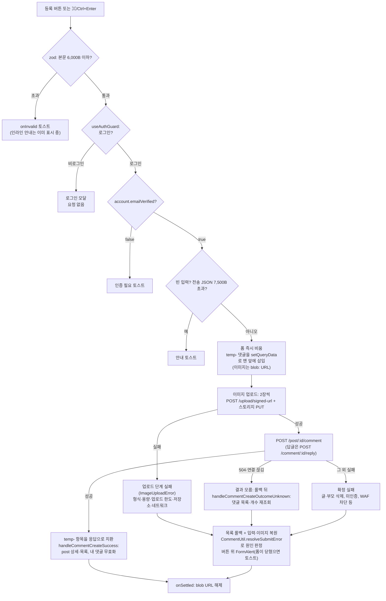

# 댓글 (작성·답글·수정·삭제·좋아요·내 댓글) 기능

> **문서 성격**: 독립 기능 문서(서사형)
>
> **대상 독자**: 이 레포 FE를 처음 보거나 오랜만에 돌아온 개발자.
>
> **읽고 나면**: 댓글이 등록되기 전 화면에 먼저 뜨는 이유(낙관적 업데이트), 길이 상한이
> 두 겹(6,000B·7,500B)인 이유, 이미지가 본문 끝에 URL로 붙는 저장 방식, 업로드·등록이
> 실패했을 때 원인별로 무엇을 안내하는지, "내 댓글"에서 원글의 그 댓글로 이동하는 방식을
> 이해하고, 상한·장수·캐시 무효화 범위·실패 문구를 어디서 바꾸는지 안다.
>
> **마지막 검토**: 2026-10-28

게시글 상세(`/post/:id`) 하단의 댓글 섹션과, 내가 쓴 댓글을 모아보는 "내 댓글"
화면(`/my/comments`)을 다룬다. 게시글 자체(목록·상세·작성)는
[`POST.md`](./POST.md)가 다룬다.

## 1. 쉬운 설명

댓글 작성은 **메신저에서 메시지를 보내는 것**과 비슷하다. 전송 버튼을 누르면 서버
답을 기다리지 않고 내 메시지가 대화창에 반투명하게 먼저 뜨고, 서버가 받았다고 답하면
진짜 메시지로 조용히 바뀐다. 전송이 실패하면 반투명 메시지가 사라지고 입력창에 쓰던
글이 되돌아오며, 등록 버튼 바로 위에 실패 원인과 할 일이 남는다(§5 "실패 안내").

다른 점이 둘 있다.

- **보내기 전에 크기를 잰다** — CloudFront 앞단의 WAF(웹 방화벽)가 8,192바이트를 넘는
  요청을 앱에 닿기도 전에 막는다. 그래서 FE가 미리 본문 바이트(6,000B)와 실제 전송
  바이트(7,500B)를 두 번 잰다(§5 "길이 상한").
- **이미지는 본문의 일부다** — 첨부 이미지는 스토리지에 먼저 올리고, BE가 그 공개
  URL을 본문 끝에 한 줄씩 이어붙여 저장한다. 별도 이미지 테이블이 없다(§5 "이미지").



## 2. 전제 지식

TanStack Query의 `setQueryData`·`invalidateQueries`와 낙관적 업데이트(`onMutate`→롤백),
React Hook Form + zod resolver의 기본 동작은 안다고 가정한다.

가정하지 않는 것:

- 이 레포의 3-Layer API(`*.api.ts`→`*.keys.ts`→`*.queries.ts`)와 크로스 엔티티 무효화 →
  [`FE-ARCHITECTURE.md`](./FE-ARCHITECTURE.md) §5, 낙관적 업데이트 규약은 같은 문서 §11
- 비로그인 유도(`useAuthGuard`)와 이메일 인증 게이트 → [`AUTH.md`](./AUTH.md) §5
  "네 개의 게이트"(게이트 C·D)
- 작성 중 이탈 경고 → [`UNSAVED-CHANGES-GUARD.md`](./UNSAVED-CHANGES-GUARD.md)
- 처음 보는 용어(`temp-` id, 톰스톤, `EDGE_BLOCKED` 등) → §12 용어 사전
- 서비스 전체 지도 → [`ONBOARDING.md`](./ONBOARDING.md)

## 3. 사용한 도구·기술

**기능 자체를 이루는 것**

- **TanStack Query** — 댓글 트리 조회(`useSuspenseQuery`), 내 댓글 무한 스크롤
  (`useSuspenseInfiniteQuery`), 작성·답글·좋아요 낙관적 업데이트
- **React Hook Form + Zod** — 작성·수정 폼이 공유하는 바이트 상한 스키마
  (`commentContentFormSchema`)
- **`useImageAttachments`**(`src/shared/hooks/useImageAttachments.ts`) — 붙여넣기·파일
  선택·드래그앤드롭 첨부, 장수·용량 검증
- **스토리지 직접 업로드** — `uploadImageAndGetUrl`(리사이즈 → 서명 URL 발급 → PUT)
- **`IntersectionObserver`** — 내 댓글 다음 페이지 선반입
- **`ResizeObserver`** — 모바일 댓글 바 높이만큼 토스트 위치를 올림

**구현·검증 과정에서 쓴 도구**: Vitest + MSW(`src/mocks/handlers/comment.handlers.ts`),
Playwright e2e(`page.route()` 모킹) — §9 참고.

## 4. 왜 만들었나

링크를 공유하는 서비스에서 댓글은 "이 글 왜 좋은지/어디가 틀렸는지"를 남기는 유일한
대화 수단이다. 처음엔 단순 텍스트 CRUD였고, 쓰면서 부딪힌 문제를 하나씩 풀며 지금
모양이 됐다.

- **느림** — 등록 후 서버 응답(당시엔 링크 프리뷰 크롤링 포함)과 목록 재조회를 기다려야
  댓글이 보였다 → 2026-08-03 낙관적 업데이트로 전환(`595b678`). 지금 BE는 링크 프리뷰를
  커밋 후 별도 Lambda에서 크롤링한다(BE `CommentService.kt` 주석, `CommentPostProcessService`).
- **이미지 첨부 발견성** — 붙여넣기로만 첨부할 수 있어 모바일에선 사실상 불가능했다 →
  2026-08-10 버튼·드래그앤드롭, 최대 5장(`docs/DECISIONS.md` 2026-08-10)
- **원인 불명의 403** — 긴 댓글·태그가 섞인 댓글이 CloudFront WAF에 막혔다 →
  2026-09-06 앱 상한 + `EDGE_BLOCKED` 안내(§10)
- **"내가 어디 달았지"** — 내가 쓴 댓글을 다시 찾을 방법이 없었다 → 2026-09-14
  "내 댓글" 화면(`63b6881`, PR #90)

## 5. 구조

### API 엔드포인트

경로 정의는 `src/shared/config/api.ts:49-56`, 호출은 `src/entities/comment/api/comment.api.ts`.

| 메서드   | 경로                         | 용도                                                         |
| -------- | ---------------------------- | ------------------------------------------------------------ |
| `GET`    | `/post/{postId}/comment`     | 게시글의 댓글 트리(루트 + `replies`) 전체, 페이지네이션 없음 |
| `POST`   | `/post/{postId}/comment`     | 루트 댓글 등록 `{ content, images: string[] }`               |
| `POST`   | `/comment/{commentId}/reply` | 답글 등록(바디 동일)                                         |
| `PATCH`  | `/comment/{commentId}`       | 수정 `{ content, images: [...기존 URL, ...새 업로드 URL] }`  |
| `DELETE` | `/comment/{commentId}`       | 삭제                                                         |
| `PUT`    | `/comment/{commentId}/like`  | 좋아요(멱등, `entities/interaction`이 소유)                  |
| `DELETE` | `/comment/{commentId}/like`  | 좋아요 취소(멱등). 옛 `POST` 토글은 2026-10-14 제거(BE #92)  |
| `GET`    | `/comment/my?page&size`      | 내 댓글 페이지(`postId`·`postTitle` 포함, 0부터 시작)        |

응답 타입은 BE OpenAPI 생성 타입의 alias다(`src/entities/comment/model/comment.dto.ts`).
`Comment`는 `linkMetadata`의 nullable과 `replies` 재귀를 직접 override한다 — 이유는 그
파일 주석(9-17줄)에 있다.

### 목록 — 트리 2단, 루트만 최신순

- `useCommentList`(`src/widgets/comment/comment-list/hooks/useCommentList.ts:14-23`)가
  루트 댓글만 `createdAt` 내림차순으로 다시 정렬한다. 답글은 서버가 준 순서 그대로다.
- 상세에 들어가면 댓글은 게시글과 동시에 요청된다(§5 "내 댓글" 절의 해시 이동, 기다림 줄이기 항목).
- 헤딩 옆 개수(`countComments`, 같은 파일 6-8줄)는 답글과 **삭제된 톰스톤까지** 센다 —
  `PostCard`의 `commentCount`와 맞추기 위해서다.
- 답글은 한 단계만 허용한다. 답글 버튼 조건은
  `depth < 1 && !isDeleted && !isOptimistic`
  (`src/widgets/comment/comment-list/ui/CommentItem.tsx:40`, `canReply`) — 답글에는
  답글 버튼이 없다.
- 삭제된 댓글(`isDeleted`)은 원래 본문이 아니라 BE가 바꿔 넣은 "삭제된 댓글입니다."가
  흐린 이탤릭으로 보이고, 액션 줄은 사라진다(같은 파일 41줄·88줄, BE 치환은 §5 "삭제").
  게시글 작성자가 쓴 댓글엔 "작성자" 배지가 붙는다(66-70줄).
- `temp-`로 시작하는 낙관적 항목은 `opacity-60`이고 좋아요·답글·수정·삭제를 숨긴다 —
  아직 실제 id가 없어 서버 액션을 걸면 404가 나기 때문이다(37-39줄 주석과 코드).

### 작성 — 즉시 반영, 실패 시 복원

`useCreateComment`(`src/features/comment/create/hooks/useCreateComment.ts`)의 제출 순서는
§1 순서도와 같다. 구현상 짚을 점:

1. **검증은 세 군데로 나뉜다** — zod(본문 6,000B, 실패 시 `form.handleSubmit`의 두 번째 인자인
   `onInvalid` 콜백 토스트), `account.emailVerified === false` 토스트(`guard` 콜백 안), `getCommentSubmitError`(빈 입력·
   전송 7,500B). 빈 입력 판정은 이미지만 있어도 통과다.
2. **줄바꿈 정규화** — CRLF·CR을 LF로 바꾼 뒤 잰다(`onSubmit`의 `replace(/\r\n/g, '\n')`). 붙여넣은 Windows 텍스트가
   바이트를 부풀리지 않게 한다.
3. **폼은 즉시 비우고, 닫기는 미룬다** — `reset()`·`clearAllImages()`를 먼저 하고(`onSubmit`, `submitComment` 호출 직전)
   폼을 닫는 `onSuccess`는 `mutateAsync`가 성공한 뒤에 부른다(`submitComment`).
   답글 폼·모바일 바는 성공 시 언마운트되는데, 지금 닫으면 실패했을 때 입력을 되돌리고
   원인을 안내할 자리가 사라진다. `mutate` 콜백 대신 `mutateAsync`를 기다리는 이유는 아래
   "실패 안내"의 "폼이 닫힌 뒤 실패하면"을 본다.
4. **실패 복원은 덮어쓰지 않는다** — 요청이 도는 사이 사용자가 새 글을 쓰기 시작했으면
   본문을 되돌리지 않고, 이미지도 비어 있을 때만 되돌린다(`submitComment`의 `catch`). 복원한 뒤 원인
   안내를 남긴다(아래 "실패 안내").
5. **낙관적 삽입** — `useCreateCommentMutation`(`src/entities/comment/api/comment.queries.ts`)이
   `temp-<uuid>` 댓글을 목록 맨 앞에, 같은 파일의 `useCreateReplyMutation`이 부모의
   `replies` 끝에 넣는다. 성공하면 id로 응답과 치환하고 목록은 재조회하지 않는다.

버튼 비활성화는 **빈 입력일 때만**이다(`src/features/comment/create/ui/CommentForm.tsx`의 `canSubmit`).
길이 초과는 버튼을 막지 않고 인라인 안내 문구 + `aria-invalid`로 보여준 뒤, 눌렀을 때
zod가 막는다 — 이유는 `.claude/CLAUDE.md` Critical Rules의 "폼 검증 실패를 버튼
`disabled`만으로 처리하지 않는다" 항목과 §10. 빈 상태에서 ⌘/Ctrl+Enter를 누르면 답글 폼이
여러 개 열려 있을 수 있어 그 폼 자체를 화면 중앙으로 스크롤하고 1.3초 강조한다
(`highlightEmptyForm`).

이탈 가드 키는 `comment-create:${postId}:${parentId ?? 'root'}`(useCreateComment.ts의
`useUnsavedChanges` 호출)이다. 동작은 [`UNSAVED-CHANGES-GUARD.md`](./UNSAVED-CHANGES-GUARD.md) 참고.

### 길이 상한 — 두 겹인 이유

| 검사                        | 무엇을 재나                                    | 언제                   | 위치                                                    |
| --------------------------- | ---------------------------------------------- | ---------------------- | ------------------------------------------------------- |
| 본문 상한 6,000B            | `content` 원본의 UTF-8 바이트(한글 약 2,000자) | 타이핑 중 + 제출 시    | `commentContentFormSchema`, `MAX_COMMENT_CONTENT_BYTES` |
| 전송 상한 7,500B            | `JSON.stringify({ content, images })`의 바이트 | 제출 직전              | `CommentUtil.estimateCommentPayloadBytes`               |
| WAF `SizeRestrictions_BODY` | 요청 바디 전체 8,192B                          | CloudFront(앱 도달 전) | AWS 관리형 룰, 손대지 않음                              |

본문 바이트만 재면 줄바꿈이 JSON에서 `\n`(2바이트)로 늘어나는 것과 이미지 URL 몫을
놓친다. 그래서 실제 전송될 JSON과 같은 모양을 만들어 다시 잰다. 아직 업로드 전인
이미지는 URL을 모르므로 200바이트 자리표시자로 채운다(`src/entities/comment/utils/comment.util.ts:113-123`).

**왜 6,000B인가** — 이미지 URL 5개(약 650B)와 JSON 봉투를 더해도 8,192B 벽 안에 여유 있게 들어가도록
잡은 값이다(`src/entities/comment/config/comment.const.ts:5-15` 주석). 7,500B는 그 벽 대비 약 700B 여유를 둔
전송 상한이다. 값이 지금으로 정해진 경위는 §10을 본다.

그래도 WAF에 막히면 403이 HTML로 온다. `client.ts`는 JSON 파싱에 실패한 403을
`EDGE_BLOCKED`로 분류하고(`src/shared/api/client.ts:96-105`), 댓글 폼은
`CommentUtil.resolveSubmitError`가 이 코드를 "보안 정책에 막혔다"는 문구로 바꿔 버튼 위에
남긴다(아래 "실패 안내"). 전역 토스트를 쓰는 다른 화면은 토스트 판정이 같은 문구를
`meta.errorMessage`보다 먼저 고른다(`src/shared/lib/react-query/config/error-toast.ts`의 `resolveErrorToast` 중
`EDGE_BLOCKED` 분기). WAF 룰을 완화하면 안 되는
이유는 `.claude/CLAUDE.md` Critical Rules의 WAF 항목에 있다.

### 이미지 — 본문 끝에 URL을 붙이는 저장 방식

- 첨부는 `useImageAttachments({ maxCount: 5 })`가 받는다. 허용 형식(JPG·PNG·GIF·WEBP·AVIF·SVG,
  `src/shared/config/image-format.ts`) 밖의 파일, 30MB 초과(리사이즈하지 않는 SVG·GIF는 10MB 초과),
  5장 초과는 토스트로 거른다. 허용 형식과 SVG·GIF 상한은 업로드 버킷 설정(`allowed_mime_types`,
  `file_size_limit` 10MB)과 맞춘 값이다 — 버킷보다 넓으면 고를 때는 통과해도 업로드에서 거부된다.
- 업로드는 요청 직전 `uploadCommentImages`(`src/entities/comment/api/comment.api.ts:10-22`)가
  **2장씩** 처리한다. `createImageBitmap`이 디코드된 픽셀 수만큼 메모리를 쓰기 때문에
  동시 디코드를 줄이려는 것이고, 결과 배열은 입력 순서를 유지한다.
- 장마다 `uploadImageAndGetUrl`(`src/shared/lib/upload/uploadImageAndGetUrl.ts:48-68`)이
  1600px WebP로 리사이즈 → `POST /upload/signed-url` → 스토리지 `PUT` → `publicUrl`을
  돌려준다. 원본은 저장하지 않는다. 예외로 SVG는 항상, GIF는 댓글 업로드 기본값
  (`skipGifResize = true`)에서 리사이즈 없이 원본을 올린다
  (`src/shared/lib/image/resizeImage.ts:16-21`, 47-48줄) — 그래서 상한이 10MB로 따로 있다.
- BE가 `content` 끝에 URL을 이어붙여 저장한다 — 본문이 있으면 빈 줄 하나 뒤에, 이미지
  URL은 한 줄에 하나씩(BE [`CommentService.kt`](https://github.com/BAECHAN/link-sphere_BE_NEW/blob/main/src/main/kotlin/com/example/linksphere/domain/comment/CommentService.kt)
  `buildFinalContent`). FE는 낙관적 항목을 같은 규칙으로
  조립하고(comment.queries.ts의 `buildOptimisticComment`), 수정 폼은 역함수
  `splitContentImages`(`src/shared/lib/content/imageContent.ts:13-27`)로 텍스트와 이미지
  줄을 다시 나눈다. 테이블을 분리하지 않은 이유는 `docs/DECISIONS.md` 2026-08-10 항목.
- 렌더링은 `MarkdownContent`가 이미지 확장자 URL과 `blob:` URL을 이미지로 그린다.
  스토리지 이미지는 Supabase 변환 주소(`/render/image/`, 800px 정사각)로 받는다. 이 변환이
  실패하면 `AttachmentImage`가 원본 주소(`/object/`)로 한 번 더 받는다 — Supabase 공식 문서상
  이미지 변환은 Free 플랜에 없는 기능이라(_"Pro Plan 이상에서 활성화돼 있다"_ (번역),
  [Image Transformations](https://supabase.com/docs/guides/storage/serving/image-transformations)),
  지금은 동작해도(2026-10-28 직접 확인) 언제 막힐지 모른다. 아바타(`UserAvatar`)도 같은 순서로
  받고, 원본까지 실패하면 닉네임 첫 글자를 보여 준다.

### 수정 — 기존 이미지는 URL로, 새 이미지는 파일로

`useUpdateComment`(`src/features/comment/update/hooks/useUpdateComment.ts`):

- 편집 시작 시점에 `splitContentImages`로 한 번만 스냅샷을 뜬다(53-54줄). 기존 이미지는
  URL 썸네일로, 새로 붙인 것은 `File`로 따로 관리한다.
- 기존 이미지 장수를 `reservedCount`로 넘겨 합계 5장을 지킨다(100줄).
- 전송 상한 계산에 기존 URL을 실제 길이로 포함한다(39-41줄).
- PATCH 바디의 `images`는 `[...남은 기존 URL, ...새 업로드 URL]`이다(comment.api.ts 60-61줄).
- 성공 시 응답을 통째로 넣지 않고 `content`·`linkMetadata`만 병합한다
  (comment.queries.ts의 `patchCommentRecursively`를 `useUpdateCommentMutation`의 `onSuccess`가 부른다). PATCH 응답은
  `replies`·`likeCount`·`isLiked`를 항상 기본값으로 주기 때문에 통째로 넣으면 답글이
  사라지고 좋아요가 리셋된다. 병합 뒤 `handleCommentUpdateSuccess`가 목록을 한 번 더
  무효화한다(정합성 백스톱).
- 작성과 달리 **낙관적이지 않다** — 응답이 와야 폼이 닫힌다. 실패하면 폼을 닫지 않고
  버튼 위에 원인을 남긴다(아래 "실패 안내").

### 실패 안내 — 원인과 할 일을 버튼 위에

등록·답글·수정이 실패하면 `CommentUtil.resolveSubmitError`
(`src/entities/comment/utils/comment.util.ts:29-102`)가 원인을 판정하고, 폼 훅이 그 문구를
`failureMessage`로 들고 있다가 첨부 썸네일과 버튼 사이의 `FormAlert`에 남긴다
(`CommentForm.tsx`·`CommentEditForm.tsx`의 `{failureMessage && <FormAlert>…}`). 세 mutation은 `manualErrorHandling`이라
전역 토스트는 뜨지 않는다. 안내는 입력을 고치거나 첨부를 바꾸거나 다시 제출하면 지워진다.
위치(버튼 바로 위)는 게시글 폼과 같은 자리로, 시안을 나란히 비교해 정했다
(`docs/DECISIONS.md` 2026-10-06).

판정은 **어느 단계에서 실패했는가**부터 나눈다. 업로드 단계는 본 요청을 보내기 전이라
댓글이 저장되지 않은 게 확실하고, 본 요청 단계의 504·연결 끊김은 서버에 저장됐을 수도
있다. 같은 429·네트워크 실패라도 안내가 달라야 해서, 업로드 단계 실패는
`uploadImageAndGetUrl`이 `ImageUploadError`로 따로 감싼다
(`src/shared/lib/upload/uploadImageAndGetUrl.ts:13-39`).

| 단계    | 원인                                 | 판별 근거                                                                                    | 문구 키(`TEXTS.messages.error.*`)                                 |
| ------- | ------------------------------------ | -------------------------------------------------------------------------------------------- | ----------------------------------------------------------------- |
| 업로드  | 허용 밖 형식                         | 서명 URL `UNSUPPORTED_IMAGE_TYPE`, 스토리지 `statusCode` "415"                               | `uploadSubmit.imageUnsupportedType`                               |
| 업로드  | 10MB 초과                            | 스토리지 `statusCode` "413"                                                                  | `uploadSubmit.register.imageTooLarge`                             |
| 업로드  | 업로드 한도(회원당 시간당 30회)      | 서명 URL 429 + `Retry-After`(없으면 분 없는 문구)                                            | `uploadSubmit.register.imageRateLimitedIn(분)`·`imageRateLimited` |
| 업로드  | 저장소 혼잡·장애                     | 스토리지 429·5xx(544 DB 타임아웃 포함)                                                       | `uploadSubmit.register.storageUnavailable`                        |
| 업로드  | 연결 끊김                            | `fetch` reject → `NetworkError`                                                              | `uploadSubmit.register.network`                                   |
| 본 요청 | 결과 모름(등록·답글만)               | 504, `NetworkError`                                                                          | `commentSubmit.outcomeUnknown` + 목록 재조회                      |
| 본 요청 | 글 삭제 / 답글 대상 삭제 / 수정 대상 | `POST_NOT_FOUND` / 답글의 `COMMENT_NOT_FOUND` / 수정의 `COMMENT_NOT_FOUND`·`COMMENT_DELETED` | `commentSubmit.postDeleted`·`parentDeleted`·`commentDeleted`      |
| 본 요청 | 요청 한도·동시 실행 포화             | 429(댓글 API엔 앱 레이트리밋이 없어 Lambda 동시 실행 포화 등)                                | `rateLimited`                                                     |
| 본 요청 | 이메일 미인증·WAF 차단·로그인 만료   | `EMAIL_NOT_VERIFIED`·`EDGE_BLOCKED`·`NOT_LOGGED_IN`·`INVALID_TOKEN`                          | 기존 문구 그대로                                                  |
| 본 요청 | 권한 없음                            | `ACCESS_DENIED`                                                                              | `accessDenied`                                                    |
| 첨부    | 첨부 처리 중 직접 던진 안내          | `UserFacingError`(이미 `TEXTS`로 쓴 문구)                                                    | 그 문구 그대로                                                    |
| 그 외   | 나머지                               | —                                                                                            | `commentSubmit.createFailed`·`updateFailed`                       |

- **수정 폼은 끝맺음이 "저장"이다** — 업로드 단계 문구는 `register`(등록)·`save`(저장) 두
  벌이 있고, 수정 폼과 프로필 사진은 `save`를 쓴다. 수정은 결과를 몰라도 다시 보내면 같은
  내용으로 덮어쓸 뿐이라 결과 모름 안내 대신 일반 안내(`save.network`·`updateFailed`)를 쓴다.
- **스토리지 원인은 본문에 있다** — Supabase Storage는 500이 아닌 오류를 HTTP 400으로 보내고
  원래 상태 코드는 본문 `statusCode`에 남긴다([storage 서버 `http` 폴더의 `error-handler.ts`](https://github.com/supabase/storage/tree/master/src/http),
  413·415·544 정의는 [`internal/errors` 폴더의 `codes.ts`](https://github.com/supabase/storage/tree/master/src/internal/errors),
  2026-10-06 소스 확인). 그래서 `upload.api.ts`의 `resolveStorageFailureReason`이 본문을 먼저 읽고,
  없으면 HTTP 상태로 판정한다.
- **결과 모름이면 목록을 다시 불러온다** — 504면 CloudFront가 기다림을 끊었을 뿐 서버는
  저장을 마쳤을 수 있다. 낙관적 댓글을 롤백한 뒤 `handleCommentCreateOutcomeUnknown`
  (`src/entities/comment/api/comment.keys.ts:37-42`)이 목록과 댓글 수를 다시 불러와, 실제로
  저장됐다면 다시 보이게 한다. 입력은 그대로 복원되니 목록을 보고 판단하면 된다.
- **폼이 닫힌 뒤 실패하면 토스트로 대신 알린다** — `mutate` 콜백은 요청 도중 컴포넌트가
  언마운트되면 불리지 않는다. 전역 토스트를 끈 지금 그대로 두면 답글 폼을 취소하거나 모바일
  바를 접은 뒤의 실패가 조용히 묻힌다. 그래서 `mutateAsync`를 기다리고, 그 시점에 폼이
  언마운트됐으면(`isMountedRef`) 같은 문구를 토스트로 띄운다.
- **연결 끊김 판별** — `client.ts`·`upload.api.ts`가 `fetch` 호출 자리의 reject만
  `NetworkError`로 바꾼다. 예전에는 Chrome 문구 `'Failed to fetch'`만 비교했다
  (`ErrorUtil.isServerError`는 두 방식을 모두 본다).
- **프로필 사진도 같은 문구를 쓴다** — `account.queries.ts`의 `resolveAccountUpdateErrorMessage`가
  업로드 단계 실패·연결 끊김·429를 `save` 문구로 토스트한다([`MYPAGE.md`](./MYPAGE.md) §5).

### 삭제 — 확인 후 서버 판단을 기다린다

`useDeleteComment`(`src/features/comment/delete/hooks/useDeleteComment.ts:13-25`)가
`openConfirm`(확정 강조 `emphasis: 'confirm'`)을 띄우고 확인 시 `mutateAsync`로 지운다.
낙관적 반영은 없고, 성공하면 `handleCommentDeleteSuccess`가 댓글 목록·내 댓글·게시글
상세·게시글 목록을 무효화한다. 같은 때 `meta.successMessage`로 "댓글을 삭제했어요." 토스트가
뜬다 — 확인창이 닫힌 뒤 재조회가 끝날 때까지 화면이 그대로라서다(2026-10-21, 판단 기준은
`.claude/skills/texts-conventions/SKILL.md` "성공 토스트 표시 기준" 축 4).

답글이 없는 댓글은 행 자체가 지워져 목록에서 사라지고, 답글이 있는 댓글은 본문을
"삭제된 댓글입니다."로 바꾼 `isDeleted: true` 톰스톤으로 남는다. 이 분기는 BE
`deleteComment`가 `existsByParentId`로 정한다(BE
[`CommentService.kt`](https://github.com/BAECHAN/link-sphere_BE_NEW/blob/main/src/main/kotlin/com/example/linksphere/domain/comment/CommentService.kt)
`deleteComment`, 문구 상수는 `DELETED_COMMENT_CONTENT`, 조회 응답에서도 같은 상수로 내려준다). FE는 그
결과를 재조회로 받기만 한다. `e2e/comment-delete.spec.ts`가 두 경우를 모킹으로 재현해
검증한다.

### 좋아요 — 낙관적 반영, 실패는 조용히 롤백

`LikeCommentButton`이 `useAuthGuard`로 감싸 feature 훅 `useLikeComment`
(`src/features/comment/like/hooks/useLikeComment.ts`)를 부르고, 이 훅이
`useLikeCommentMutation`(`src/entities/interaction/api/interaction.queries.ts`)을
그대로 돌려준다. 버튼은 `ToggleButton`이라 400ms 안의 재클릭을 무시하고, 요청 중 `disabled`는 두지
않는다(낙관적 반영 중 흐려지는 깜빡임을 피하려고 — [`POST.md`](./POST.md) §5 "좋아요"와 같은 결정, 2026-10-02).

- 누르면 지금 상태의 반대(`mutate(!isLiked)`)를 원하는 상태로 보낸다 — 켜기는 `PUT`, 끄기는 `DELETE`다
  (2026-10-13, 토글에서 전환).
- `onMutate`에서 트리를 재귀로 돌며 그 댓글의 `isLiked`를 원하는 값으로, `likeCount`를 ±1한다(이미 그
  상태면 그대로).
- 연타는 게시글 좋아요와 같이 처리한다 — 같은 댓글의 요청은 `scope`로 한 줄로 보내고, 롤백은 마지막 요청이
  실패했을 때만 한 뒤 `handleLikeCommentFailure`로 그 글의 댓글 목록을 무효화한다
  ([`POST.md`](./POST.md) §5 "좋아요").
- `meta: { manualErrorHandling: true }`인데 자체 토스트도 없다 — 실패하면 화면만 원래대로
  돌아가고 아무 안내가 없다.
- 성공 후 무효화·응답 반영이 없다. 응답에 `likeCount`가 없어 낙관적 값이 그대로 정답으로 남는다.

### 내 댓글(`/my/comments`)

- `MyCommentPage`(`src/pages/mycomment/MyCommentPage.tsx`) → `MyCommentList` →
  `useMyCommentList`. 보호 경로다(`src/shared/config/route-paths.ts:45`).
- `useSuspenseMyCommentsInfiniteQuery`(comment.queries.ts)가 0페이지부터 10개씩
  가져오고, `select`에서 페이지 경계 중복 id를 걸러 낸다.
- 다음 페이지는 목록 끝 감시 요소가 화면 아래 1200px 안에 들어오면 미리 부른다
  (`src/widgets/comment/my-comment-list/hooks/useMyCommentList.ts:19`).
- 가상화하지 않는다 — 카드가 가볍고 Ctrl+F를 살리려는 판단(`docs/DECISIONS.md` 2026-09-19
  가상화 항목의 "범위 밖").
- 카드(`src/widgets/comment/my-comment-list/ui/MyCommentCard.tsx`)는 본문을 `splitContentImages`로
  나눠 텍스트만 3줄까지 보여주고, 첨부 이미지는 원글 배지 옆에 개수(🖼 N)로만 알린다. 이미지만
  있는 댓글은 본문 자리에 "사진 N장"을 흐리게 띄운다. 2026-10-02 전까지는 본문을 그대로 그려
  스토리지 URL이 글자로 보였다 — 개수 표시·작은 썸네일·텍스트만 세 안을 실제 카드 스타일로
  나란히 비교해 카드 높이가 지금과 같은 개수 표시안을 골랐다(`e2e/my-comments.spec.ts`).
- 카드는 `/post/${postId}#comment-${id}`로 링크한다
  (`src/widgets/comment/my-comment-list/ui/MyCommentCard.tsx`의 `Link`). 카드에 마우스를 올리거나
  포커스하면 원글과 그 댓글 목록을 미리 받는다(`useMyCommentCard`, 2026-10-15) — 누르면 항상 특정 댓글로
  가서 댓글 목록이 와야 스크롤할 수 있으므로, 게시글 카드 💬 hover와 같은 방식이다(아래 "기다림 줄이기").

**해시 이동**: 상세의 `CommentList`가 `location.hash`로 대상을 찾아
`scrollIntoView({ behavior: ScrollUtil.getBehavior(), block: 'start' })`하고 1.6초 동안 링으로 강조한다
(`src/widgets/comment/comment-list/ui/CommentList.tsx`의 `scrollToHashedComment` effect — `behavior: 'smooth'`
리터럴은 ESLint가 막는다, 아래 "스크롤 방식"). 대상 요소는
`CommentItem` 루트의 `id="comment-<id>"`이고, sticky navbar에 가리지 않도록
`scroll-mt-[calc(var(--navbar-height)_+_24px)]`를 둔다(CommentItem.tsx 45·51줄). 상세의
돌아가기 버튼 라벨은 [`POST-DETAIL-BACK-NAVIGATION.md`](./POST-DETAIL-BACK-NAVIGATION.md)가
다룬다.

- **카드 댓글 아이콘(`#comments`, 2026-10-14)** — 피드·북마크·상세 카드의 💬은
  `/post/:id#comments`로 간다(`PostCard.tsx:361`). 대상은 댓글 제목과 데스크톱 작성 폼을 감싼
  컨테이너(`formContainerRef`)라 링 대신 플로팅 버튼처럼 부드럽게 스크롤한 뒤 입력창에 포커스한다.
  모바일은 인라인 폼이 없어 제목까지만 오고 하단 바는 접힌 채다.
- **`#comments`는 DOM id가 아니라 신호다** — 같은 id의 요소가 있으면 react-router
  `ScrollRestoration`이 이 effect보다 먼저 그 요소로 즉시 점프해(캐시가 있는 재방문·상세 안 클릭)
  부드러운 스크롤이 안 보였다(시안 녹화로 확인). 그래서 `CommentList`가 해시(`COMMENT_SECTION_HASH`,
  `src/entities/comment/config/comment.const.ts:41`)를 보고 ref로 찾는다. 상세 안 💬은 `replace`
  (돌아가기가 같은 글로 가지 않게)와 `preventScrollReset`(ScrollRestoration이 맨 위로 올렸다
  내려오지 않게)을 함께 준다.
- **스크롤 방식은 브라우저 기본 `smooth`(2026-10-14)** — 세 안을 같은 화면으로 녹화해 나란히
  비교했다(애니메이션 시간은 직접 측정, dev 서버·Playwright chromium). 기기에서 "동작 줄이기"를
  켠 사용자에게는 미끄러지지 않고 바로 이동한다(`ScrollUtil.getBehavior()`,
  `src/shared/utils/scroll.util.ts` — 댓글 화면의 스크롤 4곳 모두 같다).

  | 안                           | 애니메이션                  | 결과                                                                                                                                                                                                                                                                                                                                                                                                                                                                        |
  | ---------------------------- | --------------------------- | --------------------------------------------------------------------------------------------------------------------------------------------------------------------------------------------------------------------------------------------------------------------------------------------------------------------------------------------------------------------------------------------------------------------------------------------------------------------------- |
  | A 즉시(`behavior: 'auto'`)   | 0ms                         | 기각 — "갑자기 댓글이 보이면 당황하고, 화면이 확 바뀌면 거부감이 든다"(사용자 피드백). NN/g의 Laubheimer는 앵커 링크의 부드러운 스크롤이 _"콘텐츠가 모두 한 페이지 안에 있다는 것과 그것이 페이지의 어디에 있는지를 보여준다"_ (번역, [The Role of Animation and Motion in UX](https://www.nngroup.com/articles/animation-purpose-ux/))고 쓴다                                                                                                                              |
  | B 직접 만든 250ms(ease-out)  | 216~234ms                   | 기각 — `scrollTo`·`scrollIntoView`에는 지속시간 옵션이 없어([MDN](https://developer.mozilla.org/en-US/docs/Web/API/Window/scrollTo)) 프레임마다 위치를 옮기는 코드를 직접 짜야 하고, 💬 하나만 다른 댓글 화면 스크롤과 방식이 달라진다. 지속시간 조절은 [GSAP ScrollToPlugin](https://gsap.com/docs/v3/Plugins/ScrollToPlugin/) 같은 애니메이션 라이브러리의 몫이다                                                                                                         |
  | **C 브라우저 기본 `smooth`** | 데스크톱 416ms·모바일 500ms | 채택 — 플로팅 버튼·내 댓글 이동과 같은 방식이고, [Bootstrap](https://getbootstrap.com/docs/5.3/getting-started/accessibility/)·[Tailwind](https://tailwindcss.com/docs/scroll-behavior)도 브라우저 기본 `scroll-behavior: smooth`를 쓴다. 다만 Laubheimer는 _"400ms는 아주 느린 애니메이션이라 큰 화면을 가로지르는 큰 움직임에만 쓴다"_ (번역, [Executing UX Animations](https://www.nngroup.com/articles/animation-duration/))고 쓰므로, 기다림은 아래 미리 받기로 줄였다 |

- **기다림 줄이기(2026-10-14)** — 게시글을 기다리며 멈추는 `PostDetailContent` 안에 `CommentList`가
  있어, 게시글이 와야 댓글을 요청하는 순차 요청이었다. 두 가지로 줄였다.
  - 상세 진입: 상세 라우트(`PostDetailRoute`, `src/app/routes/index.tsx:147`)가
    `usePrefetchComments`(`src/entities/comment/api/comment.queries.ts:101`)를 불러 댓글을
    게시글과 동시에 요청한다. 처음엔 `PostDetailPage`가 경계 바깥에서 불렀다. 2026-10-26부터는 lazy 페이지
    청크도 기다리지 않도록 라우트로 옮겼다([`PERFORMANCE.md`](./PERFORMANCE.md) "LCP 데이터 요청 시점").
    `CommentList`는 같은 키의 캐시를 읽어 다시 요청하지 않는다
    ([TanStack Query 프리페치 가이드](https://github.com/tanstack/query/blob/main/docs/framework/react/guides/prefetching.md)의 "게시글 + 댓글" 예시와 같은 구조).
  - 💬 hover·focus: `handlePrefetchDetailWithComments`(`src/widgets/post/post-card/hooks/usePostCard.ts:141`)가
    게시글과 `prefetchComments`(`src/entities/comment/api/comment.queries.ts`)를 미리 받는다. 제목 링크는 `::after`가
    카드 전체를 덮어 카드 위를 지나가기만 해도 발동하므로 지금처럼 게시글만 받는다.

  클릭부터 도착까지(직접 측정, API당 300ms 목 응답, 3회 반복):

  | 방식                             | 0.4초 hover 후 클릭 | 바로 클릭 |
  | -------------------------------- | ------------------- | --------- |
  | 순차 요청(이전)                  | 약 1.15초           | 약 1.18초 |
  | + 동시 요청                      | 약 0.86초           | 약 0.88초 |
  | + 동시 요청 + 💬 hover 미리 받기 | 약 0.53초           | 약 0.81초 |

  운영(linksphere.click)에서도 쟀다(2026-10-15 직접 측정 — 비로그인, 1280×800, 각 5회 중앙값, RUM 수집
  요청은 막음). 게시글·댓글 요청이 클릭 약 20ms 뒤 함께 나갔고, 응답은 각각 약 0.21초·0.20초였다.

  | 방식                | 스크롤 시작(데이터 준비) | 도착   |
  | ------------------- | ------------------------ | ------ |
  | 바로 클릭           | 0.32초                   | 0.74초 |
  | 0.4초 hover 후 클릭 | 0.08초                   | 0.50초 |

  예전 순차 요청이었다면 같은 응답 시간으로 약 0.87초였을 것이다 — 이전 버전은 이미 내려가 직접 재지 못했고,
  잰 응답 시간을 이어 붙인 추정이다. RUM으로는 이런 화면 안 동작을 잴 수 없다(`docs/RUM.md` "남은 것").

- **한 엔트리에 한 번만** — 오버레이(이미지 뷰어·북마크 폴더 창 등, `useHistoryOverlay`)는
  해시를 빼고 push해서, 닫는 뒤로가기(POP)에서 해시가 되살아난다. 그때마다 다시 스크롤하면
  보던 자리에서 대상으로 끌려가므로(가드를 빼면 17px → 763px, `e2e/comment-icon-scroll.spec.ts`)
  처리한 `location.key`를 ref에 기억해 같은 엔트리면 건너뛴다. 새로고침·다른 화면에서 돌아오기는
  다시 마운트돼 ref가 비므로 예전처럼 다시 이동한다. 같은 가드가 StrictMode의 effect 재실행도
  건너뛰므로 강조 해제 타이머는 cleanup에서 취소하지 않는다(취소하면 링이 남는다).

### 모바일 댓글 바 · 데스크톱 인라인 폼

`CommentList`는 화면 폭에 따라 작성 진입점을 다르게 둔다.

| 폭       | 진입점                                                        | 핵심 동작                                                                                                 |
| -------- | ------------------------------------------------------------- | --------------------------------------------------------------------------------------------------------- |
| 모바일   | `MobileCommentBar` — 탭바 위 고정 바, 탭하면 하단 시트로 펼침 | 접힘 `z-panel`, 펼침 `z-scrim`. 바 높이만큼 `--toast-offset-bottom`을 올려 토스트가 바 위에 뜨게 함       |
| 데스크톱 | 목록 위 인라인 `CommentForm`                                  | 멀리 내려간 뒤 폼으로 돌아가려면 우하단 맨 위로(↑) → 본문 아래 💬(댓글 수) 버튼(아래 "맨 위로 버튼" 참고) |

- 모바일 헤더 검색이 열리면 바를 **언마운트하지 않고** `hidden`으로만 숨긴다
  (`src/features/comment/create/ui/MobileCommentBar.tsx`의 `isMobileSearchOpen && 'hidden'`). 이탈 가드는 같은
  pathname 이동을 통과시키므로, 언마운트하면 쓰던 글이 경고 없이 사라진다.
- 펼친 시트의 `z-scrim`은 사이드바 백드롭과 같은 층이다 — 미해결 충돌(§11), 근거는
  [`DESIGN-SYSTEM.md`](./DESIGN-SYSTEM.md) §4.
- `MobileCommentBar`는 `space-y-6` 형제 목록 **밖**에 둔다(CommentList.tsx `CommentListContent`의 반환 JSX 끝, 이유를 적은 주석 아래). 안에 두면
  마운트·언마운트 때마다 24px 레이아웃이 흔들린다(§10).

### 맨 위로 버튼 — 데스크톱에만, 댓글 이동 버튼 대신(2026-10-27)

상세의 우하단 플로팅 자리는 **데스크톱에서만 맨 위로(`ScrollToTop`)가 쓴다. 모바일 상세에는 두지 않는다.**
그 전까지 이 자리는 데스크톱 전용 "댓글 쓰기로 이동" 버튼(`ScrollToCommentFormButton`)이었고, 상세에는
맨 위로가 없었다(등록 화면을 상세로 잘못 읽어 숨기던 조건까지 포함한 경위는 PR #429).

- **조건** — `src/app/layouts/app-layout/AppLayout.tsx`의 `showScrollToTop`(글 등록·수정이 아니면 그린다)과,
  상세일 때(`isPostDetailPage`) 감싸는 `max-md:hidden`. 폭 경계를 JS가 아니라 Tailwind `md`(48rem)로 둔 것은
  버튼 자신의 세로 위치(`bottom-20 md:bottom-6`)가 같은 경계에서 바뀌기 때문이다.
- **댓글로 가는 길** — 본문 아래 💬(댓글 수) 버튼이 맡는다(`PostCard.tsx`의 `COMMENT_SECTION_HASH` 링크). 데스크톱은
  폼으로 스크롤한 뒤 입력창에 포커스한다(위 "해시 이동").
- **잃은 것** — 댓글을 한참 읽다가 작성 폼으로 가는 동작이 한 번(💬 플로팅)에서 두 번(↑ 뒤 💬)이 됐다.

근거는 두 가이드라인과 서비스 11곳 조사다. NN/g는 맨 위로 버튼을 이렇게 쓰라고 한다.

> 4화면보다 긴 페이지에는 맨 위로 버튼을 쓴다. 페이지 오른쪽 아래에 고정된 맨 위로 버튼을 둔다. 섹션마다
> 링크를 여러 개 넣지 말고 페이지당 고정된 맨 위로 링크 하나를 둔다. (번역, 지침 세 줄을 이어 붙임)
>
> — NN/g, Hoa Loranger, "Back-to-Top Button Design Guidelines"(2017), https://www.nngroup.com/articles/back-to-top/

같은 글은 Home 키 같은 기본 수단을 두고 _"기술에 밝은 독자는 알지 몰라도 대부분의 사용자는 모른다"_ (번역)고
쓴다. [Material Design 3 FAB 가이드](https://m3.material.io/components/floating-action-button/guidelines)는
_"한 화면에 FAB를 여러 개 두지 않는다"_ (번역)고 한다 — 이 문구는 2026-10-27 조사 에이전트가 브라우저로 열어
옮긴 것의 재인용이다(페이지가 스크립트로만 그려져 이 문서를 쓰며 직접 다시 열지 못했다).
[WCAG 2.4.11](https://www.w3.org/WAI/WCAG22/Understanding/focus-not-obscured-minimum.html)은 고정 요소가
키보드 포커스를 받은 요소를 완전히 가리지 않을 것을 요구한다 — 고정 요소를 쌓을수록 그 위험이 커진다.

서비스 조사는 2026-10-27 조사 에이전트가 Playwright로 서비스마다 글 하나를 로그아웃 상태로 열어 본 것이다.

| 방식        | 서비스                                                 | 맨 위로                     | 댓글 입력                          |
| ----------- | ------------------------------------------------------ | --------------------------- | ---------------------------------- |
| 포털 방식   | 네이버 뉴스, 다음 뉴스                                 | 오른쪽 아래 플로팅 **하나** | 본문 흐름 안(또는 별도 페이지)     |
| 블로그 방식 | velog, dev.to, 브런치, 티스토리, 네이버 블로그, Medium | **없음**                    | 하단 고정 바·측면 레일의 댓글 버튼 |

플로팅 버튼 둘을 쌓은 곳은 없었다. 데스크톱 상세(인라인 폼)는 포털 방식, 모바일 상세(하단 댓글 바)는 블로그
방식과 구조가 같다. 맨 위로 버튼을 출시했다가 없앤 사례는 찾지 못했다.

| 안                             | 데스크톱       | 모바일            | 결과     | 이유                                                                                                                                                                 |
| ------------------------------ | -------------- | ----------------- | -------- | -------------------------------------------------------------------------------------------------------------------------------------------------------------------- |
| 변경 전                        | 💬 폼으로 이동 | 없음              | 기각     | 우하단 버튼의 뜻이 상세에서만 달랐다. 댓글로 가는 길은 본문 아래 💬가 이미 있다                                                                                      |
| **하나로 바꾸기**              | ↑              | 없음              | **채택** | 포털 방식 선례와 같고, 목록 화면과 같은 자리·같은 규칙이 된다                                                                                                        |
| 쌓기                           | 💬 위, ↑ 아래  | —                 | 기각     | 11곳 중 선례 없음, M3의 "FAB 하나"와 어긋나고 포커스를 가릴 위험이 커진다                                                                                            |
| 모바일에도 ↑(위로 스크롤할 때) | —              | 댓글 바 위에 잠깐 | 기각     | 블로그 방식 6곳 모두 없음. 실제 컴포넌트로 만든 미리보기에서 ↑가 마지막 댓글의 "삭제" 버튼을 가렸다. NN/g가 말하는 "위로 올리려 할 때만" 노출이지만 선례는 못 찾았다 |

### 캐시 무효화 범위

`src/entities/comment/api/comment.keys.ts`가 정본이다.

| 이벤트                        | 댓글 목록(`list`)          | 내 댓글(`myRoot`) | 게시글 상세·목록    |
| ----------------------------- | -------------------------- | ----------------- | ------------------- |
| 작성·답글                     | ❌ (낙관적으로 직접 갱신)  | ✅                | ✅ (`commentCount`) |
| 작성 결과 모름(504·연결 끊김) | ✅ (롤백 뒤 재조회)        | ✅                | ✅ (`commentCount`) |
| 수정                          | ✅ (병합 뒤 백스톱)        | ✅                | ❌                  |
| 삭제                          | ✅                         | ✅                | ✅                  |
| 좋아요                        | ✅ (마지막 요청 실패 때만) | ❌                | ❌                  |
| 프로필 변경                   | ✅ (`root` 전체)           | ✅                | —                   |

게시글 쪽은 `entities/post/@x/comment.ts`가 공개한 `postInvalidateQueries`로만 건드린다.
프로필 변경 시 무효화는 `entities/account`가 `src/entities/comment/@x/account.ts`를 거쳐
부른다([`MYPAGE.md`](./MYPAGE.md) §6).

## 6. 상태 모델

### `commentKeys` 계층(`src/entities/comment/api/comment.keys.ts:4-12`)

| 키                         | 값                     | 데이터                                       |
| -------------------------- | ---------------------- | -------------------------------------------- |
| `commentKeys.root`         | `['comments']`         | (무효화 기준점)                              |
| `commentKeys.list(postId)` | `['comments', postId]` | `Comment[]` — 루트 배열, 각자 `replies` 보유 |
| `commentKeys.myRoot`       | `['comments', 'my']`   | 무한 쿼리 페이지(`MyCommentListResponse[]`)  |

`myRoot`는 `list`와 같은 `['comments', …]` 아래라, `root` 무효화 한 번에 둘 다 걸린다.

### 낙관적 항목의 수명

| 단계        | 캐시 상태                                                   | 화면                                  |
| ----------- | ----------------------------------------------------------- | ------------------------------------- |
| `onMutate`  | `temp-<uuid>` 항목 삽입, 이미지는 `blob:` URL               | 반투명, 액션 줄 없음                  |
| `onSuccess` | 같은 자리를 서버 응답으로 치환                              | 불투명, 액션 줄 표시                  |
| `onError`   | 삽입 전 스냅샷으로 통째로 복원(결과 모름이면 이어서 재조회) | 항목 사라짐, 폼에 입력 복원·실패 안내 |
| `onSettled` | `URL.revokeObjectURL`로 blob 해제                           | —                                     |

### 폼 훅 반환값

`useCreateComment`·`useUpdateComment`는 `form`·`onSubmit`·`contentValue`·`isOverLimit`·
`failureMessage`(버튼 위 실패 안내, 없으면 `null`)와 첨부 핸들러 묶음을 돌려준다. `useUpdateComment`만 `canSubmit`(빈 입력·요청 중이면
`false`)을 직접 계산해 준다. 원본 시그니처는 각 파일을 본다.

## 7. 운영 파라미터

| 파라미터                     | 값                      | 실제 위치                                                                                                                                    |
| ---------------------------- | ----------------------- | -------------------------------------------------------------------------------------------------------------------------------------------- |
| 댓글당 최대 이미지           | 5장                     | `src/entities/comment/config/comment.const.ts:1`                                                                                             |
| 내 댓글 페이지 크기          | 10                      | `src/entities/comment/config/comment.const.ts:4`                                                                                             |
| 본문 상한                    | 6,000B(한글 약 2,000자) | `src/entities/comment/config/comment.const.ts:15`                                                                                            |
| 전송 상한                    | 7,500B                  | `src/entities/comment/config/comment.const.ts:26`                                                                                            |
| 업로드 전 이미지 URL 추정치  | 200B                    | `src/entities/comment/config/comment.const.ts:33`                                                                                            |
| 이미지 동시 업로드 수        | 2                       | `src/entities/comment/api/comment.api.ts:14`                                                                                                 |
| 리사이즈 최대 변 길이        | 1600px                  | `src/shared/lib/upload/uploadImageAndGetUrl.ts:50`                                                                                           |
| 원본 파일 상한               | 30MB                    | `src/shared/lib/image/resizeImage.ts:13`                                                                                                     |
| SVG·GIF(리사이즈 안 함) 상한 | 10MB(버킷과 같게)       | `src/shared/lib/image/resizeImage.ts:21`                                                                                                     |
| 해시 이동 강조 시간          | 1600ms                  | `src/widgets/comment/comment-list/ui/CommentList.tsx`의 `scrollToHashedComment` 안 `setTimeout`                                              |
| 빈 제출 강조 시간            | 1300ms                  | `src/features/comment/create/ui/CommentForm.tsx`·`src/features/comment/update/ui/CommentEditForm.tsx`의 `highlightEmptyForm` 안 `setTimeout` |
| 내 댓글 선반입 거리          | 아래 1200px             | `src/widgets/comment/my-comment-list/hooks/useMyCommentList.ts:19`                                                                           |
| 해시 도착 여백               | navbar + 24px           | `src/widgets/comment/comment-list/ui/CommentItem.tsx:51`                                                                                     |
| 모바일 바 ↔ 토스트 간격      | 8px                     | `src/features/comment/create/ui/MobileCommentBar.tsx:14`                                                                                     |

**함께 바꿔야 하는 값**:

- 본문 상한을 바꾸면 BE `MAX_COMMENT_CONTENT_BYTES = 6_000`(BE
  [`CommentService.kt`](https://github.com/BAECHAN/link-sphere_BE_NEW/blob/main/src/main/kotlin/com/example/linksphere/domain/comment/CommentService.kt)
  `companion object`, 등록·답글·수정에서 각각 검사)과 안내 문구
  `TEXTS.validation.commentContentTooLong`("한글 2,000자", `src/shared/config/texts.ts`)도
  함께 고친다 — 자동 동기화 장치는 없다.
- 장수 상한은 BE `MAX_COMMENT_IMAGES = 5`(같은 파일 `companion object`, 등록·답글·수정에서 검사)와
  같아야 한다.
- 7,500B는 WAF 8,192B 벽에서 약 700B 여유를 둔 값이다. 올리면 그 여유가 준다.

## 8. 코드 지도와 자주 하는 수정

| 단계                            | 파일:줄                                                                                                                                        |
| ------------------------------- | ---------------------------------------------------------------------------------------------------------------------------------------------- |
| 목록 정렬·개수                  | `src/widgets/comment/comment-list/hooks/useCommentList.ts:6-23`                                                                                |
| 목록 렌더·해시 이동·진입점 배치 | `src/widgets/comment/comment-list/ui/CommentList.tsx`의 `CommentListContent`·`CommentList`                                                     |
| 댓글 한 개(액션·답글 폼·재귀)   | `src/widgets/comment/comment-list/ui/CommentItem.tsx:26-183`                                                                                   |
| 작성 검증·제출·복원             | `src/features/comment/create/hooks/useCreateComment.ts`의 `getCommentSubmitError`·`useCreateComment`                                           |
| 작성 폼 UI                      | `src/features/comment/create/ui/CommentForm.tsx`의 `CommentForm`                                                                               |
| 모바일 바                       | `src/features/comment/create/ui/MobileCommentBar.tsx:16-104`                                                                                   |
| 상세의 맨 위로 버튼 조건        | `src/app/layouts/app-layout/AppLayout.tsx`의 `showScrollToTop`·`isPostDetailPage`                                                              |
| 수정 검증·제출                  | `src/features/comment/update/hooks/useUpdateComment.ts`의 `getCommentUpdateSubmitError`·`useUpdateComment`                                     |
| 삭제 확인                       | `src/features/comment/delete/hooks/useDeleteComment.ts:9-31`                                                                                   |
| 좋아요 버튼·feature 훅          | `src/features/comment/like/ui/LikeCommentButton.tsx`, `src/features/comment/like/hooks/useLikeComment.ts`                                      |
| 좋아요 낙관적 반영              | `src/entities/interaction/api/interaction.queries.ts`의 `useLikeCommentMutation`, 실패 무효화는 `interaction.keys.ts`                          |
| API·이미지 업로드               | `src/entities/comment/api/comment.api.ts:10-67`                                                                                                |
| 쿼리·낙관적 업데이트            | `src/entities/comment/api/comment.queries.ts`(파일 전체 — `buildOptimisticComment`부터 `useUpdateCommentMutation`까지)                         |
| 키·무효화 핸들러                | `src/entities/comment/api/comment.keys.ts:4-54`                                                                                                |
| 바이트 스키마·전송량 추정       | `src/entities/comment/model/comment.schema.ts:8-15`, `src/entities/comment/utils/comment.util.ts:113-123`                                      |
| 실패 원인 판정                  | `src/entities/comment/utils/comment.util.ts:21-102`, `src/shared/utils/error.util.ts:45-74`                                                    |
| 업로드 단계 실패 분류           | `src/shared/lib/upload/uploadImageAndGetUrl.ts:13-39`, `src/shared/api/upload.api.ts:15-37`                                                    |
| WAF 403 분류·문구               | `src/shared/api/client.ts:96-105`, `src/shared/lib/react-query/config/error-toast.ts`의 `resolveErrorToast`(`EDGE_BLOCKED` 분기)               |
| 내 댓글 목록·카드               | `src/widgets/comment/my-comment-list/ui/MyCommentList.tsx:11-50`, `src/widgets/comment/my-comment-list/ui/MyCommentCard.tsx`의 `MyCommentCard` |
| UI 문구                         | `src/shared/config/texts.ts`의 `TEXTS.comment`                                                                                                 |

### 자주 하는 수정

| 하고 싶은 것             | 방법                                                                                                                                                                                                                                                                                                                |
| ------------------------ | ------------------------------------------------------------------------------------------------------------------------------------------------------------------------------------------------------------------------------------------------------------------------------------------------------------------- |
| 이미지 장수 변경         | `MAX_COMMENT_IMAGES` + BE 검증 동시 변경. 늘리면 7,500B 전송 상한 안에 들어가는지 다시 계산                                                                                                                                                                                                                         |
| 본문 길이 상한 변경      | §7 "함께 바꿔야 하는 값" 세 곳을 한 커밋에서. WAF 8,192B를 넘기는 값은 불가(`.claude/CLAUDE.md` WAF 항목)                                                                                                                                                                                                           |
| 답글 깊이 늘리기         | BE 변경이 먼저다 — BE `CommentService.kt`가 답글에 대한 답글을 "Max Depth 1"로 거절한다(답글 등록의 Depth Check). FE도 `CommentItem.tsx:40`의 `depth < 1`만으로는 안 되고, `useCreateReplyMutation`이 루트의 `replies`만 찾으므로(comment.queries.ts의 `useCreateReplyMutation` `onMutate`·`onSuccess`) 함께 고친다 |
| 루트 정렬을 오래된순으로 | `useCommentList.ts:16-18`의 비교 순서를 뒤집는다. 낙관적 삽입 위치(맨 앞)도 함께 맞춘다                                                                                                                                                                                                                             |
| 무효화 범위 조정         | `comment.keys.ts`의 `handleComment*Success`만 고친다(feature 훅에서 직접 무효화 금지)                                                                                                                                                                                                                               |
| 해시 이동 정렬·강조 시간 | `CommentList.tsx`의 `scrollToHashedComment`(`block`·강조 `setTimeout` 시간), 도착 여백은 `CommentItem.tsx:51`                                                                                                                                                                                                       |
| 실패 문구 바꾸기         | `texts.ts`의 `messages.error.commentSubmit`(본 요청)·`uploadSubmit`(업로드 단계, 등록·저장 두 벌). 새 원인을 나누려면 `CommentUtil.resolveSubmitError`에 분기를 더한다                                                                                                                                              |
| 좋아요 실패 시 안내 추가 | `useLikeCommentMutation`의 `meta.manualErrorHandling`을 빼면 전역 토스트가 뜬다                                                                                                                                                                                                                                     |
| 모바일 상세에도 맨 위로  | `AppLayout.tsx`에서 상세일 때 붙는 `max-md:hidden`을 뺀다. 버튼이 하단 댓글 바·댓글의 수정·삭제를 가리지 않는지 먼저 확인한다(§5 "맨 위로 버튼")                                                                                                                                                                    |
| 테스트 실행              | `npx vitest run src/entities/comment src/features/comment`, e2e는 `pnpm test:e2e e2e/comment.spec.ts`                                                                                                                                                                                                               |

## 9. 검증 결과

2026-10-02 이 문서를 쓰며 아래 명령을 다시 돌려 8개 파일 52개가 모두 통과했다(댓글
파일 + `client.test.ts` + `useImageAttachments.test.ts`).

```bash
npx vitest run src/entities/comment src/features/comment \
  src/shared/api/client.test.ts src/shared/hooks/useImageAttachments.test.ts
```

댓글 전용분은 다음과 같다(개수는 2026-10-02 실행 기준. 2026-10-27에 `it(` 선언을 다시 세어 보니 `comment.queries.test.ts` 10개, `useCreateComment.test.tsx` 10개, `useUpdateComment.test.tsx` 7개로 늘었다 — 이 날은 테스트를 다시 돌리지 않았다).

| 파일                                                          | 개수 | 확인하는 것                                                                |
| ------------------------------------------------------------- | ---- | -------------------------------------------------------------------------- |
| `src/entities/comment/api/comment.queries.test.ts`            | 8    | 낙관적 삽입·치환·롤백(루트·답글), 수정 시 좋아요·답글 보존, 수정 후 무효화 |
| `src/entities/comment/api/comment.api.test.ts`                | 2    | 5장 업로드 시 동시 2개 제한, 순서 유지                                     |
| `src/features/comment/create/hooks/useCreateComment.test.tsx` | 6    | 즉시 비움, 실패 복원, 새 입력 보호, 6,000B·7,500B 차단, 이메일 미인증 차단 |
| `src/features/comment/update/hooks/useUpdateComment.test.tsx` | 6    | 원본 초기화, `canSubmit`, 초과 시 버튼 미차단·제출 차단, 전송량 차단, 성공 |
| `src/features/comment/create/ui/MobileCommentBar.test.tsx`    | 4    | 검색 오버레이 중 숨김·상태 보존, 토스트 오프셋                             |

`EDGE_BLOCKED` 분류는 `src/shared/api/client.test.ts`와
`src/shared/lib/react-query/config/error-toast.test.ts`가 다룬다.

실패 안내(§5 "실패 안내")는 2026-10-06에 따로 확인했다.

- 단위 테스트: 분류 표는 `src/entities/comment/utils/comment.util.test.ts`, 스토리지 응답 판정은
  `src/shared/api/upload.api.test.ts`, 안내가 버튼 위에 그려지고 입력을 고치면 사라지는 것은
  `src/features/comment/update/ui/CommentEditForm.test.tsx`가 본다. 첨부 이미지가 복원돼도 안내가 남는지,
  폼이 닫힌 뒤 실패하면 토스트로 대신 알리는지는 `useCreateComment.test.tsx`가 본다.
- 브라우저 녹화(모킹, 운영 데이터 미사용): 업로드 한도·10MB 초과·504 결과 모름·답글 대상 삭제·수정 대상
  삭제·답글 폼을 닫은 뒤 실패·모바일 바 연결 끊김·프로필 사진 업로드 한도의 8개 화면에서 문구와 위치를
  확인했다.

e2e(이번에 다시 돌리지 않았다, 파일 기준):

- `e2e/comment.spec.ts` — 작성 후 상세는 즉시, 목록은 재방문 시 댓글 수 반영
- `e2e/comment-delete.spec.ts` — 답글 없는 댓글 삭제 시 3개 캐시 감소, 답글 있는 댓글은
  톰스톤으로 남고 카운트 유지
- `e2e/guest-guard.spec.ts` — 비로그인 작성 시도 → 로그인 모달, `POST` 요청 없음
- `e2e/post-detail-search-overlay.mobile.spec.ts` — 검색을 열면 댓글 바가 사라지고, 닫으면
  쓰던 내용이 남음

맨 위로 버튼(§5)은 2026-10-27 `src/app/layouts/app-layout/AppLayout.test.tsx`(목록·북마크·내 댓글·계정은 보이고,
상세는 `max-md:hidden` 감쌈 안, 등록·수정은 없음)와 `e2e/scroll-to-top-detail.spec.ts`(데스크톱 — 내리면 나타나고
누르면 scrollY 0)·`e2e/scroll-to-top-detail.mobile.spec.ts`(모바일 — 300px 넘게 내려도 없음)를 돌려 모두 통과했다.

해시 이동은 2026-10-14 `e2e/comment-icon-scroll.spec.ts`(데스크톱 5개)·
`e2e/comment-icon-scroll.mobile.spec.ts`(1개)·`e2e/post-detail-comment-prefetch.spec.ts`(3개)를
추가해 돌렸고 모두 통과했다 — 피드·북마크·상세 카드 💬 → "댓글 N" 제목이 navbar 바로 아래·입력창
포커스, 상세 💬은 누르기 전 위치보다 위로 튀지 않고 돌아가기 한 번에 피드, 오버레이를 열고 닫아도
제자리, `#comment-<id>` 스크롤과 링 해제, 모바일은 제목까지·바 접힘, 상세 진입 때 게시글 응답 전에
댓글 요청(총 1회), 💬 hover는 게시글·댓글을, 제목 hover는 게시글만 미리 받음. 엔트리 가드·`replace`·
`preventScrollReset`·포커스·타이머 cleanup·`usePostDetailPrefetch` 호출·💬 `onMouseEnter`를 하나씩
되돌리면 해당 테스트가 실패하는 것도 확인했다. 2026-10-26 댓글 미리 받기를 라우트(`PostDetailRoute`)로
옮긴 뒤에는 `e2e/post-route-prefetch.spec.ts`가 페이지 청크를 붙잡아 둔 채 댓글이 요청되는지(총 1회)를
확인하고, 라우트의 미리 받기를 빼면 실패하는 것도 확인했다.

**테스트 공백**: `useLikeCommentMutation`의 단위 테스트는 연타 1건뿐이다(`src/entities/interaction/api/interaction.queries.test.ts`의
`describe('useLikeCommentMutation')` — 중간 요청 실패는 되돌리지 않고, 마지막 요청이 실패하면 되돌린 뒤 댓글 목록을 무효화). 응답 전
`isLiked`·`likeCount` ±1 반영만 따로 보는 테스트와 e2e는 없다. `useDeleteComment`는 단위 테스트만 없다 —
`e2e/comment-delete.spec.ts`가 확인 다이얼로그(확정 버튼 포커스 포함)부터 하드 삭제·
톰스톤까지 이 훅을 거쳐 검증한다.

## 10. 시행착오

### 댓글 403 추적 — 크기 문제인 줄 알았는데 XSS 룰 오탐이었다(2026-09-06)

상세는 `docs/DECISIONS.md` 2026-09-06 "댓글 등록 403" 항목이 정본이다. 흐름만 요약한다.

1. 긴 댓글이 CloudFront 403 HTML로 막혔다. 범인은 WAF `SizeRestrictions_BODY`(8,192B).
   처음 계획은 이 룰을 Count로 내리고 16KB 커스텀 룰을 둔 뒤, 그 안쪽에 앱 상한을 두는
   것이었다.
2. 앱 상한을 처음엔 15,000B(한글 5,000자)로 잡았다가 12,000B로 낮췄다. WAF가 재는 건
   `content`가 아니라 JSON 직렬화한 전체 바디인데, 개행 이스케이프·이미지 URL·JSON 봉투를
   빼고 계산해 16KB 방어선까지 여유가 490B뿐이었기 때문이다.
3. 실제 적용에서 16KB 커스텀 크기 룰이 CloudFront Pro 플랜 전용이라 거부됐다. Count만
   두면 바디 크기 방어가 아예 사라져 WAF를 **원복**했다. 8KB 벽이 그대로 남으므로 앱
   상한을 12,000B에서 최종 6,000B로 다시 낮췄다.
4. 처음엔 초과 시 버튼을 `disabled`로 막았는데, 그러면 클릭 자체가 안 먹어 초과 안내
   토스트가 뜰 기회가 없었다. 버튼을 열어 두고 인라인 안내 + zod 차단으로 바꿨다.
5. 배포 직후 "짧은 줄이 아주 많은 글"이 6,000B 밑인데도 다시 403이 났다. 줄바꿈이
   JSON에서 2바이트가 되기 때문이다 → 7,500B 전송 안전망 추가.
6. 그 뒤에도 짧은 콘솔 로그 댓글이 막혔다. 진짜 원인은 `CrossSiteScripting_BODY` 룰의
   오탐이었다(`<Button onClick={x}>` 같은 정상 개발 댓글도 차단). 이 룰만 Count로 내리고,
   어떤 WAF 차단이든 이유를 알 수 있게 `EDGE_BLOCKED` 안내를 만들었다.

교훈: 클라이언트 검증이 서버(여기선 WAF)와 **다른 값**을 재면, 그 차이가 나는 입력이
흔한지부터 따져야 한다.

### 플로팅 요소를 `space-y` 안에 두면 페이지가 24px씩 흔들린다(2026-09-06)

상세 화면 하단에서 스크롤할 때 본문이 "툭" 밀렸다. 댓글 이미지·웹폰트 가설을 차례로
기각한 뒤, `MobileCommentBar`·`ScrollToCommentFormButton`이 `space-y-6`의 형제로
마운트·언마운트되며 `:not(:last-child)` 마진이 앞 요소에 붙었다 떨어지는 게 원인임을
찾았다. 두 컴포넌트를 형제 목록 밖으로 뺐다(`docs/DECISIONS.md` 2026-09-06 "상세 화면
스크롤 시 본문이 밀리던 문제"). `ScrollToCommentFormButton`은 2026-10-27 맨 위로 버튼으로 바뀌어 지금은
`MobileCommentBar`만 남았다(§5 "맨 위로 버튼").

### 낙관적 작성·수정의 깜빡임(2026-08-03)

- 작성: 등록 → 응답 → 목록 재조회 후에야 보이던 것을 낙관적 삽입 + id 치환으로 바꿨다
  (`595b678`).
- 수정: 폼은 PATCH 응답 시점에 닫히는데 목록은 별도 재조회가 끝나야 바뀌어, 옛 내용이
  한 프레임 스쳤다. 응답을 캐시에 먼저 병합한 뒤 폼을 닫도록 순서를 맞췄다(`278dabf`).
  이때 PATCH 응답을 통째로 넣으면 답글·좋아요가 날아간다는 것도 발견해 필드 병합으로
  바꿨다.

### 해시 이동 정렬: `center` → `start`, 그리고 기록 불일치(2026-09-14)

"내 댓글" 출시(PR #90) 때는 `block: 'center'`였다. 긴 댓글은 시작부가 뷰포트 위로 잘려
`'start'`로 바꿨고, 대신 navbar에 가리지 않게 `scroll-mt`를 더했다. 처음엔 navbar 높이만
예약했다가 "딱 붙어 답답하다"는 피드백에 0/12/16/24px 목업을 나란히 비교해 24px로
정했다(CHANGELOG 0.14.0, PR #95).

**정정**: `docs/DECISIONS.md` 2026-09-14 "포스트 상세 돌아가기 버튼" 항목의 배경은 아직
`scrollIntoView({ block: 'center' })`라고 적혀 있다. 그 항목이 쓰인 시점의 사실이고,
현재 코드는 `'start'`다(`CommentList.tsx`의 `scrollToHashedComment`). DECISIONS.md는 append-only라 그대로 둔다.

### 로그아웃 후 "내 댓글"이 계속 에러로 남던 문제(2026-09-14)

"내 댓글" 화면을 연 채 로그아웃하면 배경 재요청이 401을 받아 캐시가 error로 굳었고,
다시 로그인해도 Suspense 훅이 옛 에러를 그대로 다시 던졌다. 로그인 성공 시 "에러이면서
데이터 없는" 쿼리만 리셋하도록 고쳤다(PR #94, CHANGELOG 0.14.0). 로그아웃 시 재요청
자체를 줄인 후속 결정은 `docs/DECISIONS.md` 2026-09-14 "로그아웃 배경 재요청" 항목과
[`AUTH.md`](./AUTH.md)에 있다.

## 11. 남은 것

기록만 하고 고치지 않은 것들이다.

- **받는 사람이 이미 그 게시글을 보고 있으면 알림의 댓글로 스크롤되지 않을 수 있다** — 푸시 알림은
  2026-10-02부터 `#comment-<id>`를 붙여 이동해 "내 댓글"과 같은 해시 스크롤을 탄다. 다만 같은
  게시글 화면에 있던 중이면 댓글 목록 캐시에 새 댓글이 아직 없어 대상 요소를 못 찾고 조용히
  넘어간다(아래 "해시 대상이 없으면" 항목과 같은 원인). 푸시 자체는
  [`FCM-PUSH-NOTIFICATION.md`](./FCM-PUSH-NOTIFICATION.md).
- **좋아요 실패가 조용하다** — 롤백만 하고 안내가 없으며, 성공 후에도 서버 값으로 다시
  맞추지 않는다. 다른 탭·기기에서 누른 좋아요는 목록이 재조회될 때까지 반영되지 않는다.
- **삭제가 낙관적이지 않다** — 하드 삭제인지 톰스톤인지 BE가 정하므로 응답과 재조회를
  기다린다. 그 사이 반응이 느려 보일 수 있다.
- **이미지 저장이 본문 이어붙이기다** — `comment_images` 테이블 분리는 2026-08-10에
  보류했다. 문장 중간의 이미지 링크와 첨부 이미지를 줄 단위 규칙으로만 구분한다.
- **`z-scrim` 공유 충돌 미해결** — 펼친 모바일 댓글 시트와 사이드바 백드롭이 같은 층이다
  (`docs/DECISIONS.md` 2026-09-13, [`DESIGN-SYSTEM.md`](./DESIGN-SYSTEM.md) §4).
- **미리 받기 실패가 캐시에 남는다** — TanStack Query의 suspense 쿼리는 에러 경계가 리셋되기
  전까지 실패 상태로 캐시된 쿼리를 마운트할 때 다시 요청하지 않는다(`retryOnMount`를 끈다,
  `@tanstack/react-query`의 `errorBoundaryUtils.js` `ensurePreventErrorBoundaryRetry`). 💬 hover 미리
  받기가 실패하면 5분(gcTime) 안에 들어간 상세의 댓글 영역이 다시 요청하지 않고 바로 에러가 된다.
  제목 hover의 `prefetchPostDetail`도 같은 성질이다.
- **주소의 id 형식이 잘못되면 토스트가 두 개 뜬다** — 게시글과 동시에 요청한 댓글도 400
  (`INVALID_PATH_VARIABLE`)을 받아 각자 토스트를 띄운다(직접 측정: 동시 요청 전 1개 → 후 2개).
  미리 받기 실패를 조용히 하면 이 경우는 1개가 되지만, 위 성질 때문에 댓글 요청이 일시적으로
  실패할 때 에러 화면만 남고 토스트가 사라져(직접 측정) 그대로 두었다. 주소를 손으로 잘못 칠 때만
  생긴다.
- **해시 대상이 없으면 조용히 무시한다** — 삭제됐거나 목록에 없는 댓글로 들어오면
  `scrollToHashedComment`가 아무 안내 없이 끝난다(대상 요소를 못 찾으면 바로 `return`하는 `if (!target)` 가드).
- **실패한 업로드의 파일은 바로 지우지 않는다** — 이미지 일부만 올라간 뒤 실패하거나 본 요청이
  확정 실패하면 올라간 파일이 고아로 남는다. BE 정리 작업(4일마다, 24시간 지난 미참조 객체)이
  회수하고, 결과가 확실한 실패에서 바로 지우는 것은 BE 업로더 기록 도입 뒤로 미뤘다
  (BE `docs/plans/2026-10-05-image-upload-lifecycle.md`).
- **수정의 504는 결과 모름으로 다루지 않는다** — 다시 보내면 같은 내용으로 덮어쓸 뿐이라 일반
  실패 안내를 쓴다. 실제로는 저장됐는데 "수정하지 못했어요"가 보일 수 있다.

## 12. 용어 사전

- **낙관적 항목(`temp-` 댓글)** — 서버 응답 전 목록에 먼저 넣는 임시 댓글. id가
  `temp-<uuid>`라 `CommentItem`이 이 접두사로 서버 액션을 숨긴다.
- **톰스톤(tombstone)** — 답글이 달린 댓글을 지웠을 때 트리 구조를 지키려고
  `isDeleted: true`로 남겨 두는 자리. 원래 본문은 BE가 "삭제된 댓글입니다."로 바꾸고,
  화면엔 그 문구가 흐린 이탤릭으로 액션 줄 없이 보인다. 개수에는 포함된다.
- **백스톱(backstop)** — 1차 처리가 놓쳤을 때를 대비한 2차 안전장치. 예: 수정 성공 시
  캐시를 직접 병합한 뒤에도 목록을 한 번 더 무효화하는 것.
- **`@x`** — 다른 엔티티에 공개하는 표면만 모아 둔 FSD 교차 참조 폴더(예:
  `src/entities/post/@x/comment.ts`는 post가 comment에 공개하는 것만 export한다).
  [`FE-ARCHITECTURE.md`](./FE-ARCHITECTURE.md) §5 참고.
- **WAF Count 모드** — 규칙에 걸린 요청을 막지 않고 집계만 하는 동작(차단하는 것은
  Block 모드).
- **`SizeRestrictions_BODY`** — AWS 관리형 룰셋의 규칙. 요청 바디가 8,192B를 넘으면
  막는다. 이 레포에선 Block 그대로 둔다.
- **`CrossSiteScripting_BODY`** — 같은 룰셋에서 바디의 XSS 패턴을 막는 규칙. 정상 개발
  댓글을 오탐해 2026-09-06에 Count로 내렸다(§10).
- **본문 상한 / 전송 상한** — `MAX_COMMENT_CONTENT_BYTES`(6,000B, `content` 원본) /
  `MAX_COMMENT_PAYLOAD_BYTES`(7,500B, 실제 전송 JSON).
- **`estimateCommentPayloadBytes`** — 전송될 `{ content, images }` JSON을 실제로 만들어
  그 UTF-8 바이트를 재는 `CommentUtil`의 정적 메서드.
- **`EDGE_BLOCKED`** — 앱이 아니라 CloudFront/WAF가 막은 403을 FE가 구분하려고 만든 에러
  코드. JSON이 아닌 403 응답이 그 신호다.
- **`splitContentImages`** — 댓글 `content`를 텍스트와 "URL 하나만 있는 이미지 줄"로 나누는
  함수. BE `buildFinalContent`의 역함수.
- **`reservedCount`** — 수정 폼에서 이미 붙어 있는 이미지 장수. `useImageAttachments`가
  새 첨부 가능 장수를 계산할 때 뺀다.
- **`patchCommentRecursively`** — 트리에서 id가 같은 댓글을 찾아 일부 필드만 병합하는
  수정 성공 처리 함수.
- **해시 이동** — `/post/:id#comment-:id`로 들어왔을 때 그 댓글로 스크롤하고 링으로
  강조하는 동작(`scrollToHashedComment`). `#comments`(카드 💬, `COMMENT_SECTION_HASH`)면 작성
  폼 컨테이너를 ref로 찾아 스크롤하고 포커스한다 — DOM id가 아니라 이 effect가 해석하는 신호다.
- **맨 위로 버튼(`ScrollToTop`)** — 300px 넘게 내리면 우하단에 뜨는 전역 플로팅 버튼
  (`src/shared/ui/elements/ScrollToTop.tsx`). 어느 화면에 그릴지는 `AppLayout.tsx`가 정한다.
- **`z-panel` / `z-scrim`** — `src/app/globals.css:103-105`의 z-index 토큰(40 / 55).
- **`ImageUploadError`** — 이미지 업로드 단계(서명 URL 발급·스토리지 PUT)의 실패. `reason`
  (형식·용량·한도·저장소·네트워크·원인 불명)과 한도일 때 `retryAfterSeconds`를 담는다
  (`src/shared/types/common.type.ts`).
- **`NetworkError`** — 서버 응답을 받기 전에 `fetch`가 실패한 경우(오프라인·연결 끊김).
- **결과 모름(outcome unknown)** — 본 요청을 보냈지만 응답을 못 받은 실패(504·연결 끊김).
  서버에는 저장됐을 수 있다(`CommentUtil.isOutcomeUnknown`).
- **`FormAlert`** — 특정 입력칸과 무관한 제출 실패를 버튼 위에 남기는 안내 상자
  (`src/shared/ui/elements/FormAlert.tsx`). 토스트와 달리 다음 제출이나 입력 수정까지 남는다.

## 13. 관련 문서

- [`POST.md`](./POST.md) — 게시글 목록·상세·작성
- [`AUTH.md`](./AUTH.md) — `useAuthGuard`(게이트 C), 이메일 인증 게이트(게이트 D)
- [`FCM-PUSH-NOTIFICATION.md`](./FCM-PUSH-NOTIFICATION.md) — 댓글이 달리면 오는 푸시 알림
- [`UNSAVED-CHANGES-GUARD.md`](./UNSAVED-CHANGES-GUARD.md) — 댓글 작성·수정 중 이탈 경고
- [`POST-DETAIL-BACK-NAVIGATION.md`](./POST-DETAIL-BACK-NAVIGATION.md) — "내 댓글"에서
  들어온 상세의 돌아가기 버튼
- [`DESIGN-SYSTEM.md`](./DESIGN-SYSTEM.md) — z-index 토큰과 `z-scrim` 충돌
- [`MYPAGE.md`](./MYPAGE.md) — 프로필 변경 시 댓글 작성자 정보 무효화
- [`FE-ARCHITECTURE.md`](./FE-ARCHITECTURE.md) — §5 3-Layer API·크로스 엔티티 무효화,
  §11 낙관적 업데이트
- [`DECISIONS.md`](./DECISIONS.md) — 2026-08-10(이미지 다중 첨부), 2026-09-06(403·WAF,
  `space-y` 흔들림), 2026-09-13(`z-scrim`), 2026-09-14(돌아가기 라벨·로그아웃 캐시),
  2026-09-19(가상화 범위 밖), 2026-10-06(실패 안내 분류·위치)
- [`ONBOARDING.md`](./ONBOARDING.md) — FE·BE 전체 길잡이
- `.claude/CLAUDE.md` Critical Rules — WAF 바디 크기 룰, `disabled` 버튼 검증 규칙
