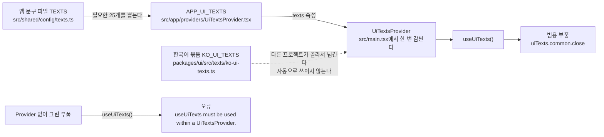
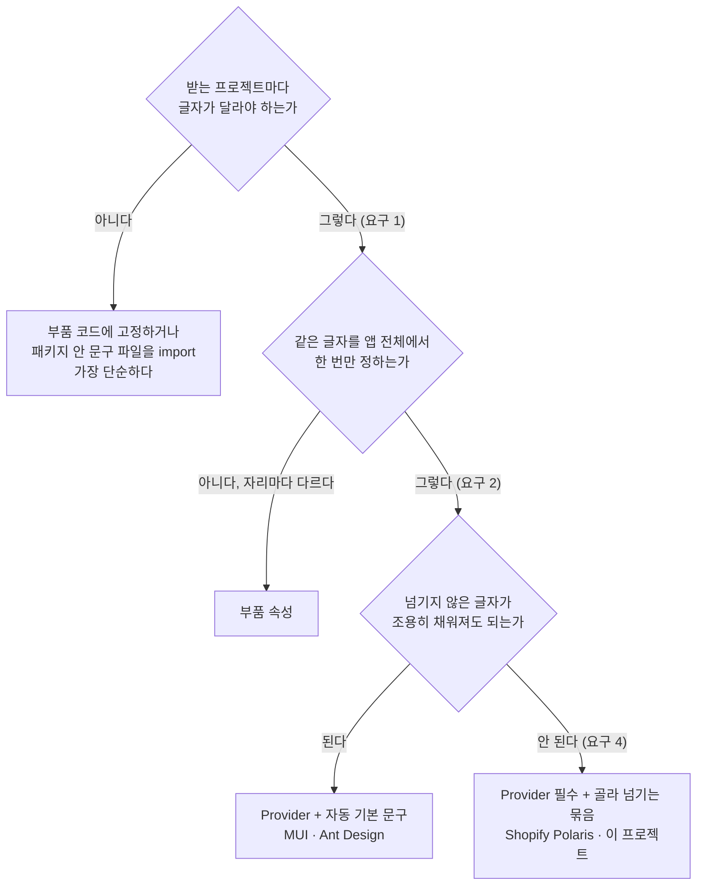
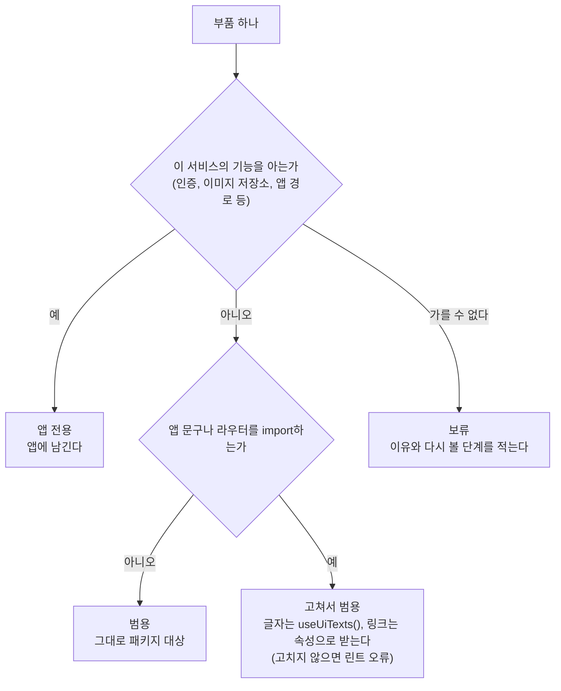

# 디자인 시스템 원칙과 부품 분류

> **문서 성격**: 레퍼런스 — 공용 UI(`src/shared/ui`, 일부는 저장소 안 패키지 `packages/ui`)를 패키지로 꺼낼 때 누구를 위해 어디까지 꺼내는지의 원칙과, 지금 있는 부품
> 59개가 그 기준에서 어디에 속하는지를 모았다. [`DESIGN-SYSTEM-ROADMAP.md`](./DESIGN-SYSTEM-ROADMAP.md) 0단계의 결과에 1단계(앱
> 결합 분리)에서 정한 것을 더했다. 부품이 지금 어떻게 동작하는지는 [`DESIGN-SYSTEM.md`](./DESIGN-SYSTEM.md)가 정본이다.
>
> **대상 독자**: 로드맵의 다음 단계를 계획할 개발자와 AI 세션, 공용 UI에 부품을 더하거나 옮기는 개발자.
>
> **읽고 나면**: 새 부품이 범용인지 앱 전용인지 두 질문으로 가를 수 있고, 범용 부품이 글자와 링크를 어떻게 받는지와 그렇게 정한
> 이유, 부품의 속성 이름과 `className`을 어떻게 맞추는지, 어느 부품이 `ref`와 나머지 속성을 받는지, 지금 부품이 어느 분류에
> 속하는지 안다.
>
> **마지막 검토**: 2026-11-24

**읽는 법**

- 따옴표 이탤릭은 원문을 옮긴 것이고 `(번역)`은 영어 원문을 옮겼다는 뜻이다. 외부 인용은 2026-11-18에 원문을 직접 받아 문장을
  대조했다([§1.3](#13-글자를-provider로-받기로-한-이유)의 react.dev "Passing Data Deeply with Context"와 Next.js 인용,
  [§1.4](#14-api-규칙)의 선례와 react.dev `forwardRef` 인용은 2026-11-19).
- 분류와 수치는 2026-11-19, 1단계 둘째 PR(이미지 확대 창 나누기)까지 반영한 상태다. 부품을 더하거나 옮기면
  [§5](#5-부품-분류표) 표의 줄을 고치고 [§6](#6-측정-명령) 명령으로 개수를 다시 맞춘다.
- **부품**은 `src/shared/ui`와 `packages/ui/src` 안의 컴포넌트 파일이다. **앱 코드**는 그 폴더 밖의 이 저장소 코드다. **보조 모듈**은 앱 코드 가운데
  부품이 가져다 쓰지만 앱 문구·라우터·서비스 기능을 모르는 작은 모듈이다(`cn()`, 클릭 가드 훅 등).

---

## 1. 정한 것 (2026-11-18)

| 항목                  | 결정                                                                                | 기각한 대안                                                                                                                                            | 정해진 경로 |
| --------------------- | ----------------------------------------------------------------------------------- | ------------------------------------------------------------------------------------------------------------------------------------------------------ | ----------- |
| 사용 대상             | React와 Tailwind v4를 쓰는, 이 저장소를 만든 개발자의 다음 프로젝트                 | 처음부터 Tailwind 무관(쓸 곳이 없는 CSS 빌드를 먼저 만든다), 공개 오픈소스(영어 문서와 외부 문의 대응이 붙는다)                                        | 사용자 답   |
| Tailwind를 안 쓰는 곳 | 지금 정하지 않는다. 3단계(패키지화)에서 정한다                                      | —                                                                                                                                                      | 사용자 답   |
| 경계 기준             | 앱 문구·라우터만 묶인 부품까지 범용이다. 이 서비스의 기능을 아는 부품만 앱 전용이다 | 좁게(지금 그대로 쓸 수 있는 부품만 범용 — 조합 부품을 다음 프로젝트에서 다시 만든다), 넓게(55개 전부 범용 — 인증·이미지 저장소까지 주입 구조로 바꾼다) | 사용자 답   |
| 상태 단계 이름        | `Experimental` / `Ready` / `Deprecated`                                             | 한국어 이름, 8단계(운영)로 미룸                                                                                                                        | 사용자 답   |
| 부품별 상태           | 지금 붙이지 않는다. 패키지에 들어가는 3단계에서 붙인다                              | 지금 55개에 붙임                                                                                                                                       | 계획 승인   |
| `Ready` 조건          | [§4](#4-상태-단계)의 네 가지                                                        | —                                                                                                                                                      | 계획 승인   |

재사용 방식(npm 패키지)은 [`DECISIONS.md`](./DECISIONS.md) "2026-11-18 — 공용 UI 재사용 방식: npm 패키지 (shadcn 레지스트리·혼합
기각)"에 있다. 이 문서의 결정은 문서만 고치면 되돌릴 수 있어 그 기록에는 적지 않았다.

### 1.1 1단계에서 정한 것

1단계(앱 결합 분리)의 계획과 구현 중에 정했다. 부품 13개와 문구 파일 세 개를 고치면 되돌릴 수 있어 `DECISIONS.md`에는 적지
않았다. 계획은 [`plans/2026-11-18-design-system-stage1-decoupling.md`](./plans/2026-11-18-design-system-stage1-decoupling.md)다.

| 항목                                         | 결정                                                                                                                                                                         | 기각한 대안                                                                                                                                                                              | 정해진 경로                                           |
| -------------------------------------------- | ---------------------------------------------------------------------------------------------------------------------------------------------------------------------------- | ---------------------------------------------------------------------------------------------------------------------------------------------------------------------------------------- | ----------------------------------------------------- |
| 부품이 스스로 보여 주는 글자를 넣는 방법     | 앱 맨 위에 `UiTextsProvider`를 한 번 두고 부품은 `useUiTexts()`로 읽는다([§1.2](#12-부품이-스스로-보여-주는-글자))                                                           | 부품 속성으로만(쓰는 자리마다 넘긴다), 코드에 고정(받는 쪽이 글자를 정할 수 없다), 부품이 문구 파일을 직접 import(패키지 안의 파일이면 받는 쪽이 정할 수 없고 앱의 파일이면 앱에 묶인다) | 사용자 답                                             |
| 문구를 넘기지 않았을 때                      | 부품이 오류를 낸다. 패키지가 대신 넣어 주는 기본 문구는 없다                                                                                                                 | 기본 문구를 자동으로 쓴다 — 앱이 넘기지 않은 글자가 화면에 나오면 그 글자가 앱 것인지 패키지 것인지 코드로 알 수 없다                                                                    | 사용자 답(계획은 자동 기본 문구였고 구현 중에 바꿨다) |
| 한국어 문구 묶음                             | 패키지가 `KO_UI_TEXTS`를 내보내되 자동으로 쓰지 않는다. 받는 쪽이 가져와 넘기거나 자기 문구를 넘긴다                                                                         | 묶음 없이 타입만 준다(처음 쓰는 프로젝트가 25개를 모두 적어야 컴파일된다)                                                                                                                | 사용자 답                                             |
| 이 앱이 넘기는 문구                          | 묶음을 쓰지 않고 `TEXTS`에서 뽑은 `APP_UI_TEXTS`를 넘긴다. 문구를 정하는 곳은 지금처럼 `texts.ts` 한 곳이다                                                                  | `TEXTS`에서 키를 지우고 묶음을 쓴다(e2e 83개 파일이 `TEXTS`를 import하고, 말투 검사 `texts.test.ts`가 `texts.ts`를 본다)                                                                 | 계획 승인                                             |
| 문구 키의 모양                               | 부품별로 묶는다. 한 부품만 쓰는 글자는 그 부품 이름 아래에, 둘 이상이 쓰면 `common`에 둔다                                                                                   | 한 층으로 늘어놓는다(`close`, `retry` — 어느 부품의 글자인지 이름으로 알 수 없다)                                                                                                        | 사용자 답                                             |
| 부품 안의 변수 이름                          | `const uiTexts = useUiTexts()`                                                                                                                                               | `texts`(앱 문구 `TEXTS`와 헷갈린다)                                                                                                                                                      | 사용자 답                                             |
| 라우터에 묶인 부품                           | 쓰는 쪽이 넣는다. `ErrorLayout`은 홈 버튼을 `homeAction` 속성으로, `GlobalAlertDialogs`는 위치가 바뀌었다는 신호를 `dismissKey` 속성으로 받는다                              | 맨 위 Provider에 링크 부품을 등록한다(링크를 그리는 범용 부품이 1개뿐이다), 두 부품을 범용에서 뺀다                                                                                      | 사용자 답                                             |
| 앱 전용 부품의 자리                          | 옮기지 않고 경계 린트의 예외 목록에 적는다                                                                                                                                   | 지금 새 폴더로 옮긴다(3단계에서 범용 쪽이 한 번 더 옮겨진다)                                                                                                                             | 사용자 답                                             |
| 이미지 확대 창                               | 그리는 부품(범용)과 앱 배선(앱 전용)으로 나눴다. `ImageViewer`는 열림·이미지·순서를 속성으로 받고, `GlobalImageViewer`가 스토어와 뒤로가기 오버레이 훅을 잇는다              | 통째로 앱 전용, 뒤로가기 규약까지 패키지에 넣는다                                                                                                                                        | 사용자 답                                             |
| 경계를 지키게 하는 방법                      | 허용 목록 방식의 린트 `custom-design-system/no-app-import-in-generic-ui`. 범용 부품과 보조 모듈 파일이 `@/shared/ui/**`와 허용 목록 밖의 앱 모듈, 라우터를 import하면 오류다 | 문구·라우터만 막는다(인증 스토어 같은 새 결합을 못 잡는다)                                                                                                                               | 계획 승인                                             |
| 다른 프로젝트에서 쓸 수 있는지 확인하는 시점 | 1단계 뒤에 분리 리허설을 끼운다([로드맵 §5](./DESIGN-SYSTEM-ROADMAP.md#5-단계))                                                                                              | 3단계 끝 증거만 강화한다, 지금 순서 그대로 둔다                                                                                                                                          | 사용자 답                                             |
| 0단계 분류의 열린 줄                         | `LinkThumbnail`·`TooltipWrapper`의 분류와 보조 모듈의 자리는 분리 리허설 뒤에 정한다. 2026-11-23에 정했다([§1.5 "미뤄 둔 항목의 답"](#미뤄-둔-항목의-답))                    | —                                                                                                                                                                                        | 사용자 답                                             |

문구에 관한 여섯 줄(글자를 넣는 방법부터 변수 이름까지)이 어떤 요구와 비교에서 나왔는지, 선례와 다시 볼 조건은
[§1.3](#13-글자를-provider로-받기로-한-이유)에 있다.

### 1.2 부품이 스스로 보여 주는 글자

닫기 버튼의 라벨처럼 **쓰는 쪽이 넘기지 않아도 부품이 스스로 넣는 글자**가 범용 부품 13개에 25개 있다. 화면마다 다른
글자(제목, 버튼 문구, 안내문)는 여기에 들지 않고 지금처럼 쓰는 쪽이 속성으로 넘긴다.



| 조각                               | 위치                                         | 하는 일                                                                                                            |
| ---------------------------------- | -------------------------------------------- | ------------------------------------------------------------------------------------------------------------------ |
| 타입 `UiTexts`                     | `packages/ui/src/texts/ui-texts.ts`          | 부품이 스스로 넣는 글자의 목록. 부품별 묶음이고 값이 모두 필수라, 넘기는 쪽이 하나라도 빠뜨리면 컴파일 오류가 난다 |
| `UiTextsProvider`, `useUiTexts()`  | `packages/ui/src/texts/UiTextsProvider.tsx`  | 문구를 React 컨텍스트로 내려보내고 읽는다. Provider 밖에서 읽으면 오류를 낸다                                      |
| 한국어 묶음 `KO_UI_TEXTS`          | `packages/ui/src/texts/ko-ui-texts.ts`       | 25개를 직접 적지 않으려는 프로젝트가 가져다 넘기는 양식. 이 앱은 쓰지 않는다                                       |
| 이 앱의 문구 `APP_UI_TEXTS`와 래퍼 | `src/app/providers/UiTextsProvider.tsx`      | `TEXTS`에서 25개를 뽑아 넘긴다. `src/main.tsx`가 `<App />`을 이 래퍼로 감싼다                                      |
| 묶음 검사                          | `src/app/providers/UiTextsProvider.test.tsx` | `APP_UI_TEXTS`와 `KO_UI_TEXTS`의 키와 값이 같은지 본다. 일부러 다르게 둘 때 이 테스트를 지운다                     |

- **테스트와 스토리도 Provider 안에서 그린다.** `src/test/utils.tsx`의 `render`·`renderWithProviders`·`renderWithDataRouter`와
  `.storybook/preview.tsx`의 `withUiTexts` 데코레이터가 이 앱의 래퍼로 감싼다. 테스트에서 RTL의 `render`를 직접 쓰면 범용
  부품이 오류를 낸다([`TESTING.md`](./TESTING.md) "패턴 D").
- **글자를 더하거나 고치는 순서**는 `texts-conventions` skill(`.claude/skills/texts-conventions/SKILL.md`)의 "공용 UI 부품이
  스스로 보여 주는 글자"에 있다.
- **Provider로 받기로 한 이유와 치르는 값**(Next.js 서버 컴포넌트 포함)은
  [§1.3](#13-글자를-provider로-받기로-한-이유)에 있다.

### 1.3 글자를 Provider로 받기로 한 이유

[§1.1](#11-1단계에서-정한-것) 표에서 문구에 관한 여섯 줄이 어떤 요구와 비교에서 나왔는지 적는다. 나중에 이 결정을 고치려 할 때
판단할 근거로 남긴다. 결정한 날은 2026-11-18이고, 이 절의 개수는 2026-11-19에 다시 센 값이다([§6](#6-측정-명령) 7·8번).

이 절의 "21개"와 "12개"는 결정한 때(1단계 첫 PR)의 수다. 둘째 PR에서 이미지 확대 창(`ImageViewer`, 문구 4개)이 더해져 지금은
25개와 13개다([§1.2](#12-부품이-스스로-보여-주는-글자), [§6](#6-측정-명령) 6번). `ImageViewer`는 상태·효과 훅과 이벤트
핸들러를 써서, 아래 "치르는 값"의 "문구 훅 때문에만 클라이언트 컴포넌트가 되는 3개"에 들지 않는다.

**결정** — 범용 부품이 스스로 넣는 글자 21개는 받는 앱이 맨 위 `UiTextsProvider`에 한 번 넘긴다. 넘기지 않으면 부품이 오류를
낸다. 패키지는 한국어 묶음을 내보내되 자동으로 쓰지 않는다.

#### 요구

사용자가 밝힌 것이고, 번호는 이 절에서 다시 쓴다. 로드맵을 세울 때부터의 걱정은 "이 앱과 잘 분리해도 다른 프로젝트에 합치기
어려우면 가장 나쁘다"였다.

1. 패키지는 여러 프로젝트에서 쓰고, 문구는 앱마다 달라진다.
2. 문구는 서버 컴포넌트에서 쓰든 클라이언트 컴포넌트에서 쓰든 한곳에서 관리한다.
3. 기본 말투는 패키지가 주되, 쓰는 앱이 21개를 모두 자기 문구로 정할 수 있다.
4. 화면에 나온 글자가 앱이 넘긴 것인지 패키지 기본값인지 알 수 있어야 한다. 부품 코드에 글자를 고정하는 방식은 관리가 어려워
   뺀다.
5. 처음 도입하는 프로젝트가 21개를 하나씩 적어야만 컴파일되는 부담을 줄인다.
6. 부품 안에서 글자를 읽는 코드가 앱 문구(`TEXTS.common.failed`)처럼 어디의 글자인지 드러나야 한다.

요구 3과 4는 부딪친다. 기본 글자가 자동으로 채워지면 4가 깨지고, 기본 글자가 아예 없으면 3이 깨진다. 묶음을 주되 받는 앱이
직접 가져와 넘기게 한 것이 둘을 함께 채운 방법이다.

요구 2는 Provider가 채우는 것이 아니다. 앱 문구의 원본은 앱의 문구 파일 한 곳이고(이 앱은 `texts.ts`), 그 파일은 서버·클라이언트
어디서나 import한다. Provider는 그 파일을 import할 수 없는 패키지 부품에 21개를 건네는 통로로만 쓴다.

#### 비교한 방식

| 방식                                       | 글자를 정하는 곳                     | 요구에 비춘 결과                                                                                                                                                                                 | 이 방식이 맞는 때                                                         |
| ------------------------------------------ | ------------------------------------ | ------------------------------------------------------------------------------------------------------------------------------------------------------------------------------------------------ | ------------------------------------------------------------------------- |
| 부품 코드에 고정한다                       | 패키지(부품 파일)                    | 요구 1을 못 채운다. 받는 쪽이 글자를 정하려면 패키지를 고쳐 새 버전을 내야 한다                                                                                                                  | 한 회사·한 말투의 패키지, 코드를 복사해 가서 사본을 고치는 배포           |
| 패키지 안의 문구 파일을 부품이 import한다  | 패키지(문구 파일)                    | 고정과 같은 이유로 요구 1을 못 채운다. 구조는 가장 단순하고 서버 컴포넌트 제약이 없다. 글자를 받는 앱이 정하게 하면 가져올 파일이 없어 성립하지 않는다(패키지는 앱의 파일을 import할 수 없다)    | 받는 프로젝트가 모두 같은 글자를 쓸 때                                    |
| 부품 속성으로 받는다                       | 부품을 쓰는 자리마다                 | 요구 2를 못 채운다(아래 "속성으로 받는 방식과 견준 사실"). 기본값을 두면 한 자리에서 빠뜨렸을 때 그 자리만 패키지 글자가 나와 요구 4에도 걸린다                                                  | 자리마다 글자가 다를 때, 부품이 서버 컴포넌트로 남아야 할 때              |
| 글자를 넣지 않는다                         | 쓰는 쪽(버튼과 라벨을 요소째 넣는다) | 패키지에 글자가 없어 요구 3을 못 채운다. 닫기 버튼이 부품 안에 조립돼 있는 지금 부품의 모양을 바꿔야 한다                                                                                        | 뼈대만 주는 부품                                                          |
| Provider + 자동 기본 문구(계획 때 고른 안) | 앱 맨 위 한 곳. 없으면 패키지        | 요구 1·2·3을 채운다. Provider를 통째로 빠뜨리면 21개가 조용히 패키지 글자가 되어 요구 4에 걸린다. 21개 가운데 여럿이 화면 읽기 프로그램만 읽는 라벨이라 눈으로는 알아채기 어렵다                 | 넘기지 않은 글자가 기본값으로 채워져도 되는 패키지                        |
| **Provider 필수 + 골라 넘기는 묶음(결정)** | 앱 맨 위 한 곳                       | 요구 1~5를 채운다. 넘기지 않으면 오류이고, 묶음을 쓰는 앱은 `KO_UI_TEXTS`를 가져오는 줄이 코드에 남는다. 요구 6은 키를 부품별로 묶고 변수 이름을 `uiTexts`로 둬서 채운다(`uiTexts.common.close`) | 받는 앱마다 글자가 다르고, 글자가 누구 것인지 코드로 알 수 있어야 하는 때 |



#### 속성으로 받는 방식과 견준 사실

- **21개는 자리마다 다른 글자가 아니다.** 지금도 호출부가 넘기지 않고 부품이 안에서 읽는다. 자리마다 다른 글자(제목, 버튼
  문구)는 지금처럼 속성으로 넘긴다.
- **부품 안의 부품에 들어 있다.** 앱 화면 → `FormInputPassword` → `PasswordInput` → `Input`에서 "입력값 지우기"는 맨 안쪽
  `Input`이 넣는 글자다. 속성으로 받으면 12개를 감싸 쓰는 범용 부품 7개(`FormInput`, `FormInputPassword`, `PasswordInput`,
  `SearchInput`, `CenteredSpinner`, `SheetDialogContent`, `GlobalAlertDialogs`)가 속성을 받아 아래로 넘겨야 한다.
- **쓰는 자리가 많다.** 12개를 직접 가져다 쓰는 `src/shared/ui` 밖 파일이 20개다. 속성 방식이면 문구가 다른 프로젝트는 이런
  자리마다 같은 글자를 넘긴다.
- react.dev [Passing Data Deeply with Context](https://react.dev/learn/passing-data-deeply-with-context)는 컨텍스트를 쓰기
  전에 살펴볼 대안으로 _"props 전달부터 시작한다"_ 와 _"컴포넌트를 추출하고 JSX를 `children`으로 넘긴다"_ (번역)를 든다. 같은
  글은 _"하지만 props 전달은 어떤 prop을 트리 깊숙이 넘겨야 하거나 많은 컴포넌트가 같은 prop을 필요로 할 때 장황하고
  불편해질 수 있다"_ (번역)고도 쓴다. 21개가 뒤 문장의 두 경우에 모두 든다는 것이 이 문서의 판단이다.

#### 치르는 값

- **구조가 는다.** Provider와 훅, 앱 쪽 래퍼가 생기고, 테스트와 스토리도 Provider 안에서 그려야 한다
  ([§1.2](#12-부품이-스스로-보여-주는-글자)).
- **같은 글자가 두 곳에 있다.** 한국어 묶음과 이 앱의 `TEXTS`다. 이 앱은 묶음을 쓰지 않아 묶음이 틀려도 화면과 다른 테스트로는
  드러나지 않는다. 그래서 묶음 검사 테스트를 따로 둔다.
- **묶음을 펼쳐 일부만 바꾸는 앱에서는 요구 4가 다시 깨진다.** `{ ...KO_UI_TEXTS, common: { close: '닫아요' } }`처럼 넘기는
  앱은 자기가 적지 않은 묶음에 글자가 늘어도 컴파일 오류 없이 패키지의 글자를 받는다. 묶음을 그대로 넘기거나 21개를 모두 적는
  앱에는 해당하지 않는다.
- **Next.js(App Router)에서는 문구를 읽는 부품이 클라이언트 컴포넌트가 된다.** Next 문서
  [Server and Client Components](https://nextjs.org/docs/app/getting-started/server-and-client-components)는 _"React 컨텍스트는
  서버 컴포넌트에서 지원되지 않는다"_ (번역)고 쓰고, 클라이언트 컴포넌트를 써야 하는 때로 _"상태와 이벤트 핸들러"_, _"커스텀
  훅"_ (번역)을 든다. 아래는 문서를 읽고 낸 결론이고 Next.js에서 실행해 확인하지 않았다.
  - 12개 가운데 9개는 문구가 아니어도 상태·효과 훅이나 이벤트 핸들러를 쓴다. 문구 훅 때문에만 클라이언트 컴포넌트가 되는 것은
    `Spinner`, `AuthLayout`, `ErrorLayout` 3개다.
  - 서버 컴포넌트인 페이지가 이 부품들을 그리는 것은 된다. 같은 문서는 Provider를 클라이언트 컴포넌트로 감싼 예 뒤에 _"이제
    서버 컴포넌트가 provider를 직접 그릴 수 있고, 앱 곳곳의 다른 클라이언트 컴포넌트가 이 컨텍스트를 쓸 수 있다"_ (번역)고
    쓴다. _"클라이언트 컴포넌트와 RSC 페이로드는 HTML을 미리 그리는 데 쓰인다"_ (번역)는 문장도 있어, 글자가 첫 HTML에
    들어간다고 읽었다.
  - 꼭 서버 컴포넌트로 남아야 하는 부품이 생기면 그 부품에만 라벨 속성을 더하는 길이 있다. 속성을 더하는 것은 쓰던 곳을 깨지
    않는다.
  - 패키지로 낼 때 문구를 읽는 부품 파일에 `'use client'`를 적어야 한다. 같은 문서는 _"컴포넌트 라이브러리를 만든다면,
    클라이언트 전용 기능에 기대는 진입점에 `"use client"` 지시어를 넣어라"_ (번역)고 안내한다. 지금 12개 가운데 이 표시가 있는
    파일은 `BackToTopButton.tsx` 하나다. 3단계(패키지화)에서 한다([로드맵 §5](./DESIGN-SYSTEM-ROADMAP.md#5-단계)).
  - 받는 앱도 Provider를 `'use client'` 파일에서 감싸야 한다는 것이 이 문서의 판단이다. 함수로 된 문구
    2개(`imageAttachmentField.removeAt`, `imageAt`)는 서버 컴포넌트가 클라이언트 컴포넌트에 속성으로 넘길 수 없다 — react.dev
    [`'use client'`](https://react.dev/reference/rsc/use-client#serializable-types)는 _"서버 컴포넌트에서 클라이언트 컴포넌트로
    넘기는 속성 값은 직렬화할 수 있어야 한다"_ (번역)고 쓰고, 클라이언트 표시 모듈에서 내보내지 않았고 `'use server'`도 아닌
    함수를 지원하지 않는 값으로 든다.

#### 다시 볼 조건

- **Provider의 근거는 요구 1 하나다.** 이 패키지를 이 앱만 쓰게 되거나, 받는 프로젝트가 모두 같은 한국어 글자를 쓰기로 정해지면
  패키지 안의 문구 파일을 import하는 방식이 더 단순하다. 구조가 상수 파일 하나로 줄고, 서버 컴포넌트 제약과 테스트 감싸기가
  없어진다.
- **바꾸는 방향에 따라 값이 다르다.**

  | 바꾸는 방향                         | 하는 일                                                                              | 쓰던 앱                                  |
  | ----------------------------------- | ------------------------------------------------------------------------------------ | ---------------------------------------- |
  | 문구 파일 import → Provider         | 부품의 상수를 훅으로 바꾸고 Provider를 더한다. 컨텍스트 기본값을 그 상수로 두면 된다 | 깨지지 않는다                            |
  | Provider → 문구 파일 import         | 훅과 Provider를 걷어 낸다                                                            | 자기 글자를 넘기던 앱은 그 기능을 잃는다 |
  | 묶음 없음 → 묶음 제공               | 파일을 더한다                                                                        | 깨지지 않는다                            |
  | 묶음 제공 → 묶음 없음               | 파일을 지운다                                                                        | 묶음을 가져다 넘기던 앱이 깨진다         |
  | 넘기지 않으면 오류 → 자동 기본 문구 | 컨텍스트 기본값을 묶음으로 둔다                                                      | 깨지지 않는다. 요구 4를 버리는 선택이다  |
  | 문구 키의 구조를 바꾼다             | 타입, 묶음, 부품 12개                                                                | 문구를 넘기던 앱이 모두 고친다           |

- **패키지를 내기 전과 뒤가 다르다.** 3단계 전에는 부품 12개와 문구 파일 세 개(`ui-texts.ts`, `ko-ui-texts.ts`,
  `UiTextsProvider.tsx`), 테스트·스토리 배선만 고치면 어느 쪽으로든 갈 수 있다. 낸 뒤에는 받는 앱이 함께 고쳐야 한다.
- **여러 언어를 지원하게 되어도 방식은 그대로다.** 넘기는 값이 언어별 `UiTexts` 가운데 하나가 된다. 함수로 된 문구 2개는 JSON
  번역 파일에 담을 수 없다. 이 앱의 문구(`TEXTS`)를 언어별로 나누는 일은 이 결정과 별개다.

#### 결정까지의 순서

한 번에 정해지지 않았다. 전제가 바뀔 때마다 답이 달라졌고, 어느 전제가 어느 답을 냈는지가 다시 볼 때의 기준이다.

1. **계획** — "Provider + 자동 기본 문구", "속성 + 기본 문구", "속성 필수" 셋을 견줘 첫째를 골랐다. 패키지 안의 문구 파일을
   import하는 방식과 Next.js 서버 컴포넌트는 이때 따지지 않았다.
2. **"바뀌지 않는 상수는 컨텍스트에 넣지 않고 import한다"는 반론** — 앱 문구에는 맞는 말이라 `TEXTS`는 그대로 import한다.
   패키지 부품은 받는 앱의 파일을 import할 수 없어서, 글자를 받는 앱이 정하게 하려면 통로가 따로 있어야 한다. 이때 "패키지
   안의 문구 파일을 import" 방식을 선택지에 더했다.
3. **다음 프로젝트가 Next.js라면** — 컨텍스트를 서버 컴포넌트에서 읽을 수 없다는 것을 확인했다. 요구가 정해지기 전이라 더
   단순한 import 쪽으로 기울었다.
4. **요구 1~3** — import와 고정은 요구 1을 채우지 못해 Provider로 돌아왔다.
5. **속성과 견줌, 다른 디자인 시스템 조사** — 위 "속성으로 받는 방식과 견준 사실"과 아래 "선례"다. Provider를 유지했다.
6. **요구 4** — 자동 기본 문구를 없애고 "넘기지 않으면 오류"로 바꿨다.
7. **요구를 모두 빼고 다시 견줌** — 요구가 없으면 import가 더 단순하다. 갈리는 물음은 "받는 프로젝트마다 글자가 달라야
   하는가" 하나였다. 글자를 패키지가 아니라 받는 앱이 정한다고 두자 import는 가져올 파일이 없어 빠졌고, Provider로 정했다.
8. **요구 5** — 묶음 없이 타입만 주는 안과 견줘, 한국어 묶음을 내보내되 자동으로 쓰지 않는 안을 골랐다.
9. **요구 6** — 키를 부품별로 묶고 변수 이름을 `uiTexts`로 정했다.

#### 선례

부품이 스스로 넣는 글자를 다루는 방식은 넷으로 갈린다. 2026-11-18에 원문(문서, 공개 저장소, npm 배포본)을 직접 받아 대조했다.

| 방식                                     | 쓰는 곳                                                                     | 출처                                                                                                                                                                                                                                                                                                                                                                         |
| ---------------------------------------- | --------------------------------------------------------------------------- | ---------------------------------------------------------------------------------------------------------------------------------------------------------------------------------------------------------------------------------------------------------------------------------------------------------------------------------------------------------------------------- |
| 코드에 직접 적는다                       | shadcn, GitHub Primer, 토스 TDS의 일부, 당근 SEED 스니펫의 일부             | [shadcn `dialog.tsx`](https://raw.githubusercontent.com/shadcn-ui/ui/main/apps/v4/registry/new-york-v4/ui/dialog.tsx), Primer [`Dialog`](https://github.com/primer/react/tree/main/packages/react/src/Dialog) 폴더의 `Dialog.tsx`(`aria-label="Close"`), [SEED `bottom-sheet.tsx`](https://github.com/daangn/seed-design/blob/dev/docs/registry/react/ui/bottom-sheet.tsx)   |
| 부품 속성으로 받는다(기본값이 있다)      | Mantine, IBM Carbon, 토스 TDS의 일부, 당근 SEED 스니펫의 일부               | [Mantine Modal](https://mantine.dev/core/modal/), Carbon [`ListBox`](https://github.com/carbon-design-system/carbon/tree/main/packages/react/src/components/ListBox) 폴더의 `ListBoxSelection.tsx`(`translateWithId` 속성), [SEED `search-input.tsx`](https://github.com/daangn/seed-design/blob/dev/docs/registry/react/ui/search-input.tsx)(`clearButtonLabel = "지우기"`) |
| 맨 위에서 한 번 받는다                   | MUI, Ant Design, React Aria, Shopify Polaris, 당근 스택플로우 상단 바, X 웹 | [MUI Localization](https://mui.com/material-ui/guides/localization/), [Ant Design i18n](https://ant.design/docs/react/i18n), [React Aria](https://react-aria.adobe.com/quality), 스택플로우 [`plugin-basic-ui`](https://github.com/daangn/stackflow/tree/main/extensions/plugin-basic-ui/src/components) 폴더의 `AppBar.tsx`, Polaris와 X는 아래                             |
| 글자를 넣지 않고 쓰는 쪽이 요소째 넣는다 | Radix, 네이버 egjs, 카카오 olive-ui                                         | [Radix Dialog](https://www.radix-ui.com/primitives/docs/components/dialog), [`egjs-flicking-plugins`](https://github.com/naver/egjs-flicking-plugins/tree/master/src)의 `Arrow.ts`, [`kakao/olive-ui`](https://github.com/kakao/olive-ui)                                                                                                                                    |

- **토스 TDS**는 npm 배포본 `@toss/tds-mobile@2.5.1`의 `dist/esm/index.js`와 `index.d.ts`에서 읽었다. 가림막의 `"닫기"`는
  고정이고 `rightButton="확인"`·`leftButton="취소"`는 속성의 기본값이다. 맨 위 `TDSMobileProvider`의 속성에 문구는 없다.
- **당근 스택플로우 상단 바**는 개별 `ariaLabel` 속성이 없으면 전역 옵션의 값을 읽는다.
- **X 웹**은 x.com이 브라우저에 내려 주는 운영 스크립트(로그인 전 화면의 진입 묶음과 그것이 부르는 묶음 3개)에서 읽었다. 자체
  `TranslationProvider`와 `useTranslation()`이 있고, Provider 밖에서 훅을 부르면
  `useTranslation: render under TranslationProvider` 오류를 낸다. 압축된 코드라 오류 문구와 라이브러리 문자열로 판단했고, 주소가
  고정된 원문이 없어 링크를 달지 못했다.
- **국내 네 회사(토스, 당근, 카카오, 네이버)의 공개 코드에서 문구만 받는 전역 Provider는 찾지 못했다.** 카카오와 네이버는 React
  디자인 시스템의 공개 코드를 찾지 못해 위 두 저장소만 봤다.
- **갈리는 기준은 나라가 아니라 "받는 앱마다 글자가 달라야 하는가"라는 것이 이 문서의 판단이다.** 회사가 이유를 직접 밝힌 글은
  찾지 못했다. 판단에 쓴 사실은 셋이다.
  - 글자를 고정하는 Primer와 shadcn은 해외의 것이다.
  - 토스는 TDS를 _"TDS는 토스 제품을 만들 때 공통적으로 사용하는 디자인 시스템이에요."_
    ([TDS Mobile 소개](https://tossmini-docs.toss.im/tds-mobile/))라고 소개한다.
  - 당근 SEED의 스니펫은 받는 프로젝트 안에 파일로 생겨 사본을 고칠 수 있다 — _"CLI 실행 후, `seed-design/ui/*` 디렉토리에
    snippet이 생성됩니다."_
    ([SEED Snippet 문서](https://github.com/daangn/seed-design/blob/dev/docs/content/react/components/concepts/snippet.mdx)).

이 프로젝트의 선택(Provider가 필수이고, 넘기지 않으면 오류이고, 언어별 묶음을 따로 준다)과 모양이 같은 것은 Shopify Polaris다.

- `AppProvider`의 `i18n` 속성에 `?`가 없다
  ([`components/AppProvider`](https://github.com/Shopify/polaris/tree/main/polaris-react/src/components/AppProvider) 폴더의
  `AppProvider.tsx`에 있는 `i18n: ConstructorParameters<typeof I18n>[0];`).
- 문구를 읽는 훅은 Provider가 없으면 `MissingAppProviderError('No i18n was provided.')`를 던진다
  ([`utilities/i18n`](https://github.com/Shopify/polaris/tree/main/polaris-react/src/utilities/i18n) 폴더의 `hooks.tsx`).
- 한국어 묶음은 `Avatar`, `Button`, `Modal`처럼 부품별로 묶여 있고, 여러 부품이 쓰는 글자는 `Common`(`cancel: "취소"`,
  `close: "닫기"` 등)에 있다([`locales/ko.json`](https://github.com/Shopify/polaris/blob/main/polaris-react/locales/ko.json)).

반대쪽 근거도 있다. react.dev [`useContext`](https://react.dev/reference/react/useContext)의 "Specifying a fallback default
value" 절은 컨텍스트에 기본값을 두는 방식을 두고 _"이렇게 하면 실수로 어떤 컴포넌트를 해당 provider 없이 그려도 깨지지
않는다"_ (번역)고 쓴다. 이 프로젝트는 깨지지 않는 것보다 화면에 나온 글자가 누구 것인지 코드로 알 수 있는 쪽을 골랐다(요구
4). Provider 밖에서 오류를 던지는 훅은 그 문서에 나오지 않고, 선례는 위 Polaris다. 컨텍스트 기본값을
`null`로 둔 것은 [`createContext`](https://react.dev/reference/react/createContext)의 "Parameters" 절 _"의미 있는 기본값이
없으면 `null`을 지정한다"_ (번역)를 따랐다. `<UiTextsContext.Provider>` 꼴로 쓴 것은 설치본이 React 18.3.1이기 때문이다 — 같은
문서는 React 19부터 `<SomeContext>`를 바로 provider로 그릴 수 있고 그 전 버전에서는 `.Provider`를 쓰라고 안내한다.

### 1.4 API 규칙

부품마다 종류를 고르는 속성 이름, `className`이 합쳐지는 자리, `ref`와 나머지 속성을 받는지가 달라 쓰는 쪽이 부품별로 외워야
했다. 패키지를 낸 뒤에 속성 이름을 바꾸면 쓰는 쪽 코드가 깨지므로 내기 전에 맞췄다. 결정한 날은 2026-11-19이고 계획은
[`plans/2026-11-19-design-system-api-rules.md`](./plans/2026-11-19-design-system-api-rules.md)다. 패키지를 내기 전이라 부품
파일과 사용처를 고치면 되돌릴 수 있어 `DECISIONS.md`에는 적지 않았다.

이 절에서 **축**은 쓰는 쪽이 값 하나를 고르는 속성 하나다. **모양**은 채움·외곽선·글자만처럼 생김새를 가르는 값이고, **뜻**은
정보·성공·경고·위험처럼 부품이 전하는 의미를 가르는 값이다.

**저수준 부품**은 atoms와, elements 가운데 버튼·입력처럼 DOM 요소 하나를 감싼 부품이다. **조립 부품**은 나머지 elements와
layouts로, 부품 여럿을 엮어 한 덩어리를 그린다. **나머지 속성**은 부품이 이름을 붙여 따로 받지 않은 속성이다(`id`, `data-*`,
`aria-*`, 이벤트 핸들러 등). **대상 요소**는 쓰는 쪽이 넘긴 `ref`·`className`·나머지 속성이 닿는 DOM 요소다. 보통 부품이
그리는 맨 바깥 요소이고, 입력을 감싼 부품(`PasswordInput`·`SearchInput`)에서는 감싼 `div`가 아니라 `input`이며, 창을 그리는
부품(`DialogContent`·`SheetDialogContent`)에서는 바탕 막이 아니라 창 패널이다.

| 규칙                | 내용                                                                                                                                                              | 지키게 하는 검사                                                                                        |
| ------------------- | ----------------------------------------------------------------------------------------------------------------------------------------------------------------- | ------------------------------------------------------------------------------------------------------- |
| 종류·크기 속성 이름 | 종류를 고르는 속성은 `variant`, 크기는 `size`다. 모양과 뜻을 따로 골라야 하는 부품에서만 뜻 축을 `tone`으로 더한다                                                | 린트 `custom-design-system/cva-variant-keys`                                                            |
| 클래스 병합         | `className`은 `cn(자기 클래스, className)`으로 맨 뒤에 합친다. cva로 만든 함수에는 `className`을 넘기지 않는다. 부분을 꾸미는 속성의 이름은 `<부분>ClassName`이다 | 린트 `custom-design-system/classname-last`(맨 뒤인지, cva 밖인지). `<부분>ClassName` 이름은 보지 않는다 |
| `ref`·나머지 속성   | 저수준 부품은 `ref`·나머지 속성·`className`을 같은 대상 요소에 넘긴다. React 18을 지원하는 동안 `forwardRef`로 만든다                                             | 계약 테스트 `src/shared/ui/ApiContract.test.tsx`                                                        |
| 조립 부품           | 계약 테스트의 표에 적힌 것만 약속한다. 새 조립 부품은 표에 한 줄을 더한다                                                                                         | 같은 테스트(표에 없는 부품이 있으면 실패)                                                               |

부품마다 무엇을 약속하는지는 계약 테스트 파일의 두 표가 정본이라 이 문서에 옮겨 적지 않는다. 계약 테스트는 부품을 실제로 그려
`ref`·`className`·나머지 속성이 어느 요소에 닿는지 보는 단위 테스트다.

#### 규칙을 쓰는 모습

```tsx
// 고르는 축이 하나면 그 값이 모양이든 뜻이든 variant다
<Button variant="outline" size="sm" />
<Button variant="destructive" />
<FeaturedIcon icon={MailCheck} variant="success" />

// 모양과 뜻을 따로 골라야 하는 부품이 생기면 뜻 축을 tone으로 더한다
// (2026-11-19 기준 그런 부품은 0개다. Callout은 설명하려고 든 없는 부품이다)
<Callout variant="outline" tone="warning" />
```

```tsx
// 부품 안에서 클래스를 합치는 자리
<div className={cn(badgeVariants({ variant }), className)} {...props} /> // 규칙
<Comp className={cn(buttonVariants({ variant, size, className }))} /> // 린트 오류. 결과는 같지만 합치는 자리가 둘이 된다
<div className={cn(className, 'rounded-full')} /> // 린트 오류. 부품의 클래스가 쓰는 쪽 클래스를 이긴다
```

- **맨 뒤에 두는 이유**: `cn()`은 `tailwind-merge`로 서로 부딪치는 클래스 가운데 뒤에 온 것을 남긴다. 설치본 3.7.0에서
  `twMerge('rounded-full', 'rounded-md')`는 `rounded-md`를, 순서를 바꾸면 `rounded-full`을 돌려준다(2026-11-19 실행).
  쓰는 쪽이 넘긴 클래스가 이기려면 `className`이 맨 뒤여야 한다.
- **cva 안팎의 결과가 같은 이유**: 설치본 `class-variance-authority` 0.7.1은 넘겨받은 `className`을 자기 클래스 뒤에 붙여
  돌려준다(`node_modules/class-variance-authority/dist/index.mjs`의 마지막 `return cx(base, …, props.class, props.className)`).
  그래서 `cn()`에 들어가는 문자열이 두 꼴에서 같다. `Button`을 바꾸기 전후로 그린 `class` 문자열도 같았다([§6](#6-측정-명령)
  11번).

```tsx
// 저수준 부품을 만드는 꼴: ref·className·나머지 속성이 같은 요소에 닿는다
const Badge = forwardRef<HTMLDivElement, BadgeProps>(({ className, variant, ...props }, ref) => (
  <div ref={ref} className={cn(badgeVariants({ variant }), className)} {...props} />
));
Badge.displayName = 'Badge';

// 쓰는 쪽
<Badge ref={badgeRef} id="author-badge" className="ml-2" />
<SearchInput ref={inputRef} /> // 입력을 감싼 부품은 감싼 div가 아니라 input에 닿는다

// 버튼 하나를 감싼 부품: 나머지 속성을 먼저 펼치고, 부품이 정하는 속성을 그 뒤에 적는다
<Button ref={ref} {...props} type="button" variant="ghost" aria-label={label} />
<EditButton label={label} onClick={onEdit} type="submit" /> // 타입 오류. type은 EditButton이 정한다
```

- **React 18에서 `forwardRef`가 필요한 이유**: 일반 함수 컴포넌트에 `ref`를 넘기면 닿지 않는다. 부품을 고치기 전에 계약
  테스트를 돌렸을 때 14개 atoms에서 `ref`가 비어 있었고 React가 "Function components cannot be given refs" 경고를
  냈다([§6](#6-측정-명령) 13번). 그 가운데 `Divider`·`Kbd`·`KbdGroup`·`Spinner`·`DropdownMenuShortcut` 다섯은 타입이 `ref`를
  받는다고 적혀 있었다(`React.ComponentProps<'div'>` 꼴과 `React.RefAttributes`).
- **버튼을 감싼 부품에서 펼치는 순서가 중요한 이유**: JSX는 같은 속성을 두 번 적으면 뒤에 적은 값을 쓴다. `{...props}`를
  먼저 펼치고 `type`·`variant`·`aria-label`을 그 뒤에 적어야 부품이 정한 값이 남는다. 타입에서 빼는 것만으로는 다 막지 못한다
  — `type`·`title`은 넘기면 타입 오류가 나지만, `aria-label`처럼 하이픈이 든 속성은 타입에서 빼도 JSX에서 오류가 나지
  않는다(`pnpm type-check`로 확인, [§6](#6-측정-명령) 16번).
- **이 순서는 버튼을 감싼 elements 4개에만 걸었다.** `{...props}`를 맨 뒤에 둔 atoms에서는 부품이 기본으로 주는 속성을 쓰는
  쪽이 바꿀 수 있다(`Skeleton`의 `aria-hidden`, `Spinner`의 `role`. 둘은 전부터 그랬다). 이번에 나머지 속성을 연
  `RequiredMark`의 `aria-hidden`도 같은 자리라 이제 바꿀 수 있다.

#### 이름과 병합 자리를 정한 이유

| 항목                 | 결정                                                                                                                                                   | 기각한 대안                                                                                                                                                                                                                                                                                                                                                                                                                                                                     | 정해진 경로 |
| -------------------- | ------------------------------------------------------------------------------------------------------------------------------------------------------ | ------------------------------------------------------------------------------------------------------------------------------------------------------------------------------------------------------------------------------------------------------------------------------------------------------------------------------------------------------------------------------------------------------------------------------------------------------------------------------- | ----------- |
| 종류 속성 이름       | `variant` 하나. 고르는 축이 하나면 값이 모양인지 뜻인지 따질 일이 없고, 이름이 허용 목록 안에 있는지만 보면 되어 린트로 막을 수 있다                   | ① 모양은 `variant`, 뜻은 `tone`으로 나누고 코드는 그대로 둔다 — 뜻만 고르는 부품이 `tone` 하나만 갖는다(바꾸기 전의 `FeaturedIcon`). `Button`·`Badge`·`DropdownMenuItem`의 `variant="destructive"` 세 곳이 "뜻 값이 모양 축에 있는" 예외로 남고, 새 부품마다 값이 모양인지 뜻인지 사람이 판단한다. ② 뜻은 전부 `tone`으로 옮긴다 — 외곽선이면서 위험인 버튼처럼 지금 없는 조합의 생김새를 새로 정해야 하고, shadcn에서 부품을 들일 때마다 `variant="destructive"`를 풀어 옮긴다 | 사용자 답   |
| 클래스를 합치는 자리 | `cn(자기 클래스, className)`                                                                                                                           | cva로 만든 함수 안에 넘긴다 — 결과는 같다. 두 꼴이 섞이면 `className`이 어디서 합쳐지는지 파일마다 읽어야 하고, cva를 쓰지 않는 부품에는 쓸 수 없는 꼴이다                                                                                                                                                                                                                                                                                                                      | 계획 승인   |
| 지키게 하는 방법     | cva `variants`의 키를 허용 목록(`variant`·`size`·`tone`)으로 막는다. `tone`은 `variant`가 함께 있을 때만 통과한다. 경계 린트와 같은 허용 목록 방식이다 | 금지 이름 목록(`color`, `kind`처럼 새로 나올 이름을 미리 다 적어야 한다), 문서에만 적는다                                                                                                                                                                                                                                                                                                                                                                                       | 계획 승인   |

바꾼 코드는 `FeaturedIcon`의 속성 이름(`tone` → `variant`, 사용처 5곳)과 `Button`의 병합 한 줄이다. 값 이름과 클래스는 그대로라
화면은 바뀌지 않는다.

#### ref와 나머지 속성을 넘기기로 한 이유

| 항목                    | 결정                                                                                                                                                                    | 기각한 대안                                                                                                                     | 정해진 경로                                                           |
| ----------------------- | ----------------------------------------------------------------------------------------------------------------------------------------------------------------------- | ------------------------------------------------------------------------------------------------------------------------------- | --------------------------------------------------------------------- |
| `ref` 구현              | `forwardRef`. 이 앱의 React 18.3.1과, 다음 프로젝트에서 쓸 확률이 높은 React 19 둘 다에서 돈다                                                                          | 이 앱을 React 19로 먼저 올린다(별도 계획이 필요하다). `ref`는 손대지 않고 규칙만 적는다(이 앱의 테스트로 규칙을 확인할 수 없다) | 사용자 답                                                             |
| 적용 범위               | 저수준 부품만                                                                                                                                                           | 범용 부품 전부 — 조립 부품의 맨 바깥 요소를 나중에 바꾸기 어려워진다(아래 react.dev 인용)                                       | 사용자 답                                                             |
| 대상 요소               | 맨 바깥 요소, 입력을 감싼 부품은 입력 요소. 고치기 전 동작 그대로다                                                                                                     | 비교한 대안 없음                                                                                                                | 계획 승인                                                             |
| 버튼을 감싼 부품의 속성 | 기본 `button` 속성을 받는다. 부품이 정하는 `type`·`children`과 `label`·`isActive`에서 만드는 `aria-label`·`title`·`aria-pressed`는 타입에서 빼고, 펼친 뒤에 다시 적는다 | 전부 열어 둔다 — 부품이 정한 모양과 이름이 쓰는 쪽 실수로 바뀐다                                                                | 계획 승인. `aria-*`·`title`까지 뺀 것과 펼치는 순서는 구현하며 정했다 |
| 지키게 하는 방법        | 부품을 실제로 그려 보는 계약 테스트                                                                                                                                     | 소스 모양만 보는 린트(`className`과 속성이 실제로 닿는지 보지 못한다), 문서에만 적는다                                          | 계획 승인                                                             |

적용 범위를 저수준 부품으로 좁힌 근거는 react.dev의 `forwardRef` 문서다.

> 컴포넌트 안의 DOM 노드로 가는 ref를 노출하면 나중에 컴포넌트 내부를 바꾸기가 더 어려워진다는 점을 기억하세요. 보통 버튼이나
> 텍스트 입력처럼 재사용하는 저수준 컴포넌트에서 DOM 노드를 노출하고, 아바타나 댓글 같은 애플리케이션 수준 컴포넌트에서는
> 노출하지 않습니다. (번역)
>
> — react.dev "forwardRef", https://react.dev/reference/react/forwardRef

같은 문서는 `forwardRef`가 React 19에서 필요 없어진다고 적는다. 이 앱은 React 18이라 지금은 `forwardRef`가 있어야 `ref`가
닿고, 걷어 내는 때는 아래 "API 규칙을 다시 볼 조건"에 적었다.

> React 19에서는 `forwardRef`가 더는 필요하지 않습니다. 대신 `ref`를 prop으로 넘기세요. `forwardRef`는 앞으로 나올 릴리스에서
> 지원 중단(deprecated)됩니다. (번역)
>
> — react.dev "forwardRef", https://react.dev/reference/react/forwardRef

고친 부품은 atoms 14개와 elements 4개다. `ref`를 넘기지 않는 한 동작은 같고 화면은 바뀌지 않는다.

- **atoms 14개**: `Badge`, `Divider`, `Skeleton`, `Spinner`, `Kbd`, `KbdGroup`, `DialogHeader`, `DialogFooter`,
  `AlertDialogHeader`, `AlertDialogFooter`, `DropdownMenuShortcut`은 `ref`만 더했다. `FeaturedIcon`, `LabeledDivider`,
  `RequiredMark`는 나머지 속성도 함께 열었다.
- **elements 4개**: `ActionButton`, `ActionChip`, `EditButton`, `FilterChip`. `FilterChip`은 `className`도 새로 받는다.
  `ActionChip`의 `aria-label`과 `FilterChip`의 `id`·`name`은 나머지 속성으로도 받지만 인터페이스에 직접 적어 둔다.
  Storybook의 자동 속성 표는 인터페이스에 직접 적은 속성만 보여 줘서, 빼면 표에서 줄이 빠진다(#657에서 빠졌다가 #661에서
  되살렸다, [§6](#6-측정-명령) 17번).
- **고치기 전부터 맞았던 elements**: `ToggleButton`, `PasswordInput`, `SearchInput`, `SheetDialogContent`.
- **뒤에 고친 atoms 1개**: `LinkThumbnail`(2026-11-24, #684). `img`로 가던 `className`을 맨 바깥 요소로 옮기고 `ref`와 나머지
  속성을 열었다. 이미지에 거는 클래스는 새 속성 `imageClassName`으로 받는다 — 부분을 꾸미는 속성은 `<부분>ClassName` 꼴로
  적는다([§6](#6-측정-명령) 12번의 네 이름과 같은 꼴). `imageClassName`은 이미지를 받지 못해 안내 아이콘으로 바뀐 동안에는
  쓰이지 않는다. 넘기던 곳은 `PostCard` 하나였고 화면은 바뀌지 않았다([§6](#6-측정-명령) 18번).

#### 린트가 보는 것과 못 보는 것

두 규칙의 본체는 `scripts/lib/ui-api-rule.js`이고 `src/shared/ui`의 스토리·테스트를 뺀 파일에 건다(앱 전용 부품 포함). 규칙
자체는 `src/test/scripts/ui-api-rule.test.ts`가 통과 19개, 위반 10개 사례로 고정한다.

| 규칙               | 보는 것                                                                                                                      | 못 보는 것                                                                                                                                                                                                                                                            |
| ------------------ | ---------------------------------------------------------------------------------------------------------------------------- | --------------------------------------------------------------------------------------------------------------------------------------------------------------------------------------------------------------------------------------------------------------------- |
| `cva-variant-keys` | `cva(…, { variants: { … } })`의 키 이름. 허용 목록 밖이면 오류, `tone`이 `variant` 없이 있으면 오류                          | cva 없이 속성을 직접 받는 부품의 속성 이름(`DropdownMenuItem`의 `variant`). 계산된 키와 펼쳐 넣은 축. 설정이나 `variants`를 객체 그대로 적지 않고 변수로 넘긴 경우(`cva('base', sharedConfig)`). `cva`를 다른 이름으로 가져오거나 멤버로 부른 경우                    |
| `classname-last`   | `cn()`의 인자 가운데 이름이 `className`인 것이 맨 뒤인지, 같은 파일에서 `cva()`로 만든 함수에 `className`·`class`를 넘기는지 | `className`이라는 이름 그대로 인자 자리에 오지 않는 꼴(다른 이름으로 받은 경우, `props.className`, 조건식이나 배열 안). `cn()`이 아닌 함수(`twMerge`·`clsx` 직접 호출)나 문자열 잇기로 합친 경우. 다른 파일에서 가져온 cva 함수, cva 함수에 변수나 펼침으로 넘긴 경우 |

#### 계약 테스트가 보는 것과 못 보는 것

`src/shared/ui/ApiContract.test.tsx` 하나이고 `pnpm test`에 들어 있어 push 전 훅과 CI에서 돈다. jsdom에서 부품을 실제로 그린
뒤 `ref`, 표식 클래스, 표식 `data-*` 속성이 어느 요소에 붙었는지 본다.

| 대상             | 보는 것                                                                                                                                                               | 못 보는 것                                                                                                                                             |
| ---------------- | --------------------------------------------------------------------------------------------------------------------------------------------------------------------- | ------------------------------------------------------------------------------------------------------------------------------------------------------ |
| atoms            | 폴더의 파일을 훑어 내보낸 부품 76개 가운데 61개를 그리고 `ref`·`className`·`data-*` 속성이 같은 요소에 닿는지 본다. 표에 적지 않은 새 부품도 단독으로 그려 검사한다   | 그 요소가 맨 바깥 요소인지(셋이 같은 요소인지만 본다). 계약 밖으로 뺀 15개. `data-*`가 아닌 속성이 중간에서 걸러지는지. 타입이 `ref`를 받는다고 적는지 |
| elements·layouts | 내보낸 부품 36개가 모두 표에 있는지, 표에 "대상 요소로 간다"고 적은 칸(부품 22개)이 실제로 닿는지, 버튼을 감싼 4개가 스스로 정한 속성을 넘겨받은 값으로 바꾸지 않는지 | "받지 않는다"·"다른 요소로 간다"고 적은 칸 — 지금 동작을 적어 둔 것이고 고정하지 않는다. 타입에서 뺀 속성을 넘기면 타입 오류가 나는지                  |

계약 밖으로 뺀 atoms 15개는 이렇게 나뉜다. 부품별 이유와 근거(설치본 `파일:줄`)는 테스트 파일의 `ATOMS_OUTSIDE_CONTRACT`에
있다.

- **자기 DOM 요소가 없는 10개** — `Dialog`·`Select`·`Tooltip`처럼 상태나 포털만 맡는 부품이다.
- **jsdom에서 Radix가 그리지 않는 3개** — `AvatarImage`(이미지를 받아 오지 않는다), `SelectScrollUpButton`,
  `SelectScrollDownButton`(스크롤 위치가 없다). 소스는 다른 부품처럼 `forwardRef`로 `ref`·`className`·나머지 속성을 넘기는
  꼴이지만 그려서 확인하지는 못했다.
- **`SelectValue`** — Radix 부품을 그대로 내보낸 것인데 Radix가 `className`을 받지 않는다.
- **`Toaster`** — 맨 바깥 요소를 sonner가 그린다.

조립 부품 36개의 표는 다섯으로 나뉜다. 셋 다 대상 요소로 가는 저수준 elements 8개, `className`만 맨 바깥 요소로 가는 12개,
`className`은 맨 바깥 요소로 가고 나머지 속성은 안쪽 입력으로 가는 `FormInput`·`FormInputPassword`, `className`이 열렸을 때만
있는 메뉴로 가는 `KebabMenu`, 셋 다 받지 않는 13개다.

#### 이 규칙으로 생기는 제약

- **`variant` 값 목록에 모양과 뜻이 섞인다.** `Button`의 `variant`에는 `outline`·`ghost`(모양)와 `destructive`(뜻)가 함께
  있어, 외곽선이면서 위험인 버튼은 속성으로 고를 수 없다. 이 조합이 필요해지는 때가 아래 "다시 볼 조건"이다.
- **`variant`·`size`·`tone` 밖의 cva 축은 둘 수 없다.** 켜고 끄는 값(꽉 채우기 등)이나 배치를 cva 축으로 두려면 이 절과
  `ui-api-rule.js`의 허용 목록을 함께 고친다.
- **shadcn에서 부품을 새로 들일 때 한 줄을 고칠 수 있다.** shadcn 원본은 부품에 따라 두 꼴을 다 쓴다(아래 선례). `Button`
  꼴이면 린트가 오류를 내고, `cn(xVariants({ … }), className)`으로 고치면 된다.
- **DOM 요소를 그리는 새 atoms는 `forwardRef`로 만든다.** 일반 함수 컴포넌트로 더하면 계약 테스트가 `ref`에서 실패한다.
  shadcn의 지금 원본은 `forwardRef` 없는 함수 꼴이라(아래 선례) 들일 때 감싸야 한다. 상태나 포털만 맡아 자기 DOM 요소가
  없는 부품은 테스트 파일의 `ATOMS_OUTSIDE_CONTRACT`에 이유와 함께 적는다.
- **조립 부품의 DOM 요소는 `ref`로 잡을 수 없다.** 필요해지면 계약 표의 그 줄과 코드를 함께 바꾼다. 새 elements·layouts는
  표에 줄을 더하지 않으면 테스트가 실패한다.
- **버튼을 감싼 부품 4개는 `type`과 모양을 바꿀 수 없다.** `ActionButton`·`ActionChip`·`EditButton`·`FilterChip`은
  `type="button"`과 `variant`를 스스로 정한다. 폼을 제출하는 버튼이 필요하면 `Button`을 쓴다.

#### API 규칙의 선례

2026-11-19에 원문 파일을 받아 대조했다. 링크는 각 저장소의 기본 브랜치를 가리켜, 그 뒤에 바뀌었을 수 있다. SEED의 레시피는
[`recipes`](https://github.com/daangn/seed-design/tree/dev/packages/qvism-preset/src/recipes) 폴더의 파일이다.

| 방식                                    | 쓰는 곳                                     | 본 것                                                                                                                                                                                                                                                                                                                                                                                                                                   |
| --------------------------------------- | ------------------------------------------- | --------------------------------------------------------------------------------------------------------------------------------------------------------------------------------------------------------------------------------------------------------------------------------------------------------------------------------------------------------------------------------------------------------------------------------------- |
| 축 하나에 모양 값과 뜻 값을 함께 둔다   | shadcn, 당근 SEED의 버튼                    | shadcn [`button.tsx`](https://github.com/shadcn-ui/ui/blob/main/apps/v4/registry/new-york-v4/ui/button.tsx)의 `variant`에 `destructive`가 있다. SEED 레시피 `action-button.ts`의 `variant`에 `brandSolid`, `neutralWeak`, `criticalSolid`, `ghost`가 있다                                                                                                                                                                               |
| 뜻만 고르는 부품에 `tone` 하나를 둔다   | 당근 SEED의 알림 상자                       | SEED 레시피 `callout.ts`의 `variants`가 `tone` 하나다                                                                                                                                                                                                                                                                                                                                                                                   |
| 모양 축과 뜻 축을 따로 둔다             | 당근 SEED의 배지, Shopify Polaris, 토스 TDS | SEED 레시피 `badge.ts`에 `size`·`variant`·`tone`이 있다. Polaris [`components/Button`](https://github.com/Shopify/polaris/tree/main/polaris-react/src/components/Button) 폴더의 `Button.tsx`에 `variant`(`plain`, `primary` 등)와 `tone`(`critical`, `success`)이 있다. [TDS Mobile Button 문서](https://tossmini-docs.toss.im/tds-mobile/components/button/)의 예제가 `variant="fill"`·`variant="weak"`와 `color="danger"`를 함께 쓴다 |
| `className`을 자기 클래스 뒤에서 합친다 | shadcn의 배지, 당근 SEED                    | shadcn [`badge.tsx`](https://github.com/shadcn-ui/ui/blob/main/apps/v4/registry/new-york-v4/ui/badge.tsx)의 `cn(badgeVariants({ variant }), className)`, SEED [`components/ActionButton`](https://github.com/daangn/seed-design/tree/dev/packages/react/src/components/ActionButton) 폴더에 있는 `ActionButton.tsx`의 `clsx(recipeClassName, scaleFeedbackClassName, className)`                                                        |
| `className`을 cva 함수 안에 넘긴다      | shadcn의 버튼                               | 같은 `button.tsx`의 `cn(buttonVariants({ variant, size, className }))`                                                                                                                                                                                                                                                                                                                                                                  |
| `forwardRef`로 `ref`를 넘긴다           | 당근 SEED                                   | 같은 `ActionButton.tsx`가 `React.forwardRef<HTMLButtonElement, ActionButtonProps>`로 만들고 `{...restProps}`를 펼친다                                                                                                                                                                                                                                                                                                                   |
| `forwardRef` 없이 함수로 만든다         | shadcn                                      | 같은 `button.tsx`·`badge.tsx`가 `function Button({ … }: React.ComponentProps<"button"> & …)` 꼴이고 `{...props}`를 펼친다                                                                                                                                                                                                                                                                                                               |
| 버튼에 `ref` 처리가 없다                | Shopify Polaris                             | 같은 `Button.tsx`에 `forwardRef`와 `ref`가 없다                                                                                                                                                                                                                                                                                                                                                                                         |

이 프로젝트의 규칙은 축이 하나일 때 shadcn·SEED의 버튼과 같고, 축이 둘일 때 SEED의 배지·Polaris와 같다. 뜻만 고르는 부품에서는
SEED의 알림 상자와 다르다 — `FeaturedIcon`은 `tone`이 아니라 `variant`를 받는다. `ref`는 SEED와 같은 `forwardRef`다. shadcn의
함수 꼴은 위 react.dev 인용이 말하는 React 19 방식(`ref`를 속성으로 받는다)으로 읽었고, shadcn이 밝힌 이유를 확인한 것은
아니다.

#### API 규칙을 다시 볼 조건

- **모양과 뜻을 따로 골라야 하는 부품이 처음 생길 때.** 그 부품에 `tone`을 더하고, 이미 `variant`에 뜻 값을 둔
  부품(`Button`·`Badge`의 `destructive`)을 함께 옮길지 그때 정한다.
- **허용 목록에 없는 축이 필요해질 때.** 위 "이 규칙으로 생기는 제약" 둘째 항목대로 이 절을 먼저 고친다.
- **이 앱이 React 19로 올라갈 때.** `forwardRef`를 걷어 내고 `ref`를 속성으로 받는 꼴로 바꾼 뒤, 규칙 표의 "React 18을
  지원하는 동안" 문장을 고친다. 패키지가 React 18 프로젝트도 받쳐야 하면 그대로 둔다. 올릴 계획은 아직 없다.
- **조립 부품에 `ref`나 `className`이 실제로 필요해질 때.** 계약 표의 그 줄과 코드를 함께 바꾼다.

### 1.5 분리 리허설에서 알게 된 것과 정한 것

[로드맵 §5](./DESIGN-SYSTEM-ROADMAP.md#5-단계)의 1.5단계다. 첫 PR(2026-11-20)에서 대표 묶음을 저장소 안 패키지 `packages/ui`
(그때 이름은 `@link-sphere/ui`, 지금은 `@baechan/ui`다. [패키지 이름](#패키지-이름))로 떼어 내고 이 앱이 그 패키지로 같은 화면을 그리게 했다. 둘째 PR(2026-11-23)에서 Next.js(React 19) 예제 앱
`examples/next`가 같은 패키지로 화면을 그리게 했고, 그 결과를 본 사용자의 답으로 미뤄 둔 항목(§1.1 마지막 줄,
[§5.5](#55-함께-옮길-보조-모듈))을 정했다. 폴더를 옮기고 설정을 고치면 되돌릴 수 있어 `DECISIONS.md`에는 적지 않았다. 계획은
[`plans/2026-11-20-design-system-split-rehearsal.md`](./plans/2026-11-20-design-system-split-rehearsal.md)와, 답으로 생긴 코드
변경을 다룬
[`plans/2026-11-23-design-system-split-rehearsal-wrapup.md`](./plans/2026-11-23-design-system-split-rehearsal-wrapup.md)다.

#### 옮긴 것

| 묶음      | 패키지 안 자리                                                                                                  | 쓰는 쪽의 import 경로                      |
| --------- | --------------------------------------------------------------------------------------------------------------- | ------------------------------------------ |
| 부품 6개  | `atoms/`의 `Button`·`Spinner`·`Tooltip`·`Toaster`(`sonner.tsx`)·`LinkThumbnail`, `elements/`의 `TooltipWrapper` | `@baechan/ui/atoms/button` 꼴              |
| 보조 모듈 | `lib/tailwind/utils.ts`(`cn`), `lib/toast/toast.ts`·`toast-layout.ts`, `lib/image/failedImageCache.ts`          | `@baechan/ui/lib/tailwind/utils` 꼴        |
| 문구      | `texts/`의 `UiTexts` 타입, `UiTextsProvider`·`useUiTexts`, `KO_UI_TEXTS`                                        | `@baechan/ui/texts/UiTextsProvider` 꼴     |
| 범용 토큰 | `styles/tokens.css`                                                                                             | CSS에서 `@import '@baechan/ui/styles.css'` |

위 파일의 스토리·테스트도 함께 옮겼다. 둘은 앱에 남겼다. 옮기면 패키지 쪽 파일이 앱 코드를 import하게 되기 때문이다.

- `src/shared/lib/toast/toast.test.ts` — 토스트 래퍼를 앱 문구(`TEXTS`)의 실제 문장과 앱 테스트 setup의 sonner 목으로 검사한다.
- `src/shared/ui/atoms/sonner.stories.tsx`(`Toaster` 스토리) — 앱 전용 토스트(`showNoticeToast` 등)와 `TEXTS`로 견본을 그린다.

두 파일도 나머지 부품을 패키지로 옮기는 3단계에서 패키지 방식으로 바꿔 옮긴다([미뤄 둔 항목의 답](#미뤄-둔-항목의-답)).

#### 패키지의 경계

| 항목                    | 정한 것                                                                                                                                                                                                                        | 지키는 장치                                                                                                                                                                                 |
| ----------------------- | ------------------------------------------------------------------------------------------------------------------------------------------------------------------------------------------------------------------------------ | ------------------------------------------------------------------------------------------------------------------------------------------------------------------------------------------- |
| 형태                    | 빌드 없이 TS 소스를 `exports`로 내보낸다. `private: true`로 게시하지 않는다                                                                                                                                                    | 쓰는 앱의 번들러가 변환한다(Vite·Vitest·Storybook·Next.js 16.4.6에서 확인). Next.js는 `transpilePackages`에 패키지를 적는다([예제 앱](#예제-앱))                                            |
| 공개 경로               | 폴더 구조 그대로다. `exports`에 적힌 폴더(`atoms`·`elements`·`lib`·`texts`)와 `styles.css`만 밖에서 가져올 수 있다                                                                                                             | `exports` 밖 경로는 해석되지 않는다                                                                                                                                                         |
| 패키지 안 import        | 자기 패키지 이름으로 가리킨다(`@baechan/ui/lib/tailwind/utils`). `@/`(앱 코드)와 상대 경로는 쓰지 않는다                                                                                                                       | ESLint `no-restricted-imports` 패키지 블록, 상대 경로 금지 규칙, 경계 린트 `custom-design-system/no-app-import-in-generic-ui`                                                               |
| 의존성 선언             | `react`·`react-dom`은 `peerDependencies`(`>=18`), `@types/react`는 없어도 되는(optional) peer, 나머지는 `dependencies`다. 토큰 CSS가 가져오는 `tw-animate-css`도 `dependencies`에 든다. 버전은 옮길 때의 설치본 그대로다       | dependency-cruiser `no-non-package-json`이 패키지 파일을 가장 가까운 `packages/ui/package.json`으로 판정한다(`pnpm check:deps`). CSS의 `@import`는 이 검사가 보지 않는다(아래 "알게 된 것") |
| 앱과 함께 선언한 의존성 | 패키지의 `dependencies` 가운데 루트 `package.json`도 선언한 패키지(지금 9개)는 버전 문자열이 같아야 한다. 패키지의 `devDependencies`(테스트·타입 도구)는 대조하지 않는다 — 지금 8개가 루트와 겹치고 3개는 범위 문자열이 다르다 | `src/test/workspace-shared-deps.test.ts`(`pnpm test`). 한쪽만 올리면 실패한다                                                                                                               |
| 타입 검사               | 패키지 `tsconfig.json`으로 따로 돈다                                                                                                                                                                                           | `pnpm type-check`가 앱 `tsc -b` 뒤에 패키지 `tsc --noEmit`을 돌린다                                                                                                                         |
| 테스트                  | 앱 setup·`@` 별칭 없이 도는 Vitest 프로젝트 `ui`(jsdom + jest-dom)                                                                                                                                                             | `pnpm test`가 `unit`과 함께 돌린다(`packages/ui/vitest.config.ts`)                                                                                                                          |
| 스토리                  | 앱 Storybook 하나가 함께 읽는다. 제목과 주소는 옮기기 전과 같다(`Shared/UI/Atoms/Button`)                                                                                                                                      | 제목 규칙 `custom-storybook/title-matches-path`가 `packages/ui/src/`를 `shared/ui/`로 읽는다                                                                                                |
| 앱에 남는 부품          | 3단계 전까지 새 범용 부품도 `src/shared/ui`에 만든다. 남는 부품도 문구는 패키지의 `useUiTexts`로 읽는다                                                                                                                        | —                                                                                                                                                                                           |

#### 토큰을 나눈 기준

부품의 클래스가 쓰거나 패키지 코드가 이름을 아는 토큰은 패키지로, 이 앱의 화면에만 있는 것은 앱에 남겼다. 색 토큰(`--color-*`)은
패키지 28개, 앱 31개다(`grep -c "^\s*--color-"`, 2026-11-20).

- **패키지(`packages/ui/src/styles/tokens.css`)**: 의미 색과 무채색 팔레트, 반경, z-index 8단계, 글자 크기(t1~t14 스케일과 역할
  토큰), 다크 변형, `@layer base`의 기본 테두리·커서·텍스트 선택, 동작 줄이기, `--toast-offset-bottom`의 기본값 24px. 이 파일의
  `@source '..'`가 패키지 소스를 쓰는 앱의 Tailwind에 등록한다. 맨 위에서 열림·닫힘 애니메이션 CSS(`tw-animate-css`)도
  가져온다(2026-11-23).
- **앱(`src/app/globals.css`)**: 카테고리·사이드바·차트 색, `hover-or-open`, `--kbd-in-primary-*`, `--navbar-height`, 글꼴
  (`--font-sans` — 글꼴 파일을 앱이 싣는다), `body`의 줄바꿈 규칙, nprogress, `--toast-offset-bottom`의 모바일 값(탭바 위로 띄운다).
- **계획과 다른 점**: t1~t14 스케일은 앱에 남기려 했다. 패키지의 `cn()`이 `TEXT_SIZE_TOKENS`로 이 이름들을 알고, 그 테스트가 토큰
  CSS와 대조해서 함께 옮겼다.

#### 알게 된 것

| 문제                                                                                                                                                                                                                                                                                                                                                                                              | 드러난 곳                      | 대응                                                                                                                                                                                                                                                                                                                                                                                      | 3단계로 넘길 것                                                                                                                |
| ------------------------------------------------------------------------------------------------------------------------------------------------------------------------------------------------------------------------------------------------------------------------------------------------------------------------------------------------------------------------------------------------- | ------------------------------ | ----------------------------------------------------------------------------------------------------------------------------------------------------------------------------------------------------------------------------------------------------------------------------------------------------------------------------------------------------------------------------------------- | ------------------------------------------------------------------------------------------------------------------------------ |
| 패키지에 선언하지 않은 import가 설치로는 드러나지 않는다. `.npmrc`의 `shamefully-hoist=true`가 루트 의존성을 모든 곳에서 보이게 한다                                                                                                                                                                                                                                                              | 계획 조사                      | dependency-cruiser가 가장 가까운 `package.json`으로 판정한다(18.7.2 `get-manifest.mjs`). 일부러 넣은 미선언 import가 잡혔다                                                                                                                                                                                                                                                               | 별도 저장소로 옮기면 설치 단계에서도 막힌다                                                                                    |
| 앱이 `@baechan/ui`를 선언했는지는 dependency-cruiser가 보지 않는다. pnpm 워크스페이스 import를 `undetermined`로 분류하고(`determine-dependency-types.mjs:254`), 워크스페이스는 `package.json`의 `workspaces` 필드로만 알아본다(`module-classifiers.mjs:145-150`)                                                                                                                                  | `pnpm check:deps` 확인         | 루트 `package.json`에 `"@baechan/ui": "workspace:*"`로 선언했다. 선언이 빠지면 링크가 생기지 않아 해석부터 실패할 것으로 본다(확인하지 않았다)                                                                                                                                                                                                                                            | —                                                                                                                              |
| 패키지 안 자기 참조 import는 Vite가 가장 가까운 `package.json`의 `name`과 `exports`로 푼다(6.4.6). Stryker가 저장소를 sandbox로 복사하자 앱의 import는 sandbox 밖의 실제 패키지로, 패키지 안 import는 sandbox 안 복사본으로 풀려 모듈이 두 벌이 됐다. 문구 Provider가 갈라져 `useUiTexts must be used within a UiTextsProvider`로 실패했다                                                        | 뮤테이션 테스트 dry run        | `vitest.stryker.config.ts`가 `@baechan/ui`를 sandbox 안 패키지 소스로 별칭한다                                                                                                                                                                                                                                                                                                            | 쓰는 쪽에서 자기 참조와 바깥 import가 서로 다른 실제 경로로 풀리는 환경(파일 복사·링크)이면 같은 일이 난다                     |
| pnpm이 패키지의 peer `react`를 루트의 React 18로 링크한다                                                                                                                                                                                                                                                                                                                                         | `pnpm install`                 | 이 앱은 React 18이라 문제가 없다. React 19 예제 앱에서도 실행 중 React는 한 벌이었다(아래 줄)                                                                                                                                                                                                                                                                                             | —                                                                                                                              |
| 링크로 설치하면 패키지 파일이 저장소 루트의 `node_modules`를 본다. 실행 중 React는 한 벌이었지만(Next App Router가 자기 React로 모은다. 훅을 쓰는 툴팁이 열렸다) 타입과 `next-themes`가 두 벌이 됐다. 타입은 `@types/react` 18과 19가 섞여 `ReactNode` 오류(TS2322)가 났고, 어두운 화면에서 토스트 테마가 `light`로 측정됐다(앱의 테마 Provider와 `Toaster`의 `useTheme`이 서로 다른 모듈을 본다) | 예제 앱 `next build`, 브라우저 | 예제 앱이 패키지를 복사본으로 깐다(pnpm `dependenciesMeta.injected`). 복사본은 `node_modules` 안이라 Next가 TS를 변환하지 않아(`Unknown module type`) `transpilePackages`에 적었고, 패키지에 `@types/react`를 없어도 되는 peer로 선언했다. 그 뒤 토스트 테마는 `dark`였다                                                                                                                 | 별도 저장소에서 설치하면 처음부터 복사본과 같은 모양이다. `next-themes`를 받는 쪽 것을 쓰는 peer로 둘지("함께 쓸 패키지 범위") |
| 복사본은 패키지를 고쳐도 따라오지 않는다                                                                                                                                                                                                                                                                                                                                                          | 예제 앱                        | 패키지를 고친 뒤 `pnpm install`을 다시 돌린다([예제 앱](#예제-앱))                                                                                                                                                                                                                                                                                                                        | 빌드해서 주면 받는 쪽은 설치본만 본다                                                                                          |
| 복사본을 다시 깔아도 Next의 증분 캐시(`.next/cache/.tsbuildinfo`)가 앞선 빌드의 타입 오류를 그대로 다시 썼다(TS2559)                                                                                                                                                                                                                                                                              | 예제 앱 `next build`           | 예제 앱 `tsconfig.json`에서 `incremental`을 껐다. 타입 검사는 1초 남짓이다                                                                                                                                                                                                                                                                                                                | —                                                                                                                              |
| 패키지 파일에는 `'use client'`가 없다. 서버 컴포넌트에서 직접 그리면 네 파일이 깨진다. `UiTextsProvider`·`TooltipWrapper`·`link-thumbnail`은 빌드 오류(`createContext`·`useState` 등을 서버 컴포넌트 모듈이 import)이고 `sonner`는 프리렌더에서만 오류(`useTheme`을 서버에서 호출)다. `Spinner`는 문구 Provider를 거쳐 함께 깨진다. `Button`·`Tooltip`은 서버 컴포넌트에서 그려졌다               | 예제 앱 `next build`           | 예제 앱이 클라이언트 경계 두 개(`providers.tsx`, `showcase.tsx`) 아래에서 그린다. `Button`은 서버 컴포넌트(`page.tsx`)에서도 그린다                                                                                                                                                                                                                                                       | `'use client'`를 붙일 파일(후보는 이 네 개)                                                                                    |
| 받는 쪽이 패키지 경로를 Tailwind에 등록해야 하는지                                                                                                                                                                                                                                                                                                                                                | 예제 앱 CSS                    | 패키지 토큰 CSS의 `@source '..'`만으로 충분했다. 이 줄을 빼면 예제 앱 CSS가 27,265바이트에서 12,698바이트로 줄어 부품 클래스가 빠진다                                                                                                                                                                                                                                                     | —                                                                                                                              |
| 툴팁의 열림·닫힘 애니메이션 클래스(`animate-in` 등)는 `tw-animate-css`가 만든다. 받는 쪽이 이 CSS를 빠뜨리면 오류 없이 애니메이션만 사라진다(툴팁의 `animationName`이 `none`)                                                                                                                                                                                                                     | 토큰 나누기, 예제 앱           | 패키지 토큰 CSS가 맨 위에서 가져오고 패키지 `dependencies`에 선언했다(2026-11-23). 이 앱과 예제 앱의 직접 import는 지웠다. 이 앱 CSS는 전후 99,155바이트로 같고 규칙 내용도 같다(`tw-animate-css`의 `@property`·`@keyframes` 21개가 토큰 규칙 앞으로 옮겨졌을 뿐이고, 이름이 겹치는 규칙이 없어 순서의 영향이 없다)                                                                       | —                                                                                                                              |
| `pnpm check:deps`는 CSS의 `@import`를 보지 않는다. 패키지에서 `tw-animate-css` 선언을 지워도 통과했다                                                                                                                                                                                                                                                                                             | 선언을 지워 본 시험            | 깨끗한 설치에서는 `@import`를 풀지 못해 빌드가 실패할 것으로 본다(확인하지 못했다). 워크트리에서는 선언을 지우고 다시 설치한 뒤에도 앱과 예제 앱 빌드가 통과했다. 워크트리 안의 탐색 경로에는 설치본이 없었고 Node의 탐색 경로는 상위 폴더인 메인 체크아웃의 `node_modules`까지 올라가는데 거기에 설치본이 있어, 그쪽에서 풀린 것으로 추정한다(빌드의 해석 경로를 직접 따라가지는 않았다) | CSS 의존성이 늘면 선언을 확인하는 검사를 둘지                                                                                  |
| 이 앱과 패키지가 같은 패키지를 서로 다른 버전으로 풀리게 선언하면 pnpm이 두 벌을 깐다. 그러면 위의 `next-themes` 문제가 이 앱에서도 날 수 있다(이 앱에서 재현하지는 않았다. 지금은 패키지 `dependencies`와 겹치는 9개 모두 버전 문자열이 같다)                                                                                                                                                    | 예제 앱 측정에서 이어진 판단   | 함께 선언한 패키지의 버전 문자열이 같은지 보는 테스트 `src/test/workspace-shared-deps.test.ts`. 패키지의 `next-themes`를 0.4.5로 바꾸면 실패했다                                                                                                                                                                                                                                          | "함께 쓸 패키지 범위"를 정하면 이 테스트를 그 결정에 맞춘다                                                                    |
| 패키지 `tsconfig`를 앱의 project references에 넣으면 선언 파일을 만드는 설정 때문에 타입 이름 오류(TS2742)가 난다                                                                                                                                                                                                                                                                                 | `pnpm type-check`              | 패키지를 따로 `tsc --noEmit`으로 검사한다                                                                                                                                                                                                                                                                                                                                                 | 빌드 도구를 정할 때 다시 본다                                                                                                  |
| jsdom 환경의 전역 `URL`은 jsdom 것이라 `new URL(상대 경로, import.meta.url)`을 `fs`가 파일 주소로 받지 않는다                                                                                                                                                                                                                                                                                     | 패키지 테스트(`utils.test.ts`) | `fileURLToPath` + `join`으로 경로를 만든다                                                                                                                                                                                                                                                                                                                                                | —                                                                                                                              |
| 저장소 도구가 `src`만 보고 있었다. Storybook은 옮긴 스토리를 빠뜨렸고, 문서 검사는 `packages/ui/src/…` 안의 `src/…`를 루트 경로로 읽었고, 의존성 그림·뮤테이션 대상·배포 경로 필터에도 패키지가 없었다                                                                                                                                                                                            | 각 도구                        | 모두 넓혔다(`.storybook/main.ts`, `scripts/check-docs.js`, `scripts/dep-graph.js`, `scripts/mutation-report.js`, 워크플로 세 개)                                                                                                                                                                                                                                                          | 패키지나 앱이 더 생기면 같은 목록을 다시 본다                                                                                  |

#### 예제 앱

`examples/next`(`@baechan/ui-example`)는 이 패키지를 받는 쪽 프로젝트를 흉내 낸 Next.js App Router 앱이다(Next.js 16.4.6,
React 19.3.1, Tailwind 4.3.5 — 설치본 기준). 화면 하나에 `Button` 종류 6개, `Spinner`, `Tooltip`·`TooltipWrapper`, `Toaster`와
토스트 래퍼, `LinkThumbnail`(있는 이미지와 없는 주소), 밝은·어두운 테마 전환을 그린다. 앱 코드(`src/`)는 가져다 쓰지 않는다.

받는 쪽이 하는 일은 이 앱의 파일 네 곳에 있다.

| 하는 일                                                               | 파일                              |
| --------------------------------------------------------------------- | --------------------------------- |
| 패키지를 선언한다. 저장소 안에서는 복사본으로 깔게 한다(`injected`)   | `examples/next/package.json`      |
| Next가 패키지의 TS 소스를 변환하게 한다(`transpilePackages`)          | `examples/next/next.config.ts`    |
| `@import 'tailwindcss'` 다음에 패키지 CSS 한 줄을 가져온다            | `examples/next/app/globals.css`   |
| 클라이언트 경계 안에서 테마·문구·툴팁 Provider와 `Toaster`를 장착한다 | `examples/next/app/providers.tsx` |

```bash
pnpm --filter @baechan/ui-example build   # next build — CI가 돌리는 명령
pnpm --filter @baechan/ui-example start   # 빌드한 것을 띄운다
pnpm --filter @baechan/ui-example dev     # 개발 서버
```

- **패키지를 고친 뒤에는 `pnpm install`을 다시 돌린다.** 예제 앱은 패키지의 복사본을 보기 때문에 고친 내용이 설치 전에는
  반영되지 않는다. 이 앱(루트)은 링크라 바로 반영된다.
- **CI**: `ci.yml` check 잡의 "예제 앱 빌드 (examples/next)" 단계가 `packages`·`examples`·`pnpm-lock.yaml`·
  `pnpm-workspace.yaml`이 바뀐 PR에서만 빌드한다. 수동 실행(`workflow_dispatch`)이면 늘 빌드한다.
- **TypeScript는 5.9.3이다.** 계획은 최신 안정판(7.0.2)이었지만 저장소 안의 TypeScript를 한 벌로 두려고 루트와 같은 버전을
  골랐다. Next.js 16.4가 7을 받는지는 확인하지 않았다.
- 스크립트와 CI 모두 `NEXT_TELEMETRY_DISABLED=1`로 Next.js의 익명 사용 정보 전송을 끈다.
- **린트**: 루트 `pnpm lint`가 예제 앱 파일도 보지만 기본 규칙만 걸린다(코어 4개와 typescript-eslint 20개 —
  `eslint --print-config examples/next/app/showcase.tsx`, 2026-11-23). 이 앱의 레이어·문구·디자인 시스템 규칙은 `src`와 패키지에만
  걸린다. Next.js용 린트 규칙을 예제 앱에 둘지는 정하지 않았다.

#### 미뤄 둔 항목의 답

2026-11-23, 리허설 결과를 본 사용자의 답이다. 코드를 바꾸는 답 가운데 애니메이션 CSS와 버전 맞춤은 둘째 PR에 넣었고, 나머지는
적힌 시점에 따로 계획을 세운다.

| 항목                             | 결정                                                                                                                                                                                                           | 기각한 대안                                                                                               | 적용 시점                                            |
| -------------------------------- | -------------------------------------------------------------------------------------------------------------------------------------------------------------------------------------------------------------- | --------------------------------------------------------------------------------------------------------- | ---------------------------------------------------- |
| 보조 모듈의 자리                 | 부품을 옮길 때 패키지 `lib/`로 옮기고 앱도 패키지에서 가져다 쓴다. 앱 것과 섞인 세 파일([§5.5](#55-함께-옮길-보조-모듈))은 부품이 쓰는 이름만 떼어 옮긴다                                                      | 패키지와 앱에 사본을 하나씩 둔다(한쪽만 고치면 어긋난다)                                                  | 3단계                                                |
| `LinkThumbnail`·`TooltipWrapper` | 둘 다 범용이다. 예제 앱에서 앱 코드 없이 그려졌다. `LinkThumbnail`의 `className`은 맨 바깥 요소로 보내고 `img`용 클래스는 새 속성으로 받는다([§1.4](#14-api-규칙)의 규칙에 맞춘다)                             | `className`을 지금처럼 `img`로 두고 예외로 기록한다(받는 쪽이 이 부품만 따로 기억해야 한다)               | 2026-11-24에 했다(#684, [§6](#6-측정-명령) 18번)     |
| 범용 부품의 스토리·테스트        | 부품을 패키지로 옮길 때 그 스토리·테스트도 패키지 방식으로 바꾼다. 문구가 필요한 테스트는 그때 `KO_UI_TEXTS`로 감싸는 패키지 `render`를 만들어 쓴다. `ImageViewer` 스토리의 앱 배선 둘은 앱 쪽 스토리로 나눈다 | 지금 미리 고친다(옮길 때 경로를 또 고친다), 고치지 않는다(앱 코드를 import하는 파일은 패키지로 못 옮긴다) | 3단계                                                |
| 애니메이션 CSS                   | 패키지 토큰 CSS가 `tw-animate-css`를 가져오고 패키지 `dependencies`에 선언한다. 받는 쪽은 패키지 CSS 한 줄만 가져온다                                                                                          | 받는 쪽이 가져온다(빠뜨려도 오류가 없다)                                                                  | 둘째 PR                                              |
| 버전 어긋남 막기                 | 루트와 패키지가 함께 선언한 패키지의 버전 문자열이 같은지 테스트로 본다                                                                                                                                        | `next-themes`를 peer로만 둔다(3단계의 "함께 쓸 패키지 범위"를 앞당긴다), 기록만 한다                      | 둘째 PR                                              |
| 패키지 이름                      | `@link-sphere/ui`는 이 서비스 이름에 묶여 있어 바꾼다. 후보와 npm 스코프 조건·비용을 비교한 이름 계획을 먼저 세우고, 사용자가 고른 이름으로 이름만 바꾸는 PR을 낸다                                            | 둘째 PR에 넣는다(리허설 결과와 약 220개 파일 치환이 한 diff에 섞인다), 3단계까지 미룬다                   | 2026-11-23에 했다(#676, [패키지 이름](#패키지-이름)) |

스토리·테스트 항목의 대상은 15개 파일이다(2026-11-23, `src/shared/ui`의 범용 부품 스토리·테스트 가운데 앱 것을 import하는
파일).

- **앱 문구(`TEXTS`)를 직접 import하는 8개**: 스토리 3개(`sonner`, `CharacterCount`, `FormAlert`), 테스트 5개(`alert-dialog`,
  `BackToTopButton`, `ImageAttachmentPreviews`, `GlobalAlertDialogs`, `FormInput`).
- **앱 테스트 도구(`src/test/utils.tsx`)만 쓰는 6개**: `dialog`, `select`, `SheetDialogContent`, `ImageViewer`,
  `FormInputPassword`, `ErrorLayout`의 테스트.
- **라우터를 쓰는 1개**: `ImageViewer.stories.tsx`. 앱 배선을 그리는 스토리 둘(`CommentAttachmentIntegration`,
  `MixedAspectRatioGallery`)이 `GlobalImageViewer`·`MarkdownContent`와 메모리 라우터를 쓴다.

패키지 안에서는 `@/` import를 린트가, 선언하지 않은 패키지를 의존성 검사가 이미 막는다. 그래서 이 파일들은 옮기는 순간 고치지
않으면 검사에서 걸리고, 새 검사를 더하지 않았다.

#### 패키지 이름

2026-11-23에 패키지 `@link-sphere/ui`를 `@baechan/ui`로, 예제 앱 `@link-sphere/example-next`를 `@baechan/ui-example`로
바꿨다(#676). 계획은 [`plans/2026-11-23-design-system-package-rename.md`](./plans/2026-11-23-design-system-package-rename.md)다.
npm에 올리기 전(`packages/ui/package.json`의 `private: true`)이라 저장소 안 치환(코드·설정 212개 파일)만으로 바꿀 수 있었다.
올린 뒤에는 이름을 바꾸기 어렵다(아래 "다시 볼 조건").

이름은 두 부분이다. 스코프(`@`부터 `/` 앞)는 npm에서 "누구의 패키지인가"를, 패키지 이름(`/` 뒤)은 "무엇인가"를 나타낸다.

```
업계 예(GitHub Primer)   바꾸기 전                     바꾼 뒤
@primer/react            @link-sphere/ui               @baechan/ui
└스코프┘└패키지┘          └ 서비스 이름에 묶임 ┘          └ npm 계정 이름 ┘
                         @link-sphere/example-next     @baechan/ui-example
```

**정한 것: 개인 계정 스코프(`@baechan/…`).** 계정이 `baechan`이라는 것은 사용자가 말했고, PR을 열기 전에 직접 확인해 맞다고
알려 줬다(2026-11-23). 이 기계에서는 직접 확인하지 못했다. `npm whoami`는 로그인 안 됨이었고, npmjs.com 프로필 페이지는 봇 확인
화면(403)이 떠서 읽지 못했다. 이름이 npm에서 비어 있는지는 레지스트리를
조회했다(2026-11-23): `@baechan/ui`와 `@baechan/example-next`(예제 앱의 처음 이름)는 404(올라간 적 없음), `scope:baechan`
검색은 0건이다. 지금 이름 `@baechan/ui-example`은 조회하지 않았다. 스코프가 없어도 404가 나므로 이 조회는 계정이 있다는
증거가 아니다.

| 방향                 | 예             | 조건                                                                                  | 돈                     | 정한 것                                      |
| -------------------- | -------------- | ------------------------------------------------------------------------------------- | ---------------------- | -------------------------------------------- |
| 새 브랜드 스코프     | `@<브랜드>/ui` | npm에 그 이름의 조직을 만들어야 주인이 되고, 이름이 비어 있어야 한다                  | 공개 패키지만이면 무료 | 추천했으나 고르지 않았다                     |
| **개인 계정 스코프** | `@baechan/ui`  | npm 계정만 있으면 된다. 따로 만들 것이 없다                                           | 무료                   | **사용자가 골랐다**(이유는 따로 듣지 않았다) |
| 스코프 없는 이름     | `<이름>-ui`    | 전 세계에서 하나뿐인 이름이어야 하고, 형제 패키지(토큰 등)를 한 이름표로 묶을 수 없다 | 무료                   | 기각                                         |

- **근거(재인용)**: 아래는 공식 문서를 읽은 에이전트의 보고를 옮긴 것이고 원문은 링크에서 확인한다.
  - _"각 npm 사용자·조직은 자기 스코프를 가지며, 자기 스코프에는 본인만 패키지를 추가할 수 있다"_ (번역,
    [npm scope](https://docs.npmjs.com/cli/v11/using-npm/scope). [about-scopes](https://docs.npmjs.com/about-scopes)에는 이 문장이 없다).
  - 스코프 패키지는 기본이 비공개다([about-scopes](https://docs.npmjs.com/about-scopes)). 공개로 올리는 방법은 _"첫 `npm publish`
    명령에 `--access public`을 지정해야 한다"_ (번역, [npm scope](https://docs.npmjs.com/cli/v11/using-npm/scope)). 공개 패키지는 무료이고 비공개만 유료다
    ([creating-an-organization](https://docs.npmjs.com/creating-an-organization), 비공개 요금은 2023-10 수정 문서 기준이고 요금 페이지는 읽지 못했다).
  - 계정 이름은 바꿀 수 없다([changing-your-npm-username](https://docs.npmjs.com/changing-your-npm-username)).
  - 추천한 브랜드 스코프의 근거: npm 레지스트리의 `name` 값으로 본 패키지 9개(디자인 시스템 7곳) 가운데 8개가 브랜드 스코프이고
    (`@primer/react`·`@carbon/react`·`@mantine/core`·`@chakra-ui/react`·`@shopify/polaris`·`@radix-ui/react-tooltip` 등), 스코프 없는 것은 `antd` 하나였다.
    Primer(`@primer/primitives`)와 Shopify(`@shopify/polaris-tokens`)는 토큰을 같은 스코프의 형제 패키지로 둔다.
- **패키지 부분은 `ui`로 그대로 두었다.** 스코프만 바꿔 치환 범위를 좁혔다. 2단계에서 토큰을 따로 떼면 같은 스코프에
  `@baechan/<토큰 이름>`이 들어갈 자리가 있다.
- **예제 앱 이름에서 `next`를 뺐다.** 처음엔 `@baechan/ui-example-next`로 정했지만 이름의 `next`가 패키지까지 Next.js용으로
  읽힌다는 사용자 질문을 듣고 `@baechan/ui-example`로 바꿨다. 폴더는 `examples/next` 그대로다(폴더까지 바꾸면 CI 경로 필터와 문서
  경로가 더 바뀐다). 다른 프레임워크 예제를 더하면 이 이름을 다시 정한다.

**패키지는 Next.js 전용이 아니다.** `examples/next`의 `next`는 예제 앱이 쓰는 프레임워크다. 패키지가 요구하는 것은 `react`·`react-dom`
`>=18`뿐이고(`packages/ui/package.json`의 `peerDependencies`), `packages/ui/src`에서 `next` 패키지를 가져오는 곳은 없다
(`grep -rnE "from 'next(/[^']*)?'" packages/ui/src`가 0건, 2026-11-23. `from 'next` 까지만 쓰면 `next-themes`가 걸린다). `next-themes`는 Next.js가 아니라 테마를 바꾸는 라이브러리이고 `sonner.tsx`만 쓰며,
Vite 앱인 이 앱도 같은 라이브러리를 직접 쓴다(`src/app/providers/ThemeProvider.tsx`). 지금 이 패키지를 쓰는 곳은 이 앱(Vite +
React 18.3.1)과 예제 앱(Next.js + React 19.3.1) 둘이다.

**이름을 바꿀 때 알게 된 것**

| 발견                                                                                                                                                                                                                                                   | 확인 방법                                         | 대응                                                                                                                                                                                                                   |
| ------------------------------------------------------------------------------------------------------------------------------------------------------------------------------------------------------------------------------------------------------ | ------------------------------------------------- | ---------------------------------------------------------------------------------------------------------------------------------------------------------------------------------------------------------------------- |
| `pnpm --filter <이름>`은 이름이 어떤 프로젝트와도 안 맞으면 `No projects matched the filters`만 찍고 종료 코드 0으로 끝난다. 루트 `package.json`의 `build`·`type-check`와 `ci.yml`의 예제 앱 단계가 이 필터를 쓰므로, 이름이 틀리면 에러 없이 건너뛴다 | 없는 이름으로 직접 실행(pnpm 10.20.0, 2026-11-23) | 이름을 바꿀 때는 출력에 `tsc --noEmit`·`next build`가 실제로 돈 줄이 있는지 본다. pnpm 10.20.0에는 일치하는 프로젝트가 없으면 종료 코드 1을 돌려주는 `--fail-if-no-match`가 있다(`pnpm install --help`). 쓰지는 않았다 |
| 워크트리에서는 옛 이름의 import가 빌드를 통과할 수 있다(추정). 메인 체크아웃의 `node_modules`에 옛 이름 링크가 남아 있고 워크트리가 그 폴더까지 거슬러 올라가 풀기 때문이다. 2026-11-23 리허설에서 선언을 뺀 `tw-animate-css`가 이렇게 풀렸다          | `grep -rl '@link-sphere/'`로 남은 곳을 직접 센다  | 이름을 바꿀 때는 빌드 통과 대신 `grep` 0건을 증거로 삼고, 깨끗한 설치인 CI가 마지막으로 확인한다                                                                                                                       |
| 이름이 4글자 짧아져(`@link-sphere` 12자 → `@baechan` 8자) 서식이 바뀔 수 있다                                                                                                                                                                          | `prettier --list-different`                       | 바뀐 파일은 없었다                                                                                                                                                                                                     |
| 이름은 번들에 남지 않는다                                                                                                                                                                                                                              | `pnpm build` 전후의 `dist` 크기 비교              | CSS 합계 156,247바이트, JS 합계 1,056,798바이트, 파일 166개(`find dist -type f`)가 전후로 같았다                                                                                                                       |

**다시 볼 조건**

- **npm에 올리기 전(3단계)에 이 선택을 한 번 더 본다.** 개인 스코프에는 본인만 올릴 수 있다(위 근거). 다른 사람과 함께 관리하거나 서비스·브랜드
  이름이 필요해지면 조직 스코프로 옮기는 쪽이 될 수 있다(패키지 하나만 공동으로 관리하는 방법이 있는지는 확인하지 않았다). 올린
  뒤에 패키지 이름을 바꾸는 절차는 읽은 npm 문서 페이지에 없어 확인하지 못했다. 그래서 올리기 전에 정한다.
- **올릴 때는 첫 `npm publish`에 `--access public`이 필요하다**(위 근거). 인증 방식과 게시 비용은 3단계 계획 때 공식 문서로 확인한다.
- **병합 뒤 모든 체크아웃·워크트리는 `pnpm install`을 한 번 해야 한다.** 하지 않으면 `node_modules`에 옛 링크가 남아
  `@baechan/ui/…`를 찾지 못한다.
- 공개 코드 지도(`pages-site/floorplan/index.html`)에는 옛 이름이 한 번 남아 있다. 생성된 내보내기본이라 손으로 고치지 않고, 다음
  지도 갱신 PR에서 바뀐다([`DEPLOY.md`](./DEPLOY.md) "코드 지도").

## 2. 사용 대상과 전제

- **받는 쪽은 React와 Tailwind v4를 쓴다.** 부품은 모양을 Tailwind 클래스로 적고, 그 클래스의 CSS는 받는 쪽 프로젝트의 Tailwind가
  만든다.
- **받는 쪽은 패키지 경로를 Tailwind에 따로 등록하지 않는다.** Tailwind는 `node_modules` 안의 파일을 기본으로 읽지 않는다.
  Tailwind 문서 [Detecting classes in source files](https://tailwindcss.com/docs/detecting-classes-in-source-files)는
  `@source "../node_modules/@acmecorp/ui-lib"`처럼 경로를 등록하는 방법을 두고 _"의존성은 보통 `.gitignore`에 올라 있어 Tailwind가
  기본으로 무시하므로, Tailwind로 만든 외부 라이브러리를 스캔해야 할 때 특히 유용하다"_ (번역)고 쓴다. 이 등록을 패키지 토큰 CSS가
  자기 소스를 가리키는 `@source '..'`로 대신한다. 예제 앱(Next.js 16.4.6, Tailwind 4.3.5)은 따로 등록하지 않고도 부품 클래스가 모두
  만들어졌고, 패키지의 그 줄을 빼면 빠졌다([§1.5](#15-분리-리허설에서-알게-된-것과-정한-것) "알게 된 것").
- **받는 쪽은 패키지 CSS 한 줄을 가져간다.** 부품의 클래스(`bg-primary` 등)는 패키지 토큰 CSS(`packages/ui/src/styles/tokens.css`)가
  정한 토큰에서 나온다. 받는 쪽 CSS는 `@import 'tailwindcss'` 다음에 `@import '@baechan/ui/styles.css'`를 둔다. 열림·닫힘
  애니메이션 CSS(`tw-animate-css`)도 이 한 줄로 함께 온다. 받는 쪽이 `tw-animate-css`를 한 번 더 가져와도 CSS는 겹치지 않았다(예제
  앱 CSS가 한 번일 때와 두 번일 때 27,265바이트로 바이트까지 같았다, 2026-11-23).
- **Next.js(App Router)에서 쓸 때.** 패키지가 빌드 없이 TS 소스를 내보내는 동안에는 받는 쪽 `next.config`의 `transpilePackages`에
  패키지를 적는다. 패키지 파일에 `'use client'`가 없어서, 훅을 쓰는 부품과 문구 Provider는 받는 쪽의 클라이언트 경계 아래에서
  그린다. 둘 다 3단계에서 다시 정한다([§1.5 "예제 앱"](#예제-앱)).
- **Tailwind를 안 쓰는 프로젝트**에는 미리 만든 CSS 파일을 패키지에 함께 넣어 주는 길이 있다. 부품 코드는 그대로 두고 빌드 단계를
  더하는 일이라 뒤에 붙일 수 있다는 것이 이 문서의 판단이다(실험하지 않았다). 넣을지는 3단계에서 정한다.

## 3. 경계 기준

부품 하나를 두 질문으로 가른다.

1. **이 서비스의 기능을 아는가.** 로그인 상태, 이미지 저장소, 앱의 경로 이름, 서버 오류 코드처럼 다른 제품에는 없거나 다르게
   생긴 것을 부품이 직접 읽으면 "예"다. 이런 부품은 **앱 전용**이고 앱에 남긴다.
2. **앱 문구 파일(`TEXTS`)이나 라우터(`react-router-dom`)를 import하는가.** "예"면 **고쳐서 범용**으로 만든다. 글자와 링크를
   밖에서 넣게 고치면 다른 제품에서도 뜻이 같다. 스스로 넣는 글자는 `useUiTexts()`로 읽고([§1.2](#12-부품이-스스로-보여-주는-글자)),
   링크와 이동은 쓰는 쪽이 속성으로 넘긴다. 0단계에는 이런 부품이 12개 있었고("범용(1단계 수정)") 1단계에서 모두 고쳤다.

둘 다 "아니오"면 **범용**이다. 두 질문으로 가를 수 없으면 **보류**로 두고 이유와 다시 볼 단계를 적는다.

경계는 린트가 지킨다. 범용 부품과 보조 모듈 파일이 `@/shared/ui/**`와 허용 목록 밖의 앱 모듈이나 라우터를 import하면
`custom-design-system/no-app-import-in-generic-ui`가 오류를 낸다(규칙과 허용 목록: `scripts/lib/ui-boundary-rule.js`, 대상과
예외 목록: `eslint.config.js`). 새 부품이 앱 전용이면 `eslint.config.js`의 예외 목록과 [§5](#5-부품-분류표) 표에 함께 적는다.



| 묶인 정도   | 예                                                                                     | 분류                          |
| ----------- | -------------------------------------------------------------------------------------- | ----------------------------- |
| 안 묶임     | `Button`, `Card`, `Checkbox`                                                           | 범용                          |
| 겉만 묶임   | 0단계의 `Dialog`(닫기 버튼의 라벨을 앱 문구 파일에서 가져왔다), `ErrorLayout`(홈 링크) | 고쳐서 범용(1단계에서 고쳤다) |
| 속까지 묶임 | `AsyncBoundary`(로그인 상태를 본다), `MarkdownContent`(이미지 저장소 주소 변환)        | 앱 전용                       |

분류하면서 세운 세부 규칙이다(이 문서의 판단).

- **보조 모듈은 결합으로 세지 않는다.** `cn()`이나 클릭 가드 훅은 부품 폴더 밖에 있지만 앱 문구·라우터·서비스 기능을 모른다.
  부품과 함께 패키지로 옮긴다([§5.5](#55-함께-옮길-보조-모듈)).
- **부품은 자기 파일의 import로 판정한다.** `FormInputPassword`는 `PasswordInput`(1단계에서 고친 부품)을 쓰지만 자신은 고칠
  것이 없어 범용이다.
- **이름이 아니라 코드로 판정한다.** `LinkThumbnail`, `AuthLayout`은 이름이 이 서비스의 화면을 가리키지만 코드가 서비스 기능을
  읽지 않아 앱 전용이 아니다.
- **주석 속 예시는 세지 않는다.** `CharacterCount`, `EmptyState`, `ErrorState`는 사용 예시 주석에 `TEXTS`가 나오지만 import하지
  않는다.

## 4. 상태 단계

이름은 [Primer의 component status](https://primer.style/product/getting-started/component-status/)를 그대로 쓴다. Primer는 이
표시를 _"컴포넌트가 운영 애플리케이션에서 쓸 준비가 됐는지를 나타낸다"_ (번역)고 설명한다.

| 이름           | Primer의 정의                                               | 이 프로젝트에서의 뜻                                             |
| -------------- | ----------------------------------------------------------- | ---------------------------------------------------------------- |
| `Experimental` | _"컴포넌트가 개념 증명으로 있거나 작업 중이다"_ (번역)      | 실험 — 패키지에 들어 있지만 아래 `Ready` 조건을 다 채우지 못했다 |
| `Ready`        | _"컴포넌트를 더는 '실험'으로 보지 않으며 써도 된다"_ (번역) | 안정 — 아래 네 조건을 모두 채웠다                                |
| `Deprecated`   | _"컴포넌트는 앞으로 제거되며 쓰지 말아야 한다"_ (번역)      | 폐기 예정 — 새로 쓰지 않는다. 없애는 절차는 8단계에서 정한다     |

**`Ready` 조건**

1. 앱 코드를 import하지 않는다(보조 모듈은 패키지 안으로 옮겨진 상태).
2. 스토리가 있다.
3. 스토리의 접근성 검사를 통과한다(`.storybook/preview.tsx:42`의 `a11y.test: 'error'`).
4. 부품 문서가 있다(4단계의 산출물).

**지금 59개에는 상태를 붙이지 않는다.** 지금 부품은 운영에서 쓰이고 있어 "개념 증명·작업 중"이 아니고, 넷째 조건은 4단계에야
채울 수 있어 `Ready`도 아니다. 패키지에 들어가는 3단계에서 붙이고, 어디에 표시할지(Storybook 태그, 문서 머리)도 그때 정한다.

## 5. 부품 분류표

| 분류    | 뜻                                                                                                         | 개수   |
| ------- | ---------------------------------------------------------------------------------------------------------- | ------ |
| 범용    | 패키지 대상. 0단계의 39개, 1단계 첫 PR에서 고친 12개, 둘째 PR에서 나눈 `ImageViewer`, 그 뒤에 늘어난 2개다 | 54     |
| 앱 전용 | 앱에 남긴다                                                                                                | 5      |
| 보류    | 지금은 없다                                                                                                | 0      |
| **합**  |                                                                                                            | **59** |

- 0단계에는 55개였고 "범용(1단계 수정)"이 12개 있었다. 1단계 첫 PR에서 12개를 모두 고쳐 범용이 됐고("1단계에서 할 일" 칸이
  "끝"인 줄), 라우터와 잇는 앱 전용 부품 `RouteAlertDialogs`가 하나 늘었다.
- 둘째 PR에서 보류였던 이미지 확대 창을 그리는 부품 `ImageViewer`(범용)와 앱 배선 `GlobalImageViewer`(앱 전용)로 나눠 하나가
  더 늘었다.
- 그 뒤 범용 부품이 둘 늘었다. 2026-11-20에 이미지 첨부 부품 `ImageAttachmentField`를 `ImageAttachmentButton`과
  `ImageAttachmentPreviews`로 나눴고(#664 — 그때 이 표의 합계는 고치지 않아 2026-11-24에 함께 맞췄다), 2026-11-24에 시간이
  지나면 바뀌는 글자 `RelativeTime`을 더했다.
- "묶인 것" 칸에는 `cn()`(`packages/ui/src/lib/tailwind/utils.ts`, 43개 파일이 쓴다)과 다른 부품을 적지 않았다.
- "문구"는 범용 부품이면 `packages/ui/src/texts/ui-texts.ts`의 `UiTexts` 키이고([§1.2](#12-부품이-스스로-보여-주는-글자)), 앱
  전용 부품이면 `src/shared/config/texts.ts`의 `TEXTS` 키다.
- 앱 전용 부품은 자리를 옮기지 않았다. `eslint.config.js`의 경계 린트 예외 목록이 이 표의 앱 전용 줄과 같아야 한다.
- `packages/ui/src/texts/`의 문구 Provider는 화면을 그리지 않아 부품으로 세지 않았다.

### 5.1 atoms (23개)

| 부품             | 파일                                       | 분류 | 묶인 것                                                                                                              | 1단계에서 할 일                                                            |
| ---------------- | ------------------------------------------ | ---- | -------------------------------------------------------------------------------------------------------------------- | -------------------------------------------------------------------------- |
| `AlertDialog`    | `src/shared/ui/atoms/alert-dialog.tsx`     | 범용 | 문구 1개(`common.close`). 보조: `useOpenClickGuard`                                                                  | 끝 — 닫기 라벨을 `useUiTexts()`로 읽는다                                   |
| `Avatar`         | `src/shared/ui/atoms/avatar.tsx`           | 범용 | —                                                                                                                    | 없음                                                                       |
| `Badge`          | `src/shared/ui/atoms/badge.tsx`            | 범용 | —                                                                                                                    | 없음                                                                       |
| `Button`         | `packages/ui/src/atoms/button.tsx`         | 범용 | —                                                                                                                    | 없음                                                                       |
| `Card`           | `src/shared/ui/atoms/card.tsx`             | 범용 | —                                                                                                                    | 없음                                                                       |
| `Checkbox`       | `src/shared/ui/atoms/checkbox.tsx`         | 범용 | —                                                                                                                    | 없음                                                                       |
| `Dialog`         | `src/shared/ui/atoms/dialog.tsx`           | 범용 | 문구 1개(`common.close`). 보조: `useOpenClickGuard`                                                                  | 끝 — 닫기 라벨을 `useUiTexts()`로 읽는다                                   |
| `Divider`        | `src/shared/ui/atoms/divider.tsx`          | 범용 | —                                                                                                                    | 없음                                                                       |
| `DropdownMenu`   | `src/shared/ui/atoms/dropdown-menu.tsx`    | 범용 | —                                                                                                                    | 없음                                                                       |
| `FeaturedIcon`   | `src/shared/ui/atoms/featured-icon.tsx`    | 범용 | —                                                                                                                    | 없음                                                                       |
| `Input`          | `src/shared/ui/atoms/input.tsx`            | 범용 | 문구 1개(`input.clear`). 보조: `useMergedRef`                                                                        | 끝 — 지우기 버튼 라벨을 `useUiTexts()`로 읽는다                            |
| `Kbd`            | `src/shared/ui/atoms/kbd.tsx`              | 범용 | —                                                                                                                    | 없음                                                                       |
| `Label`          | `src/shared/ui/atoms/label.tsx`            | 범용 | —                                                                                                                    | 없음                                                                       |
| `LabeledDivider` | `src/shared/ui/atoms/labeled-divider.tsx`  | 범용 | —                                                                                                                    | 없음                                                                       |
| `LinkThumbnail`  | `packages/ui/src/atoms/link-thumbnail.tsx` | 범용 | 보조: `failedImageCache`(실패한 이미지 주소를 세션 동안 기억한다)                                                    | 옮겼다. 범용으로 확정했다. `className`을 맨 바깥 요소로 옮겼다(#684, §1.4) |
| `RequiredMark`   | `src/shared/ui/atoms/required-mark.tsx`    | 범용 | —                                                                                                                    | 없음                                                                       |
| `Select`         | `src/shared/ui/atoms/select.tsx`           | 범용 | 보조: `useClickGuard`의 상수 `CLICK_GUARD_MS`                                                                        | 보조 모듈과 함께 옮긴다                                                    |
| `Skeleton`       | `src/shared/ui/atoms/skeleton.tsx`         | 범용 | —                                                                                                                    | 없음                                                                       |
| `Toaster`        | `packages/ui/src/atoms/sonner.tsx`         | 범용 | CSS 변수 `--toast-offset-bottom`을 읽는다. 기본값 24px은 패키지 토큰 CSS에, 모바일 값은 `src/app/globals.css`에 있다 | 없음. 분리 리허설에서 기본값과 앱의 덮는 값으로 나눴다(§1.5)               |
| `Spinner`        | `packages/ui/src/atoms/spinner.tsx`        | 범용 | 문구 1개(`spinner.label`)                                                                                            | 끝 — 로딩 라벨을 `useUiTexts()`로 읽는다                                   |
| `Switch`         | `src/shared/ui/atoms/switch.tsx`           | 범용 | —                                                                                                                    | 없음                                                                       |
| `Textarea`       | `src/shared/ui/atoms/textarea.tsx`         | 범용 | —                                                                                                                    | 없음                                                                       |
| `Tooltip`        | `packages/ui/src/atoms/tooltip.tsx`        | 범용 | —                                                                                                                    | 없음                                                                       |

### 5.2 elements (34개)

| 부품                      | 파일                                                                | 분류    | 묶인 것                                                                                                                                                                                       | 1단계에서 할 일                                                                       |
| ------------------------- | ------------------------------------------------------------------- | ------- | --------------------------------------------------------------------------------------------------------------------------------------------------------------------------------------------- | ------------------------------------------------------------------------------------- |
| `ActionButton`            | `src/shared/ui/elements/ActionButton.tsx`                           | 범용    | —                                                                                                                                                                                             | 없음                                                                                  |
| `ActionChip`              | `src/shared/ui/elements/ActionChip.tsx`                             | 범용    | —                                                                                                                                                                                             | 없음                                                                                  |
| `AppErrorFallback`        | `src/shared/ui/elements/AppErrorFallback.tsx`                       | 앱 전용 | 앱 경로(`ROUTES_PATHS`), 청크 재로딩(`ChunkReloadUtil`), 서버 오류 해석(`ErrorUtil`), 문구 1개                                                                                                | 앱에 남긴다                                                                           |
| `AsyncBoundary`           | `src/shared/ui/elements/AsyncBoundary.tsx`                          | 앱 전용 | 인증 스토어(`useAuthStore`), 서버 오류 해석(`ErrorUtil`), 문구 1개                                                                                                                            | 앱에 남긴다                                                                           |
| `BackToTopButton`         | `src/shared/ui/elements/BackToTopButton.tsx`                        | 범용    | 문구 1개(`backToTopButton.label`). 보조: `ScrollUtil`                                                                                                                                         | 끝 — 라벨을 `useUiTexts()`로 읽는다                                                   |
| `CenteredSpinner`         | `src/shared/ui/elements/CenteredSpinner.tsx`                        | 범용    | 보조: `useDelayedLoading`, 상수 `LOADING_INDICATOR_DELAY_MS`                                                                                                                                  | 보조 모듈과 함께 옮긴다                                                               |
| `CharacterCount`          | `src/shared/ui/elements/CharacterCount.tsx`                         | 범용    | 보조: `CommonUtil.commaizeNumber`                                                                                                                                                             | 보조 모듈과 함께 옮긴다                                                               |
| `DelayedFallback`         | `src/shared/ui/elements/DelayedFallback.tsx`                        | 범용    | 보조: `useDelayedLoading`, 상수 `LOADING_INDICATOR_DELAY_MS`                                                                                                                                  | 보조 모듈과 함께 옮긴다                                                               |
| `DropTargetOverlay`       | `src/shared/ui/elements/DropTargetOverlay.tsx`                      | 범용    | 문구 1개(`dropTargetOverlay.message`)                                                                                                                                                         | 끝 — 안내 문구를 `useUiTexts()`로 읽는다                                              |
| `EditButton`              | `src/shared/ui/elements/EditButton.tsx`                             | 범용    | —                                                                                                                                                                                             | 없음                                                                                  |
| `EmptyState`              | `src/shared/ui/elements/EmptyState.tsx`                             | 범용    | —                                                                                                                                                                                             | 없음                                                                                  |
| `ErrorState`              | `src/shared/ui/elements/ErrorState.tsx`                             | 범용    | —                                                                                                                                                                                             | 없음                                                                                  |
| `FilterChip`              | `src/shared/ui/elements/FilterChip.tsx`                             | 범용    | —                                                                                                                                                                                             | 없음                                                                                  |
| `FormAlert`               | `src/shared/ui/elements/FormAlert.tsx`                              | 범용    | —                                                                                                                                                                                             | 없음                                                                                  |
| `ImageAttachmentButton`   | `src/shared/ui/elements/ImageAttachmentButton.tsx`                  | 범용    | 문구 2개(`imageAttachmentField.attach`, `imageAttachmentField.hint`)                                                                                                                          | 끝 — 문구를 `useUiTexts()`로 읽는다                                                   |
| `ImageAttachmentPreviews` | `src/shared/ui/elements/ImageAttachmentPreviews.tsx`                | 범용    | 문구 2개(`imageAttachmentField.removeAt`, `imageAttachmentField.imageAt`)                                                                                                                     | 끝 — 문구를 `useUiTexts()`로 읽는다                                                   |
| `KebabMenu`               | `src/shared/ui/elements/KebabMenu.tsx`                              | 범용    | —                                                                                                                                                                                             | 없음                                                                                  |
| `LoadMoreError`           | `src/shared/ui/elements/LoadMoreError.tsx`                          | 범용    | 문구 2개(`loadMoreError.failed`, `loadMoreError.retry`)                                                                                                                                       | 끝 — 문구를 `useUiTexts()`로 읽는다                                                   |
| `MarkdownContent`         | `src/shared/ui/elements/MarkdownContent.tsx`                        | 앱 전용 | Supabase 이미지 주소 변환(`supabaseImage`), 라우터 이동(`NavigationService`), 뒤로가기 오버레이 등록부(`back-closable-overlay`), 코드 블록 분리(`codeBlock`), 이미지 확대 창 스토어, 문구 3개 | 앱에 남긴다                                                                           |
| `PasswordInput`           | `src/shared/ui/elements/PasswordInput.tsx`                          | 범용    | 문구 2개(`passwordInput.show`, `passwordInput.hide`)                                                                                                                                          | 끝 — 라벨을 `useUiTexts()`로 읽는다                                                   |
| `RelativeTime`            | `src/shared/ui/elements/RelativeTime.tsx`                           | 범용    | —. 글자는 쓰는 쪽이 `format` 함수로 넘긴다. 외부 패키지 `dayjs`로 지금 시각을 읽는다                                                                                                          | 없음(2026-11-24에 더했다)                                                             |
| `SearchInput`             | `src/shared/ui/elements/SearchInput.tsx`                            | 범용    | 보조: `useKeydown`, `useMergedRef`                                                                                                                                                            | 보조 모듈과 함께 옮긴다                                                               |
| `ToggleButton`            | `src/shared/ui/elements/ToggleButton.tsx`                           | 범용    | 보조: `useClickGuard`                                                                                                                                                                         | 보조 모듈과 함께 옮긴다                                                               |
| `TooltipWrapper`          | `packages/ui/src/elements/TooltipWrapper.tsx`                       | 범용    | 보조: 토스트 래퍼 `toast`. 터치에서는 툴팁 대신 토스트로 이유를 알린다 — 받는 쪽이 패키지의 토스트(`Toaster`)를 함께 장착해야 보인다                                                          | 옮겼다. 범용으로 확정했다(§1.5)                                                       |
| `SheetDialogContent`      | `src/shared/ui/elements/dialog/SheetDialogContent.tsx`              | 범용    | —                                                                                                                                                                                             | 없음                                                                                  |
| `GlobalAlertDialogs`      | `src/shared/ui/elements/dialog/alert-dialog/GlobalAlertDialogs.tsx` | 범용    | 문구 3개(`alertDialog.confirm`, `alertDialog.cancel`, `alertDialog.fallbackTitle`). 창을 닫을 신호는 `dismissKey` 속성으로 받는다                                                             | 끝 — 문구는 `useUiTexts()`로 읽고, 위치가 바뀌었다는 신호는 쓰는 쪽이 속성으로 넘긴다 |
| `RouteAlertDialogs`       | `src/shared/ui/elements/dialog/alert-dialog/RouteAlertDialogs.tsx`  | 앱 전용 | 라우터(`useLocation` — 위치 키를 `GlobalAlertDialogs`의 `dismissKey`로 넘긴다)                                                                                                                | 앱에 남긴다(1단계에서 만들었다)                                                       |
| `ImageViewer`             | `src/shared/ui/elements/dialog/image-viewer/ImageViewer.tsx`        | 범용    | 문구 5개(`imageViewer.title`, `imageViewer.description`, `imageViewer.prev`, `imageViewer.next`, `common.close`). 열림·이미지·순서는 속성으로 받는다                                          | 끝 — 문구는 `useUiTexts()`로 읽고, 열림과 순서는 쓰는 쪽이 속성으로 넘긴다            |
| `GlobalImageViewer`       | `src/shared/ui/elements/dialog/image-viewer/GlobalImageViewer.tsx`  | 앱 전용 | 뒤로가기 오버레이 훅(`useBackClosableOverlay` — `react-router-dom`의 `useNavigate`와 이 앱의 오버레이 등록부를 쓴다), 이미지 확대 창 스토어                                                   | 앱에 남긴다(1단계 둘째 PR에서 `ImageViewer`와 나눴다)                                 |
| `FormCheckbox`            | `src/shared/ui/elements/form/FormCheckbox.tsx`                      | 범용    | —                                                                                                                                                                                             | 없음                                                                                  |
| `FormCheckboxGroup`       | `src/shared/ui/elements/form/FormCheckboxGroup.tsx`                 | 범용    | 보조: 타입 `SelectOptionType`                                                                                                                                                                 | 보조 모듈과 함께 옮긴다                                                               |
| `FormInput`               | `src/shared/ui/elements/form/FormInput.tsx`                         | 범용    | —                                                                                                                                                                                             | 없음                                                                                  |
| `FormInputPassword`       | `src/shared/ui/elements/form/FormInputPassword.tsx`                 | 범용    | —                                                                                                                                                                                             | 없음                                                                                  |
| `FormField`               | `src/shared/ui/elements/form/_base/FormField.tsx`                   | 범용    | —                                                                                                                                                                                             | 없음                                                                                  |

### 5.3 layouts (2개)

| 부품          | 파일                                    | 분류 | 묶인 것                                                                                                           | 1단계에서 할 일                                                            |
| ------------- | --------------------------------------- | ---- | ----------------------------------------------------------------------------------------------------------------- | -------------------------------------------------------------------------- |
| `AuthLayout`  | `src/shared/ui/layouts/AuthLayout.tsx`  | 범용 | 문구 2개(`authLayout.root`, `authLayout.content`)                                                                 | 끝 — 라벨을 `useUiTexts()`로 읽는다                                        |
| `ErrorLayout` | `src/shared/ui/layouts/ErrorLayout.tsx` | 범용 | 문구 3개(`errorLayout.root`, `errorLayout.content`, `errorLayout.detail`). 홈 버튼은 `homeAction` 속성으로 받는다 | 끝 — 라벨은 `useUiTexts()`로 읽고, 홈 버튼(문구와 링크)은 쓰는 쪽이 넘긴다 |

### 5.4 부품 폴더 안의 스토어 (2개, 59개에 들지 않는다)

| 스토어                | 파일                                                              | 분류    | 묶인 것                                            | 1단계에서 할 일                    |
| --------------------- | ----------------------------------------------------------------- | ------- | -------------------------------------------------- | ---------------------------------- |
| `useAlertDialogStore` | `src/shared/ui/elements/dialog/alert-dialog/alertDialog.store.ts` | 범용    | —                                                  | `GlobalAlertDialogs`와 함께 옮긴다 |
| `useImageViewerStore` | `src/shared/ui/elements/dialog/image-viewer/imageViewer.store.ts` | 앱 전용 | 뒤로가기 오버레이 훅(`useBackClosableOverlayOpen`) | 앱에 남긴다(린트 예외 목록)        |

### 5.5 함께 옮길 보조 모듈

범용 부품이 가져다 쓰는 앱 코드 가운데 앱 문구·라우터·서비스 기능을 모르는 모듈이다. 12개(파일로는 13개) 모두 React·외부
패키지·상수 파일만 가져다 쓴다.

- **범용 부품이 가져다 쓸 수 있는 앱 모듈은 이 표가 전부다.** 분리 리허설에서 `packages/ui`로 옮긴 셋(`cn`·토스트 래퍼·
  `failedImageCache`, 파일 4개)은 앱 밖이라 경계 린트의 허용 목록(`scripts/lib/ui-boundary-rule.js`)에서 뺐고, 남은 9개가 허용
  목록과 같다. 이 파일들도 린트 대상이라 보조 모듈을 거쳐 앱에 다시 묶이지 않는다.
- **앱 것과 섞여 있는 세 파일은 이름 단위로만 허용한다.** `config/const.ts`는 상수 둘, `types/common.type.ts`는 타입
  `SelectOptionType`, `utils/common.util.ts`는 `CommonUtil.commaizeNumber`만 쓸 수 있다.
- **나머지는 부품을 옮길 때(3단계) 패키지 `lib/`로 옮기고 앱도 패키지에서 가져다 쓴다.** 리허설에서 `cn()`·토스트 래퍼로 해 본
  방식을 규칙으로 삼았다. 앱 것과 섞인 세 파일은 부품이 쓰는 이름만 떼어 옮긴다(2026-11-23 사용자 답,
  [§1.5 "미뤄 둔 항목의 답"](#미뤄-둔-항목의-답)).

| 보조 모듈                                                                         | 쓰는 부품                                             | 그 모듈이 가져다 쓰는 것                                                    |
| --------------------------------------------------------------------------------- | ----------------------------------------------------- | --------------------------------------------------------------------------- |
| `packages/ui/src/lib/tailwind/utils.ts` (`cn`)                                    | 43개 파일                                             | `clsx`, `tailwind-merge`                                                    |
| `src/shared/hooks/useClickGuard.ts`                                               | `Select`, `ToggleButton`                              | React, `src/shared/config/const.ts`                                         |
| `src/shared/hooks/useOpenClickGuard.ts`                                           | `AlertDialog`, `Dialog`                               | React, `src/shared/config/const.ts`                                         |
| `src/shared/hooks/useMergedRef.ts`                                                | `Input`, `SearchInput`                                | React                                                                       |
| `src/shared/hooks/useDelayedLoading.ts`                                           | `CenteredSpinner`, `DelayedFallback`                  | React                                                                       |
| `src/shared/hooks/useKeydown.ts`                                                  | `SearchInput`                                         | React                                                                       |
| `src/shared/config/const.ts`                                                      | `CenteredSpinner`, `DelayedFallback`, 클릭 가드 훅 둘 | 없음. 상수 둘만 쓴다(`LOADING_INDICATOR_DELAY_MS`, `DOUBLE_CLICK_GUARD_MS`) |
| `packages/ui/src/lib/toast/toast.ts`, `packages/ui/src/lib/toast/toast-layout.ts` | `TooltipWrapper`                                      | `sonner`                                                                    |
| `packages/ui/src/lib/image/failedImageCache.ts`                                   | `LinkThumbnail`                                       | 없음                                                                        |
| `src/shared/utils/common.util.ts`                                                 | `CharacterCount`                                      | `dayjs`. 함수 하나(`commaizeNumber`)만 쓴다                                 |
| `src/shared/utils/scroll.util.ts`                                                 | `BackToTopButton`                                     | 없음                                                                        |
| `src/shared/types/common.type.ts`                                                 | `FormCheckboxGroup`                                   | 없음. 타입 하나(`SelectOptionType`)만 쓴다                                  |

## 6. 측정 명령

저장소 루트에서 돌린다. 결과를 함께 적었고, 잰 날을 따로 적지 않은 것은 2026-11-18의 값이다. 2026-11-20 분리 리허설로 부품
6개와 문구 Provider가 `packages/ui/src`로 옮겨졌다. 아래 값은 옮기기 전에 잰 것이라, `src/shared/ui`를 훑는 명령은
`packages/ui/src`도 함께 넣어야 견줄 수 있다.

1. 부품 수(2026-11-19):
   `find src/shared/ui -name "*.tsx" -not -name "*.stories.tsx" -not -name "*.test.tsx"` → 58. 부품 57개(atoms 23, elements 32,
   layouts 2)와 문구 Provider 1개(`texts/UiTextsProvider.tsx`)다. 2026-11-24에 `packages/ui/src`를 함께 넣어 다시 세면 60(53 + 7)
   이고, 부품 59개(atoms 23, elements 34, layouts 2)와 문구 Provider 1개다.
2. 앱 문구·라우터·서비스 기능을 직접 가져다 쓰는 파일(2026-11-19):
   `grep -rlE "from '@/shared/config/texts'|from 'react-router-dom'|useAuthStore|NavigationService|ROUTES_PATHS|useBackClosableOverlay" src/shared/ui`에서
   스토리·테스트 파일을 뺀 수 → 6. 앱 전용 부품 5개와 스토어 1개이고, 모두 경계 린트의 예외 목록에 있다. 0단계에는 17이었다.
3. 부품이 가져다 쓰는 부품 폴더 밖 모듈과 횟수:
   `grep -rhoE "from '@/shared/(lib|hooks|utils|config|types|store)/[^']+'" src/shared/ui --include="*.tsx" --include="*.ts" --exclude="*.stories.tsx" --exclude="*.test.tsx" --exclude="*.test.ts" | sort | uniq -c`
   → 22종. [§5.5](#55-함께-옮길-보조-모듈)의 12개(`toast-layout.ts`는 `toast.ts`를 거쳐 닿는다)와 나머지 10종이다. 10종 가운데
   9종은 앱 문구·라우터·이 앱의 기능(인증, 이미지 저장소, 오류 해석, 청크 재로딩, 오버레이 등록부)을 다루는 모듈이고(`texts`,
   `route-paths`, `back-closable-overlay`, `useBackClosableOverlay`, `supabaseImage`, `navigation`, `auth.store`,
   `chunk-reload.util`, `error.util`), `codeBlock`은 앱 전용 부품 `MarkdownContent`만 써서 보조 모듈 표에 넣지 않았다.
4. 범용 부품이 앱 전용 부품과 스토어를 가져다 쓰지 않는지(2026-11-19):
   `grep -rlE "(AppErrorFallback|AsyncBoundary|MarkdownContent|RouteAlertDialogs|GlobalImageViewer|imageViewer\.store)'" src/shared/ui`에서
   스토리·테스트 파일을 뺀 것 → `MarkdownContent.tsx`, `GlobalImageViewer.tsx` 둘뿐이다(둘 다 앱 전용이고 이미지 확대 창
   스토어를 쓴다).
5. 경계 린트가 지금 코드에서 통과하는지: `pnpm lint` → 오류 없음. 규칙이 실제로 막는지는 범용 부품 파일에
   `import { TEXTS } from '@/shared/config/texts';`를 잠깐 넣고 `pnpm exec eslint <그 파일>`을 돌려 확인한다(2026-11-18에 앱
   문구, `react-router-dom`, `config/const`의 다른 상수, `CommonUtil`의 다른 멤버, 보조 모듈 파일 다섯 경우가 모두 오류로
   잡혔다).
6. 문구를 `useUiTexts()`로 읽는 부품(2026-11-19):
   `grep -rlE "useUiTexts\(\)" src/shared/ui`에서 스토리·테스트 파일과 `texts/`를 뺀 수 → 13. 1단계 첫 PR의 12개에 둘째 PR의
   `ImageViewer`가 더해졌다. 7·8번은 `ImageViewer`가 더해지기 전의 12개를 센 값이다.
7. 첫 PR의 12개를 직접 가져다 쓰는 파일(2026-11-19):
   `grep -rlE "from '@/shared/ui/(atoms/(alert-dialog|dialog|input|spinner)|elements/(BackToTopButton|DropTargetOverlay|ImageAttachmentField|LoadMoreError|PasswordInput)|elements/dialog/alert-dialog/GlobalAlertDialogs|layouts/(AuthLayout|ErrorLayout))'" src`에서
   스토리·테스트 파일을 뺀 것 → `src/shared/ui` 밖 20, 안 11. 안의 11개는 범용 7개(`FormInput`, `FormInputPassword`,
   `PasswordInput`, `SearchInput`, `CenteredSpinner`, `SheetDialogContent`, `GlobalAlertDialogs`), 앱 전용
   3개(`AppErrorFallback`, `AsyncBoundary`, `RouteAlertDialogs`), 그때 보류였던 1개(나누기 전의 `ImageViewer.tsx`)다.
8. 첫 PR의 12개 가운데 문구 훅 말고도 훅이나 이벤트 핸들러를 쓰는 부품(2026-11-19): 파일마다
   `grep -oE "\buse[A-Z][A-Za-z]*\(|\bon[A-Z][A-Za-z]*=" <파일>`의 결과에서 `useUiTexts(`를 빼고 남는 것이 있는 파일 → 9. 남는
   것이 없는 3개는 `Spinner`, `AuthLayout`, `ErrorLayout`이다.
9. cva `variants`의 축 이름(2026-11-19):
   `grep -rnA1 "variants: {" src/shared/ui --include="*.tsx" --exclude="*.stories.tsx" --exclude="*.test.tsx"` → 세
   파일(`badge.tsx`, `button.tsx`, `featured-icon.tsx`)의 첫 축이 모두 `variant`다. 나머지 축은
   `grep -rnE "^\s+(size|tone): \{" src/shared/ui --include="*.tsx" --exclude="*.stories.tsx" --exclude="*.test.tsx"` →
   `button.tsx`의 `size` 하나다. cva를 쓰는 파일은 `grep -rlE "\bcva\(" src/shared/ui --include="*.tsx"` → 4(`label.tsx`는
   변형이 없다).
10. API 규칙 린트가 실제 파일에서 막는지(2026-11-19): 부품 파일에 아래 네 가지를 잠깐 넣고 `pnpm exec eslint <그 파일>`을
    돌린다 → 네 가지 모두 오류로 잡혔다. cva 키가 `tone`뿐인 경우(`featured-icon.tsx`), 키 `color`(`badge.tsx`),
    `cn(className, …)`(`badge.tsx`), `buttonVariants({ …, className })`(`button.tsx`).
11. `Button`의 병합 줄과 `FeaturedIcon`의 속성 이름을 바꾸기 전후의 `class` 문자열(2026-11-19): 임시 테스트로 `Button`을
    `variant` 8가지(넘기지 않은 경우 포함) × `size` 7가지 × `className` 2가지로 112번, `FeaturedIcon`을 값 5가지 ×
    `className` 2가지로 10번 그려 루트 요소의 `class`를 파일로 떠서 비교했다 → 122개가 모두 같다. 임시 테스트는 커밋하지
    않았다.
12. 부분을 꾸미는 속성(2026-11-19):
    `grep -rnoE "\b[a-z][A-Za-z]*ClassName\??:" src/shared/ui --include="*.tsx" --exclude="*.stories.tsx" --exclude="*.test.tsx"`
    → 5. `spinnerClassName`, `triggerClassName`, `iconClassName`, `labelClassName` 넷은 부분의 클래스이고, `FilterChip`의
    `activeClassName`은 부분이 아니라 켜진 상태에서 붙는 클래스다.
13. 계약 테스트(2026-11-19): `pnpm exec vitest run --project unit src/shared/ui/ApiContract.test.tsx` → 87건 통과. atoms
    60건, 조립 부품의 대상 요소 21건, 버튼을 감싼 부품의 고정 속성 4건, 표 검사 2건이다. 부품을 고치기 전에는 그때 있던 83건
    가운데 18건이 실패했다. atoms 11개는 `ref`만, `FeaturedIcon`·`LabeledDivider`·`RequiredMark`와
    `ActionButton`·`ActionChip`·`EditButton`은 `ref`와 나머지 속성이, `FilterChip`은 `className`까지 셋 다 닿지 않았다.
14. atoms를 만드는 방식(2026-11-19): 내보낸 부품은 76개다(계약 테스트가 검사하는 60개와 계약 밖 16개).
    `grep -hE "^(export )?const [A-Z][A-Za-z]* = (React\.)?forwardRef" src/shared/ui/atoms/*.tsx` → 57. 이 가운데
    `AlertDialogContentPanel`은 내보내지 않는 안쪽 부품이라 내보낸 것은 56개다.
    `grep -hE "^(export )?const [A-Z][A-Za-z]* = [A-Za-z]+Primitive\.[A-Za-z]+;" src/shared/ui/atoms/*.tsx` → 16(Radix 부품을
    그대로 내보낸 것). 남은 4개는 일반 함수 컴포넌트 `DropdownMenu`, `Select`, `LinkThumbnail`, `Toaster`이고 모두 계약 밖
    표에 있다. "Radix 그대로 16개"와 "계약 밖 16개"는 수만 같은 다른 묶음이다. Radix 그대로 16개 가운데 자기 DOM 요소가
    있는 7개(`DialogTrigger`, `DialogClose`, `AlertDialogTrigger`, `TooltipTrigger`, `DropdownMenuGroup`,
    `DropdownMenuRadioGroup`, `SelectGroup`)는 그려서 검사하고, 나머지 9개만 계약 밖이다.
15. 계약 테스트가 실제로 막는지(2026-11-19): 코드를 잠깐 깨고 13번 명령을 돌린 뒤 되돌렸다. `Badge`에서 `ref` 전달을 지우면
    `ref`가, `EditButton`에서 `{...props}`를 지우면 나머지 속성이, `EditButton`의 `{...props}`를 맨 뒤로 옮기면 고정 속성이,
    조립 표에서 한 줄을 지우면 표 검사가 실패했다.
16. 타입에서 뺀 속성(2026-11-19): `EditButton` 사용처에 속성을 잠깐 넣고 `pnpm type-check`를 돌렸다. `type="submit"`과
    `title`은 오류(TS2322)가 났고 `aria-label`만 넣으면 통과했다. 하이픈이 든 속성은 펼치는 순서와 13번의 고정 속성 검사가
    막는다.
17. `forwardRef`로 바꾼 부품의 Storybook 자동 속성 표(2026-11-19): `pnpm exec storybook dev -p <빈 포트> --ci --no-open`으로
    띄워 `/iframe.html?viewMode=docs&id=shared-ui-atoms-badge--docs`의 속성 표를 읽었다. `Badge`는 `forwardRef` 꼴과
    `badge.tsx`를 잠깐 함수 꼴로 되돌린 상태에서 표가 같았다(`variant`, `children` 두 줄). `FilterChip`은 인터페이스에
    `className`을 적기 전에는 표에 그 줄이 없었고 적은 뒤에 생겼다 — 표는 직접 적은 속성만 보여 준다. 같은 날
    [공개 Storybook](https://baechan.github.io/link-sphere_FE_NEW/storybook/)(고치기 전 `main`)의 표에는 `FilterChip`의
    `id`·`name`, `ActionChip`의 `aria-label` 줄이 있었고, 고친 뒤 표에는 없다. 세 속성을 인터페이스에 다시 적은 뒤(#661)
    같은 방법으로 `shared-ui-elements-actionchip--docs`와 `shared-ui-elements-filterchip--docs`의 표를 읽어 세 줄이 돌아온
    것을 확인했다.
18. `LinkThumbnail`의 `className`을 맨 바깥 요소로 옮긴 전후(2026-11-24, #684):
    - 계약 테스트: 13번 명령 → 89건 통과. atoms 61건, 조립 부품의 대상 요소 22건, 버튼을 감싼 부품의 고정 속성 4건, 표 검사
      2건이다. 부품을 고치기 전에 계약 밖 표에서 `LinkThumbnail` 줄을 지우고 그리는 법(`src`·`alt`)을 더해 돌리면 그 한 건이
      실패했다(`ref`와 나머지 속성이 닿지 않았다). 새 단위 테스트 4개(`packages/ui/src/atoms/link-thumbnail.test.tsx`)도 고치기
      전에는 모두 실패했고, 고친 뒤 `className`과 `imageClassName`의 자리를 잠깐 맞바꾸면 그 가운데 3개와 계약 테스트의 한
      건이 실패한다.
    - atoms를 만드는 방식(14번을 두 폴더로 다시 셈):
      `grep -hE "^(export )?const [A-Z][A-Za-z]* = (React\.)?forwardRef" src/shared/ui/atoms/*.tsx packages/ui/src/atoms/*.tsx`
      → 58(내보내지 않는 `AlertDialogContentPanel` 포함). 내보낸 76개는 계약 테스트가 검사하는 61개와 계약 밖 15개이고, 일반
      함수 컴포넌트로 남은 것은 `DropdownMenu`, `Select`, `Toaster` 3개다.
    - 화면이 같은지: 임시 Playwright 스펙(e2e 모킹 도구를 쓰고 커밋하지 않았다)으로 `/post`를 열었다. 목 게시글에 `ogImage`를
      넣고 이미지 요청에는 스펙이 만든 SVG를 돌려줬다. 첫 카드 썸네일의 `outerHTML`, 썸네일 링크에 마우스를 올리기 전과 올린
      뒤 700ms의 계산값(`scale`·`transform`)과 그려진 크기(`getBoundingClientRect`), 그 링크의 스크린샷 2장을 고치기 전후로
      떠서 비교했다 → 모두 같다(스크린샷은 SHA-256이 같다). 올리면 `img`의 `scale`만 `none`에서 `1.05`가 되고(폭 288.66px →
      303.09px) 맨 바깥 `div`의 크기는 그대로다. 잰 것은 `chromium` 프로젝트(1280×720, 데스크톱 배치) 한 가지다.
    - 이 앱에서 `scale-105`는 `transform`이 아니라 `scale` 속성으로 나온다. `transform` 계산값은 올리기 전후 모두 `none`이라,
      호버 확대를 `transform`으로 읽으면 차이가 보이지 않는다.

## 7. 관련 문서

- [`DESIGN-SYSTEM-ROADMAP.md`](./DESIGN-SYSTEM-ROADMAP.md) — 단계와 상태. 이 문서는 0단계의 결과에 1단계에서 정한 것을 더한
  것이다
- [`DESIGN-SYSTEM.md`](./DESIGN-SYSTEM.md) — 지금 있는 토큰·컴포넌트·린트·카탈로그·접근성 게이트
- [`FE-ARCHITECTURE.md`](./FE-ARCHITECTURE.md) §18 — Storybook 스토리 규칙
- [`BACK-NAVIGATION.md`](./BACK-NAVIGATION.md) — 뒤로가기로 닫히는 오버레이 규약(`GlobalImageViewer`를 앱 전용으로 둔 배경)
- [`DECISIONS.md`](./DECISIONS.md) — "2026-11-18 — 공용 UI 재사용 방식: npm 패키지 (shadcn 레지스트리·혼합 기각)"
- [`TESTING.md`](./TESTING.md) "패턴 D" — 범용 부품을 그리는 테스트가 문구 Provider를 받는 방법
- 계획: [`plans/2026-11-18-design-system-stage0-principles.md`](./plans/2026-11-18-design-system-stage0-principles.md)(0단계),
  [`plans/2026-11-18-design-system-stage1-decoupling.md`](./plans/2026-11-18-design-system-stage1-decoupling.md)(1단계 결합 분리),
  [`plans/2026-11-19-design-system-api-rules.md`](./plans/2026-11-19-design-system-api-rules.md)(1단계 API 규칙),
  [`plans/2026-11-20-design-system-split-rehearsal.md`](./plans/2026-11-20-design-system-split-rehearsal.md)(1.5단계 분리 리허설)
