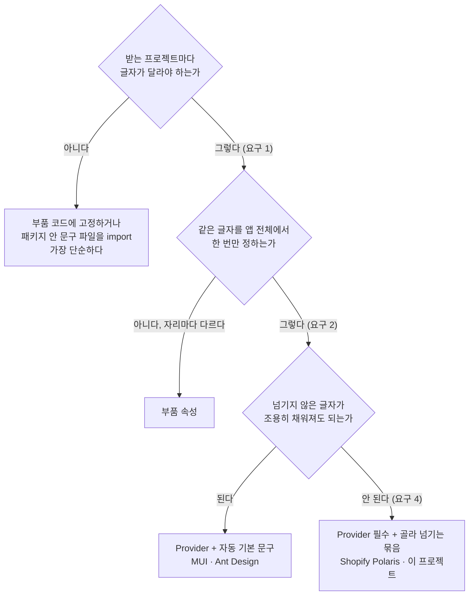
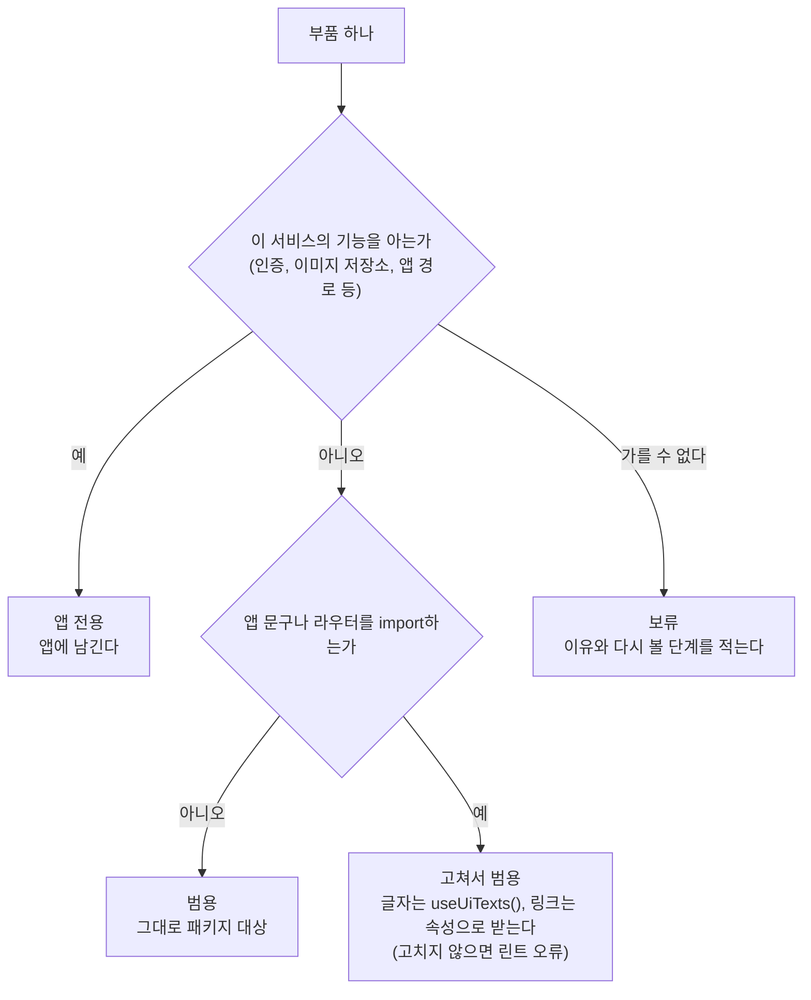

# 디자인 시스템 원칙과 부품 분류

> **문서 성격**: 레퍼런스 — 공용 UI(`src/shared/ui`)를 패키지로 꺼낼 때 누구를 위해 어디까지 꺼내는지의 원칙과, 지금 있는 부품
> 57개가 그 기준에서 어디에 속하는지를 모았다. [`DESIGN-SYSTEM-ROADMAP.md`](./DESIGN-SYSTEM-ROADMAP.md) 0단계의 결과에 1단계(앱
> 결합 분리)에서 정한 것을 더했다. 부품이 지금 어떻게 동작하는지는 [`DESIGN-SYSTEM.md`](./DESIGN-SYSTEM.md)가 정본이다.
>
> **대상 독자**: 로드맵의 다음 단계를 계획할 개발자와 AI 세션, 공용 UI에 부품을 더하거나 옮기는 개발자.
>
> **읽고 나면**: 새 부품이 범용인지 앱 전용인지 두 질문으로 가를 수 있고, 범용 부품이 글자와 링크를 어떻게 받는지와 그렇게 정한
> 이유, 지금 부품이 어느 분류에 속하는지 안다.
>
> **마지막 검토**: 2026-11-19

**읽는 법**

- 따옴표 이탤릭은 원문을 옮긴 것이고 `(번역)`은 영어 원문을 옮겼다는 뜻이다. 외부 인용은 2026-11-18에 원문을 직접 받아 문장을
  대조했다([§1.3](#13-글자를-provider로-받기로-한-이유)의 react.dev "Passing Data Deeply with Context"와 Next.js 인용은
  2026-11-19).
- 분류와 수치는 2026-11-19, 1단계 둘째 PR(이미지 확대 창 나누기)까지 반영한 상태다. 부품을 더하거나 옮기면
  [§5](#5-부품-분류표) 표의 줄을 고치고 [§6](#6-측정-명령) 명령으로 개수를 다시 맞춘다.
- **부품**은 `src/shared/ui` 안의 컴포넌트 파일이다. **앱 코드**는 그 폴더 밖의 이 저장소 코드다. **보조 모듈**은 앱 코드 가운데
  부품이 가져다 쓰지만 앱 문구·라우터·서비스 기능을 모르는 작은 모듈이다(`cn()`, 클릭 가드 훅 등).

---

## 1. 정한 것 (2026-11-18)

| 항목                  | 결정                                                                                | 기각한 대안                                                                                                                                            | 정해진 경로 |
| --------------------- | ----------------------------------------------------------------------------------- | ------------------------------------------------------------------------------------------------------------------------------------------------------ | ----------- |
| 사용 대상             | React와 Tailwind v4를 쓰는, 이 저장소를 만든 개발자의 다음 프로젝트                 | 처음부터 Tailwind 무관(쓸 곳이 없는 CSS 빌드를 먼저 만든다), 공개 오픈소스(영어 문서와 외부 문의 대응이 붙는다)                                        | 사용자 답   |
| Tailwind를 안 쓰는 곳 | 지금 정하지 않는다. 3단계(패키지화)에서 정한다                                      | —                                                                                                                                                      | 사용자 답   |
| 경계 기준             | 앱 문구·라우터만 묶인 부품까지 범용이다. 이 서비스의 기능을 아는 부품만 앱 전용이다 | 좁게(지금 그대로 쓸 수 있는 부품만 범용 — 조합 부품을 다음 프로젝트에서 다시 만든다), 넓게(55개 전부 범용 — 인증·이미지 저장소까지 주입 구조로 바꾼다) | 사용자 답   |
| 상태 단계 이름        | `Experimental` / `Ready` / `Deprecated`                                             | 한국어 이름, 8단계(운영)로 미룸                                                                                                                        | 사용자 답   |
| 부품별 상태           | 지금 붙이지 않는다. 패키지에 들어가는 3단계에서 붙인다                              | 지금 55개에 붙임                                                                                                                                       | 계획 승인   |
| `Ready` 조건          | [§4](#4-상태-단계)의 네 가지                                                        | —                                                                                                                                                      | 계획 승인   |

재사용 방식(npm 패키지)은 [`DECISIONS.md`](./DECISIONS.md) "2026-11-18 — 공용 UI 재사용 방식: npm 패키지 (shadcn 레지스트리·혼합
기각)"에 있다. 이 문서의 결정은 문서만 고치면 되돌릴 수 있어 그 기록에는 적지 않았다.

### 1.1 1단계에서 정한 것

1단계(앱 결합 분리)의 계획과 구현 중에 정했다. 부품 13개와 문구 파일 세 개를 고치면 되돌릴 수 있어 `DECISIONS.md`에는 적지
않았다. 계획은 [`plans/2026-11-18-design-system-stage1-decoupling.md`](./plans/2026-11-18-design-system-stage1-decoupling.md)다.

| 항목                                         | 결정                                                                                                                                                                         | 기각한 대안                                                                                                                                                                              | 정해진 경로                                           |
| -------------------------------------------- | ---------------------------------------------------------------------------------------------------------------------------------------------------------------------------- | ---------------------------------------------------------------------------------------------------------------------------------------------------------------------------------------- | ----------------------------------------------------- |
| 부품이 스스로 보여 주는 글자를 넣는 방법     | 앱 맨 위에 `UiTextsProvider`를 한 번 두고 부품은 `useUiTexts()`로 읽는다([§1.2](#12-부품이-스스로-보여-주는-글자))                                                           | 부품 속성으로만(쓰는 자리마다 넘긴다), 코드에 고정(받는 쪽이 글자를 정할 수 없다), 부품이 문구 파일을 직접 import(패키지 안의 파일이면 받는 쪽이 정할 수 없고 앱의 파일이면 앱에 묶인다) | 사용자 답                                             |
| 문구를 넘기지 않았을 때                      | 부품이 오류를 낸다. 패키지가 대신 넣어 주는 기본 문구는 없다                                                                                                                 | 기본 문구를 자동으로 쓴다 — 앱이 넘기지 않은 글자가 화면에 나오면 그 글자가 앱 것인지 패키지 것인지 코드로 알 수 없다                                                                    | 사용자 답(계획은 자동 기본 문구였고 구현 중에 바꿨다) |
| 한국어 문구 묶음                             | 패키지가 `KO_UI_TEXTS`를 내보내되 자동으로 쓰지 않는다. 받는 쪽이 가져와 넘기거나 자기 문구를 넘긴다                                                                         | 묶음 없이 타입만 준다(처음 쓰는 프로젝트가 25개를 모두 적어야 컴파일된다)                                                                                                                | 사용자 답                                             |
| 이 앱이 넘기는 문구                          | 묶음을 쓰지 않고 `TEXTS`에서 뽑은 `APP_UI_TEXTS`를 넘긴다. 문구를 정하는 곳은 지금처럼 `texts.ts` 한 곳이다                                                                  | `TEXTS`에서 키를 지우고 묶음을 쓴다(e2e 83개 파일이 `TEXTS`를 import하고, 말투 검사 `texts.test.ts`가 `texts.ts`를 본다)                                                                 | 계획 승인                                             |
| 문구 키의 모양                               | 부품별로 묶는다. 한 부품만 쓰는 글자는 그 부품 이름 아래에, 둘 이상이 쓰면 `common`에 둔다                                                                                   | 한 층으로 늘어놓는다(`close`, `retry` — 어느 부품의 글자인지 이름으로 알 수 없다)                                                                                                        | 사용자 답                                             |
| 부품 안의 변수 이름                          | `const uiTexts = useUiTexts()`                                                                                                                                               | `texts`(앱 문구 `TEXTS`와 헷갈린다)                                                                                                                                                      | 사용자 답                                             |
| 라우터에 묶인 부품                           | 쓰는 쪽이 넣는다. `ErrorLayout`은 홈 버튼을 `homeAction` 속성으로, `GlobalAlertDialogs`는 위치가 바뀌었다는 신호를 `dismissKey` 속성으로 받는다                              | 맨 위 Provider에 링크 부품을 등록한다(링크를 그리는 범용 부품이 1개뿐이다), 두 부품을 범용에서 뺀다                                                                                      | 사용자 답                                             |
| 앱 전용 부품의 자리                          | 옮기지 않고 경계 린트의 예외 목록에 적는다                                                                                                                                   | 지금 새 폴더로 옮긴다(3단계에서 범용 쪽이 한 번 더 옮겨진다)                                                                                                                             | 사용자 답                                             |
| 이미지 확대 창                               | 그리는 부품(범용)과 앱 배선(앱 전용)으로 나눴다. `ImageViewer`는 열림·이미지·순서를 속성으로 받고, `GlobalImageViewer`가 스토어와 뒤로가기 오버레이 훅을 잇는다              | 통째로 앱 전용, 뒤로가기 규약까지 패키지에 넣는다                                                                                                                                        | 사용자 답                                             |
| 경계를 지키게 하는 방법                      | 허용 목록 방식의 린트 `custom-design-system/no-app-import-in-generic-ui`. 범용 부품과 보조 모듈 파일이 `@/shared/ui/**`와 허용 목록 밖의 앱 모듈, 라우터를 import하면 오류다 | 문구·라우터만 막는다(인증 스토어 같은 새 결합을 못 잡는다)                                                                                                                               | 계획 승인                                             |
| 다른 프로젝트에서 쓸 수 있는지 확인하는 시점 | 1단계 뒤에 분리 리허설을 끼운다([로드맵 §5](./DESIGN-SYSTEM-ROADMAP.md#5-단계))                                                                                              | 3단계 끝 증거만 강화한다, 지금 순서 그대로 둔다                                                                                                                                          | 사용자 답                                             |
| 0단계 분류의 열린 줄                         | `LinkThumbnail`·`TooltipWrapper`의 분류와 보조 모듈의 자리는 분리 리허설 뒤에 정한다                                                                                         | —                                                                                                                                                                                        | 사용자 답                                             |

문구에 관한 여섯 줄(글자를 넣는 방법부터 변수 이름까지)이 어떤 요구와 비교에서 나왔는지, 선례와 다시 볼 조건은
[§1.3](#13-글자를-provider로-받기로-한-이유)에 있다.

### 1.2 부품이 스스로 보여 주는 글자

닫기 버튼의 라벨처럼 **쓰는 쪽이 넘기지 않아도 부품이 스스로 넣는 글자**가 범용 부품 13개에 25개 있다. 화면마다 다른
글자(제목, 버튼 문구, 안내문)는 여기에 들지 않고 지금처럼 쓰는 쪽이 속성으로 넘긴다.

| 조각                               | 위치                                         | 하는 일                                                                                                            |
| ---------------------------------- | -------------------------------------------- | ------------------------------------------------------------------------------------------------------------------ |
| 타입 `UiTexts`                     | `src/shared/ui/texts/ui-texts.ts`            | 부품이 스스로 넣는 글자의 목록. 부품별 묶음이고 값이 모두 필수라, 넘기는 쪽이 하나라도 빠뜨리면 컴파일 오류가 난다 |
| `UiTextsProvider`, `useUiTexts()`  | `src/shared/ui/texts/UiTextsProvider.tsx`    | 문구를 React 컨텍스트로 내려보내고 읽는다. Provider 밖에서 읽으면 오류를 낸다                                      |
| 한국어 묶음 `KO_UI_TEXTS`          | `src/shared/ui/texts/ko-ui-texts.ts`         | 25개를 직접 적지 않으려는 프로젝트가 가져다 넘기는 양식. 이 앱은 쓰지 않는다                                       |
| 이 앱의 문구 `APP_UI_TEXTS`와 래퍼 | `src/app/providers/UiTextsProvider.tsx`      | `TEXTS`에서 25개를 뽑아 넘긴다. `src/main.tsx`가 `<App />`을 이 래퍼로 감싼다                                      |
| 묶음 검사                          | `src/app/providers/UiTextsProvider.test.tsx` | `APP_UI_TEXTS`와 `KO_UI_TEXTS`의 키와 값이 같은지 본다. 일부러 다르게 둘 때 이 테스트를 지운다                     |

- **테스트와 스토리도 Provider 안에서 그린다.** `src/test/utils.tsx`의 `render`·`renderWithProviders`·`renderWithDataRouter`와
  `.storybook/preview.tsx`의 `withUiTexts` 데코레이터가 이 앱의 래퍼로 감싼다. 테스트에서 RTL의 `render`를 직접 쓰면 범용
  부품이 오류를 낸다([`TESTING.md`](./TESTING.md) "패턴 D").
- **글자를 더하거나 고치는 순서**는 `texts-conventions` skill(`.claude/skills/texts-conventions/SKILL.md`)의 "공용 UI 부품이
  스스로 보여 주는 글자"에 있다.
- **Provider로 받기로 한 이유와 치르는 값**(Next.js 서버 컴포넌트 포함)은
  [§1.3](#13-글자를-provider로-받기로-한-이유)에 있다.

### 1.3 글자를 Provider로 받기로 한 이유

[§1.1](#11-1단계에서-정한-것) 표에서 문구에 관한 여섯 줄이 어떤 요구와 비교에서 나왔는지 적는다. 나중에 이 결정을 고치려 할 때
판단할 근거로 남긴다. 결정한 날은 2026-11-18이고, 이 절의 개수는 2026-11-19에 다시 센 값이다([§6](#6-측정-명령) 7·8번).

이 절의 "21개"와 "12개"는 결정한 때(1단계 첫 PR)의 수다. 둘째 PR에서 이미지 확대 창(`ImageViewer`, 문구 4개)이 더해져 지금은
25개와 13개다([§1.2](#12-부품이-스스로-보여-주는-글자), [§6](#6-측정-명령) 6번). `ImageViewer`는 상태·효과 훅과 이벤트
핸들러를 써서, 아래 "치르는 값"의 "문구 훅 때문에만 클라이언트 컴포넌트가 되는 3개"에 들지 않는다.

**결정** — 범용 부품이 스스로 넣는 글자 21개는 받는 앱이 맨 위 `UiTextsProvider`에 한 번 넘긴다. 넘기지 않으면 부품이 오류를
낸다. 패키지는 한국어 묶음을 내보내되 자동으로 쓰지 않는다.

#### 요구

사용자가 밝힌 것이고, 번호는 이 절에서 다시 쓴다. 로드맵을 세울 때부터의 걱정은 "이 앱과 잘 분리해도 다른 프로젝트에 합치기
어려우면 가장 나쁘다"였다.

1. 패키지는 여러 프로젝트에서 쓰고, 문구는 앱마다 달라진다.
2. 문구는 서버 컴포넌트에서 쓰든 클라이언트 컴포넌트에서 쓰든 한곳에서 관리한다.
3. 기본 말투는 패키지가 주되, 쓰는 앱이 21개를 모두 자기 문구로 정할 수 있다.
4. 화면에 나온 글자가 앱이 넘긴 것인지 패키지 기본값인지 알 수 있어야 한다. 부품 코드에 글자를 고정하는 방식은 관리가 어려워
   뺀다.
5. 처음 도입하는 프로젝트가 21개를 하나씩 적어야만 컴파일되는 부담을 줄인다.
6. 부품 안에서 글자를 읽는 코드가 앱 문구(`TEXTS.common.failed`)처럼 어디의 글자인지 드러나야 한다.

요구 3과 4는 부딪친다. 기본 글자가 자동으로 채워지면 4가 깨지고, 기본 글자가 아예 없으면 3이 깨진다. 묶음을 주되 받는 앱이
직접 가져와 넘기게 한 것이 둘을 함께 채운 방법이다.

요구 2는 Provider가 채우는 것이 아니다. 앱 문구의 원본은 앱의 문구 파일 한 곳이고(이 앱은 `texts.ts`), 그 파일은 서버·클라이언트
어디서나 import한다. Provider는 그 파일을 import할 수 없는 패키지 부품에 21개를 건네는 통로로만 쓴다.

#### 비교한 방식

| 방식                                       | 글자를 정하는 곳                     | 요구에 비춘 결과                                                                                                                                                                                 | 이 방식이 맞는 때                                                         |
| ------------------------------------------ | ------------------------------------ | ------------------------------------------------------------------------------------------------------------------------------------------------------------------------------------------------ | ------------------------------------------------------------------------- |
| 부품 코드에 고정한다                       | 패키지(부품 파일)                    | 요구 1을 못 채운다. 받는 쪽이 글자를 정하려면 패키지를 고쳐 새 버전을 내야 한다                                                                                                                  | 한 회사·한 말투의 패키지, 코드를 복사해 가서 사본을 고치는 배포           |
| 패키지 안의 문구 파일을 부품이 import한다  | 패키지(문구 파일)                    | 고정과 같은 이유로 요구 1을 못 채운다. 구조는 가장 단순하고 서버 컴포넌트 제약이 없다. 글자를 받는 앱이 정하게 하면 가져올 파일이 없어 성립하지 않는다(패키지는 앱의 파일을 import할 수 없다)    | 받는 프로젝트가 모두 같은 글자를 쓸 때                                    |
| 부품 속성으로 받는다                       | 부품을 쓰는 자리마다                 | 요구 2를 못 채운다(아래 "속성으로 받는 방식과 견준 사실"). 기본값을 두면 한 자리에서 빠뜨렸을 때 그 자리만 패키지 글자가 나와 요구 4에도 걸린다                                                  | 자리마다 글자가 다를 때, 부품이 서버 컴포넌트로 남아야 할 때              |
| 글자를 넣지 않는다                         | 쓰는 쪽(버튼과 라벨을 요소째 넣는다) | 패키지에 글자가 없어 요구 3을 못 채운다. 닫기 버튼이 부품 안에 조립돼 있는 지금 부품의 모양을 바꿔야 한다                                                                                        | 뼈대만 주는 부품                                                          |
| Provider + 자동 기본 문구(계획 때 고른 안) | 앱 맨 위 한 곳. 없으면 패키지        | 요구 1·2·3을 채운다. Provider를 통째로 빠뜨리면 21개가 조용히 패키지 글자가 되어 요구 4에 걸린다. 21개 가운데 여럿이 화면 읽기 프로그램만 읽는 라벨이라 눈으로는 알아채기 어렵다                 | 넘기지 않은 글자가 기본값으로 채워져도 되는 패키지                        |
| **Provider 필수 + 골라 넘기는 묶음(결정)** | 앱 맨 위 한 곳                       | 요구 1~5를 채운다. 넘기지 않으면 오류이고, 묶음을 쓰는 앱은 `KO_UI_TEXTS`를 가져오는 줄이 코드에 남는다. 요구 6은 키를 부품별로 묶고 변수 이름을 `uiTexts`로 둬서 채운다(`uiTexts.common.close`) | 받는 앱마다 글자가 다르고, 글자가 누구 것인지 코드로 알 수 있어야 하는 때 |

#### 속성으로 받는 방식과 견준 사실

- **21개는 자리마다 다른 글자가 아니다.** 지금도 호출부가 넘기지 않고 부품이 안에서 읽는다. 자리마다 다른 글자(제목, 버튼
  문구)는 지금처럼 속성으로 넘긴다.
- **부품 안의 부품에 들어 있다.** 앱 화면 → `FormInputPassword` → `PasswordInput` → `Input`에서 "입력값 지우기"는 맨 안쪽
  `Input`이 넣는 글자다. 속성으로 받으면 12개를 감싸 쓰는 범용 부품 7개(`FormInput`, `FormInputPassword`, `PasswordInput`,
  `SearchInput`, `CenteredSpinner`, `SheetDialogContent`, `GlobalAlertDialogs`)가 속성을 받아 아래로 넘겨야 한다.
- **쓰는 자리가 많다.** 12개를 직접 가져다 쓰는 `src/shared/ui` 밖 파일이 20개다. 속성 방식이면 문구가 다른 프로젝트는 이런
  자리마다 같은 글자를 넘긴다.
- react.dev [Passing Data Deeply with Context](https://react.dev/learn/passing-data-deeply-with-context)는 컨텍스트를 쓰기
  전에 살펴볼 대안으로 _"props 전달부터 시작한다"_ 와 _"컴포넌트를 추출하고 JSX를 `children`으로 넘긴다"_ (번역)를 든다. 같은
  글은 _"하지만 props 전달은 어떤 prop을 트리 깊숙이 넘겨야 하거나 많은 컴포넌트가 같은 prop을 필요로 할 때 장황하고
  불편해질 수 있다"_ (번역)고도 쓴다. 21개가 뒤 문장의 두 경우에 모두 든다는 것이 이 문서의 판단이다.

#### 치르는 값

- **구조가 는다.** Provider와 훅, 앱 쪽 래퍼가 생기고, 테스트와 스토리도 Provider 안에서 그려야 한다
  ([§1.2](#12-부품이-스스로-보여-주는-글자)).
- **같은 글자가 두 곳에 있다.** 한국어 묶음과 이 앱의 `TEXTS`다. 이 앱은 묶음을 쓰지 않아 묶음이 틀려도 화면과 다른 테스트로는
  드러나지 않는다. 그래서 묶음 검사 테스트를 따로 둔다.
- **묶음을 펼쳐 일부만 바꾸는 앱에서는 요구 4가 다시 깨진다.** `{ ...KO_UI_TEXTS, common: { close: '닫아요' } }`처럼 넘기는
  앱은 자기가 적지 않은 묶음에 글자가 늘어도 컴파일 오류 없이 패키지의 글자를 받는다. 묶음을 그대로 넘기거나 21개를 모두 적는
  앱에는 해당하지 않는다.
- **Next.js(App Router)에서는 문구를 읽는 부품이 클라이언트 컴포넌트가 된다.** Next 문서
  [Server and Client Components](https://nextjs.org/docs/app/getting-started/server-and-client-components)는 _"React 컨텍스트는
  서버 컴포넌트에서 지원되지 않는다"_ (번역)고 쓰고, 클라이언트 컴포넌트를 써야 하는 때로 _"상태와 이벤트 핸들러"_, _"커스텀
  훅"_ (번역)을 든다. 아래는 문서를 읽고 낸 결론이고 Next.js에서 실행해 확인하지 않았다.
  - 12개 가운데 9개는 문구가 아니어도 상태·효과 훅이나 이벤트 핸들러를 쓴다. 문구 훅 때문에만 클라이언트 컴포넌트가 되는 것은
    `Spinner`, `AuthLayout`, `ErrorLayout` 3개다.
  - 서버 컴포넌트인 페이지가 이 부품들을 그리는 것은 된다. 같은 문서는 Provider를 클라이언트 컴포넌트로 감싼 예 뒤에 _"이제
    서버 컴포넌트가 provider를 직접 그릴 수 있고, 앱 곳곳의 다른 클라이언트 컴포넌트가 이 컨텍스트를 쓸 수 있다"_ (번역)고
    쓴다. _"클라이언트 컴포넌트와 RSC 페이로드는 HTML을 미리 그리는 데 쓰인다"_ (번역)는 문장도 있어, 글자가 첫 HTML에
    들어간다고 읽었다.
  - 꼭 서버 컴포넌트로 남아야 하는 부품이 생기면 그 부품에만 라벨 속성을 더하는 길이 있다. 속성을 더하는 것은 쓰던 곳을 깨지
    않는다.
  - 패키지로 낼 때 문구를 읽는 부품 파일에 `'use client'`를 적어야 한다. 같은 문서는 _"컴포넌트 라이브러리를 만든다면,
    클라이언트 전용 기능에 기대는 진입점에 `"use client"` 지시어를 넣어라"_ (번역)고 안내한다. 지금 12개 가운데 이 표시가 있는
    파일은 `BackToTopButton.tsx` 하나다. 3단계(패키지화)에서 한다([로드맵 §5](./DESIGN-SYSTEM-ROADMAP.md#5-단계)).
  - 받는 앱도 Provider를 `'use client'` 파일에서 감싸야 한다는 것이 이 문서의 판단이다. 함수로 된 문구
    2개(`imageAttachmentField.removeAt`, `imageAt`)는 서버 컴포넌트가 클라이언트 컴포넌트에 속성으로 넘길 수 없다 — react.dev
    [`'use client'`](https://react.dev/reference/rsc/use-client#serializable-types)는 _"서버 컴포넌트에서 클라이언트 컴포넌트로
    넘기는 속성 값은 직렬화할 수 있어야 한다"_ (번역)고 쓰고, 클라이언트 표시 모듈에서 내보내지 않았고 `'use server'`도 아닌
    함수를 지원하지 않는 값으로 든다.

#### 다시 볼 조건

- **Provider의 근거는 요구 1 하나다.** 이 패키지를 이 앱만 쓰게 되거나, 받는 프로젝트가 모두 같은 한국어 글자를 쓰기로 정해지면
  패키지 안의 문구 파일을 import하는 방식이 더 단순하다. 구조가 상수 파일 하나로 줄고, 서버 컴포넌트 제약과 테스트 감싸기가
  없어진다.
- **바꾸는 방향에 따라 값이 다르다.**

  | 바꾸는 방향                         | 하는 일                                                                              | 쓰던 앱                                  |
  | ----------------------------------- | ------------------------------------------------------------------------------------ | ---------------------------------------- |
  | 문구 파일 import → Provider         | 부품의 상수를 훅으로 바꾸고 Provider를 더한다. 컨텍스트 기본값을 그 상수로 두면 된다 | 깨지지 않는다                            |
  | Provider → 문구 파일 import         | 훅과 Provider를 걷어 낸다                                                            | 자기 글자를 넘기던 앱은 그 기능을 잃는다 |
  | 묶음 없음 → 묶음 제공               | 파일을 더한다                                                                        | 깨지지 않는다                            |
  | 묶음 제공 → 묶음 없음               | 파일을 지운다                                                                        | 묶음을 가져다 넘기던 앱이 깨진다         |
  | 넘기지 않으면 오류 → 자동 기본 문구 | 컨텍스트 기본값을 묶음으로 둔다                                                      | 깨지지 않는다. 요구 4를 버리는 선택이다  |
  | 문구 키의 구조를 바꾼다             | 타입, 묶음, 부품 12개                                                                | 문구를 넘기던 앱이 모두 고친다           |

- **패키지를 내기 전과 뒤가 다르다.** 3단계 전에는 부품 12개와 문구 파일 세 개(`ui-texts.ts`, `ko-ui-texts.ts`,
  `UiTextsProvider.tsx`), 테스트·스토리 배선만 고치면 어느 쪽으로든 갈 수 있다. 낸 뒤에는 받는 앱이 함께 고쳐야 한다.
- **여러 언어를 지원하게 되어도 방식은 그대로다.** 넘기는 값이 언어별 `UiTexts` 가운데 하나가 된다. 함수로 된 문구 2개는 JSON
  번역 파일에 담을 수 없다. 이 앱의 문구(`TEXTS`)를 언어별로 나누는 일은 이 결정과 별개다.

#### 결정까지의 순서

한 번에 정해지지 않았다. 전제가 바뀔 때마다 답이 달라졌고, 어느 전제가 어느 답을 냈는지가 다시 볼 때의 기준이다.

1. **계획** — "Provider + 자동 기본 문구", "속성 + 기본 문구", "속성 필수" 셋을 견줘 첫째를 골랐다. 패키지 안의 문구 파일을
   import하는 방식과 Next.js 서버 컴포넌트는 이때 따지지 않았다.
2. **"바뀌지 않는 상수는 컨텍스트에 넣지 않고 import한다"는 반론** — 앱 문구에는 맞는 말이라 `TEXTS`는 그대로 import한다.
   패키지 부품은 받는 앱의 파일을 import할 수 없어서, 글자를 받는 앱이 정하게 하려면 통로가 따로 있어야 한다. 이때 "패키지
   안의 문구 파일을 import" 방식을 선택지에 더했다.
3. **다음 프로젝트가 Next.js라면** — 컨텍스트를 서버 컴포넌트에서 읽을 수 없다는 것을 확인했다. 요구가 정해지기 전이라 더
   단순한 import 쪽으로 기울었다.
4. **요구 1~3** — import와 고정은 요구 1을 채우지 못해 Provider로 돌아왔다.
5. **속성과 견줌, 다른 디자인 시스템 조사** — 위 "속성으로 받는 방식과 견준 사실"과 아래 "선례"다. Provider를 유지했다.
6. **요구 4** — 자동 기본 문구를 없애고 "넘기지 않으면 오류"로 바꿨다.
7. **요구를 모두 빼고 다시 견줌** — 요구가 없으면 import가 더 단순하다. 갈리는 물음은 "받는 프로젝트마다 글자가 달라야
   하는가" 하나였다. 글자를 패키지가 아니라 받는 앱이 정한다고 두자 import는 가져올 파일이 없어 빠졌고, Provider로 정했다.
8. **요구 5** — 묶음 없이 타입만 주는 안과 견줘, 한국어 묶음을 내보내되 자동으로 쓰지 않는 안을 골랐다.
9. **요구 6** — 키를 부품별로 묶고 변수 이름을 `uiTexts`로 정했다.

#### 선례

부품이 스스로 넣는 글자를 다루는 방식은 넷으로 갈린다. 2026-11-18에 원문(문서, 공개 저장소, npm 배포본)을 직접 받아 대조했다.

| 방식                                     | 쓰는 곳                                                                     | 출처                                                                                                                                                                                                                                                                                                                                                                         |
| ---------------------------------------- | --------------------------------------------------------------------------- | ---------------------------------------------------------------------------------------------------------------------------------------------------------------------------------------------------------------------------------------------------------------------------------------------------------------------------------------------------------------------------- |
| 코드에 직접 적는다                       | shadcn, GitHub Primer, 토스 TDS의 일부, 당근 SEED 스니펫의 일부             | [shadcn `dialog.tsx`](https://raw.githubusercontent.com/shadcn-ui/ui/main/apps/v4/registry/new-york-v4/ui/dialog.tsx), Primer [`Dialog`](https://github.com/primer/react/tree/main/packages/react/src/Dialog) 폴더의 `Dialog.tsx`(`aria-label="Close"`), [SEED `bottom-sheet.tsx`](https://github.com/daangn/seed-design/blob/dev/docs/registry/react/ui/bottom-sheet.tsx)   |
| 부품 속성으로 받는다(기본값이 있다)      | Mantine, IBM Carbon, 토스 TDS의 일부, 당근 SEED 스니펫의 일부               | [Mantine Modal](https://mantine.dev/core/modal/), Carbon [`ListBox`](https://github.com/carbon-design-system/carbon/tree/main/packages/react/src/components/ListBox) 폴더의 `ListBoxSelection.tsx`(`translateWithId` 속성), [SEED `search-input.tsx`](https://github.com/daangn/seed-design/blob/dev/docs/registry/react/ui/search-input.tsx)(`clearButtonLabel = "지우기"`) |
| 맨 위에서 한 번 받는다                   | MUI, Ant Design, React Aria, Shopify Polaris, 당근 스택플로우 상단 바, X 웹 | [MUI Localization](https://mui.com/material-ui/guides/localization/), [Ant Design i18n](https://ant.design/docs/react/i18n), [React Aria](https://react-aria.adobe.com/quality), 스택플로우 [`plugin-basic-ui`](https://github.com/daangn/stackflow/tree/main/extensions/plugin-basic-ui/src/components) 폴더의 `AppBar.tsx`, Polaris와 X는 아래                             |
| 글자를 넣지 않고 쓰는 쪽이 요소째 넣는다 | Radix, 네이버 egjs, 카카오 olive-ui                                         | [Radix Dialog](https://www.radix-ui.com/primitives/docs/components/dialog), [`egjs-flicking-plugins`](https://github.com/naver/egjs-flicking-plugins/tree/master/src)의 `Arrow.ts`, [`kakao/olive-ui`](https://github.com/kakao/olive-ui)                                                                                                                                    |

- **토스 TDS**는 npm 배포본 `@toss/tds-mobile@2.5.1`의 `dist/esm/index.js`와 `index.d.ts`에서 읽었다. 가림막의 `"닫기"`는
  고정이고 `rightButton="확인"`·`leftButton="취소"`는 속성의 기본값이다. 맨 위 `TDSMobileProvider`의 속성에 문구는 없다.
- **당근 스택플로우 상단 바**는 개별 `ariaLabel` 속성이 없으면 전역 옵션의 값을 읽는다.
- **X 웹**은 x.com이 브라우저에 내려 주는 운영 스크립트(로그인 전 화면의 진입 묶음과 그것이 부르는 묶음 3개)에서 읽었다. 자체
  `TranslationProvider`와 `useTranslation()`이 있고, Provider 밖에서 훅을 부르면
  `useTranslation: render under TranslationProvider` 오류를 낸다. 압축된 코드라 오류 문구와 라이브러리 문자열로 판단했고, 주소가
  고정된 원문이 없어 링크를 달지 못했다.
- **국내 네 회사(토스, 당근, 카카오, 네이버)의 공개 코드에서 문구만 받는 전역 Provider는 찾지 못했다.** 카카오와 네이버는 React
  디자인 시스템의 공개 코드를 찾지 못해 위 두 저장소만 봤다.
- **갈리는 기준은 나라가 아니라 "받는 앱마다 글자가 달라야 하는가"라는 것이 이 문서의 판단이다.** 회사가 이유를 직접 밝힌 글은
  찾지 못했다. 판단에 쓴 사실은 셋이다.
  - 글자를 고정하는 Primer와 shadcn은 해외의 것이다.
  - 토스는 TDS를 _"TDS는 토스 제품을 만들 때 공통적으로 사용하는 디자인 시스템이에요."_
    ([TDS Mobile 소개](https://tossmini-docs.toss.im/tds-mobile/))라고 소개한다.
  - 당근 SEED의 스니펫은 받는 프로젝트 안에 파일로 생겨 사본을 고칠 수 있다 — _"CLI 실행 후, `seed-design/ui/*` 디렉토리에
    snippet이 생성됩니다."_
    ([SEED Snippet 문서](https://github.com/daangn/seed-design/blob/dev/docs/content/react/components/concepts/snippet.mdx)).

이 프로젝트의 선택(Provider가 필수이고, 넘기지 않으면 오류이고, 언어별 묶음을 따로 준다)과 모양이 같은 것은 Shopify Polaris다.

- `AppProvider`의 `i18n` 속성에 `?`가 없다
  ([`components/AppProvider`](https://github.com/Shopify/polaris/tree/main/polaris-react/src/components/AppProvider) 폴더의
  `AppProvider.tsx`에 있는 `i18n: ConstructorParameters<typeof I18n>[0];`).
- 문구를 읽는 훅은 Provider가 없으면 `MissingAppProviderError('No i18n was provided.')`를 던진다
  ([`utilities/i18n`](https://github.com/Shopify/polaris/tree/main/polaris-react/src/utilities/i18n) 폴더의 `hooks.tsx`).
- 한국어 묶음은 `Avatar`, `Button`, `Modal`처럼 부품별로 묶여 있고, 여러 부품이 쓰는 글자는 `Common`(`cancel: "취소"`,
  `close: "닫기"` 등)에 있다([`locales/ko.json`](https://github.com/Shopify/polaris/blob/main/polaris-react/locales/ko.json)).

반대쪽 근거도 있다. react.dev [`useContext`](https://react.dev/reference/react/useContext)의 "Specifying a fallback default
value" 절은 컨텍스트에 기본값을 두는 방식을 두고 _"이렇게 하면 실수로 어떤 컴포넌트를 해당 provider 없이 그려도 깨지지
않는다"_ (번역)고 쓴다. 이 프로젝트는 깨지지 않는 것보다 화면에 나온 글자가 누구 것인지 코드로 알 수 있는 쪽을 골랐다(요구
4). Provider 밖에서 오류를 던지는 훅은 그 문서에 나오지 않고, 선례는 위 Polaris다. 컨텍스트 기본값을
`null`로 둔 것은 [`createContext`](https://react.dev/reference/react/createContext)의 "Parameters" 절 _"의미 있는 기본값이
없으면 `null`을 지정한다"_ (번역)를 따랐다. `<UiTextsContext.Provider>` 꼴로 쓴 것은 설치본이 React 18.3.1이기 때문이다 — 같은
문서는 React 19부터 `<SomeContext>`를 바로 provider로 그릴 수 있고 그 전 버전에서는 `.Provider`를 쓰라고 안내한다.

## 2. 사용 대상과 전제

- **받는 쪽은 React와 Tailwind v4를 쓴다.** 부품은 모양을 Tailwind 클래스로 적고, 그 클래스의 CSS는 받는 쪽 프로젝트의 Tailwind가
  만든다.
- **받는 쪽은 패키지 경로를 Tailwind에 등록한다.** Tailwind는 `node_modules` 안의 파일을 기본으로 읽지 않는다. Tailwind 문서
  [Detecting classes in source files](https://tailwindcss.com/docs/detecting-classes-in-source-files)는
  `@source "../node_modules/@acmecorp/ui-lib"`처럼 경로를 등록하는 방법을 두고 _"의존성은 보통 `.gitignore`에 올라 있어 Tailwind가
  기본으로 무시하므로, Tailwind로 만든 외부 라이브러리를 스캔해야 할 때 특히 유용하다"_ (번역)고 쓴다. 이 저장소의 설치본은
  4.3.5다.
- **받는 쪽은 토큰 CSS도 가져간다.** 부품의 클래스(`bg-primary` 등)는 `src/app/globals.css`의 `@theme` 블록이 정한 토큰에서
  나온다. 토큰을 어떤 파일로 내보낼지는 2·3단계에서 정한다.
- **Tailwind를 안 쓰는 프로젝트**에는 미리 만든 CSS 파일을 패키지에 함께 넣어 주는 길이 있다. 부품 코드는 그대로 두고 빌드 단계를
  더하는 일이라 뒤에 붙일 수 있다는 것이 이 문서의 판단이다(실험하지 않았다). 넣을지는 3단계에서 정한다.

## 3. 경계 기준

부품 하나를 두 질문으로 가른다.

1. **이 서비스의 기능을 아는가.** 로그인 상태, 이미지 저장소, 앱의 경로 이름, 서버 오류 코드처럼 다른 제품에는 없거나 다르게
   생긴 것을 부품이 직접 읽으면 "예"다. 이런 부품은 **앱 전용**이고 앱에 남긴다.
2. **앱 문구 파일(`TEXTS`)이나 라우터(`react-router-dom`)를 import하는가.** "예"면 **고쳐서 범용**으로 만든다. 글자와 링크를
   밖에서 넣게 고치면 다른 제품에서도 뜻이 같다. 스스로 넣는 글자는 `useUiTexts()`로 읽고([§1.2](#12-부품이-스스로-보여-주는-글자)),
   링크와 이동은 쓰는 쪽이 속성으로 넘긴다. 0단계에는 이런 부품이 12개 있었고("범용(1단계 수정)") 1단계에서 모두 고쳤다.

둘 다 "아니오"면 **범용**이다. 두 질문으로 가를 수 없으면 **보류**로 두고 이유와 다시 볼 단계를 적는다.

경계는 린트가 지킨다. 범용 부품과 보조 모듈 파일이 `@/shared/ui/**`와 허용 목록 밖의 앱 모듈이나 라우터를 import하면
`custom-design-system/no-app-import-in-generic-ui`가 오류를 낸다(규칙과 허용 목록: `scripts/lib/ui-boundary-rule.js`, 대상과
예외 목록: `eslint.config.js`). 새 부품이 앱 전용이면 `eslint.config.js`의 예외 목록과 [§5](#5-부품-분류표) 표에 함께 적는다.

| 묶인 정도   | 예                                                                                     | 분류                          |
| ----------- | -------------------------------------------------------------------------------------- | ----------------------------- |
| 안 묶임     | `Button`, `Card`, `Checkbox`                                                           | 범용                          |
| 겉만 묶임   | 0단계의 `Dialog`(닫기 버튼의 라벨을 앱 문구 파일에서 가져왔다), `ErrorLayout`(홈 링크) | 고쳐서 범용(1단계에서 고쳤다) |
| 속까지 묶임 | `AsyncBoundary`(로그인 상태를 본다), `MarkdownContent`(이미지 저장소 주소 변환)        | 앱 전용                       |

분류하면서 세운 세부 규칙이다(이 문서의 판단).

- **보조 모듈은 결합으로 세지 않는다.** `cn()`이나 클릭 가드 훅은 부품 폴더 밖에 있지만 앱 문구·라우터·서비스 기능을 모른다.
  부품과 함께 패키지로 옮긴다([§5.5](#55-함께-옮길-보조-모듈)).
- **부품은 자기 파일의 import로 판정한다.** `FormInputPassword`는 `PasswordInput`(1단계에서 고친 부품)을 쓰지만 자신은 고칠
  것이 없어 범용이다.
- **이름이 아니라 코드로 판정한다.** `LinkThumbnail`, `AuthLayout`은 이름이 이 서비스의 화면을 가리키지만 코드가 서비스 기능을
  읽지 않아 앱 전용이 아니다.
- **주석 속 예시는 세지 않는다.** `CharacterCount`, `EmptyState`, `ErrorState`는 사용 예시 주석에 `TEXTS`가 나오지만 import하지
  않는다.

## 4. 상태 단계

이름은 [Primer의 component status](https://primer.style/product/getting-started/component-status/)를 그대로 쓴다. Primer는 이
표시를 _"컴포넌트가 운영 애플리케이션에서 쓸 준비가 됐는지를 나타낸다"_ (번역)고 설명한다.

| 이름           | Primer의 정의                                               | 이 프로젝트에서의 뜻                                             |
| -------------- | ----------------------------------------------------------- | ---------------------------------------------------------------- |
| `Experimental` | _"컴포넌트가 개념 증명으로 있거나 작업 중이다"_ (번역)      | 실험 — 패키지에 들어 있지만 아래 `Ready` 조건을 다 채우지 못했다 |
| `Ready`        | _"컴포넌트를 더는 '실험'으로 보지 않으며 써도 된다"_ (번역) | 안정 — 아래 네 조건을 모두 채웠다                                |
| `Deprecated`   | _"컴포넌트는 앞으로 제거되며 쓰지 말아야 한다"_ (번역)      | 폐기 예정 — 새로 쓰지 않는다. 없애는 절차는 8단계에서 정한다     |

**`Ready` 조건**

1. 앱 코드를 import하지 않는다(보조 모듈은 패키지 안으로 옮겨진 상태).
2. 스토리가 있다.
3. 스토리의 접근성 검사를 통과한다(`.storybook/preview.tsx:42`의 `a11y.test: 'error'`).
4. 부품 문서가 있다(4단계의 산출물).

**지금 57개에는 상태를 붙이지 않는다.** 지금 부품은 운영에서 쓰이고 있어 "개념 증명·작업 중"이 아니고, 넷째 조건은 4단계에야
채울 수 있어 `Ready`도 아니다. 패키지에 들어가는 3단계에서 붙이고, 어디에 표시할지(Storybook 태그, 문서 머리)도 그때 정한다.

## 5. 부품 분류표

| 분류    | 뜻                                                                                     | 개수   |
| ------- | -------------------------------------------------------------------------------------- | ------ |
| 범용    | 패키지 대상. 0단계의 39개, 1단계 첫 PR에서 고친 12개, 둘째 PR에서 나눈 `ImageViewer`다 | 52     |
| 앱 전용 | 앱에 남긴다                                                                            | 5      |
| 보류    | 지금은 없다                                                                            | 0      |
| **합**  |                                                                                        | **57** |

- 0단계에는 55개였고 "범용(1단계 수정)"이 12개 있었다. 1단계 첫 PR에서 12개를 모두 고쳐 범용이 됐고("1단계에서 할 일" 칸이
  "끝"인 줄), 라우터와 잇는 앱 전용 부품 `RouteAlertDialogs`가 하나 늘었다.
- 둘째 PR에서 보류였던 이미지 확대 창을 그리는 부품 `ImageViewer`(범용)와 앱 배선 `GlobalImageViewer`(앱 전용)로 나눠 하나가
  더 늘었다.
- "묶인 것" 칸에는 `cn()`(`src/shared/lib/tailwind/utils.ts`, 43개 파일이 쓴다)과 다른 부품을 적지 않았다.
- "문구"는 범용 부품이면 `src/shared/ui/texts/ui-texts.ts`의 `UiTexts` 키이고([§1.2](#12-부품이-스스로-보여-주는-글자)), 앱
  전용 부품이면 `src/shared/config/texts.ts`의 `TEXTS` 키다.
- 앱 전용 부품은 자리를 옮기지 않았다. `eslint.config.js`의 경계 린트 예외 목록이 이 표의 앱 전용 줄과 같아야 한다.
- `src/shared/ui/texts/`의 문구 Provider는 화면을 그리지 않아 부품으로 세지 않았다.

### 5.1 atoms (23개)

| 부품             | 파일                                      | 분류 | 묶인 것                                                                        | 1단계에서 할 일                                            |
| ---------------- | ----------------------------------------- | ---- | ------------------------------------------------------------------------------ | ---------------------------------------------------------- |
| `AlertDialog`    | `src/shared/ui/atoms/alert-dialog.tsx`    | 범용 | 문구 1개(`common.close`). 보조: `useOpenClickGuard`                            | 끝 — 닫기 라벨을 `useUiTexts()`로 읽는다                   |
| `Avatar`         | `src/shared/ui/atoms/avatar.tsx`          | 범용 | —                                                                              | 없음                                                       |
| `Badge`          | `src/shared/ui/atoms/badge.tsx`           | 범용 | —                                                                              | 없음                                                       |
| `Button`         | `src/shared/ui/atoms/button.tsx`          | 범용 | —                                                                              | 없음                                                       |
| `Card`           | `src/shared/ui/atoms/card.tsx`            | 범용 | —                                                                              | 없음                                                       |
| `Checkbox`       | `src/shared/ui/atoms/checkbox.tsx`        | 범용 | —                                                                              | 없음                                                       |
| `Dialog`         | `src/shared/ui/atoms/dialog.tsx`          | 범용 | 문구 1개(`common.close`). 보조: `useOpenClickGuard`                            | 끝 — 닫기 라벨을 `useUiTexts()`로 읽는다                   |
| `Divider`        | `src/shared/ui/atoms/divider.tsx`         | 범용 | —                                                                              | 없음                                                       |
| `DropdownMenu`   | `src/shared/ui/atoms/dropdown-menu.tsx`   | 범용 | —                                                                              | 없음                                                       |
| `FeaturedIcon`   | `src/shared/ui/atoms/featured-icon.tsx`   | 범용 | —                                                                              | 없음                                                       |
| `Input`          | `src/shared/ui/atoms/input.tsx`           | 범용 | 문구 1개(`input.clear`). 보조: `useMergedRef`                                  | 끝 — 지우기 버튼 라벨을 `useUiTexts()`로 읽는다            |
| `Kbd`            | `src/shared/ui/atoms/kbd.tsx`             | 범용 | —                                                                              | 없음                                                       |
| `Label`          | `src/shared/ui/atoms/label.tsx`           | 범용 | —                                                                              | 없음                                                       |
| `LabeledDivider` | `src/shared/ui/atoms/labeled-divider.tsx` | 범용 | —                                                                              | 없음                                                       |
| `LinkThumbnail`  | `src/shared/ui/atoms/link-thumbnail.tsx`  | 범용 | 보조: `failedImageCache`(실패한 이미지 주소를 세션 동안 기억한다)              | 보조 모듈과 함께 옮긴다. 분류는 분리 리허설 뒤에 다시 본다 |
| `RequiredMark`   | `src/shared/ui/atoms/required-mark.tsx`   | 범용 | —                                                                              | 없음                                                       |
| `Select`         | `src/shared/ui/atoms/select.tsx`          | 범용 | 보조: `useClickGuard`의 상수 `CLICK_GUARD_MS`                                  | 보조 모듈과 함께 옮긴다                                    |
| `Skeleton`       | `src/shared/ui/atoms/skeleton.tsx`        | 범용 | —                                                                              | 없음                                                       |
| `Toaster`        | `src/shared/ui/atoms/sonner.tsx`          | 범용 | CSS 변수 `--toast-offset-bottom`을 읽는다. 값은 `src/app/globals.css`가 정한다 | 없음. 변수를 둘 곳은 2단계에서 정한다                      |
| `Spinner`        | `src/shared/ui/atoms/spinner.tsx`         | 범용 | 문구 1개(`spinner.label`)                                                      | 끝 — 로딩 라벨을 `useUiTexts()`로 읽는다                   |
| `Switch`         | `src/shared/ui/atoms/switch.tsx`          | 범용 | —                                                                              | 없음                                                       |
| `Textarea`       | `src/shared/ui/atoms/textarea.tsx`        | 범용 | —                                                                              | 없음                                                       |
| `Tooltip`        | `src/shared/ui/atoms/tooltip.tsx`         | 범용 | —                                                                              | 없음                                                       |

### 5.2 elements (32개)

| 부품                   | 파일                                                                | 분류    | 묶인 것                                                                                                                                                                                       | 1단계에서 할 일                                                                       |
| ---------------------- | ------------------------------------------------------------------- | ------- | --------------------------------------------------------------------------------------------------------------------------------------------------------------------------------------------- | ------------------------------------------------------------------------------------- |
| `ActionButton`         | `src/shared/ui/elements/ActionButton.tsx`                           | 범용    | —                                                                                                                                                                                             | 없음                                                                                  |
| `ActionChip`           | `src/shared/ui/elements/ActionChip.tsx`                             | 범용    | —                                                                                                                                                                                             | 없음                                                                                  |
| `AppErrorFallback`     | `src/shared/ui/elements/AppErrorFallback.tsx`                       | 앱 전용 | 앱 경로(`ROUTES_PATHS`), 청크 재로딩(`ChunkReloadUtil`), 서버 오류 해석(`ErrorUtil`), 문구 1개                                                                                                | 앱에 남긴다                                                                           |
| `AsyncBoundary`        | `src/shared/ui/elements/AsyncBoundary.tsx`                          | 앱 전용 | 인증 스토어(`useAuthStore`), 서버 오류 해석(`ErrorUtil`), 문구 1개                                                                                                                            | 앱에 남긴다                                                                           |
| `BackToTopButton`      | `src/shared/ui/elements/BackToTopButton.tsx`                        | 범용    | 문구 1개(`backToTopButton.label`). 보조: `ScrollUtil`                                                                                                                                         | 끝 — 라벨을 `useUiTexts()`로 읽는다                                                   |
| `CenteredSpinner`      | `src/shared/ui/elements/CenteredSpinner.tsx`                        | 범용    | 보조: `useDelayedLoading`, 상수 `LOADING_INDICATOR_DELAY_MS`                                                                                                                                  | 보조 모듈과 함께 옮긴다                                                               |
| `CharacterCount`       | `src/shared/ui/elements/CharacterCount.tsx`                         | 범용    | 보조: `CommonUtil.commaizeNumber`                                                                                                                                                             | 보조 모듈과 함께 옮긴다                                                               |
| `DelayedFallback`      | `src/shared/ui/elements/DelayedFallback.tsx`                        | 범용    | 보조: `useDelayedLoading`, 상수 `LOADING_INDICATOR_DELAY_MS`                                                                                                                                  | 보조 모듈과 함께 옮긴다                                                               |
| `DropTargetOverlay`    | `src/shared/ui/elements/DropTargetOverlay.tsx`                      | 범용    | 문구 1개(`dropTargetOverlay.message`)                                                                                                                                                         | 끝 — 안내 문구를 `useUiTexts()`로 읽는다                                              |
| `EditButton`           | `src/shared/ui/elements/EditButton.tsx`                             | 범용    | —                                                                                                                                                                                             | 없음                                                                                  |
| `EmptyState`           | `src/shared/ui/elements/EmptyState.tsx`                             | 범용    | —                                                                                                                                                                                             | 없음                                                                                  |
| `ErrorState`           | `src/shared/ui/elements/ErrorState.tsx`                             | 범용    | —                                                                                                                                                                                             | 없음                                                                                  |
| `FilterChip`           | `src/shared/ui/elements/FilterChip.tsx`                             | 범용    | —                                                                                                                                                                                             | 없음                                                                                  |
| `FormAlert`            | `src/shared/ui/elements/FormAlert.tsx`                              | 범용    | —                                                                                                                                                                                             | 없음                                                                                  |
| `ImageAttachmentField` | `src/shared/ui/elements/ImageAttachmentField.tsx`                   | 범용    | 문구 4개(`imageAttachmentField.attach`, `imageAttachmentField.hint`, `imageAttachmentField.removeAt`, `imageAttachmentField.imageAt`)                                                         | 끝 — 문구를 `useUiTexts()`로 읽는다                                                   |
| `KebabMenu`            | `src/shared/ui/elements/KebabMenu.tsx`                              | 범용    | —                                                                                                                                                                                             | 없음                                                                                  |
| `LoadMoreError`        | `src/shared/ui/elements/LoadMoreError.tsx`                          | 범용    | 문구 2개(`loadMoreError.failed`, `loadMoreError.retry`)                                                                                                                                       | 끝 — 문구를 `useUiTexts()`로 읽는다                                                   |
| `MarkdownContent`      | `src/shared/ui/elements/MarkdownContent.tsx`                        | 앱 전용 | Supabase 이미지 주소 변환(`supabaseImage`), 라우터 이동(`NavigationService`), 뒤로가기 오버레이 등록부(`back-closable-overlay`), 코드 블록 분리(`codeBlock`), 이미지 확대 창 스토어, 문구 3개 | 앱에 남긴다                                                                           |
| `PasswordInput`        | `src/shared/ui/elements/PasswordInput.tsx`                          | 범용    | 문구 2개(`passwordInput.show`, `passwordInput.hide`)                                                                                                                                          | 끝 — 라벨을 `useUiTexts()`로 읽는다                                                   |
| `SearchInput`          | `src/shared/ui/elements/SearchInput.tsx`                            | 범용    | 보조: `useKeydown`, `useMergedRef`                                                                                                                                                            | 보조 모듈과 함께 옮긴다                                                               |
| `ToggleButton`         | `src/shared/ui/elements/ToggleButton.tsx`                           | 범용    | 보조: `useClickGuard`                                                                                                                                                                         | 보조 모듈과 함께 옮긴다                                                               |
| `TooltipWrapper`       | `src/shared/ui/elements/TooltipWrapper.tsx`                         | 범용    | 보조: 토스트 래퍼 `toast`. 터치에서는 툴팁 대신 토스트로 이유를 알린다 — 받는 쪽이 패키지의 토스트(`Toaster`)를 함께 장착해야 보인다                                                          | 보조 모듈과 함께 옮긴다. 분류는 분리 리허설 뒤에 다시 본다                            |
| `SheetDialogContent`   | `src/shared/ui/elements/dialog/SheetDialogContent.tsx`              | 범용    | —                                                                                                                                                                                             | 없음                                                                                  |
| `GlobalAlertDialogs`   | `src/shared/ui/elements/dialog/alert-dialog/GlobalAlertDialogs.tsx` | 범용    | 문구 3개(`alertDialog.confirm`, `alertDialog.cancel`, `alertDialog.fallbackTitle`). 창을 닫을 신호는 `dismissKey` 속성으로 받는다                                                             | 끝 — 문구는 `useUiTexts()`로 읽고, 위치가 바뀌었다는 신호는 쓰는 쪽이 속성으로 넘긴다 |
| `RouteAlertDialogs`    | `src/shared/ui/elements/dialog/alert-dialog/RouteAlertDialogs.tsx`  | 앱 전용 | 라우터(`useLocation` — 위치 키를 `GlobalAlertDialogs`의 `dismissKey`로 넘긴다)                                                                                                                | 앱에 남긴다(1단계에서 만들었다)                                                       |
| `ImageViewer`          | `src/shared/ui/elements/dialog/image-viewer/ImageViewer.tsx`        | 범용    | 문구 5개(`imageViewer.title`, `imageViewer.description`, `imageViewer.prev`, `imageViewer.next`, `common.close`). 열림·이미지·순서는 속성으로 받는다                                          | 끝 — 문구는 `useUiTexts()`로 읽고, 열림과 순서는 쓰는 쪽이 속성으로 넘긴다            |
| `GlobalImageViewer`    | `src/shared/ui/elements/dialog/image-viewer/GlobalImageViewer.tsx`  | 앱 전용 | 뒤로가기 오버레이 훅(`useBackClosableOverlay` — `react-router-dom`의 `useNavigate`와 이 앱의 오버레이 등록부를 쓴다), 이미지 확대 창 스토어                                                   | 앱에 남긴다(1단계 둘째 PR에서 `ImageViewer`와 나눴다)                                 |
| `FormCheckbox`         | `src/shared/ui/elements/form/FormCheckbox.tsx`                      | 범용    | —                                                                                                                                                                                             | 없음                                                                                  |
| `FormCheckboxGroup`    | `src/shared/ui/elements/form/FormCheckboxGroup.tsx`                 | 범용    | 보조: 타입 `SelectOptionType`                                                                                                                                                                 | 보조 모듈과 함께 옮긴다                                                               |
| `FormInput`            | `src/shared/ui/elements/form/FormInput.tsx`                         | 범용    | —                                                                                                                                                                                             | 없음                                                                                  |
| `FormInputPassword`    | `src/shared/ui/elements/form/FormInputPassword.tsx`                 | 범용    | —                                                                                                                                                                                             | 없음                                                                                  |
| `FormField`            | `src/shared/ui/elements/form/_base/FormField.tsx`                   | 범용    | —                                                                                                                                                                                             | 없음                                                                                  |

### 5.3 layouts (2개)

| 부품          | 파일                                    | 분류 | 묶인 것                                                                                                           | 1단계에서 할 일                                                            |
| ------------- | --------------------------------------- | ---- | ----------------------------------------------------------------------------------------------------------------- | -------------------------------------------------------------------------- |
| `AuthLayout`  | `src/shared/ui/layouts/AuthLayout.tsx`  | 범용 | 문구 2개(`authLayout.root`, `authLayout.content`)                                                                 | 끝 — 라벨을 `useUiTexts()`로 읽는다                                        |
| `ErrorLayout` | `src/shared/ui/layouts/ErrorLayout.tsx` | 범용 | 문구 3개(`errorLayout.root`, `errorLayout.content`, `errorLayout.detail`). 홈 버튼은 `homeAction` 속성으로 받는다 | 끝 — 라벨은 `useUiTexts()`로 읽고, 홈 버튼(문구와 링크)은 쓰는 쪽이 넘긴다 |

### 5.4 부품 폴더 안의 스토어 (2개, 57개에 들지 않는다)

| 스토어                | 파일                                                              | 분류    | 묶인 것                                            | 1단계에서 할 일                    |
| --------------------- | ----------------------------------------------------------------- | ------- | -------------------------------------------------- | ---------------------------------- |
| `useAlertDialogStore` | `src/shared/ui/elements/dialog/alert-dialog/alertDialog.store.ts` | 범용    | —                                                  | `GlobalAlertDialogs`와 함께 옮긴다 |
| `useImageViewerStore` | `src/shared/ui/elements/dialog/image-viewer/imageViewer.store.ts` | 앱 전용 | 뒤로가기 오버레이 훅(`useBackClosableOverlayOpen`) | 앱에 남긴다(린트 예외 목록)        |

### 5.5 함께 옮길 보조 모듈

범용 부품이 가져다 쓰는 앱 코드 가운데 앱 문구·라우터·서비스 기능을 모르는 모듈이다. 12개(파일로는 13개) 모두 React·외부
패키지·상수 파일만 가져다 쓴다.

- **범용 부품이 가져다 쓸 수 있는 앱 모듈은 이 표가 전부다.** 경계 린트의 허용 목록(`scripts/lib/ui-boundary-rule.js`)이 이
  표와 같고, 이 13개 파일도 린트 대상이라 보조 모듈을 거쳐 앱에 다시 묶이지 않는다.
- **앱 것과 섞여 있는 세 파일은 이름 단위로만 허용한다.** `config/const.ts`는 상수 둘, `types/common.type.ts`는 타입
  `SelectOptionType`, `utils/common.util.ts`는 `CommonUtil.commaizeNumber`만 쓸 수 있다.
- **어디로 옮길지는 분리 리허설 뒤에 정한다.** 섞인 세 파일에서 쓰는 것만 떼어 낼지와, 앱도 함께 쓰는 `cn()`·토스트 래퍼를
  패키지에서 가져다 쓰게 할지가 남아 있다.

| 보조 모듈                                                               | 쓰는 부품                                             | 그 모듈이 가져다 쓰는 것                                                    |
| ----------------------------------------------------------------------- | ----------------------------------------------------- | --------------------------------------------------------------------------- |
| `src/shared/lib/tailwind/utils.ts` (`cn`)                               | 43개 파일                                             | `clsx`, `tailwind-merge`                                                    |
| `src/shared/hooks/useClickGuard.ts`                                     | `Select`, `ToggleButton`                              | React, `src/shared/config/const.ts`                                         |
| `src/shared/hooks/useOpenClickGuard.ts`                                 | `AlertDialog`, `Dialog`                               | React, `src/shared/config/const.ts`                                         |
| `src/shared/hooks/useMergedRef.ts`                                      | `Input`, `SearchInput`                                | React                                                                       |
| `src/shared/hooks/useDelayedLoading.ts`                                 | `CenteredSpinner`, `DelayedFallback`                  | React                                                                       |
| `src/shared/hooks/useKeydown.ts`                                        | `SearchInput`                                         | React                                                                       |
| `src/shared/config/const.ts`                                            | `CenteredSpinner`, `DelayedFallback`, 클릭 가드 훅 둘 | 없음. 상수 둘만 쓴다(`LOADING_INDICATOR_DELAY_MS`, `DOUBLE_CLICK_GUARD_MS`) |
| `src/shared/lib/toast/toast.ts`, `src/shared/lib/toast/toast-layout.ts` | `TooltipWrapper`                                      | `sonner`                                                                    |
| `src/shared/lib/image/failedImageCache.ts`                              | `LinkThumbnail`                                       | 없음                                                                        |
| `src/shared/utils/common.util.ts`                                       | `CharacterCount`                                      | `dayjs`. 함수 하나(`commaizeNumber`)만 쓴다                                 |
| `src/shared/utils/scroll.util.ts`                                       | `BackToTopButton`                                     | 없음                                                                        |
| `src/shared/types/common.type.ts`                                       | `FormCheckboxGroup`                                   | 없음. 타입 하나(`SelectOptionType`)만 쓴다                                  |

## 6. 측정 명령

저장소 루트에서 돌린다. 결과를 함께 적었고, 잰 날을 따로 적지 않은 것은 2026-11-18의 값이다.

1. 부품 수(2026-11-19):
   `find src/shared/ui -name "*.tsx" -not -name "*.stories.tsx" -not -name "*.test.tsx"` → 58. 부품 57개(atoms 23, elements 32,
   layouts 2)와 문구 Provider 1개(`texts/UiTextsProvider.tsx`)다.
2. 앱 문구·라우터·서비스 기능을 직접 가져다 쓰는 파일(2026-11-19):
   `grep -rlE "from '@/shared/config/texts'|from 'react-router-dom'|useAuthStore|NavigationService|ROUTES_PATHS|useBackClosableOverlay" src/shared/ui`에서
   스토리·테스트 파일을 뺀 수 → 6. 앱 전용 부품 5개와 스토어 1개이고, 모두 경계 린트의 예외 목록에 있다. 0단계에는 17이었다.
3. 부품이 가져다 쓰는 부품 폴더 밖 모듈과 횟수:
   `grep -rhoE "from '@/shared/(lib|hooks|utils|config|types|store)/[^']+'" src/shared/ui --include="*.tsx" --include="*.ts" --exclude="*.stories.tsx" --exclude="*.test.tsx" --exclude="*.test.ts" | sort | uniq -c`
   → 22종. [§5.5](#55-함께-옮길-보조-모듈)의 12개(`toast-layout.ts`는 `toast.ts`를 거쳐 닿는다)와 나머지 10종이다. 10종 가운데
   9종은 앱 문구·라우터·이 앱의 기능(인증, 이미지 저장소, 오류 해석, 청크 재로딩, 오버레이 등록부)을 다루는 모듈이고(`texts`,
   `route-paths`, `back-closable-overlay`, `useBackClosableOverlay`, `supabaseImage`, `navigation`, `auth.store`,
   `chunk-reload.util`, `error.util`), `codeBlock`은 앱 전용 부품 `MarkdownContent`만 써서 보조 모듈 표에 넣지 않았다.
4. 범용 부품이 앱 전용 부품과 스토어를 가져다 쓰지 않는지(2026-11-19):
   `grep -rlE "(AppErrorFallback|AsyncBoundary|MarkdownContent|RouteAlertDialogs|GlobalImageViewer|imageViewer\.store)'" src/shared/ui`에서
   스토리·테스트 파일을 뺀 것 → `MarkdownContent.tsx`, `GlobalImageViewer.tsx` 둘뿐이다(둘 다 앱 전용이고 이미지 확대 창
   스토어를 쓴다).
5. 경계 린트가 지금 코드에서 통과하는지: `pnpm lint` → 오류 없음. 규칙이 실제로 막는지는 범용 부품 파일에
   `import { TEXTS } from '@/shared/config/texts';`를 잠깐 넣고 `pnpm exec eslint <그 파일>`을 돌려 확인한다(2026-11-18에 앱
   문구, `react-router-dom`, `config/const`의 다른 상수, `CommonUtil`의 다른 멤버, 보조 모듈 파일 다섯 경우가 모두 오류로
   잡혔다).
6. 문구를 `useUiTexts()`로 읽는 부품(2026-11-19):
   `grep -rlE "useUiTexts\(\)" src/shared/ui`에서 스토리·테스트 파일과 `texts/`를 뺀 수 → 13. 1단계 첫 PR의 12개에 둘째 PR의
   `ImageViewer`가 더해졌다. 7·8번은 `ImageViewer`가 더해지기 전의 12개를 센 값이다.
7. 첫 PR의 12개를 직접 가져다 쓰는 파일(2026-11-19):
   `grep -rlE "from '@/shared/ui/(atoms/(alert-dialog|dialog|input|spinner)|elements/(BackToTopButton|DropTargetOverlay|ImageAttachmentField|LoadMoreError|PasswordInput)|elements/dialog/alert-dialog/GlobalAlertDialogs|layouts/(AuthLayout|ErrorLayout))'" src`에서
   스토리·테스트 파일을 뺀 것 → `src/shared/ui` 밖 20, 안 11. 안의 11개는 범용 7개(`FormInput`, `FormInputPassword`,
   `PasswordInput`, `SearchInput`, `CenteredSpinner`, `SheetDialogContent`, `GlobalAlertDialogs`), 앱 전용
   3개(`AppErrorFallback`, `AsyncBoundary`, `RouteAlertDialogs`), 그때 보류였던 1개(나누기 전의 `ImageViewer.tsx`)다.
8. 첫 PR의 12개 가운데 문구 훅 말고도 훅이나 이벤트 핸들러를 쓰는 부품(2026-11-19): 파일마다
   `grep -oE "\buse[A-Z][A-Za-z]*\(|\bon[A-Z][A-Za-z]*=" <파일>`의 결과에서 `useUiTexts(`를 빼고 남는 것이 있는 파일 → 9. 남는
   것이 없는 3개는 `Spinner`, `AuthLayout`, `ErrorLayout`이다.

## 7. 관련 문서

- [`DESIGN-SYSTEM-ROADMAP.md`](./DESIGN-SYSTEM-ROADMAP.md) — 단계와 상태. 이 문서는 0단계의 결과에 1단계에서 정한 것을 더한
  것이다
- [`DESIGN-SYSTEM.md`](./DESIGN-SYSTEM.md) — 지금 있는 토큰·컴포넌트·린트·카탈로그·접근성 게이트
- [`FE-ARCHITECTURE.md`](./FE-ARCHITECTURE.md) §18 — Storybook 스토리 규칙
- [`BACK-NAVIGATION.md`](./BACK-NAVIGATION.md) — 뒤로가기로 닫히는 오버레이 규약(`GlobalImageViewer`를 앱 전용으로 둔 배경)
- [`DECISIONS.md`](./DECISIONS.md) — "2026-11-18 — 공용 UI 재사용 방식: npm 패키지 (shadcn 레지스트리·혼합 기각)"
- [`TESTING.md`](./TESTING.md) "패턴 D" — 범용 부품을 그리는 테스트가 문구 Provider를 받는 방법
- 계획: [`plans/2026-11-18-design-system-stage0-principles.md`](./plans/2026-11-18-design-system-stage0-principles.md)(0단계),
  [`plans/2026-11-18-design-system-stage1-decoupling.md`](./plans/2026-11-18-design-system-stage1-decoupling.md)(1단계 결합 분리)
