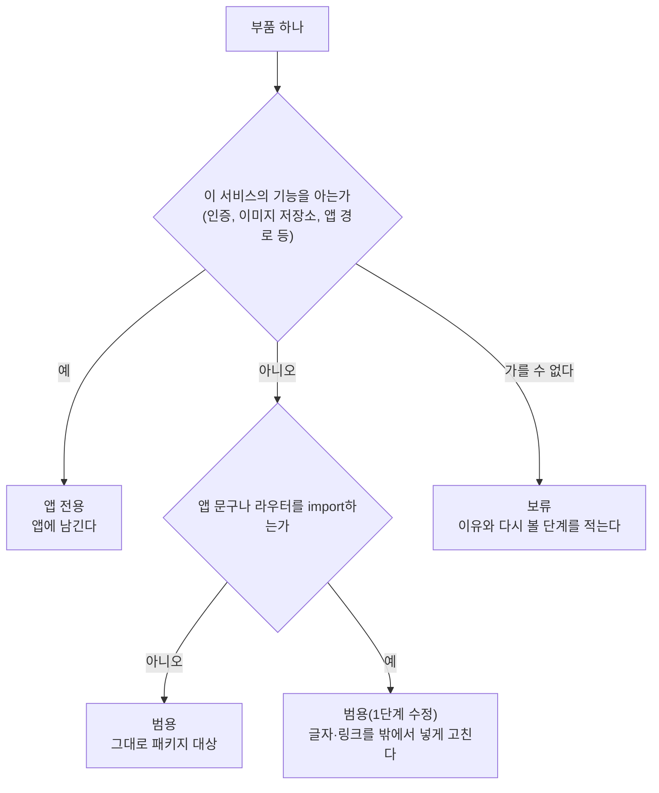

# 디자인 시스템 원칙과 부품 분류

> **문서 성격**: 레퍼런스 — 공용 UI(`src/shared/ui`)를 패키지로 꺼낼 때 누구를 위해 어디까지 꺼내는지의 원칙과, 지금 있는 부품
> 55개가 그 기준에서 어디에 속하는지를 모았다. [`DESIGN-SYSTEM-ROADMAP.md`](./DESIGN-SYSTEM-ROADMAP.md) 0단계의 결과다. 부품이
> 지금 어떻게 동작하는지는 [`DESIGN-SYSTEM.md`](./DESIGN-SYSTEM.md)가 정본이다.
>
> **대상 독자**: 로드맵 1단계(앱 결합 분리)를 계획할 개발자와 AI 세션, 공용 UI에 부품을 더하거나 옮기는 개발자.
>
> **읽고 나면**: 새 부품이 범용인지 앱 전용인지 두 질문으로 가를 수 있고, 지금 부품 가운데 1단계에서 고칠 것이 무엇인지 안다.
>
> **마지막 검토**: 2026-11-18

**읽는 법**

- 따옴표 이탤릭은 원문을 옮긴 것이고 `(번역)`은 영어 원문을 옮겼다는 뜻이다. 외부 인용은 2026-11-18에 원문을 직접 받아 문장을
  대조했다.
- 분류와 수치는 2026-11-18 `main`(5031c021) 기준이다. 부품을 더하거나 옮기면 [§5](#5-부품-분류표) 표의 줄을 고치고
  [§6](#6-측정-명령) 명령으로 개수를 다시 맞춘다.
- **부품**은 `src/shared/ui` 안의 컴포넌트 파일이다. **앱 코드**는 그 폴더 밖의 이 저장소 코드다. **보조 모듈**은 앱 코드 가운데
  부품이 가져다 쓰지만 앱 문구·라우터·서비스 기능을 모르는 작은 모듈이다(`cn()`, 클릭 가드 훅 등).

---

## 1. 정한 것 (2026-11-18)

| 항목                  | 결정                                                                                | 기각한 대안                                                                                                                                            | 정해진 경로 |
| --------------------- | ----------------------------------------------------------------------------------- | ------------------------------------------------------------------------------------------------------------------------------------------------------ | ----------- |
| 사용 대상             | React와 Tailwind v4를 쓰는, 이 저장소를 만든 개발자의 다음 프로젝트                 | 처음부터 Tailwind 무관(쓸 곳이 없는 CSS 빌드를 먼저 만든다), 공개 오픈소스(영어 문서와 외부 문의 대응이 붙는다)                                        | 사용자 답   |
| Tailwind를 안 쓰는 곳 | 지금 정하지 않는다. 3단계(패키지화)에서 정한다                                      | —                                                                                                                                                      | 사용자 답   |
| 경계 기준             | 앱 문구·라우터만 묶인 부품까지 범용이다. 이 서비스의 기능을 아는 부품만 앱 전용이다 | 좁게(지금 그대로 쓸 수 있는 부품만 범용 — 조합 부품을 다음 프로젝트에서 다시 만든다), 넓게(55개 전부 범용 — 인증·이미지 저장소까지 주입 구조로 바꾼다) | 사용자 답   |
| 상태 단계 이름        | `Experimental` / `Ready` / `Deprecated`                                             | 한국어 이름, 8단계(운영)로 미룸                                                                                                                        | 사용자 답   |
| 부품별 상태           | 지금 붙이지 않는다. 패키지에 들어가는 3단계에서 붙인다                              | 지금 55개에 붙임                                                                                                                                       | 계획 승인   |
| `Ready` 조건          | [§4](#4-상태-단계)의 네 가지                                                        | —                                                                                                                                                      | 계획 승인   |

재사용 방식(npm 패키지)은 [`DECISIONS.md`](./DECISIONS.md) "2026-11-18 — 공용 UI 재사용 방식: npm 패키지 (shadcn 레지스트리·혼합
기각)"에 있다. 이 문서의 결정은 문서만 고치면 되돌릴 수 있어 그 기록에는 적지 않았다.

## 2. 사용 대상과 전제

- **받는 쪽은 React와 Tailwind v4를 쓴다.** 부품은 모양을 Tailwind 클래스로 적고, 그 클래스의 CSS는 받는 쪽 프로젝트의 Tailwind가
  만든다.
- **받는 쪽은 패키지 경로를 Tailwind에 등록한다.** Tailwind는 `node_modules` 안의 파일을 기본으로 읽지 않는다. Tailwind 문서
  [Detecting classes in source files](https://tailwindcss.com/docs/detecting-classes-in-source-files)는
  `@source "../node_modules/@acmecorp/ui-lib"`처럼 경로를 등록하는 방법을 두고 _"의존성은 보통 `.gitignore`에 올라 있어 Tailwind가
  기본으로 무시하므로, Tailwind로 만든 외부 라이브러리를 스캔해야 할 때 특히 유용하다"_ (번역)고 쓴다. 이 저장소의 설치본은
  4.3.5다.
- **받는 쪽은 토큰 CSS도 가져간다.** 부품의 클래스(`bg-primary` 등)는 `src/app/globals.css`의 `@theme` 블록이 정한 토큰에서
  나온다. 토큰을 어떤 파일로 내보낼지는 2·3단계에서 정한다.
- **Tailwind를 안 쓰는 프로젝트**에는 미리 만든 CSS 파일을 패키지에 함께 넣어 주는 길이 있다. 부품 코드는 그대로 두고 빌드 단계를
  더하는 일이라 뒤에 붙일 수 있다는 것이 이 문서의 판단이다(실험하지 않았다). 넣을지는 3단계에서 정한다.

## 3. 경계 기준

부품 하나를 두 질문으로 가른다.

1. **이 서비스의 기능을 아는가.** 로그인 상태, 이미지 저장소, 앱의 경로 이름, 서버 오류 코드처럼 다른 제품에는 없거나 다르게
   생긴 것을 부품이 직접 읽으면 "예"다. 이런 부품은 **앱 전용**이고 앱에 남긴다.
2. **앱 문구 파일(`TEXTS`)이나 라우터(`react-router-dom`)를 import하는가.** "예"면 **범용(1단계 수정)** 이다. 글자와 링크를 밖에서
   넣게 고치면 다른 제품에서도 뜻이 같다.

둘 다 "아니오"면 **범용**이다. 두 질문으로 가를 수 없으면 **보류**로 두고 이유와 다시 볼 단계를 적는다.

| 묶인 정도   | 예                                                                              | 분류             |
| ----------- | ------------------------------------------------------------------------------- | ---------------- |
| 안 묶임     | `Button`, `Card`, `Checkbox`                                                    | 범용             |
| 겉만 묶임   | `Dialog`(닫기 버튼의 라벨을 앱 문구 파일에서 가져온다), `ErrorLayout`(홈 링크)  | 범용(1단계 수정) |
| 속까지 묶임 | `AsyncBoundary`(로그인 상태를 본다), `MarkdownContent`(이미지 저장소 주소 변환) | 앱 전용          |

분류하면서 세운 세부 규칙이다(이 문서의 판단).

- **보조 모듈은 결합으로 세지 않는다.** `cn()`이나 클릭 가드 훅은 부품 폴더 밖에 있지만 앱 문구·라우터·서비스 기능을 모른다.
  부품과 함께 패키지로 옮긴다([§5.5](#55-함께-옮길-보조-모듈)).
- **부품은 자기 파일의 import로 판정한다.** `FormInputPassword`는 `PasswordInput`(1단계 수정)을 쓰지만 자신은 고칠 것이 없어
  범용이다.
- **이름이 아니라 코드로 판정한다.** `LinkThumbnail`, `AuthLayout`은 이름이 이 서비스의 화면을 가리키지만 코드가 서비스 기능을
  읽지 않아 앱 전용이 아니다.
- **주석 속 예시는 세지 않는다.** `CharacterCount`, `EmptyState`, `ErrorState`는 사용 예시 주석에 `TEXTS`가 나오지만 import하지
  않는다.

## 4. 상태 단계

이름은 [Primer의 component status](https://primer.style/product/getting-started/component-status/)를 그대로 쓴다. Primer는 이
표시를 _"컴포넌트가 운영 애플리케이션에서 쓸 준비가 됐는지를 나타낸다"_ (번역)고 설명한다.

| 이름           | Primer의 정의                                               | 이 프로젝트에서의 뜻                                             |
| -------------- | ----------------------------------------------------------- | ---------------------------------------------------------------- |
| `Experimental` | _"컴포넌트가 개념 증명으로 있거나 작업 중이다"_ (번역)      | 실험 — 패키지에 들어 있지만 아래 `Ready` 조건을 다 채우지 못했다 |
| `Ready`        | _"컴포넌트를 더는 '실험'으로 보지 않으며 써도 된다"_ (번역) | 안정 — 아래 네 조건을 모두 채웠다                                |
| `Deprecated`   | _"컴포넌트는 앞으로 제거되며 쓰지 말아야 한다"_ (번역)      | 폐기 예정 — 새로 쓰지 않는다. 없애는 절차는 8단계에서 정한다     |

**`Ready` 조건**

1. 앱 코드를 import하지 않는다(보조 모듈은 패키지 안으로 옮겨진 상태).
2. 스토리가 있다.
3. 스토리의 접근성 검사를 통과한다(`.storybook/preview.tsx:31`의 `a11y.test: 'error'`).
4. 부품 문서가 있다(4단계의 산출물).

**지금 55개에는 상태를 붙이지 않는다.** 지금 부품은 운영에서 쓰이고 있어 "개념 증명·작업 중"이 아니고, 넷째 조건은 4단계에야
채울 수 있어 `Ready`도 아니다. 패키지에 들어가는 3단계에서 붙이고, 어디에 표시할지(Storybook 태그, 문서 머리)도 그때 정한다.

## 5. 부품 분류표

| 분류             | 뜻                                           | 개수   |
| ---------------- | -------------------------------------------- | ------ |
| 범용             | 고칠 것 없이 패키지 대상                     | 39     |
| 범용(1단계 수정) | 문구·라우터를 밖에서 넣게 고치면 패키지 대상 | 12     |
| 앱 전용          | 앱에 남긴다                                  | 3      |
| 보류             | 1단계에서 정해야 가를 수 있다                | 1      |
| **합**           |                                              | **55** |

- "묶인 것" 칸에는 `cn()`(`src/shared/lib/tailwind/utils.ts`, 43개 파일이 쓴다)과 다른 부품을 적지 않았다.
- "문구"는 `src/shared/config/texts.ts`의 `TEXTS` 키다.
- 문구를 넣는 방법(속성·컨텍스트)과 앱 전용 부품을 어느 폴더로 옮길지는 1단계에서 정한다. 그래서 "1단계에서 할 일" 칸은 무엇을
  떼는지만 적었다.

### 5.1 atoms (23개)

| 부품             | 파일                                      | 분류             | 묶인 것                                                                        | 1단계에서 할 일                       |
| ---------------- | ----------------------------------------- | ---------------- | ------------------------------------------------------------------------------ | ------------------------------------- |
| `AlertDialog`    | `src/shared/ui/atoms/alert-dialog.tsx`    | 범용(1단계 수정) | 문구 1개(`ariaLabels.close`). 보조: `useOpenClickGuard`                        | 닫기 라벨을 밖에서 넣게 한다          |
| `Avatar`         | `src/shared/ui/atoms/avatar.tsx`          | 범용             | —                                                                              | 없음                                  |
| `Badge`          | `src/shared/ui/atoms/badge.tsx`           | 범용             | —                                                                              | 없음                                  |
| `Button`         | `src/shared/ui/atoms/button.tsx`          | 범용             | —                                                                              | 없음                                  |
| `Card`           | `src/shared/ui/atoms/card.tsx`            | 범용             | —                                                                              | 없음                                  |
| `Checkbox`       | `src/shared/ui/atoms/checkbox.tsx`        | 범용             | —                                                                              | 없음                                  |
| `Dialog`         | `src/shared/ui/atoms/dialog.tsx`          | 범용(1단계 수정) | 문구 1개(`ariaLabels.close`). 보조: `useOpenClickGuard`                        | 닫기 라벨을 밖에서 넣게 한다          |
| `Divider`        | `src/shared/ui/atoms/divider.tsx`         | 범용             | —                                                                              | 없음                                  |
| `DropdownMenu`   | `src/shared/ui/atoms/dropdown-menu.tsx`   | 범용             | —                                                                              | 없음                                  |
| `FeaturedIcon`   | `src/shared/ui/atoms/featured-icon.tsx`   | 범용             | —                                                                              | 없음                                  |
| `Input`          | `src/shared/ui/atoms/input.tsx`           | 범용(1단계 수정) | 문구 1개(`ariaLabels.inputClear`). 보조: `useMergedRef`                        | 지우기 버튼 라벨을 밖에서 넣게 한다   |
| `Kbd`            | `src/shared/ui/atoms/kbd.tsx`             | 범용             | —                                                                              | 없음                                  |
| `Label`          | `src/shared/ui/atoms/label.tsx`           | 범용             | —                                                                              | 없음                                  |
| `LabeledDivider` | `src/shared/ui/atoms/labeled-divider.tsx` | 범용             | —                                                                              | 없음                                  |
| `LinkThumbnail`  | `src/shared/ui/atoms/link-thumbnail.tsx`  | 범용             | 보조: `failedImageCache`(실패한 이미지 주소를 세션 동안 기억한다)              | 보조 모듈과 함께 옮긴다               |
| `RequiredMark`   | `src/shared/ui/atoms/required-mark.tsx`   | 범용             | —                                                                              | 없음                                  |
| `Select`         | `src/shared/ui/atoms/select.tsx`          | 범용             | 보조: `useClickGuard`의 상수 `CLICK_GUARD_MS`                                  | 보조 모듈과 함께 옮긴다               |
| `Skeleton`       | `src/shared/ui/atoms/skeleton.tsx`        | 범용             | —                                                                              | 없음                                  |
| `Toaster`        | `src/shared/ui/atoms/sonner.tsx`          | 범용             | CSS 변수 `--toast-offset-bottom`을 읽는다. 값은 `src/app/globals.css`가 정한다 | 없음. 변수를 둘 곳은 2단계에서 정한다 |
| `Spinner`        | `src/shared/ui/atoms/spinner.tsx`         | 범용(1단계 수정) | 문구 1개(`ariaLabels.loading`)                                                 | 로딩 라벨을 밖에서 넣게 한다          |
| `Switch`         | `src/shared/ui/atoms/switch.tsx`          | 범용             | —                                                                              | 없음                                  |
| `Textarea`       | `src/shared/ui/atoms/textarea.tsx`        | 범용             | —                                                                              | 없음                                  |
| `Tooltip`        | `src/shared/ui/atoms/tooltip.tsx`         | 범용             | —                                                                              | 없음                                  |

### 5.2 elements (30개)

| 부품                   | 파일                                                                | 분류             | 묶인 것                                                                                                                                                                                       | 1단계에서 할 일                                                                                             |
| ---------------------- | ------------------------------------------------------------------- | ---------------- | --------------------------------------------------------------------------------------------------------------------------------------------------------------------------------------------- | ----------------------------------------------------------------------------------------------------------- |
| `ActionButton`         | `src/shared/ui/elements/ActionButton.tsx`                           | 범용             | —                                                                                                                                                                                             | 없음                                                                                                        |
| `ActionChip`           | `src/shared/ui/elements/ActionChip.tsx`                             | 범용             | —                                                                                                                                                                                             | 없음                                                                                                        |
| `AppErrorFallback`     | `src/shared/ui/elements/AppErrorFallback.tsx`                       | 앱 전용          | 앱 경로(`ROUTES_PATHS`), 청크 재로딩(`ChunkReloadUtil`), 서버 오류 해석(`ErrorUtil`), 문구 1개                                                                                                | 앱에 남긴다                                                                                                 |
| `AsyncBoundary`        | `src/shared/ui/elements/AsyncBoundary.tsx`                          | 앱 전용          | 인증 스토어(`useAuthStore`), 서버 오류 해석(`ErrorUtil`), 문구 1개                                                                                                                            | 앱에 남긴다                                                                                                 |
| `BackToTopButton`      | `src/shared/ui/elements/BackToTopButton.tsx`                        | 범용(1단계 수정) | 문구 1개(`ariaLabels.backToTop`). 보조: `ScrollUtil`                                                                                                                                          | 라벨을 밖에서 넣게 한다                                                                                     |
| `CenteredSpinner`      | `src/shared/ui/elements/CenteredSpinner.tsx`                        | 범용             | 보조: `useDelayedLoading`, 상수 `LOADING_INDICATOR_DELAY_MS`                                                                                                                                  | 보조 모듈과 함께 옮긴다                                                                                     |
| `CharacterCount`       | `src/shared/ui/elements/CharacterCount.tsx`                         | 범용             | 보조: `CommonUtil.commaizeNumber`                                                                                                                                                             | 보조 모듈과 함께 옮긴다                                                                                     |
| `DelayedFallback`      | `src/shared/ui/elements/DelayedFallback.tsx`                        | 범용             | 보조: `useDelayedLoading`, 상수 `LOADING_INDICATOR_DELAY_MS`                                                                                                                                  | 보조 모듈과 함께 옮긴다                                                                                     |
| `DropTargetOverlay`    | `src/shared/ui/elements/DropTargetOverlay.tsx`                      | 범용(1단계 수정) | 문구 1개(`comment.form.dropHere`). 댓글 폼의 문구를 직접 쓴다                                                                                                                                 | 안내 문구를 밖에서 넣게 한다                                                                                |
| `EditButton`           | `src/shared/ui/elements/EditButton.tsx`                             | 범용             | —                                                                                                                                                                                             | 없음                                                                                                        |
| `EmptyState`           | `src/shared/ui/elements/EmptyState.tsx`                             | 범용             | —                                                                                                                                                                                             | 없음                                                                                                        |
| `ErrorState`           | `src/shared/ui/elements/ErrorState.tsx`                             | 범용             | —                                                                                                                                                                                             | 없음                                                                                                        |
| `FilterChip`           | `src/shared/ui/elements/FilterChip.tsx`                             | 범용             | —                                                                                                                                                                                             | 없음                                                                                                        |
| `FormAlert`            | `src/shared/ui/elements/FormAlert.tsx`                              | 범용             | —                                                                                                                                                                                             | 없음                                                                                                        |
| `ImageAttachmentField` | `src/shared/ui/elements/ImageAttachmentField.tsx`                   | 범용(1단계 수정) | 문구 4개(`comment.form.attachImage`, `comment.form.attachHint`, `comment.form.removeImageAt`, `ariaLabels.attachmentImageAt`). 댓글 폼의 문구를 직접 쓴다                                     | 문구를 밖에서 넣게 한다                                                                                     |
| `KebabMenu`            | `src/shared/ui/elements/KebabMenu.tsx`                              | 범용             | —                                                                                                                                                                                             | 없음                                                                                                        |
| `LoadMoreError`        | `src/shared/ui/elements/LoadMoreError.tsx`                          | 범용(1단계 수정) | 문구 2개(`buttons.retry`, `messages.error.loadMoreFailed`)                                                                                                                                    | 문구를 밖에서 넣게 한다                                                                                     |
| `MarkdownContent`      | `src/shared/ui/elements/MarkdownContent.tsx`                        | 앱 전용          | Supabase 이미지 주소 변환(`supabaseImage`), 라우터 이동(`NavigationService`), 뒤로가기 오버레이 등록부(`back-closable-overlay`), 코드 블록 분리(`codeBlock`), 이미지 확대 창 스토어, 문구 3개 | 앱에 남긴다                                                                                                 |
| `PasswordInput`        | `src/shared/ui/elements/PasswordInput.tsx`                          | 범용(1단계 수정) | 문구 2개(`ariaLabels.showPassword`, `ariaLabels.hidePassword`)                                                                                                                                | 라벨을 밖에서 넣게 한다                                                                                     |
| `SearchInput`          | `src/shared/ui/elements/SearchInput.tsx`                            | 범용             | 보조: `useKeydown`, `useMergedRef`                                                                                                                                                            | 보조 모듈과 함께 옮긴다                                                                                     |
| `ToggleButton`         | `src/shared/ui/elements/ToggleButton.tsx`                           | 범용             | 보조: `useClickGuard`                                                                                                                                                                         | 보조 모듈과 함께 옮긴다                                                                                     |
| `TooltipWrapper`       | `src/shared/ui/elements/TooltipWrapper.tsx`                         | 범용             | 보조: 토스트 래퍼 `toast`. 터치에서는 툴팁 대신 토스트로 이유를 알린다                                                                                                                        | 보조 모듈과 함께 옮긴다                                                                                     |
| `SheetDialogContent`   | `src/shared/ui/elements/dialog/SheetDialogContent.tsx`              | 범용             | —                                                                                                                                                                                             | 없음                                                                                                        |
| `GlobalAlertDialogs`   | `src/shared/ui/elements/dialog/alert-dialog/GlobalAlertDialogs.tsx` | 범용(1단계 수정) | 문구 3개(`buttons.confirm`, `buttons.cancel`, `ariaLabels.alertDialogFallbackTitle`), 라우터(`useLocation` — 위치가 바뀌면 창을 닫는다)                                                       | 문구와 위치 변화 신호를 밖에서 넣게 한다                                                                    |
| `GlobalImageViewer`    | `src/shared/ui/elements/dialog/image-viewer/ImageViewer.tsx`        | 보류             | 뒤로가기 오버레이 훅(`useBackClosableOverlay` — `react-router-dom`의 `useNavigate`와 이 앱의 오버레이 등록부를 쓴다), 문구 5개                                                                | 1단계에서 다시 본다. 뒤로가기로 닫는 규약을 패키지에 넣을지, 열림·닫힘을 밖에서 받을지에 따라 분류가 갈린다 |
| `FormCheckbox`         | `src/shared/ui/elements/form/FormCheckbox.tsx`                      | 범용             | —                                                                                                                                                                                             | 없음                                                                                                        |
| `FormCheckboxGroup`    | `src/shared/ui/elements/form/FormCheckboxGroup.tsx`                 | 범용             | 보조: 타입 `SelectOptionType`                                                                                                                                                                 | 보조 모듈과 함께 옮긴다                                                                                     |
| `FormInput`            | `src/shared/ui/elements/form/FormInput.tsx`                         | 범용             | —                                                                                                                                                                                             | 없음                                                                                                        |
| `FormInputPassword`    | `src/shared/ui/elements/form/FormInputPassword.tsx`                 | 범용             | —                                                                                                                                                                                             | 없음                                                                                                        |
| `FormField`            | `src/shared/ui/elements/form/_base/FormField.tsx`                   | 범용             | —                                                                                                                                                                                             | 없음                                                                                                        |

### 5.3 layouts (2개)

| 부품          | 파일                                    | 분류             | 묶인 것                                                                                                                                    | 1단계에서 할 일                   |
| ------------- | --------------------------------------- | ---------------- | ------------------------------------------------------------------------------------------------------------------------------------------ | --------------------------------- |
| `AuthLayout`  | `src/shared/ui/layouts/AuthLayout.tsx`  | 범용(1단계 수정) | 문구 2개(`ariaLabels.authLayout`, `ariaLabels.authContent`)                                                                                | 라벨을 밖에서 넣게 한다           |
| `ErrorLayout` | `src/shared/ui/layouts/ErrorLayout.tsx` | 범용(1단계 수정) | 문구 4개(`ariaLabels.errorLayout`, `ariaLabels.errorContent`, `ariaLabels.errorDetail`, `buttons.home`), 라우터(`Link` — 홈으로 가는 링크) | 문구와 홈 링크를 밖에서 넣게 한다 |

### 5.4 부품 폴더 안의 스토어 (2개, 55개에 들지 않는다)

| 스토어                | 파일                                                              | 분류 | 묶인 것                                            | 1단계에서 할 일                    |
| --------------------- | ----------------------------------------------------------------- | ---- | -------------------------------------------------- | ---------------------------------- |
| `useAlertDialogStore` | `src/shared/ui/elements/dialog/alert-dialog/alertDialog.store.ts` | 범용 | —                                                  | `GlobalAlertDialogs`와 함께 옮긴다 |
| `useImageViewerStore` | `src/shared/ui/elements/dialog/image-viewer/imageViewer.store.ts` | 보류 | 뒤로가기 오버레이 훅(`useBackClosableOverlayOpen`) | `GlobalImageViewer`와 같이 정한다  |

### 5.5 함께 옮길 보조 모듈

범용과 범용(1단계 수정) 부품이 가져다 쓰는 앱 코드 가운데 앱 문구·라우터·서비스 기능을 모르는 모듈이다. 12개 모두 React·외부
패키지·상수 파일만 가져다 쓴다.
모듈을 통째로 옮길지 쓰는 것만 떼어 옮길지는 1단계에서 정한다.

| 보조 모듈                                                               | 쓰는 부품                                             | 그 모듈이 가져다 쓰는 것                                                    |
| ----------------------------------------------------------------------- | ----------------------------------------------------- | --------------------------------------------------------------------------- |
| `src/shared/lib/tailwind/utils.ts` (`cn`)                               | 43개 파일                                             | `clsx`, `tailwind-merge`                                                    |
| `src/shared/hooks/useClickGuard.ts`                                     | `Select`, `ToggleButton`                              | React, `src/shared/config/const.ts`                                         |
| `src/shared/hooks/useOpenClickGuard.ts`                                 | `AlertDialog`, `Dialog`                               | React, `src/shared/config/const.ts`                                         |
| `src/shared/hooks/useMergedRef.ts`                                      | `Input`, `SearchInput`                                | React                                                                       |
| `src/shared/hooks/useDelayedLoading.ts`                                 | `CenteredSpinner`, `DelayedFallback`                  | React                                                                       |
| `src/shared/hooks/useKeydown.ts`                                        | `SearchInput`                                         | React                                                                       |
| `src/shared/config/const.ts`                                            | `CenteredSpinner`, `DelayedFallback`, 클릭 가드 훅 둘 | 없음. 상수 둘만 쓴다(`LOADING_INDICATOR_DELAY_MS`, `DOUBLE_CLICK_GUARD_MS`) |
| `src/shared/lib/toast/toast.ts`, `src/shared/lib/toast/toast-layout.ts` | `TooltipWrapper`                                      | `sonner`                                                                    |
| `src/shared/lib/image/failedImageCache.ts`                              | `LinkThumbnail`                                       | 없음                                                                        |
| `src/shared/utils/common.util.ts`                                       | `CharacterCount`                                      | `dayjs`. 함수 하나(`commaizeNumber`)만 쓴다                                 |
| `src/shared/utils/scroll.util.ts`                                       | `BackToTopButton`                                     | 없음                                                                        |
| `src/shared/types/common.type.ts`                                       | `FormCheckboxGroup`                                   | 없음. 타입 하나(`SelectOptionType`)만 쓴다                                  |

## 6. 측정 명령

저장소 루트에서 돌린다. 2026-11-18의 결과를 함께 적었다.

1. 부품 수:
   `find src/shared/ui -name "*.tsx" -not -name "*.stories.tsx" -not -name "*.test.tsx"` → 55(atoms 23, elements 30, layouts 2)
2. 앱 문구·라우터·서비스 기능을 직접 가져다 쓰는 파일:
   `grep -rlE "from '@/shared/config/texts'|from 'react-router-dom'|useAuthStore|NavigationService|ROUTES_PATHS|useBackClosableOverlay" src/shared/ui`에서
   스토리·테스트 파일을 뺀 수 → 17. 부품 16개(범용(1단계 수정) 12 + 앱 전용 3 + 보류 1)와 스토어 1개다.
3. 부품이 가져다 쓰는 부품 폴더 밖 모듈과 횟수:
   `grep -rhoE "from '@/shared/(lib|hooks|utils|config|types|store)/[^']+'" src/shared/ui --include="*.tsx" --include="*.ts" --exclude="*.stories.tsx" --exclude="*.test.tsx" --exclude="*.test.ts" | sort | uniq -c`
   → 22종. [§5.5](#55-함께-옮길-보조-모듈)의 12개(`toast-layout.ts`는 `toast.ts`를 거쳐 닿는다)와 나머지 10종이다. 10종 가운데
   9종은 앱 문구·라우터·이 앱의 기능(인증, 이미지 저장소, 오류 해석, 청크 재로딩, 오버레이 등록부)을 다루는 모듈이고(`texts`,
   `route-paths`, `back-closable-overlay`, `useBackClosableOverlay`, `supabaseImage`, `navigation`, `auth.store`,
   `chunk-reload.util`, `error.util`), `codeBlock`은 앱 전용 부품 `MarkdownContent`만 써서 보조 모듈 표에 넣지 않았다.
4. 범용 부품이 앱 전용·보류 부품을 가져다 쓰지 않는지:
   `grep -rlE "(AppErrorFallback|AsyncBoundary|MarkdownContent|image-viewer/ImageViewer|imageViewer\.store)'" src/shared/ui`에서
   스토리·테스트 파일을 뺀 것 → `MarkdownContent.tsx`, `ImageViewer.tsx` 둘뿐이다(둘 다 이미지 확대 창 스토어를 쓴다).

## 7. 관련 문서

- [`DESIGN-SYSTEM-ROADMAP.md`](./DESIGN-SYSTEM-ROADMAP.md) — 단계와 상태. 이 문서는 0단계의 결과이고 1단계의 일감이다
- [`DESIGN-SYSTEM.md`](./DESIGN-SYSTEM.md) — 지금 있는 토큰·컴포넌트·린트·카탈로그·접근성 게이트
- [`FE-ARCHITECTURE.md`](./FE-ARCHITECTURE.md) §18 — Storybook 스토리 규칙
- [`BACK-NAVIGATION.md`](./BACK-NAVIGATION.md) — 뒤로가기로 닫히는 오버레이 규약(`GlobalImageViewer` 보류의 배경)
- [`DECISIONS.md`](./DECISIONS.md) — "2026-11-18 — 공용 UI 재사용 방식: npm 패키지 (shadcn 레지스트리·혼합 기각)"
- 계획: [`plans/2026-11-18-design-system-stage0-principles.md`](./plans/2026-11-18-design-system-stage0-principles.md)
