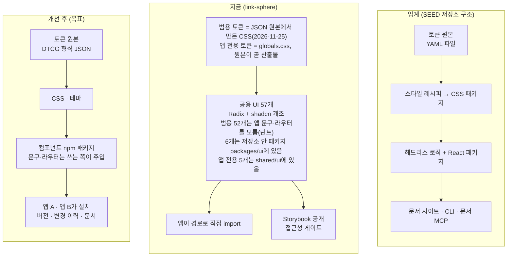

# 디자인 시스템 로드맵

> **문서 성격**: 레퍼런스 — 이 프로젝트의 공용 UI를 다른 프로젝트에서도 쓰는 디자인 시스템으로 키우려면 무엇을 준비해야
> 하는지, 지금 무엇이 있고 없는지, 어떤 순서로 할지를 모았다. 지금 동작하는 토큰·컴포넌트·검사의 설명은
> [`DESIGN-SYSTEM.md`](./DESIGN-SYSTEM.md)가 정본이고, 이 문서는 "앞으로 할 일"만 다룬다.
>
> **대상 독자**: 디자인 시스템을 처음 구축해 보는 개발자, 단계별 계획을 세울 AI 세션. 디자인 시스템 경험이 없어도 읽을 수
> 있게 썼다.
>
> **읽고 나면**: 디자인 시스템을 이루는 11개 영역을 설명할 수 있고, 이 프로젝트가 각 영역에서 어디까지 와 있는지와 다음에
> 어느 단계를 계획하면 되는지 안다.
>
> **마지막 검토**: 2026-11-26

**읽는 법**

- 따옴표 이탤릭은 원문을 옮긴 것이다. `(번역)`이 붙으면 영어 원문을 옮긴 것이고, 없으면 한국어 원문 그대로다.
- "재인용"은 조사 에이전트가 읽어 온 요약이고 이 문서를 쓴 세션이 원문을 직접 열지 않았다는 뜻이다. 표시가 없는 외부
  인용은 2026-11-18에 원문을 직접 받아 문장을 대조했다.
- Design System Checklist의 항목 이름은 사이트가 아니라 원본 저장소의 영어 번역 파일(유지보수 묶음)에서 읽었다.
- 내부 수치는 2026-11-18 `main`(78db44cf) 기준이고 측정 명령을 [§4](#4-현재와의-차이) 아래에 적었다.
- 단계가 끝나면 [§5](#5-단계) 표의 상태 열만 고치고 마지막 검토 날짜를 바꾼다. 차이 표의 행을 다시 확인하면 그 행의
  확인 날짜를 고친다.

---

## 1. 쉬운 설명

디자인 시스템은 **여러 제품이 같은 화면 부품을 쓰게 하는 공용 부품 창고**다. 창고에는 부품(컴포넌트)만 있는 것이 아니라
부품을 만드는 재료 규격(토큰), 사용 설명서(문서), 부품이 바뀔 때의 약속(버전 정책), 검수 절차(검사)가 함께 있다.

지금 이 프로젝트의 공용 UI는 품질은 갖췄지만 **한 제품의 작업실 안에만 있는 부품**이다. 앱의 문구·라우터와 섞여 있고,
밖으로 꺼내는 길(패키지)과 꺼낸 뒤의 약속(버전·변경 이력)이 없다. 이 로드맵은 그 부품을 창고로 옮기는 순서다.

### 용어

| 용어                    | 뜻                                                                                                           |
| ----------------------- | ------------------------------------------------------------------------------------------------------------ |
| 디자인 토큰             | 색·간격·글자 크기 같은 디자인 값에 이름을 붙인 것. 값이 아니라 이름을 쓰게 해서 한 곳만 고치면 전체가 바뀐다 |
| 원시·의미·컴포넌트 토큰 | 팔레트 값(회색 500) → 쓰임새 이름(본문 글자색) → 부품별 값(버튼 배경)의 세 층                                |
| 헤드리스(headless)      | 모양 없이 동작·키보드·접근성만 담은 부품. 모양은 따로 입힌다                                                 |
| 패키지 배포             | 부품을 npm 패키지로 올리고 다른 프로젝트가 설치해서 쓰는 방식                                                |
| 코드 복사 배포          | 부품 소스를 다른 프로젝트 안으로 복사해 주는 방식(shadcn 레지스트리)                                         |
| SemVer                  | `주.부.수` 버전 규칙. 쓰는 쪽 코드를 깨는 변경은 주 버전에서만 한다는 약속                                   |
| peerDependencies        | "이 패키지는 React 몇 버전과 같이 써야 한다"처럼 함께 쓸 패키지 범위를 선언하는 칸                           |
| 시각 회귀 테스트        | 화면을 찍어 이전 사진과 비교해 의도하지 않은 모양 변화를 잡는 검사                                           |
| 상태 단계               | 부품마다 붙이는 성숙도 표시(시험 중·사용 권장·폐기 예정)                                                     |

### 업계 구조 · 지금 · 개선 후



## 2. 방향 결정 (2026-11-18)

| 항목           | 결정                                                                                                                                 | 정해진 경로 |
| -------------- | ------------------------------------------------------------------------------------------------------------------------------------ | ----------- |
| 재사용 방식    | npm 패키지                                                                                                                           | 사용자 답   |
| Figma 연동     | 하지 않는다. 시안을 그리는 사람이 따로 없어 이을 대상이 없고, 변수 모드는 유료 요금제 기능이다                                       | 사용자 답   |
| 시각 회귀      | 배제한다. 쓰는 곳이 이 앱 하나라 지금은 필요하지 않다. 기존 기각 결정을 유지한다                                                     | 사용자 답   |
| 단계 순서      | [§5](#5-단계)의 0 → 8                                                                                                                | 계획 승인   |
| 저장소 구조    | 정하지 않음. 3단계 계획에서 비교한다                                                                                                 | —           |
| 토큰 원본 형식 | 2026-11-18에는 정하지 않았다. 2026-11-24에 DTCG 형식 JSON 원본에서 만들기로 정했다([`DECISIONS.md`](./DECISIONS.md) 2026-11-24 항목) | 사용자 답   |

기각한 대안과 근거는 [`DECISIONS.md`](./DECISIONS.md) "2026-11-18 — 공용 UI 재사용 방식: npm 패키지 (shadcn 레지스트리·혼합 기각)" 항목에 있다.

## 3. 준비 요소 11개 영역

영역 이름은 SEED Design, GitHub Primer, Design System Checklist의 목차를 겹쳐 이 문서가 묶은 것이다. 어느 한 곳의 공식
분류가 아니다.

### 3.1 원칙·거버넌스

- **무엇**: 누가 쓰는 시스템인지, 무엇을 넣고 빼는지, 누가 어떻게 바꾸는지의 규칙.
- **왜**: 규칙이 없으면 제품마다 필요한 것을 밀어 넣어 공용 부품이 한 제품 전용으로 굳는다.
- **선례**: [Design System Checklist](https://github.com/ardakaracizmeli/design-system-checklist)는
  유지보수 묶음에 "Decision-making log", "Roadmap", "Contribution guidelines", "Feature proposal template"을 둔다.
  [Primer](https://primer.style/product/getting-started/component-status/)는 부품마다 상태 단계를 붙인다 —
  Experimental은 _"개념 증명이거나 작업 중"_ (번역), Deprecated는 _"앞으로 제거되므로 쓰지 말아야 한다"_ (번역).

### 3.2 토큰

- **무엇**: 색·간격·반경·그림자·모션·글자 크기 값의 이름과 층.
- **왜**: 부품이 값을 직접 쓰면 테마를 바꾸거나 다른 제품에 입힐 때 부품을 전부 고쳐야 한다.
- **선례**: [SEED 디자인 토큰](https://seed-design.io/llms/foundations/design-token.txt)은 값에 이름을 붙인 Scale 토큰과
  그 조합인 Semantic 토큰 두 층을 쓰고, Semantic 토큰이 _"실제 디자인과 개발과정에서 주요 빌딩블럭으로 사용됩니다"_ 라고
  쓴다. [SEED 구조 문서](https://github.com/daangn/seed-design/blob/dev/ARCHITECTURE.md)는
  _"Rootage YAML이 토큰과 컴포넌트 스키마의 원천이다"_ 라고 쓴다 — 원본 파일 하나에서 CSS와 다른 플랫폼 값을 만든다.
  토큰을 도구 사이에 주고받는 형식은 W3C 커뮤니티 그룹이 2025-10-28에
  [첫 안정판(2025.10)](https://www.w3.org/community/design-tokens/2025/10/28/design-tokens-specification-reaches-first-stable-version/)을
  냈다. 부품별 값까지 토큰으로 두는 세 번째 층(SEED의 컴포넌트 스펙 파일)은 재인용이다.

### 3.3 컴포넌트

- **무엇**: 부품 목록, 부품 API의 규칙(속성 이름, 크기·종류 지정, ref 전달, 클래스 병합), 동작과 모양의 분리.
- **왜**: 규칙이 부품마다 다르면 쓰는 사람이 부품마다 문서를 다시 읽어야 한다.
- **선례**: [SEED 구조 문서](https://github.com/daangn/seed-design/blob/dev/ARCHITECTURE.md)는 헤드리스 패키지가
  _"스타일 없는 상태·접근성·입력 로직을 독립 패키지로 제공한다"_ 고 쓴다. Radix Primitives가 모양 없는 부품을, Radix Themes가
  모양 입힌 부품을 따로 내는 것도 같은 분리다(재인용).

### 3.4 패턴

- **무엇**: 부품 여러 개를 엮은 화면 단위의 약속(로딩, 빈 상태, 폼, 삭제 확인 등).
- **왜**: 부품이 같아도 엮는 방식이 다르면 화면이 서로 달라 보인다.
- **선례**: Primer는 UI 패턴(빈 상태·폼·로딩 등)과 시나리오 패턴(만들기·지우기·거르기)을 따로 둔다(재인용). 이 프로젝트의
  패턴은 [`FE-ARCHITECTURE.md`](./FE-ARCHITECTURE.md) §10·§10-A·§14에 있다.

### 3.5 문서

- **무엇**: 부품마다 쓰는 법·속성 표·예제·가이드라인·접근성을 적은 한 장, 그리고 시작하기 문서.
- **왜**: 소스를 읽어야만 쓸 수 있으면 다른 프로젝트·다른 사람이 쓰지 못한다.
- **선례**: [Design System Checklist](https://github.com/ardakaracizmeli/design-system-checklist)는
  문서 항목으로 "Getting started", "Component anatomy", "Component properties", "Component composition examples",
  "Browser / OS support", "Release cycle"을 든다. SEED는 디자인 스펙 문서와 React 구현 문서를 나눠 운영한다(재인용).

### 3.6 도구·자동화

- **무엇**: 토큰 밖의 값을 못 쓰게 하는 린트, 부품 카탈로그, 설치·이전을 돕는 CLI와 codemod(코드를 자동으로 고쳐 주는
  스크립트).
- **왜**: 문서 규칙은 지켜지지 않는다. 기계가 막아야 일관성이 남는다.
- **선례**: [SEED README](https://github.com/daangn/seed-design/blob/dev/README.md)의 패키지 목록에 `@seed-design/cli`
  (_"컴포넌트를 프로젝트에 추가하는 CLI"_)와 `@seed-design/codemod`(_"코드 마이그레이션 도구"_)가 있다.

### 3.7 배포·버전

- **무엇**: 배포 방식(패키지·복사), 버전 규칙, 변경 이력, 업그레이드 안내, 폐기 절차.
- **왜**: 쓰는 쪽이 "올려도 안 깨지는가"를 알 수 없으면 버전을 올리지 않고, 결국 제품마다 다른 버전에 머문다.
- **선례**: [SEED 업그레이드 문서](https://seed-design.io/llms/react/updates/upgrade.txt)는 2.0부터
  _"breaking change는 **major에서만** 발생하고, minor·patch는 하위 호환을 보장합니다"_ 라고 쓰고, 화면에도 같은 약속을
  적용해 _"색상 토큰은 이름뿐 아니라 **값도 major에서만** 바뀝니다"_ 라고 쓴다. 패키지 사이 호환 범위는
  `peerDependencies`로 선언한다. [Changesets](https://github.com/changesets/changesets)는 자신을
  _"버전과 변경 이력을 관리하는 도구"_ (번역)라고 소개한다. 코드 복사 방식의 대표인
  [shadcn/ui](https://ui.shadcn.com/docs)는 _"이것은 컴포넌트 라이브러리가 아니다. 여러분의 컴포넌트 라이브러리를 만드는
  방법이다."_ (번역)라고 쓴다.

### 3.8 접근성

- **무엇**: 목표 기준(WCAG 2.2 AA), 부품별 키보드·역할 규칙, 자동 검사 범위.
- **왜**: 공용 부품의 접근성 결함은 그 부품을 쓰는 모든 화면의 결함이 된다.
- **선례**: W3C의 WAI-ARIA Authoring Practices Guide(APG)가 부품 종류별 키보드 동작과 역할을 정리한다(재인용). 이
  프로젝트가 따르는 기준은 [`DESIGN-SYSTEM.md`](./DESIGN-SYSTEM.md) §9·§11에 있다.

### 3.9 디자인 연동

- **무엇**: Figma의 변수·부품과 코드의 토큰·부품을 같은 이름으로 잇는 것.
- **왜**: 이름이 다르면 디자이너의 시안을 코드로 옮길 때마다 사람이 대응표를 머릿속에서 만든다.
- **선례**: [SEED 구조 문서](https://github.com/daangn/seed-design/blob/dev/ARCHITECTURE.md)의 생성 파이프라인 1단계는
  Figma 변수를 뽑아 색·그라디언트·그림자 토큰 파일을 다시 쓰는 것이다. Figma Code Connect는 Figma 부품과 코드 부품을
  잇는 Figma 공식 기능이다(재인용).

### 3.10 AI 연동

- **무엇**: AI 도구가 읽을 수 있는 문서 형식(`llms.txt`), 문서·토큰을 조회하는 MCP 서버, 에이전트용 규칙 파일.
- **왜**: AI가 부품을 모르면 같은 부품을 새로 만든다.
- **선례**: [SEED llms.txt](https://seed-design.io/llms.txt)는 문서 영역마다 진입 파일을 두고 변경 이력도 같은 형식으로
  낸다. [SEED README](https://github.com/daangn/seed-design/blob/dev/README.md)에 `@seed-design/docs-mcp`
  (_"문서 MCP 서버"_)가 있다.

### 3.11 도입·측정

- **무엇**: 얼마나 쓰이는지 재는 방법, 쓰는 쪽을 돕는 창구, 기존 코드에서 옮겨오는 길.
- **왜**: 만들어도 쓰이지 않으면 유지 비용만 남는다. 무엇을 먼저 고칠지도 사용량으로 정한다.
- **선례**: [Design System Checklist](https://github.com/ardakaracizmeli/design-system-checklist)의
  "Analytics", "Support channels", "Regular updates".

## 4. 현재와의 차이

| 영역        | 업계 기준                         | 지금                                                                                                                                                                                                            | 근거                                                                                                                                   | 확인 날짜  |
| ----------- | --------------------------------- | --------------------------------------------------------------------------------------------------------------------------------------------------------------------------------------------------------------- | -------------------------------------------------------------------------------------------------------------------------------------- | ---------- |
| 거버넌스    | 기여 규칙, 상태 단계, 폐기 정책   | 결정 기록, 사용 대상·경계 기준·상태 단계 이름이 있다. 부품별 상태 표시·기여 규칙·폐기 정책 없음                                                                                                                 | [`DECISIONS.md`](./DECISIONS.md), [`DESIGN-SYSTEM-PRINCIPLES.md`](./DESIGN-SYSTEM-PRINCIPLES.md) §1·§4                                 | 2026-11-18 |
| 토큰 원본   | 변환 가능한 원본 파일             | 범용 토큰은 **갖춤** — DTCG 형식 JSON 원본(`packages/ui/tokens/`)에서 CSS·토큰 목록·토큰 표를 만들고 CI가 원본과 생성물이 같은지 본다. 앱 전용 토큰은 `globals.css`가 원본이자 산출물이다                       | [`DESIGN-SYSTEM.md`](./DESIGN-SYSTEM.md) §5 "토큰 원본과 생성물", `packages/ui/scripts/build-tokens.js`, `src/app/globals.css`, 측정 ① | 2026-11-25 |
| 토큰 축     | 색·간격·반경·그림자·모션·글자     | 색·반경·z-index·글자 크기·시간·가속 곡선이 있다. 간격·그림자 토큰 없음                                                                                                                                          | 측정 ②, [`DESIGN-SYSTEM.md`](./DESIGN-SYSTEM.md) §5 "시간과 곡선"·§11(간격을 두지 않은 이유)                                           | 2026-11-26 |
| 토큰 층     | 원시 → 의미 → 컴포넌트            | 색(무채색·유채색)과 글자 크기가 두 층. 범용 의미 색은 모두 팔레트를 가리킨다. 컴포넌트 층 없음                                                                                                                  | [`DESIGN-SYSTEM.md`](./DESIGN-SYSTEM.md) §5 "색상 2층"·"유채색도 팔레트로"                                                             | 2026-11-26 |
| 토큰 강제   | 토큰 밖 값을 린트로 막음          | **갖춤** — 색·z-index·글자 크기·제목 조합·시간·곡선을 ESLint가 막는다                                                                                                                                           | [`DESIGN-SYSTEM.md`](./DESIGN-SYSTEM.md) §5                                                                                            | 2026-11-26 |
| 앱과 분리   | 부품이 앱 코드를 모름             | 범용 52개는 앱 문구·라우터를 import하지 않고 린트가 그 경계를 막는다. 앱 문구·라우터·인증 스토어를 import하는 것은 앱 전용 5개와 스토어 1개다. 떼어 낸 부품이 다른 프로젝트에서 실제로 도는지는 확인하지 않았다 | 측정 ③, [`DESIGN-SYSTEM-PRINCIPLES.md`](./DESIGN-SYSTEM-PRINCIPLES.md) §1.1·§5                                                         | 2026-11-19 |
| 부품 범위   | 탭·아코디언·라디오·팝오버 등 포함 | 앱이 쓰는 것만 있다. 탭·아코디언·라디오·슬라이더·팝오버·페이지네이션·진행 표시 없음                                                                                                                             | 측정 ④                                                                                                                                 | 2026-11-18 |
| API 규칙    | 속성 이름·병합 순서 통일          | 종류 속성은 `variant`, 크기는 `size`, `className`은 `cn()`의 맨 뒤다. 저수준 부품은 `ref`·나머지 속성을 대상 요소에 넘긴다([원칙 §1.4](./DESIGN-SYSTEM-PRINCIPLES.md#14-api-규칙), 린트 2개와 계약 테스트)      | `src/shared/ui/atoms/featured-icon.tsx:11`, `packages/ui/src/atoms/button.tsx:54`, `src/shared/ui/atoms/badge.tsx:33`                  | 2026-11-19 |
| 카탈로그    | 모든 부품의 견본                  | **갖춤** — 스토리 파일 58개, 공개 Storybook                                                                                                                                                                     | 측정 ⑤, [`FE-ARCHITECTURE.md`](./FE-ARCHITECTURE.md) §18                                                                               | 2026-11-18 |
| 부품 문서   | 쓰는 법·가이드라인·접근성 한 장   | 자동 생성 속성 표만 있다. 사용 가이드(mdx) 0개                                                                                                                                                                  | 측정 ⑥                                                                                                                                 | 2026-11-18 |
| 상호작용    | 클릭·키보드 동작 테스트           | 스토리 안 상호작용 테스트는 파일 1개뿐                                                                                                                                                                          | 측정 ⑦                                                                                                                                 | 2026-11-18 |
| 접근성 검사 | 부품과 페이지 모두                | 부품은 **갖춤**(스토리마다 axe 검사, 위반이면 CI 실패). 페이지 단위 검사와 `eslint-plugin-jsx-a11y`는 없음                                                                                                      | `.storybook/preview.tsx:42`, 측정 ⑧                                                                                                    | 2026-11-18 |
| 시각 회귀   | 화면 사진 비교                    | 없음. 애드온만 설치돼 있고 쓰지 않는다. 기각했고 이번에도 배제했다([§5](#5-단계))                                                                                                                               | `package.json:85`, [`DECISIONS.md`](./DECISIONS.md) "2026-09-20 — Storybook 공개 호스팅"                                               | 2026-11-18 |
| 배포·버전   | 패키지, SemVer, 변경 이력         | 없음. 앱 패키지 하나(`private`, 버전 0.0.0)                                                                                                                                                                     | `package.json:3`                                                                                                                       | 2026-11-18 |
| 디자인 연동 | Figma 변수·부품 대응              | 없음. 하지 않기로 했다([§5](#5-단계))                                                                                                                                                                           | [`DECISIONS.md`](./DECISIONS.md) "2026-09-20 — Storybook 공개 호스팅" 배경                                                             | 2026-11-18 |
| AI 연동     | `llms.txt`, 문서 MCP              | 없음. 이 레포 안에서는 skill 세 개(`design-tokens`, `motion-ux`, `responsive-ux`)가 규칙을 알려 주지만 다른 프로젝트로는 가지 않는다                                                                            | `.claude/skills/`                                                                                                                      | 2026-11-18 |
| 도입·측정   | 사용량 측정, 지원 창구            | 없음. 쓰는 곳이 이 앱 하나다                                                                                                                                                                                    | —                                                                                                                                      | 2026-11-18 |

**측정 명령** (저장소 루트에서)

1. `grep -nE "style-dictionary|changeset" package.json packages/ui/package.json` → `packages/ui/package.json:53`의 `style-dictionary` 한 줄
   (2026-11-25. 그 전에는 결과 없음. 변경 이력 도구는 여전히 없다)
2. `grep -nE "^\s*--(spacing|shadow|transition-duration|ease)" packages/ui/src/styles/tokens.css packages/ui/src/styles/tokens.gen.css src/app/globals.css`
   → `tokens.gen.css`의 시간 5줄·곡선 3줄(2026-11-26. 시간 토큰은 Tailwind 테마 키 이름이라 `duration`을
   `transition-duration`으로 바꿔 다시 쟀다. 2026-11-25에는 결과 없음)
3. `grep -rlE "from '@/shared/config/texts'|from 'react-router-dom'|useAuthStore|NavigationService|ROUTES_PATHS|useBackClosableOverlay" src/shared/ui`에서
   스토리·테스트 파일을 뺀 수 → 6(0단계에는 17). 전체 부품 수는
   `find src/shared/ui -name "*.tsx" -not -name "*.stories.tsx" -not -name "*.test.tsx"` → 58(부품 57개와 문구 Provider 1개, 분리 리허설 전 값. 2026-11-20부터는 `packages/ui/src`도 함께 넣는다)
4. `find src -type f \( -iname "*tabs*" -o -iname "*accordion*" -o -iname "*radio*" -o -iname "*slider*" -o -iname "*popover*" -o -iname "*pagination*" -o -iname "*progress*" \)`
   → 결과 없음
5. `find src -name "*.stories.tsx"` → 58
6. `find src -name "*.mdx"` → 0
7. `grep -rlE "^\s*play:" src --include="*.stories.tsx"` → 1
8. `grep -c "jsx-a11y" package.json` → 0, `grep -rln "axe" e2e playwright.config.ts` → 결과 없음

## 5. 단계

상태는 `미착수` / `진행` / `완료` / `하지 않음`으로 적고, 진행·완료에는 그 단계의 계획 파일과 PR을 링크한다. 단계마다 별도 계획을 세워
승인받는다.

| 단계 | 목표         | 정할 것                                                                                                                                                                                        | 끝났다고 볼 증거                                                               | 상태                                                                                                                                                                                                                                                                                                                                                                                                                                                                                                                                                                                                                                                                                                                                                                                                                                                                                                                                                                                                                                                          |
| ---- | ------------ | ---------------------------------------------------------------------------------------------------------------------------------------------------------------------------------------------- | ------------------------------------------------------------------------------ | ------------------------------------------------------------------------------------------------------------------------------------------------------------------------------------------------------------------------------------------------------------------------------------------------------------------------------------------------------------------------------------------------------------------------------------------------------------------------------------------------------------------------------------------------------------------------------------------------------------------------------------------------------------------------------------------------------------------------------------------------------------------------------------------------------------------------------------------------------------------------------------------------------------------------------------------------------------------------------------------------------------------------------------------------------------- |
| 0    | 원칙·범위    | 누가 쓰는가, 범용 부품과 이 앱 전용 부품의 경계, 부품 상태 단계 이름                                                                                                                           | 부품 55개가 "범용 / 앱 전용 / 보류"로 분류된 표                                | 완료 — [분류표](./DESIGN-SYSTEM-PRINCIPLES.md#5-부품-분류표), [계획](./plans/2026-11-18-design-system-stage0-principles.md), [#648](https://github.com/BAECHAN/link-sphere_FE_NEW/pull/648)                                                                                                                                                                                                                                                                                                                                                                                                                                                                                                                                                                                                                                                                                                                                                                                                                                                                   |
| 1    | 앱 결합 분리 | 문구를 주입하는 방법(속성·컨텍스트), 라우터에 묶인 부품을 어디로 옮길지, 속성 이름·ref·클래스 병합 규칙                                                                                        | 범용으로 분류한 부품이 앱 문구·라우터를 import하지 않음을 린트가 막는다        | 완료 — 문구·라우터 분리, 경계 린트, 이미지 확대 창 나누기([정한 것](./DESIGN-SYSTEM-PRINCIPLES.md#11-1단계에서-정한-것), [계획](./plans/2026-11-18-design-system-stage1-decoupling.md), [#649](https://github.com/BAECHAN/link-sphere_FE_NEW/pull/649)·[#650](https://github.com/BAECHAN/link-sphere_FE_NEW/pull/650))와 API 규칙([규칙](./DESIGN-SYSTEM-PRINCIPLES.md#14-api-규칙), [계획](./plans/2026-11-19-design-system-api-rules.md), [#652](https://github.com/BAECHAN/link-sphere_FE_NEW/pull/652)·[#657](https://github.com/BAECHAN/link-sphere_FE_NEW/pull/657))                                                                                                                                                                                                                                                                                                                                                                                                                                                                                    |
| 1.5  | 분리 리허설  | 부품 몇 개를 저장소 안 패키지로 떼어 내는 방법, 빈 예제 앱을 무엇으로 만들지                                                                                                                   | 떼어 낸 부품이 빈 예제 앱에서 그려지고, 이 앱도 그 패키지로 같은 화면을 그린다 | 완료 — 대표 묶음을 저장소 안 패키지 `packages/ui`로 옮기고 이 앱이 그 패키지로 그린다([#665](https://github.com/BAECHAN/link-sphere_FE_NEW/pull/665)). Next.js(React 19) 예제 앱 `examples/next`가 같은 패키지로 그리고, 미뤄 둔 항목을 사용자 답으로 정했다([#673](https://github.com/BAECHAN/link-sphere_FE_NEW/pull/673)). [알게 된 것과 정한 것](./DESIGN-SYSTEM-PRINCIPLES.md#15-분리-리허설에서-알게-된-것과-정한-것), 계획 [리허설](./plans/2026-11-20-design-system-split-rehearsal.md)·[마무리](./plans/2026-11-23-design-system-split-rehearsal-wrapup.md). 패키지 이름을 `@link-sphere/ui`에서 `@baechan/ui`로 바꿨다([#676](https://github.com/BAECHAN/link-sphere_FE_NEW/pull/676), [패키지 이름](./DESIGN-SYSTEM-PRINCIPLES.md#패키지-이름), [계획](./plans/2026-11-23-design-system-package-rename.md)). 이어서 `LinkThumbnail`의 `className`을 맨 바깥 요소로 옮기고 이미지용 클래스를 `imageClassName`으로 받게 했다([#684](https://github.com/BAECHAN/link-sphere_FE_NEW/pull/684), [계획](./plans/2026-11-24-link-thumbnail-classname.md)) |
| 2    | 토큰         | 원본 형식(W3C 형식 파일 또는 CSS 유지), 토큰 이름 규칙(속성·역할 순), 빠진 축(간격·그림자·모션)을 둘지, 유채색 원시 층, 컴포넌트 층을 둘지                                                     | 토큰 표와 카탈로그가 원본에서 만들어지고 전후 계산값 차이가 설명된다           | 진행 — [계획](./plans/2026-11-24-design-tokens-stage2.md)(PR 8개 안팎과 부품 단계의 후속 계획). 원본 전환이 끝났다: 범용 토큰을 DTCG 형식 JSON으로 옮기고 CSS·토큰 목록·[토큰 표](./DESIGN-TOKENS.md)를 원본에서 만든다([#687](https://github.com/BAECHAN/link-sphere_FE_NEW/pull/687), [구조](./DESIGN-SYSTEM.md#토큰-원본과-생성물-2026-11-25)). 범용 의미 색이 모두 팔레트를 가리킨다([#692](https://github.com/BAECHAN/link-sphere_FE_NEW/pull/692), [§5 "유채색도 팔레트로"](./DESIGN-SYSTEM.md#5-구조)). 시간·가속 곡선 토큰을 더하고 숫자 시간·기본 곡선 클래스를 린트로 막는다([#693](https://github.com/BAECHAN/link-sphere_FE_NEW/pull/693), [§5 "시간과 곡선"](./DESIGN-SYSTEM.md#시간과-곡선-2026-11-26)). 남은 것: 새 축(그림자·역할 간격), 색 이름 바꾸기, 부품 토큰                                                                                                                                                                                                                                                                            |
| 3    | 패키지화     | 저장소 구조(모노레포·별도 저장소), 빌드 도구, 함께 쓸 패키지 범위 선언, 버전 규칙, 변경 이력 도구, 공개 범위, `'use client'`를 적을 부품 파일([이유](./DESIGN-SYSTEM-PRINCIPLES.md#치르는-값)) | 빈 프로젝트에 설치해 버튼 하나를 그린 화면, 이 앱이 패키지를 설치해 쓰는 PR    | 미착수                                                                                                                                                                                                                                                                                                                                                                                                                                                                                                                                                                                                                                                                                                                                                                                                                                                                                                                                                                                                                                                        |
| 4    | 문서         | 부품 문서 한 장의 틀(쓰는 법·속성·예제·가이드라인·접근성), 시작하기 문서, 문서를 둘 곳                                                                                                         | 범용 부품마다 틀을 채운 문서가 공개 Storybook에서 보인다                       | 미착수                                                                                                                                                                                                                                                                                                                                                                                                                                                                                                                                                                                                                                                                                                                                                                                                                                                                                                                                                                                                                                                        |
| 5    | 검사         | 페이지 단위 접근성 검사, 상호작용 테스트 범위. 시각 회귀는 배제                                                                                                                                | 정한 검사가 패키지 PR의 필수 검사로 돈다                                       | 미착수                                                                                                                                                                                                                                                                                                                                                                                                                                                                                                                                                                                                                                                                                                                                                                                                                                                                                                                                                                                                                                                        |
| 6    | 디자인 연동  | 없음. Figma 연동은 하지 않는다                                                                                                                                                                 | —                                                                              | 하지 않음                                                                                                                                                                                                                                                                                                                                                                                                                                                                                                                                                                                                                                                                                                                                                                                                                                                                                                                                                                                                                                                     |
| 7    | AI 연동      | `llms.txt`를 낼지, 문서 MCP를 만들지, 에이전트 규칙 파일을 패키지에 넣을지                                                                                                                     | 새 프로젝트의 AI 세션이 패키지 문서를 조회해 기존 부품을 쓴 기록               | 미착수                                                                                                                                                                                                                                                                                                                                                                                                                                                                                                                                                                                                                                                                                                                                                                                                                                                                                                                                                                                                                                                        |
| 8    | 운영         | 기여 규칙, 폐기 절차, 사용량을 재는 방법                                                                                                                                                       | 규칙 문서, 두 번째 프로젝트에서의 사용 현황                                    | 미착수                                                                                                                                                                                                                                                                                                                                                                                                                                                                                                                                                                                                                                                                                                                                                                                                                                                                                                                                                                                                                                                        |

**순서의 이유** (이 문서의 판단)

- 1단계가 3단계보다 먼저다. 앱 문구·라우터를 import하는 부품은 패키지로 꺼낼 수 없다.
- 분리 리허설(1.5)을 1단계 바로 뒤에 둔다. 1단계가 끊는 것은 import 결합뿐이라, 떼어 낸 부품이 다른 프로젝트에서 도는지는
  3단계에 가서야 드러난다. 그때 합치기 어렵다는 것을 알면 2단계에서 한 일까지 다시 해야 하므로 일찍 확인한다.
- 2단계가 4단계보다 먼저다. 토큰 이름이 정해져야 문서의 값 표를 쓸 수 있다.
- 빠진 부품(탭·아코디언 등)은 단계로 두지 않았다. 쓰는 화면이 생길 때 그 단계의 규칙대로 추가한다.

**하지 않기로 한 것** (2026-11-18 사용자 결정)

- 시각 회귀: 배제한다. 부품을 고치는 사람과 그 화면을 보는 사람이 같고 쓰는 곳이 이 앱 하나라 지금은 필요하지 않다.
  기존 결정([`DECISIONS.md`](./DECISIONS.md) "2026-09-20 — Storybook 공개 호스팅"의 Chromatic 기각, 2026-09-06 "화면 먼저,
  그다음 반영")을 그대로 유지한다. 시각 회귀는 Storybook 스토리를 찍어 비교하는 검사라 디자인 도구 연동과는 무관하다.
- Figma 연동: 하지 않는다. 연동은 디자이너의 시안과 코드를 잇는 것인데 이 프로젝트는 시안을 그리는 사람이 따로 없고
  코드가 유일한 원본이다. 밝은·어두운 테마를 옮기는 데 필요한 변수 모드도 유료다 — Figma 도움말
  [Modes for variables](https://help.figma.com/hc/en-us/articles/15343816063383-Modes-for-variables)는 대상 요금제를
  _"Professional, Education, Organization, Government, Enterprise 요금제"_ (번역)로 적고 무료 Starter는 들어 있지 않다
  (2026-11-18 확인. 요금 액수는 확인하지 못했다). 디자이너가 있는 회사라면 필요한 영역이라 [§3.9](#39-디자인-연동)의
  설명은 남긴다.
- 두 가지 모두 토큰·부품을 읽기만 하는 장치라 뒤에 붙여도 부품을 고칠 필요가 없다는 것이 이 문서의 판단이다(확인하지
  않음). 그 판단이 성립하도록 2단계에서 토큰 이름 규칙을 정한다.

## 6. 단계별 요청 틀

단계 하나를 시작할 때 아래 다섯 줄을 채워 요청한다. 한 번에 한 가지 산출물만 요청한다.

```
목표: <이 단계가 끝나면 무엇이 되는가>
기준: <비교할 선례 URL 2~3개>
제약: <비용, 건드리지 않을 과거 결정>
이번 산출물: <조사 보고 | 결정 질문 | 구현 계획> 중 하나
완료 조건: <무엇을 보면 끝났다고 할지>
```

| 일             | 맡길 곳                         | 이유                                                             |
| -------------- | ------------------------------- | ---------------------------------------------------------------- |
| 판단·계획·질문 | 주 세션                         | 과거 결정과 부딪히는지 가리는 일이 여기서 일어난다               |
| 읽기 전용 조사 | Explore 에이전트                | 파일을 고치지 않는다. 보고는 주 세션이 파일을 열어 다시 확인한다 |
| 구현           | general-purpose 에이전트        | 이 레포의 지침(`CLAUDE.md`)을 읽는다                             |
| 계획 대조·리뷰 | `plan-verifier`, `/code-review` | 구현한 세션이 아닌 새 눈으로 본다                                |

## 7. 관련 문서

- [`DESIGN-SYSTEM.md`](./DESIGN-SYSTEM.md) — 지금 있는 토큰·컴포넌트·린트·카탈로그·접근성 게이트
- [`DESIGN-SYSTEM-PRINCIPLES.md`](./DESIGN-SYSTEM-PRINCIPLES.md) — 0단계의 결과와 1단계에서 정한 것: 사용 대상, 범용과 앱 전용의
  경계, 부품이 글자와 링크를 받는 방법, 상태 단계, 부품 분류표
- [`FE-ARCHITECTURE.md`](./FE-ARCHITECTURE.md) §18 — Storybook 스토리 규칙
- [`DECISIONS.md`](./DECISIONS.md) — "2026-11-18 — 공용 UI 재사용 방식: npm 패키지", "2026-09-20 — Storybook 공개 호스팅",
  2026-09-06 "화면 먼저, 그다음 반영"
- `.claude/skills/design-tokens/SKILL.md` — 색·반경·글자 크기 토큰 표
- 계획: [`plans/2026-11-18-design-system-roadmap.md`](./plans/2026-11-18-design-system-roadmap.md)
