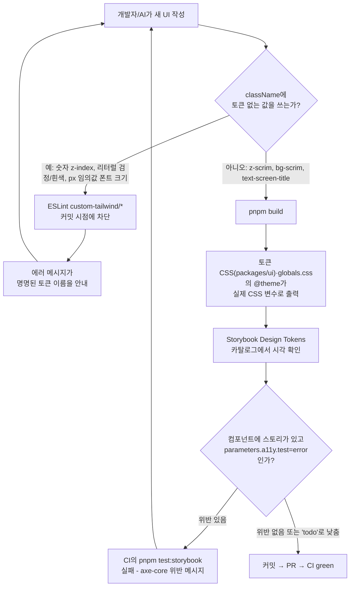
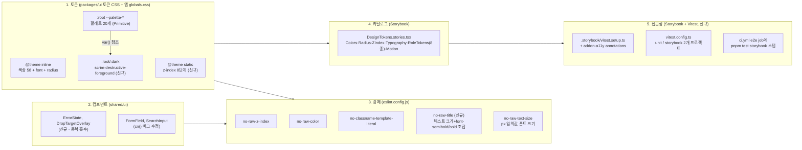
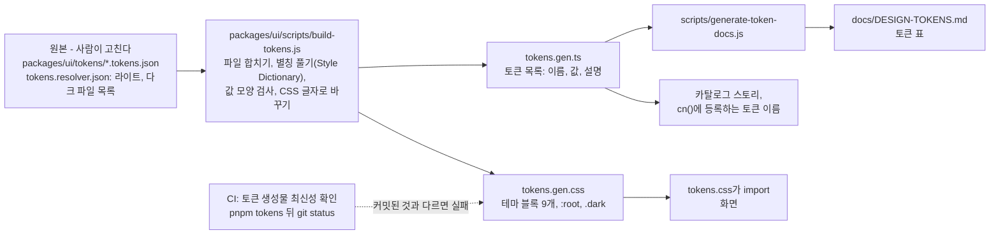

# 디자인 시스템 (토큰 · 컴포넌트 · 강제 규칙)

> **문서 성격**: 독립 기능 문서(서사형)
>
> **대상 독자**: 이 레포 FE의 스타일링 작업을 하는 개발자, 새 컴포넌트를 스타일링할 때
> 참고할 AI 세션.
>
> **읽고 나면**: 색상·반경·z-index·타이포그래피(스케일+역할) 토큰이 어디 정의돼 있고
> 어떻게 확장하는지, ESLint가 어떤 Tailwind className 규칙을 강제하는지, Storybook
> 토큰 카탈로그를 어떻게 보는지, Storybook a11y 게이트가 CI에서 어떻게 도는지 안다.
> 간격 토큰을 왜 칩 사이 간격 하나만 두는지, 지금까지 찾은 a11y 위반을 어떻게 해소했는지도 안다.
>
> **마지막 검토**: 2026-11-27

## 1. 쉬운 설명

이 레포는 한글 UI 문자열에 이미 완성된 시스템이 있다 — 모든 문구는
`src/shared/config/texts.ts`의 `TEXTS.*`에 모여 있고, ESLint
`custom-i18n/no-hardcoded-hangul`이 한글을 직접 쓰면 pre-commit(lint-staged)과 CI·배포의
`pnpm check`에서 막는다(`pnpm build` 자체는 ESLint를 돌리지 않는다). 그래서 문구가
일관된다. 스타일에는 색상 축(`globals.css`)에만 이런 사전이 있었고, 그 외(spacing·
타이포·z-index)에는 없었다 — 그래서 같은 파일 안에서도 페이지 제목이 세 가지 크기로
갈리고, 아이콘 크기 지정이 조용히 무시되는 일이 생겼다.

이 문서가 다루는 것은 그 사전(토큰)을 만들고, 반복되는 UI를 컴포넌트로 묶고,
ESLint로 "고를 수 없게" 강제하고, Storybook에 견본책을 두고, 접근성을 CI로
지키는 다섯 겹의 장치다. 색상은 이미 첫 겹이 있었고(2026-09-13), z-index와 색상
결손(딤 오버레이, destructive 글자색)을 채웠다(같은 날). 타이포그래피는 스케일 층
(t1~t14)과 역할 층(페이지 제목 등 12곳)을 화면 미리보기 승인을 거쳐 뒤이어
채웠다(2026-09-16, §4·§11 참고). 같은 날 Storybook의 a11y addon을 CI에 실제로
배선해 axe-core 검사를 자동화했고, 그 과정에서 2026-09-13부터 있던 진짜 버그
(색상 카탈로그의 잘못된 CSS 변수 참조, §10 참고)도 찾아냈다. spacing은 Tailwind
v4의 구조적 제약 때문에 숫자 눈금을 그대로 쓰고(§11), 2026-11-27에 칩 사이 간격 하나에만
이름을 붙였다(§5 "역할 간격").

## 2. 전제 지식

이 문서는 Tailwind v4의 CSS-first 설정(`@theme` 지시자)과 이 레포의 `cn()`/`cva`
패턴을 이미 안다고 가정한다. 범용 토큰의 값과 정한 이유는 원본에서 만든 토큰 표
[`DESIGN-TOKENS.md`](./DESIGN-TOKENS.md)가, 색을 고르는 법과 다크모드·커서 규칙은
[`design-tokens` skill](../.claude/skills/design-tokens/SKILL.md)이 정본이다
— 여기서 복제하지 않는다. `tailwind.config.ts`가 왜 사라졌는지의 배경은
[`docs/DECISIONS.md`](DECISIONS.md) 2026-09-13 항목 참고.

## 3. 사용한 도구·기술

- **기능 자체**: Tailwind v4 `@theme inline`/`@theme static` 지시자, CSS 커스텀
  프로퍼티, `class-variance-authority`(cva), `tailwind-merge`(`cn()`)
- **강제**: ESLint 커스텀 룰(외부 플러그인 없이 `eslint.config.js`에 직접 정의 —
  기존 `custom-i18n`/`custom-a11y`/`custom-query-rules`와 같은 이 레포의 관례)
- **검증 도구**: `rg`(ripgrep)로 실측 감사, Storybook decorator, `pnpm build` 산출물
  CSS를 직접 grep해 토큰 반영 여부 확인

## 4. 왜 만들었나

2026-09-13 `rg` 실측 감사 결과:

- z-index가 8단계(10/20/40/50/55/60/70/80)로 21곳에 흩어져 있었고, `Sidebar.tsx`
  드로어 백드롭과 `MobileCommentBar.tsx`(지금의 `CommentComposer.tsx`) 확장 댓글 시트가 값(55)을 공유하는 잠재
  충돌이 있었다.
- `button.tsx`·`badge.tsx`가 `--destructive-foreground` 토큰 없이 흰색 글자를
  하드코딩하고 있었다 — 원인은 죽은 `tailwind.config.ts`가 이 토큰을 참조했지만
  `globals.css`엔 끝내 추가되지 않았기 때문(`docs/DECISIONS.md` 2026-09-13 참고).
- 딤(스크림) 오버레이 12곳이 검정·흰색 리터럴을 직접 썼다 — 팔레트 색(`gray-500` 등)은
  이미 프로덕션 0건이었지만, 이 두 색은 grep 규칙에 안 걸려 지나쳤다.
- `_base/FormField.tsx`가 `cn()` 대신 템플릿 리터럴로 클래스를 조합하는 유일한
  `shared/ui` 컴포넌트였고, 스토리도 유일하게 없었다. `PostCard.tsx`는 보간 없는
  템플릿 리터럴을 14곳에서 습관적으로 쓰고 있었다.
- `SearchInput.tsx`의 `inputVariant` 상수가 `cn()`을 거치지 않아, 호출부가
  `className`을 넘기면 기본 스타일을 통째로 덮어써 버리는 확장성 버그가 있었다.

## 5. 구조

**재사용성(이식 친화적 구조)**: `shared/ui/`는 FSD 레이어 규칙(ESLint
`no-restricted-imports`)이 이미 `entities`/`features`/`widgets`/`pages`/`app`을
import하지 못하게 막아, 구조적으로 도메인 로직과 분리돼 있다. `globals.css`의 토큰 중
`--category`(카테고리 칩)는 link-sphere 도메인 고유값이고, 나머지(z-index 스케일,
반경, 딤 오버레이 등)는 범용이다 — 이번 라운드는 실제 레지스트리 인프라를 만들지
않고, 이 구분만 이 문단에 남겨 다음 프로젝트를 시작할 때 그대로 추출할 수 있게 했다
(2026-09-13 대화에서 확정, 레지스트리 자체 구축은 범위 밖으로 결정). `--category-1`~`8`
(2026-09-21 추가)도 같은 분류 - 카테고리 개수·id 기반 배정이 link-sphere 고유
비즈니스 규칙이다. 2026-11-20 분리 리허설에서 범용 토큰을 공용 UI 패키지의
`packages/ui/src/styles/tokens.css`로 옮겼고, 카테고리·사이드바·차트처럼 앱에 묶인 토큰만 `globals.css`에 남았다
(나눈 기준은 [DESIGN-SYSTEM-PRINCIPLES.md](./DESIGN-SYSTEM-PRINCIPLES.md) §1.5). 2026-11-18에 재사용 방식을 npm 패키지로 정했다 — 단계와 진행 상태는 [`DESIGN-SYSTEM-ROADMAP.md`](./DESIGN-SYSTEM-ROADMAP.md), 결정 근거는 [`DECISIONS.md`](./DECISIONS.md) 2026-11-18 항목에 있다.

**색상 2층 — 무채색만 Primitive로 분리(2026-10-29)**: `:root`/`.dark`의 의미 토큰(Semantic,
`--card` 등)은 무채색 값을 숫자 대신 `:root`의 `--palette-*`(Primitive)로 참조한다 —
`--palette-white`·`--palette-black`과 `--palette-neutral-{50,100,200,400,500,800,900,950}`
10개다(`neutral`은 2026-11-26에 `gray`로 바꿨다). 타이포가 이미 스케일(t1~t14) → 역할 2층이라 색도 같은 구조로 맞췄다. 범위와 위치는
이렇게 정했다:

- **무채색만 분리**: 분리 전 무채색 선언 68개가 서로 다른 값 13개(투명도 붙은 2개 포함)에
  몰려 있었다(`oklch(0.205 0 0)` 하나가 17번). 반면 유채색(info·success·category 등)은
  모드마다 한 번씩만 쓰여, 층을 나눠도 1:1 별칭만 늘어난다. 범용 토큰은 2026-11-26에 이 판단을 뒤집었다(아래
  "유채색도 팔레트로").
- **Tailwind `--color-neutral-*`를 참조하지 않고 직접 정의**: 값은 tailwindcss 4.1.18의
  `theme.css` neutral 팔레트와 같지만, 참조하면 Tailwind가 팔레트 값을 바꿀 때 테마가 조용히
  따라 바뀐다.
- **`@theme`가 아니라 `:root`**: `bg-palette-*` 같은 유틸리티가 생기지 않는다. 컴포넌트는
  의미 토큰만 쓴다(명명 팔레트 클래스는 `custom-tailwind/no-raw-color`가 이미 막는다).
- **숫자로 남긴 예외 4개**: `--muted-foreground`(0.542 — a11y 대비 때문에 팔레트 0.556에서
  내린 값), 다크 `--border`·`--input`·`--sidebar-border`(흰색 + 투명도 — `var()` 뒤에 알파를
  붙일 수 없다). 패키지 토큰 셋의 이유는 원본의 설명에 적혀 토큰 표에 실리고, 앱 토큰 `--sidebar-border`의
  이유는 `globals.css` 주석에 있다. 패키지 셋은 2026-11-26에 팔레트로 옮겼다(아래).
- 안 쓰는 단계(300·600·700)는 정의하지 않는다 — 필요해지면 그때 추가한다.

**유채색도 팔레트로 — 2026-11-26(2단계 게이트 2)**: 범용 의미 색은 이제 값을 숫자로 적지 않고 모두 팔레트를 가리킨다.
숫자로 적거나 팔레트가 아닌 토큰을 가리키면 `pnpm tokens`가 그 토큰 경로를 대며 멈춘다(`build-tokens.js`의
`assertColorsUsePalette`). 값은 하나도 바뀌지 않았다. 이름과 번호는 토큰 표 "팔레트"에 있다.

- **당근은** 의미 색이 모두 팔레트를 가리킨다(`$color.fg.critical` → `$color.palette.red-700`). 투명도 색도 팔레트에 따로
  둔다(`static-white-alpha-*`, [`color.yaml`](https://github.com/daangn/seed-design/blob/dev/packages/rootage/color.yaml),
  dev `e174aa7b`에서 직접 읽음). **토스는** `grey50`~`grey900`, `red`·`blue`·`green`·`yellow` 등의 50~900, 회색 투명도
  `greyOpacity50`~`900`을 둔다([TDS Colors](https://tossmini-docs.toss.im/tds-mobile/foundation/colors/), 웹 조회 에이전트로
  읽음). **우리는** 색 이름을 두 곳과 같은 단어(gray·red·blue·yellow·green)로 하고, 번호는 같은 색상의 Tailwind 단계 가운데
  명도(L)가 가장 가까운 것으로 붙였다. **이유**: 2026-10-29의 "1:1 별칭만 늘어난다"는 지금도 맞지만, 2단계에서 당근 규격을
  따르기로 했고(2026-11-24) 뒤 단계의 부품 토큰이 가리킬 대상이 생긴다.
- **번호와 값**: 번호가 같아도 Tailwind와 값이 같은 것은 `red-400`·`red-600`뿐이다. `blue-600`·`green-700`은 2026-09-16 a11y
  게이트에서 대비를 맞추려고 명도를 낮춘 값이다(§11 "색상 토큰 대비 개선"). `blue-400`은 Tailwind 값과 색상각만 다르다
  (254.624 → 254). `yellow-500`·`green-500`은 2026-03-14 의미 색을 처음 정의한 커밋(`c0035550`)에서 적은 값이고, 왜 이 값인지는
  기록에 없다(출처 미상). 다른 다섯 개는 모두 토큰 설명에 Tailwind 값과 다르다고 적었다. 번호 체계를 당근(100~1000)으로 하지 않은 것은 당근 번호가 모드마다
  값이 바뀌는 단계라서다. 우리 팔레트는 모드와 무관하고 의미 색이 모드마다 다른 팔레트를 가리킨다.
- **예외였던 셋**: 흐린 글자는 `gray-550`(500과 600 사이), 다크 테두리·입력은 `white-alpha-10`·`white-alpha-15`가 됐다. 투명도
  번호는 투명도 %다. 당근·토스의 투명도 번호는 %가 아니라 단계지만(당근 `static-white-alpha-50`은 약 5%, `-100`은 약 9%),
  우리는 투명도 값이 둘뿐이라 단계표를 만들 근거가 없었다.
- **`neutral` → `gray`**: 팔레트는 Tailwind 테마 키로 내보내지 않아 Tailwind의 `gray`(푸른 회색) 클래스와 겹치지 않는다. 앱
  CSS(`globals.css`)의 팔레트 참조 22줄도 이름만 바꿨다.
- 숫자로 남은 것은 앱 전용 `--sidebar-border` 하나다(앱 전용 토큰은 2단계 범위 밖).

### 토큰 원본과 생성물 (2026-11-25)

범용 토큰(패키지 `@baechan/ui`)의 값은 손으로 쓴 CSS가 아니라 **원본 파일**에 있다. 원본은 사람이 고치는 JSON이고,
CSS·토큰 목록·토큰 표는 원본에서 만드는 **생성물**이라 직접 고치지 않는다. 그 전에는 `tokens.css` 한 파일이 원본이자
결과물이었고, 같은 값을 카탈로그 스토리·skill·문서에 손으로 베껴 적었다. 앱 전용 토큰(`globals.css`)은 이 구조 밖이고
지금처럼 CSS를 직접 고친다. 위 "구조" 그림이 다섯 겹 전체를 보인다면 아래 그림은 그중 토큰 한 겹의 안쪽이다.

- **DTCG**: W3C 커뮤니티 그룹이 정한 토큰 파일 형식이다(2025.10판,
  [Format](https://www.designtokens.org/tr/2025.10/format/)). 색은 `{ colorSpace, components }` 객체로, 크기는
  `{ value, unit }`으로 적는다. 값 자리에 `{palette.gray.900}`처럼 다른 토큰의 경로를 적으면 그 토큰을 가리킨다(별칭).
- **Style Dictionary**: 토큰 파일을 읽어 별칭을 풀고 플랫폼별 코드로 바꾸는 도구다(여기서는 5.8.0,
  `packages/ui`의 `devDependencies`).

|             | 당근(SEED)                  | 토스(TDS)                               | 우리                                          | 이유                                                                                                              |
| ----------- | --------------------------- | --------------------------------------- | --------------------------------------------- | ----------------------------------------------------------------------------------------------------------------- |
| 원본        | YAML 파일(자체 형식)        | Figma 플러그인이 GitHub에 커밋하는 파일 | DTCG JSON. 손으로 고친다                      | 당근의 YAML은 당근 생성기만 읽는다. Figma 연동은 하지 않기로 했다(`DECISIONS.md` 2026-11-18)                      |
| 생성 도구   | 자체 생성기                 | Style Dictionary                        | Style Dictionary + 생성 스크립트 하나         | 자체 생성기를 만들 규모가 아니다. 도구 기본 출력은 우리 CSS 구조와 달라 스크립트가 메운다(아래)                   |
| 생성물      | CSS 변수, TS, Tailwind 테마 | CSS, TS 등                              | Tailwind 테마 블록이 든 CSS, TS 목록, 토큰 표 | 표와 카탈로그를 손으로 베끼지 않으려는 것이 이 구조의 목적이다                                                    |
| 생성물 관리 | —                           | —                                       | 커밋하고 CI가 다시 만들어 같은지 본다         | 이 레포의 선례다(`openapi.gen.ts`, `ci.yml` "생성 타입 최신성 확인"). 당근·토스가 어떻게 하는지는 확인하지 않았다 |

당근은 [ARCHITECTURE.md](https://github.com/daangn/seed-design/blob/dev/ARCHITECTURE.md)와
[packages/rootage](https://github.com/daangn/seed-design/tree/dev/packages/rootage)를, 토스는 기술 블로그
[달리는 기차 바퀴 칠하기: 7년만의 컬러 시스템 업데이트](https://toss.tech/article/tds-color-system-update)를 2026-11-24에
읽었다. 토스 저장소는 비공개라 그 글이 근거의 전부다. 도구를 고른 경위와 기각한 쪽은 `DECISIONS.md` 2026-11-24 항목에 있다.

**생성 스크립트가 직접 하는 일** — Style Dictionary 5.8.0의 기본 동작이 우리 CSS와 달라서다(2026-11-24·25에 실제로 돌려 확인):

| 일                            | 기본 동작                                                                              | 그래서                                                                                                                        |
| ----------------------------- | -------------------------------------------------------------------------------------- | ----------------------------------------------------------------------------------------------------------------------------- |
| 색을 CSS 글자로               | 내장 `css` 변환 묶음은 색을 hex·rgba로 바꾼다(`oklch(0.577 0.245 27.325)` → `#e7000b`) | `oklch()`를 원본 숫자 그대로 적는다. 패키지 색 6개가 sRGB 밖이라(§9 2026-11-25) hex로 바꾸면 넓은 색역 화면에서 색이 달라진다 |
| Tailwind 테마 블록            | `@theme inline`·`@theme static` 블록과 `--text-<이름>--line-height` 하위 키를 모른다   | 블록 배치와 변수 이름을 스크립트가 정한다(`renderCss`, `cssVarName`)                                                          |
| 라이트·다크                   | DTCG의 모드 파일(리졸버)을 읽지 못한다                                                 | 스크립트가 `tokens.resolver.json`을 읽어 라이트 한 번, 다크 한 번 빌드한다                                                    |
| 같은 토큰이 두 파일에 있을 때 | 토큰을 속성 단위로 깊게 합친다                                                         | 스크립트가 토큰을 통째로 바꿔 합친 뒤 넘긴다(§10 "다크 토큰에 라이트 설명이 딸려 왔다")                                       |
| 값 모양 확인                  | 타입과 안 맞는 값(숫자 자리에 `"50px"`, 성분이 2개인 색)을 그대로 통과시킨다           | 스크립트의 변환기가 타입마다 모양을 보고 틀리면 멈춘다                                                                        |
| 오류 문구                     | 끊긴 별칭과 변환 실패를 개수로만 알린다("참조 1개를 찾지 못함")                        | 스크립트가 별칭 대상을 먼저 확인하고 변환기의 문구를 모아, 토큰 경로와 받은 값을 대며 멈춘다                                  |

**값을 고치는 순서**

1. `packages/ui/tokens/<축>.tokens.json`에서 값이나 설명(`$description`)을 고친다. 다크에서만 다른 색은
   `color.dark.tokens.json`에 적는다(다크 파일에는 기본 파일에 있는 토큰만 적을 수 있다).
2. 저장소 루트에서 `pnpm tokens`를 돌린다(패키지 생성 → prettier → 토큰 표).
3. 원본과 생성물 세 개(`tokens.gen.css`, `tokens.gen.ts`, `docs/DESIGN-TOKENS.md`)를 함께 커밋한다. 생성물만 고치거나
   원본만 고치면 CI "토큰 생성물 최신성 확인"이 실패한다.

**반경은 고정 값이 됐다(사용자 결정, 2026-11-24)**: 전에는 기준 값 하나(`--radius: 0.625rem`)에서
`calc(var(--radius) - 4px)`처럼 계산했다. DTCG 형식은 계산식을 적을 수 없어 브라우저 기본 글자 크기(16px)에서의 계산값을
단계마다 고정 값으로 옮겼다. 16px에서는 화면이 같고, 기본 글자 크기를 바꾼 브라우저에서만 `sm`·`md`·`xl`이 조금 달라진다
(§9 2026-11-25의 표). 반경 전체를 한 번에 바꾸던 `--radius` 변수는 없어졌다.

### 시간과 곡선 (2026-11-26)

트랜지션·애니메이션의 **시간**(지속 시간)과 **가속 곡선**(시간에 따라 빨라지고 느려지는 모양, CSS의 `cubic-bezier()`)도
원본에서 만든다. 값과 쓰는 곳은 [토큰 표](./DESIGN-TOKENS.md) "시간"·"가속 곡선"에, 고르는 법과 함정은 `motion-ux`
skill에 있다. 값은 전과 같아 화면은 바뀌지 않는다(§9 2026-11-26).

- **당근은** 시간을 50ms 간격 눈금 `d1`(50ms)~`d6`(300ms)과 역할(`color-transition`·`pressed-scale` → `d3`)로 둔다. 곡선은
  `linear`, `easing`(0.35, 0, 0.35, 1), `enter`(0, 0, 0.15, 1), `exit`(0.35, 0, 1, 1), `enter-expressive`·`exit-expressive`,
  `pressed-scale`로 둔다([`duration.yaml`](https://github.com/daangn/seed-design/blob/dev/packages/rootage/duration.yaml),
  [`timing-function.yaml`](https://github.com/daangn/seed-design/blob/dev/packages/rootage/timing-function.yaml), dev
  `cd7d84ca`에서 직접 읽음). **토스는** 공개 문서에 시간·곡선 토큰이 없다(2026-11-24 조사,
  [2단계 계획](./plans/2026-11-24-design-tokens-stage2.md) "당근·토스·우리"). **우리는** 당근의 이름 짓는 법(50ms 눈금 번호,
  역할, 곡선 이름)을 따르고, 값은 지금 화면에서 쓰는 것만 올렸다. **이유**: 값까지 당근에 맞추면 화면이 바뀐다.

2026-11-26 게이트 2에서 사용자가 정한 것(③~⑦, 질문과 답은 계획 결과 블록):

| 정한 것   | 내용                                                                                                 | 이유                                                                                                                                                              |
| --------- | ---------------------------------------------------------------------------------------------------- | ----------------------------------------------------------------------------------------------------------------------------------------------------------------- |
| 클래스 꼴 | `duration-d4`, `ease-<이름>`. `transition-*`만 붙였을 때의 Tailwind 기본 시간·곡선도 토큰을 가리킨다 | 당근 꼴이다. 기본값이 토큰을 가리켜, 시간을 적지 않은 트랜지션은 고치지 않아도 토큰을 쓴다                                                                        |
| 린트      | 숫자, Tailwind 기본 이름, 대괄호·괄호 값을 막는다(`custom-tailwind/no-raw-motion`)                   | 겹침 순서(`no-raw-z-index`)·색(`no-raw-color`)과 같은 방식이다                                                                                                    |
| 눈금      | 쓰는 단계만 둔다: d3 150ms, d4 200ms, d6 300ms. 역할은 `color-transition`(→ d3)                      | 안 쓰는 단계는 정의하지 않는다(위 "색상 2층"과 같은 원칙). `color-transition`은 당근과 같은 역할이고 Tailwind 기본 시간과 같은 값이다                             |
| 600ms     | `d12`                                                                                                | 50ms 눈금의 12번째다. 당근 눈금(d6까지) 밖이라 번호를 이어 붙였다                                                                                                 |
| 곡선      | `easing`(0.4, 0, 0.2, 1), `enter`(0, 0, 0.2, 1), `sheet`(0.32, 0.72, 0, 1)                           | 값은 지금 쓰는 곡선 그대로(앞의 둘은 Tailwind 기본 곡선 값, `sheet`는 vaul 값 — `DECISIONS.md` 2026-11-03)이고 이름만 당근 꼴이다. `sheet`는 당근에 없는 이름이다 |

**Tailwind와 잇는 법**

- **테마 키**: 시간은 `--transition-duration-<이름>`, 곡선은 `--ease-<이름>`으로 낸다. Tailwind 4.3.5의 `duration-*`은
  `--transition-duration` 테마 키를 먼저 찾는다(`node_modules/tailwindcss/dist/lib.js`). 공식 문서의 테마 이름 표에 없는
  동작이라, 생성된 CSS로 확인하는 테스트(`src/test/tailwind-motion-theme.test.ts`)를 함께 뒀다.
- **기본값**: `--default-transition-duration`·`--default-transition-timing-function`을 `@theme static`에서 토큰을 가리키게
  다시 정의한다. Tailwind 기본값(150ms, (0.4, 0, 0.2, 1), `tailwindcss/theme.css`)과 값이 같다.
- **`cn()`**: tailwind-merge 3.7.0은 시간은 숫자, 곡선은 Tailwind 기본 이름만 알아 토큰 이름을 등록했다
  (`packages/ui/src/lib/tailwind/utils.ts`, 이름 목록은 생성된 `DURATION_TOKEN_NAMES`·`EASE_TOKEN_NAMES`). 등록이 빠지면
  쓰는 쪽이 넘긴 시간이 부품의 시간을 지우지 못하고 둘 다 남는다.
- **JS**: 생성된 TS가 시간을 밀리초 숫자로 내보내고(`DURATION_MS`), 닫힘을 기다리는 타이머가 그 값을 읽는다.
- 동작 줄이기 전역 블록(토큰 CSS의 `prefers-reduced-motion`)은 바꾸지 않았다.

**못 잡는 것**

- 대괄호 속성으로 `transition-duration`을 직접 적은 꼴, 인라인 `style`, `delay-*`(토큰이 없어 린트 밖이다).
- `animate-in`·`animate-out`(`tw-animate-css`)에 시간을 적지 않으면 그 라이브러리 기본값(150ms, `ease`)으로 움직인다. 이
  라이브러리는 Tailwind 기본값을 읽지 않는다.
- 클래스와 JS 타이머가 같은 토큰을 읽는지. 클래스 이름은 Tailwind가 찾을 수 있게 글자 그대로 적어야 해서 한 값에서 만들 수
  없다.
- Tailwind는 문서·주석·테스트까지 훑어, 거기 글자 그대로 적힌 클래스 이름의 규칙도 CSS에 만든다(§10 첫 항목). 고치지 않는 기록(결정
  로그, 계획, 지난 릴리즈의 CHANGELOG)에 옛 시간·곡선 클래스가 적혀 있어 그 규칙은 운영 CSS에 남는다(쓰는 곳이 없어 화면과는
  무관하다). 고칠 수 있는 문서와 주석에는 쓰지 않는 클래스 이름을 적지 않고, 린트 규칙 테스트는 이름을 조각으로 이어 만든다.

### 그림자 (2026-11-27)

부품의 그림자도 원본에서 만든다. 깊이 순서대로 네 단계 `shadow-s1`~`shadow-s4`이고, 값과 쓰는 곳은
[토큰 표](./DESIGN-TOKENS.md) "그림자"에, 고르는 법은 `design-tokens` skill에 있다. 값은 전과 같아 화면은 바뀌지 않는다
(§9 2026-11-27).

- **당근은** 그림자를 깊이 순서 번호 `s1`~`s3`으로 두고, 단계마다 층 하나와 투명도를 붙인 hex 색을 적는다. 라이트와 다크의
  값이 다르다. 색의 투명도가 라이트는 약 8·10·12%, 다크는 약 50·68·80%다
  ([`shadow.yaml`](https://github.com/daangn/seed-design/blob/dev/packages/rootage/shadow.yaml), dev `cd7d84ca`에서 직접 읽음).
  **토스는** 공개 문서에 그림자 토큰이 없다(2026-11-24 조사, [2단계 계획](./plans/2026-11-24-design-tokens-stage2.md)
  "당근·토스·우리"). **우리는** 이름 짓는 법(깊이 순서 번호)만 따르고, 값은 지금 쓰던 Tailwind 기본값 네 개를 작은 것부터
  옮겼다. 층이 둘인 단계도 그대로 두고, 다크 값은 따로 두지 않는다. **이유**: 값이나 다크 값을 당근에 맞추면 화면이 바뀐다.

2026-11-26 게이트 2에서 사용자가 정한 것(③·④·⑧, 질문과 답은 계획 결과 블록):

| 정한 것   | 내용                                                                                                                                          | 이유                                                 |
| --------- | --------------------------------------------------------------------------------------------------------------------------------------------- | ---------------------------------------------------- |
| 클래스 꼴 | `shadow-s1`~`shadow-s4`. 그림자를 없애는 `shadow-none`은 그대로 쓴다                                                                          | 당근 꼴이다                                          |
| 린트      | Tailwind 기본 이름(`2xs`~`2xl`, `inner`, 이름 없는 `shadow`)과 대괄호·괄호 값을 막는다(`custom-tailwind/no-raw-shadow`). `shadow-none`은 둔다 | 시간·곡선(`no-raw-motion`)과 같은 방식이다           |
| 옮기는 법 | 지금 쓰는 기본 이름 네 개(`xs`·`sm`·`md`·`lg`)를 순서대로 `s1`~`s4`로 옮기고 값은 그대로 둔다                                                 | 쓰는 곳 29곳(앱 27, 패키지 2)의 화면이 바뀌지 않는다 |

**Tailwind와 잇는 법**

- **테마 키**: `--shadow-<이름>`을 `@theme static`으로 낸다. Tailwind 4.3.5의 `shadow-<이름>`은 변수를 가리키지 않고 값을
  규칙에 그대로 넣어서, 일반 `@theme`이면 변수가 출력에서 빠진다. 카탈로그는 이 변수로 견본을 그린다.
- **색**: 원본에는 검정에 투명도를 붙인 숫자(`oklch(0 0 0 / 10%)`)로 적는다. 우리 팔레트에는 검정 투명도 단계가 없고, 당근도
  그림자 색을 팔레트에서 가져오지 않고 숫자로 적는다. Tailwind는 그 색을 `var(--tw-shadow-color, …)`로 감싸 그림자 색
  클래스가 덮어쓸 수 있게 한다. 생성된 CSS를 설치된 Tailwind로 컴파일해 이 꼴을 보는 테스트가
  `src/test/tailwind-shadow-theme.test.ts`다.
- **`cn()`**: tailwind-merge 3.7.0은 그림자를 크기 이름(`xs`·`sm` 꼴)으로만 알아서, 등록하지 않으면 토큰 클래스를 그림자 색으로
  분류한다. 그러면 쓰는 쪽이 넘긴 `shadow-none`이 부품의 그림자를 지우지 못하고 둘 다 남는다(이미지 보기가 대화상자의 그림자를,
  모바일 북마크 정렬 아이콘이 선택 상자 버튼의 그림자를 이렇게 지운다). 생성된 `SHADOW_TOKEN_NAMES`를 등록했다
  (`packages/ui/src/lib/tailwind/utils.ts`).
- **생성 스크립트**: 층 배열을 `0px 1px 2px 0px <색>` 꼴로 쉼표로 이어 적는다. 안쪽 그림자(`inset`)와 음수 흐림은 멈춘다.

**못 잡는 것**

- 문자열 전체가 `shadow` 한 낱말인 것. 이름 없는 그림자(Tailwind 호환 테마의 기본값으로, 옮기기 전 `sm`과 같은 값이다)는
  다른 클래스와 함께 쓰거나 변형·투명도가 붙으면 린트가 막지만, 한 낱말뿐인 문자열은 토큰 묶음 이름(`group === 'shadow'`)과
  구분하지 못해 보지 않는다. 지금 클래스로 쓰는 곳은 없다(2026-11-27 검색).
- 진행 막대(NProgress)의 대괄호 그림자. `globals.css`의 `@apply`에 있고 CSS 파일은 린트 밖이다. 인라인 `style`,
  `drop-shadow-*`·`inset-shadow-*`·`text-shadow-*`(토큰이 없어 린트 밖이다)도 같다.
- 고치지 않는 기록(지난 릴리즈의 CHANGELOG, 계획 스냅샷)에 옛 그림자 클래스가 적혀 있어 그 규칙은 운영 CSS에 남는다(§9).
  예제 앱 CSS에는 패키지 소스의 글자(`cn()` 설정 키 `shadow`, 병합 테스트 값 `shadow-none`)에서 규칙 2개가 새로 생긴다. 둘 다
  쓰는 곳이 없어 화면과는 무관하다.

### 역할 간격 (2026-11-27)

간격은 Tailwind 숫자 눈금(`--spacing`의 배수)을 그대로 쓰고, 같은 뜻으로 여러 곳에 되풀이되는 간격에만 이름을 붙인다. 지금은
칩 사이 간격 `gap-between-chips`(0.5rem, 브라우저 기본 글자 크기에서 8px) 하나다. 쓰는 곳은 칩 줄 4곳(피드 카드의 카테고리
칩 줄·태그 줄, 피드 위 필터의 카테고리 칩 줄·범위 칩 줄)과 피드 카드를 불러오는 동안 보이는 골격의 칩 자리 1곳이고, 값은
전과 같아 화면은 바뀌지 않는다(§9 2026-11-27 "역할 간격"). 골격은 게이트 2 뒤 구현 중에 찾아 2026-11-27 사용자 결정으로 함께 옮겼다.

- **당근은** 숫자 눈금 `x0_5`(2px)~`x16`(64px)(`xN` = N×4px) 위에 역할 간격 6개를 둔다. 가로는 `spacing-x.between-chips`(칩 사이,
  `x2`)·`global-gutter`(화면 좌우 여백, `x4`), 세로는 `spacing-y.component-default`(`x3`)·`nav-to-title`(`x5`)·
  `screen-bottom`(`x14`)·`between-text`(`x1_5`)다([`dimension.yaml`](https://github.com/daangn/seed-design/blob/dev/packages/rootage/dimension.yaml)
  65~88줄, dev `2e738637`에서 직접 읽음). `between-chips`의 설명은 _"Chip 사이의 수평 간격에 사용합니다."_ 다. **토스는**
  공개 문서에 간격 토큰이 없다(2026-11-24 조사, [2단계 계획](./plans/2026-11-24-design-tokens-stage2.md) "당근·토스·우리").
  **우리는** 숫자 눈금은 Tailwind 것을 그대로 쓰고(당근의 `xN`도 N×4px라 같은 눈금이다), 역할 가운데 우리 코드에서 같은 뜻으로
  되풀이되는 칩 사이 간격만 옮겼다. **이유**: 화면 좌우·아래 여백은 앱 레이아웃 한 곳(`AppLayout.tsx`)에만 있고 화면 폭마다 값이
  달라 이름을 붙여도 다시 쓰는 곳이 없다. 나머지 셋은 같은 뜻으로 되풀이되는 곳이 없다(2026-11-26 조사).

**전에는 간격 토큰을 두지 않기로 했었다(§11, 2026-09-16)**. 그때 판단은 "숫자 눈금(`--spacing`)을 잠그면 클래스 591곳이
무너지고, 고정 숫자 이스케이프도 0건이라 막을 문제가 없다"였다. 이 판단은 지금도 그대로다 — 숫자 눈금은 잠그지 않고 린트로
막지도 않는다. 바뀐 것은 "이름 붙은 간격을 하나도 두지 않는다"는 부분뿐이다. 2단계에서 당근 규격(숫자 눈금 위에 역할 간격을
두는 구조)을 따르기로 하면서([2단계 계획](./plans/2026-11-24-design-tokens-stage2.md) "뒤집힌 전제") 당근 역할 간격과 우리 코드를
대조했고, 같은 뜻으로 되풀이되는 간격이 하나 나왔다. 린트를 두지 않는 것도 그 계획에서 정했다(Phase 3 "간격은 대상이 아니다").

2026-11-26 게이트 2에서 사용자가 정한 것(⑧, 질문과 답은 계획 결과 블록):

| 정한 것 | 내용                                               | 이유                                                                                                        |
| ------- | -------------------------------------------------- | ----------------------------------------------------------------------------------------------------------- |
| 토큰    | `between-chips` 하나. 클래스는 `gap-between-chips` | 당근 역할 6개 가운데 우리 코드에서 같은 뜻으로 되풀이되는 것이 칩 사이 4곳뿐이다                            |
| 이름    | 당근의 `spacing-x.between-chips`에서 `x`를 뺐다    | 우리 칩 줄은 줄을 바꿔 쌓여 위아래 간격도 같은 값이다. 가로 간격만 가리키는 이름이면 위아래 쓰임과 어긋난다 |

**Tailwind와 잇는 법**

- **테마 키**: `--spacing-<이름>`을 `@theme static`으로 낸다. Tailwind 문서의 간격 이름공간이고, `gap-*`은 `--gap`·`--spacing`
  테마 키를 읽는다(Tailwind 4.3.5 `node_modules/tailwindcss/dist/lib.js`). 이 키는 `p-*`·`m-*`·`w-*`·`max-w-*` 같은 다른 간격·크기
  유틸리티도 읽어서, 이름이 `xs`~`7xl` 꼴이면 지금 쓰는 크기 클래스의 값이 바뀐다. `between-chips`는 그 꼴이 아니다. 카탈로그가
  변수로 견본을 그려 `static`이다. 생성된 CSS를 설치된 Tailwind로 컴파일해 보는 테스트가 `src/test/tailwind-spacing-theme.test.ts`다.
- **값의 단위**: `rem`으로 적는다. 숫자 간격은 `calc(var(--spacing) * 2)`이고 `--spacing`이 0.25rem이라, 브라우저 기본 글자
  크기를 바꾸면 함께 커진다. 토큰도 rem이어야 어느 글자 크기에서든 옮기기 전과 같다(반경을 px로 옮겨 글자 크기를 바꾼 브라우저에서
  달라진 것과 반대 경우다, 위 "반경은 고정 값이 됐다").
- **눈금을 가리키지 않는다**: 당근의 `between-chips`는 눈금 `x2`를 가리키지만, 우리 원본에는 숫자 눈금 토큰이 없다(눈금은 Tailwind의
  `--spacing`이다). 그래서 역할 토큰은 값을 직접 적는다. Tailwind의 `--spacing`을 다시 정의하지 않는 동안은 눈금 2칸과 같은 값이고,
  다시 정의하면 이 토큰도 함께 고친다. 같은 값인지는 컴파일 테스트(`src/test/tailwind-spacing-theme.test.ts`)가 본다.
- **`cn()`**: tailwind-merge 3.7.0은 간격을 `px`와 숫자로만 알아서, 등록하지 않으면 토큰 클래스를 간격으로 보지 않는다. 그러면
  쓰는 쪽이 넘긴 숫자 간격이 부품의 토큰 간격을 지우지 못하고 둘 다 남는다. 생성된 `SPACING_TOKEN_NAMES`를 테마의 `spacing`에
  등록했다(`packages/ui/src/lib/tailwind/utils.ts`). 이 등록은 `gap` 밖의 간격 유틸리티(`p-*` 등)에도 같은 이름을 알린다.

**못 잡는 것**

- 칩 줄에 숫자 간격을 쓰는 것. 숫자 간격은 칩 줄 밖에서 계속 쓰는 클래스라 칩 줄만 가려 막을 수도 없다. 새 칩 줄은 고를 때 직접
  본다(`design-tokens` skill "역할 간격 토큰").
- 인라인 `style`의 간격, 대괄호 값. 숫자 간격과 같이 린트 밖이다.

**신규 shared/ui/atoms**: 위 재사용성 절 이후 `RequiredMark`(`required-mark.tsx`),
`Divider`(`divider.tsx`), `FeaturedIcon`(`featured-icon.tsx`), `LabeledDivider`(`labeled-divider.tsx`),
`AlertDialog`(`alert-dialog.tsx`) 등이 `src/shared/ui/atoms/`에 추가됐다 — 이들을 포함해
`shared/ui/atoms`·`elements`의 모든 컴포넌트가 CLAUDE.md의 "스토리 없이 커밋 금지" 규칙에
맞춰 같은 이름의 `.stories.tsx`를 함께 갖고 있다(2026-10-27 재확인, 목록 정본은 디렉터리 자체).

**타이포그래피 전역 규칙 — `word-break: keep-all`**: `src/app/globals.css`의 `body`
셀렉터가 `word-break: keep-all` + `overflow-wrap: break-word`를 전역으로 건다. 한글은
어절(공백) 안 아무 글자 사이에서나 개행될 수 있어 문장이 부자연스럽게 끊기는 문제를
막기 위해서다 — MDN도 _"CJK(중국어/일본어/한국어) 텍스트에는 word-break를 쓰면 안
된다"_(번역)고 명시한다([MDN, word-break](https://developer.mozilla.org/en-US/docs/Web/CSS/word-break)).
URL처럼 공백 없이 긴 토큰이 넘칠 때만 `overflow-wrap: break-word`가 예외적으로 끊어
넘침을 막는다. `MarkdownContent.tsx`의 `break-all`처럼 더 구체적인 선택자는 이 전역
규칙을 그대로 덮어쓴다(`globals.css` 파일 내 주석 참고).

## 6. 상태 모델

이 기능은 Zustand 스토어나 React Query 키를 도입하지 않는다 — 상태는 CSS 커스텀
프로퍼티뿐이다. 새로 추가된 네임스페이스:

| 네임스페이스                                                                                | 정의 위치                                                                                                                                                             | 정본                                                                                                            |
| ------------------------------------------------------------------------------------------- | --------------------------------------------------------------------------------------------------------------------------------------------------------------------- | --------------------------------------------------------------------------------------------------------------- |
| `--z-index-*` (8개)                                                                         | 원본 `packages/ui/tokens/z-index.tokens.json` → 생성 `tokens.gen.css`의 `@theme static` 블록                                                                          | [토큰 표](./DESIGN-TOKENS.md) "겹침 순서"                                                                       |
| `--destructive-foreground`, `--scrim`, `--scrim-foreground`                                 | 원본 `packages/ui/tokens/color.tokens.json` → 생성 `tokens.gen.css`의 `:root` (테마 무관, 다크 파일에 없음)                                                           | 토큰 표 "의미 색"                                                                                               |
| `--text-t1`~`--text-t14` (스케일 층, 2026-09-16 추가)                                       | 원본 `packages/ui/tokens/font-size.tokens.json`·`line-height.tokens.json` → 생성 `tokens.gen.css`의 `@theme static` 블록                                              | 토큰 표 "글자 크기 눈금"                                                                                        |
| `--text-screen-title`/`section-title`/`subsection-title`/`micro` (역할 층, 2026-09-16 추가) | 원본 `packages/ui/tokens/text.tokens.json` → 생성 `tokens.gen.css`의 (static 아닌) `@theme` 블록                                                                      | 토큰 표 "글자 역할"                                                                                             |
| `--category-1`~`--category-8` (+`-foreground`, 2026-09-21 추가)                             | `src/app/globals.css`의 `:root`/`.dark`. `category.id % 8`로 배정                                                                                                     | [`design-tokens` skill](../.claude/skills/design-tokens/SKILL.md), `entities/category/config/category.const.ts` |
| `--text-card-title`/`group-label`/`display-title` (역할 층, 2026-09-16 추가)                | 위 역할 층과 같은 원본·블록                                                                                                                                           | 토큰 표 "글자 역할"                                                                                             |
| `--text-detail-title` (역할 층, 2026-09-21 추가)                                            | 위 역할 층과 같은 원본·블록                                                                                                                                           | 토큰 표 "글자 역할"                                                                                             |
| `--palette-*` (Primitive 20개. 2026-10-29 무채색 10개, 2026-11-26 유채색·투명도 추가)       | 원본 `packages/ui/tokens/palette.tokens.json` → 생성 `tokens.gen.css`의 `:root` 맨 앞 (테마 무관, 다크 파일에 없음)                                                   | 이 문서 §5 "색상 2층", 토큰 표 "팔레트"                                                                         |
| `--transition-duration-*`(5개)·`--ease-*`(3개) (2026-11-26 추가)                            | 원본 `packages/ui/tokens/duration.tokens.json`·`timing-function.tokens.json` → 생성 `tokens.gen.css`의 `@theme static` 블록 2개(Tailwind 기본값 2개를 함께 다시 정의) | 이 문서 §5 "시간과 곡선", 토큰 표 "시간"·"가속 곡선"                                                            |
| `--shadow-*`(4개) (2026-11-27 추가)                                                         | 원본 `packages/ui/tokens/shadow.tokens.json` → 생성 `tokens.gen.css`의 `@theme static` 블록                                                                           | 이 문서 §5 "그림자", 토큰 표 "그림자"                                                                           |
| `--spacing-between-chips`(1개) (2026-11-27 추가)                                            | 원본 `packages/ui/tokens/spacing.tokens.json` → 생성 `tokens.gen.css`의 `@theme static` 블록                                                                          | 이 문서 §5 "역할 간격", 토큰 표 "역할 간격"                                                                     |

패키지 토큰의 "정의 위치"는 2026-11-25부터 원본 파일이다(§5 "토큰 원본과 생성물"). 전체 58개 색상 값 자체는 옮겨적지
않는다 — 범용 27개는 토큰 원본(`packages/ui/tokens/color.tokens.json`)이, 앱 전용 31개는 `globals.css`가 SSOT다
(`--color-*` 선언 개수. 범용은 생성 CSS에서, 앱 전용은 `grep -cE "^\s+--color-[a-z0-9-]+:" src/app/globals.css`로
2026-11-25에 다시 셌다. 그 전에 적혀 있던 범용 28개·전체 59개는 `grep -c`가 토큰 CSS의 주석 한 줄까지 센 값이다).

## 7. 운영 파라미터

없음 — 이 기능에 주기·건수·타임아웃 같은 운영 파라미터는 없다.

## 8. 코드 지도와 자주 하는 수정

| 하려는 것                                                                              | 위치                                                                                                                                                                             | 방법                                                                                                                                                                                                                                                                                                                                                                                                                                                                                                                     |
| -------------------------------------------------------------------------------------- | -------------------------------------------------------------------------------------------------------------------------------------------------------------------------------- | ------------------------------------------------------------------------------------------------------------------------------------------------------------------------------------------------------------------------------------------------------------------------------------------------------------------------------------------------------------------------------------------------------------------------------------------------------------------------------------------------------------------------ |
| 새 z-index 층 추가                                                                     | 원본 `packages/ui/tokens/z-index.tokens.json`                                                                                                                                    | 토큰을 값이 작은 것부터 순서에 맞춰 더하고 `$description`에 쓰는 곳을 적는다 → `pnpm tokens` → 원본과 생성물을 함께 커밋. 토큰 표와 카탈로그(`DesignTokens.stories.tsx`의 `Z_INDEX_LAYERS`)는 생성 목록을 읽어 따로 고치지 않는다 → `design-tokens` skill의 순서 문장에 이름 추가                                                                                                                                                                                                                                        |
| 새 색 토큰 추가                                                                        | 범용이면 원본 `packages/ui/tokens/color.tokens.json`(다크에서 값이 다르면 `color.dark.tokens.json`에도), 이 앱에만 묶이면 `globals.css`의 `:root`/`.dark` + `@theme inline` 매핑 | **범용**: 원본에 토큰을 더한다(값은 숫자 대신 `{palette.<색>.<단계>}` 별칭 — 필요한 값이 없으면 `palette.tokens.json`에 먼저 추가. 숫자로 적으면 `pnpm tokens`가 멈춘다) → `pnpm tokens`(`--color-<name>` 매핑과 토큰 표가 함께 만들어진다) → 카탈로그의 색 묶음(`DesignTokens.stories.tsx`의 `packageColors(...)`)에 이름 추가(안 넣으면 "묶음에 넣지 않은 범용 색"에 나온다). **앱 전용**: 값 정의(팔레트에 있는 값이면 `var(--palette-<색>-<단계>)`) → `--color-<name>: var(--<name>)` 매핑 추가 → skill 문서 표 갱신 |
| 새 Tailwind 커스텀 ESLint 룰 추가                                                      | `eslint.config.js`의 `customTailwindRulesPlugin.rules`(정의) + 파일 하단 `custom-tailwind/*` 등록 블록(활성화)                                                                   | 기존 7개 룰(`no-raw-z-index`/`no-raw-color`/`no-raw-motion`/`no-raw-shadow`/`no-raw-text-size`/`no-raw-title`/`no-classname-template-literal`, 2026-11-27 재확인)과 같은 패턴(허용목록 없이 `Literal`/`TemplateLiteral` 방문, 정규식 매칭 — `no-classname-template-literal`만 `JSXAttribute`/`VariableDeclarator` 방문) 따르기. `no-raw-motion`·`no-raw-shadow`처럼 설정 파일 밖(`scripts/lib/`)에 두면 `src/test/scripts/`에서 단위 테스트로 고정할 수 있다                                                             |
| 새 타이포 역할 토큰 추가                                                               | 원본 `packages/ui/tokens/text.tokens.json`                                                                                                                                       | 역할 아래에 `font-size`·`line-height`(필요하면 `font-weight`) 토큰을 더한다 → `pnpm tokens`(`cn()`이 읽는 글자 크기 이름 목록 `TEXT_SIZE_TOKEN_NAMES`에 함께 등록된다. 등록이 왜 필요한지는 §10) → 실제 사용처에 클래스 적용 → `design-tokens` skill 역할 토큰 표에 대상 예시 추가                                                                                                                                                                                                                                       |
| 새 토큰 축 추가(모션·그림자 등)                                                        | 원본 `packages/ui/tokens/<축>.tokens.json`, `packages/ui/tokens/tokens.resolver.json`, `packages/ui/scripts/build-tokens.js`, `scripts/generate-token-docs.js`                   | 원본 파일을 만들고 `tokens.resolver.json`의 기본 파일 목록에 더한다 → `build-tokens.js`의 `describePath`(경로를 축·이름으로 나눔)·`cssVarName`(변수 이름)·`renderCss`(어느 테마 블록에 낼지)·`toCssValue`(새 값 타입이면)에 축을 더한다 → `generate-token-docs.js`의 `SECTIONS`에 절을 더한다. 어느 하나를 빠뜨리면 `pnpm tokens`가 그 축 이름을 대며 멈춘다                                                                                                                                                             |
| 시간·곡선 토큰 더하기                                                                  | 원본 `packages/ui/tokens/duration.tokens.json`·`timing-function.tokens.json`                                                                                                     | 토큰을 더한다(시간은 `{ "value": 250, "unit": "ms" }`, 곡선은 숫자 4개 배열이고 첫째·셋째는 0~1) → `pnpm tokens`(`cn()` 등록 목록과 JS 값 `DURATION_MS`가 함께 만들어진다) → 쓰는 곳에 클래스. 닫힘을 기다리는 JS 타이머는 `DURATION_MS.<이름>`을 읽는다(`motion-ux` skill "exit 애니메이션 동기화 함정"). 토큰 표와 카탈로그(`DesignTokens.stories.tsx`의 `Motion`)는 생성 목록을 읽어 따로 고치지 않는다                                                                                                               |
| 그림자 단계 더하기                                                                     | 원본 `packages/ui/tokens/shadow.tokens.json`                                                                                                                                     | 깊이 순서에 맞는 자리에 토큰을 더한다(값은 층 배열, 층마다 `color`는 `{ "colorSpace": "oklch", "components": [0, 0, 0], "alpha": 0.1 }` 꼴, `offsetX`·`offsetY`·`blur`·`spread`는 `{ "value": 4, "unit": "px" }` 꼴) → `pnpm tokens`(`cn()` 등록 목록 `SHADOW_TOKEN_NAMES`가 함께 만들어진다) → 쓰는 곳에 클래스. 토큰 표와 카탈로그(`DesignTokens.stories.tsx`의 `Shadow`)는 생성 목록을 읽어 따로 고치지 않는다                                                                                                        |
| 역할 간격 더하기                                                                       | 원본 `packages/ui/tokens/spacing.tokens.json`                                                                                                                                    | 같은 뜻으로 여러 곳에 되풀이되는 간격인지 먼저 본다(한 곳뿐이면 숫자 간격을 그대로 쓴다, §5 "역할 간격") → 토큰을 더한다(값은 `{ "value": 0.75, "unit": "rem" }`처럼 rem, 이름은 `xs`~`7xl` 꼴을 피한다 — 같은 테마 키를 읽는 크기 클래스의 값이 바뀐다) → `pnpm tokens`(`cn()` 등록 목록 `SPACING_TOKEN_NAMES`가 함께 만들어진다) → 쓰는 곳에 `gap-<이름>`. 토큰 표와 카탈로그(`DesignTokens.stories.tsx`의 `Spacing`)는 생성 목록을 읽어 따로 고치지 않는다 → `design-tokens` skill "역할 간격 토큰"에 쓰는 곳 추가    |
| 토스트의 버튼 자리·닫기 X 바꾸기                                                       | `packages/ui/src/lib/toast/toast-layout.ts`                                                                                                                                      | 호출부는 모양 옵션을 넘길 수 없고 래퍼가 정한다(`FE-ARCHITECTURE.md` §14 "버튼 배치"). 새 모양은 `packages/ui/src/lib/toast/`에 함수로 만들고 `sonner.stories.tsx`에 견본을 더한다                                                                                                                                                                                                                                                                                                                                       |
| 토스트 종류별 색 바꾸기                                                                | `packages/ui/src/atoms/sonner.tsx`의 `KIND_TOKENS`·`KIND_COLOR_VARS`                                                                                                             | 오류·경고·성공·안내 토스트의 배경·테두리·글자색은 `--destructive`·`--warning`·`--success`·`--info`에서 `color-mix`로 만든다(배경 8%·테두리 30%는 바탕색과, 글자 60%는 본문색과 섞는다). 토큰 값을 바꾸면 따라 바뀐다. 비율이나 토큰을 바꾸면 Storybook `Kinds`·`Notice`에서 밝은·어두운 테마의 제목 대비(4.5:1 이상)를 다시 잰다. sonner가 문서화하지 않은 변수 이름에 기대므로 sonner를 올릴 때도 같은 스토리를 확인한다(`DECISIONS.md` 2026-11-18 "토스트 색")                                                         |
| 범용 부품이 스스로 보여 주는 글자 더하기                                               | `packages/ui/src/texts/`(타입·한국어 묶음·Provider), `src/app/providers/UiTextsProvider.tsx`(이 앱이 넘기는 값)                                                                  | 부품에 `TEXTS`를 import하지 않는다. `ui-texts.ts` 타입 → `ko-ui-texts.ts` 묶음 → `APP_UI_TEXTS` 순서로 키를 더하고 부품에서 `useUiTexts()`로 읽는다. 순서와 묶는 규칙은 `texts-conventions` skill "공용 UI 부품이 스스로 보여 주는 글자", 배경은 [DESIGN-SYSTEM-PRINCIPLES.md](./DESIGN-SYSTEM-PRINCIPLES.md) §1.2                                                                                                                                                                                                       |
| 새 공용 UI 부품이 경계 린트(`custom-design-system/no-app-import-in-generic-ui`)에 걸림 | `scripts/lib/ui-boundary-rule.js`(허용 목록), `eslint.config.js`의 같은 규칙 블록 `ignores`(앱 전용 예외 목록)                                                                   | 범용 부품이면 걸린 import를 뗀다(글자는 `useUiTexts()`, 라우터·앱 상태는 쓰는 쪽이 속성으로 넘긴다). 이 앱에서만 쓰는 부품이면 예외 목록에 파일을 더하고 [DESIGN-SYSTEM-PRINCIPLES.md](./DESIGN-SYSTEM-PRINCIPLES.md) §5 분류표에 "앱 전용"으로 적는다. 허용 목록에 모듈을 더하는 것은 그 모듈이 패키지와 함께 옮겨질 때만이다(§5.5)                                                                                                                                                                                     |
| 토큰 카탈로그에 새 섹션 추가                                                           | `src/shared/ui/tokens/DesignTokens.stories.tsx`                                                                                                                                  | 새 `export const <Name>: Story` 추가(기존 `Colors`/`Radius`/`ZIndex` 참고)                                                                                                                                                                                                                                                                                                                                                                                                                                               |
| Storybook에서 다크모드 확인                                                            | `.storybook/preview.tsx`의 툴바 테마 토글                                                                                                                                        | 별도 설정 불필요 — 이미 `.dark` 클래스를 토글하도록 연결됨                                                                                                                                                                                                                                                                                                                                                                                                                                                               |
| a11y 위반을 로컬에서 확인                                                              | `pnpm test:storybook` (전체) 또는 `pnpm exec vitest run --project=storybook <파일>` (단일 파일)                                                                                  | 실패 메시지의 axe 규칙 링크(dequeuniversity.com)로 원인 확인 → 고치거나 `parameters.a11y.test: 'todo'` + 사유 주석으로 낮추고 §11 목록에 추가                                                                                                                                                                                                                                                                                                                                                                            |
| 새 스토리를 a11y 예외로 낮추기                                                         | 해당 `*.stories.tsx`의 story 객체(또는 파일 전체가 해당하면 `meta`)                                                                                                              | `parameters: { a11y: { test: 'todo' } }` 추가 + 이유 주석 + `docs/DESIGN-SYSTEM.md` §11 "a11y 잔여 목록" 표에 행 추가                                                                                                                                                                                                                                                                                                                                                                                                    |
| CI가 "Storybook 테스트 중 의존성 재최적화"로 실패                                      | `.github/workflows/ci.yml`의 "Run Storybook a11y tests" 단계 로그                                                                                                                | 출력된 `new dependencies optimized:` 목록 확인 → 스토리가 없는 경로(이미지 `src` 등)를 요청해 `index.html` 폴백이 나지 않았는지 `DEBUG=vite:html-fallback pnpm test:storybook`으로 먼저 확인(§10) → 스토리가 실제로 쓰는 의존성이면 `vitest.config.ts` storybook 프로젝트에 `optimizeDeps.include`로 추가                                                                                                                                                                                                                |

## 9. 검증 결과

2026-09-13 실측(이 브랜치, 워크트리 `design-system-foundation`):

- `pnpm type-check` — 통과 (0 에러)
- `pnpm lint` — 통과 (0 위반, 신설 룰 3개 포함)
- `pnpm test` — 55개 파일 358개 테스트 전부 통과
- `pnpm format:check` — 통과
- `pnpm build` — 성공. 빌드된 CSS(`dist/assets/index-*.css`)를 직접 grep해 확인:
  - `--z-index-raised:10` ~ `--z-index-popover:80` 8개 모두 정의됨
  - `.z-raised{z-index:var(--z-index-raised)}` 등 8개 유틸리티 클래스 정상 생성
  - `--destructive-foreground:oklch(100% 0 0)`, `--scrim:oklch(0% 0 0)`,
    `--scrim-foreground:oklch(100% 0 0)` 정의됨
  - 기존 숫자 그대로의 raw z-index 리터럴 클래스는 0건(내가 새로 추가한 파일·주석
    기준 — §10 참고)

2026-09-16 실측 (타이포그래피 역할 층 + 12곳 치환, 워크트리
`typography-role-tokens`, PR-1(#108) 위에 스택):

- `pnpm type-check` — 통과 (0 에러)
- `pnpm lint` — 통과 (0 위반, 신설 `no-raw-text-size` 룰 포함). 룰이 실제로 위반을
  잡는지 별도 확인: `text-[13px]`를 임시로 넣어 에러 발생을 확인한 뒤 되돌렸다.
- `pnpm test` — 58개 파일 380개 테스트 전부 통과
- `pnpm build` — 성공. `dist/assets/index-*.css` grep 확인:
  - `--text-screen-title`/`section-title`/`subsection-title`/`micro` 4개 모두
    size·line-height(·`micro` 제외 font-weight)까지 정의됨
  - `.text-screen-title{...}`/`.text-section-title{...}`/`.text-subsection-title{...}`/
    `.text-micro{...}` 유틸리티 4개 모두 정상 생성 — `text-micro`만 font-weight 선언이
    없음(의도대로)
  - 10px 임의값 유틸리티가 여전히 1건 생성됨 — 원인은 §10의 append-only 계획 파일,
    실제 JSX 참조는 0건(화면 영향 없음)

2026-09-16 실측 (CI/skill/Storybook 개선, 워크트리 `typography-scale-tokens`
안 브랜치 `worktree-design-system-ci-fixes`, PR #108·#110 머지 후 신선한 `main`
기준):

- `pnpm type-check`/`pnpm lint`/`pnpm test`/`pnpm format:check`/`pnpm check:docs`
  전부 통과
- `pnpm build` 로컬 실행 — `ci.yml`에 추가한 것과 동일 커맨드가 성공하는지 먼저
  확인
- `pnpm build-storybook` — 신설 `RoleTokens` 스토리 포함 정상 컴파일 확인

2026-09-16 실측 (a11y CI 게이트, 같은 워크트리 안 브랜치 `worktree-a11y-ci-gate`,
PR #108·#110·#111 머지 후 신선한 `main` 기준):

- `pnpm test` — 58개 파일 380개 테스트 전부 통과(unit 프로젝트, 기존과 동일 —
  `vitest.config.ts`를 `projects`로 분리해도 회귀 없음을 확인)
- `pnpm test:storybook` — 스토리 파일 43개, story export 151개(계획이 추정한
  "42개"는 파일 수 기준 오집계, 실제 판정 단위는 export 개수) 전부 통과(exit 0).
  `parameters.a11y.test: 'error'`를 켠 직후 1차 실행에서 14개 실패 확인 → 1건
  수정(아이콘 버튼 `aria-label` 누락), 1건 원인 수정(`AsyncBoundary` 데모의
  raw `red-*` 팔레트를 `--destructive` 토큰으로 교체, 여전히 대비 부족이라 결국
  `'todo'`) → 나머지 12건 `'todo'`로 낮춤(§11 "a11y 잔여 목록" 참고)
- 게이트 실효성 별도 확인: `Icon` 스토리의 `aria-label`을 임시로 제거해
  `pnpm exec vitest run --project=storybook packages/ui/src/atoms/button.stories.tsx`
  실행 → 실패 확인(`button-name` 위반) → 원복 후 재확인(통과) — "걸려 있기만 하고
  안 잡는" 상태가 아님을 실증
- PR을 열어 `pull_request` 트리거(필터 제거 후)가 자동으로 도는지 실측 확인 —
  이전엔 `workflow_dispatch`로만 수동 확인해야 했던 것이 정상 경로로 동작

2026-09-16 실측 (색상 토큰 대비 개선, 같은 워크트리 안 브랜치
`worktree-color-contrast-fix`, PR #108·#110·#111·#112 머지 후 신선한 `main` 기준):

- `pnpm type-check`/`pnpm lint`/`pnpm test`(unit, 380개) 전부 통과
- `pnpm test:storybook` — 151개 전부 통과, `'todo'`였던 7건이 실제로 통과해서
  통과한 것인지 확인하려고 각 파일에서 `parameters.a11y.test: 'todo'`를 지운 뒤
  재실행 → 그대로 151/151 통과(기존엔 `'todo'`라 검사 자체가 스킵됐던 것과 달리
  이번엔 실제 axe 검사를 통과)
- `AsyncBoundary.stories.tsx`·`select.stories.tsx`의 `'todo'`는 이 4개 토큰과
  무관해 그대로 유지, 실제로 손대지 않았음을 diff로 확인

2026-09-16 실측 (남은 a11y `'todo'` 2건 해소, 같은 워크트리 안 브랜치
`worktree-select-a11y-fix`, PR #108·#110·#111·#112·#113 머지 후 신선한 `main`
기준):

- `pnpm exec vitest run --project=storybook src/shared/ui/atoms/select.stories.tsx`
  단독 실행으로 `aria-label` 추가 직후 3/3 통과 확인
- `pnpm test:storybook` 전체 재실행 — 151개 전부 통과
- `rg "a11y.*test.*todo" src/shared/ui/` — 0건, `parameters.a11y.test: 'todo'`가
  코드베이스에서 완전히 사라짐을 확인
- `pnpm type-check`/`pnpm lint`/`pnpm test`(unit, 380개, `texts.test.ts` 톤 검사
  포함) 전부 통과

2026-09-16 실측 (제목+두께 조합 ESLint 룰 도입 + 역할 토큰 2종 추가, 같은
워크트리 안 브랜치 `worktree-title-weight-tokens`, PR #108·#110·#111·#112·
#113·#114·#115 머지 후 신선한 `main` 기준):

- `git grep`으로 `origin/main` 기준 "text-{크기} font-{semibold|bold}" 조합
  22곳 전수 조사(당초 계획의 "26곳"은 이미 정리된 12곳을 포함한 이전 실측치 —
  재조사 결과 22곳으로 확인) — 브랜드 워드마크 4·공용 UI 프리미티브 1·포스트
  제목 1·그룹 라벨 5·콘텐츠 메타데이터 2·배지 2·마크다운 헤딩 4·Storybook 3
  로 분류
- Artifact 미리보기(https://claude.ai/artifact/HFhnbYBfxXTYL2HmbQQY12)로 시각
  변경이 있는 4개 그룹(Dialog 제목·포스트 카드 제목·폴더 그룹 라벨 4곳·최근
  검색 라벨)을 사용자에게 보여주고 전체 반영 승인받음
- `custom-tailwind/no-raw-title` 룰 추가 직후 `pnpm lint` 1차 실행에서 계획에
  없던 `ErrorLayout.tsx:20`(에러 페이지 60px 타이틀)이 추가로 걸림 — 기존
  역할 토큰 어느 것과도 안 맞고 Artifact 승인 범위 밖이라 이번엔 예외 주석만
  달고 별도 라운드로 미룸(§11 참고)
- `pnpm type-check`/`pnpm lint`(신설 `no-raw-title` 포함 0위반)/`pnpm test`
  (380개)/`pnpm test:storybook`(151개)/`pnpm format:check`/`pnpm check:docs`/
  `pnpm build` 전부 통과
- 브라우저 검증(테스트 계정 `tester_new_999`, 실제 화면):
  - Dialog: 폴더 삭제 확인창에서 `.text-section-title` 요소를 직접 조회해
    18px/24px/600 확인(이전 leading-none 18px/18px에서 줄간격만 넓어짐)
  - 포스트 카드 제목: `/post` 데스크톱(1280px)에서 18px/24px/700, 모바일(390px)
    에서 14px/19px/700 확인 — `md:text-t6` 반응형 전환이 실제로 동작함
  - 폴더 그룹 라벨: `/bookmark` 사이드바(FolderSidebar)의 "내 폴더" 라벨에서
    12px/16px/600 확인. `BookmarkFolderSelectDialog.tsx`는 같은
    `text-group-label` 토큰을 쓰므로 별도 실측 없이 동일 계산값으로 간주 —
    실제로 열어 확인하지는 않았다
  - 최근 검색 라벨: `/post`에서 검색 열기 → "최근 검색" 라벨에서 12px/16px/600
    확인(원래 14px에서 실제로 줄어듦)
  - 녹화: `.claude/browser-artifacts/verify-2026-09-16-title-weight-tokens.webm`

2026-09-16 실측 (`ErrorLayout.tsx`의 남은 예외 주석을 `text-display-title`
역할 토큰으로 교체, 같은 워크트리 안 브랜치 `worktree-error-layout-title-token`,
PR #108·#110·#111·#112·#113·#114·#115·#116 머지 후 신선한 `main` 기준):

- `/this-route-does-not-exist`(404 페이지) 실측 — 교체 전 `getComputedStyle`로
  `text-6xl font-bold`가 60px/60px(line-height 1)/700임을 먼저 확인한 뒤,
  `text-display-title`도 동일하게 60px/60px/700로 렌더됨을 재확인 — 계산값
  완전 동일
- 실제 타이틀 콘텐츠도 함께 확인: `pages/404`·`pages/403`·`AppErrorFallback`·
  `AsyncBoundary`의 `DefaultErrorFallback`은 전부 문장형 메시지("페이지를
  찾을 수 없어요" 등)를 넘기고, `pages/500`만 리터럴 `"500"`을 쓴다 —
  스토리 데모("404"/"403" 같은 짧은 코드)와는 다른데도 60px에서 줄바꿈 없이
  깔끔하게 렌더됨을 화면으로 확인, 값을 바꿀 이유가 없다고 판단
- `pnpm type-check`/`pnpm lint`/`pnpm test`(380개)/`pnpm test:storybook`
  (151개)/`pnpm format:check`/`pnpm check:docs`/`pnpm build` 전부 통과

2026-09-16 실측 (`EmptyState` 컴포넌트 신설, 같은 워크트리 안 브랜치
`worktree-empty-state-spacing`, PR #108·#110·#111·#112·#113·#114·#115·#116·
#117·#118 머지 후 신선한 `main` 기준):

- 스크린샷 전/후 비교(`RecentSearchPanel.tsx`의 빈 검색 화면, py-8→py-12
  1차 시도)를 사용자에게 보여준 결과 "이전(32px)이 더 낫다, 대신 통일은
  하자"는 피드백을 받아 방향을 바꿨다 — 다수(4곳)가 쓰던 `py-12`가 아니라
  소수(1곳)가 쓰던 `py-8`을 표준으로 채택
- `EmptyState`를 `py-8`로 변경한 뒤 `/post?q=<존재하지 않는 검색어>`(빈 검색
  결과, 실제 화면)를 스크린샷으로 재확인 — 테두리·배경 있는 변형도 32px에서
  문제없이 렌더됨을 확인
- `pnpm exec vitest run --project=storybook EmptyState.stories.tsx` 2/2 통과 →
  `pnpm test:storybook` 전체 재실행 44개 파일·153개 테스트(신규 스토리 2개
  포함) 전부 통과
- `pnpm type-check`/`pnpm lint`/`pnpm test`(380개)/`pnpm format:check`/
  `pnpm check:docs`/`pnpm build` 전부 통과

2026-09-17 실측 (`PostCard.tsx` 조회수 gap·`PostListFilter.tsx` 필터 카드
정리, 같은 워크트리 안 브랜치 `worktree-postcard-spacing-fixes`, PR #108~
#119 머지 후 신선한 `main` 기준):

- 처음 제시했던 "PostCard 안 gap 4종 불일치"는 재검토 결과 과장이었다 —
  헤더 메타 텍스트 줄(86번째 줄)·헤더 아이콘 버튼 묶음(111번째 줄)은 조회수
  행과 아예 다른 UI 영역이라 비교 대상이 아니었고, 실제로 같은 역할(아이콘+
  숫자 액션)인데 다른 건 조회수 행(`gap-1`) 하나뿐이었다 — 범위를 4곳에서
  1곳으로 좁혔다
- 로딩 스피너 래퍼 패딩도 재검토 결과 제외 — 실측해보니 다른 값을 쓰는
  2곳(모달·사이드바)이 좁은 임베드 공간이라 밀도 차이가 의도에 가까웠다
- 브라우저 실측(`/post`, 데스크톱 1280px): 조회수 행 gap이 4px→6px로
  커져 댓글 수 버튼과 동일해짐을 확인. 필터 카드는 `Card` 컴포넌트 전환 후
  padding 16px·radius 16px·border 1px·box-shadow·배경색 전부 이전과 동일한
  계산값으로 렌더됨을 확인(순수 컴포넌트 재사용 전환)
- `pnpm type-check`/`pnpm lint`/`pnpm test`(380개)/`pnpm format:check`/
  `pnpm check:docs`/`pnpm build` 전부 통과

2026-09-17 실측 (`MyCommentCard.tsx` 패딩을 `p-3`으로 통일, 같은 워크트리 안
브랜치 `worktree-mycommentcard-padding`, PR #108~#120 머지 후 신선한 `main`
기준):

- Artifact 미리보기(`p-4` vs `p-3` before/after)를 사용자에게 보여주고
  승인받은 뒤 반영
- `/my/comments`(실제 화면, 로그인 필요) 실측: `getComputedStyle`로 카드
  padding이 12px(`p-3`)로 렌더됨을 확인, 스크린샷 기록
  (`.claude/browser-artifacts/verify-2026-09-17-mycommentcard-padding.webm`)
- `MyCommentCardSkeleton.tsx`도 같은 값으로 맞춤 — 그 파일 자체 주석이 이미
  "MyCommentCard와 동일해야 레이아웃이 안 튄다"고 명시하고 있어, 실제 카드만
  바꾸면 로딩→렌더 전환에서 시프트가 생기는 걸 미리 막았다
- `pnpm type-check`/`pnpm lint`/`pnpm test`(380개)/`pnpm format:check`/
  `pnpm check:docs`/`pnpm build` 전부 통과

2026-10-29 실측 (무채색 Primitive 층 분리, 워크트리 `color-palette-tokens`, `main` `2d813440`
기준) — 직접 측정:

- 바꾸기 전·후를 각각 `vite build`한 CSS(`dist/assets/index-*.css`)를 Chromium(Playwright)에
  올리고, `:root`·`.dark` 규칙에 선언된 모든 커스텀 프로퍼티의 `getComputedStyle` 값을 라이트와
  `.dark` 클래스를 켠 상태에서 각각 읽어 문자열로 비교했다 — 토큰 200개 × 2모드 = 400건 중
  차이 0건. 추가된 건 `--palette-*` 10개뿐이다. 커스텀 프로퍼티의 계산값은 `var()`가 치환된
  값이라(예: 다크 `--card` = `oklch(20.5% 0 0)`) 참조로 바꿔도 같은 문자열이 나와야 한다.
- 비교가 실제로 틀린 곳을 잡는지 음성 대조: 결과 CSS의 `var(--palette-neutral-900)` 하나를
  `var(--palette-neutral-90)`로 망가뜨리자 `--primary`·`--color-primary`가 빈 값으로 바뀐
  2건이 잡혔다.
- `pnpm type-check`/`pnpm test`(141개 파일 1,590개)/`prettier --check` 통과

2026-11-25 실측 (범용 토큰을 원본에서 생성하도록 전환, 워크트리 `ds-tokens-stage2-source`, `main` `3b0451ad` 기준) —
직접 측정. 스크립트는 커밋하지 않았다(설치된 Tailwind의 내부 API를 쓴다).

- **빌드된 CSS 비교**: 바꾸기 전·후 커밋을 `git archive`로 따로 풀고, 설치된 Tailwind(`@tailwindcss/node`의 `compile`,
  `@tailwindcss/oxide`의 `Scanner` — PostCSS 플러그인이 쓰는 것과 같은 경로)로 진입 CSS를 각각 빌드했다. 클래스 후보도
  트리마다 따로 긁어, 새 파일이나 사라진 글자 때문에 생기거나 없어진 유틸리티까지 보이게 했다. 규칙(선택자 경로) 단위로
  선언을 비교한 결과:

  | 진입 CSS                                | 규칙 수(전 → 후) | 바뀐 규칙    | 전에만 있던 규칙 | 후에만 있는 규칙 |
  | --------------------------------------- | ---------------- | ------------ | ---------------- | ---------------- |
  | 앱 `src/app/globals.css`                | 1,167 → 1,157    | 7(모두 반경) | 11               | 1                |
  | 예제 앱 `examples/next/app/globals.css` | 268 → 268        | 3(모두 반경) | 0                | 0                |
  - 바뀐 규칙: 테마 층의 반경 변수 4개, 반경 유틸리티 5개(`sm`·`md`·`lg`·`xl`과 `sm:` 변형의 `lg`)가 계산식 대신
    `var(--radius-<단계>)`를 쓰고, `:root`의 `--radius`가 없어졌다. 예제 앱은 쓰는 반경 유틸리티가 `md` 하나이고, 전에는
    출력되지 않던 반경 변수 4개가 테마 층에 나온다(반경을 `@theme static`으로 낸다). 색·z-index·글자 크기 규칙은 선언이 한
    글자도 바뀌지 않았고 공통 규칙의 순서도 같다.
  - 전에만 있던 11개: 글자 크기 눈금 t2~t10·t12·t13의 유틸리티 클래스다. 코드에는 쓰는 곳이 없고 `design-tokens` skill의
    눈금 표에 클래스 이름이 적혀 있어 만들어지던 것이다(§10 첫 항목과 같은 현상). 표를 토큰 표 링크로 바꾸면서 사라졌다.
    카탈로그는 클래스가 아니라 변수(`@theme static`이라 늘 출력된다)를 읽어 그대로 그려진다.
  - 후에만 있는 1개: 계획 스냅샷(`docs/plans/2026-11-24-design-tokens-stage2.md`)에 글자 유틸리티에 변수를 괄호로 넘기는
    꼴을 클래스 그대로 적어 생긴 유령 유틸리티다. 쓰는 곳이 없어 화면 영향은 없다. 승인된 계획 원문이라 고치지 않았다
    (§10 "같은 문제가 이번엔 고칠 수 없는 자리에서 재발했다"와 같은 실수다).

- **브라우저 계산값**: 위 앱 빌드 CSS 둘을 Chromium(Playwright, `setContent`라 네트워크 요청 없음)에 올려 읽었다.
  - CSS에 선언된 사용자 지정 속성 287개의 `getComputedStyle` 문자열을 라이트와 `.dark`에서 비교: 차이 4건, 모두 반경이다
    (`--radius`가 없어졌고 `sm`·`md`·`xl`은 `calc(0.625rem - 4px)` 꼴이 `0.375rem` 꼴로 바뀌었다).
  - 패키지 토큰 100개를 탐침 요소의 실제 속성(배경색·반경·z-index·글자 크기·줄 높이·두께)에 입혀 읽은 계산값: 브라우저
    기본 글자 크기 16px에서 라이트·다크 모두 차이 0건.
  - 기본 글자 크기를 20px로 바꾸면(CDP `Page.setFontSizes`, 브라우저 설정에서 글자 크기를 키운 것과 같다) 반경 3단계만
    달라진다. 전에는 "기준 값(rem) ± 고정 px"이었고 이제는 전부 rem이라 글자 크기에 비례한다:

    | 단계 | 16px (전 = 후) | 20px 전 | 20px 후 |
    | ---- | -------------- | ------- | ------- |
    | `sm` | 6px            | 8.5px   | 7.5px   |
    | `md` | 8px            | 10.5px  | 10px    |
    | `lg` | 10px           | 12.5px  | 12.5px  |
    | `xl` | 14px           | 16.5px  | 17.5px  |

- **sRGB 밖 색 6개**: 라이트 `destructive`·`warning`·`success`, 다크 `destructive`·`info`·`warning`. OKLCH 값을 선형 sRGB로
  바꿔 성분이 0~1을 벗어나는지 임시 스크립트로 계산했다(2026-11-24). `oklch()`를 hex로 바꾸면 이 색들이 sRGB 안으로
  잘리므로 생성 스크립트가 숫자를 그대로 적는다(§5 "생성 스크립트가 직접 하는 일").
- **검사가 실제로 막는지**(고쳤다가 되돌림):
  - 원본의 반경 값만 고치고 `pnpm tokens`를 돌리면 CI 단계와 같은 `git status --porcelain <생성물 경로>`가 세 파일을 낸다.
  - 크기 자리에 글자(`"6px"`)를 넣거나, 없는 토큰을 가리키거나(`{palette.whit}`), 다크 파일에만 토큰을 두면 `pnpm tokens`가
    그 토큰의 경로와 이유를 대며 멈춘다.
  - `cn()` 등록에서 이름 하나를 빼면 `utils.test.ts`가 실패한다(`expected 'text-sm text-t1' to be 'text-t1'`).
- **검사 묶음**(같은 커밋, 잠자기를 막으려고 `caffeinate -dims`로 묶음): `pnpm check`, `pnpm test`(파일 219개, 테스트
  3,197개), `pnpm check:docs`, `pnpm build`, `pnpm build-storybook`, `pnpm test:storybook`(파일 60개, 테스트 218개), 예제 앱
  빌드, `pnpm test:e2e`(chromium·mobile-chrome 396개, 재시도 없음)가 모두 통과했다.
- **의존성 감사**: `pnpm audit`의 9건(설정으로 무시한 1건 포함)은 모두 전부터 있던 것이다. Style Dictionary도 경고가 걸린
  `glob` 13.0.7을 거친다 — [GHSA-3g3m-2fjr-6pw4](https://github.com/advisories/GHSA-3g3m-2fjr-6pw4)의 제목은 _"AbortSignal
  취소 우회로 시간 초과 뒤에도 파일 시스템 탐색이 계속된다"_ (번역)이다. Storybook이 같은 판을 이미 써서 건수는 그대로이고
  감사 표에는 Storybook 경로만 나온다. 설치본 Style Dictionary 5.8.0은 설정에 `include`나 `source`(파일 목록)가 있을
  때만 이 함수를 부르고(`StyleDictionary.js`), 생성 스크립트는 원본을 `tokens` 객체로 넘겨 그 경로를 타지 않는다.

2026-11-26 실측 (의미 색이 모두 팔레트를 가리키게 함, 워크트리 `ds-tokens-stage2-palette`, `main` `9c4db298` 기준) — 직접
측정. 위 2026-11-25와 같은 임시 스크립트로, 바꾸기 전 커밋과 바꾼 작업 트리를 비교했다.

- **빌드된 CSS 비교**: 앱 진입 CSS는 규칙 1,157 → 1,157개, 예제 앱은 268 → 268개이고, 둘 다 전에만 있거나 후에만 있는 규칙이
  없다. 바뀐 규칙은 둘 다 `:root`와 `.dark` 두 개뿐이고 바뀐 선언은 모두 사용자 지정 속성이다. 팔레트 이름
  (`--palette-neutral-*` → `--palette-gray-*`), 새 팔레트 10개, 숫자 값이던 의미 색 11개(라이트 5, 다크 6)가 팔레트 별칭으로
  바뀐 것이다. 유틸리티 규칙은 한 글자도 바뀌지 않았다.
- **브라우저 계산값**: 앱 빌드 CSS 둘에서 사용자 지정 속성 304개의 `getComputedStyle` 문자열을 라이트·다크와 기본 글자 크기
  16px·20px, 네 조건에서 비교했다. 차이는 조건마다 26건이고 모두 팔레트다(옛 이름 8개가 없어지고 새 이름 18개가 생겼다).
  패키지 토큰 110개를 탐침 요소의 실제 속성에 입혀 읽은 값도 차이 18건이 모두 전에 없던 팔레트 이름이다. 의미 색·반경·겹침
  순서·글자 토큰은 네 조건 모두 차이 0건이다. 다크 표본(`--destructive` = `oklch(0.704 0.191 22.216)`)이 라이트와 다른 값인
  것도 확인했다(비교가 빈 것이 아니다).
- **검사가 실제로 막는지**(고쳤다가 되돌림): 의미 색 `info`의 값을 숫자로 적거나 다른 의미 색(`{color.primary}`)을 가리키게
  하면 `pnpm tokens`가 `[tokens] color.info: 의미 색은 값을 직접 적지 않고 팔레트를 가리킨다(…)`로 멈춘다. 되돌린 뒤
  생성물은 검사 때와 같다.
- **검사 묶음**(같은 작업 트리, `caffeinate -dims`로 묶음): 생성물 최신성(`pnpm tokens` 뒤 세 파일이 같음), `pnpm check`,
  `pnpm test`(파일 222개, 테스트 3,208개), `pnpm check:docs`, `pnpm build`, `pnpm build-storybook`, 예제 앱 빌드,
  `pnpm test:storybook`(파일 60개, 테스트 218개), `pnpm test:e2e`(chromium·mobile-chrome 396개, 재시도 없음)가 모두 통과했다.

2026-11-26 실측 (시간·곡선 토큰, 워크트리 `ds-tokens-stage2-motion`, `main` `4372577a` 기준) — 직접 측정. 위와 같은 임시
스크립트로 바꾸기 전 커밋과 바꾼 작업 트리를 비교했다. 규칙 비교가 못 보는 열림·닫힘 시간과 JS 타이머는 임시 브라우저 스펙으로
따로 봤다.

- **빌드된 CSS 비교**: 앱 진입 CSS는 규칙 1,157 → 1,162개이고 공통 규칙의 순서는 같다.
  - 옛 클래스와 새 토큰 클래스의 짝 7개(시간 4, 곡선 3)는 `var()`를 풀어 쓴 선언이 같다. 시트 곡선만 쉼표 뒤 띄어쓰기가
    다르고, 아래 계산값은 같다.
  - 옛 규칙 가운데 150ms·600ms 둘은 없어졌다. 200ms·300ms, Tailwind 기본 곡선 둘, 대괄호로 적은 시트 곡선은 남는다. 고치지
    않는 기록(CHANGELOG, `docs/DECISIONS.md`, 계획 스냅샷)과 `motion-ux` skill의 인용에 그 글자가 있어서다(§10 첫 항목과
    같은 현상). 쓰는 곳이 없어 화면 영향은 없다.
  - 짝으로 설명되지 않는 규칙은 전·후 모두 0개다.
  - 선언이 바뀐 규칙은 테마 층의 `:root, :host` 하나다. Tailwind 기본 시간·곡선 변수 둘이 숫자 대신 토큰을 가리키고(풀어
    쓴 값은 150ms, `cubic-bezier(0.4, 0, 0.2, 1)`로 그대로다), 토큰 변수가 더해졌다.
  - 그 뒤 카탈로그에 `Motion` 스토리를 더하고 다시 비교하면 1,162 → 1,165개다. 더해진 3개는 그 스토리의 재생 예시가 쓰는
    클래스(대괄호로 적은 전환 속성 하나, 동작 줄이기 꺼짐·켜짐 변형 하나씩)다. 스토리 파일도 앱 CSS의 스캔 범위라서 생기고,
    앱 화면에서는 쓰지 않는다. 다른 규칙의 선언과 순서는 그대로다.
  - 예제 앱은 268 → 273개다. 짝 1개(300ms → d6)는 같다. 짝 없이 새로 생긴 것은 유틸리티 규칙 4개(d4, 곡선 셋)와
    `@property --tw-ease`다. 패키지 토큰 CSS의 `@source '..'`가 훑는 패키지 안 테스트·주석의 글자에서 생겼다. 예제 앱은
    빌드만 하고 배포하지 않는다.
- **브라우저 계산값**: 앱 빌드 CSS 둘을 Chromium(`setContent`라 네트워크 요청 없음)에 올렸다. 쓰는 곳의 클래스 조합 13개를
  전은 옛 클래스, 후는 토큰 클래스로 두고 `transition-*`·`animation-*` 계산값과 tw-animate 변수(진입 이동량, 퇴장 확대값)를
  읽었다. 동작 줄이기 꺼짐·켜짐 모두 13/13이 같다. 시간은 조합에 따라 0.15·0.2·0.3·0.6s로 다르게 읽혀 빈 비교가 아니고,
  동작 줄이기를 켜면 퇴장 확대값이 0.95에서 1이 된다(전·후 같다).
- **열림·닫힘 시간과 타이머**(임시 Playwright 스펙, e2e 모킹이라 운영 요청 없음, 커밋하지 않음):

  | 확인                    | 결과                                                                                              |
  | ----------------------- | ------------------------------------------------------------------------------------------------- |
  | 로그인 대화상자         | 내용은 열림·닫힘 200ms, 딤은 150ms. 닫기 시작 241ms 뒤 DOM에서 빠진다                             |
  | 삭제 확인창             | 같은 시간이다. 216ms 뒤 DOM에서 빠지고, 목록에서 지우는 타이머(d6, 300ms)는 그 뒤다               |
  | 맨 위로 버튼            | 0.2s로 사라지고 209ms 뒤 DOM에서 빠진다(타이머 d4)                                                |
  | 해시로 이동한 댓글 강조 | 나타남은 0.2s·`(0, 0, 0.2, 1)`. 1,598ms 뒤 0.6s로 바뀌고, 그 600.6ms 뒤 클래스를 뗀다(타이머 d12) |
  | 폰 크기(393×727) 토스트 | 위 가운데에 뜨고 가로 16~377px·세로 16~70px로 화면 안이다                                         |

  딤 150ms는 이 PR 전부터 그렇다. 데스크톱 대화상자의 딤에는 시간 클래스가 없어 tw-animate 기본값으로 움직이고, 내용보다
  50ms 먼저 끝난다(§5 "시간과 곡선"의 "못 잡는 것"). 이 딤은 #694(2026-11-26)에서 대화상자·확인 창의 딤에
  `duration-d4`를 붙여 창과 같은 0.2s로 맞췄다(브라우저 계산값, Storybook). 모바일 시트의 시간(딤과 시트 모두 300ms·시트 곡선)과 실제 화면의
  동작 줄이기는 따로 스펙을 쓰지 않고 기존 e2e(`e2e/bookmark-sheet-motion.mobile.spec.ts`, `e2e/reduced-motion.spec.ts`)로
  갈음했다. 둘 다 아래 검사 묶음에서 통과했다.

- **검사가 실제로 막는지**(고쳤다가 되돌림):
  - 생성 스크립트의 시간 테마 이름을 `--duration-`으로 바꾸면 `src/test/tailwind-motion-theme.test.ts`의 6개(토큰 5개와
    기본값 1개)가 실패한다.
  - `cn()`의 시간 등록에서 첫 이름(d3)을 빼면 `utils.test.ts`가 실패한다.
  - 린트 규칙이 막는 기본 곡선에서 `linear`를 빼면 규칙 테스트 1개가 실패한다.
- **운영 번들**: `pnpm build`의 JS에 전체 토큰 목록은 없다. `cn()`이 읽는 이름 목록과, 타이머가 읽는 `DURATION_MS`의 쓰는 값
  셋(d4·d6·d12)만 들어간다.
- **검사 묶음**(같은 작업 트리, `caffeinate -dims`로 묶음): 생성물 최신성(`pnpm tokens` 뒤 세 파일이 같음), `pnpm check`,
  `pnpm test`(파일 224개, 테스트 3,249개), `pnpm check:docs`, `pnpm build`, `pnpm build-storybook`, 예제 앱 빌드,
  `pnpm test:storybook`(파일 60개, 테스트 218개), `pnpm test:e2e`(chromium·mobile-chrome 396개, 재시도 없음)가 모두 통과했다.
  카탈로그를 더한 뒤에는 `pnpm test:storybook`(파일 60개, 테스트 219개)을 다시 돌려 통과했다. 재생 예시는 Storybook 화면에서
  재생·되돌리기와 동작 줄이기(점이 움직이지 않고 흐려지기만 함, 계산값 `translate: none`·`opacity: 0.3`)를 확인했다.

2026-11-27 실측 (그림자 토큰, 워크트리 `ds-tokens-stage2-shadow`, `main` `fe73e373` 기준) — 직접 측정. 위와 같은 임시
스크립트로 바꾸기 전 커밋과 바꾼 작업 트리(카탈로그 스토리 포함)를 비교했다.

- **빌드된 CSS 비교**: 앱 진입 CSS는 규칙 1,165 → 1,169개이고 공통 규칙의 순서는 같다.
  - 옛 클래스와 토큰 클래스의 짝 7개(변형이 붙은 것 3개 포함)는 선언이 표기만 다르다. 색은 `rgb(0 0 0 / 0.1)`과
    `oklch(0 0 0 / 10%)`, 0은 `0`과 `0px`이다. 이 둘을 맞추면 7개 모두 같고, 아래 픽셀 비교에서 같은 그림으로 그려진다.
  - 옛 규칙 가운데 셋(`xs`·`md`의 기본 규칙, 토스트 그룹 변형)은 없어졌다. 넷(`sm`·`lg`의 기본 규칙, `md`의 hover 변형,
    `lg`의 `hover-or-open` 변형)은 남는다. 고치지 않는 기록(지난 릴리즈의 CHANGELOG, 계획 스냅샷 `2026-09-21`·`2026-09-24`)에
    그 글자가 있어서다(§10 첫 항목과 같은 현상). 쓰는 곳이 없어 화면 영향은 없다.
  - 짝으로 설명되지 않는 규칙은 전·후 모두 0개다. 카탈로그 `Shadow` 스토리는 인라인 `style`로 그려 규칙을 더하지 않는다.
  - 선언이 바뀐 규칙은 테마 층의 `:root, :host` 하나이고, 토큰 변수 4개가 더해졌다.
  - 예제 앱은 273 → 275개다. 짝 2개는 표기를 맞추면 같다. 짝 없이 새로 생긴 것은 이름 없는 그림자와 그림자를 없애는 규칙
    2개다(§5 "그림자"의 "못 잡는 것").
- **픽셀 비교**(임시 Playwright 스크립트, `setContent`라 네트워크 요청 없음): 짝 4개의 전 값(Tailwind 4.3.5 `theme.css`)과
  후 값(생성 CSS)을 같은 상자에 입혀 밝은 바탕(`oklch(1 0 0)`)과 어두운 바탕(`oklch(0.145 0 0)`)에서 찍었다. 8쌍 모두
  스크린샷 바이트가 같다. 바탕만 찍은 화면과 넷째 단계 그림자를 그린 화면은 달라서 빈 비교가 아니다. 계산값
  (`getComputedStyle`)은 색 표기만 `rgba(0, 0, 0, 0.1)`과 `oklch(0 0 0 / 0.1)`로 다르다.
- **Storybook 계산값**(빌드한 Storybook): 외곽선 버튼·입력칸·체크박스·스위치는 `oklch(0 0 0 / 0.05) 0px 1px 2px 0px`, 카드는
  층 두 개인 `s2` 값, 스위치 손잡이는 `s4` 값이다. 이미지 보기 대화상자에는 `shadow-none`만 남고(`cn()`이 부품의 `shadow-s4`를
  지운다) 그림자는 투명이다. 카탈로그 `Shadow` 스토리는 네 단계를 깊이 순서로 보인다.
- **검사가 실제로 막는지**(고쳤다가 되돌림):
  - 생성 스크립트의 그림자 변수 이름을 `--box-shadow-`로 바꾸거나 블록을 일반 `@theme`으로 바꾸면
    `src/test/tailwind-shadow-theme.test.ts`의 4개가 실패한다.
  - `cn()`에 등록하기 전에는 `utils.test.ts`의 새 병합 테스트 4개가 실패했다(`shadow-s4 shadow-none`이 둘 다 남는다).
  - 린트 규칙에서 앞 글자 조건(다른 유틸리티의 일부가 아닌지)을 빼면 규칙 테스트 1개가, 막는 이름에서 `lg`를 빼면 3개가
    실패한다.
  - 원본 값을 층 배열이 아닌 값, 음수 흐림, `em` 단위로 바꾸면 `pnpm tokens`가 토큰 경로를 대며 멈춘다. 되돌린 뒤 생성물은
    같다.
  - 이름 없는 그림자를 막는 조건을 넣기 전에는 새 규칙 테스트 4개(다른 클래스와 함께, 변형, 투명도, 템플릿 문자열)가 실패했다.
    한 낱말 예외를 빼면 `'shadow'` 한 낱말의 허용 테스트 1개가 실패한다.
- **운영 번들**: `pnpm build`의 JS에는 `cn()` 설정의 그림자 이름 목록만 들어가고, 토큰 목록·설명은 들어가지 않는다.
- **검사 묶음**(같은 작업 트리, `caffeinate -dims`로 묶음): 생성물 최신성(`pnpm tokens` 뒤 세 파일이 같음), `pnpm check`,
  `pnpm test`(파일 226개, 테스트 3,285개), `pnpm check:docs`, `pnpm build`, `pnpm build-storybook`, 예제 앱 빌드,
  `pnpm test:storybook`(파일 60개, 테스트 220개), `pnpm test:e2e`(chromium·mobile-chrome 396개, 재시도 없음)가 모두 통과했다.
  그 뒤 린트 규칙에 이름 없는 그림자를 더하고 `pnpm check`, `pnpm test`(테스트 3,289개), `pnpm check:docs`를 다시 돌려
  통과했다. 앱 CSS는 그 전과 바이트까지 같다.

2026-11-27 실측 (역할 간격 토큰, 워크트리 `ds-tokens-stage2-spacing`, `main` `d328dacc` 기준) — 직접 측정. 위와 같은 임시
스크립트로 바꾸기 전 작업 트리와 바꾼 작업 트리(카탈로그 스토리 포함)를 비교했다.

- **빌드된 CSS 비교**: 앱 진입 CSS는 규칙 1,169 → 1,170개이고 공통 규칙의 순서는 같다.
  - 새 규칙은 칩 간격 클래스 하나(`gap: var(--spacing-between-chips)`)다. 선언이 바뀐 규칙은 테마 층의 `:root, :host` 하나이고
    토큰 변수 1개가 더해졌다. 옮기기 전의 숫자 간격 규칙은 칩 줄 밖에서도 써서 그대로 남는다.
  - 옛 클래스와 토큰 클래스의 짝은 선언 글자가 다르다(`calc(var(--spacing) * 2)`와 변수). 그림자처럼 표기만 맞춰 같다고 볼 수
    없어, 같은 값인지는 아래 계산값과 컴파일 테스트로 보였다.
  - 예제 앱은 275 → 275개이고 테마 변수 하나만 더해졌다. 토큰 설명·병합 테스트·`cn()` 주석에 클래스 이름을 글자 그대로 적지
    않아(§5 "시간과 곡선"의 "못 잡는 것") 새 유틸리티 규칙이 생기지 않았다.
- **브라우저 계산값**(임시 Playwright 스크립트, `setContent`라 네트워크 요청 없음): 전 CSS의 숫자 간격과 후 CSS의 칩 간격을
  너비 240px 칩 줄(칩 7개, 3줄로 줄바꿈)에 입혔다. 루트 글자 크기 16px에서 가로·세로 간격이 모두 8px, 20px에서 모두 10px로
  전후가 같고, 칩 7개의 위치·크기도 같다. 간격 클래스를 뺀 줄은 칩 위치가 달라 빈 비교가 아니다.
- **Storybook 계산값**(빌드한 Storybook을 네트워크 없이 띄움): 동작 칩 `CategoryColors`, 필터 칩 `ActiveVariants`의 칩 줄과
  카탈로그 `Spacing` 견본이 16px에서 8px, 20px에서 10px다. 피드 카드·필터는 스토리가 없어 병합 뒤 운영 화면에서 본다. 카드를
  불러오는 동안의 골격은 잠깐만 보여 운영에서 잡기 어렵고, 같은 클래스 하나를 쓰므로 위 칩 줄 계산값으로 갈음한다.
- **검사가 실제로 막는지**(고쳤다가 되돌림):
  - `cn()`에 등록하기 전에는 `utils.test.ts`의 새 병합 테스트 1개가 실패했다(숫자 간격과 칩 간격이 둘 다 남는다).
  - 생성 스크립트의 간격 변수 이름을 `--space-`로 바꾸면 `src/test/tailwind-spacing-theme.test.ts`의 2개가 실패한다. 되돌린 뒤
    생성물은 같다.
- **운영 번들**: `pnpm build`의 JS에는 `cn()` 설정의 간격 이름 목록과 쓰는 곳의 클래스 글자만 들어가고, 토큰 설명은 들어가지
  않는다.
- **검사 묶음**(같은 작업 트리, `caffeinate -dims`로 묶음): 생성물 최신성(`pnpm tokens` 뒤 세 파일이 같음), `pnpm test`(파일
  227개, 테스트 3,294개), Claude 훅·git 훅 회귀 테스트, `pnpm check:docs`, `pnpm build`, `pnpm build-storybook`, 예제 앱 빌드,
  `pnpm test:storybook`(파일 60개, 테스트 221개), `pnpm test:e2e`(chromium·mobile-chrome 396개, 재시도 없음)가 통과했다.
  `pnpm check`는 이 문서와 로드맵의 표 정렬(Prettier)에서 실패했고, 서식을 맞춘 뒤 `format:check`·`check:deps`를 다시 돌려
  통과했다(타입 검사와 린트는 첫 실행에서 통과).

## 10. 시행착오

**Tailwind 스캐너가 CSS/JS 주석·마크다운 문서도 전부 텍스트로 훑는다.** `globals.css`에
z-index 마이그레이션 배경을 설명하며, 옛 값을 나타내려고 "z" 뒤에 숫자를 붙인 실제
클래스 형태 그대로(예: z 뒤에 10을 붙인 문자열) 주석에 적었더니, `pnpm build` 후 dist
CSS에 그 클래스가 다시 나타났다. Tailwind v4는 JIT 스캐너가 프로젝트 전체 파일을
"코드인지 주석인지" 구분하지 않고 문자열 패턴만 찾기 때문에, 주석 안의 문자열도 유효한
클래스 후보로 인식해 미사용 유틸리티를 생성한 것이다. `eslint.config.js`의 새 룰 설명
주석, `docs/DECISIONS.md`의 배경 설명, 그리고 이 문서 초안 자체에서도 같은 방식으로
같은 문제가 재발했다 — 발견할 때마다 클래스 형태를 그대로 쓰지 않고 풀어서 서술하는
방식으로 고쳤다. 반대로 `CHANGELOG.md`와 `.claude/skills/responsive-ux/SKILL.md`에
이미 있던 과거 서술(옛 z-index 값을 그대로 적은 문장)은 같은 현상을 이미 일으키고
있었지만, 이번 작업 범위 밖의 파일이라 손대지 않았다.

**같은 문제가 이번엔 고칠 수 없는 자리에서 재발했다.** 타이포그래피 역할 토큰 작업
(2026-09-16) 계획 초안에 10px 임의값 클래스를 대상 목록으로 설명하며 그 형태 그대로
적었는데, 그 초안이 `docs/plans/2026-09-16-typography-tokens-a11y-gate.md`로 커밋된
뒤에야 발견했다. 이 파일은 `.claude/CLAUDE.md` "계획과 PR 본문" 규칙상 커밋 후 수정하지 않는
append-only 파일이라(CI가 수정 자체를 막는다) 고칠 수 없다 — `pnpm build` 산출물에
그 유령 유틸리티 클래스가 실제로 생성됨을 확인했다(어떤 컴포넌트도 참조하지 않아
화면 영향은 없음). 같은 문서 초안에서 발견한 `docs/DESIGN-SYSTEM.md`(이 문서, 아직
커밋 전)의 같은 서술은 이번에 고쳤다. 교훈: 계획 초안 단계에서부터 클래스 형태를
풀어 쓰는 습관이 필요하다 — 커밋된 뒤엔 늦다.

**a11y 게이트가 켜지자마자 2026-09-13부터 있던 진짜 버그를 잡았다.** `ColorsCatalog`
(`ColorSwatch`)가 `var(--color-<name>)`(Tailwind가 `@theme inline`용으로 붙이는
접두사 이름)를 인라인 style로 직접 읽었는데, 실측 결과 Tailwind v4의 `@theme inline`은
유틸리티 클래스 생성 시 참조값을 직접 인라인하고, `--color-<name>` 간접 변수 자체는
그 이름이 다른 곳에서 리터럴로 더 쓰이는 극소수(예: `destructive-foreground`/`scrim`/
`scrim-foreground`)만 실제로 `:root`에 남긴다 — `primary-foreground`처럼 대부분의
`-foreground` 변수는 `:root`에 존재하지 않는다. `color`는 상속 속성이라 `var()`가
무효가 되면 조용히 `body`의 `text-foreground`로 폴백돼, 스와치마다 다른 배경 위에
전부 같은 어두운 글자색이 깔리고 있었다(`getComputedStyle`로 실측: 모든 `-foreground`
스팬의 실제 `color`가 하나같이 `--foreground`와 동일했다). 시각적으로는 우연히 크게
어색하지 않아 아무도 눈치채지 못했지만, "primary" 스와치는 대비 1.1:1까지 떨어져
a11y 게이트가 첫 실행에서 바로 잡아냈다. 고침: `--color-<name>` 대신 `:root`/`.dark`에
항상 실존하는 원본 이름(`--<name>`)을 직접 읽도록 `ColorSwatch`를 수정했다(화면상
"primary" 등 일부 스와치의 글자색만 올바르게 바뀌고, 이미 우연히 맞았던 나머지는
그대로다 — 순수 버그 수정이라 별도 승인 없이 반영). `ZIndexCatalog`/`RadiusCatalog`는
`@theme static`/`@theme inline`이라도 실제 사용처가 많아 이 문제가 없음을 확인했다.

**"남은 것" 목록이 갱신되지 않아 이미 고친 버그를 "남았다"고 이틀 넘게 잘못 적어뒀다.**
2026-09-13 라운드가 §11에 "화면이 바뀌는 항목들(아이콘 14px→16px 버그·제목/빈상태
여백·`FilterChip` 호버)은 발견만 하고 이번엔 제외한다"고 적었는데, 실제로는 바로
다음 날(2026-09-14) PR #85에서 전부 고쳐졌다. 그런데 이 절이 갱신되지 않아, 이번
세션(2026-09-16)이 타이포 작업 계획을 쓰면서 그 문구를 그대로 `docs/plans/
2026-09-16-typography-tokens-a11y-gate.md`(append-only, 이미 커밋됨)에도 옮겨 적어
오류를 한 번 더 반복했다. 사용자가 "제외된 버그부터 고치자"고 요청한 뒤 `git log
--all -S "activeClassName"`/`-S "h-3.5"`로 실제 히스토리를 대조하고서야 발견했다 —
PR을 닫을 때 그 PR이 해소한 문제를 언급하는 다른 문서(§11 같은)를 갱신하는 절차가
없었던 게 근본 원인이다.

**"전부 해소됨"이라고 적은 PR #85의 `FilterChip` 호버 수정이 실은 라이트 모드
한정이었다.** 당시 방식은 `Button`의 ghost variant가 주는 호버 클래스를 호출부
`activeClassName`의 `hover:bg-X hover:text-X-foreground`로 twMerge를 이용해
덮어쓰는 것이었다. `hover:bg-*`는 같은 modifier 그룹이라 지워지지만, ghost가
함께 주는 `dark:hover:bg-accent/50`은 modifier 그룹이 달라(`dark:hover:` vs
`hover:`) twMerge가 못 지우고 그대로 남았다 — CSS 특이성도 `@custom-variant dark
(&:is(.dark *))`가 얹는 `:is(.dark *)` 한 단계 때문에 다크 쪽이 이겨서, 다크모드
활성 칩이 호버 시 흰 배경(`--primary`)에서 회색(`accent/50`)으로 덮이고 글자
(`--primary-foreground`, 검정)와 거의 구분이 안 됐다. 같은 구조의 버그가
`variant="ghost"` + `className`으로 `hover:bg-*`를 덮는 다른 8곳(`FolderSidebar`
칩, `PostCard` AI 요약 토글·댓글 수 버튼, `BookmarkFolderSelectDialog` 삭제 행,
`LikePostButton`, `CommentForm` 프리뷰 토글, `RecentSearchPanel`, `UserAvatar`)
에도 있었다. 2026-09-21, 덮어쓰기로 지우는 대신 호버 스타일이 애초에 없는
`none` variant를 `button.tsx`에 추가해 9곳 전부 해소했다 — `FilterChip`과
`FolderSidebar`의 비활성/비선택 분기처럼 호버 배경의 출처가 ghost뿐이던 곳은
같은 커밋에 `hover:bg-accent`/`hover:text-foreground`를 명시로 보완했다.

**Storybook a11y CI 간헐 실패 — 원인은 아바타 스토리의 깨진 이미지 경로였다(2026-09-30).**
PR CI `e2e` job의 "Run Storybook a11y tests" 단계가 변경과 무관한 스토리(`divider`·`required-mark`·
`AppErrorFallback` 등)에서 `Failed to fetch dynamically imported module …/sb-vitest/deps/*.js`로
간헐 실패했다. 최근 CI 60회 중 12건이었고, 재실행하면 통과해 "기존 간헐 실패"로 넘겨 왔다
(2026-09-30 직접 측정: `gh run list --workflow CI --limit 60`에서 재시도한 run 12개를 골라,
`gh api repos/…/actions/runs/<id>/attempts/<n>/jobs`로 앞선 시도의 실패 단계를 셌다 — Storybook
a11y 12건, e2e 3건).

- **로그의 공통점**: 로그를 본 실패 5건 모두 직전에 `new dependencies optimized:`로 같은 11개
  (`react-dom/client`, `@tanstack/react-query`, `@tanstack/react-query-devtools`, `firebase/messaging`,
  `react-remove-scroll`, `dayjs`와 로케일·플러그인 5개)가 찍히고 `optimized dependencies changed. reloading`이
  이어졌다. 통과한 run 중에도 같은 리로드를 겪고 운 좋게 넘어간 경우가 있었다.
- **추적**: 11개는 스토리가 쓰는 것이 아니라 앱 진입점(`src/main.tsx` → `App`·`QueryProvider`·라우터·
  FCM·`date.util.ts`)의 의존성이었다. `DEBUG=vite:html-fallback pnpm test:storybook`으로 돌리자
  `Rewriting GET /broken-image.jpg to /index.html`이 찍혔다.
- **원인 연결**:
  - `avatar.stories.tsx`의 `Fallback` 스토리가 이미지 실패 화면을 보여 주려고 없는 경로를 썼다.
  - 개발 서버는 없는 경로의 GET 요청 중 Accept 헤더가 `text/html`이나 `*/*`를 포함하면 SPA 폴백으로
    `index.html`을 돌려준다(설치된 Vite 6.4.1 `htmlFallbackMiddleware` 조건, 소스 직접 확인).
  - 그 HTML을 변환하며 `<script src="/src/main.tsx">`를 미리 변환했고, 거기서 앱 셸 의존성을 새로
    발견해 재최적화·리로드했다.
  - 로컬은 테스트가 약 5초 만에 끝나 리로드 전에 종료돼 재현되지 않았다(직접 측정: 캐시 없는 새
    워크트리에서 `DEBUG=vite:deps pnpm test:storybook`의 Vitest `Duration` 5.15초, `new dependencies found`
    로그는 테스트 종료 직후 찍힘). 느린 CI에서는 발견이 테스트 도중에 겹쳐 실행 중이던 스토리가 옛 청크를
    못 불러왔다.
- **고침**: 깨진 이미지를 네트워크 요청이 없는 `data:image/png;base64,`로 바꿨다. 같은 콜드 조건
  (캐시 없는 새 워크트리)에서 HTML 폴백 0회, `main.tsx` 변환 0회, 뒤늦은 의존성 발견 0회를
  확인했고, 대체 표시("CN")도 그대로 나온다.
- **기각한 대안**: 경고를 띄우는 Vitest 소스(`browserLoader.ts`([vitest-dev/vitest의 node/plugins 디렉터리](https://github.com/vitest-dev/vitest/tree/main/packages/vitest/src/node/plugins)))는
  _"안정적으로 쓰려면 새로 최적화된 의존성을 설정의 `optimizeDeps.include`에 직접 추가하라"_ (번역)고
  안내한다. 하지만 그렇게 하면 원인은 둔 채 스토리가 쓰지 않는 앱 셸 의존성을 매번 미리 번들하게 된다.
  CI 캐시(캐시 없는 첫 run은 그대로 실패)와 테스트 자동 재시도(진짜 실패까지 가림)도 기각했다.
- **재발 감시**: `ci.yml`의 해당 단계는 로그에 `optimized dependencies changed`가 찍히면 테스트 통과
  여부와 상관없이 실패하고, 발견된 의존성 목록을 출력한다. 이 문구는 Vite optimizer 로그 원문이라
  Vite를 올려 문구가 바뀌면 감시가 조용히 꺼질 수 있다 — Vite 업그레이드 때 확인한다.

**역할 토큰으로 바꾼 4곳이 6주간 다른 크기·색으로 보였다 — `cn()`이 토큰을 글자 색으로 봤다(2026-10-28 발견).**
타이포그래피 토큰 도입(#110, 2026-09-16)은 좋아요·댓글 수 버튼, 댓글 작성자 배지, 검색창 단축키(Kbd)의
`text-[10px]`를 `text-micro`(11px)로 바꿨다. 빌드 CSS에 유틸리티가 생겼는지는 봤지만(§9), 화면 계산값은 재지 않았다.

- **발견**: 북마크 폴더 화면 이름 수정(#440)에서 입력에 `md:text-screen-title`을 줬더니 14px로 나왔다. 같은
  구조를 찾다가 운영(360px)에서 쟀더니 좋아요·댓글 버튼이 11px가 아니라 14px였고, 댓글 버튼은 회색
  (`oklch(0.542 0 0)`)이 아니라 본문색(`oklch(0.145 0 0)`)이었다(직접 측정: `getComputedStyle`).
- **원인**:
  - `cn()`은 설정 없는 tailwind-merge 3.4.0이었다. 기본 설정은 `xs`~`9xl`만 글자 크기로 안다
    (`node_modules/tailwind-merge/dist/bundle-mjs.mjs`의 `'font-size'` 그룹과 `theme.text: [isTshirtSize]`).
  - 그래서 `text-micro`를 글자 색으로 분류했다. 같은 줄의 `text-muted-foreground`를 지웠고, `Button`의 `text-sm`은
    다른 그룹이라 남겼다.
  - 남은 둘 중 무엇이 이기는지는 Tailwind 4.1.18의 유틸리티 정렬이 정한다(`dist/lib.js`). 순서는 변형 → 처음 다른
    속성 → 속성이 많은 쪽 먼저 → 이름순이다. 두께가 없는 `text-micro`는 이름순에서 `text-sm`보다 앞에 놓여
    `text-sm`이 이겼다.
  - 이전 `text-[10px]`는 tailwind-merge가 길이 값으로 알아 `text-sm`을 지웠기에 문제가 없었다.
- **고침**: `packages/ui/src/lib/tailwind/utils.ts`에서 `extendTailwindMerge`로 글자 크기 토큰 22개(`t1`~`t14`, 역할 8개)를
  `theme.text`에 등록했다. 화면은 #110이 의도한 모습(11px·원래 색)으로 돌아왔다. 토큰을 빠뜨리지 않게
  `utils.test.ts`가 토큰 CSS(`packages/ui/src/styles/tokens.css`)의 `--text-*`를 읽어 하나씩 대조한다.
- **반대 방향 부작용**: 이제 역할 토큰 위에 기본 크기를 덮으면 `cn()`이 토큰을 통째로 지워 두께도 빠진다.
  `BookmarkFolderSelectDialog.tsx`의 `DialogTitle className="text-base"`가 그 자리라 `font-semibold`를 함께 줘 지금
  모습(16px·600)을 지켰다. 같은 이유로 #440의 important(`md:text-screen-title!`)는 뺐다.
- **그 뒤(2026-11-25)**: 이름 목록을 손으로 적지 않는다. `utils.ts`는 원본에서 만든 `TEXT_SIZE_TOKEN_NAMES`를 읽고,
  `utils.test.ts`는 토큰 CSS 대신 생성된 토큰 목록(`@baechan/ui/tokens`의 `TOKENS`)과 대조한다(§5 "토큰 원본과 생성물").

**다크 토큰에 라이트 설명이 딸려 왔다 — Style Dictionary가 같은 토큰을 속성 단위로 합친다(2026-11-25 발견).**
토큰 원본을 처음 만들 때 라이트 파일과 다크 파일을 Style Dictionary 5.8.0에 `source` 목록으로 함께 넘겼다.

- **발견**: 생성된 토큰 표의 `info`·`success` 행에서 "다크:" 뒤에 라이트의 설명이 한 번 더 나왔다. 다크 파일의 두
  토큰에는 설명(`$description`)이 없다.
- **원인**: 같은 경로의 토큰이 두 파일에 있으면 뒤 파일이 앞 파일을 통째로 바꾸지 않고 속성 하나씩 덮어쓴다. 다크
  토큰에 없는 속성은 라이트 것이 남는다. 설명만 그런 것이 아니라 값 객체 안쪽도 같다 — 라이트 값이
  `{ components: [0.5, 0.1, 30], alpha: 0.5 }`, 다크 값이 `{ components: [0.9, 0.2, 60] }`인 토큰을 두 파일로 넘기면
  합친 값이 `{ components: [0.9, 0.2, 60], alpha: 0.5 }`가 된다(직접 실행). 지금 패키지 토큰에는 라이트에만 알파가
  있는 색이 없어 값은 틀리지 않았다.
- **고침**: 파일 합치기를 `build-tokens.js`의 `addToTree`가 한다. 토큰을 통째로 놓고, 합친 나무 하나를
  Style Dictionary에 `tokens`로 넘긴다. 다크 파일에만 있는 토큰이나 기본 파일끼리 겹치는 토큰은 실수로 보고 멈춘다.
- **남는 한계**: 그룹에 붙은 `$type`을 다크 파일이 다르게 적어도 잡지 않는다(다크 파일의 `$` 속성은 읽지 않고
  기본 파일 것을 쓴다).

**뮤테이션 테스트만 `@baechan/ui/tokens`를 못 찾았다 — Stryker 설정의 별칭이 공개 경로를 폴더로 풀었다(2026-11-25 발견).**
`cn()`이 생성된 토큰 목록을 읽게 바꾼 PR(#687)에서, 단위 테스트·e2e는 모두 통과했는데 PR의 뮤테이션 댓글만 "보고서가 없다"고
했다(뮤테이션 잡은 정보용이라 실패해도 통과로 표시된다).

- **발견**: CI 로그에서 Stryker가 바꾼 파일 `utils.ts`를 대상으로 골랐고, 변이를 넣기 전 첫 테스트 실행에서 _"One or more
  tests failed in the initial test run"_ 으로 멈췄다. Stryker가 쓰는 Vitest 설정으로 직접 돌리니 테스트 파일 61개가
  _"Failed to resolve import "@baechan/ui/tokens" from "packages/ui/src/lib/tailwind/utils.ts""_ 로 실패했다.
- **원인**: `vitest.stryker.config.ts`는 `@baechan/ui`를 패키지 `src` 폴더로 바꾸는 별칭을 둔다(sandbox 사본을 보게
  하려고, [원칙 문서 §1.5](./DESIGN-SYSTEM-PRINCIPLES.md)). 그러면 `@baechan/ui/tokens`가 없는 폴더 `packages/ui/src/tokens`로
  풀리는데, 패키지 `exports`에서 이 경로는 `packages/ui/src/generated/tokens.gen.ts`를 가리켜 폴더 구조와 다르다. 앱
  테스트(`unit` 프로젝트)만 이 별칭을 물려받고, 패키지 자체 테스트는 패키지 설정으로 풀려 통과했다.
- **고침**: `@baechan/ui/tokens` 별칭을 일괄 별칭보다 먼저 적었다. 설치본 Vite 6.4.6은 객체로 적은 별칭을 키 순서대로
  배열로 바꾸고 import마다 처음 맞는 항목을 쓴다(`normalizeAlias`, 별칭 플러그인의 `entries.find`). 고친 뒤 같은 설정에서
  테스트 파일 219개가 모두 통과한다.
- **남는 한계**: 패키지에 공개 경로를 더할 때 `src` 폴더 구조와 다르면 이 별칭에도 한 줄을 더해야 하고, 검사로는 막지
  않는다. 뮤테이션 댓글이 "보고서가 없다"고 하면 잡 로그의 첫 테스트 실행부터 본다.

### raw 팔레트 클래스가 공용 UI에 남아 있었다 (2026-09-09)

"하드코딩 색상 금지"가 문서 규칙뿐이던 때, 2026-09-09 감사에서 `ImageAttachmentField.tsx`(2026-11-20에 `src/shared/ui/elements/ImageAttachmentButton.tsx`·`ImageAttachmentPreviews.tsx`로 나뉨)·`SearchInput.tsx`,
`src/shared/ui/layouts/AuthLayout.tsx`·`ErrorLayout.tsx`에 raw gray/zinc 팔레트 클래스가 남아 있는 것을 찾아 같은 날 토큰 기반
클래스로 고쳤다. 2026-09-13부터 ESLint `custom-tailwind/no-raw-color`가 같은 종류의 회귀를 pre-commit과 `pnpm check`에서 막는다.

## 11. 남은 것

- **타이포그래피 역할 층·화면 치환·a11y CI 게이트 전부 완료**: 2026-09-16
  `docs/plans/2026-09-16-typography-tokens-a11y-gate.md`에서 스케일 층(`--text-t1`~
  `--text-t14`)을 화면 무변경으로 먼저 추가한 뒤, Artifact 미리보기로 사용자 승인을
  받아 역할 토큰(`--text-screen-title`/`section-title`/`subsection-title`/`micro`)과
  h1 5곳·h2 3곳·10px 임의값 4곳 = 12곳 치환을 마쳤다 — line-height가 Tailwind
  기본값과 달랐던 만큼 일부 텍스트의 실제 렌더링이 바뀌었다(`--text-section-title`이
  가장 큰 -4px, 페이지 제목 두께는 semibold로 통일). 머지 직후 감사에서 인프라
  갭 4가지를 추가로 발견해 같은 날 고쳤다 — 역할 토큰이 Storybook 카탈로그에 없던
  것(`RoleTokens` 스토리 신설), `design-tokens` skill의 트리거 메타데이터가
  타이포그래피를 안 다루던 것, `ci.yml`의 `pull_request` 트리거가 base를 `main`으로
  제한해 스택 PR(다른 PR 브랜치를 base로 하는 PR)에서 CI가 자동으로 안 돌던 것
  (실제로 이 라운드의 PR #109가 그 사각지대에 걸려 자동 CI 0건이었다), `pnpm build`가
  CI에 없어 토큰의 CSS 생성 실패를 머지 전에 못 잡던 것. 이어서 계획의 PR-4(a11y
  CI 게이트)도 같은 날 완료했다 — `.storybook/vitest.setup.ts` 신설, `vitest.config.ts`를
  `unit`/`storybook` 2개 프로젝트로 분리, `.storybook/preview.tsx`에
  `parameters.a11y.test: 'error'` 전역 설정, `ci.yml`의 `e2e` job에
  `pnpm test:storybook` 스텝 추가(기존 Playwright 브라우저 설치 재사용, 별도
  job 안 만듦). 계획이 "42개 스토리"라고 추정했던 것은 실측 결과 파일 43개·
  story export 151개였다 — 실제로 `test:'error'`를 켜자 14개 테스트가 실패했고
  (예상보다 관리 가능한 규모), 그중 1건(아이콘 버튼 `aria-label` 누락)만 고치고
  나머지 12건은 색상 토큰 대비 부족(`--muted-foreground`/`--info`/`--category`/
  `--success` 등, 앱 전역에 쓰이는 토큰이라 값 조정은 시각 변경 승인 필요)과
  Radix Select 트리거의 접근 가능한 이름 부재(원인 미상, 추가 조사 필요)로
  `parameters.a11y.test: 'todo'` + 사유 주석으로 낮췄다 — 전체 목록은 아래
  "a11y 잔여 목록" 참고. 이 과정에서 `DesignTokens.stories.tsx`의 `ColorSwatch`가
  2026-09-13부터 갖고 있던 실제 버그(§10 참고)도 우연히 발견해 고쳤다.

### a11y 잔여 목록 (`parameters.a11y.test: 'todo'`) — 전부 해소됨

2026-09-16 같은 날 세 라운드에 걸쳐 14건 전부 해소했다. `parameters.a11y.test:
'todo'`는 이제 코드베이스에 0건이다(`rg "a11y.*test.*todo" src/shared/ui/`로
확인).

- **색상 토큰 4종 대비 부족 (7건)**: `--muted-foreground`/`--info`/`--category`/
  `--success`가 원인이던 `DesignTokens`(Colors)·`kbd`(Command, Complex
  Combination)·`FilterChip`(Default, Interactive, Active Variants)·
  `BackToTopButton`·`MarkdownContent`·`FormField`(With Success Description) —
  Artifact 미리보기로 사용자 승인을 받아 `globals.css` 라이트 모드 값(명도만
  조정, 색상·채도 유지)을 전부 4.60:1 이상으로 올렸다(아래 §"색상 토큰 대비
  개선" 참고).
- **`select.stories.tsx`의 `button-name` (3건)**: 원인을 실제로 조사한 결과 —
  `role="combobox"`는 ARIA 스펙상 "name from content"를 지원하지 않는 역할이라
  (버튼과 달리) 화면에 보이는 placeholder/값 텍스트를 접근성 이름으로 자동
  인식하지 않는다. `SelectTrigger`에 `aria-label`이 필요했다. 스토리 3개
  전부와 **실제 앱의 유일한 실사용처**(`BookmarkPage.tsx`의 정렬 Select
  2곳)에도 같은 수정을 적용했다 — 조사해보니 스토리에만 있던 문제가 아니라
  실제 화면에도 있던 진짜 접근성 버그였다.
- **`AsyncBoundary.stories.tsx`의 `/10` 틴트 조합 (1건)**: `--destructive`
  자체는 흰 배경 위에서 4.76:1로 충분하지만, `/10` 틴트 배경 위에서는 4:1로
  떨어졌다 — 틴트를 걷어내고 일반 배경 위 테두리로 바꿔 해결(데모 전용이라
  화면 영향 없음).

### 색상 토큰 대비 개선 (2026-09-16, 위 목록의 후속 라운드)

Storybook a11y 게이트가 실측한 4개 토큰의 라이트 모드 대비 미달을
[Artifact 미리보기](https://claude.ai/artifact/UfsZXFcvR1CXPQY5o5sjiB)로
사용자에게 보여주고 승인받아 고쳤다. OKLCH→sRGB 변환 후 WCAG 상대 휘도 공식으로
직접 계산해, 색상(H)·채도(C)는 그대로 두고 명도(L)만 낮춰 4.60:1(반올림 오차
여유 포함)을 넘기는 최소값을 찾았다. 다크 모드 값은 전부 7:1~9.4:1로 이미
통과라 손대지 않았다(직접 계산 확인).

| 토큰                 | 라이트 L      | 비고                                                                                                        |
| -------------------- | ------------- | ----------------------------------------------------------------------------------------------------------- |
| `--muted-foreground` | 0.556 → 0.542 | `#737373`→`#6f6f6f`, 육안 구분 거의 안 됨                                                                   |
| `--info`             | 0.585 → 0.575 | `#226eff`→`#1e6aff`, 육안 구분 거의 안 됨                                                                   |
| `--category`         | 0.606 → 0.597 | `#8d4fff`→`#8a4cff`, 육안 구분 거의 안 됨                                                                   |
| `--success`          | 0.627 → 0.543 | `#2ba321`→`#008900`, **유일하게 눈에 띄게 진해짐**(원래 3.29:1로 가장 크게 미달했던 만큼 조정 폭도 가장 큼) |

- **spacing 토큰 — 숫자 눈금은 Tailwind 것을 그대로 쓰고, 반복 패턴은 컴포넌트로 하나씩
  해소 중(2026-09-16~17)**. 2026-11-27에 이름 붙은 역할 간격 하나(칩 사이)를 더했다 — 아래의 "숫자 눈금을 잠그지 않는다"는
  판단은 그대로이고, "이름 붙은 간격을 하나도 두지 않는다"는 부분만 뒤집혔다(이유는 §5 "역할 간격"). 아래는 2026-09-16의 기록이다.
  Tailwind v4의 `--spacing`은 `gap-2`·`p-4`·`h-9`·
  `size-4`가 전부 파생되는 단일 배수 변수라, 색상/z-index와 같은 "CSS 커스텀
  프로퍼티 + `no-raw-*` 룰" 해법이 안 맞는다 — `--spacing: initial`로 잠그면
  591개 className이 무너진다. 게다가 padding·margin·gap에 고정 숫자를 넣은 이스케이프
  (`p-[13px]`류)가 0건이라 "하드코딩 색상"에 해당하는 문제도 없다 — 남은 이스케이프 3건
  (`CommentComposer.tsx`·`BottomTabBar.tsx`의 `pb-[…env(safe-area-inset-bottom)…]`,
  `CommentItem.tsx`의 `scroll-mt-[calc(var(--navbar-height)_+_24px)]`)은 safe-area·navbar
  높이처럼 배수 토큰으로 못 바꾸는 값을 계산한다(2026-10-27 재확인). 실제 문제는 같은 의미의
  UI를 여러 곳이 각자 구현하며 서로 다른 숫자를 고른 것 — `EmptyState`(신규,
  `ErrorState`와 대칭 구조)로 빈 상태 문구 패턴 5곳을, 이어서 `PostCard.tsx`
  안 조회수 gap(`gap-1` → `gap-1 md:gap-1.5`, 같은 파일 안 다른 액션 버튼과
  통일)과 `PostListFilter.tsx`의 필터 카드(공용 `Card` 재사용, raw div
  재구현 정리)를 고쳤다.
  - **로딩 스피너 래퍼 패딩(재검토 결과 버그 아님으로 판단)**: `py-10`
    (`BookmarkFolderSelectDialog.tsx`, 모달 내부 — #275 이후 스켈레톤 행으로 바뀌어 지금은
    없다)·`py-4`(`FolderSidebar.tsx`,
    좁은 사이드바)는 `py-12`(`BookmarkPostList.tsx`/`MobileFolderList.tsx`,
    전체 화면 본문 영역)와 다르지만, 다시 읽어보니 **맥락(좁은 임베드 공간 vs
    본문 영역)이 실제로 달라 의도된 밀도 차이일 가능성이 높다** — 처음엔
    "2곳 불일치"라고 단정했다가 재조사 후 "버그로 확신할 수 없다"로 정정,
    손대지 않기로 했다.
  - **카드 패딩 — `p-3`으로 통일(2026-09-17)**: `PostCard`·
    `MobileFolderList` 폴더 카드는 이미 `p-3`였고, `MyCommentCard`만
    `p-4`였다. [Artifact 미리보기](https://claude.ai/artifact/B2V5ovgE93iggx8WqEYRoe)로
    실제 댓글 카드가 `p-3`에서 어떻게 보이는지 확인받은 뒤 반영했다 —
    레이아웃 시프트 방지를 위해 `MyCommentCardSkeleton.tsx`의 패딩도
    함께 맞췄다(그 파일 자체의 주석이 "MyCommentCard와 동일하게 맞춰야
    한다"고 이미 명시하고 있었다).
  - **리스트 행 패딩(4종)**: 사용자 요청으로 이번엔 그대로 둔다 — 모달
    (`px-4 py-2.5`)·모바일 검색(`px-4 py-3`)·모바일 폴더 고정 행
    (`px-4 py-3.5`)·데스크톱 사이드바(`px-3 py-2`) 4가지 맥락이 각자
    다르다고 판단, 미착수 상태 유지.
- **화면이 바뀌는 항목들 — 전부 해소됨(2026-09-14, PR #85)**: 아이콘 9곳의 14px
  의도 vs 16px 실제 렌더링 버그(`button.tsx`의 CSS 명시도 문제), 페이지 제목·빈
  상태 여백 통일, `FilterChip`의 호버 불일치 버그 — 이 절이 2026-09-13에 "발견만
  하고 제외"로 적어둔 뒤 갱신되지 않았는데, 실제로는 하루 뒤 PR #85에서 전부
  고쳐졌다(브라우저 검증 포함, 변경 내용은 그 PR의 커밋 메시지 참고). **단,
  `FilterChip` 호버 수정은 라이트 모드 한정이었다** — 다크모드는 2026-09-21에
  별도로 해소됐다(§10의 "전부 해소됨이라고 적은 PR #85의 `FilterChip` 호버 수정이
  실은 라이트 모드 한정이었다" 문단 참고). 같은 구조의 버그를 가진 ghost 버튼
  8곳도 이때 함께 고쳤다.
- **shadcn 커스텀 레지스트리**: 다른 프로젝트로 토큰·컴포넌트를 이식하는 실제
  인프라는 이번에 만들지 않았다 — §5의 "재사용성" 구분만 남겨뒀다. 2026-11-18에 레지스트리 대신 npm 패키지로 방향을 정했다([`DESIGN-SYSTEM-ROADMAP.md`](./DESIGN-SYSTEM-ROADMAP.md) §2).

### 제목+두께 조합 ESLint 룰 (2026-09-16)

`text-{크기} font-{semibold|bold}` 조합을 잡는 `custom-tailwind/no-raw-title`
룰을 도입하고, 실측된 22곳 중 시각 변경이 필요한 4개 그룹(Dialog 제목·포스트
카드 제목·폴더 그룹 라벨 4곳·최근 검색 라벨)을 새 역할 토큰(`text-card-title`/
`text-group-label`)으로 전환했다(Artifact 승인,
https://claude.ai/artifact/HFhnbYBfxXTYL2HmbQQY12). 나머지 15곳(브랜드
워드마크·배지·마크다운 헤딩·외부 링크 메타데이터)은 제목이 아니라는 이유를
남긴 `eslint-disable-next-line` 예외 주석으로 처리했다.

- **`ErrorLayout.tsx:20`의 60px 에러 페이지 타이틀 — 해소됨(2026-09-16 후속
  라운드)**: 룰 도입 직후 처음 걸린 곳인데, 계획했던 22곳 조사(당시
  `text-4xl`까지만 스캔)에 없던 사각지대였다 — 기존 6개 역할 토큰 어디에도
  안 맞고(가장 큰 screen-title도 20px), SEED 스케일의 t13/t14(40px/48px,
  "sm 이상 권장" 대형 제목용)와도 정확히 안 맞았다. 실제 렌더링(404 페이지,
  브라우저 실측)을 확인한 결과 60px 자체는 시각적으로 문제없는 의도된
  스타일이었다 — `pages/*`가 넘기는 실제 타이틀이 스토리 데모("404" 같은
  짧은 코드)와 달리 전부 문장형 메시지("페이지를 찾을 수 없어요" 등)라는
  점도 함께 확인했지만, 60px에서 줄바꿈 없이 깔끔하게 렌더됐다. 값을 바꿀
  이유가 없어 새 역할 토큰 `text-display-title`(60px/60px/bold)을
  `text-6xl font-bold`의 기존 계산값 그대로 신설했다 — group-label과 같은
  "이름만 붙이는 순수 정리"라 별도 Artifact 승인 없이 반영했다.

## 12. 용어 사전

- **스크림(scrim)**: 모달·드로어·이미지 뷰어 등에서 배경을 어둡게 덮는 오버레이.
  이 레포에서는 `--scrim`/`--scrim-foreground` 토큰으로 표현하며, 실제 딤 정도(투명도)는
  호출부가 `bg-scrim/50` 같은 Tailwind 투명도 수식자로 정한다 — 토큰 자체는 항상
  완전 불투명한 검정/흰색이다.
- **`@theme static`**: Tailwind v4의 `@theme` 옵션 중 하나. 기본(`inline`이 아닌)
  `@theme`는 실제 사용되지 않는 토큰을 빌드 출력에서 제거하는데, `static`을 붙이면
  사용 여부와 무관하게 항상 CSS 변수로 출력된다. Storybook 카탈로그가
  `getComputedStyle`로 항상 읽을 수 있어야 하는 z-index 토큰에 이 옵션을 썼다.

### UI 컴포넌트 용어

업계에서 뜻이 갈리는 UI 이름을 이 레포에서 어떻게 쓰는지 정리한다. 이름을 정하는 규칙은
[`FE-ARCHITECTURE.md` §18](./FE-ARCHITECTURE.md#18-네이밍-컨벤션)에 있다. 인용은 2026-11-06 서브에이전트가 원문에서 옮긴 문구를 번역한 것이다.

| 용어            | 뜻                                                                                                                                                                     | 우리 코드                                | 출처                                                                                                                                                                                |
| --------------- | ---------------------------------------------------------------------------------------------------------------------------------------------------------------------- | ---------------------------------------- | ----------------------------------------------------------------------------------------------------------------------------------------------------------------------------------- |
| Badge           | 누를 수 없는 작은 라벨. 상태나 시스템이 붙인 분류를 보여 준다. Material 계열은 더 좁게, 다른 요소 위에 얹는 숫자·점을 뜻한다                                           | `Badge`(작성자, 자동 태그)               | [Polaris](https://shopify.dev/docs/api/app-home/web-components/feedback-and-status-indicators/badge), [Android](https://developer.android.com/develop/ui/compose/components/badges) |
| Chip            | 누를 수 있는 작은 요소. Material은 Assist·Filter·Input·Suggestion 네 종류로 나눈다                                                                                     | `FilterChip`, `ActionChip`               | [Material Web](https://raw.githubusercontent.com/material-components/material-web/main/docs/components/chip.md)                                                                     |
| Filter chip     | 켜고 끄며 목록을 거르는 칩. Android 문서는 _"선택하거나 해제할 수 있다"_ (번역)고 쓴다                                                                                 | `FilterChip`(필터 카드)                  | [Android](https://developer.android.com/develop/ui/compose/components/chip)                                                                                                         |
| Action chip     | 누르면 동작을 실행하고 켜짐 상태가 없는 칩                                                                                                                             | `ActionChip`(카드 카테고리)              | [Flutter](https://api.flutter.dev/flutter/material/Chip-class.html)                                                                                                                 |
| Input chip      | 사용자가 넣은 값을 보여 주는 칩. Material Web은 _"사용자가 입력한 개별 정보를 나타낸다"_ (번역)고 쓰고 Gmail 연락처를 예로 든다                                        | 없음                                     | [Material Web](https://raw.githubusercontent.com/material-components/material-web/main/docs/components/chip.md)                                                                     |
| Suggestion chip | 고를 만한 값을 제안하는 칩. Material Web은 _"동적으로 생성한 제안을 보여 주어 사용자의 의도를 좁히도록 돕는다"_ (번역)고 쓴다                                          | 없음                                     | [Material Web](https://raw.githubusercontent.com/material-components/material-web/main/docs/components/chip.md)                                                                     |
| Tag             | 시스템마다 뜻이 다르다. Carbon은 분류 라벨, Fluent 2는 사람이 고른 값이다                                                                                              | 컴포넌트 없음. `post.tags`는 데이터 이름 | [Carbon](https://carbondesignsystem.com/components/tag/usage/), [Fluent 2](https://fluent2.microsoft.design/components/web/react/core/tag/usage)                                    |
| Pill            | 역할이 아니라 알약 모양을 가리키는 말이다                                                                                                                              | 없음                                     | [Smart Interface Design Patterns](https://smart-interface-design-patterns.com/articles/badges-chips-tags-pills/)                                                                    |
| Lozenge         | Badge의 다른 이름. component.gallery가 Badge 사례로 Atlassian Design System의 Lozenge를 싣는다. Atlassian 문서 본문은 스크립트 렌더링이라 읽지 못해 뜻을 옮기지 않았다 | 없음                                     | [component.gallery](https://component.gallery/components/badge/)                                                                                                                    |
| Alert           | _"작업을 끊지 않고 주의를 끄는"_ (번역) 안내                                                                                                                           | `FormAlert`                              | [W3C APG](https://www.w3.org/WAI/ARIA/apg/patterns/alert/)                                                                                                                          |
| Alert Dialog    | _"사용자의 작업 흐름을 끊는 모달 다이얼로그"_ (번역). 확인창이 여기 속한다                                                                                             | `GlobalAlertDialogs`, `useAlertDialog`   | [W3C APG](https://www.w3.org/WAI/ARIA/apg/patterns/alertdialog/)                                                                                                                    |
| Overlay         | 부모나 화면 위에 덮어 그리는 층                                                                                                                                        | `DropTargetOverlay`                      | [Mantine](https://mantine.dev/core/loading-overlay/)                                                                                                                                |
| Scrim           | 모달·드로어 뒤 화면을 어둡게 가리는 층. Flutter 속성 설명은 _"드로어가 열린 동안 주요 콘텐츠를 가리는 스크림"_ (번역)이다(일반 정의는 아니다)                          | `--scrim` 토큰(`bg-scrim`)               | [Flutter](https://api.flutter.dev/flutter/material/Scaffold/drawerScrimColor.html)                                                                                                  |
| Tree            | _"계층 목록"_ (번역). 부모·자식이 있고 펼치고 접는다                                                                                                                   | 없음                                     | [W3C APG](https://www.w3.org/WAI/ARIA/apg/patterns/treeview/)                                                                                                                       |
| List            | 항목을 나열한 것. Tree와 달리 부모·자식을 전제하지 않는다. MDN은 list 역할을 _"항목 목록을 식별하는 데 쓴다"_ (번역)고 쓴다                                            | `PostList`                               | [MDN](https://developer.mozilla.org/en-US/docs/Web/Accessibility/ARIA/Reference/Roles/list_role)                                                                                    |
| Filter          | _"콘텐츠 집합을 분석해 일부 항목을 제외하는 모든 것"_ (번역)                                                                                                           | `FilterChip`                             | [NN/g](https://www.nngroup.com/articles/filters-vs-facets/)                                                                                                                         |
| Search          | 찾는 기능. MDN은 search 역할을 _"페이지·사이트·사이트 모음을 검색하는 데 쓰는 페이지 영역"_ (번역)으로 쓴다                                                            | `NavbarSearch`, `BookmarkSearch`         | [MDN](https://developer.mozilla.org/en-US/docs/Web/Accessibility/ARIA/Reference/Roles/search_role)                                                                                  |
| Kebab menu      | 세로 점 세 개(⋮) 버튼으로 여는 메뉴. 외부 정의는 찾지 못했다(출처 미상). NN/g는 이 아이콘을 세로 줄임표로 부른다                                                       | `KebabMenu`                              | [NN/g](https://www.nngroup.com/articles/contextual-menus/)                                                                                                                          |
| Featured icon   | 색 배경 안에 아이콘을 크게 둔 표시. 표준 이름은 없고 Mantine은 ThemeIcon이라 부른다                                                                                    | `FeaturedIcon`                           | [Untitled UI](https://www.untitledui.com/react/components/featured-icons), [Mantine](https://mantine.dev/core/theme-icon/)                                                          |
| Back to top     | 페이지 맨 위로 돌아가는 떠 있는 버튼                                                                                                                                   | `BackToTopButton`                        | [Ant Design](https://ant.design/components/float-button)                                                                                                                            |

## 13. 관련 문서

- [`design-tokens` skill](../.claude/skills/design-tokens/SKILL.md) — 색상·반경·
  z-index·타이포그래피·커서·다크모드·폰트 토큰의 정본 표
- [`docs/DECISIONS.md`](DECISIONS.md) 2026-09-13 항목 — 죽은 `tailwind.config.ts`
  삭제 배경
- [`docs/plans/2026-09-16-typography-tokens-a11y-gate.md`](plans/2026-09-16-typography-tokens-a11y-gate.md)
  — 타이포그래피 역할 층·화면 치환·a11y CI 게이트 전체 계획
- [`docs/FE-ARCHITECTURE.md`](FE-ARCHITECTURE.md) — FSD 레이어 규칙, `cn()`/cva 패턴
