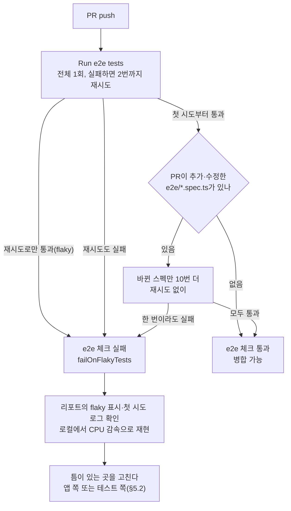

# Link-Sphere FE — e2e 첫 시도 실패(flaky) 대응 (2026-11-01)

> **문서 성격**: 독립 기능 문서(서사형)
>
> **대상 독자**: CI의 e2e가 첫 시도에 실패하고 재실행하면 통과하는 일을 겪었거나, 그 원인을 찾아 고쳐야 하는
> 이 레포 FE 개발자(AI 에이전트 포함).
>
> **읽고 나면**: e2e 흔들림이 얼마나 자주, 왜 생기는지, CI가 그것을 어떻게 잡는지, 흔들림이 나면 무엇부터 보고
> 어디를 고치는지 안다. 이번 대응(#472)이 무엇을 기대하고 언제 다시 확인하는지도 안다.
>
> **마지막 검토**: 2026-11-01

## 1. 쉬운 설명

자판기를 생각해보자. 화면에 "선택하세요"가 뜬 순간 버튼을 누르면 가끔 무시된다. 기계 안에서 버튼 회로가 화면보다
아주 조금 늦게 켜지기 때문이다. 사람은 화면을 보고 손을 뻗기까지 시간이 걸려 이 틈을 못 느끼지만, 로봇은 화면이
뜨자마자 누른다. 그래서 로봇은 열 번에 한 번쯤 실패하고, 다시 누르면 성공한다.

e2e 테스트의 Playwright가 그 로봇이다. Playwright는 요소가 "보이고 누를 수 있는" 상태가 될 때까지 기다린 뒤 조작하는데,
React 앱과 라이브러리는 화면을 그린 **뒤에**(`useEffect`) 기능을 켜는 경우가 많다. 그 틈에 걸리면 테스트가 실패하고,
재시도하면 틈을 비켜 가서 통과한다. 이렇게 같은 코드에서 통과와 실패가 오가는 테스트를 **flaky**(흔들리는 테스트)라 한다.

이 레포 CI는 실패한 테스트를 두 번까지 다시 돌리지만, **재시도로만 통과한 것도 실패로 친다**(2026-10-13부터). 그래서
"첫 시도는 실패, 재실행하면 성공"이 PR 체크에 그대로 드러난다. 2026-11-01부터는 PR이 직접 바꾼 e2e 스펙을 병합 전에
10번 더 돌려, 새로 흔들리는 테스트가 main에 들어오기 전에 드러나게 한다.

## 2. 전제 지식

Playwright의 locator·`expect` 자동 대기와 GitHub Actions의 job·step은 안다고 가정한다.

가정하지 않는 것:

- e2e를 쓰고 돌리는 법, CI 재시도 규칙 → [`TESTING.md`](./TESTING.md) "Playwright e2e 자동화 테스트"·"CI 연동"
- `useEffect`가 화면을 그린 뒤에 돈다는 것과 `useLayoutEffect`와의 차이 → [`UNSAVED-CHANGES-GUARD.md`](./UNSAVED-CHANGES-GUARD.md) §10
  (react.dev 링크 포함)
- e2e가 필수 체크라 빨개지면 병합이 막힌다는 것 → [`CI-CHECK-GATE.md`](./CI-CHECK-GATE.md) "main 규칙셋" 행

## 3. 사용한 도구·기술

**기능 자체를 이루는 것**

- **Playwright 1.64.0** — `retries`, `failOnFlakyTests`, `--repeat-each`(같은 테스트를 N번 반복)
- **GitHub Actions** `ci.yml`의 `e2e` job — "Run e2e tests" 단계와 "바뀐 e2e 스펙 반복 실행" 단계
- **git diff** — PR이 바꾼 스펙 고르기(PR 병합 커밋의 첫 부모와 비교)

**조사·검증 과정에서 쓴 도구**

- **GitHub REST API**(`gh api`) — CI run 목록과 시도별 e2e job 로그 수집
- **Python 집계 스크립트** — 로그의 Playwright 요약 줄(`N flaky`·`N failed`) 집계. 레포에는 두지 않았다(§10)
- **Chrome DevTools Protocol** `Emulation.setCPUThrottlingRate` — 로컬에서 CPU를 느리게 해 틈을 넓혀 재현

## 4. 왜 만들었나

2026-11-01 사용자가 CI e2e가 첫 시도에 하나씩 실패하고 재실행하면 통과하는 일이 잦다며 해결 방법을 물었다. e2e는 필수 체크라 첫 시도가
빨개지면 병합이 막히고, 재실행에 4~8분이 더 든다. 재실행으로 넘기는 일이 버릇이 되면 진짜 실패도 같이 묻힌다.

실제로 얼마나 잦은지 2026-09-20~11-01 CI run 523회를 집계했다(직접 측정, 방법은 §10). 아래는 e2e 단계가 끝까지 돈
run을 사람이 다시 돌리기 전의 **첫 실행**(run attempt 1)만 센 것이다(취소·건너뜀 제외). 기간은 PR 병합 시각으로 나눴다.

| 기간                                | 실행 수 | 재시도로만 통과(flaky)  | 재시도도 실패 |
| ----------------------------------- | ------- | ----------------------- | ------------- |
| ~10-13 (#354 `failOnFlakyTests` 전) | 281     | 43 — 통과로 처리돼 숨음 | 8             |
| 10-13~10-28 (#354~#450)             | 111     | 0                       | 7             |
| 10-28~11-01 (#450 뒤)               | 21      | 4                       | 0             |

- 사용자가 "잦다"고 느낀 구간은 #450 뒤였다 — 21회 중 4회(19%). 4건 중 3건이 #450이 넣은 `auth-tab-sync.spec.ts`의
  두 테스트였고, 1건은 `signup.spec.ts`였다(#454로 이미 고침).
- 흔들림은 매번 몇 개 테스트에 몰렸고, 그 테스트를 고치면 사라졌다. #354 뒤 111회는 0건이었다.
- 워커(병렬로 테스트를 돌리는 프로세스)는 413회 모두 2개였다. 워커 수를 바꿔 본 적이 없어 워커 수의 효과는 이
  데이터로는 알 수 없다.

## 5. 구조

### 5.1 CI 구성의 변화

| 구성                 | 워커 | 재시도로만 통과하면 | 새 흔들림이 드러나는 시점                       |
| -------------------- | ---- | ------------------- | ----------------------------------------------- |
| Playwright 문서 권장 | 1    | (문서에 없음)       | —                                               |
| ~10-13               | 2    | 통과                | 드러나지 않음(통과 273회 중 43회가 숨은 흔들림) |
| 10-13~11-01 (#354)   | 2    | 실패                | 병합 **뒤** 다른 PR의 CI에서                    |
| 11-01~ (#472)        | 2    | 실패                | 그 테스트를 바꾼 PR에서 병합 **전**(10번 반복)  |

[Playwright CI 문서](https://playwright.dev/docs/ci)는 _"CI 환경에서는 안정성과 재현성을 우선해 워커를 1로 두기를
권한다"_ (번역)고 쓴다. 이 레포는 워커를 정하지 않아 Playwright 기본값(CPU의 50%)을 쓰고, GitHub `ubuntu-latest`(4코어)에서
2개가 된다. 1개로 바꾸지 않은 이유는 §5.3에 있다.

### 5.2 흔들림의 공통 원인과 고치는 두 갈래

지금까지 고친 흔들림 여섯 건(§9.1)은 모두 **앱이 준비되기 전에 테스트가 다음 동작을 한 경쟁**이었고, 대부분은 화면에는
이미 준비된 것처럼 보이는 틈이었다. 고치는 곳은 그 틈이 어디에 있느냐로 정한다.

| 틈이 있는 곳                                              | 고치는 곳 | 방법                                                 | 선례                                                                |
| --------------------------------------------------------- | --------- | ---------------------------------------------------- | ------------------------------------------------------------------- |
| 우리 코드가 `useEffect`로 켜는 동작 — 사람도 밟을 수 있다 | 앱        | 화면을 그리기 전에 켠다(`useLayoutEffect`)           | #354 ([`UNSAVED-CHANGES-GUARD.md`](./UNSAVED-CHANGES-GUARD.md) §10) |
| 라이브러리 안이거나 사람에게는 드러나지 않는다            | 테스트    | 화면에 드러나는 "준비됐다" 신호를 기다린 뒤 조작한다 | #268, #343, #454, #472 (§9.1)                                       |

재시도 횟수를 늘리거나 `test.skip`으로 덮지 않는다([`TESTING.md`](./TESTING.md) "CI 연동"). 테스트 쪽 신호는 라이브러리
설치본 소스를 따라가 고른다 — 비슷해 보이는 신호가 한 렌더 이를 수 있다(§9.2).

### 5.3 택하지 않은 것

| 방안                                           | 택하지 않은 이유                                                                                                                                             |
| ---------------------------------------------- | ------------------------------------------------------------------------------------------------------------------------------------------------------------ |
| CI 워커 1개(Playwright 권장)                   | 흔들림은 특정 테스트에 몰렸고 그 테스트를 고치면 사라졌다(§4). 워커를 바꿔 본 데이터가 없어 효과를 알 수 없는데, e2e 시간은 약 2배가 된다(추정 — 병렬 2→1)   |
| `failOnFlakyTests` 끄기, 실패 job 자동 재실행  | 10-13 전처럼 흔들림이 다시 숨는다                                                                                                                            |
| Playwright `--only-changed`로 반복 대상 고르기 | 바뀐 파일을 import하는 스펙까지 고르는데, 거의 모든 스펙이 `texts.ts`를 import해 문구 하나만 바꿔도 전체를 10번 돈다([`TESTING.md`](./TESTING.md) "CI 연동") |

## 6. 운영 파라미터

| 값                                   | 위치                                                                                                  | 뜻                                                                         |
| ------------------------------------ | ----------------------------------------------------------------------------------------------------- | -------------------------------------------------------------------------- |
| `retries: 2`(CI만)                   | `playwright.config.ts:26`                                                                             | 실패한 테스트를 두 번까지 다시 돌린다 — 진단용 트레이스·영상을 남기려는 것 |
| `failOnFlakyTests`(CI만)             | `playwright.config.ts:30`                                                                             | 재시도로만 통과해도 실패                                                   |
| `trace`·`video: 'on-first-retry'`    | `playwright.config.ts:34-35`                                                                          | 첫 재시도의 트레이스·영상을 남긴다                                         |
| `fullyParallel: true`, 워커 미지정   | `playwright.config.ts:22`, 기본값은 설치본 `node_modules/playwright/lib/common/index.js:534`(`"50%"`) | CI에서 워커 2개                                                            |
| 반복 횟수 10, 재시도 0               | `.github/workflows/ci.yml:206`                                                                        | 바뀐 스펙을 재시도 없이 10번                                               |
| 반복 대상                            | `.github/workflows/ci.yml:197`                                                                        | `e2e/*.spec.ts` 중 추가(A)·수정(M)·이름 변경(R)된 것                       |
| PR 이벤트에서만                      | `.github/workflows/ci.yml:195`                                                                        | `workflow_dispatch`에서는 건너뛴다                                         |
| 비교 기준 `HEAD^1`, `fetch-depth: 2` | `.github/workflows/ci.yml:146`                                                                        | PR 병합 커밋의 첫 부모(base)와 비교하려고 커밋 두 개를 받는다              |

## 7. 코드 지도와 자주 하는 수정

| 하고 싶은 것                    | 어떻게                                                                                                                                                                                                                                                                                                 |
| ------------------------------- | ------------------------------------------------------------------------------------------------------------------------------------------------------------------------------------------------------------------------------------------------------------------------------------------------------ |
| CI에서 flaky로 빨개진 원인 찾기 | ① 실패한 job의 Playwright 리포트 artifact에서 flaky 테스트와 재시도 트레이스를 본다. ② 첫 시도 로그가 필요하면 `gh api repos/BAECHAN/link-sphere_FE_NEW/actions/jobs/<job id>/logs`로 받는다(§9.3). ③ 로컬 재현은 [`TESTING.md`](./TESTING.md) "CI 연동"의 CPU 감속 방법. ④ §5.2 표로 고칠 곳을 정한다 |
| 고친 흔들림 기록하기            | 원인·재현·수정은 그 기능 문서의 시행착오 절에 쓰고, 이 문서 §9.1 표에 한 줄을 더한다                                                                                                                                                                                                                   |
| 반복 횟수 바꾸기                | `.github/workflows/ci.yml:206`의 `--repeat-each`. 실행당 12%로 흔들리는 테스트라면 원래 1회와 합쳐 10번이면 약 75%, 20번이면 약 93% 확률로 한 번 이상 실패해 드러난다(각 실행이 독립이라고 보고 1 − 0.88^(N+1)로 계산). 대신 그 스펙 실행 시간이 N배로 는다                                            |
| 반복 단계를 잠시 끄기           | `.github/workflows/ci.yml`의 "바뀐 e2e 스펙 반복 실행" 단계를 지우거나 `if`를 `false`로                                                                                                                                                                                                                |
| Radix 창을 ESC로 닫는 e2e 쓰기  | 창이 보이자마자 누르지 말고 `pointer-events: auto`를 기다린다 — `e2e/auth-tab-sync.spec.ts:339`의 `closeWithEscape`. 근거는 [`AUTH.md`](./AUTH.md) §10 "로그아웃 안내 창이 ESC를 놓쳤다". 다른 스펙에서도 필요해지면 공용 헬퍼로 옮긴다                                                                |

## 8. 검증 결과

- **측정**: §4 표(직접 측정).
- **auth-tab-sync 고침**: 쓰는 탭 CPU 20배 감속, 세 테스트 × 20회 재현에서 "ESC 뒤 창이 안 닫힘"이 수정 전 60회 중
  33회 → 수정 후 120회 중 0회(직접 측정, 표는 [`AUTH.md`](./AUTH.md) §10). 감속 없이 스펙 전체 11개 × 5회 55회 모두 통과.
- **반복 단계**: #472 자신의 CI([run 41282410136](https://github.com/BAECHAN/link-sphere_FE_NEW/actions/runs/41282410136))에서
  바뀐 스펙으로 `e2e/auth-tab-sync.spec.ts`만 골라 110회(11개 × 10) 모두 통과했다. 반복 단계 3.7분, e2e job 전체 7분 50초.

## 9. 시행착오

### 9.1 흔들림 이력

| 날짜  | PR   | 흔들린 테스트                                         | 틈                                                                     | 고친 곳 | 기록                                                                 |
| ----- | ---- | ----------------------------------------------------- | ---------------------------------------------------------------------- | ------- | -------------------------------------------------------------------- |
| 09-30 | #268 | `post-delete`·`post-visibility`                       | URL은 바뀌었는데 화면은 아직 목록(상세 청크 대기) — 목록 카드를 눌렀다 | 테스트  | [`TESTING.md`](./TESTING.md) "자주 발생하는 문제" 13                 |
| 10-13 | #343 | `signup-unsaved-changes` "가입 실패 뒤 뒤로가기"      | 가입 요청 실패가 화면에 반영되기 전에 뒤로가기를 눌렀다                | 테스트  | #343 커밋 본문(실패 토스트·버튼 재활성화 대기)                       |
| 10-13 | #343 | `dropdown-menu-scroll` "Esc로 닫으면 트리거로 포커스" | Radix 메뉴가 보여도 ESC 리스너가 아직 없음(1.64 전체 실행에서만 재현)  | 테스트  | `e2e/dropdown-menu-scroll.spec.ts:92-96` 주석                        |
| 10-13 | #354 | `signup-unsaved-changes`·`dialog-outside-click`       | 이탈 가드·바깥 클릭 막기를 `useEffect`로 켜 화면보다 늦음              | 앱      | [`UNSAVED-CHANGES-GUARD.md`](./UNSAVED-CHANGES-GUARD.md) §10         |
| 10-29 | #454 | `signup` 확인 칸                                      | react-hook-form의 두 번째 포커스 타이머가 `fill` 사이에 끼어듦         | 테스트  | [`AUTH.md`](./AUTH.md) §10 "제출 뒤 위 칸 fill이 확인 칸에 들어갔다" |
| 11-01 | #472 | `auth-tab-sync` 두 건                                 | Radix 창이 보여도 아직 ESC를 받지 않음                                 | 테스트  | [`AUTH.md`](./AUTH.md) §10 "로그아웃 안내 창이 ESC를 놓쳤다"         |

### 9.2 처음 고른 "준비됐다" 신호가 한 렌더 일렀다 (2026-11-01)

auth-tab-sync를 고칠 때 처음에는 "창 안으로 포커스가 들어왔는지"를 기다렸다. `dropdown-menu-scroll`(#343)과 같은
신호다. 그런데 20배 감속 재현에서 60회 중 1회가 여전히 ESC를 놓쳤고, Radix 설치본 소스를 더 따라가 보니 포커스는
ESC 처리에 필요한 순서가 맞춰지기 한 렌더 전에 옮겨진다. 그 렌더에서 붙는 `pointer-events: auto`로 바꾸자 120회 중 0회가
됐다(상세는 [`AUTH.md`](./AUTH.md) §10). `dropdown-menu-scroll`의 포커스 대기에도 같은 틈이 남아 있지만, 집계 기간에 그
단계에서 실패한 적은 없어 그대로 뒀다.

### 9.3 재시도된 run의 첫 시도 로그를 잘못 읽을 뻔했다 (2026-11-01)

첫 시도에 실패하고 재실행으로 통과한 run에서, 첫 시도 job id로 `gh run view --job <id> --log-failed`를 돌렸더니 전부
통과한 로그가 나왔다. 같은 job id를 `gh api repos/BAECHAN/link-sphere_FE_NEW/actions/jobs/<id>/logs`로 받으면 flaky가
찍힌 첫 시도 로그가 나왔다. `gh`가 왜 다른 시도의 로그를 주는지는 소스로 확인하지 않았다 — 첫 시도 로그는 API로 받는다.

## 10. 남은 것

**기대하는 것**

- `auth-tab-sync`의 ESC 흔들림이 사라진다.
- 새로 추가·수정한 e2e 테스트의 흔들림은 대부분 병합 전에 드러난다. 그래서 main에 들어온 뒤 다른 PR의 CI에서 갑자기
  흔들리는 일(#450 뒤 21회 중 4회)이 #354~#450 구간(111회 중 0회)에 가깝게 줄어든다.

**다시 확인할 것** — 2026-11-15 무렵(#472 병합 뒤 2주), §4와 같은 방법으로 다시 센다. 열린 이슈 #473에서 추적한다.

- 첫 시도 flaky 실패 수와 비율(기준: #450 뒤 21회 중 4회)
- 반복 단계가 실패한 PR 수 — 병합 전에 잡아낸 흔들림
- 반복 단계가 e2e job에 더한 시간

측정 방법: `gh run list --workflow ci.yml`로 run 목록을 받고, 각 run의 시도별 e2e job 로그를 `gh api .../actions/jobs/<id>/logs`로
받아 "Run pnpm test:e2e" 단계의 요약 줄(`N flaky`·`N failed`·`N passed`)을 센다. 2026-11-01 집계 스크립트는 세션 임시
폴더에만 있었다 — 다시 잴 때 레포에 둘지 정한다.

**이 방식이 못 잡는 것**

- 앱 코드만 바뀌어 기존 테스트가 흔들리게 된 경우 — 반복 대상은 바뀐 스펙뿐이다. 병합 뒤 `failOnFlakyTests`가 드러낸다.
- `e2e/mocks/`·`e2e/fixtures/` 같은 공용 헬퍼만 바뀐 경우도 같다.
- e2e job에는 시간 제한이 없어, 많은 스펙을 한꺼번에 바꾸는 PR이면 반복 단계가 꽤 길어질 수 있다.
- 창이 보이자마자 ESC를 누르는 다른 e2e 4곳은 고치지 않았다(목록은 [`AUTH.md`](./AUTH.md) §10 "같은 위험이 남은 곳").

## 11. 용어 사전

- **flaky(흔들리는 테스트)** — 코드는 그대로인데 실행할 때마다 통과와 실패가 오가는 테스트.
- **첫 시도 / 재시도** — CI가 테스트를 처음 돌린 것 / 실패한 테스트를 `retries` 설정만큼 다시 돌린 것. job 전체를 다시
  돌리는 GitHub의 "Re-run"(run attempt)과는 다르다.
- **`failOnFlakyTests`** — 재시도로만 통과한 테스트가 있으면 실행 전체를 실패로 끝내는 Playwright 설정.
- **반복 실행(`--repeat-each`)** — 같은 테스트를 N번 돌리는 Playwright 옵션. 이 문서의 "반복 단계"는 이것을 PR이 바꾼 스펙에만
  재시도 없이 거는 CI 단계다.
- **필수 체크** — 통과해야 main에 병합할 수 있는 CI 결과(`check`·`e2e`).
- **CPU 감속(CPU throttling)** — 브라우저가 쓰는 CPU를 일부러 느리게 해 타이밍 틈을 넓히는 재현 방법.
- **준비 신호** — 화면에 드러나는 값 중 "이제 이 동작을 받을 수 있다"를 뜻하는 것(예: Radix 창의 `pointer-events: auto`).
- **Radix** — 이 레포의 창(Dialog)·메뉴(DropdownMenu)가 쓰는 UI 라이브러리(`@radix-ui/*`). ESC로 닫기·창 안에 포커스
  가두기를 라이브러리가 처리하고, 그 기능을 화면을 그린 뒤 `useEffect`에서 켠다.
- **트레이스** — Playwright가 테스트 한 번의 동작·DOM 스냅샷·네트워크를 기록한 파일. 이 레포는 첫 재시도에서만 남긴다(§6).

## 12. 관련 문서

- [`TESTING.md`](./TESTING.md) "CI 연동" — 재시도·반복 단계 규칙, 로컬 재현 방법
- [`AUTH.md`](./AUTH.md) §10 — 이번 auth-tab-sync 흔들림과 #454 signup 흔들림의 원인·재현
- [`UNSAVED-CHANGES-GUARD.md`](./UNSAVED-CHANGES-GUARD.md) §10 — 앱 쪽에서 고친 흔들림과 `failOnFlakyTests` 도입
- [`CI-CHECK-GATE.md`](./CI-CHECK-GATE.md) — CI 게이트 전체, e2e job과 main 규칙셋
