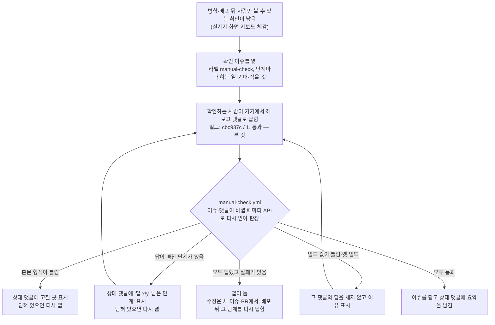

# Link-Sphere FE — 확인 이슈: 사람이 직접 해야 하는 확인을 적힌 답으로 닫기 (2026-11-24)

> **문서 성격**: 독립 기능 문서(서사형)
>
> **대상 독자**: 배포 뒤 실기기에서 직접 눌러 봐야 하는 확인을 맡은 사람, 그 확인을 이슈로 여는 AI 에이전트, 그리고
> 닫은 확인 이슈가 다시 열려 이유를 찾는 사람.
>
> **읽고 나면**: 어떤 확인을 확인 이슈로 여는지, 본문과 답을 어떤 형식으로 쓰는지, 검사가 무엇을 보고 무엇을 못 보는지,
> 왜 이런 장치를 두었는지(업계 사례 포함) 안다. 규칙을 바꾸려면 어디를 고치는지도 안다.
>
> **마지막 검토**: 2026-11-24

## 1. 쉬운 설명

비행기 조종실의 이륙 전 점검을 생각해보자. 부조종사가 "플랩?" 하고 부르면 기장은 "확인"이라고 답하지 않고 계기를 보고
"15도"라고 답한다. "확인"은 계기를 보지 않고도 할 수 있는 말이지만 "15도"는 봐야만 할 수 있는 말이기 때문이다.

이 레포에도 사람이 직접 해 봐야만 아는 확인이 있다. 폰의 하단 뒤로 버튼, 화면 키보드가 올라올 때의 배치처럼 자동
테스트가 누르지 못하는 것들이다. 지금까지는 대화에서 "확인했어", "잘되네"라고 하면 그 확인이 끝난 것으로 기록됐다.
그 말은 눌러 보지 않고도 할 수 있다.

그래서 이런 확인은 **확인 이슈**라는 정해진 형식의 GitHub 이슈로 연다. 단계마다 "무엇을 적을지"가 정해져 있고, 확인한
사람이 단계마다 판정과 본 것을 댓글로 적어야 한다. 검사 워크플로는 빈 단계가 있으면 이슈가 닫혀도 다시 열고, 모든
단계가 통과로 답해졌을 때만 이슈를 닫는다. 적은 내용이 사실인지는 기계가 알 수 없다. 기계는 빈칸이 없는지와, 적은 빌드
값이 확인할 변경을 포함하는지만 본다.



## 2. 전제 지식

GitHub 이슈·라벨과 Actions 워크플로는 안다고 가정한다.

가정하지 않는 것:

- 병합 뒤에 확인할 약속을 이슈로 여는 규칙 → [`PR-BODY-CHECK.md`](./PR-BODY-CHECK.md) §5.2
- 빌드 값이 무엇이고 버전 화면이 어떻게 보여 주는지 → [`BUILD-VERSION.md`](./BUILD-VERSION.md)
- 자동 테스트(e2e)가 무엇을 볼 수 있는지 → [`TESTING.md`](./TESTING.md) "Playwright e2e 자동화 테스트"

## 3. 사용한 도구·기술

**기능 자체를 이루는 것**

- **GitHub 이슈와 라벨** — 라벨 `manual-check`가 붙은 이슈가 확인 이슈다
- **GitHub Actions** `issues`·`issue_comment` 이벤트 — 이슈나 댓글이 바뀔 때마다 판정을 다시 한다
- **Node.js 스크립트** — 외부 패키지 없이 본문과 댓글을 줄 단위로 읽어 판정한다
- **git** `merge-base --is-ancestor` — 답에 적힌 빌드가 확인할 변경을 포함하는지 본다
- **버전 화면** `/version` — 확인하는 사람이 지금 탭이 실행 중인 빌드 값을 읽는 곳

**구현·검증 과정에서 쓴 도구**

- **Vitest** — 판정 규칙 단위 테스트(`src/test/scripts/manual-check.test.ts`)
- **`gh api`** — 과거 확인 이슈의 본문과 댓글을 받아 새 규칙을 돌려 봄(§9)

## 4. 왜 만들었나

2026-11-24 사용자가 로그인 상태의 운영 확인을 직접 눌러 본 뒤 물었다. 대화에서 "확인했어"라고만 하면 안 눌러 봐도
통과되는데, 귀찮더라도 확인하는 사람이 실제로 확인해야만 넘어가는 장치가 있어야 하지 않느냐는 것이다.

과거 확인 이슈를 보니 그 걱정대로였다(2026-11-24 `gh issue view`로 직접 확인).

| 이슈 | 일어난 일                                                                                                                                                 |
| ---- | --------------------------------------------------------------------------------------------------------------------------------------------------------- |
| #593 | 확인 항목이 4개인데 "잘되네" 한마디로 닫혔다. 닫는 댓글이 스스로 적었다: "항목별 결과를 따로 받지는 않았다. 1~4번을 통틀어 기대대로 동작한 것으로 적는다" |
| #516 | 체크박스 7개가 하나도 표시되지 않은 채 한 줄 댓글로 닫혔다                                                                                                |

- 두 건 모두 사용자의 말을 듣고 AI 에이전트가 댓글을 쓰고 닫은 것으로 보인다(댓글 문체로 본 추정이고 기록으로 확인하지는
  않았다).
- 실기기 확인 이슈 3건(#514·#519·#522)이 11월 초부터 열려 있었다.
- 확인 이슈를 구분하는 라벨이 없었고 본문 형식이 건마다 달랐다(#519는 체크박스 목록, #593은 번호 표).

## 5. 구조

### 5.1 업계는 어떻게 하나

결론은 "확인했다는 말은 증거가 아니다"로 모인다. 아래 인용은 2026-11-24에 원문 페이지에서 문장을 다시 찾아 대조했고,
대조하지 못한 것은 "재인용"이라 적었다.

| 장치           | 내용                                                                     | 출처                                                                                                                                                                                               |
| -------------- | ------------------------------------------------------------------------ | -------------------------------------------------------------------------------------------------------------------------------------------------------------------------------------------------- |
| 본 값으로 응답 | _"가능하면 응답은 언제나 그 항목의 실제 상태나 값을 말해야 한다"_ (번역) | [NASA CR 177549 §6.2.3](https://ntrs.nasa.gov/citations/19910017830)                                                                                                                               |
| 비면 통과 불가 | 검증 단계가 하나라도 표시되지 않은 채 남으면 테스트 케이스 전체가 실패다 | [Azure Test Plans "Run manual tests"](https://learn.microsoft.com/en-us/azure/devops/test/run-manual-tests?view=azure-devops), [Xray](https://docs.getxray.app/display/XRAY/Execute+Tests)(재인용) |
| 사람 대신 기계 | 스크립트가 운영에서 핵심 흐름을 주기적으로 눌러 본다                     | [AWS CloudWatch Synthetics](https://docs.aws.amazon.com/AmazonCloudWatch/latest/monitoring/CloudWatch_Synthetics_Canaries.html) — 이 문서의 범위 밖이다(§11)                                       |

- 기록이 쉬울수록 건성 통과가 늘었다: _"기록된 체크리스트 준수율은 크게 믿기 어렵고 실제보다 높을 수 있으며, 전자
  서식으로 기록이 쉬워질 때 특히 그렇다"_ (번역, [Saturno 외, World J Surg 2014](https://doi.org/10.1007/s00268-013-2300-6), 초록).
- 항공도 같은 문제를 봤다: _"조종사는 체크리스트를 '돌리지만' 응답은 기억에서 나왔고 항목의 실제 상태에 근거하지
  않았다"_ (번역, [NASA CR 177549 §6.1.1](https://ntrs.nasa.gov/citations/19910017830)).

### 5.2 고른 것과 택하지 않은 것

"사용자 결정"은 2026-11-24 계획 질문에서 사용자가 고른 것이고, 표시가 없는 행은 계획에 적어 승인받은 구현 판단이다.
전체 표는 [`plans/2026-11-24-manual-check-issue.md`](./plans/2026-11-24-manual-check-issue.md) "판단이 필요했던 항목"에 있다.

| 안                                        | 결정                                                          | 이유                                                                                                           |
| ----------------------------------------- | ------------------------------------------------------------- | -------------------------------------------------------------------------------------------------------------- |
| 답을 이슈 댓글에 적는다                   | **채택**(사용자 결정)                                         | 폰에서 쓰기 쉽고 누가 언제 적었는지 댓글마다 남는다                                                            |
| 답을 이슈 본문의 칸에 적는다              | 택하지 않음                                                   | 폰에서 본문 편집이 번거롭고 누가 채웠는지 흐려진다                                                             |
| 답이 있는지와 빌드 값까지 대조한다        | **채택**(사용자 결정)                                         | 배포본을 실제로 열었는지를 기계가 확인할 수 있는 유일한 부분이고, 옛 빌드가 남은 탭으로 확인하는 실수도 잡는다 |
| 체크박스 목록                             | 택하지 않음                                                   | #516은 체크 0개로 닫혔고, 수술 체크리스트 연구도 기록이 쉬울수록 건성 통과가 늘었다고 한다(§5.1)               |
| 답 없이 닫으면 사유와 상관없이 다시 연다  | **채택**(사용자 결정 — "확인 안 함"으로 닫기를 허용하지 않음) | 확인할 수 없게 된 이슈는 저장소 주인이 라벨을 떼어 검사 대상에서 뺀다. 라벨이 떼어지면 그 사실이 댓글로 남는다 |
| 이슈를 닫지 못하게 막는다                 | 할 수 없음                                                    | 이슈 닫기를 막는 설정을 GitHub 문서에서 찾지 못했다. 그래서 닫힌 뒤에 다시 연다                                |
| AI 에이전트는 확인 이슈에 답하지 않는다   | **채택**(사용자 결정 — 규칙 문장과 가드 훅 둘 다)             | 워크플로는 사람과 에이전트를 구분하지 못한다(§5.6)                                                             |
| 운영에서 기계가 주기적으로 눌러 보는 검사 | 이 문서의 범위 밖                                             | 테스트 계정 비밀번호를 시크릿에 두는 일과 운영 데이터를 바꾸지 않는 범위를 따로 정해야 한다(§11)               |

### 5.3 이슈 본문 형식

네 절이 모두 있어야 하고 비어 있으면 형식 오류다. 이슈를 열기 전에 `pnpm check:manual-issue <본문 파일>`로 확인한다.

```
## 무엇을 확인하나

북마크 시트 뒤로가기 변경(#123)이 배포된 뒤 Android 폰 Chrome에서 본다.

## 왜 사람이 봐야 하나

자동 검사는 실제 Android 뒤로 버튼을 누르지 못한다.

## 확인 항목

확인할 빌드: 890e4c5 이후

1. 피드에서 북마크 버튼을 눌러 시트를 띄우고 하단 뒤로 버튼을 누른다
   - 기대: 시트만 닫히고 피드는 그대로다
   - 적을 것: 뒤로 버튼을 누른 뒤 보이는 화면

## 결과에 따라

기대와 다르면 docs/BACK-NAVIGATION.md §8 "자주 하는 수정"부터 본다.
```

- **확인할 빌드** — 확인하려는 변경이 병합된 커밋(7자리 이상)이다. FE 빌드와 무관한 확인(BE만 바뀐 경우)이면
  `확인할 빌드: 없음`이라 적는다. 값은 main에 있는 커밋이어야 한다.
- **단계** — `1.`부터 차례로 번호를 붙이고, 단계마다 들여쓴 `- 기대:`와 `- 적을 것:`을 둔다.
- **적을 것** — 해 봐야만 알 수 있는 것으로 정한다(주소창 값, 뜬 문구, 개수, 보이는 화면). "잘 되는지"처럼 보지 않고도
  답할 수 있는 것을 적지 않는다. §5.1의 "실제 상태나 값으로 응답"을 옮긴 것이다.
- **왜 사람이 봐야 하나** — 자동 테스트로 볼 수 있는 것이면 확인 이슈가 아니라 테스트를 쓴다.

### 5.4 답 댓글 형식

```
빌드: cbc937c
1. 통과 — 시트만 닫혔고 피드 스크롤 위치도 그대로
2. 실패 — 토스트가 뜨지 않았음
```

- **빌드** — 버전 화면 `/version`의 "이 탭이 실행 중인 빌드" 7자리다(`src/pages/version/VersionPage.tsx:102`). 본문이
  `확인할 빌드: 없음`이면 없어도 된다.
- **판정** — `통과`나 `실패`다. 판정과 본 것 사이의 기호는 긴 줄표·하이픈·콜론을 모두 받고, 없어도 된다(폰 자판에서 긴
  줄표를 치기 어렵다).
- **본 것** — 공백을 빼고 5자 이상이다.
- 한 댓글에 모든 단계를 적어도 되고 여러 댓글에 나눠 적어도 된다. 같은 단계에 답이 여럿이면 가장 늦은 답을 센다.
  실패한 단계는 수정이 배포된 뒤 새 댓글로 다시 답하면 된다.

### 5.5 판정 규칙

| 상황                                                                                                           | 검사가 하는 일                                                            |
| -------------------------------------------------------------------------------------------------------------- | ------------------------------------------------------------------------- |
| 본문 형식 오류(필수 절, 1부터 이어지는 번호, `기대`·`적을 것`, `확인할 빌드` 줄, 확인할 빌드가 main에 없는 값) | 상태 댓글에 고칠 곳을 적는다. 닫혀 있으면 다시 연다                       |
| 답이 빠진 단계가 있다                                                                                          | 상태 댓글에 "답 x/y, 남은 단계"를 적는다. 닫혀 있으면 다시 연다           |
| 답 댓글에 빌드 줄이 없거나, main에 없는 값이거나, 확인할 빌드를 포함하지 않는다                                | 그 댓글의 답을 세지 않고 이유를 적는다                                    |
| 판정이 `통과`·`실패`가 아니거나 본 것이 5자 미만이거나 본문에 없는 단계 번호다                                 | 그 줄의 답을 세지 않고 이유를 적는다                                      |
| 모두 답했고 실패가 있다                                                                                        | 열어 두고 실패 단계를 적는다. 닫혀 있으면 다시 연다                       |
| 모두 통과다                                                                                                    | 댓글 이벤트면 이슈를 닫고 요약(단계·판정·본 것·빌드)을 상태 댓글에 남긴다 |
| 라벨이 떼어졌다                                                                                                | "검사 대상에서 빠졌습니다(답 x/y)" 댓글을 한 번 남긴다                    |

- **답으로 세는 댓글**: 저장소 주인(`OWNER`)이 쓴 댓글만 센다. 공개 저장소라 누구나 댓글을 달 수 있다.
- **답으로 보지 않는 댓글**: 빌드 줄도 판정 줄도 없는 댓글(메모·질문)은 조용히 건너뛴다. 세지 않은 답 목록에도 넣지 않는다.
  "잘되네" 한마디나, 번호는 붙였지만 `통과`·`실패`를 쓰지 않은 답이 여기에 든다 — 상태 댓글의 답 개수는 그대로이고 꼬리말이
  답하는 법을 알려 준다.
- **세지 않는 답은 앞선 답을 덮지 않는다**: 통과로 센 단계에 나중에 형식이 틀린 답을 달아도 앞선 답이 남는다.
- **자동 닫기는 댓글 이벤트에서만 한다**: 다시 확인하려고 연 이슈를 검사가 곧바로 닫지 않게 한다. 모두 통과인 이슈를
  사람이 직접 닫는 것은 막지 않는다. 다시 연 뒤에는 메모를 포함해 어떤 댓글이 달려도, 모든 단계가 통과인 한 검사가 다시
  닫는다 — 다시 확인하려면 그 단계를 새 댓글로 답한다(실패로 답하면 열린 채 남는다).
- **상태 댓글은 이슈마다 하나다**: 맨 앞 표식(`<!-- manual-check-status -->`)으로 찾아 갱신한다([`ci.yml`](../.github/workflows/ci.yml)
  "PR 영향 그래프"와 같은 방식).
- **안 보는 것**: 적은 내용이 사실인지, 본 것이 기대와 맞는지, 실패를 통과로 바꾼 답이 수정이 들어간 빌드에서 나왔는지.

### 5.6 AI 에이전트는 답하지 않는다

이 저장소에서는 사용자와 AI 에이전트(Claude Code)가 같은 GitHub 계정으로 `gh` 명령을 쓴다. API가 알려 주는 작성자
관계가 둘 다 `OWNER`라 워크플로는 둘을 구분하지 못한다. 그래서 에이전트 쪽을 따로 막는다.

- **규칙 문장**: [`.claude/CLAUDE.md`](../.claude/CLAUDE.md) Critical Rules — 확인 이슈에 답을 쓰거나 닫거나 고치지 않는다.
  대화에서 들은 "확인했어"는 증거로 치지 않고 이슈에 적어 달라고 안내한다.
- **가드 훅**: 이 기계의 공통 가드(claude-base 저장소의 `hooks/bash-guard.mjs`)가 확인 이슈에 대한 댓글·닫기·수정 명령을
  확인 창 없이 거부하게 한다(사용자 결정). 이 문서를 처음 쓰는 시점에는 아직 넣지 않았다 — 병합 뒤 동작 시험을 마친 다음
  단계다(§9).
- **한 번뿐인 예외**: 병합 뒤 동작 시험은 제목이 "[시험]"으로 시작하는 이슈 한 건에서 에이전트가 답 댓글 쓰기·닫기·본문
  고치기·라벨 떼기를 직접 해서 여섯 경로를 확인한다(2026-11-24 사용자 결정, 가드를 넣기 전). 이 한 건 밖에서는 위 규칙
  그대로다.

## 6. 상태 모델

검사는 저장하는 상태가 없다. 실행마다 그 시점의 이슈 본문과 댓글 전체를 API로 다시 받아 아래 넷 중 하나로 판정한다
(`scripts/lib/manual-check.js:263`의 `evaluateIssue`).

| 판정         | 뜻                          | 열린 이슈에서         | 닫힌 이슈에서 |
| ------------ | --------------------------- | --------------------- | ------------- |
| `malformed`  | 본문 형식이 틀렸다          | 상태 댓글에 고칠 곳   | 다시 연다     |
| `incomplete` | 답이 빠진 단계가 있다       | 상태 댓글에 남은 단계 | 다시 연다     |
| `failed`     | 모두 답했고 실패가 있다     | 열어 둔다             | 다시 연다     |
| `passed`     | 모든 단계가 통과로 답해졌다 | 댓글 이벤트면 닫는다  | 그대로 둔다   |

판정에서 할 일을 정하는 곳은 같은 파일의 `decideActions`(`:376`)다. 실행을 기다리는 사이 라벨이 떼어진 이슈는
`skipped`로 끝내고 아무것도 하지 않는다(`scripts/check-manual-issue.js:155`).

## 7. 운영 파라미터

| 값                    | 위치                                    | 뜻                                                                                                                                                                                                                                                                                                                                                                                                                              |
| --------------------- | --------------------------------------- | ------------------------------------------------------------------------------------------------------------------------------------------------------------------------------------------------------------------------------------------------------------------------------------------------------------------------------------------------------------------------------------------------------------------------------- |
| 라벨 이름             | `scripts/lib/manual-check.js:6`         | `manual-check`. 워크플로의 job 조건(`.github/workflows/manual-check.yml:31`)에도 직접 적혀 있어 둘이 같은지 테스트가 본다                                                                                                                                                                                                                                                                                                       |
| 상태 댓글 표식        | `scripts/lib/manual-check.js:8`         | `<!-- manual-check-status -->`. 워크플로(`.github/workflows/manual-check.yml:96`)에도 적혀 있고 같은 테스트가 본다                                                                                                                                                                                                                                                                                                              |
| 본 것의 최소 길이     | `scripts/lib/manual-check.js:10`        | 5자(공백 제외). 얕은 검사의 선례를 따랐다 — Danger·GitLab의 "본문 5자 미만이면 실패"([`PR-BODY-CHECK.md`](./PR-BODY-CHECK.md) §5.1)                                                                                                                                                                                                                                                                                             |
| 필수 절 목록          | `scripts/lib/manual-check.js:12`        | `REQUIRED_SECTIONS` — 이름과 오류 문구에 붙는 안내                                                                                                                                                                                                                                                                                                                                                                              |
| 답으로 세는 작성자    | `scripts/lib/manual-check.js:214`       | 작성자 관계가 `OWNER`이고 봇이 아닌 댓글                                                                                                                                                                                                                                                                                                                                                                                        |
| 빌드를 대조하는 기준  | `scripts/check-manual-issue.js:25`      | `origin/main`. 배포되는 빌드는 main의 커밋이다                                                                                                                                                                                                                                                                                                                                                                                  |
| 실행 이벤트           | `.github/workflows/manual-check.yml:9`  | 이슈 `opened`·`edited`·`closed`·`reopened`·`labeled`·`unlabeled`, 댓글 `created`·`edited`·`deleted`                                                                                                                                                                                                                                                                                                                             |
| 같은 이슈의 실행 순서 | `.github/workflows/manual-check.yml:19` | 이슈마다 하나씩 차례로. `queue: max`로 기다리는 실행을 취소하지 않는다 — 기본값은 _"같은 묶음에서 기다리던 실행이 있으면 취소되고 새로 들어온 실행이 그 자리를 차지한다"_ (번역)라 닫는 실행이 취소될 수 있고, _"취소하지 않고 여러 실행을 줄 세우려면 `queue: max`를 설정한다"_ (번역, 둘 다 [GitHub Docs](https://docs.github.com/en/actions/how-tos/write-workflows/choose-when-workflows-run/control-workflow-concurrency)) |
| 전체 기록 받기        | `.github/workflows/manual-check.yml:51` | `fetch-depth: 0`. 빌드 포함 여부를 git 기록으로 본다                                                                                                                                                                                                                                                                                                                                                                            |
| 시간 제한             | `.github/workflows/manual-check.yml:36` | job마다 5분                                                                                                                                                                                                                                                                                                                                                                                                                     |
| 필수 체크 여부        | 해당 없음                               | PR 체크가 아니다. 이슈에 댓글을 달고 열고 닫을 뿐 병합을 막지 않는다                                                                                                                                                                                                                                                                                                                                                            |

## 8. 코드 지도와 자주 하는 수정

| 단계                           | 파일                                                                                  |
| ------------------------------ | ------------------------------------------------------------------------------------- |
| 본문에서 단계·확인할 빌드 뽑기 | `scripts/lib/manual-check.js:185` `parseIssueBody`                                    |
| 댓글에서 답 뽑아 종합 판정     | `scripts/lib/manual-check.js:263` `evaluateIssue`                                     |
| 다시 열지·닫을지 정하기        | `scripts/lib/manual-check.js:376` `decideActions`                                     |
| 상태 댓글 만들기               | `scripts/lib/manual-check.js:460` `renderStatusComment`                               |
| 빌드 포함 여부(git)            | `scripts/check-manual-issue.js:71` `checkBuild`                                       |
| 이슈·댓글 받기와 반영          | `.github/workflows/manual-check.yml` — 판정 job(읽기 권한)과 반영 job(이슈 쓰기 권한) |

| 하고 싶은 것                     | 어떻게                                                                                                                                                                                                               |
| -------------------------------- | -------------------------------------------------------------------------------------------------------------------------------------------------------------------------------------------------------------------- |
| 확인 이슈 열기                   | 본문을 파일로 쓰고 `pnpm check:manual-issue <본문 파일>` → `gh issue create --label manual-check --title "…" --body-file <본문 파일>`. 상태 댓글 "답 0/N"이 달리는지 본다                                            |
| 닫은 이슈가 다시 열렸다          | 상태 댓글에 이유가 있다(빠진 단계, 세지 않은 답과 그 이유). 답을 채우면 검사가 닫는다                                                                                                                                |
| "옛 빌드"라고 거절됐다           | 탭을 새로고침해 버전 화면의 빌드가 바뀌었는지 보고 다시 확인한다                                                                                                                                                     |
| 더는 확인할 수 없게 됐다         | 저장소 주인이 라벨 `manual-check`를 뗀다. 검사 대상에서 빠졌다는 댓글이 남는다                                                                                                                                       |
| 실패한 단계를 고쳤다             | 수정이 배포된 뒤 그 단계만 새 댓글로 다시 답한다(늦은 답이 센다). 실패 분석과 수정은 새 이슈·PR에서 하고 `Refs #번호`로 건다                                                                                         |
| 로컬에서 판정을 돌려 보기        | `gh api repos/<소유자>/<저장소>/issues/<번호>`와 같은 주소의 `/comments`를 워크플로와 같은 `--jq`로 파일에 받아 `node scripts/check-manual-issue.js --evaluate <이슈 JSON> <댓글 NDJSON>`. 결과가 표준 출력에 나온다 |
| 필수 절·답 형식·최소 길이 바꾸기 | `scripts/lib/manual-check.js`, 이 문서 §5.3~§5.5, 상태 댓글 꼬리말(`scripts/lib/manual-check.js:436`)을 함께 고친다. 테스트는 `src/test/scripts/manual-check.test.ts`                                                |
| 라벨 이름·표식 바꾸기            | `scripts/lib/manual-check.js`와 `.github/workflows/manual-check.yml`을 함께 고친다(다르면 테스트가 실패한다). claude-base 가드의 라벨 상수도 같이 바꾼다                                                             |
| 끄기(되돌리기)                   | `.github/workflows/manual-check.yml`을 지우면 검사가 멈춘다. 이슈와 댓글은 그대로 남는다                                                                                                                             |

## 9. 검증 결과

병합 전에 확인한 것(2026-11-24). 워크플로 자체는 병합 전에 돌려 볼 수 없다 — `issues`·`issue_comment` 이벤트는
_"워크플로 파일이 기본 브랜치에 있을 때만 워크플로 실행을 만든다"_ (번역,
[GitHub Docs](https://docs.github.com/en/actions/reference/workflows-and-actions/events-that-trigger-workflows)).

- **테스트 먼저**: 판정 테스트를 먼저 쓰고 구현 전에 돌려 실패를 확인했다(`Failed to resolve import "../../../scripts/lib/manual-check.js"`).
  계획 대조 뒤에 더한 두 규칙(확인할 빌드가 틀린 본문, 꼬리말의 문서 주소)도 테스트를 먼저 써 `2 failed | 35 passed`를 본 뒤
  구현했다.
- **단위 테스트** 37개 통과 — 본문 형식(절·확인할 빌드·번호·`기대`·`적을 것`), 답 세기(주인이 아닌 댓글, 빌드 줄 없음,
  빌드 대조 거절, 판정 글자, 최소 길이, 없는 단계, 늦은 답 우선, 세지 않는 답이 앞선 답을 덮지 않음, 확인할 빌드가 틀린
  본문), 할 일 결정(다시 열기, 통과가 아니면 닫지 않기, 댓글 이벤트에서만 닫기, 라벨 떼기), 상태 댓글, 워크플로에 적힌
  라벨·표식이 코드 상수와 같은지.
- **테스트가 실제로 잡는지**: 판정 줄 여섯 곳을 일부러 깨자 테스트 7개가 실패했다 — 주인 댓글만 세기·다시 열기·댓글
  이벤트에서만 닫기·빌드 대조에서 5개, 통과가 아니면 닫지 않기·실패 문구에서 2개. 워크플로의 라벨·표식을 바꾸자 2개가
  실패했다. 되돌린 뒤 모두 통과했다.
- **과거 이슈에 돌려 보기**(직접 실행): #593과 #519의 본문·댓글을 `gh api`로 받아 라벨이 붙었다고 가정하고 판정했다.
  둘 다 형식 오류로 나왔다 — #593은 `"## 확인 항목" 절이 없습니다` 하나(닫혀 있어 "다시 연다"로 판정), #519는 절 두 개와
  `확인할 빌드` 줄, 번호 붙은 단계가 없다는 네 가지. 라벨이 없는 실제 상태로는 둘 다 `skipped`였다.
- **빌드 대조**(직접 실행, 이 레포의 실제 git 기록): 확인할 빌드를 `cbc937c`로 둔 가짜 이슈에서 그 뒤 커밋(`07c987e`)으로
  쓴 답은 세고, 그 앞 커밋(`ea684ee`)으로 쓴 답은 "확인할 빌드가 들어가기 전의 빌드", 없는 값(`0000000`)은 "저장소에서
  찾을 수 없는 값"으로 거절했다. 작성자 관계가 `NONE`인 댓글은 세지 않았다. 확인할 빌드 자체를 없는 값으로 둔 닫힌
  이슈는 답이 모두 통과여도 본문 형식 오류로 판정해 "다시 연다"가 나왔다.

병합 뒤 시험용 이슈로 하는 동작 확인(형식 오류, 답이 빠진 채 닫기, 틀린 빌드 값, 실패 답, 모두 통과, 라벨 떼기)과 가드
훅의 거부 확인은 아직 하지 않았다. 결과는 이 절에 덧붙인다.

## 10. 시행착오

아직 없다. 병합 뒤 시험에서 나오면 여기에 적는다.

## 11. 남은 것

- **값을 지어내 적는 것은 막지 못한다.** 빌드 값은 저장소에서 누구나 볼 수 있고 본 것은 꾸며 쓸 수 있다. 요청 단위 서버
  기록과 맞춰 볼 수도 없다(BE 접속 로그가 꺼져 있고 CloudFront 접근 로그는 지금 요금제에서 쓸 수 없다). 이 장치가 올리는
  것은 "안 해 보고 통과시키는 데 드는 수고"다.
- **가드가 못 보는 길**: 가드 훅은 명령 문자열만 본다. `gh api graphql`, `curl`, 변수로 가린 이슈 번호는 잡지 못해 규칙
  문장이 맡는다.
- **실패를 통과로 바꾼 답**이 수정이 들어간 빌드에서 나왔는지는 대조하지 않는다(확인할 빌드 이후이기만 하면 된다).
- **실패 답이 달린 확인 이슈를 알아채는 장치가 없다.** 관련 작업을 시작할 때 `gh issue list --label manual-check`로 본다.
- **운영 자동 스모크**(테스트 계정으로 로그인한 뒤의 흐름을 기계가 주기적으로 눌러 보는 검사)는 별도 계획이다.
- **BE·infra 저장소**에는 이 워크플로가 없다. BE 변경이라도 화면으로 보는 확인이면 이 저장소의 이슈로 연다.
- **건너뛴 실행 기록**: 라벨이 없는 이슈와 PR의 댓글에도 워크플로가 뜨고 job을 건너뛴 기록이 Actions 목록에 남는다.

## 12. 용어 사전

- **확인 이슈** — 라벨 `manual-check`가 붙은 GitHub 이슈. 사람이 직접 해 봐야 하는 확인을 §5.3 형식으로 적은 것.
- **확인할 빌드** — 확인하려는 변경이 병합된 커밋. 답에 적힌 빌드가 이 커밋을 포함해야 답으로 센다.
- **빌드 값** — 지금 탭이 실행 중인 배포본이 만들어진 커밋의 앞 7자리. 버전 화면 `/version`에 나온다.
- **답 댓글** — 확인한 사람이 `빌드:` 줄과 `번호. 판정 — 본 것` 줄로 적는 댓글(§5.4).
- **본 것** — 그 단계를 해 봤을 때 실제로 본 것. 본문의 `적을 것`이 무엇을 적을지 정한다.
- **상태 댓글** — 검사가 이슈마다 하나만 두고 갱신하는 댓글. 답 개수, 단계별 판정, 세지 않은 답과 이유가 나온다.
- **세지 않은 답** — 형식이나 빌드가 맞지 않아 판정에 넣지 않은 답. 상태 댓글에 이유와 함께 나온다.
- **가드 훅** — AI 에이전트가 실행하려는 셸 명령을 실행 전에 보고 거부하는 스크립트. claude-base 저장소(이 기계에만 있는
  공통 지침·훅 저장소)에 있다.

## 13. 관련 문서

- [`plans/2026-11-24-manual-check-issue.md`](./plans/2026-11-24-manual-check-issue.md) — 이 장치의 계획과 결정 전체
- [`PR-BODY-CHECK.md`](./PR-BODY-CHECK.md) — 병합 뒤 약속을 이슈로 여는 규칙, 얕은 검사의 업계 선례
- [`.claude/CLAUDE.md`](../.claude/CLAUDE.md) Critical Rules — AI 에이전트가 확인 이슈를 다루는 규칙
- [`BACK-NAVIGATION.md`](./BACK-NAVIGATION.md) — 실기기 확인이 필요했던 대표 작업(뒤로가기·오버레이)
