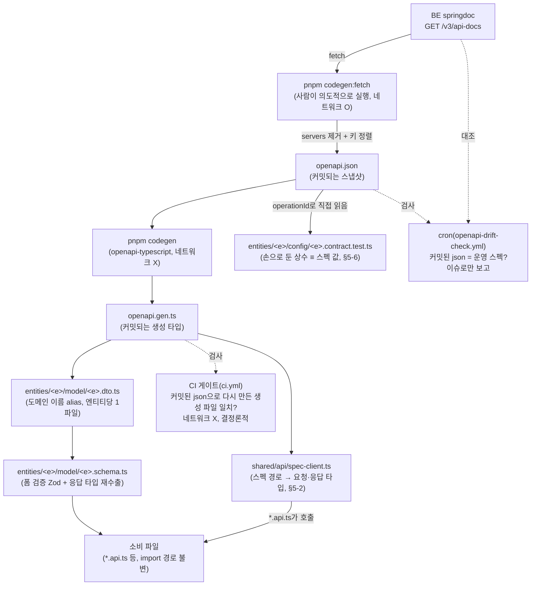
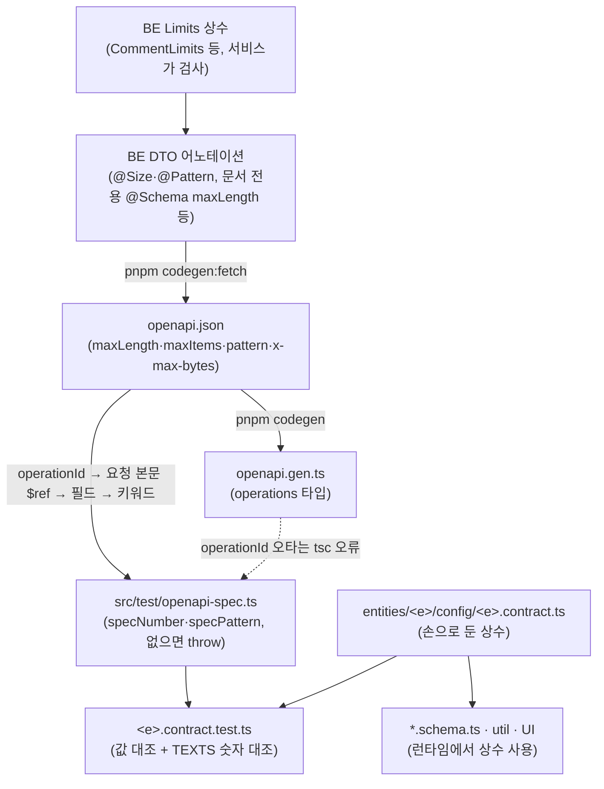

# BE OpenAPI 스펙 기반 FE 타입 생성

> 독립 기능 문서(서사형)다.
>
> 대상 독자: 이 레포 FE를 처음 보거나 오랜만에 돌아온 개발자, 새 엔티티의 응답 타입을
> 추가해야 하는 개발자.
>
> 읽고 나면: 응답 타입이 어디서 오는지, 새 엔티티를 추가할 때 무엇을 만들어야 하는지,
> BE 스펙이 바뀌면 무슨 일이 일어나는지, BE nullable 정보가 왜 가끔 유실되는지, BE 입력 제약 값(길이·개수·패턴)을
> FE가 어떻게 맞추는지(§5-6) 알게 된다.
>
> 마지막 검토: 2026-11-07

## 1. 쉬운 설명

FE는 BE가 뭘 돌려주는지 두 가지 방법으로 알 수 있다 — 사람이 코드를 보고 손으로 타입을
옮겨적거나, BE가 스스로 "내 API는 이렇게 생겼다"고 말해주는 것(OpenAPI 스펙)을 그대로
받아쓰거나. 이 레포는 원래 전자였다. `entities/*/model/*.schema.ts`에 BE 응답과 똑같이
생긴 Zod 스키마를 손으로 만들어뒀다 — 마치 다른 사람이 부르는 걸 듣고 받아적은 메모 같은
것이다. 받아적는 사람이 졸다가 한 줄 놓치거나, 부르는 사람이 내용을 바꿨는데 못 들으면
메모가 틀린다.

이 기능은 그 받아쓰기를 없앤다. BE(springdoc)가 자기 API 스펙을 JSON으로 공개하면
([`GET /v3/api-docs`](#8-코드-지도와-자주-하는-수정)), FE가 그 JSON을 그대로 저장해두고
(`src/shared/api/generated/openapi.json`), 코드 생성기(`openapi-typescript`)로 TypeScript
타입을 뽑아낸다(`openapi.gen.ts`). 엔티티별 `*.dto.ts`는 거기에 이 레포가 쓰는 이름만
붙이는 얇은 표지판이다. 사람이 더 이상 "BE가 뭘 보내는지" 기억하거나 옮겨적을 필요가
없다 — 스펙이 바뀌면 생성된 타입도 자동으로 바뀌고, FE 코드가 그 타입을 쓰고 있었다면
컴파일 에러로 바로 드러난다.

Zod는 없어지지 않았다 — 역할이 좁아졌을 뿐이다. 응답을 "받아 적는" 용도에서, 사용자가
입력한 걸 "검증하는" 용도로만 남았다(생성 폼, 검색 필터 등). 이 레포는 애초에 서버 응답에
Zod `.parse()`를 걸어본 적이 없다 — 그러니 응답 쪽 Zod는 처음부터 실질적인 검증 없이
"타입을 적어두는 문서" 역할만 하고 있었던 셈이고, 이제 그 역할을 스펙 생성 타입이 대신한다.



## 2. 전제 지식

- **가정하는 지식**: 이 레포의 FSD 레이어 구조와 3-Layer API 패턴(`docs/FE-ARCHITECTURE.md`
  §1·§5), Zod 기본 사용법, OpenAPI 3.1 스펙의 기본 개념(`paths`/`components.schemas`/`$ref`).
  §10 시행착오는 3.0 시절 이야기라 3.0의 `nullable` 키도 함께 나온다.
- **가정하지 않는 지식**: `openapi-typescript`의 내부 동작, swagger-core/springdoc의 모델
  변환 파이프라인(§10 시행착오에서 필요한 만큼 설명), BE Kotlin 코드베이스(필요한 부분만
  파일:줄로 인용).
- 왜 모노레포가 아니라 이 방식을 택했는지는 별도 설계 결정이 아니라 이 기능 자체의 설계
  전제라 `DECISIONS.md`에 없다 — 도입 배경(§4)에서 바로 다룬다.

## 3. 사용한 도구·기술

- **기능 자체**:
  - [`openapi-typescript`](https://www.npmjs.com/package/openapi-typescript) 7.13.0 —
    OpenAPI 3.1 JSON을 TypeScript 타입 선언으로 변환(런타임 코드 0, 타입만)
  - BE `springdoc-openapi-starter-webmvc-api` 2.10.0(BE `build.gradle.kts`) — Kotlin
    컨트롤러/DTO에서 OpenAPI 스펙을 생성해 `/v3/api-docs`로 공개(운영 포함). 같은 스펙을
    사람이 읽는 화면은 읽기 전용 Swagger UI(https://baechan.github.io/link-sphere_BE_NEW/api-docs/,
    BE `main` 병합마다 갱신)다. 2026-10-26
    2.7.0에서 올라가며(BE #116) 스펙이 OpenAPI 3.0에서 3.1.0이 됐고, FE는 그 스펙을
    스냅샷에 반영했다(FE #419)
  - BE `NullableAwareModelConverter`/`NullableAwareOpenApiCustomizer`(swagger-core
    `ModelConverter` + springdoc `OpenApiCustomizer`) — Kotlin nullable 타입을 스키마의
    `nullable = true`로 표시한다(§10). 3.1로 직렬화된 스펙에는 `nullable` 키가 없고,
    `type: ["string", "null"]`처럼 타입 배열로 나온다
  - [`openapi-msw`](https://www.npmjs.com/package/openapi-msw) 2.1.1 — 생성된 `paths` 타입으로
    MSW 기본 핸들러의 경로·응답을 검사한다(§5-5, 2026-10-30 추가)
  - `specClient`(`src/shared/api/spec-client.ts`) — 생성된 `paths`로 `*.api.ts`의 경로와 요청·응답
    타입을 묶는 자체 래퍼. 기존 `apiClient`를 그대로 호출한다(§5-2, 2026-10-30 추가)
  - `specNumber`·`specPattern`(`src/test/openapi-spec.ts`) — 계약 테스트가 `openapi.json`에서 입력 제약 값을
    operationId 기준으로 읽는 헬퍼(§5-6, 2026-11-07 추가)
  - BE `CommentLimits`·`BookmarkFolderLimits` — 서비스가 검사하고 DTO가 같이 참조하는 입력 제약 상수.
    DTO의 문서 전용 어노테이션(`@field:Schema(maxLength)`·`@field:ArraySchema(maxItems)`·`x-max-bytes` 확장)이
    그 값을 스펙에 싣는다. BE `PasswordPattern`은 이와 달리 DTO의 `@field:Pattern`이 실제로 검사하는 정규식이고,
    그 어노테이션이 그대로 스펙의 `pattern`이 된다(BE #152, BE `docs/BE-ARCHITECTURE.md` §7-12)
- **구현·검증 과정에서 쓴 도구**: `jq`(스펙 구조 확인·대조), `curl`(운영 스펙·실제 API
  응답 직접 확인), 로컬 `./gradlew bootRun`(BE 컨버터 실측), Python(`json` 모듈로 스펙
  전후 구조적 diff 확인)

## 4. 왜 만들었나

FE는 BE 응답 타입을 `entities/*/model/*.schema.ts`에 손으로 옮겨적어 관리해왔다.
`bookmark-folder.schema.ts`의 `// 폴더 항목 — BE FolderResponse 와 매핑` 같은 주석이 그
수작업의 증거였다. 이 방식은 두 가지 문제를 낳았다:

1. **동기화가 사람 기억에 의존한다.** BE가 필드를 추가/제거/변경해도 FE 타입은 자동으로
   안 바뀐다 — 사람이 알아채고 손으로 고쳐야 한다. `docs/VERSION-COMPATIBILITY.md`가
   11행짜리 수동 호환 매트릭스로 자란 게 그 결과다. 그중 3건은 "동시 배포 필수"/"BE 먼저
   배포 필수"로 표시돼 있고, FE v0.4.0 행에는 *"FE가 7일 먼저 머지됨 — BE 배포 전까지는
   비로그인 열람이 실제로는 동작하지 않음"*이라는 실제 불일치 기록도 남아 있었다.
2. **BE에는 이미 다리의 절반이 있었다.** `springdoc`이 운영 포함으로 떠 있고 스펙 JSON도
   공개 중이었는데 FE가 소비하지 않고 있었다.

목표는 응답 타입의 정본을 "사람 기억"에서 "BE 스펙"으로 옮기는 것이다. 4번 항목이 이
기능의 성공 기준이었다: **BE가 필드를 바꾸면 FE 코드가 컴파일 에러로 즉시 드러나야
한다** — 이전에는 런타임까지 몰랐다.

> 모노레포 전환도 검토했지만 보류했다. Kotlin↔TS는 언어가 달라 레포를 합쳐도 타입이
> 공유되지 않고, 배포 파이프라인이 둘인 이상(S3 vs Lambda) 배포 순서 제약도 남기 때문이다.
> 이 기능은 모노레포 여부와 독립적으로 이득이 있다.

## 5. 구조

### 5-1. 스펙을 어떻게 가져오는가 — vendored spec

스펙을 매 빌드마다 네트워크로 가져오는 대신, FE 레포에 스냅샷(`openapi.json`)을
**커밋**한다. 후보로 검토한 대안:

| 안                      | BE 실행 | 오프라인 CI | 배포 시차 문제                | 판정                                                                               |
| ----------------------- | ------- | ----------- | ----------------------------- | ---------------------------------------------------------------------------------- |
| 로컬 `bootRun` + fetch  | 필요    | ✗           | 없음                          | BE가 원격 DB+Firebase 시크릿을 요구해 FE 개발자·CI가 단독으로 못 띄움              |
| 운영 URL에서 매번 fetch | 불필요  | ✗           | **있음**                      | PR CI가 외부 시스템 상태에 의존 — BE 배포 시점에 따라 무관한 FE PR이 오탐으로 실패 |
| **커밋된 스냅샷**       | 불필요  | **✓**       | 명시적(사람이 갱신 PR을 연다) | **채택**                                                                           |

이 결정 때문에 파이프라인이 두 단계로 나뉜다:

```bash
pnpm codegen:fetch   # 네트워크 O — 사람이 의도적으로 실행, openapi.json 갱신
pnpm codegen         # 네트워크 X — openapi.json → openapi.gen.ts, CI가 이 단계만 재현
```

`scripts/fetch-openapi.js`는 `--from=local|prod`를 받는다(기본 `prod`). `servers` 필드를
반드시 제거하고 키를 정렬한다 — springdoc이 요청받은 오리진을 그대로 `servers[0].url`에
채워 넣어서, 지우지 않으면 로컬/운영 fetch 결과가 매번 다른 바이트가 되어 드리프트
게이트가 출처 차이로 오탐한다(정규화 로직은 `scripts/lib/openapi-spec.js`로 분리해
`fetch-openapi.js`와 `check-openapi-drift.js`가 공유한다).

### 5-2. 도구 선택 — 타입만 생성한다

`openapi-typescript`(타입만, 런타임 0)를 골랐다. 대안이었던 `orval`(훅까지 생성)은 이
레포와 직접 충돌한다 — ESLint `custom-query-rules/no-direct-query-import`가
`@tanstack/react-query` import를 `*.queries.ts`/`hooks/`로 제한해 orval 생성 훅이 생성
즉시 lint 위반이 되고, `apiClient`가 담당하는 401 자동 refresh(`client.ts`의 `handleTokenExpired`)·NFC
정규화·WAF 403 판별 같은 로직을 custom mutator로 다시 감싸야 해서 이점이 사라진다.
`openapi-zod-client`도 검토했으나, 이 레포는 응답에 `.parse()`를 쓴 적이 없어(§9) 쓰지
않는 런타임 코드가 번들에 들어가고, 기존 Zod에 섞인 FE 전용 검증(댓글 바이트 상한 등)은
생성물이 재현 못 해 결국 Zod가 두 벌이 된다. (정정(2026-11-02): 댓글 바이트 상한은 FE 전용 검증이 아니다 — BE도
같은 값으로 검사한다(BE `CommentService`, 상수는 `CommentLimits.MAX_CONTENT_BYTES`). 지금은 스펙의 `x-max-bytes`로
값이 실린다, §5-6.)

**2026-10-30 추가 — 경로가 타입을 정하는 `specClient`**. 타입만 생성한다는 결정은 그대로지만, `*.api.ts`가
생성 타입을 쓰는 방식을 바꿨다. 전에는 ``apiClient.get<Post>(`${API_ENDPOINTS.post.base}/${id}`)``처럼
URL 문자열과 응답 타입 `T`를 따로 적어서, 엉뚱한 경로에 엉뚱한 `T`를 적어도 컴파일이 통과했다.
[openapi-fetch](https://openapi-ts.dev/openapi-fetch/) 문서는 경로 타입 클라이언트의 이점으로 _"URL·파라미터에
오타가 없다"_, _"버그를 숨기는 `as` 타입 덮어쓰기를 없앤다"_ 를 꼽는다(번역, `docs/plans/2026-10-29-api-contract-checks.md`
"사전 조사"에서 재인용). openapi-fetch는 자기 `fetch`로 요청하므로 위 orval과 같은 이유(`apiClient`의 토큰
갱신·NFC·WAF 판별)로 쓰지 않고, 같은 타입 아이디어만 얇은 래퍼로 가져왔다.

- [`src/shared/api/spec-types.ts`](../src/shared/api/spec-types.ts): 경로·메서드에서 경로 변수·쿼리·본문·200/201
  응답을 꺼낸다. 응답은 봉투를 벗긴 `data`이고, `ApiResponseUnit`(`data` 없음)은 `void`다(런타임 값은 `{}`지만
  쓰지 않는다). header·cookie 파라미터는 다루지 않는다.
- [`src/shared/api/spec-client.ts`](../src/shared/api/spec-client.ts): `specClient.{get,post,put,patch,delete}(경로,
{ path, query, body }, options)`. `{id}`를 `encodeURIComponent`로 치환하고 `query`를 `searchParams`로 넘겨
  기존 `apiClient`를 그대로 부른다. `options`(keepalive 등)도 그대로 넘긴다.
- 스펙보다 좁힌 도메인 타입은 두 번째 제네릭으로만 좁힌다(`specClient.get<'/auth/account', Account>(…)`, 지금은
  `Account` 3곳). 스펙 응답의 하위 타입이 아니면 오류이고, 반환 위치가 `NoInfer`라 대입할 변수 타입만으로는
  좁혀지지 않는다(§10).
- ESLint `custom-api-rules/no-raw-api-client-import`가 `apiClient` 값 import를 막는다(허용: `spec-client.ts`·테스트).

**잡는 것과 못 잡는 것**(2026-10-30 실측, [`src/shared/api/spec-client.test.ts`](../src/shared/api/spec-client.test.ts)의
`@ts-expect-error`):

| `*.api.ts` 실수                                                            | `pnpm type-check`                         |
| -------------------------------------------------------------------------- | ----------------------------------------- |
| 스펙에 없는 경로·메서드                                                    | 실패                                      |
| 경로 변수 누락·이름 혼동(`{postId}`↔`{id}`)                                | 실패                                      |
| 필수 쿼리 누락·쿼리 이름 오타                                              | 실패                                      |
| 필수 본문·본문 필수 필드 누락, 본문이 없는 엔드포인트에 본문               | 실패                                      |
| 두 번째 제네릭에 스펙 응답의 하위 타입이 아닌 타입, 변수 타입으로만 좁히기 | 실패                                      |
| `ApiResponseUnit` 응답을 값처럼 쓰기                                       | 실패 — `void`                             |
| BE가 실제로 스펙과 다르게 응답                                             | 통과 — 런타임 검증은 하지 않는다(위 결정) |
| 오류 응답(`ErrorResponse`)의 모양                                          | 대상 아님 — 스펙에 없다(§11)              |

**2026-11-02 추가, 2026-11-07 제거 — orval zod로 제약 상수**. 응답 타입은 그대로 `openapi-typescript`가 만들고, 요청 본문의
입력 제약 값(닉네임·비밀번호 길이와 패턴, 폴더 이름 15자, 댓글 이미지 5장)만 orval zod 모드로 상수를 생성했다. 그 전까지
FE는 이 값들을 손으로 적고 "BE와 같은 값" 주석으로만 맞췄다. 위에서 기각한 orval은 react-query 훅 생성이었고, 이때는 같은
도구를 zod 모드, 요청 본문만으로 좁혀 썼다. 아래 표는 2026-11-02 비교에 2026-11-07 결정을 덧붙인 것이다.

| 안                                               | 판정                                            | 근거                                                                                                                                                                                                                                                                            |
| ------------------------------------------------ | ----------------------------------------------- | ------------------------------------------------------------------------------------------------------------------------------------------------------------------------------------------------------------------------------------------------------------------------------- |
| orval zod, 요청 본문만                           | 채택(2026-11-02) → 제거(2026-11-07 사용자 결정) | 상수 이름이 `<operationId>Body<필드><Min\|Max\|RegExp>`로 정해져 어느 요청의 어느 필드인지 바로 보인다                                                                                                                                                                          |
| orval zod + react-query + MSW 생성               | 보류(§11 재검토 조건)                           | 2026-11-02 실제로 생성해 보니 쿼리 키가 URL 문자열이라 `['post']` 묶음 무효화가 깨지고, 반환 타입이 봉투째(`res.data.data`)이고, 이미지 선업로드 두 단계 mutation에 맞지 않고, MSW 목이 faker 무작위 값이었다. 다시 쓰려면 orval을 재설치해야 한다                              |
| typed-openapi                                    | 기각                                            | 주력이 API 클라이언트라 `openapi-typescript`·`specClient`와 겹친다. 2026-11-02 [npm 다운로드 API](https://api.npmjs.org/downloads/point/last-month/typed-openapi) 조회로 지난 한 달 약 32만(같은 날 [orval](https://api.npmjs.org/downloads/point/last-month/orval) 약 1,004만) |
| openapi-zod-client                               | 기각                                            | [README](https://github.com/astahmer/openapi-zod-client)가 deprecated라고 밝힌다(2026-11-02 확인)                                                                                                                                                                               |
| 상수만 뽑는 자체 스크립트(약 50줄)               | 기각(2026-11-02 사용자 결정)                    | zod가 섞이지 않아 번들 걱정은 없지만 직접 만든 코드를 유지해야 하고, 나중에 orval의 다른 생성으로 넘어갈 길이 없다                                                                                                                                                              |
| **테스트 헬퍼로 `openapi.json` 직접 읽기**(68줄) | **채택**(2026-11-07 사용자 결정)                | 위 자체 스크립트를 기각한 이유인 "직접 만든 코드 유지"는 여기에도 해당한다. 다른 점은 파일을 생성하지 않아 낡을 산출물과 번들 가드가 필요 없다는 것이다                                                                                                                         |

당시에도 생성 스키마(`zod.object(...)`)는 쓰지 않았다. 에러 문구가 영어 기본값이고, 부분 수정 API라 `nickname`이
`nullish`인데 폼에서는 필수였다. 생성 상수도 런타임에서는 쓰지 않고 계약 테스트 대조에만 썼다. 이유는 §10 "계약 상수가
목록 페이지에 zod를 끌어왔다".

**2026-11-07 변경 — orval 제거**. 쓰임을 재 보니 `openapi.zod.ts`의 export 45개(상수 22, `zod.object` 23) 중 쓰이는 것은
계약 테스트 4개가 import하는 상수 20개뿐이었고, 앱 코드에서 import하는 곳은 0개였다(`pnpm graph:focus --text`). 그 값은
커밋된 `openapi.json`에 이미 있다. 이를 위해 lock 스냅샷 63개와 ESLint 규칙 하나를 유지하는 것이 과하다고 판단해 orval을
지우고 계약 테스트가 스펙을 직접 읽게 했다(`docs/plans/2026-11-07-remove-orval.md`). 2026-11-02 사용자 결정을 뒤집는
사용자 결정이다.

- `openapi-typescript`만으로는 대체되지 않는다. 설치본 7.13.0은 타입만 내고 값을 내지 않는다(생성 파일에 제약 키워드 0건,
  `--array-length`는 튜플 타입만 만든다). 그래서 대체 수단은 테스트가 스펙을 직접 읽는 것이고, `openapi-typescript`는
  operationId 이름 검사를 맡는다(§5-6).
- 반대로 전부 orval로 옮기는 안은 2026-11-07 실제로 생성해 보고 기각했다. 쿼리 키가 URL 문자열이고 `paths` 타입을 만들지
  않아, `specClient`(§5-2)와 스펙 타입 MSW(§5-5)를 다시 만들어야 한다.
- 잃은 것은 §11에 적었다. 생성 본문 스키마, orval의 다른 생성 경로, 그리고 `pnpm codegen` 안의 OpenAPI 스펙 구조 검증이다.

### 5-3. 생성물 배치 — `shared/api/generated/`, 배럴 없음

```
src/shared/api/
├── client.ts        (기존)
├── spec-types.ts    (§5-2, 타입만)
├── spec-client.ts   (§5-2)
└── generated/
    ├── openapi.json   (커밋)
    └── openapi.gen.ts (커밋)
```

처음에는 이름 없는 응답(`Map` 등)의 `data`를 꺼내는 수기 헬퍼 `api.type.ts`(`Unwrap`)도 있었다. 마지막 사용처였던
댓글 좋아요 응답이 BE에서 이름 있는 스키마(`CommentLikeResponse`)가 되면서 2026-10-26에 지웠다. BE는 이제
`ApiResponse<Map>`을 검사(`ControllerSignatureRulesTest`)로 막는다.

`generated/`에 `index.ts`를 두지 않는다 — `custom-barrel-rules/no-index-file`이 막는다. 직접 경로
(`@/shared/api/generated/openapi.gen`)로만 쓴다.

생성 파일을 직접 import하는 곳은 엔티티 `.dto.ts`(§5-4), `src/shared/api/spec-types.ts`·`src/shared/api/spec-client.ts`(§5-2,
테스트 `spec-client.test.ts` 포함), `src/mocks/http.ts`(§5-5), `src/test/openapi-spec.ts`(§5-6, 타입 import), 그리고 `.dto.ts`가
없는 shared 레이어의 `upload.api.ts`(`UploadUrlResponse` 별칭)뿐이다.

### 5-4. 엔티티별 `.dto.ts` — 정본을 가리키는 얇은 표지판

```typescript
// entities/category/model/category.dto.ts (override 없는 가장 단순한 예)
import type { components } from '@/shared/api/generated/openapi.gen';

export type CategoryOption = components['schemas']['CategoryResponse'];
```

생성 파일을 직접 import하는 곳은 **엔티티당 이 파일 하나뿐**이다 — 스펙 스키마 이름이
바뀌어도 고칠 자리가 한 곳이라는 뜻이다. `*.schema.ts`는 기존 타입 이름을 그대로
재수출한다:

```typescript
// entities/category/model/category.schema.ts
export type { CategoryOption } from '@/entities/category/model/category.dto';
```

이 재수출 패턴 덕분에 **소비 파일(`*.api.ts` 등)은 import 경로를 한 줄도 안 바꿔도
된다** — 마이그레이션 6개 엔티티 전체에서 소비 파일 변경이 0건이었던 이유다(§9).

예외: `interaction`은 폼 검증이 없어 `.schema.ts`가 없다. 그래서 `interaction.api.ts`·
`interaction.queries.ts`가 `interaction.dto.ts`를 직접 import한다(§6 표).

2026-10-30부터 `*.api.ts`가 돌려주는 값은 `specClient`의 스펙 응답 타입이고, 함수의 반환 타입
(`Promise<Comment>` 등)은 여전히 이 `.dto.ts`의 도메인 이름이다. 둘이 맞지 않으면 그 `return`에서 컴파일
오류가 난다. 넓히는 override(`Comment.linkMetadata` 등)는 그대로 대입되고, 좁히는 override(`Account`)만
`specClient`의 두 번째 제네릭이 필요하다(§5-2).

### 5-5. MSW 기본 핸들러도 스펙 타입으로 검사한다

2026-10-30에 추가했다. 단위 테스트의 기본 응답(`src/mocks/handlers/`, 40개)은 손으로 적은 목이라, BE
응답과 달라져도 테스트는 계속 통과한다. Martin Fowler는 _"대역으로 테스트하면 그 대역이 실제 외부 서비스를
정확히 나타내는지, 외부 서비스가 계약을 바꾸면 어떻게 되는지 늘 의문이 남는다"_ (번역,
[ContractTest](https://martinfowler.com/bliki/ContractTest.html))고 쓴다. 실제로 이 작업 전에도 목 11개가 BE와
달랐다.

| 어긋남                                                                | 개수 | 실제 BE                             |
| --------------------------------------------------------------------- | ---- | ----------------------------------- |
| 성공 응답을 `204`·빈 본문으로 흉내(로그아웃·글/댓글 삭제·댓글 좋아요) | 5    | `200` + 봉투(BE에 `NO_CONTENT` 0건) |
| `ApiResponse<Unit>` 엔드포인트에 `data: null`                         | 5    | `"data":{}`(아래 실측)              |
| 비밀번호 변경 응답에 `deletionCancelled` 누락                         | 1    | `TokenResponse` 전체                |

**구조**:

- [`src/mocks/http.ts`](../src/mocks/http.ts): `createOpenApiHttp<paths>({ baseUrl: API_BASE_URL })`.
  핸들러는 스펙 경로 템플릿(`'/post/{id}'`)을 그대로 쓰고, `API_BASE_URL`은 여기서 한 번만 붙는다.
  [openapi-msw](https://www.npmjs.com/package/openapi-msw)는 스스로를 _"OpenAPI 스키마로 타입을 추론하는,
  MSW를 감싼 작고 타입 안전한 래퍼"_ (번역, 패키지 설명)라고 소개한다. 경로 템플릿을 msw 경로(`:id`)로 바꾼
  **뒤에** `baseUrl`을 붙이므로(openapi-msw 2.1.1 설치본의 `convertToColonPath`) `/api` 접두가 그대로 매칭된다.
- [`src/mocks/mock-envelope.util.ts`](../src/mocks/mock-envelope.util.ts): `MockEnvelopeUtil.json(data, status)`와
  `MockEnvelopeUtil.unit()`. 스펙 응답 미디어 타입이 전부 `*/*`라 openapi-msw의 `response(200).json()`
  헬퍼는 쓸 수 없다. 이 헬퍼는 `*json` 미디어 타입만 받는다(openapi-msw의 `JSONLike` 타입). 그래서 봉투 헬퍼를 따로 둔다.
- `ApiResponseUnit` 스키마에는 `data`가 없지만, 운영은 `"data":{}`를 보낸다. 2026-10-30 `POST /auth/logout`
  익명 호출로 실측한 응답은 `{"status":200,"message":"Logout successful","data":{},…}`이었다. 그래서 `unit()`은
  빈 객체를 넣는다.

**잡는 것과 못 잡는 것**(2026-10-30 실측, [`src/mocks/http.test.ts`](../src/mocks/http.test.ts)의 `@ts-expect-error`):

| 핸들러 실수                                                             | `pnpm type-check`                                   |
| ----------------------------------------------------------------------- | --------------------------------------------------- |
| 스펙에 없는 경로·메서드, 경로 변수 이름 혼동(`{postId}`↔`{id}`)         | 실패                                                |
| `data`의 필수 필드 누락·필드 타입 오류, `data`가 필요한 경로에 `unit()` | 실패                                                |
| 쿼리 이름 오타(`query.get('…')`)                                        | 실패                                                |
| `new HttpResponse(null)`·`HttpResponse.json(null)`                      | **통과** — msw가 본문 타입과 무관하게 `null`을 허용 |
| 응답 상태 코드(예: 스펙은 201인데 200)                                  | 통과 — 응답 타입이 상태 코드별 본문의 합집합이다    |

null 본문은 타입으로 막을 수 없어서 ESLint(`no-restricted-imports`, `src/mocks/handlers/**`)가 핸들러에서
`msw`의 `http`·`HttpResponse` import를 막는다. 스펙 밖 요청(외부 스토리지 PUT)은 `http.untyped`를 쓴다.

**도구 선택**: 직접 만든 헬퍼(약 40줄)와 비교해 표준 도구를 먼저 시험했다. 걱정했던 점은 이 패키지가
`.ts` 소스를 그대로 싣는다는 것이었다. `dist/exports/main.d.ts`가 `../src/*.ts`를 import하므로
`skipLibCheck`(`.d.ts`만 건너뜀)이 적용되지 않는다. 시험해 보니 우리 strict 설정(`noUncheckedIndexedAccess` 등)에서도
오류가 0건이어서 그대로 채택했다. 범위는 기본 핸들러만이다. 테스트 인라인 핸들러는 §11.

### 5-6. 입력 제약 값 — 손으로 둔 계약 상수와 계약 테스트

2026-11-02에 추가하고 2026-11-07에 대조 방식을 바꿨다(§5-2). BE가 검사하는 입력 제약 값을 FE 폼도 미리 검사한다. 그 값의
정본은 BE이고, 스펙이 값을 싣고, FE는 값을 손으로 적어 두되 테스트로 스펙과 대조한다.



| 값                      | 런타임 상수(손으로 둠)                                                 | 대조하는 스펙 위치(operationId > 필드 > 키워드)                                                 | BE 정본                                |
| ----------------------- | ---------------------------------------------------------------------- | ----------------------------------------------------------------------------------------------- | -------------------------------------- |
| 닉네임 2~20자·허용 문자 | `entities/account/config/account.contract.ts` `NICKNAME_*`             | `signup`·`updateAccount` > `nickname` > `minLength`·`maxLength`·`pattern`                       | DTO `@Size`·`@Pattern`                 |
| 비밀번호 8~64자·패턴    | `entities/auth/config/auth.contract.ts` `PASSWORD_MIN/MAX_LENGTH`      | `signup` > `password`, `changePassword`·`confirmPasswordReset` > `newPassword` > 같은 세 키워드 | DTO `@Size`, `PasswordPattern.REGEXP`  |
| 폴더 이름 15자          | `entities/bookmark/folder/config/bookmark-folder.contract.ts`          | `createFolder`·`updateFolder` > `name` > `maxLength`                                            | `BookmarkFolderLimits.MAX_NAME_LENGTH` |
| 댓글 이미지 5장         | `entities/comment/config/comment.contract.ts` `MAX_COMMENT_IMAGES`     | `createComment`·`createReply`·`updateComment` > `images` > `maxItems`                           | `CommentLimits.MAX_IMAGES`             |
| 댓글 본문 6,000바이트   | `entities/comment/config/comment.const.ts` `MAX_COMMENT_CONTENT_BYTES` | 같은 세 요청 > `content` > `x-max-bytes`                                                        | `CommentLimits.MAX_CONTENT_BYTES`      |

비밀번호 패턴은 상수로 옮기지 않았다. `auth.schema.ts`의 `passwordValidationSchema`는 안내 문구를 나누려고 정규식을
둘로 나눠 두고, 최소 길이도 정규식 안(`.{8,}`)에 품는다. 그래서 `auth.contract.test.ts`가 표본 문자열마다 이 스키마와
스펙 규칙(`signup` > `password`의 길이 범위 + `pattern`)의 통과 여부가 같은지 비교한다(차등 테스트).

**왜 런타임 상수를 손으로 두나**. 값을 런타임에 스펙에서 얻으려면 스펙(`openapi.json`, 91,907바이트)을 번들에 실어야 한다.
그 청크 영향은 재지 않았다. 런타임은 손으로 둔 상수만 쓰고, 값이 맞는지는 테스트가 본다.

**헬퍼 규칙**(`src/test/openapi-spec.ts`).

- operationId에서 출발한다. 스키마 이름으로 읽으면 BE가 그 요청의 DTO를 바꿔도 옛 값을 읽어 통과한다.
- 못 찾으면 항상 throw한다. 없는 패턴을 그대로 쓰면 `new RegExp(undefined)`가 무엇이든 통과시키는 `/(?:)/`가 되어 원인을 가린다.
- 인자 타입이 `keyof operations`라 operationId 오타는 `pnpm type-check`에서 막힌다. 필드 이름과 키워드 존재는 타입으로 묶지
  않아 테스트 실행 때 throw한다(pre-push·CI). 2026-11-02 구성에서는 필드 개명·키워드 제거를 tsc가 잡았고, 지금은 그 시점만
  늦어졌다. 병합은 여전히 막힌다.
- 지금 스펙에 없는 모양(필드의 `$ref`·`anyOf` 등)은 풀지 않고 throw한다. 그런 스펙이 오면 값이 같아도 테스트가 실패하므로
  그때 헬퍼를 넓힌다.

**BE 값이 바뀌면**. BE 배포 뒤 매일 도는 드리프트 검사(§5-1)가 이슈를 연다. 담당자가 `pnpm codegen:fetch`를 돌리면 그 직후
`pnpm test`의 계약 테스트가 실패해 고칠 상수를 가리키고, TEXTS 문구에 숫자가 박혀 있으면(예: "2~20자") 그 문구도 가리킨다.
`openapi.gen.ts`는 `pnpm codegen`으로 함께 갱신한다(CI 게이트).

**잡는 것과 못 잡는 것**(직접 측정. 2026-11-07 행은 `openapi.json` 사본을 잠깐 바꿔 `pnpm exec vitest run --project=unit .contract.test`로 확인, §9):

| 실수                                               | 잡는 곳                                                                                     | 측정       |
| -------------------------------------------------- | ------------------------------------------------------------------------------------------- | ---------- |
| BE 값이 바뀌었는데 FE 상수를 안 고침               | 계약 테스트(`pnpm test`)                                                                    | 2026-11-07 |
| BE가 제약 키워드를 지움(값 없음)                   | 헬퍼 throw로 계약 테스트 실패. 비밀번호 `pattern`이면 `auth` 테스트 파일 수집이 실패한다    | 2026-11-07 |
| BE가 요청 필드 이름을 바꿈                         | 헬퍼 throw                                                                                  | 2026-11-07 |
| BE가 operationId를 바꿈                            | 헬퍼 throw, `pnpm codegen` 뒤 `pnpm type-check`                                             | 2026-11-07 |
| BE가 그 요청의 DTO를 다른 스키마로 바꿈            | 계약 테스트(새 스키마의 값을 읽는다)                                                        | 2026-11-07 |
| 본문이 multipart만 남음, 본문 전체가 `anyOf`가 됨  | 헬퍼 throw                                                                                  | 2026-11-07 |
| 필드가 `anyOf`·`$ref`가 됨(값은 같음)              | 헬퍼 throw — 거짓 경보다. 풀지 않으므로 헬퍼를 넓혀야 한다                                  | 2026-11-07 |
| 패턴이 `\p{...}`를 씀                              | 차등 테스트 실패 — `u` 플래그를 붙이지 않아 거짓 경보일 수 있다. 오늘 해당 패턴 0개         | 2026-11-07 |
| 상수만 고치고 TEXTS 문구의 숫자를 안 고침          | 계약 테스트 — 테스트에 적어 둔 키만(`account`·`auth`·`comment` 계약 테스트)                 | 2026-11-02 |
| 비밀번호 스키마가 스펙 패턴과 다른 판정            | 차등 테스트 — 표본 문자열 범위 안에서만                                                     | 2026-11-02 |
| 첫 화면 경로의 모듈이 zod를 import                 | CI "진입 청크에 zod 없음 확인"(`dist/index.html`에 `zod-vendor`가 있으면 실패)              | 2026-11-02 |
| 지연 청크(목록 페이지 등)가 zod를 import           | **못 잡는다** — CI 검사는 `index.html`만 본다(§11)                                          | 2026-11-02 |
| BE가 서비스에서만 검사하고 스펙에 싣지 않은 제약   | **못 잡는다** — BE DTO에 문서 전용 어노테이션이 있어야 스펙에 실린다(BE-ARCHITECTURE §7-12) | 2026-11-02 |
| JSON과 multipart가 함께 있고 multipart 제약만 다름 | **못 잡는다** — JSON만 읽는다. 2026-11-02 구성도 같았다                                     | 2026-11-07 |
| BE가 요청 필드를 `readOnly`로 바꿈                 | **못 잡는다** — 값은 그대로다. 오늘 스펙에 0건                                              | 2026-11-07 |

## 6. 상태 모델

이 기능은 새 스토어나 쿼리 키를 도입하지 않는다. 대신 "타입의 정본이 어디 있는가"가
엔티티마다 세 갈래로 나뉜다:

| 엔티티            | `.dto.ts` (응답 정본)                                                          | `.schema.ts`에 남은 것                                                                                                       |
| ----------------- | ------------------------------------------------------------------------------ | ---------------------------------------------------------------------------------------------------------------------------- |
| `category`        | `CategoryOption`                                                               | 재수출만(2줄)                                                                                                                |
| `auth`            | `LoginResponse`                                                                | `loginSchema`/`createAccountSchema` 외 비밀번호 재설정·변경, 이메일 인증 스키마(폼), `passwordValidationSchema`(재사용 검증) |
| `bookmark-folder` | `BookmarkFolder`/`BookmarkFolderListResponse`/`BookmarkFoldersResponse`        | `createBookmarkFolderSchema`/`bookmarkFolderSortEnum`(폼)                                                                    |
| `comment`         | `Comment`/`MyComment`/`MyCommentListResponse`                                  | `commentContentFormSchema`(폼)                                                                                               |
| `account`         | `Account`                                                                      | `updateAccountSchema`/`deleteAccountSchema`(폼), `nicknameValidationSchema`/`emailValidationSchema`(재사용 검증)             |
| `post`            | `Post`/`PostListResponse`/`PostListRequest`/`CreatePostResponse`/`LinkPreview` | `createPostSchema`/`updatePostSchema`(폼)                                                                                    |
| `interaction`     | `PostLikeResponse`/`CommentLikeResponse`/`PostBookmarkResponse`                | `.schema.ts` 없음 — 소비 파일이 `.dto.ts`를 직접 import(§5-4 예외)                                                           |

override가 있는 타입(원본 대신 `Omit<...> & {...}`로 재정의한 것)은 `src/shared/api/generated/openapi.gen.ts`를
직접 읽지 않고 아래 §8 표에서 파일:줄로 찾는다.

## 7. 운영 파라미터

| 값                         | 위치                                                                    | 비고                                                                                                                          |
| -------------------------- | ----------------------------------------------------------------------- | ----------------------------------------------------------------------------------------------------------------------------- |
| 스펙 fetch 대상(로컬)      | `.env`의 `VITE_API_BASE_URL`                                            | 운영 API 기준 주소 `https://linksphere.click/api`(Lambda Function URL은 OAC 잠금 이후 403, 2026-10-02 교체)                   |
| 스펙 fetch 대상(cron)      | `scripts/check-openapi-drift.js`의 `PROD_SPEC_URL` 상수                 | 운영 커스텀 도메인 `linksphere.click`(`README.md`에 이미 공개) — 실제 사용자가 거치는 경로를 그대로 확인, 별도 시크릿 불필요  |
| 드리프트 cron 주기         | `.github/workflows/openapi-drift-check.yml`의 `cron: '0 0 * * *'`       | 매일 1회(UTC 0시)                                                                                                             |
| openapi-typescript 버전    | `package.json`의 devDependencies, `save-exact=true`(`.npmrc:23`)로 고정 | 7.13.0                                                                                                                        |
| openapi-msw 버전           | `package.json`의 devDependencies(정확히 고정)                           | 2.1.1 — peer `msw ^2.10.5 \|\| ^3.0.0`(설치 msw 2.12.10)                                                                      |
| 스펙 규모(2026-09-24 기준) | —                                                                       | `paths` 29개, `components.schemas` 53개, `nullable` 프로퍼티 24개                                                             |
| 스펙 규모(2026-10-27 기준) | `src/shared/api/generated/openapi.json`(OpenAPI 3.1.0)                  | `paths` 36개, `components.schemas` 63개, nullable 프로퍼티 27개(`type` 배열의 `"null"` 26개 + `oneOf`의 `{type: "null"}` 1개) |

## 8. 코드 지도와 자주 하는 수정

### 파이프라인 자체를 고치려면

| 하는 일                                 | 파일                                                                           |
| --------------------------------------- | ------------------------------------------------------------------------------ |
| 스펙 가져오는 방식 변경                 | `scripts/fetch-openapi.js`                                                     |
| 정규화 로직(servers 제거, 키 정렬)      | `scripts/lib/openapi-spec.js` — fetch/drift-check 스크립트가 공유              |
| 타입 생성 커맨드                        | `package.json`의 `codegen`/`codegen:fetch` 스크립트                            |
| PR 게이트(재생성 일치 확인)             | `.github/workflows/ci.yml`의 "생성 타입 최신성 확인" 스텝                      |
| 운영 대조 cron                          | `.github/workflows/openapi-drift-check.yml` + `scripts/check-openapi-drift.js` |
| ESLint가 생성 파일을 건너뛰게 하는 설정 | `eslint.config.js`의 전역 `ignores` 배열(`**/src/shared/api/generated/**`)     |
| 경로 → 요청·응답 타입 계산              | `src/shared/api/spec-types.ts`                                                 |
| 경로 치환·`apiClient` 호출              | `src/shared/api/spec-client.ts`                                                |
| `apiClient` 직접 import 금지            | `eslint.config.js`의 `custom-api-rules/no-raw-api-client-import` 블록          |
| 계약 테스트가 스펙 값을 읽는 방식       | `src/test/openapi-spec.ts`(음성 테스트는 `openapi-spec.test.ts`)               |
| 첫 로딩에 zod가 실리는지 확인           | `.github/workflows/ci.yml`의 "진입 청크에 zod 없음 확인" 스텝                  |

### BE 입력 제약 값이 바뀌었다면

1. `pnpm codegen:fetch && pnpm codegen` 뒤 `pnpm test`를 돌린다. 실패한 `*.contract.test.ts`가 고칠 값을 알려 준다
2. 같은 폴더의 `<entity>.contract.ts` 상수를 고친다(댓글 바이트는 `comment.const.ts`의 `MAX_COMMENT_CONTENT_BYTES`)
3. 테스트가 TEXTS 문구를 가리키면 `src/shared/config/texts.ts`의 숫자도 고친다
4. 상수를 쓰는 화면 문서(`docs/BOOKMARK.md` "폴더 이름 길이", `docs/COMMENT.md` 등)에 값이 적혀 있으면 함께 고친다

### 새 입력 제약을 FE와 맞추려면

1. BE에서 그 값이 스펙에 실리는지 먼저 확인한다(`jq '.components.schemas.<요청>.properties.<필드>' src/shared/api/generated/openapi.json`).
   서비스 코드에서만 검사하면 BE DTO에 문서 전용 어노테이션부터 단다(BE `docs/BE-ARCHITECTURE.md` §7-12)
2. 그 요청의 operationId를 찾는다(`jq '.paths["<경로>"].<메서드>.operationId' src/shared/api/generated/openapi.json`)
3. `entities/<entity>/config/<entity>.contract.ts`에 값을 손으로 적고, 같은 폴더 `<entity>.contract.test.ts`에서
   `specNumber(<operationId>, <필드>, <키워드>)`는 값을, `specPattern(<operationId>, <필드>)`는 `.source`끼리 `toBe`로 대조한다
   (`src/entities/bookmark/folder/config/bookmark-folder.contract.test.ts`가 가장 단순한 예). 안내 문구에 숫자가 있으면 그 문구도
   테스트에 넣는다(`account.contract.test.ts` 참고)

### 새 API 함수를 추가하려면

1. 경로가 `src/shared/api/generated/openapi.gen.ts`의 `paths`에 있는지 확인한다. 없으면
   `pnpm codegen:fetch && pnpm codegen`으로 스펙을 갱신한다(가져오는 곳은 §5-1)
2. `<entity>.api.ts`에 `specClient.<메서드>('<스펙 경로>', { path, query, body })`를 쓰고, 반환 타입은
   `.dto.ts`의 도메인 이름으로 적는다(`src/entities/post/api/post.api.ts` 참고)
3. 도메인 타입이 스펙보다 좁으면 `specClient.<메서드><'<스펙 경로>', <도메인 타입>>(…)`으로 적고 근거 주석을
   단다(`src/entities/account/api/account.api.ts` 참고)

### 새 엔티티에 응답 타입을 추가하려면

`/add-schema <domain> <entity>` 슬래시 커맨드(`.claude/commands/add-schema.md`)를 쓴다.
직접 하려면:

1. BE 스펙에 이미 엔드포인트가 있는지 확인: `pnpm codegen:fetch && pnpm codegen`
2. `src/shared/api/generated/openapi.json`에서 스키마 이름 확인:
   `jq '.components.schemas | keys[]' src/shared/api/generated/openapi.json | grep -i <entity>`
3. `entities/<entity>/model/<entity>.dto.ts` 생성 — §5-4 패턴을 따른다
4. 사용자 입력 검증이 필요하면(생성/수정 폼 등) `entities/<entity>/model/<entity>.schema.ts`에
   Zod로 추가

### 기존 엔티티에서 BE 응답이 nullable인데 FE 타입에 `null`이 없다면(또는 반대)

**원시 타입 프로퍼티**(string/number/boolean)는 BE `NullableAwareModelConverter`가 이미
nullable로 표시하고, 3.1 스펙에는 `type: ["string", "null"]`처럼 나온다 — 스펙을 다시
받아오면(`pnpm codegen:fetch && pnpm codegen`) 해결된다.

**`$ref`로 참조되는 중첩 객체 프로퍼티**(다른 스키마를 가리키는 필드)도 3.1 전환(FE #419)
뒤로는 `oneOf: [{"$ref": "..."}, {"type": "null"}]`로 nullable이 실린다(2026-10-27
`openapi.json`의 `CommentResponse.linkMetadata` 확인 — 이 `oneOf`를 어느 단계가 만드는지는
swagger-core 소스로 따라가 확인하지 않았다). 3.0 시절에는 이 컨버터가 `$ref` 프로퍼티에
통하지 않아(§10) `.dto.ts`에서 직접 override했다. 아래는 지금 `.dto.ts`에 남아 있는
override 전부다 — 응답 쪽 4건과 요청 쪽 1건:

| 엔티티.필드                          | 방향                                 | 파일:줄                                                       | 근거                                                                                                                                                                                                                          |
| ------------------------------------ | ------------------------------------ | ------------------------------------------------------------- | ----------------------------------------------------------------------------------------------------------------------------------------------------------------------------------------------------------------------------- |
| `bookmark-folder.lastUsedAt`         | 넓힘(`string?` → `string \| null?`)  | `entities/bookmark/folder/model/bookmark-folder.dto.ts:13-15` | `$ref` 아님(원시 타입)이지만 Phase 4 시점엔 BE 컨버터가 아직 없어서 override. 지금은 BE가 이미 처리하므로 이 override는 안전한 중복(제거해도 무방하지만 유지 — §11)                                                           |
| `comment.linkMetadata`               | 넓힘(`X?` → `X \| null?`)            | `entities/comment/model/comment.dto.ts:18-21`                 | 3.0 시절엔 `$ref` 프로퍼티라 nullable이 유실돼 override. 3.1 전환 뒤로는 생성 타입이 이미 `LinkMetadata \| null`이라 안전한 중복(유지 — §11). `CommentDTO.kt`의 실제 타입은 `LinkMetadata? = null`                            |
| `account.role`                       | 좁힘(`string` → `'USER' \| 'ADMIN'`) | `entities/account/model/account.dto.ts:18-21`                 | BE가 enum class가 아니라 String으로 선언해(`AuthDTO.kt`의 `AccountResponse.role`) 스펙에 enum이 안 실림                                                                                                                       |
| `account.nickname`                   | 좁힘(`string \| null?` → `string`)   | `entities/account/model/account.dto.ts:18-21`                 | 스펙은 nullable이지만 계정 생성 경로(`SignupRequest.nickname`, BE `member/MemberDTO.kt`)가 필수라 실제로는 항상 존재. 실측(§9)으로 확인                                                                                       |
| `post` 목록 요청 `size`, `page` 제외 | 좁힘(선택 → 필수, `page`는 뺌)       | `entities/post/model/post.dto.ts:20-25`(`PostListRequest`)    | 요청 쪽 override. `size`는 BE에 기본값이 있어 스펙상 선택이지만(`PostController.kt`의 `defaultValue`) FE가 쪽 크기를 항상 정해서 보낸다. `page`는 옛 번들을 위해 스펙에 남은 옛 경로라 새 코드가 쓰지 못하게 뺀다(2026-11-05) |

override 방향을 정하는 기준: **실제 런타임 데이터가 더 넓으면(값이 있을 수도, null일
수도 있으면) 넓히고, 실제로 존재할 수 없는 상태면 좁힌다.** 좁히기 전에는 항상 실제
소비처를 확인한다 — `account.nickname`을 좁힌 이유는 넓혔을 때 type-check가 10곳 넘는
에러를 실제로 냈기 때문이다(무의미한 `?? ''` 폴백이 번지는 걸 막기 위함).

**정정(2026-09-29)**: 이 표는 한때 `post.author.nickname`도 같은 이유로 좁혀서
`entities/post/model/post.dto.ts`에 override를 뒀지만, 이후 회원탈퇴 14일 유예기간
기능(`CHANGELOG.md` `[Unreleased]`)에서 걷어냈다 — 탈퇴 유예 중이거나 이미 익명화된
계정의 글은 실제로 `author.nickname`이 `null`로 내려온다는 게 확인돼, "좁히기" 전제
자체가 틀렸었다. 지금 `post.dto.ts`는 `Post`·`PostListResponse` 모두 생성 타입을
override 없이 그대로 alias한다(스펙의 nullable이 곧 실제 런타임과 일치).

### 재귀 타입/목록 응답의 `content`·`items`에 override가 안 먹는다면

`Omit`은 최상위 키만 제외할 뿐 중첩 타입까지 다시 쓰지 않는다. `Comment.replies`나
`BookmarkFolderListResponse.folders`처럼 배열 필드가 override 없는 원본 타입을 그대로
참조하고 있다면, 그 필드도 함께 override해야 한다 — `entities/comment/model/comment.dto.ts`의
`replies`, `entities/bookmark/folder/model/bookmark-folder.dto.ts`의 `folders` override가
실제 사례다. (`post.dto.ts`의 `PostListResponse.content` override는 한때 같은 이유로
있었지만, `Post.author.nickname` override 자체가 §8 표의 "정정(2026-09-29)"에서
설명한 이유로 제거되며 함께 없어졌다 — override가 남아있지 않으면 이 문제도 생기지
않는다.)

## 9. 검증 결과

- **파이프라인**: `pnpm codegen:fetch` 2회 연속 실행 해시 일치(멱등성), `--from=local`과
  `--from=prod` 결과 동일 바이트, `pnpm build` 전후 `dist` 크기 동일(15M — 생성 타입은
  런타임 코드 0)
- **CI 드리프트 게이트**: 정상/실패 경로 둘 다 로컬에서 강제 재현해 확인(스펙에 필드를
  하나 추가하고 `pnpm codegen` 없이 push하면 게이트가 실패하는 것, 정상 상태에선 통과하는
  것 둘 다)
- **각 엔티티 마이그레이션 후 공통 검증**: `pnpm type-check`(strict + `noUncheckedIndexedAccess`
  포함) 에러 0건, `pnpm lint`/`pnpm format:check` 통과, `pnpm test` 전량 통과, 소비 파일
  import 경로 무변경
- **실제 API 응답 대조**(가능한 엔드포인트만 — 인증 필요 없는 것):
  - `GET /common/category-option`: 응답 키 `[id, name]` = 스펙 `CategoryResponse.properties`
    키 완전 일치
  - `GET /post?page=0&size=3`: 응답 키 14개 전부 스펙과 일치, `createdAt`이 문자열임을
    확인, `author.nickname`이 실제 데이터(봇 계정 포함)에서 항상 존재함을 확인
- **BE nullable 컨버터**(Phase 0.5, 로컬 `bootRun`): `nullable: true`가 24개 프로퍼티에
  정확히 붙음, 200 응답 content 타입(스키마 참조) 완전히 동일(`@ApiResponses` 관련 회귀
  없음), 요청 DTO `required` 배열 불변, `nullable` 필드를 제외하면 전후 스펙이 완전히
  동일(Python으로 재귀 비교, diff 0)
- **입력 제약 상수**(2026-11-02, §5-6):
  - BE #152 전후 스펙을 `jq -S 'del(.servers)'`로 비교해 바뀐 곳이 정확히 여덟 군데(보안 스킴 `name` 삭제, 폴더 `name`
    maxLength 2곳, 댓글 `images` maxItems, 댓글 `content` `x-max-bytes`, 비밀번호 pattern 3곳)이고 `"null"`이 하나도
    사라지지 않았음을 확인. `openapi.gen.ts`는 바뀌지 않았다(제약 키는 타입으로 나오지 않는다)
  - `pnpm build` 뒤 zod-vendor를 import하는 청크 목록이 운영(main 빌드)과 같고, `openapi.zod` 청크가 없음을 확인. 운영
    목록은 진입 청크가 가리키는 청크를 하나씩 받아 `zod-vendor` 문자열을 찾아 만들었다
  - 계약 테스트·차등 테스트·ESLint 규칙이 각각 잠깐 넣은 위반(상수 값 변경, 스키마 정규식 변경, contract 밖 import를 디스크
    파일로)에서 실패하는 것을 확인
- **orval 제거**(2026-11-07, 직접 측정, §5-2·§5-6):
  - 번들: `CI=1 GITHUB_SHA=bundle-compare GITHUB_REF_NAME=local pnpm build`를 변경 전후로 돌려 `dist`의 `version.json`을 뺀 파일
    164개 SHA-256이 모두 같고, `dist/index.html`의 `zod-vendor`가 0건임을 확인. 앱 소스 변경은 주석뿐이다(`git diff -U0`에서 주석
    줄을 빼면 0줄)
  - lock: `packages` 1,324개 중 62개, `snapshots` 1,328개 중 63개 제거, 추가 0, 남은 `packages` 항목 내용 변화 0. 남은 `snapshots`에서는
    `yaml@2.9.1`이 `optional: true`가 된 1건만 바뀌었고, 저장소에서 `yaml`을 직접 쓰는 곳은 없다
  - 값 대조: 제거 전 생성 상수 20개와 스펙 직접 읽기 값이 모두 같고, 정규식 판정 55건 비교에서 차이 0건
  - `openapi.json` 뮤테이션 19건을 사례마다 되돌려 가며 실행: 값 변경(V1~V5)·키워드 제거(K1~K3)·필드 개명(F1)·operationId
    변경(O1, `pnpm codegen` 뒤 tsc 오류 포함)·DTO 교체(D1·D2)·`anyOf`(A1)·`$ref`(R1)·multipart만(M1)·본문 nullable(N1)·`\p`
    패턴(P1)은 모두 계약 테스트가 실패하고 무관한 행은 통과. JSON + multipart(M2)와 `readOnly`(RO)는 전부 통과해 못 잡는 경우로 §5-6에 적었다
  - 헬퍼 뮤테이션 4건: 숫자 가드 제거, 패턴 가드 제거, 필드 없음 가드 제거는 `openapi-spec.test.ts`가 실패. `matches.length !== 1`을
    `=== 0`으로 바꾼 것은 **통과한다** — 중복 operationId가 있는 스펙이 없어 실제 스펙으로는 고정하지 못한다
  - `openapi-typescript` 7.13.0의 스펙 검증(`pnpm exec openapi-typescript <파일>`을 스크래치 사본으로 실행): HTTP 스킴의 `name`,
    중복 operationId, `Bad Key!` 컴포넌트 키, `type: "strng"`는 모두 exit 0에 경고도 없었다. 없는 파일을 가리키는 외부 `$ref`만
    exit 1이다. 왜 통과하는지 Redocly 소스를 따라가지는 않았다

## 10. 시행착오

### BE nullable 컨버터가 처음엔 전혀 동작하지 않았다

`ModelConverter.resolve()`가 넘겨주는 `type.type`이 항상 원시 `java.lang.Class`일
거라고 가정하고 캐스팅했는데(`(type.type as? Class<*>)`), 실제로는 호출 경로에 따라
Jackson의 `JavaType`(`SimpleType` 등)으로 감싸져 오는 경우가 섞여 있었다 — 요청 바디처럼
컨트롤러 시그니처에서 직접 스캔되는 타입은 원시 `Class`로, `ApiResponse<T>`의 `T`처럼
제네릭 타입 인자로 다시 해석되는 타입은 `JavaType`으로 왔다. 진단 로깅을 추가해
`resolve()`가 어떤 타입으로 몇 번 불리는지 실제로 찍어보고서야 발견했다. `rawClassOf()`
헬퍼를 만들어 두 경우를 다 처리하도록 고쳤다.

캐스팅을 고친 뒤에도 여전히 `nullable`이 하나도 안 붙었다. 다시 로깅을 넣어 확인해보니,
이름이 있는 모델(`PostResponse` 등)이 여러 곳에서 참조되면 swagger-core는 **최초 1회만
프로퍼티가 채워진 완전한 Schema를 만들어 `components.schemas`에 등록**하고, 이후 참조
지점에는 `{$ref: "#/components/schemas/PostResponse"}`만 있는 **빈 Schema(`properties=null`)**
를 돌려준다는 걸 알게 됐다. `ModelConverter.resolve()`는 이 `$ref` 전용 Schema만 보게
되는 경우가 대부분이라, 거기서 아무리 `properties[name].nullable = true`를 해봐야 실제
등록된 완전한 Schema에는 반영이 안 됐다.

해결책은 두 확장점으로 역할을 나누는 것이었다 — `ModelConverter.resolve()`는 실제 Kotlin
Class를 볼 수 있는 시점이므로 "스키마 이름 → nullable 프로퍼티명 집합"만 계산해 정적
맵에 저장해두고, springdoc이 스펙 생성을 끝낸 뒤 호출하는 `OpenApiCustomizer.customise()`
(이때는 `openAPI.components.schemas`가 이름 기준으로 전부 채워져 있다)에서 그 맵을 실제
적용했다. `$ref` 참조 자체는 형제 키(`nullable` 포함)를 가질 수 없다는 OpenAPI 3.0 제약
때문에, `$ref`로 참조되는 중첩 객체 프로퍼티(`comment.linkMetadata` 등)에는 이 방법으로도
`nullable`이 안 붙는다 — 원시 타입 프로퍼티에만 통한다. 이 잔여 한계가 §8의 override
표에 있는 항목들의 존재 이유다(여기까지는 3.0 시절 이야기다 — 2026-10-26 3.1 전환(FE #419)
뒤로는 `$ref` 프로퍼티에도 `oneOf`로 nullable이 실린다, §8·§11).

### FE 타입이 이미 거짓말을 하고 있던 걸 발견했다

`bookmark-folder.util.ts`의 기존 주석이 이미 이렇게 밝히고 있었다: _"apiClient.get<BookmarkFolderListResponse>()는
캐싱만 할 뿐 bookmarkFolderSchema로 파싱하지 않는다 — 그래서 lastUsedAt은 (BookmarkFolder
타입상 Date로 보여도) 실제로는 BE가 보낸 원시 ISO 문자열 그대로 들어온다."_(2026-10-27 주석
정리 전 문구라 지금 그 파일에서는 찾을 수 없다 — 지금 주석은 타입대로 `string | null`인 ISO
문자열을 dayjs로 비교한다고만 쓴다) 즉 기존
`BookmarkFolder.lastUsedAt: Date` 타입은 처음부터 틀린 타입이었다 — 아무도 실제로
`Date`로 파싱한 적이 없었다. 마찬가지로 `post.schema.ts`의 `categories: z.array(...).nullable()`도
BE `PostDTO.kt`를 확인하니 `val categories: List<CategoryResponse>`(non-null)였다 —
기존 FE 타입이 오히려 틀렸던 쪽이고, 스펙이 그걸 바로잡아줬다.

### `Comment`/`Post`의 재귀·목록 필드에서 override가 안 먹혔다

`Omit<Schemas['CommentResponse'], 'linkMetadata'> & { linkMetadata?: X | null }` 형태로
`Comment` 타입을 처음 만들었을 때 `pnpm type-check`가 `patchCommentRecursively`
(`comment.queries.ts`) 등에서 대량의 타입 에러를 냈다. 원인은 `Omit`이 **최상위 키만**
제외한다는 것 — `CommentResponse.replies: CommentResponse[]`는 override 안 된 원본을
그대로 참조하고 있어서, 재귀 지점마다 `linkMetadata` override가 끊겼다. `replies`도
함께 override해서 해결했다(`Comment[]`로). `post.dto.ts`의 `PostListResponse.content`도
같은 이유로 함께 override했다(이 `post.dto.ts` override는 이후 §8 "정정(2026-09-29)"에서
설명한 이유로 제거됐다 — 지금 파일에는 남아있지 않다).

### 대입할 변수 타입만으로 응답 타입이 조용히 좁혀졌다

2026-10-30 `specClient`를 처음 만들 때는 반환 타입을 `Promise<R>`로 뒀다. 타입 테스트에 "좁힌 도메인 타입에
스펙 응답을 그대로 대입하면 오류" 케이스(`const account: NarrowedAccount = await specClient.get('/auth/account')`)를
넣자 `@ts-expect-error`가 "Unused directive"로 실패했다. TypeScript가 대입할 변수 타입에서 `R`을 거꾸로 추론해,
호출부에 `R`을 적지 않아도 `role: string`이 `'USER' | 'ADMIN'`으로 조용히 좁혀진 것이다 — 손으로 `T`를 적던
예전 방식과 다를 바가 없었다. 반환 타입을 `Promise<NoInfer<R>>`로 바꿔(TypeScript 5.4부터, 설치본 5.7.3) 그
위치에서는 추론하지 않게 했다. 지금은 같은 줄이 `role` 타입 불일치로 실패하고, `R`은 호출부에 적을 때만 좁혀진다.

### 계약 상수가 목록 페이지에 zod를 끌어왔다

2026-11-02 처음 계획은 `<entity>.contract.ts`가 생성 상수를 받아 다시 내보내고, ESLint로
contract 파일만 생성 파일을 import하게 하고, CI가 `dist/index.html`에 zod-vendor가 없는지 보는 것이었다. 첫 로딩 경로
(`routes/AppRoutes.tsx` → `comment.queries.ts` → `comment.const.ts`)만 생성 파일을 피하면 된다고 봤다.

빌드는 CI 검사를 통과했다. 그런데 zod-vendor를 import하는 청크 목록을 운영과 비교하니, 목록 페이지 지연 청크가 새로
zod-vendor(56,122바이트, gzip 12,989바이트)를 정적으로 import하고 있었다. 경로는 글 카드의 북마크 토글 →
`bookmark-folder.util.ts` → `bookmark-folder.contract.ts` → `openapi.zod.ts`였다. zod-vendor 자체는 비로그인 방문자도 원래
로그인 창 지연 청크 때문에 첫 렌더 뒤 받는다(`docs/PERFORMANCE.md` "첫 로딩 JS"). 달라지는 점은 첫 화면인 목록 페이지
청크가 zod-vendor와 생성 파일 청크를 다 받을 때까지 실행을 기다린다는 것이다(그 지연은 재지 않았다). `index.html`만 보는
CI 검사도, contract 파일을 허용하는 ESLint 규칙도 이 경로를 못 봤다.

크기는 직접 측정한 값이다. 시험 빌드의 `dist/assets/js/zod-vendor-*.js`를 `wc -c`와 `gzip -9 -c <파일> | wc -c`로 쟀다. 같은
방법으로 2026-11-02 main 빌드를 다시 재면 56,102바이트, gzip 12,979바이트다.

생성 파일은 상수와 `zod.object(...)` 스키마를 한 파일에 담는다. orval 8.46.0에는 상수만 내보내는 옵션이 없었다(설치본
`@orval/core`의 `ZodOptions` 확인). 런타임 모듈이 상수 하나만 import해도 그 파일의 최상위 `zod.object(...)` 호출이 남았다.

- `vite.config.ts`의 `treeshake.moduleSideEffects`(CSS·firebase 밖은 `false`를 돌려주는 함수)는 쓰이는 모듈 안의 최상위 호출을 지우지 않는다
  (`docs/PERFORMANCE.md` "첫 로딩 JS", 2026-10-28 직접 측정).
- Rollup `treeshake.manualPureFunctions: ['zod']`도 소용없었다. 설치본 Rollup 4.55.1은 이 옵션을 이름 경로로만 맞추고
  (ES 빌드 `node-entry.js`의 `getPureFunctions` 2361-2371줄·`isPureFunction` 5397-5411줄), `zod.string().min(1)` 같은 체인 호출은
  그대로 남았다(2026-11-02 빌드로 확인, 설정은 되돌림).

그래서 사용자 결정(2026-11-02)으로 런타임 상수를 전부 손으로 두고 생성 파일은 테스트에서만 쓰기로 바꿨다. ESLint 허용 대상도
contract 파일에서 `*.contract.test.ts`로 좁혔다.

같은 날 문서-코드 대조에서, 이 규칙이 `import` 문만 봐서 처음 실패한 설계 그대로의 재수출(`export { … } from`)과 동적
`import()`를 통과시킨다는 걸 찾았다. 재수출·`export *`·동적 `import()`도 잡게 보강했다. 디스크에 위반 파일 여섯 개(일반
import·재수출·`export *`·동적 import·타입 전용 재수출·타입 전용 import)를 잠깐 두고 `pnpm exec eslint`로 확인했다. 옛 규칙은
일반 import 하나만 잡았고, 보강한 규칙은 위반 넷을 모두 잡고 타입 전용 둘은 통과시켰다. 이 규칙은 막을 대상 파일이 없어져
2026-11-07 orval과 함께 지웠다.

### orval을 지우자 lock 차이가 8,792줄로 보였다

2026-11-07 `pnpm remove orval` 직후 `pnpm-lock.yaml` 차이가 +2,032/−6,760줄이었다. 다른 패키지 버전이 움직인 줄 알고 멈춰서 lock의
`packages`·`snapshots` 항목을 파싱해 비교했더니 형식 차이였다. 커밋된 lock은 `lint-staged`가 `*.yaml`에 돌리는 Prettier 모양이고,
`pnpm remove`는 pnpm 기본 모양으로 다시 쓴다. Prettier를 한 번 돌리면 +15/−930줄이고, 항목 비교 결과는 §9와 같다. 커밋할 때는
`lint-staged`가 같은 모양으로 맞춰 준다.

## 11. 남은 것

- `bookmark-folder.dto.ts`의 `lastUsedAt` override는 BE `NullableAwareModelConverter`
  도입(Phase 0.5) 이전에 만들어진 것이라, 지금은 BE가 이미 nullable을 정확히
  보내므로(3.1 스펙에서는 `type: ["string", "null"]`) **안전한 중복**이다(없애도 동작은 같음) —
  제거하지 않고 남겨뒀다. 이후 유사 케이스를 만들 때 "BE 컨버터가 먼저 처리 중인 필드인지"
  확인하는 습관이 필요하다
- (해소됨, 2026-10-27 확인) BE `NullableAwareModelConverter`를 `$ref` 프로퍼티까지 처리하도록
  넓히는 건 범위 밖으로 남겨뒀었다(당시 검토한 방법: OpenAPI 3.0의
  `{"allOf": [{"$ref": "..."}], "nullable": true}` 래핑). 컨버터를 넓히지 않았는데도 3.1
  전환(springdoc 2.10.0, BE #116 / FE #419) 뒤로는 스펙이 `CommentResponse.linkMetadata`를
  `oneOf: [{"$ref": "..."}, {"type": "null"}]`로 싣고 생성 타입도 `LinkMetadata | null`이 됐다.
  그래서 §8 표의 `comment.linkMetadata` override도 `lastUsedAt`처럼 안전한 중복이 됐고,
  같은 이유로 제거하지 않고 남겨 둔다
- `LocalDateTime`에 타임존이 없다(`"2026-09-20T17:47:15.905264"` 형태) — 이 기능 범위
  밖의 기존 이슈. `new Date(문자열)`을 쓰면 로컬 시간대로 잘못 파싱될 위험이 있는데,
  `eslint.config.js`의 `no-restricted-syntax` 규칙(`RESTRICTED_SYNTAX_NO_NATIVE_DATE` 목록)이
  이미 `new Date()` 직접 사용을 막아 안전망 역할을 한다
- 스펙 타입 MSW(§5-5)는 기본 핸들러 40개만 다룬다. 테스트 파일 안의 인라인 `http.*` 핸들러
  (2026-10-30 기준 49개 파일, 280개)와 e2e `page.route()` 목은 여전히 스펙과 연결되지 않았다. 새 테스트의
  성공 응답부터 `@/mocks/http`를 쓴다(`docs/TESTING.md` "MSW 핸들러 추가 및 오버라이드"). e2e는
  `src/shared/config/api.ts`를 읽지 못해(`import.meta.env`) 따로 설계해야 한다
- `src/test/setup.ts`가 `onUnhandledRequest: 'warn'`이라, 인라인 핸들러의 경로가 틀리면 테스트가 실패하지 않고
  경고만 남긴다. `'error'`로 바꿀지는 아직 정하지 않았다
- 스펙 타입 MSW는 응답 상태 코드와 null 본문을 타입으로 검사하지 못한다(§5-5 표). null 본문은 ESLint가
  기본 핸들러에서만 막는다
- `specClient`는 스펙의 200·201 응답만 본다. 오류 응답(`ErrorResponse`)은 스펙에 없어 FE의 오류 코드 처리
  (`SERVER_ERROR_CODE`)는 여전히 스펙과 연결되지 않았다
- `API_ENDPOINTS`(`src/shared/config/api.ts`)는 `*.api.ts`에서는 빠졌지만 `client.ts`의 인증 경로 판별, 테스트
  인라인 핸들러, e2e 목(`e2e/mocks/endpoints.ts`)이 아직 쓴다
- orval의 react-query·MSW 생성(§5-2 표의 보류 안)은 BE를 design-first(스펙을 먼저 쓰고 코드를 맞추는 방식)로 바꾸거나,
  쿼리 키를 URL 기반으로 바꿔도 되는 때 다시 본다. orval을 재설치해야 한다
- MSW 핸들러가 받은 요청 본문을 스펙으로 검사하는 계약 테스트는 아직 없다. 생성 본문 스키마를 쓰는 길은 2026-11-07 orval과 함께
  없어졌으므로, 하려면 orval을 재설치하거나 다른 방법을 찾아야 한다
- 응답 미디어 타입이 전부 `*/*`다(§5-5). 응답 스키마까지 코드로 생성하려면 BE에서 먼저 정리해야 한다
- CI "진입 청크에 zod 없음 확인"은 `index.html`만 본다. 지연 청크가 zod를 끌어오는 것은 잡지 못한다(§5-6 표)
- `pnpm codegen` 안의 스펙 구조 검증은 orval과 함께 약해졌다. 2026-11-02에는 orval 검증이 BE의 HTTP 스킴 `name` 오류를 잡았는데,
  `openapi-typescript`는 같은 오류를 경고 없이 통과시킨다(§9). 스펙은 springdoc 자동 생성물이고 알려진 실제 오류는 그 1건이다.
  따로 구조 검사를 넣지는 않았다
- BE `api-compat`(oasdiff)은 요청 제약을 조이는 변경만 막는다. 제약의 완화·제거, `pattern` 변경, `x-max-bytes` 변경은 BE 병합을
  막지 못하고, 운영 배포 뒤 드리프트 이슈(매일)와 FE 스펙 갱신 때의 계약 테스트 실패로 드러난다(직접 측정 2026-11-07, 표는 BE
  [`docs/CI-CHECK-GATE.md`](https://github.com/BAECHAN/link-sphere_BE_NEW/blob/main/docs/CI-CHECK-GATE.md) §4.1). BE가
  `pattern`을 바꾸거나 `x-max-bytes`를 내리면 그 사이 FE 폼을 통과한 입력을 BE가 거부할 수 있다. BE에 "제약이 스펙에 남아
  있는지" 고정하는 테스트도 없다
- TEXTS 문구의 숫자("2~20자", "64자 이하" 등)는 함수형 키로 바꾸지 않고 계약 테스트로만 대조한다. 테스트에 적지 않은 키는
  확인되지 않는다
- BE `@Operation` 설명에는 숫자(15자·5장)가 없다 — 값은 스펙 필드로만 싣는다

## 12. 용어 사전

- **vendored spec**: 외부(BE)에서 받아온 산출물(OpenAPI 스펙 JSON)을 그때그때 fetch하지
  않고 저장소에 스냅샷으로 커밋해두는 방식. 네트워크 의존 없이 재현 가능한 빌드를 위해 씀
- **Layer 0**: `docs/FE-ARCHITECTURE.md` §5의 3-Layer API(`*.api.ts`→`*.keys.ts`→`*.queries.ts`)
  앞에 새로 추가된 계층 — 응답 타입의 정본(`*.dto.ts`)을 가리키는 이름
- **override**: 생성 타입 중 일부 프로퍼티를 `Omit<...> & {...}`로 다시 선언해 실제
  런타임과 스펙의 표현 차이를 메우는 것. 항상 BE 소스 파일:줄과 실측 근거를 주석으로 남긴다
- **드리프트(drift)**: 커밋된 생성 타입/스펙 스냅샷이 실제 BE 상태와 어긋나는 것.
  1층(재생성 불일치)과 2층(운영 스펙 불일치)으로 나눠 감지한다(§5-1)
- **`$ref` 프로퍼티**: OpenAPI 스키마에서 다른 스키마를 참조하는 프로퍼티
  (`{"$ref": "#/components/schemas/X"}`). 3.0 시절에는 형제 키를 가질 수 없다는 제약 때문에
  BE nullable 컨버터의 한계가 여기서 생겼다(§10). 3.1 스펙에서는 nullable `$ref`가
  `oneOf: [{"$ref": "..."}, {"type": "null"}]`로 나온다(§8)
- **봉투(envelope)**: BE 성공 응답의 공통 겉모양 `{ status, message, data, timestamp }`(스펙의 `ApiResponseX`).
  `apiClient`가 벗겨 `data`만 돌려준다
- **`specClient`**: 스펙 경로 템플릿(`'/post/{id}'`)이 경로 변수·쿼리·본문·응답 타입을 정하는 `apiClient` 래퍼(§5-2)
- **계약 상수**: BE와 같아야 하는 입력 제약 값을 FE가 손으로 적어 둔 상수. `entities/<entity>/config/<entity>.contract.ts`에
  둔다(§5-6)
- **계약 테스트**: 계약 상수가 스펙(`openapi.json`)의 값과 같은지 확인하는 테스트(`<entity>.contract.test.ts`).
  §5-5의 MSW 스펙 타입 검사와는 다른 것이다
- **`specNumber`·`specPattern`**: 계약 테스트가 `openapi.json`에서 operationId·필드·키워드로 제약 값을 읽는 헬퍼
  (`src/test/openapi-spec.ts`). 못 찾으면 throw한다(§5-6)
- **차등 테스트**: 같은 입력을 두 구현(FE 비밀번호 스키마, 스펙 규칙)에 넣어 결과가 같은지 비교하는 테스트(§5-6)

## 13. 관련 문서

- [`docs/FE-ARCHITECTURE.md`](./FE-ARCHITECTURE.md) §5(3-Layer API, Layer 0 포함), §9(Zod
  Schema 패턴), §18(네이밍 컨벤션)
- [`.claude/commands/add-schema.md`](../.claude/commands/add-schema.md) — 새 엔티티 응답
  타입/폼 검증 추가 절차
- [`docs/VERSION-COMPATIBILITY.md`](./VERSION-COMPATIBILITY.md) — 이 기능이 줄이려는
  문제(BE·FE 계약 어긋남)의 기존 수동 관리 방식
- BE 레포 `NullableAwareModelConverter.kt`(`global/config/`) — §10에서 다룬 컨버터의
  실제 구현
