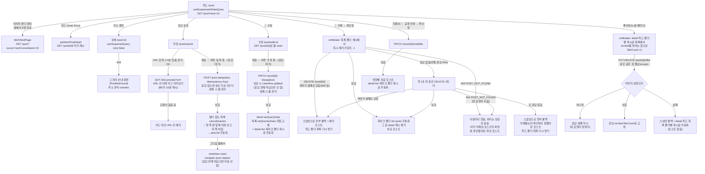

# 게시글 (피드·상세·작성·수정·삭제·공개 전환·좋아요) 기능

> **문서 성격**: 독립 기능 문서(서사형)
>
> **대상 독자**: 이 레포 FE를 처음 보거나 오랜만에 돌아온 개발자.
>
> **읽고 나면**: 게시글 하나가 등록돼 피드에 보이고, 고쳐지고, 지워지기까지 각 단계가 어느
> 파일에서 어떤 API를 부르고 어느 캐시를 어떻게 바꾸는지 안다. "등록 직후 새 글이 안 보인다",
> "좋아요가 목록에 반영 안 된다" 같은 증상을 받았을 때 어디부터 열어볼지 정할 수 있다.
>
> **마지막 검토**: 2026-11-11

이 앱의 중심 데이터다. 사용자가 링크(URL)를 등록하면 BE가 그 페이지를 크롤링해 제목·설명·
썸네일을 채우고, 그 뒤 비동기로 AI 요약·태그를 붙인다. FE는 그 결과를 피드(`/post`)에 카드로
보여주고, 상세(`/post/:id`)에서 댓글과 함께 보여준다.

이 문서가 다루지 않는 것(각 문서가 정본):

- 검색어·카테고리·범위 칩 필터 → [`SEARCH.md`](./SEARCH.md)
- 작성·수정 폼을 저장하지 않고 떠날 때의 확인창 → [`UNSAVED-CHANGES-GUARD.md`](./UNSAVED-CHANGES-GUARD.md)
- 상세의 "목록으로/뒤로" 버튼 동작·라벨 → [`POST-DETAIL-BACK-NAVIGATION.md`](./POST-DETAIL-BACK-NAVIGATION.md)
- 작성 폼의 북마크 폴더 선택 필드 → [`BOOKMARK.md`](./BOOKMARK.md) §5 "링크 등록 폼의 폴더 선택"
- 댓글·답글·댓글 좋아요 → [`COMMENT.md`](./COMMENT.md)

## 1. 쉬운 설명

게시판에 **포스트잇을 붙이는 일**과 비슷하다. 사용자가 링크를 적어 내밀면, 직원(BE)이 그
링크를 열어보고 제목·설명을 채워 넣는 몇 초 동안 사용자는 창구 앞에서 "등록 중..." 버튼을 보며
기다린다. 다 붙었다는 답이 오면 그때 피드로 돌아가고, FE는 그 포스트잇을 피드 맨 앞에 직접
끼워 넣는다. 실패하면 적은 내용을 그대로 손에 쥔 채 창구에 남는다(2026-10-03부터 — 그전엔
링크만 맡기고 곧바로 자리를 떴다). AI 요약은 직원이 나중에 따로 적어 넣는 메모라, FE는 그걸 기다리지 않는다 —
다음에 목록을 다시 가져올 때 메모가 붙어 있으면 보여줄 뿐이다.

수정도 같은 모양이다(제출 → "수정 중..."으로 응답 대기 → 성공하면 원래 화면으로 복귀 + 캐시 교체). 반대로 **삭제와
좋아요는 화면을 먼저 바꾸고**(낙관적 업데이트) 서버가 실패하면 되돌린다. 공개/비공개 전환만은
낙관적이지 않아 서버 응답 뒤 재조회로 반영된다.

## 2. 전제 지식

TanStack Query의 쿼리 키·`invalidateQueries`·`setQueryData`, 무한 쿼리(`useInfiniteQuery`)의
`pages`/`pageParams` 구조, React Hook Form + Zod는 안다고 가정한다.

가정하지 않는 것:

- 이 레포의 3계층 API 규칙(`*.api.ts` → `*.keys.ts` → `*.queries.ts`)과 크로스 엔티티 무효화 →
  [`FE-ARCHITECTURE.md`](./FE-ARCHITECTURE.md) §5
- 위젯 훅이 조회를 조합하는 방식 → 같은 문서 §8
- 확인창 + 삭제(`useAlertDialog().openConfirm`) → 같은 문서 §10
- 낙관적 업데이트 순서(`onMutate` → `cancelQueries` → `setQueryData` → 롤백) → 같은 문서 §11
- 비로그인 사용자의 좋아요를 로그인 유도로 바꾸는 `useAuthGuard`, 미인증 이메일의 글쓰기
  차단 → [`AUTH.md`](./AUTH.md) 게이트 C·D(§1에선 "문지기"라 부른다)
- BE가 등록 뒤 AI 요약·태그를 비동기로 채우는 방식 →
  [BE `AI-ASYNC-PROCESSING.md`](https://github.com/BAECHAN/link-sphere_BE_NEW/blob/main/docs/AI-ASYNC-PROCESSING.md)
- 레포 전체 지도 → [`ONBOARDING.md`](./ONBOARDING.md)
- 처음 보는 용어(`fire-and-forget`, `listRoot`, stretched link 등) → §12 용어 사전

## 3. 사용한 도구·기술

**기능 자체를 이루는 것**

- **TanStack Query** — 무한 스크롤 목록(`useSuspenseInfiniteQuery`), 상세(`useSuspenseQuery`),
  hover 프리페치, 낙관적 업데이트(삭제·좋아요), 진행 상태 관찰(`useIsMutating`)
- **TanStack Virtual**(`useWindowGridVirtualizer`, `shared/hooks/`) — 피드 카드 그리드를 행
  단위로 가상화
- **React Hook Form + Zod** — 작성·수정 폼(`createPostSchema`·`updatePostSchema`)
- **Sonner 토스트**(`shared/lib/toast/toast.ts`) — 성공 토스트, 삭제·공개 전환 실패 토스트(등록·수정의
  진행은 버튼 라벨, 실패는 입력칸·`FormAlert` — §5 "작성" 7)
- **`fetch` keepalive** — 작성·수정 요청을 탭을 닫아도 끝까지 보내기
- **NProgress** — 목록 첫 페이지 조회 동안 상단 진행 막대

**구현·검증 과정에서 쓴 도구**: Vitest + MSW(단위), Playwright(`e2e/`, `page.route()` 모킹) — §9.

## 4. 왜 만들었나

링크 공유 서비스에서 "링크를 올리고, 남의 링크를 둘러보고, 반응한다"는 흐름 그 자체다. 이
문서가 따로 필요한 이유는 기능이 단순해 보여도 **캐시가 여러 화면에 흩어져 있어서**다. 같은
게시글이 피드 목록(필터별로 여러 캐시), 상세, 북마크 폴더별 목록에 동시에 들어 있고, 한
곳에서 바꾼 값이 다른 곳에 안 따라오는 버그가 반복됐다(§10). 각 조작이 어느 캐시를 어떻게
건드리는지 한 곳에 모아 두는 것이 목적이다.

## 5. 구조

### mutation별 캐시 전략 한눈에 보기

| 동작      | 화면을 먼저 바꾸나                 | 성공 시 캐시 처리                                                                                  | 실패 시                                                                           |
| --------- | ---------------------------------- | -------------------------------------------------------------------------------------------------- | --------------------------------------------------------------------------------- |
| 작성      | 아니요(폼에서 응답 대기)           | 필터 없는 목록 첫 쪽 맨 앞에 끼워 넣기 → 모든 목록 무효화                                          | 원인별 안내, 폼 유지(응답을 못 받으면 목록도 다시 받음)                           |
| 수정      | 아니요(폼에서 응답 대기)           | 상세 `setQueryData` + 목록 직접 교체(direct patch) → 무효화                                        | 원인별 안내, 폼 유지(응답을 못 받으면 먼저 1회 다시 보냄)                         |
| 삭제      | 예(목록·북마크 폴더 캐시에서 제거) | 북마크 폴더 목록·게시글 무효화 + 그 글 detail 캐시 제거, 성공 토스트(이미 없는 글이면 정보 토스트) | 스냅샷 롤백 + 에러 토스트 + 목록·폴더 재조회(응답을 못 받으면 먼저 1회 다시 보냄) |
| 좋아요    | 예(상세·피드·폴더별 게시글 목록)   | 마지막 요청의 응답 값으로 교정                                                                     | 롤백 + 무효화, 토스트 없음(응답을 못 받으면 먼저 1회 다시 보냄)                   |
| 공개 전환 | 아니요                             | 방향별 토스트 → 상세·목록·북마크 폴더 게시글 무효화                                                | 전역 에러 토스트(응답을 못 받으면 먼저 1회 다시 보냄)                             |

각 행의 상세와 근거 줄은 아래 하위 절에 있다.

### API 엔드포인트

`src/entities/post/api/post.api.ts`와 `src/entities/interaction/api/interaction.api.ts` 기준
(`specClient`의 스펙 경로, `docs/OPENAPI-CODEGEN.md` §5-2).

| 메서드   | 경로                    | FE 함수                | 비고                                                                                   |
| -------- | ----------------------- | ---------------------- | -------------------------------------------------------------------------------------- |
| `GET`    | `/post`                 | `fetchPostList`        | `size` + 다음 쪽이면 `cursor` + 값이 있을 때만 `search`·`category`·`filter`·`nickname` |
| `GET`    | `/post/{id}`            | `fetchPostDetail`      | 비공개(남의 글)·삭제 글은 404                                                          |
| `POST`   | `/post/{id}/view`       | `recordPostView`       | 상세 화면이 뜰 때 조회 기록. 응답 `{ viewCount }`(BE가 셀지 판단한 뒤의 조회수)        |
| `POST`   | `/post`                 | `createPost`           | `keepalive: true`, 응답은 `PostResponse` 그대로                                        |
| `PATCH`  | `/post/{id}`            | `updatePost`           | `keepalive: true`                                                                      |
| `GET`    | `/link-preview?url=`    | `fetchLinkPreview`     | 작성 중 미리보기. 로그인 전용이라 `/post` 밖에 있다. 회원당 시간 60회                  |
| `PATCH`  | `/post/{id}/visibility` | `updatePostVisibility` | body `{ isPrivate }`                                                                   |
| `DELETE` | `/post/{id}`            | `deletePost`           |                                                                                        |
| `PUT`    | `/post/{id}/like`       | `likePost`             | 좋아요(멱등). 응답 `{ isLiked, likeCount }`                                            |
| `DELETE` | `/post/{id}/like`       | `unlikePost`           | 좋아요 취소(멱등). 응답은 PUT과 같다. 옛 `POST` 토글은 2026-10-14 제거(BE #92)         |

응답 타입은 BE OpenAPI 스펙에서 생성된 `PostResponse`·`PostPageResponse`의 별칭이다
(`src/entities/post/model/post.dto.ts:8-13`). 생성 파이프라인은
[`OPENAPI-CODEGEN.md`](./OPENAPI-CODEGEN.md).

### 라우트

`src/app/routes/AppRoutes.tsx`에서 피드·상세는 비로그인도 볼 수 있는 그룹(`:271-287`), 작성·수정은
`ProtectedLayout` 그룹(`:289-313`)에 있다. 각 페이지 컴포넌트는 얇다 — `pages/post/PostFeedPage.tsx`는
제목·"링크 공유" 버튼(`useProtectedNavigate`)·`PostListFilter`·`PostList`를 배치하고, `PostList`에 카드를
그리는 함수(`renderFeedPost` — `backSource="feed"`, 첫 행만 `priorityThumbnail`)와 카드 치수(`POST_CARD_GRID`)를
넘긴다([`FE-ARCHITECTURE.md`](./FE-ARCHITECTURE.md) §26 위층 조립). `PostEditPage`는 수정 폼을 그대로 렌더하고,
`PostSubmitPage`는 작성 폼에 폴더 선택 창(`renderFolderSelect` → `BookmarkFolderSelectDialog`)을 넘긴다.

### 피드 — 무한 스크롤 + 가상 그리드

- **조회**: `useSuspenseFetchPostListQuery`(`src/entities/post/api/post.queries.ts`)가
  `POST_PAGE_SIZE`(10)개씩 가져온다. 첫 쪽은 `cursor` 없이 보내고, 다음 쪽은 직전 응답의 `nextCursor`를 해석하지 않고
  그대로 보낸다. `nextCursor`가 `null`이면 끝이다. 쪽 사이에 글이 지워지거나 새로 올라와도 키 값으로 이어 읽어 누락·중복이
  없다. 형식과 이렇게 바꾼 이유는 [BE `docs/PAGINATION.md`](https://github.com/BAECHAN/link-sphere_BE_NEW/blob/main/docs/PAGINATION.md)와 [`DECISIONS.md`](./DECISIONS.md) 2026-11-05 항목에 있다.
- **첫 페이지 미리 받기**: 피드 라우트(`src/app/routes/AppRoutes.tsx`의 `PostFeedRoute`)가 lazy 페이지 청크를
  요청하는 같은 렌더에서 같은 조건으로 첫 페이지를 요청한다(`usePostFeedPrefetch` → `usePrefetchPostList`).
  호출은 `PostFeedRoute`가 함께 렌더하는 `PostFeedPrefetch` 컴포넌트가 한다 — URL·봇 숨기기 구독을 여기에 가둬,
  위치만 바뀌어도 라우트 전체가 다시 렌더되지 않게 한다.
  목록 화면은 진행 중인 그 요청을 이어받아 다시 요청하지 않는다. 두 쪽이 같은 옵션 묶음(`postListInfiniteOptions`)과
  같은 조건 계산(`toPostListPayload`)을 써야 키가 같다. 청크를 기다린 뒤 요청하던 직렬 대기를 없앤 것이다
  (2026-10-26, [`PERFORMANCE.md`](./PERFORMANCE.md) "LCP 데이터 요청 시점").
- **중복 제거**: 같은 쿼리의 `select`가 모든 페이지를 평탄화하면서 이미 본 `id`를 걸러
  `posts`를 만든다. cursor는 등록·삭제로 밀리지 않지만, 검색 점수처럼 정렬 값이 쪽 사이에 바뀌면 같은 글이 또 올 수 있어
  남겼다.
- **가상화**: `usePostList`(`src/widgets/post/post-list/hooks/usePostList.ts:184-193`)가
  컨테이너 실측 폭으로 열 수(최대 3, 최소 카드 폭 292px)를 정하고, 게시글을 열 수만큼 묶은
  **행** 단위로 가상화한다. `PostList.tsx`의 `PostListContent`(`virtualizer.getVirtualItems().map` 행 렌더)가 보이는 행만 `translateY`로 배치한다.
- **다음 페이지 트리거**: 마지막으로 렌더된 가상 행 번호가 `rows.length - 5` 이상이고, 이 목록에 진행 중인
  요청이 없고(`!isFetching`), 직전 요청이 실패하지 않았으면(`!failureReason`) `fetchNextPage()`
  (`usePostList.ts:202-215`). IntersectionObserver 센티넬은 가상화 도입 때 이 방식으로 바뀌었다.
- **다음 페이지 실패**: 자동으로 다시 받지 않고, 스피너 자리에 "더 불러오지 못했어요. [다시 시도]" 행
  (`src/shared/ui/elements/LoadMoreError.tsx`)을 둔다. 버튼을 누르거나 재조회(창 포커스·당겨서 새로고침)가
  성공하면 다시 자동으로 받는다. 요청이 도는 동안은 행 대신 스피너다. 북마크·내 댓글 목록도 같은 규칙이다
  ([`BOOKMARK.md`](./BOOKMARK.md), [`COMMENT.md`](./COMMENT.md)). 판정과 근거는 아래 "다음 페이지 실패 처리".
- **로딩·빈 상태**: `PostList.tsx`의 `PostList`가 감싼 `AsyncBoundary`가 Suspense 동안
  `DelayedFallback`(500ms 지연) 안의 스켈레톤 6장(`PostCardSkeleton.tsx:64`)을 보여준다.
  0건이면 `EmptyState`(`PostListContent`의 `posts.length === 0` 분기). 당겨서 새로고침(`usePullToRefresh`)이
  `refetch`를 부른다.
- **조회 실패**: 같은 `AsyncBoundary`가 에러 문구(`TEXTS.messages.error.fetchPosts`)를 띄운다.
  검색 조건(q·filter·봇 숨기기)이 바뀌면 에러 상태를 풀고 다시 조회한다(`resetKeys`,
  `usePostListErrorReset`, `usePostList.ts:106-116`). 풀 때 실패한 목록 쿼리를 캐시에서 지워,
  실패했던 조건을 나중에 다시 골라도 새로 요청한다. 경위는 [`SEARCH.md`](./SEARCH.md) §10
  2026-10-14 항목. 피드를 떠날 때도 같은 함수로 지운다 — 아래 "조회에 실패한 화면에 다시 들어오기"(2026-11-03).
  둘 다 데이터 없이 실패한 목록만 지우고, 1쪽이 있고 다음 쪽만 실패한 목록은 남긴다.
- **조건을 바꾼 뒤 응답 대기**: 목록은 새 응답이 올 때까지 이전 결과를 유지한다(스켈레톤 없음).
  0.5초가 지나도 응답이 없으면 `PostList.tsx`의 `isApplying` 덮개가 이전 목록을 흐리게 덮고 "결과를 불러오는
  중이에요."를 띄운다(`usePostListApplying`, `usePostList.ts:131-157`). 판정과 근거는
  [`SEARCH.md`](./SEARCH.md) §5.
- **봇 글 숨기기**: URL이 아니라 localStorage 설정(`useHideBotsStore`)을 `filter`에
  `excludeBots`로 합쳐 보낸다(`src/widgets/post/post-list/utils/post-list-payload.ts:7-18`). 칩·검색 파라미터 자체는
  [`SEARCH.md`](./SEARCH.md).

#### 다음 페이지 실패 처리 (2026-11-03, #491)

**문제**: 다음 페이지가 실패하면 같은 요청을 끝없이 다시 보냈다. 실패하면 `isFetchingNextPage`가 거짓으로 돌아와
트리거 effect가 다시 돌고, 데이터·`hasNextPage`·마지막 행이 그대로라 조건이 또 참이다. 데이터가 이미 있으면 suspense
쿼리도 에러 경계로 던지지 않는다(`@tanstack/react-query` 5.90.16 `build/modern/suspense.js:2`의
`defaultThrowOnError`). 429·WAF 차단은 재시도 정책상 다시 시도하지 않아(`retry-policy.ts`) 응답이 오는 즉시 또
보냈다. 직접 측정: 첫 페이지 성공·다음 페이지 429인 e2e(`e2e/list-fetch-failure.spec.ts`)에서 끝까지 내린 뒤
3초 동안 2,027번, 단위 테스트(왕복 30ms)에서 1초에 33~34번. 화면 끝에는 아무 표시가 없었다.

**판정 신호**

| 신호              | 쓴 것                    | 이유                                                                                                                                                                                                                                                                                 |
| ----------------- | ------------------------ | ------------------------------------------------------------------------------------------------------------------------------------------------------------------------------------------------------------------------------------------------------------------------------------ |
| 실패했는가        | `failureReason`          | `isFetchNextPageError`는 낙관적 갱신(좋아요 등의 `setQueriesData`)이 쿼리 상태를 `success`로 바꾸면 꺼진다. `failureReason`은 수동 갱신으로 지워지지 않고 다음 요청이 시작될 때만 지워진다(query-core 5.90.16 `query.js:347-351`·`391-401`)                                          |
| 무엇을 기다리는가 | `!isFetching`(모든 요청) | `!isFetchingNextPage`만 보면 실패 뒤 재조회가 시작돼 실패 기록이 지워진 순간 다음 페이지를 불러, 그 요청이 재조회를 취소한다(`fetchNextPage`의 `cancelRefetch` 기본값 true, `queryObserver.js:171`, `query.js:171-172`). 대가: 재조회 중 끝까지 내리면 재조회가 끝날 때까지 기다린다 |

**대안 비교**(사용자가 시안 Artifact를 보고 골랐다, 2026-11-03)

| 항목         | 고른 것                                   | 진 것과 이유                                                                                                                                        |
| ------------ | ----------------------------------------- | --------------------------------------------------------------------------------------------------------------------------------------------------- |
| 실패 뒤 동작 | 자동 요청을 멈추고 목록 끝에 다시 시도 행 | 멈추기만 — 다시 받을 방법이 새로고침뿐이다. 그대로 두기 — 위 반복 요청                                                                              |
| 행 모양      | 문구 + 테두리 버튼(`outline`·`sm`)        | 버튼만 — 토스트가 사라지면 버튼이 왜 있는지 알려주는 말이 없다. 한 줄(문구 옆 `ghost` 버튼) — 테두리가 없어 눌리는 것으로 덜 보인다                 |
| 문구         | 공통 "더 불러오지 못했어요."              | 목록별("다음 글을…"·"다음 댓글을…") — 위에 받은 카드가 그대로 있어 무엇을 못 받았는지는 화면이 알려주고, 공통 행 컴포넌트가 문구를 받지 않아도 된다 |

**근거**: Android Jetpack Paging은 목록 끝(footer)에 불러오기 상태를 붙이는 어댑터(`LoadStateAdapter`)를 라이브러리가
제공하고, 공식 예시가 _"LoadState.Error이면 오류 메시지와 다시 시도 버튼"_ 을 보여준다(번역, 코드 주석,
[Android Developers — Manage and present loading states](https://developer.android.com/topic/libraries/architecture/views/paging/load-state-views)).
자동으로 계속 다시 보내지 않는 이유는 AWS Builders' Library의 Marc Brooker가 짚는다:

> 재시도는 "이기적"이다. 클라이언트가 재시도하면 성공 확률을 높이려고 서버의 시간을 더 쓴다. (...) 장애가 과부하
> 때문이라면 부하를 늘리는 재시도는 상황을 훨씬 나쁘게 만들 수 있다. (번역)
>
> — Marc Brooker, AWS Builders' Library, https://builder.aws.com/content/3EumjoZascWd1oZiEgL8ORlv3qE/timeouts-retries-and-backoff-with-jitter

끝에 아무 표시도 없으면 목록이 끝난 것으로 오해한다는 점은 NN/g가 무한 스크롤 문제로 꼽는다 — _"대개 이 문제는
콘텐츠를 더 불러오고 있다는 표시가 없을 때 생긴다"_ (번역, Tim Neusesser,
[NN/g, 2022-09-04](https://www.nngroup.com/articles/infinite-scrolling-tips/)). 이 글은 로딩 표시를 다루고 실패
표시를 직접 다루지는 않는다.

### 카드(`PostCard`)

`src/widgets/post/post-card/ui/PostCard.tsx`는 피드·상세·북마크 화면이 함께 쓴다(`isDetail`로 분기).

- **카드 전체가 상세 링크**(목록만): 제목 `Link`의 `::after`를 카드 전체로 늘리고(`stretchedLinkClassName`),
  아바타·소유자 액션·AI 요약·썸네일·카테고리 칩(`:307`)·푸터 버튼은 `relative z-raised`로 그
  위에 올린다. 썸네일은 상세가 아니라 원문 새 탭이고, 카테고리 칩을 누르면 피드를 그
  카테고리로 거른다([`SEARCH.md`](./SEARCH.md)). 근거는 `docs/DECISIONS.md` 2026-09-30 "게시글
  카드: 제목 확대 대신 카드 전체를 상세 진입 영역으로" 항목.
- **제목**: 목록은 3줄 말줄임(`line-clamp-3`), 상세는 전문(제목 `h3`의 `isDetail` 분기). 근거는 `docs/DECISIONS.md`
  2026-08-04 항목.
- **프리페치**: 제목 링크의 `onMouseEnter`·`onFocus`가 `prefetchPostDetail`을 부른다
  (`usePostCard.ts`의 `handlePrefetchDetail`). 상세와 같은 키·`queryFn`이라 클릭 시 캐시가 바로 쓰인다.
  제목 링크의 `::after`가 카드 전체를 덮어, 카드에서 누르면 상세로 가는 곳 어디에 올라가도 발동한다. 목록에서는 100ms
  머물면 댓글도 미리 받고, `onMouseLeave`·`onBlur`로 그 전에 떠나면 취소한다(2026-11-04, 데스크톱 빈 화면 133 → 19ms,
  [`PERFORMANCE.md`](./PERFORMANCE.md) "상세 첫 진입 빈 화면"). 댓글이 0개인 글(`stats.commentCount`)은 요청 대신 빈 목록을
  바로 심어, 상세가 댓글 응답을 기다리지 않고 그린 뒤 한 번 다시 받는다([`COMMENT.md`](./COMMENT.md) "해시 이동").
  댓글 아이콘(💬)의 hover·focus는 게시글과 댓글을 바로 함께 미리 받고(`handlePrefetchDetailWithComments`, 0개면 같은 방식),
  상세 라우트는 들어올 때 페이지 청크와 함께 게시글과 댓글을 요청한다([`COMMENT.md`](./COMMENT.md) "해시 이동").
  hover가 없는 터치 기기는 피드 첫 썸네일이 그려진 뒤 한가할 때 상세 페이지 청크를 미리 받는다(데이터 절약 모드면 건너뜀,
  같은 절).
  - **hover 미리 받기가 실패하면**(2026-11-03, #491 3번): 토스트 없이 실패한 쿼리를 캐시에서 지워, 상세가 열릴 때
    새로 요청한다(`prefetchQueryQuietly`, `src/shared/lib/react-query/prefetch-quietly.ts`). 카드·내 댓글 카드의
    `prefetchPostDetail`·`prefetchComments`가 쓴다(사이드바 폴더 행 hover도 같은 방식. 북마크 버튼은 닫힌 폴더 창이 목록을
    지켜보고 있어 `meta.silentWhenInactive`를 더한다, [`BOOKMARK.md`](./BOOKMARK.md) "hover 프리페치"). 그 전에는 `prefetchQuery`가 promise 실패만 삼켜 전역 에러
    토스트가 떴다. 계획 단계 측정(설치본 query-core 5.90.16을 메모리에서 실행)으로는 같은 카드 제목 3번 hover에
    3번, 카드 5장을 지나가면 5번이었다. 실패한 쿼리가 캐시에 남아 상세 화면도 다시 요청하지 않고 에러 화면이 됐다.
    재현 절차는 [계획 문서](./plans/2026-11-03-error-toast-followups.md) "재현 절차"에 있다.
  - **지우는 조건**: 실패 시점에 데이터가 없고, 구독자가 0이고, 쿼리 `meta`가 아직 미리 받기의
    것(`manualErrorHandling`)일 때만 지운다. hover 직후 클릭해 상세 화면이 요청을 이어받았으면 화면의 관찰자가
    렌더 중에 쿼리 옵션을 `meta`까지 자기 것으로 바꾼다(query-core 5.90.16 `queryObserver.js:26`·`:94`). 구독은
    커밋 뒤라(`:48-50`) 그 사이 구독자 수는 0이다. 이때는 지우지 않고 지금처럼 화면이 토스트·에러 화면으로 처리한다.
    `meta` 조건을 빼면 지운 뒤 화면이 같은 요청을 한 번 더 보내 토스트가 두 번 뜬다(테스트로 확인:
    `post.queries.test.ts`의 "미리 받는 중에 상세 화면이 열린 뒤 실패하면", 조건을 빼면 요청 2회로 실패).
  - 라우트의 `usePrefetchPostDetail`·`usePrefetchComments`는 바꾸지 않았다 — 화면이 곧 붙어 그 화면이 실패를
    처리한다. 그 실패가 캐시에 남아 다시 들어와도 같은 에러가 뜨던 것은 2026-11-03 화면을 떠날 때 지우도록
    고쳤다(아래 "조회에 실패한 화면에 다시 들어오기").
- **소유자 액션**(`isOwner`일 때만): 비공개 글이면 자물쇠 버튼(누르면 공개 전환),
  그리고 ⋮(`KebabMenu`) 안에 수정·공개/비공개 전환·삭제.
- **AI 결과 표시**: `aiSummary`가 있을 때만 접이식 "AI 요약" 블록. 설명이 없고
  `aiStatus === 'NONE'`(1차 크롤링이 본문을 못 얻음)이면 "이 링크의 정보를 가져오지 못했어요"
  한 줄(`TEXTS.post.card.metadataUnavailable`). **AI 처리 대기 중 표시나 폴링은 없다** — §11.
- **수정 중 오버레이**: 같은 글의 수정 mutation이 진행 중이면(`useIsMutating`, 500ms 지연 +
  최소 400ms 유지, `usePostCard.ts`의 `isUpdating`) 내용을 흐리게 하고 "수정 중..." 오버레이로 클릭을
  막는다(`PostCard.tsx:82`, `:96-101`). 2026-10-03부터 수정 폼이 응답을 기다리므로 평소엔 보일
  일이 없고, 저장 중에 이탈 확인창에서 "나가기"를 골라 목록으로 먼저 돌아간 경우에만 뜬다.

### 상세

- `usePostDetail`(`src/pages/post/hooks/usePostDetail.ts:75-114`)이
  `useSuspenseFetchPostDetailQuery`로 조회한다. 이 쿼리는 `retry: false`다(`post.queries.ts`)
  — 404는 재시도해도 같고 안내 화면만 늦어진다.
- **미리 받기**: 상세 라우트(`PostDetailRoute`, `src/app/routes/AppRoutes.tsx:251`)가 lazy 페이지 청크를 요청하는
  같은 렌더에서 게시글(`usePrefetchPostDetail`)과 댓글(`usePrefetchComments`)을 요청한다. 게시글은 상세 조회와
  같은 옵션 묶음(`postDetailQueryOptions`)을 써 `retry: false`까지 같다. 진행 중인 요청은 먼저 시작한 쪽 옵션으로
  돌기 때문이다. 카드·내 댓글 hover의 `prefetchPostDetail`도 같은 옵션 묶음을 쓴다(2026-10-27 전에는 `retry`가
  빠져 있어, 지워진 글을 hover 직후 클릭하면 404 안내가 재시도만큼 늦었다). 미리 받기는 캐시에 상태가 있으면
  건너뛰므로, 같은 라우트가 떠날 때 데이터 없이 실패한 게시글·댓글을 지운다(아래 "조회에 실패한 화면에 다시 들어오기").
- **썸네일**: 상세 카드의 썸네일이 이 페이지의 LCP 요소라 `priorityThumbnail`로 `loading="eager"`·
  `fetchPriority="high"`를 준다(2026-10-26, 그 전에는 목록과 같은 `lazy`). 피드는 첫 행(최대 3장)만 같은 우선
  로딩을 받고 나머지 카드는 `lazy`다(`pages/post/PostFeedPage.tsx`의 `renderFeedPost`, #195).
- **404 처리**: `PostDetailPage.tsx:86-92`의 에러 폴백이 `ApiError.status === 404`면 주소를 그대로 둔 채
  그 자리에 안내 화면(`PostDetailPage.tsx:65-80`의 `PostNotFound`)을 그린다 — 아이콘·"삭제됐거나 볼 수 없는
  포스트예요"·"목록으로". BE가 삭제와 비공개를 같은 404로 응답하므로 문구도 둘을 함께 덮는다. "목록으로"는
  이동이라 버튼 모양의 링크(`Button asChild` + `Link`)로 `/post`에 간다. 화면이 떠 있는 동안 `useNoIndex`로
  `noindex` 메타를 단다(200으로 응답하는 에러 화면이 검색엔진에 색인되는 soft 404 방지). 메타는 화면이
  그려지기 전에(`useLayoutEffect`) 붙는다(§10 "noindex 메타가 안내 화면보다 늦게 붙던 문제"). 2026-10-05 이전에는
  토스트 후 `/post`로 replace했는데, 사라지는 토스트에만 기대고 주소까지 잃게 해 바꿨다(계획:
  `docs/plans/2026-10-05-url-error-responses.md`). 그 밖의 에러는 화면 안 `ErrorState`.
- **조회 1회의 뜻**: 같은 사람이 같은 글을 하루에 한 번 본 것이다. `GET /post/{id}`는 글을 읽기만 하고, 화면이 뜬 뒤
  `usePostDetail.ts`의 `recordPostViewOnEntry` effect가 `POST /post/{id}/view`를 보낸다. BE가 조회자(로그인하면 회원,
  아니면 IP)를 가려 그날 처음일 때만 조회수를 올리고, 로그인 상태면 `post_views`의 최근 열람 시각은 매번 갱신한다. 하루는
  UTC 기준이라 한국 시각 오전 9시에 바뀐다. 그래서 새로고침·재진입으로는 조회수가 오르지 않고, 카드 hover 미리 받기·탭
  복귀 재조회·댓글 뒤 재조회·수정 화면은 기록 요청을 보내지 않는다. `pnpm dev`(운영 API를 봄)에서도 보내지 않는다 —
  가드가 보는 모드 이름은 `localhost`다(`package.json`의 `dev` 스크립트가 `vite --mode localhost`). 2026-11-11 전에는
  `development`와 비교해 가드가 걸리지 않았다. CI Lighthouse는 `lighthouserc.cjs`의 `blockedUrlPatterns`로 막는다.
  비교한 대안과 근거는 `docs/plans/2026-11-05-post-view-record.md`(읽기와 기록을 나눔)와
  `docs/plans/2026-11-11-post-view-dedupe.md`(같은 사람은 하루 한 번).
- **조회수 표시**: 상세는 받은 값을 그대로 보여 주다가, 기록 응답이 오면 그 응답의 조회수(`viewCount`, BE가 이번 조회를
  셀지 판단한 뒤의 값)로 바꾼다. 처음 본 글은 숫자가 한 번 오르고, 다시 본 글은 그대로다. FE는 1을 더하거나 빼지 않는다 —
  세는 규칙이 BE `PostService.recordView` 한 곳에만 있어야 규칙이 바뀌어도 FE를 고치지 않는다. 반영은 `post.queries.ts`의
  `applyRecordedViewCount`가 한다. 진행 중인 상세 재조회를 취소하고, 상세 캐시의 조회수만 바꿔 쓰고(받은 시각은 그대로),
  재조회 중이었으면 무효화해 다시 받는다. 취소하지 않으면 기록 전에 읽은 값이 늦게 도착해 방금 쓴 숫자를 덮는다. 기록이
  실패하면 받은 값 그대로 보이고 토스트 없이 넘어간다.
- **열람 기록 반영**: 기록에 성공하면 북마크의 "최근 열람순"을 맞추려고 정렬·폴더와 상관없이 폴더별 게시글
  캐시 전체를 무효화한다(`post.queries.ts`의 `recordPostView` → `handlePostViewRecordedSuccess`). `useMutation`을 쓰지 않는
  이유는 로그인 만료 정리가 `isMutating()`을 보기 때문이다(그 함수의 주석).
- **브라우저 탭 제목**: 상세가 떠 있는 동안 탭 제목을 `{글 제목} - Link Sphere`(`TEXTS.post.detail.documentTitle`)로
  바꾸고, 상세를 떠나면 원래 제목으로 되돌린다(`usePostDetail.ts:98-111`, 2026-10-26). 설치본 react-dom 18.3.1은
  컴포넌트에서 렌더한 `<title>`을 head로 올려 주지 않아(React 19부터) effect로 `document.title`을 바꾼다. 404 안내
  화면은 게시글을 받지 못해 기본 탭 제목(`Link Sphere`)이 그대로다. 카카오톡·슬랙 같은 링크 미리보기에는 이 제목이
  쓰이지 않는다(§11).
- 상세 화면은 같은 `PostCard`(`isDetail`) 아래 `CommentList`를 붙인다.

### 조회에 실패한 화면에 다시 들어오기 (2026-11-03, #491 3번)

**문제**: 상세·댓글·피드 목록·내 댓글(앱의 suspense 쿼리 4개)이 데이터 없이 실패하면, 서버가 회복된 뒤 5분 안에
다시 들어와도 요청 없이 같은 에러 화면이 떴다. 실패한 쿼리는 gc(5분) 전까지 캐시에 남는데, 에러 경계가 리셋되기
전에는 화면이 마운트할 때 다시 요청하지 않고(`@tanstack/react-query` 5.90.16 `build/modern/errorBoundaryUtils.js:8-11`의
`retryOnMount=false`, query-core `queryObserver.js:442-443`), 라우트의 미리 받기(`usePrefetchQuery`)도 상태가 있으면
건너뛴다. 뒤로가기·알림·주소 직접 입력으로 돌아올 때 드러난다. 카드 클릭은 hover 미리 받기(`prefetchQuery`)가 실패한
쿼리를 다시 받아 가려져 있었다. 직접 측정: `e2e/failed-query-reentry.spec.ts` 4건(진입 500 → 다른 화면 → 서버 회복 →
뒤로가기)이 수정 전에는 4건 모두 다시 요청하지 않고 에러 화면에 머물러 실패했다.

**고친 것**: 화면을 떠날 때 데이터 없는 실패 쿼리를 지운다. 다시 들어오면 새로 요청한다.

| 화면    | 떠날 때 부르는 훅                                                              | 부르는 곳                                         |
| ------- | ------------------------------------------------------------------------------ | ------------------------------------------------- |
| 상세    | `useRemoveErroredPostDetailOnLeave(id)` → `postRemoveQueries.erroredDetail`    | `PostDetailRoute`(`src/app/routes/AppRoutes.tsx`) |
| 댓글    | `useRemoveErroredCommentsOnLeave(postId)` → `commentRemoveQueries.erroredList` | 같은 곳                                           |
| 피드    | `useRemoveErroredPostListsOnLeave()` → `postRemoveQueries.erroredLists`        | `PostList.tsx`의 `PostList`                       |
| 내 댓글 | `useRemoveErroredMyCommentsOnLeave()` → `commentRemoveQueries.erroredMy`       | `MyCommentList.tsx`의 `MyCommentList`             |

- **지우는 조건**: `isUnusedFailedQuery`(`src/shared/lib/react-query/unused-failed-query.ts`) — 실패했고, 데이터가 없고,
  보고 있는 화면(관찰자)이 없을 때. 1쪽을 받고 다음 쪽만 실패한 목록은 남긴다 — 돌아오면 1쪽과 "더 불러오지 못했어요."
  행이 그대로 보인다(지우면 1쪽부터 다시 받는다). 검색 조건을 바꿀 때 부르는 `erroredLists`(위 "조회 실패")도 이
  조건으로 바꿨다. 그 전에는 `status === 'error'`만 봐서 1쪽이 있는 목록까지 지웠다(#491 6번).
- **훅은 에러 경계 밖에서 부른다**: 경계 안쪽 컴포넌트는 렌더 중에 에러를 던져 effect가 붙지 않는다.
- **상세에서 다른 상세로 갈 때**(알림 토스트 클릭, `useFcmForegroundMessage.ts:48`): 상세 컴포넌트가 그대로 남아 에러
  경계가 리셋되지 않아, 앞 글의 에러 화면이 다음 글에도 남았다(`PostDetailPage.test.tsx` "조회 실패 뒤 다른 글로
  이동" 2건으로 재현). `PostDetailPage`·`CommentList`의 `AsyncBoundary`에 `resetKeys`로 글 id를 넘긴다. 댓글 테스트는
  운영 라우터처럼 이동을 transition으로 감싼다(`v7_startTransition`, `RouterProvider.tsx:27`). 감싸지 않으면 다음 글을
  기다리는 동안 댓글 영역이 숨겨졌다 다시 보이며 `componentDidUpdate`가 불리지 않아(react-dom 18.3.1
  `react-dom.development.js:23322-23323`) `resetKeys` 비교가 돌지 않는다. 운영에서는 이전 화면이 남아 그 경로를 타지
  않는다.
- **진 대안**(사용자 결정, 2026-11-03): 에러 화면에 [다시 시도] 버튼을 더하는 것 — 화면이 바뀌어 시안이 먼저
  필요했고, 떠났다 돌아오는 경우는 지우기만으로 풀린다. 문서만 정정 / 그대로 — 서버가 회복돼도 5분간 막힌다.
- 규칙(새 suspense 화면도 같은 훅을 둔다)은 [`FE-ARCHITECTURE.md`](./FE-ARCHITECTURE.md) §13 "suspense 화면은 떠날
  때 데이터 없는 실패를 지운다". 계획: [`plans/2026-11-03-error-toast-followups-review.md`](./plans/2026-11-03-error-toast-followups-review.md).

### 작성

1. 폼(`src/features/post/create/hooks/useCreatePost.ts`의 `useForm`)은 `mode: 'onChange'`라 URL 형식
   오류가 타이핑 즉시 인풋 아래에 뜬다. 제출 버튼은 `isDirty && isValid && !isCreating`일 때만
   활성(`CreatePostForm.tsx`의 `canSubmit`)이고, 비활성 이유는 `TooltipWrapper`로 보여준다.
   - 화면에 들어오면 URL 칸에 바로 포커스가 간다(URL `FormInput`의 `autoFocus`, 2026-10-16). 데스크톱은
     클릭 없이 바로 붙여넣을 수 있다. iOS는 다르다 — Apple WebKit 엔지니어는 _"사용자 제스처에 대한
     응답이 아닌 프로그래밍 포커스로는 키보드를 올리지 않기를 원한다"_ (번역,
     [WebKit 버그 195884](https://bugs.webkit.org/show_bug.cgi?id=195884), 2019)고 썼다. 이 화면은 탭한
     뒤 지연 로딩(Suspense)을 거쳐 마운트되므로, iPhone에서는 칸을 한 번 탭해야 할 것으로 본다(실기기
     미확인). Android Chrome에서 키보드가 바로 뜨는지도 아직 확인하지 못했다. 포커스 자체는
     `e2e/post-create.spec.ts`·`post-create.mobile.spec.ts`가 확인한다.
2. 스키마(`src/entities/post/model/post.schema.ts:9-27`): `url`은 `.url()` + http/https 스킴만
   허용하는 `refine`(BE `SafeUrlValidator`와 같은 제한). `title`은 선택(비우면 BE가 크롤링
   제목을 쓴다), `categoryIds`·`isPrivate`·`bookmark`·`folderIds`. **제목 길이 상한은 없다** — 카드는
   3줄 말줄임, 상세는 전문을 보여준다([`DECISIONS.md`](./DECISIONS.md) 2026-08-04).
3. 제출(`useCreatePost.ts`의 `onSubmit`):
   - 계정의 `emailVerified === false`면 서버로 보내지 않고 버튼 위 `FormAlert`에 인증 안내를 남긴다(7번과
     같은 자리, BE도 403
     `EMAIL_NOT_VERIFIED`로 막는 이중 방어 — [`AUTH.md`](./AUTH.md) 게이트 D).
   - `createPost(...)`(`mutateAsync`)의 **응답을 기다린다**. 그동안 버튼은 비활성 + "등록 중..."
     (`CreatePostForm.tsx`, FE-ARCHITECTURE §10-A "저장 중 라벨"). 성공하면 `clearNow()`로 이탈
     가드 해제 → 폼 리셋 → `/post`로 **replace** 이동. 실패하면 아무것도 하지 않아 입력·이탈
     가드가 그대로 남고, 실패 원인은 7번 방식으로 안내한다. BE가 크롤링을 동기로 하지만
     실측 중앙값 2.7초라 기다리게 한다(근거·이전 방식과의 비교는 [`DECISIONS.md`](./DECISIONS.md)
     2026-10-03). 탭을 닫아도 요청이 끝까지 가도록 `keepalive`(`post.api.ts`의 `createPost`).
   - 요청에는 `Idempotency-Key`를 싣는다(`post.queries.ts`의 `mutationFn`). 응답을 못 받으면 약 1초 뒤 같은 키로 자동으로 1번 더
     보내고, 그 뒤 사용자가 같은 내용을 다시 눌러도 같은 키라 글이 둘이 되지 않고 기존 글이 돌아온다. 내용을 고치면 새 키다
     ([`FE-ARCHITECTURE.md`](./FE-ARCHITECTURE.md) §27).
   - 저장 중 떠나려 하면 이탈 확인창이 뜬다. 확인창이 떠 있는 동안 성공하면 확인창이 닫히고 그대로 `/post`로
     간다. 응답 전에 "나가기"로 떠났으면 `useHasLeftPage`로 알아보고 이동하지 않는다(실패 안내는 7번 참고) —
     [`UNSAVED-CHANGES-GUARD.md`](./UNSAVED-CHANGES-GUARD.md) §5 "저장 요청 중 이탈"(2026-10-21).
4. 성공 시(`post.queries.ts`의 `useCreatePostMutation` `onSuccess`, entity 레벨이라 폼이 언마운트돼도 실행된다):
   - 필터 없는 목록 쿼리를 `cancelQueries` — 폼은 이 처리가 끝난 뒤에 이동하므로 평소엔 경쟁이 없지만,
     저장 중 "나가기"로 먼저 피드에 갔거나 배경 재조회가 돌던 중이면 등록 완료 전 상태의 목록 fetch가
     뒤늦게 응답해 끼워 넣은 값을 덮어쓸 수 있어 막는다.
   - `prependCreatedPostToFirstPage`로 첫 쪽 맨 앞에 새 글을 넣고 **뒤 쪽은 버린다** — cursor라 밀리지는 않지만, 남겨
     두면 바로 뒤따르는 무효화가 불러온 쪽을 전부 다시 받고 그동안 다음 쪽을 받지 못한다(`usePostList`의
     `canFetchNextPage`). 다음 쪽은 스크롤 시 재조회한 첫 쪽의 `nextCursor`로 받는다.
   - 필터가 걸린 목록에는 끼워 넣지 않는다(새 글이 그 조건에 맞는지 모른다).
   - 그다음 `handlePostCreateSuccess`(`post.keys.ts`)가 필터와 무관하게 **모든 목록**
     (`listRoot`)을 무효화한다 — 필터 없는 목록은 끼워 넣은 덕에 재조회 전에도 이미 새 글을
     보여주고, 필터 목록은 이 재조회로 갱신된다. 북마크를 같이 골랐으면 `handleBookmarkToggleSuccess`로 폴더
     카운트·폴더 게시글도 무효화.
   - 성공 토스트는 `meta.successMessage`로 전역 핸들러가 띄운다. 실패는 `manualErrorHandling`이라
     전역 토스트가 뜨지 않고 7번 방식으로 안내한다. 고른 폴더가 사라진 실패(`FOLDER_NOT_FOUND`)면
     폴더 목록을 무효화해 다시 고를 때 사라진 폴더가 안 보이게 한다.
5. **진행 표시**: 제출 버튼의 "등록 중..." 라벨이 맡는다. `src/app/ui/AccountUpdateLoadingToast.tsx`
   (하단 진행 토스트)는 2026-10-03부터 작성·수정을 관찰하지 않고 계정 수정만 남았다 — 폼이 화면에
   남아 있어 버튼 라벨과 겹치기 때문이다. 토스트 방식이 처음 생긴 근거는 `docs/DECISIONS.md`
   2026-08-13 항목.
6. 모바일에서는 제출 버튼이 하단 탭바 바로 위에 고정된 바로 뜨고, 토스트가 그 위로 오도록
   `--toast-offset-bottom`을 조정한다(`CreatePostForm.tsx`의 `reserveToastSpaceAboveBar`, 하단 바 `barRef`).
7. **실패 원인 안내**(2026-10-03): `PostUtil.resolveSubmitError`(`entities/post/utils/post.util.ts`)가
   실패를 둘로 나눈다. 서버 message(영어·내부 문구)는 노출하지 않고 code·status로만 판정한다.
   - 입력칸을 고치면 해결되는 것 → 그 칸 아래 에러(`form.setError(..., { type: 'server' })` + 포커스):
     도메인 없음(`URL_UNRESOLVABLE`), 내부망(`URL_NOT_ALLOWED`), 형식(`INVALID_URL`·`INVALID_INPUT`), 키가 다른데 1시간 안에
     같은 URL을 또 등록(`DUPLICATE_POST`, 409 — BE 필수화 뒤 발생), 폴더 사라짐
     (`FOLDER_NOT_FOUND`, 폴더를 고른 등록의 `FORBIDDEN`).
   - 그 외 → 버튼 바로 위 `FormAlert`(`shared/ui/elements/FormAlert.tsx`, `role="alert"`): 요청 한도
     (429, `Retry-After`를 분으로 올림), 네트워크, 응답 지연(504 — 이미 저장됐을 수 있어 "홈에서
     확인하기" 링크), 이메일 미인증, WAF 차단, 로그인 필요(`NOT_LOGGED_IN`·`INVALID_TOKEN`), 수정할 때만 글이
     삭제됨(`POST_NOT_FOUND`)·남의 글(`FORBIDDEN`), 그 외. 모바일에선 하단 고정 바 안 버튼 위에 붙는다.
   - 로그인이 풀린 채 그 화면에 남아 있는 동안(저장하다 만료됐든, 쓰던 중 다른 탭에서 로그아웃했든) 같은
     `FormAlert`에 `TEXTS.messages.error.signedOutBeforeSave`("로그인이 풀렸어요. 로그인한 뒤 저장해 주세요.")를 띄우고, 다시 로그인하면
     지운다(2026-10-28, `useSignedOutNotice`). 저장하다 만료된 실패(`SessionExpiredError`)는
     `PostUtil.resolveSubmitError`를 거치지 않고 입력만 남긴다. 화면도 떠나지 않는다 — 그 자리에 뜬 로그인 창에서 다시
     로그인한 뒤 다시 누르면 된다([`AUTH.md`](./AUTH.md) §8-I).
   - 로그인이 풀린 채(로그인 창을 닫고) 그 화면에 남아 누르면 요청을 보내지 않고 그 이유의 로그인 창을 다시
     연다 — 제출이 댓글·답글 등록과 같은 `useAuthGuard`로 감싸여 있다(`onSubmit` → `submitPost`).
   - 사용자가 아무 값이나 고치면 안내와 서버 칸 에러가 지워진다(`clearSubmitErrorsOnEdit`).
   - 저장 중 이탈 확인창에서 "나가기"로 먼저 떠났으면 안내할 폼이 없어 같은 문구를 에러 토스트로 띄운다
     (2026-10-21 — 전에는 실패가 안 보였다).
   - 표시 위치·박스 모양 결정 근거는 [`DECISIONS.md`](./DECISIONS.md) 2026-10-03 "실패 원인 노출" 항목.
8. **작성 중 링크 미리보기**(2026-10-03): URL 칸 바로 아래 `LinkPreviewCard`(`entities/post/ui/LinkPreviewCard.tsx`)가
   "이렇게 등록돼요"를 등록 전에 보여준다.
   - 조회는 `useLinkPreview`(`entities/post/hooks/useLinkPreview.ts`)가 한다. 입력이 0.5초 멈추고 스키마
     형식이 맞고 이메일 인증된 계정일 때만 묻는다. 등록과 같은 `UrlUtil.normalizeUrl`을 거친 URL로 물어야
     BE 캐시(10분)가 등록 때 재사용돼, 저장되는 글이 본 미리보기와 같아진다.
   - 카드 모습: 가져오는 중이면 스켈레톤, 받으면 썸네일·제목·설명(최대 2줄)·URL. 사용자가 제목을
     입력했으면 그 제목으로 보여준다(등록되는 제목과 맞춤).
   - 자리 고정(2026-10-04): 데스크톱은 등록 버튼이 폼 흐름 안에 있어 미리보기 높이가 바뀌면 버튼이
     밀린다. 그래서 모든 모습(안내 자리·가져오는 중·카드·실패)을 같은 높이(`h-24`, 96px —
     `LinkPreviewCard.tsx`의 `PREVIEW_HEIGHT_CLASSNAME`)로 맞추고, 등록 폼은 `reserveSpace`로 URL을
     넣기 전에도 같은 크기의 안내 자리를 깔아 둔다. [web.dev "Optimize CLS"](https://web.dev/articles/optimize-cls)는
     _"(플레이스홀더나 스켈레톤 UI 등으로) 뷰포트에 미리 충분한 자리를 확보해, 콘텐츠가 들어와도 페이지가
     갑자기 밀리지 않게 하라"_ (번역)고 권한다. 안내 자리 모양은 시안(점선 테두리 / 옅은 박스) 비교 후 옅은
     박스로 골랐다. 수정 폼은 URL을 바꿨을 때만 카드가 떠서 안내 자리를 두지 않는다 — 카드가 처음 뜰 때
     한 번은 밀린다. 1280×800에서 직접 측정(모킹 응답 Playwright 스펙): 등록 폼은 입력 전·가져오는 중·
     성공(설명 2줄)·실패 모두 버튼 y=725로 같았다. URL을 지우면 URL 칸 필드 에러 한 줄(28px)만큼은 여전히
     밀린다(공용 `FormField` 동작, 범위 밖).
   - 도메인 없음·내부망·형식 오류는 등록해도 똑같이 실패하므로 카드 대신 URL 칸 에러로 띄운다
     (`showPreviewUrlErrorOnField`, 7번과 같은 `PostUtil.resolveSubmitError` 문구). 그 외 실패(한도·서버
     오류)는 "미리보기를 불러오지 못했어요. 그래도 등록할 수 있어요"만 보여주고 등록은 막지 않는다.
   - 토스트는 띄우지 않는다(`useFetchLinkPreviewQuery`의 `manualErrorHandling`, `retry: false`).
   - 위치(URL 칸 바로 아래)·모양(가로형) 결정은 [`DECISIONS.md`](./DECISIONS.md) 2026-10-03 "응답 대기" 항목의 상태.

### 수정

- `useUpdatePost`(`src/features/post/update/hooks/useUpdatePost.ts`)는 비-Suspense
  `useFetchPostDetailQuery`로 원본을 받아 `form.reset`한다(`resetFormWithFetchedPost`). 로딩 중에는
  `UpdatePostForm`이 `CenteredSpinner`를 그린다. 처음 받을 때와 아직 고치지 않았을 때(`formState.isDirty`가 false)만
  다시 맞추고, 고치던 중에 글을 다시 불러오면(로그인이 풀린 채 이 화면에 남았다가 다시 로그인한 뒤의 재조회 등)
  고친 값을 덮지 않는다(2026-10-28, [`AUTH.md`](./AUTH.md) §8-I).
- **URL을 바꾸면 제목·카테고리를 비운다**(`clearDerivedFieldsOnUrlChange`) — 둘 다 옛 링크 기준이기 때문이다. 초기
  `reset` 직후의 오탐을 막으려 `form.getValues('url')`을 다시 읽어 비교한다.
- 안내 문구: URL을 바꾸면 "다시 가져와요" 안내, URL은 그대로인데 제목만 비우면 "제목을 다시
  가져오고, 못 가져오면 기존 제목 유지" 안내(`UpdatePostForm.tsx`의 `isUrlChanged`·`isTitleCleared`). 제목만
  비운 재수집이 다른 필드를 덮지 않는 BE 정책은 `docs/DECISIONS.md` 2026-09-08 "제목 비움
  재수집" 항목.
- 제출(`onSubmit`)은 작성과 같이 **응답을 기다린다**(버튼 "수정 중..."). 성공하면 `clearNow()` →
  `goBack()`(들어온 화면으로, 목록 스크롤 유지), 실패하면 고친 내용과 이탈 가드를 그대로 남긴다.
  응답 전에 이탈 확인창에서 "나가기"로 떠났으면 `goBack()`하지 않고(전에는 떠난 화면에서 한 칸 더 뒤로 갔다),
  실패는 에러 토스트로 알린다 — 등록과 같다(2026-10-21).
  `keepalive`도 같다(`post.api.ts`의 `updatePost`).
- 성공 시(`post.queries.ts`의 `useUpdatePostMutation` `onSuccess`): 서버가 돌려준 수정본으로 detail을 `setQueryData`, 모든
  목록 캐시에서 그 글을 `setQueriesData`로 **직접 교체**한 뒤, `handlePostUpdateSuccess`(detail +
  list 무효화)와 `handlePostContentUpdateSuccess`(북마크 폴더별 게시글 무효화)를 부른다. 직접
  교체가 먼저라 재조회 응답을 기다리지 않고 바로 새 제목이 보인다.
- **URL을 바꿨을 때만** 작성과 같은 미리보기 카드가 뜬다(`useUpdatePost.ts`의 `isUrlChanged`). URL이
  원래 값과 같으면 조회하지 않는다 — 다시 크롤링할 일이 없기 때문이다.

### 삭제

- 진입: 카드 ⋮ → "삭제" → `usePostDelete`(`src/features/post/delete/hooks/usePostDelete.ts:10-24`)가
  `openConfirm`(삭제 버튼 쪽 강조, `emphasis: 'confirm'`)을 띄우고 확인 시 `mutateAsync`를 기다린다.
- 낙관적 반영(`post.queries.ts`의 `useDeletePostMutation` `onMutate`): 피드 목록·북마크 폴더 목록·폴더별 게시글 쿼리를
  `cancelQueries`하고 스냅샷을 뜬 뒤,
  - 모든 피드 목록 캐시에서 그 글을 뺀다.
  - 폴더별 게시글 캐시에서도 카드를 뺀다.
  - 그 글이 북마크돼 있었다면 소속 폴더의 `bookmarkCount`(소속이 없으면 `uncategorizedCount`)를
    1 줄인다. 북마크 여부는 detail → 피드 목록 → 폴더 게시글 캐시 순으로 찾는다(`findCachedPost`).
- 서버가 실패라고 답하면(500 등) 세 스냅샷을 전부 복원하고 전역 핸들러가 "포스트 삭제에 실패했어요." 토스트. 이어서
  `handlePostDeleteFailure`(`src/entities/bookmark/folder/api/bookmark-folder.keys.ts`)로 피드 목록과 폴더 캐시를
  다시 받는다. 로그인 만료로 끝났으면 캐시는 만료 정리가 맡으므로 다시 받지 않는다.
- 응답을 못 받으면(연결 끊김·504) 바로 실패로 치지 않고 같은 요청을 한 번 더 보낸다 — 아래
  "응답을 못 받으면".
- 성공 시 북마크 폴더 목록·게시글을 무효화하고, **그 글의 detail 캐시를 지운다**(`postRemoveQueries.detail`,
  `src/entities/post/api/post.keys.ts`). 상세에서 삭제하면 push로 피드에 가므로 히스토리에 지운 글의 상세가
  남는데, 캐시가 남아 있으면 뒤로가기 때 staleTime(3분) 안에서 삭제된 글이 재조회 없이 다시 그려졌다.
  지금은 다시 받아와 그 주소에서 "삭제됐거나 볼 수 없는 포스트예요" 안내를 띄운다(`e2e/post-delete.spec.ts`).
  성공하면 `onSuccess`가 "포스트를 삭제했어요." 토스트를 직접 띄운다(아래 404와 문구가 갈려 `meta.successMessage`로는
  표현할 수 없다). 카드가 사라지는 순간은 확인창이 닫히는 순간과 겹치고, 상세에서 지우면 사라지는 장면 자체가
  없어서다(2026-10-21 복원, 판단 기준은 `.claude/skills/texts-conventions/SKILL.md` "성공 토스트 표시 기준" 축 4).
- 성공 시 `handlePostDeleteSuccess`로 북마크 폴더 목록·폴더 게시글만 재검증한다(피드 목록은 이미
  낙관적으로 반영됨).
- 상세에서 삭제하면 `navigate('/post')`로 이동한다 — **push**다(`usePostCard.ts`의 `handleDelete`). §11.

#### 이미 없는 글·댓글을 지우면(404)

서버가 `POST_NOT_FOUND`(댓글은 `COMMENT_NOT_FOUND`)로 답하면 실패로 치지 않는다. `mutationFn`이 정상 종료해
카드를 되살리지 않고, "이미 삭제된 포스트라 화면을 갱신했어요." 정보 토스트 1개만 띄우며, 상세에서 지웠다면 성공 때처럼 목록으로 옮겨
간다(2026-11-04 사용자 결정). 그 밖의 404(CloudFront·S3가 낸 응답 등)는 글이 지워졌다는 뜻이 아니라 실패로 둔다.
서버 응답은 바꾸지 않았다.

전에는 전부 실패로 처리해, 이미 지워진 글이 "포스트 삭제에 실패했어요."와 함께 목록에 되살아났다. 일어나는 경우는 셋이다.

| 상황                                        | "삭제했어요"가 사실인가 | "이미 삭제됐어요"가 사실인가 |
| ------------------------------------------- | ----------------------- | ---------------------------- |
| 응답이 끊겨 다시 보내 보니 첫 요청이 지웠음 | 예                      | 예                           |
| 다른 탭·기기에서 먼저 지움                  | 예                      | 예                           |
| 글 작성자가 글을 지워 내 댓글이 함께 사라짐 | **아니요**              | 예                           |

**이 문구를 고른 이유는 셋째 줄 하나다.** `comments.post_id` FK가 `ON DELETE CASCADE`라 글을 지우면 남의 댓글도
함께 사라진다(2026-11-04 운영 DB `service=linksphere-ro`로 `fk_comments_post`의 `confdeltype`이 `c`임을 직접 조회, BE
`PostService.deletePost`). 글·댓글이 같은 처리를 쓰도록 글에도 같은 문구 형태를 쓴다.

**"화면을 갱신했어요"까지 말하는 이유(2026-11-05 사용자 제안·결정).** 항목이 사라지는 화면은 삭제 성공 때와 같아서, 이미
삭제됐다고만 하면 내 요청이 지운 것처럼 보일 수 있다. 그래서 왜 사라졌는지도 함께 말한다. 누가 지웠는지는 말하지 않으므로
위 세 경우 모두 사실이다. "화면"이라고 쓰는 것은 동작이 셋 다 달라서다 — 글은 상세에서 목록으로 옮겨 가고, 댓글은 캐시에서
직접 빼고, 폴더는 목록을 다시 받는다.

Nielsen Norman Group은 _"사용자에게 영향을 주는 조치는 알리지 않고 취해서는 안 된다"_ (번역,
[Visibility of System Status](https://www.nngroup.com/articles/visibility-system-status/))고 쓴다. 오류 문구에는 _"무슨 일이
일어났는지 이해하도록 정확한 문제를 설명하라"_ (번역, [Error-Message Guidelines](https://www.nngroup.com/articles/error-message-guidelines/))고
쓴다. 둘 다 일반 지침이고 이 경우를 직접 다루지는 않는다. 아래 표에서 가장 가까운 NodeBB도 이미 삭제됐다고만 말해,
화면을 갱신했다고까지 말하는 것은 우리 판단이다.

**업계에 표준은 없다.** 성공으로 끝내는 곳, 이미 없다고 알리는 곳, 실패로 두는 곳이 모두 있다. 아래는 각 제품의 공개
소스·문서를 직접 읽은 결과이며 실행해 보지는 않았다.

| 제품                                                                                                                                                                                                 | 이미 없는 것을 지우면                                                                                                                                                                                                                                                                                                                                                                                              |
| ---------------------------------------------------------------------------------------------------------------------------------------------------------------------------------------------------- | ------------------------------------------------------------------------------------------------------------------------------------------------------------------------------------------------------------------------------------------------------------------------------------------------------------------------------------------------------------------------------------------------------------------ |
| Bluesky                                                                                                                                                                                              | 렉시콘(`deleteRecord.json`)이 _"레코드를 삭제하거나 존재하지 않음을 보장한다"_ (번역)고 쓰고, [PDS `repo` 폴더의 `deleteRecord.ts`](https://github.com/bluesky-social/atproto/tree/main/packages/pds/src/api/com/atproto/repo)는 아무 일 없이 끝내며 [앱 `PostMenu` 폴더의 `PostMenuItems.tsx`](https://github.com/bluesky-social/social-app/tree/main/src/components/PostControls/PostMenu)는 삭제했다고 안내한다 |
| WordPress 관리자                                                                                                                                                                                     | [`includes` 폴더의 `ajax-actions.php`](https://github.com/WordPress/wordpress-develop/tree/trunk/src/wp-admin/includes)는 없으면 바로 성공으로 응답한다(화면 JS는 확인하지 못함). 계기는 [티켓 #7264](https://lists.wordpress.org/pipermail/wp-trac/2008-July/028794.html)                                                                                                                                         |
| Mattermost                                                                                                                                                                                           | [`actions` 폴더의 `posts.ts`](https://github.com/mattermost/mattermost/tree/master/webapp/channels/src/packages/mattermost-redux/src/actions)는 화면에서 먼저 지우고 실패는 로그만 남긴다. 안내는 없고, 주석이 미해결임을 인정한다                                                                                                                                                                                 |
| NodeBB                                                                                                                                                                                               | [`posts` 폴더의 `tools.js`](https://github.com/NodeBB/NodeBB/tree/master/src/posts)가 [오류 알림](https://github.com/NodeBB/NodeBB/blob/master/public/language/en-GB/error.json#L176)으로 _"이 글은 이미 삭제됐습니다"_ (번역)라고 알린다. 숨김 처리된 글 기준이고, 완전히 없으면 _"글이 존재하지 않습니다"_ (번역)다                                                                                              |
| [MediaWiki](https://github.com/wikimedia/mediawiki/blob/master/languages/i18n/en.json), [IBM Lotus](https://public.dhe.ibm.com/software/dw/lotus/portal/mpa/acc_doc/troubleshooting/cwmpp0010e.html) | 삭제할 수 없다는 실패 문구에 이유를 함께 준다. MediaWiki의 `cannotdelete`는 어떤 경로에서 뜨는지 확인하지 못했다                                                                                                                                                                                                                                                                                                   |
| Mastodon                                                                                                                                                                                             | [`api/v1` 폴더의 `statuses_controller.rb`](https://github.com/mastodon/mastodon/tree/main/app/controllers/api/v1)가 404를 주면 [`actions` 폴더의 `alerts.ts`](https://github.com/mastodon/mastodon/tree/main/app/javascript/mastodon/actions)가 제목 `404`에 서버 문구를 띄운다. 실패 안내이고 글은 화면에 남는다                                                                                                  |
| Discourse                                                                                                                                                                                            | [`controllers` 폴더의 `topic.js`](https://github.com/discourse/discourse/tree/main/frontend/discourse/app/controllers)가 [오류 문구](https://github.com/discourse/discourse/blob/main/config/locales/server.en.yml#L702) 팝업을 띄우고 `undoDeleteState`로 되돌린다                                                                                                                                                |
| GitLab                                                                                                                                                                                               | [`components` 폴더의 `noteable_note.vue`](https://gitlab.com/gitlab-org/gitlab/-/tree/master/app/assets/javascripts/notes/components)가 일반 실패 안내를 띄운다                                                                                                                                                                                                                                                    |

서버 응답도 갈린다. [Azure 가이드라인](https://raw.githubusercontent.com/microsoft/api-guidelines/vNext/azure/Guidelines.md)은 204,
[Google AIP-135](https://google.aip.dev/135)는 기본 404에 `allow_missing` 옵션,
[WordPress REST `endpoints` 폴더의 `class-wp-rest-posts-controller.php`](https://github.com/WordPress/wordpress-develop/tree/trunk/src/wp-includes/rest-api/endpoints)는
410을 쓰고, [MDN](https://developer.mozilla.org/en-US/docs/Glossary/Idempotent)은 이후 호출이 404일 수 있다고 쓴다. 실패 뒤
목록을 다시 받는 것은 [TanStack Query](https://tanstack.com/query/latest/docs/framework/react/guides/optimistic-updates)의
_"오류든 성공이든 항상 다시 가져온다"_ (번역)를 실패 경로에 쓴 것이다.

**확인하지 못한 것:** Gmail·X 등 소스가 없는 앱의 동작, 이 상황을 다룬 사용성 연구·디자인 시스템 지침은 찾지 못했다.

| 대안                                             | 왜 지지 않았나                                                                                       |
| ------------------------------------------------ | ---------------------------------------------------------------------------------------------------- |
| 조용히 사라지게 둠                               | 세 상황 모두 사실에 어긋나지는 않지만, 확인창까지 거친 삭제에 아무 반응이 없으면 결과를 알 수 없다   |
| "삭제했어요"로 통일                              | 셋째 줄에서 사실이 아니다                                                                            |
| 실패로 둠                                        | 이미 지워진 글이 "실패"로 안내되고, 응답이 끊겼을 뿐인데 사용자는 안 지워진 줄 안다                  |
| "이미 삭제된 포스트예요."만 씀                   | 사실이지만 항목이 사라지는 이유를 말하지 않아, 화면만 보면 삭제 성공과 구분되지 않는다               |
| "이미 삭제된 항목이라 화면을 갱신했어요."로 통일 | 글이 지워져 댓글이 함께 사라진 경우 무엇이 없어졌는지 모호하고, "항목"은 UI 문구로 쓴 적 없는 말이다 |
| "목록을 새로 불러왔어요"                         | 글이 함께 지워진 댓글은 재조회가 404라 캐시에서 직접 빼므로 사실이 아니다                            |
| "새로고침했어요"                                 | 이 앱에서 "새로고침"은 브라우저 새로고침을 뜻하는데, 여기서는 페이지를 다시 읽지 않는다              |

#### 응답을 못 받으면(연결 끊김·504)

요청을 보냈는데 응답이 오지 않으면 서버가 지웠는지 알 수 없다. 그래서 약 1초 뒤 같은 DELETE를 자동으로 한 번 더 보내 그
결과대로 안내한다(2026-11-05 사용자 결정, 글·댓글 공통). 판정은 `shouldRetryIdempotentMutation`
(`src/shared/lib/react-query/config/retry-policy.ts`)이 하고, 응답을 못 받았는지는 `ErrorUtil.isOutcomeUnknown`이 본다.

| 두 번째 요청의 결과 | 뜻                       | 안내                                                             | 화면                                        |
| ------------------- | ------------------------ | ---------------------------------------------------------------- | ------------------------------------------- |
| 204                 | 첫 요청이 서버에 못 갔다 | 포스트를 삭제했어요.                                             | 사라진 채                                   |
| 404                 | 첫 요청이 지웠다         | 이미 삭제된 포스트라 화면을 갱신했어요.                          | 사라진 채                                   |
| 또 응답 없음        | 알 수 없다               | 삭제됐는지 확인하지 못했어요. 연결을 확인하고 다시 시도해주세요. | 되살린 뒤 목록을 다시 받아 서버 기준에 맞춤 |
| 500 등              | 지우지 못했다            | 포스트 삭제에 실패했어요.                                        | 되살린 뒤 목록을 다시 받음                  |

서버가 처음부터 실패라고 답한 경우(500 등)는 결과를 알고 있으므로 다시 보내지 않는다. "확인하지 못했어요" 문구는
`meta.outcomeUnknownMessage`(`error-toast.ts`)로 띄운다 — 첫 요청이 지웠을 수 있는데 "실패했어요"라고 하면 사실이 아닐 수 있다.

다시 보내도 안전한 근거는 HTTP 표준이다. DELETE는 멱등 메서드다.

> 멱등 메서드는 클라이언트가 서버 응답을 읽기 전에 통신 장애가 나면 요청을 자동으로 반복할 수 있다는 점에서 구별된다.
> (...) 원래 요청이 성공했더라도 요청을 반복하면 의도한 효과가 같다는 것을 알기 때문이다. 다만 응답은 다를 수 있다. (번역, 생략)
>
> — RFC 9110 §9.2.2, https://www.rfc-editor.org/rfc/rfc9110.html#section-9.2.2

이 출처는 다시 보내도 되는가만 다루고, 화면에 무엇을 띄울지는 정하지 않는다. 위 표의 문구와 재시도 횟수는 우리 판단이다.

- **걸리는 시간:** 재시도 간격은 TanStack Query 기본값으로 첫 재시도가 1초다(`@tanstack/query-core` 5.90.16
  `build/modern/retryer.js:6-8`의 `defaultRetryDelay`). 그동안 mutation은 pending이라 상세에서 지웠을 때 목록으로 옮겨
  가는 것도 그만큼 늦는다. 카드는 이미 화면에서 빠져 있다.
- **탭이 안 보이거나 브라우저가 오프라인을 알면** 재시도는 돌아올 때까지 미뤄진다(`retryer.js:41`의 `canContinue`,
  `retryer.js:96`의 `pause`). 그동안 안내는 뜨지 않는다.
- **계정이 바뀌면 보내지 않는다.** 다시 보내는 요청은 새 요청이라 그 순간의 로그인으로 나간다(`client.ts`의 `request()`).
  그래서 `mutationFn`이 보내기 전에 `assertMutationAuthEpochUnchanged`로 누른 순간과 비교하고, 달라졌으면
  "로그인 상태가 바뀌어서 처리되지 않았어요." 안내로 끝낸다.
- **수정·공개 전환·좋아요·북마크도 다시 보낸다**(2026-11-05, 요청별 결정은 `FE-ARCHITECTURE.md` §28). 수정은 같은 값을 다시 쓸 뿐이라
  결과가 같고, 그동안 버튼은 "수정 중..."이다. 제목을 비운 수정은 재수집·AI가 1회 더 돌지만 결과는 같다. 또 응답이 없으면 폼을 유지한
  채 실패 안내를 띄우고 글과 목록을 다시 받으며, 고치던 값은 `isDirty`라 덮이지 않는다.
- **등록도 다시 보낸다**(2026-11-05, BE #158 배포 뒤). 같은 `Idempotency-Key`라 서버가 새 글을 만들지 않고 첫 글을 돌려준다(`FE-ARCHITECTURE.md`
  §27). 그동안 버튼은 "등록 중..."이다. 또 응답이 없으면 버튼 위 안내(끊김은 `postSubmit.network`, 504는 `postSubmit.timeout`)와 함께 목록을 다시
  받아 저장됐으면 보이게 한다. 키가 있어도 저장됐으면 다시 쓸 일이 없으니 "홈에서 먼저 확인" 안내는 그대로 둔다.
- **화면을 떠난 뒤였으면** 등록·수정 모두 토스트 제목이 "처리됐는지 확인하지 못했어요"다(`leftPageFailure.outcomeUnknownTitle`).

| 대안                                | 왜 지지 않았나                                                                                        |
| ----------------------------------- | ----------------------------------------------------------------------------------------------------- |
| 실패 안내 유지 + 재조회             | 서버에선 지워졌는데 "실패했어요"가 뜬 뒤 카드가 사라져, 지워졌는지 알 수 없다(2026-11-05 사용자 지적) |
| 다시 보내지 않고 "확인 못함" 안내만 | 사실이지만 한 번 더 보내면 알 수 있는 결과를 사용자에게 넘긴다                                        |

### 공개/비공개 전환

- 진입 두 곳: 비공개 글의 자물쇠 버튼, ⋮ 메뉴의 "공개/비공개" 항목(둘 다 소유자만). 폼에서는
  작성·수정의 `isPrivate` 체크박스로도 바꿀 수 있다.
- `usePostCard.ts`의 `handleToggleVisibility`가 확인창(방향별 버튼 문구)을 띄우고 확인 시
  `useUpdatePostVisibilityMutation`을 부른다.
- **낙관적이지 않다** — 성공 후 `handlePostUpdateSuccess`·`handlePostContentUpdateSuccess`로
  재조회해서 반영된다.
- 성공 토스트는 방향별("이 게시물을 나만 보기로 전환했어요."/"이 게시물을 전체 공개로 전환했어요.",
  `TEXTS.messages.success.postSetToPrivate`·`postSetToPublic`)이라
  `meta.successMessage`(정적 문자열)로 못 띄워, entity mutation의 `onSuccess`에서 직접
  `toast.success`한다(`post.queries.ts`의 `useUpdatePostVisibilityMutation` `onSuccess`). 위젯 쪽 `mutate(vars, { onSuccess })`에 두면
  가상 스크롤로 카드가 언마운트됐을 때 스킵되기 때문이다.

### 좋아요

- `LikePostButton`(`src/features/post/like/ui/LikePostButton.tsx`)은 feature 래퍼
  `useLikePost`(`src/features/post/like/hooks/useLikePost.ts`, mutation을 그대로 반환)를 거쳐
  mutation을 쓴다. `useAuthGuard`로 비로그인이면 로그인 모달을 띄운다. 누르면 지금 보이는 상태의
  반대(`mutate(!isLiked)`)를 **원하는 상태**로 보낸다 — `mutateAsync`가 아니라 `mutate`라 실패가
  콘솔에 `Uncaught (in promise)`로 새지 않는다.
  버튼은 `ToggleButton`이라 400ms 안의 재클릭을 무시한다([`FE-ARCHITECTURE.md`](./FE-ARCHITECTURE.md) §10-A).
  요청 중 `disabled`는 두지 않는다 — 낙관적 업데이트로 아이콘이 이미 바뀌어 있어, 요청 동안 버튼을
  흐리게(`disabled:opacity-50`) 하면 깜빡임만 생긴다(2026-10-02 제거, 댓글 좋아요도 같음).
- `useLikePostMutation`(`src/entities/interaction/api/interaction.queries.ts`): 토글(POST)이 아니라
  상태 지정형 API를 쓴다 — 켜기는 `PUT`, 끄기는 `DELETE`이고 같은 요청이 여러 번 가도 결과가 같다.
  - `onMutate`에서 detail·**모든** 피드 목록·폴더별 게시글 목록 캐시의 그 글을 `setLikeOnPost`로
    원하는 상태로 바꾼다(이미 그 상태면 수도 그대로). 세 캐시를 함께 고치는 건 `patchPostEverywhere`다 —
    북마크 화면은 폴더 캐시로 카드를 그려서, 예전엔 거기서 좋아요가 화면에 안 바뀌었다.
  - **연타 처리**: 같은 글의 요청은 `scope`로 한 줄로 보낸다(화면 반영은 클릭마다 즉시). 응답 반영과
    롤백은 그 글의 **마지막 요청**(`isMutating({ mutationKey }) === 1`)에서만 한다 — 중간 응답으로 덮으면
    앞 상태로 깜빡이고, 중간 실패는 뒤 요청이 상태를 다시 정하기 때문이다. 마지막 요청이 성공하면 응답의
    `isLiked`·`likeCount`로 세 캐시를 교정하고, 실패하면 스냅샷으로 되돌린 뒤 `handleLikePostFailure`
    (`interaction.keys.ts`)로 그 글의 detail과 피드 목록 전체·폴더별 게시글 전체를 무효화한다(앞 요청까지
    실패했다면 스냅샷도 서버와 다를 수 있어서). 패턴 설명은
    [`FE-ARCHITECTURE.md`](./FE-ARCHITECTURE.md) §11 "같은 대상의 연속 mutation".
  - 로그아웃 정리(`AuthUtil.clearAll`)가 mutation 캐시도 비운다 — 끝나지 않은 요청이 줄 맨 앞에
    남아 재로그인 뒤 그 글의 좋아요가 영원히 안 나가는 것을 막는다([`AUTH.md`](./AUTH.md) §11). 로그인 만료는
    2026-10-28부터 화면을 떠나지 않아 `clearAll`을 거치지 않지만, 만료로 끝난 요청은 모두 `SessionExpiredError`로
    끝나 줄에 남지 않는다([`AUTH.md`](./AUTH.md) §8-B).
  - 줄에서 기다리는 사이 이 탭의 계정이 바뀌었으면(다른 탭·같은 탭의 로그인·로그아웃) 그 요청은 보내지 않고
    `SessionChangedError`로 끝낸다(`mutationFn`의 `assertMutationAuthEpochUnchanged`, #381) — 보내면 바뀐
    계정으로 좋아요가 실행된다([`AUTH.md`](./AUTH.md) §8-B).
  - 배경: 2026-10-13 연타한 토글 요청 둘이 토큰 갱신 뒤 동시에 재시도되어 BE가 500을 냈다(§10,
    계획 [`plans/2026-10-13-like-concurrency.md`](./plans/2026-10-13-like-concurrency.md)).
- `meta.manualErrorHandling: true`이고 직접 띄우는 토스트도 없어 **실패해도 토스트 없이 롤백만
  된다**(`CHANGELOG.md` v0.1.1 "옵티미스틱 토글 실패 시 토스트 없이 롤백").
- 북마크 저장·해제(`useBookmarkPostMutation`, 2026-10-13 토글에서 `PUT`/`DELETE`로 바뀜)는 같은 파일에 있지만
  [`BOOKMARK.md`](./BOOKMARK.md)가 정본이다.

## 6. 상태 모델

### 쿼리 키(`src/entities/post/api/post.keys.ts`)

| 키                                      | 값                                  | 쓰는 곳                                    |
| --------------------------------------- | ----------------------------------- | ------------------------------------------ |
| `postKeys.root`                         | `['post']`                          | 전체 무효화(`postInvalidateQueries.all`)   |
| `postKeys.listRoot`                     | `['post', 'list']`                  | 모든 피드 목록에 한꺼번에 패치·취소·무효화 |
| `postKeys.list(filters)`                | `['post', 'list', { search, ... }]` | 필터 조합마다 별도 무한 쿼리 캐시          |
| `postKeys.detail(id)`                   | `['post', 'detail', id]`            | 상세·수정 폼·프리페치                      |
| `postKeys.linkPreview(url)`             | `['post', 'linkPreview', url]`      | 작성 중 미리보기(정규화된 URL마다)         |
| `postMutationKeys.create`               | `['post', 'create']`                | 작성 mutation 식별(관찰하는 곳 없음)       |
| `postMutationKeys.update(id)`           | `['post', 'update', id]`            | 카드 "수정 중" 오버레이                    |
| `postMutationKeys.delete`               | `['post', 'delete']`                |                                            |
| `postMutationKeys.updateVisibility(id)` | `['post', 'updateVisibility', id]`  |                                            |

무한 목록 캐시의 원본 shape은 `InfiniteData<PostPageResponse>`(`pages[].content`·`nextCursor`·`correctedSearch`)이고
`pageParams`는 첫 쪽이 `null`, 그 뒤는 받은 `nextCursor`다. 컴포넌트는 `select`가 덧붙인 `posts`(중복 제거·평탄화)를
쓴다(`useSuspenseFetchPostListQuery`의 `select`). 좋아요 롤백은 이 원본 shape을 통째로 복원한다.

### 다른 엔티티가 post 캐시를 무효화하는 지점

post는 `@x` 표기로 무효화 래퍼를 공개하고(`src/entities/post/@x/`), 다른 엔티티는 그 래퍼만 쓴다. 예외로
다른 탭 로그인 수락(`handleSessionAdoptedSuccess`)은 래퍼를 거치지 않고 엔티티와 상관없이 모든 쿼리를 무효화한다.

| 사건                                   | 무효화                             | 위치                                                                                                     |
| -------------------------------------- | ---------------------------------- | -------------------------------------------------------------------------------------------------------- |
| 댓글 작성·삭제(`commentCount` 변동)    | detail + list                      | `src/entities/comment/api/comment.keys.ts:26-49`                                                         |
| 프로필 수정(작성자 닉네임·이미지)      | `post` 전체                        | `src/entities/account/api/account.keys.ts:29`                                                            |
| 세션 복원 성공(비로그인으로 받은 목록) | list                               | `src/entities/auth/api/auth.keys.ts:15-17`                                                               |
| 북마크 폴더 삭제·소속 변경             | list(+ 소속 변경 시 detail)        | `src/entities/bookmark/folder/api/bookmark-folder.keys.ts:81-133`                                        |
| 폴더 추가·제거·전체 해제 실패(롤백)    | list(detail은 스냅샷으로 복원)     | `src/entities/bookmark/folder/api/bookmark-folder.queries.ts`의 `rollbackBookmarkFolderMutation`         |
| 좋아요·북마크 연타의 마지막 요청 실패  | detail + list                      | `src/entities/interaction/api/interaction.keys.ts`의 `handleLikePostFailure`·`handleBookmarkPostFailure` |
| 다른 탭의 로그인을 이 탭이 받아들임    | 모든 쿼리(에러만 남은 캐시는 리셋) | `src/entities/auth/api/auth.keys.ts`의 `handleSessionAdoptedSuccess`                                     |

반대 방향으로 post mutation이 부르는 북마크 쪽 핸들러(`handlePostDeleteSuccess`,
`handlePostContentUpdateSuccess`, `handleBookmarkToggleSuccess`)는
`src/entities/bookmark/folder/api/bookmark-folder.keys.ts:94-114`에 있다.

### 폼 값

`CreatePost`·`UpdatePost`는 `post.schema.ts`의 `z.infer` 타입이다. 작성 폼 기본값은
`useCreatePost.ts`의 `DEFAULT_VALUES`(`url`·`title` 빈 문자열, `categoryIds`·`folderIds` 빈 배열,
`isPrivate`·`bookmark` false).

## 7. 운영 파라미터

| 파라미터                                | 값                   | 실제 위치                                                         |
| --------------------------------------- | -------------------- | ----------------------------------------------------------------- |
| 목록 페이지 크기                        | 10                   | `src/entities/post/config/post.const.ts:1`                        |
| 다음 페이지 선행 로드 행 수             | 5행                  | `src/widgets/post/post-list/hooks/usePostList.ts:21`              |
| 행 높이 추정 기본값(열 수 매핑 없을 때) | 600px                | `src/widgets/post/post-list/hooks/usePostList.ts:22`              |
| 카드 최소 폭 / 최대 열 수               | 292px / 3            | `src/widgets/post/post-card/config/post-card-grid.const.ts:27-28` |
| 행 간격(md 이상 / 미만)                 | 16px / 12px          | `src/widgets/post/post-card/config/post-card-grid.const.ts:29-32` |
| 열 수별 행 높이 추정치(3·2·1열)         | 654 / 635 / 582px    | `src/widgets/post/post-card/config/post-card-grid.const.ts:33-37` |
| 스켈레톤 카드 수                        | 6                    | `src/widgets/post/post-list/ui/PostCardSkeleton.tsx:64`           |
| 조회 로딩 표시 지연                     | 500ms                | `src/shared/config/const.ts:11`                                   |
| mutation 진행 표시 지연 / 최소 노출     | 500ms / 400ms        | `src/shared/config/const.ts:18-21`                                |
| 쿼리 기본 staleTime / gcTime / retry    | 3분 / 5분 / 1회      | `src/shared/lib/react-query/config/queryClient.ts:72-75`          |
| 상세 조회 재시도                        | 없음(`retry: false`) | `src/entities/post/api/post.queries.ts:241`                       |
| 미리보기 조회 디바운스                  | 500ms                | `src/entities/post/hooks/useLinkPreview.ts:9`                     |
| 미리보기 staleTime / 재시도             | 10분 / 없음          | `src/entities/post/api/post.queries.ts:214-226`                   |
| 카테고리 옵션 staleTime                 | 24시간               | `src/entities/category/api/category.queries.ts:14`                |

행 높이 추정치와 최소 카드 폭은 직접 측정한 값이다 — 측정 방법은 `post-card-grid.const.ts`의 주석과
그 주석이 가리키는 `docs/plans/` 파일에 있다.

## 8. 코드 지도와 자주 하는 수정

| 단계                         | 파일                                                                                                                                                                                                                 |
| ---------------------------- | -------------------------------------------------------------------------------------------------------------------------------------------------------------------------------------------------------------------- |
| 피드 페이지 배치             | `src/pages/post/PostFeedPage.tsx`                                                                                                                                                                                    |
| 피드·상세 미리 받기          | `src/app/routes/AppRoutes.tsx`의 `PostFeedRoute`·`PostDetailRoute`, `src/widgets/post/post-list/hooks/usePostFeedPrefetch.ts`, 조건 계산은 `src/widgets/post/post-list/utils/post-list-payload.ts`                   |
| 목록 조회·가상화·다음 페이지 | `src/widgets/post/post-list/hooks/usePostList.ts:164-236`, `src/widgets/post/post-list/ui/PostList.tsx`                                                                                                              |
| 카드 UI / 카드 동작          | `src/widgets/post/post-card/ui/PostCard.tsx`, `src/widgets/post/post-card/hooks/usePostCard.ts`                                                                                                                      |
| 상세 / 404                   | `src/pages/post/PostDetailPage.tsx:65-98`                                                                                                                                                                            |
| 떠날 때 실패 정리            | 조건 `src/shared/lib/react-query/unused-failed-query.ts`, 지우는 함수 `post.keys.ts`의 `postRemoveQueries`, 훅 `src/entities/post/hooks/useRemoveErrored*OnLeave.ts`                                                 |
| 작성 폼 / 제출               | `src/features/post/create/ui/CreatePostForm.tsx`, `src/features/post/create/hooks/useCreatePost.ts`의 `onSubmit`                                                                                                     |
| 수정 폼 / 제출               | `src/features/post/update/ui/UpdatePostForm.tsx`, `src/features/post/update/hooks/useUpdatePost.ts`의 `onSubmit`                                                                                                     |
| 삭제 확인창                  | `src/features/post/delete/hooks/usePostDelete.ts:10-24`                                                                                                                                                              |
| 좋아요 버튼 / mutation       | `src/features/post/like/ui/LikePostButton.tsx`, `src/features/post/like/hooks/useLikePost.ts`, `src/entities/interaction/api/interaction.queries.ts`의 `useLikePostMutation`, 키·실패 무효화는 `interaction.keys.ts` |
| 등록 성공 캐시 처리          | `src/entities/post/api/post.queries.ts`의 `useCreatePostMutation`                                                                                                                                                    |
| 삭제 낙관적 처리             | `src/entities/post/api/post.queries.ts`의 `useDeletePostMutation`                                                                                                                                                    |
| 수정 성공 캐시 처리          | `src/entities/post/api/post.queries.ts`의 `useUpdatePostMutation`                                                                                                                                                    |
| 공개 전환                    | `src/entities/post/api/post.queries.ts`의 `useUpdatePostVisibilityMutation`, `src/widgets/post/post-card/hooks/usePostCard.ts`의 `handleToggleVisibility`                                                            |
| 제출 대기(응답 대기·라벨)    | `useCreatePost.ts` `onSubmit`, `useUpdatePost.ts` `onSubmit`                                                                                                                                                         |
| 작성 중 미리보기             | `src/entities/post/hooks/useLinkPreview.ts`, `src/entities/post/ui/LinkPreviewCard.tsx`, 폼 연결은 두 훅의 `showPreviewUrlErrorOnField`                                                                              |
| 입력 검증                    | `src/entities/post/model/post.schema.ts:9-35`                                                                                                                                                                        |

### 자주 하는 수정

| 하고 싶은 것                      | 방법                                                                                                                                                                                                                                               |
| --------------------------------- | -------------------------------------------------------------------------------------------------------------------------------------------------------------------------------------------------------------------------------------------------- |
| 한 번에 가져오는 게시글 수 변경   | `post.const.ts`의 `POST_PAGE_SIZE`. 북마크 폴더 목록도 `@x/bookmark.ts`로 같은 값을 쓰므로 함께 바뀐다                                                                                                                                             |
| 무한 스크롤을 더 일찍/늦게 시작   | `usePostList.ts:21`의 `PREFETCH_ROW_LOOKAHEAD`                                                                                                                                                                                                     |
| 카드 최소 폭·최대 열 수 변경      | `post-card-grid.const.ts`의 `POST_CARD_GRID`(피드·북마크 목록과 스켈레톤이 페이지를 거쳐 같은 값을 받는다). 푸터 줄바꿈 회귀는 `e2e/post-card-footer-layout.spec.ts`가 잡는다                                                                      |
| 폼 필드 추가                      | `post.schema.ts`의 `createPostSchema`/`updatePostSchema` + `useCreatePost`의 `DEFAULT_VALUES`·`useUpdatePost`의 `form.reset` + 폼 UI + BE 요청 DTO                                                                                                 |
| 새 mutation 뒤에 post 캐시 갱신   | 자기 엔티티 `.keys.ts`에 `handle<Event>Success`를 만들고 그 안에서 `postInvalidateQueries.*`를 `@x/<엔티티>.ts` 경유로 호출(§6 표 참고)                                                                                                            |
| 카드에 소유자 전용 메뉴 항목 추가 | `PostCard.tsx`의 `KebabMenu` 안 + 동작은 `usePostCard.ts`                                                                                                                                                                                          |
| 등록·수정 성공/실패 문구 변경     | `TEXTS.messages.success.postCreated`·`postUpdated`, 실패 원인별 문구는 `TEXTS.messages.error.postSubmit.*`(`src/shared/config/texts.ts`, 이메일 미인증·WAF 차단·로그인 필요는 공용 `TEXTS.messages.error.*`), 분류는 `PostUtil.resolveSubmitError` |
| 테스트 실행                       | `npx vitest run src/entities/post src/entities/interaction src/features/post src/widgets/post src/pages/post`. §9의 실행 기록(2026-10-02~14)은 `src/pages/post`를 넣기 전 명령 기준이다                                                            |

## 9. 검증 결과

**단위 테스트** — 2026-10-02 위 명령으로 9개 파일 79개 테스트 통과(직접 실행). 2026-10-13 다시
실행해 13개 파일 142개 통과(북마크 저장·해제 전환 뒤, 직접 실행). 2026-10-14 마지막 폴더 해제 변경 뒤 143개(직접 실행). 아래 목록은 그때 `interaction.queries.test.ts`만 갱신했고,
나머지 개수는 2026-10-02 기준이다.

- `src/entities/post/api/post.queries.test.ts`(12) — 수정 시 detail 교체·폴더 게시글 무효화,
  공개 전환 방향별 토스트·실패 시 미호출·**언마운트 후에도** 토스트, 등록 시 필터 없는 목록
  맨 앞 삽입·필터 목록 미변경, 삭제 시 폴더 카운트·미분류 카운트 감소·폴더 캐시 전용 글 처리·
  실패 롤백
- `src/entities/post/model/post.schema.test.ts`(18) — 필수·선택 필드, `file://` 등 스킴 거부
- `src/features/post/update/hooks/useUpdatePost.test.tsx`(2) — 초기 로드 시 제목·카테고리 유지,
  URL 변경 시 비움
- `src/features/post/create/hooks/useCreatePost.guard.test.tsx`(9)·
  `src/features/post/update/hooks/useUpdatePost.guard.test.tsx`(4) — 저장 중 이탈 확인창과 응답이 겹치는
  경우(2026-10-21 추가, 목록은 [`UNSAVED-CHANGES-GUARD.md`](./UNSAVED-CHANGES-GUARD.md) §9가 정본)
- `src/widgets/post/post-list/hooks/usePostList.test.tsx`(5),
  `src/widgets/post/post-list/ui/PostListFilter.test.tsx`(3),
  `src/widgets/post/post-list/utils/search-parser.test.ts`(16) — 검색 동작은
  [`SEARCH.md`](./SEARCH.md)가 정본
- `src/widgets/post/post-card/config/post-card-grid.const.test.ts`(1)
- `src/features/post/create/ui/PostCreateBookmarkFolderField.test.tsx`(15) — [`BOOKMARK.md`](./BOOKMARK.md) §9
- `src/entities/interaction/api/interaction.queries.test.ts`(33) — 북마크 저장·해제 16개(동작
  설명은 [`BOOKMARK.md`](./BOOKMARK.md) §9), 게시글 좋아요 16개, 댓글 좋아요 1개다. 게시글 좋아요 테스트는
  서버 응답 전 중간 상태(그 글만 ±1·`isLiked` 변경, 북마크 값 유지, 이미 그 상태면 수 그대로), 응답 뒤 서버
  값 교정, 실패 롤백, detail 캐시 없이 목록에만 있는 글, 데이터 없는 목록 캐시, 북마크 폴더 캐시 반영을
  덮는다. 응답 전 상태는 핸들러가 응답을 붙잡아 두는 방식으로 본다 — 바로 응답하면 `waitFor`가 중간값을
  보기 전에 `onSuccess`가 덮어쓴다(2026-10-13 추가, 뮤테이션 테스트로 찾은 공백).
  연타 테스트 5개(2026-10-13)는 두 번째 요청이 첫 응답 뒤에 나가는지, 첫 응답으로 깜빡이지 않는지, 중간
  실패를 되돌리지 않는지, 마지막 실패면 되돌린 뒤 무효화하는지를 본다. 중간 실패 테스트는 세 번 누른다 —
  두 번이면 "첫 클릭 전 상태"와 "두 번째 클릭 뒤 상태"가 같아져, 잘못 되돌려도 통과한다("마지막 요청일 때만"
  조건을 꺼서 실패하는 것을 확인). 받은 요청을 메서드별로 기록해 핸들러가 실제로 불렸는지 함께 단언한다 —
  경로가 어긋나도 MSW는 경고만 하고(`setup.ts`의 `onUnhandledRequest: 'warn'`) 롤백 테스트가 통과한다.
- 2026-10-02 목록 뒤에 생겨 위에 없는 파일(개수 미기재): `src/entities/post/utils/post.util.test.ts`(실패 원인
  분류), `src/entities/post/hooks/useLinkPreview.test.tsx`·`src/entities/post/ui/LinkPreviewCard.test.tsx`(작성 중
  미리보기), `src/features/post/create/hooks/useCreatePost.test.tsx`(응답 대기 제출·실패 시 입력 유지),
  `src/pages/post/PostDetailPage.test.tsx`(404 안내·noindex·탭 제목·썸네일 우선 로딩),
  `src/widgets/post/post-list/ui/PostList.test.tsx`(조회 실패 복구·"불러오는 중" 표시),
  `src/widgets/post/post-list/hooks/usePostFeedPrefetch.test.tsx`(피드 미리 받기가 목록과 같은 키를 쓰는지)
- `src/entities/post/api/post.api.test.ts`(2, 2026-11-05) — 첫 쪽은 `cursor` 없이 보내고 진행 표시를 켰다 끄는지, 다음 쪽은
  받은 `cursor`를 그대로 보내고 진행 표시를 켜지 않는지, 어느 쪽도 `page`를 보내지 않는지
- `src/widgets/post/post-list/hooks/usePostList.next-page.test.tsx`(4, 2026-11-03) — 다음 페이지가 429·500으로
  실패하면 1초 동안 다시 보내지 않는지, 다시 시도로 받는지, 재조회 중에는 다음 페이지를 부르지 않다가 재조회가
  성공하면 부르는지("다음 페이지 실패 처리"). 수정 전에는 첫 두 개가 요청 33~34번으로 실패했다(직접 실행). 재조회
  대기 테스트는 조건을 `!isFetchingNextPage`로 되돌리면 실패하는 것을 확인했다
- `src/entities/post/api/post.queries.test.ts`의 `prefetchPostDetail`(5, 2026-11-03) — hover 미리 받기가 실패하면
  토스트 0·쿼리 지움, 그 뒤 상세가 열리면 새로 1회 요청, 미리 받는 중 상세가 열린 뒤 실패하면 지우지 않고 요청
  1회·토스트 1회, 성공하면 캐시를 채움, 404는 재시도 없음("프리페치"). 토스트는 운영과 같은 판정
  (`createQueryClientWithErrorToasts`)으로 센다. 수정 전에는 앞의 둘이 실패했다(직접 실행). 댓글은
  `comment.queries.test.ts`의 `prefetchComments`(2)가 앞의 둘을 같은 방식으로 본다
- `src/shared/lib/react-query/prefetch-quietly.test.ts`(3, 2026-11-03) — 데이터가 있던 쿼리는 다시 받다 실패해도
  데이터를 두고, 진행 중에 같은 키로 다시 불러도 요청은 1회, 구독 중인 화면이 있으면 지우지 않음
- 떠날 때 실패 정리(2026-11-03, "조회에 실패한 화면에 다시 들어오기", 직접 실행) —
  `src/shared/lib/react-query/unused-failed-query.test.ts`(4: 데이터 없는 실패만 참, 데이터·관찰자가 있거나 성공이면
  거짓), `src/entities/post/hooks/useRemoveErroredPostDetailOnLeave.test.tsx`(3: 떠나면 지움, 글이 바뀌면 앞 글을 지움,
  성공한 상세는 남김), `useRemoveErroredPostListsOnLeave.test.tsx`(2: 실패한 목록은 지우고 1쪽이 있는 목록은 남김),
  `PostDetailPage.test.tsx`의 "조회 실패 뒤 다른 글로 이동"(2: `resetKeys`를 빼면 실패). 댓글 쪽은
  [`COMMENT.md`](./COMMENT.md) §9

**e2e**(`e2e/`, Playwright) — 이 기능을 덮는 스펙. 이번 검토에서 실행하지는 않았다.

- `post-create.spec.ts` — 제출 시 "등록 중..." 라벨로 응답 대기 → `/post` 이동·이탈 가드 미발동,
  실패 시 이동하지 않고 입력 유지
- `post-create.mobile.spec.ts` — 모바일 하단 등록 바, Enter 제출
- `post-update.spec.ts` — ⋮ → 수정 → 폼에서 "수정 중..." 대기 → 복귀 → 새 제목 반영, 직접
  교체가 재조회보다 먼저 보이는지
- `post-delete.spec.ts` — 상세에서 삭제 후 `/post` 복귀, 재조회 없이 목록에서 사라짐, 이미 없는 글(404)의
  정보 안내, 응답이 끊기면 1회 다시 보내 이미 삭제 안내(404), 두 번 다 끊기면 카드를 되살리고 확인하지 못했다고 안내
- `post-visibility.spec.ts` — ⋮로 비공개 전환(재조회 반영·목록 전파), 자물쇠로 공개 복귀
- `like.spec.ts` — 상세 좋아요가 재조회 없이 목록에 반영, 실패 시 상세·목록 모두 원복
- `post-detail-not-found.spec.ts` — 삭제된 글 직접 진입 시 주소 유지 + 안내 화면 + "목록으로" 링크,
  카드 클릭 사이 삭제 시 안내 후 뒤로가기로 목록 복귀
- `post-card-click-area.spec.ts` — 카드 전체 클릭 영역과 내부 버튼 분리, 카테고리 칩
- `post-route-prefetch.spec.ts` — 피드·상세 청크가 오기 전에 목록·게시글·댓글을 요청하고, 청크가 온 뒤에도
  한 번만 요청하는지
- `post-detail-comment-prefetch.spec.ts` — 상세 진입 시 댓글 요청 시점, 카드 댓글 아이콘·제목 hover 프리페치, 카드 빈 곳
  hover, 지나가기만 하면 댓글은 받지 않음, 0개 글은 hover에 요청하지 않고 상세가 댓글 응답을 기다리지 않음(모바일 탭은 `.mobile.spec.ts`)
- `post-detail-chunk-preload.spec.ts`(2026-11-04) — 터치 기기는 피드 첫 썸네일이 그려지기 전에는 받지 않다가 그려지면 상세
  페이지 청크를 미리 받고(썸네일이 없으면 잠시 뒤), 마우스 기기와 데이터 절약 모드는 받지 않는지
- `list-fetch-failure.spec.ts`(2026-11-03, 직접 실행) — 피드 다음 페이지가 429면 3초 동안 1번만 요청하고 "더
  불러오지 못했어요." 행을 보여주며 [다시 시도]로 받는지, 북마크 폴더 글 첫 조회가 실패하면 빈 목록 대신 오류
  문구를 보여주는지. 수정 전에는 3초 동안 2,027번 요청했다
- `failed-query-reentry.spec.ts`(2026-11-03, 직접 실행) — 상세·댓글·피드·내 댓글 조회가 500으로 실패한 뒤 다른 화면에
  갔다가 서버가 회복되고 뒤로가기로 돌아오면 다시 요청해 내용을 보여주는지. 수정 전에는 4건 모두 실패했고, 수정 뒤
  `--repeat-each 5`로 20/20 통과. 지우는 조건을 항상 거짓으로 바꾸면 다시 실패하는 것도 확인했다
- `post-card-footer-layout.spec.ts`, `post-card-hover-menu.spec.ts`,
  `post-list-virtualization.spec.ts`, `post-list-scroll-restore.spec.ts`, `post-list.spec.ts`,
  `guest-guard.spec.ts`, `unsaved-changes.spec.ts`

## 10. 시행착오

**등록 직후 새 글이 피드에 안 보이던 문제(2026-08-13, `b9acb52`)**: 작성 화면은 응답을 기다리지
않고 피드로 이동하는데, 그 순간 피드가 목록 fetch를 시작해 버린다. 등록 성공 후
`invalidateQueries`만 했더니, 이미 떠 있던(등록 완료 전 상태의) fetch가 뒤늦게 응답해 갱신을
덮어썼다. 지금은 필터 없는 목록을 먼저 `cancelQueries`하고 캐시에 직접 끼워 넣는다(§5 작성 4).

**글을 지운 뒤 북마크 폴더 카운트가 옛 값으로 남던 문제(2026-08-13, `48fcfc4`)**: 삭제
mutation만 폴더 카운트를 낙관적으로 줄이지 않고 있었다(다른 북마크 변경 mutation은 이미 하던
일). 같은 패턴으로 폴더 카운트 감소·폴더 게시글 카드 제거·실패 롤백을 추가했다. 원인의 나머지
절반("최근 저장한 폴더" 스냅샷)은 [`BOOKMARK.md`](./BOOKMARK.md) §10.

**좋아요 실패 시 목록이 원복되지 않던 문제(2026-09-10, `9077f68` #68)**: `onMutate`는 detail과
목록을 둘 다 패치하는데 `onError`는 detail만 되돌렸다. 목록 스냅샷을 떠서 복원하도록 고쳤고,
같은 구멍이 북마크 토글에도 있어 이어서 고쳤다(`9d3c28d` #69). 회귀는 `e2e/like.spec.ts`의
실패 케이스가 잡는다.

**좋아요 연타가 500을 내던 문제(2026-10-13, BE #79·#80, FE #351)**: 좋아요를 연달아 누른 토글
요청 두 개가 둘 다 401 `TOKEN_EXPIRED`를 받았고, 토큰 갱신 큐(`client.ts` `handleTokenExpired`)가
갱신 뒤 둘을 같은 순간에 재시도했다. 서로 다른 Lambda에서 동시에 실행된 BE 토글은 둘 다 "좋아요 있음"을
보고 지우려다 두 번째가 `StaleObjectStateException`으로 500이 됐다(운영 CloudWatch 로그로 확정). BE는
토글을 "일괄 삭제 후 0행이면 추가"로 바꿔 500을 없앴고(#79), 상태 지정형 `PUT`/`DELETE`를 추가했다(#80).
FE는 이 API로 옮기고 같은 글의 요청을 `scope`로 한 줄로 세웠다. 토큰 갱신 큐는 그대로 뒀다 — RFC 9110은
401을 _"요청이 적용되지 않았다"_ (번역, [RFC 9110 §15.5.2](https://www.rfc-editor.org/rfc/rfc9110.html#section-15.5.2))는
뜻으로 정의해 재시도 자체는 정당하고, 문제는 같은 대상에 겹친 것이었다.
판단 근거와 기각한 대안은 [`plans/2026-10-13-like-concurrency.md`](./plans/2026-10-13-like-concurrency.md)와
[`DECISIONS.md`](./DECISIONS.md) 2026-10-13 항목.

**공개 전환 성공 토스트를 entity로 옮긴 이유(2026-09-21, `20da54e` #149)**: 성공해도 피드백이
없었고(공개로 바꾸면 자물쇠 아이콘이 사라질 뿐), 낙관적 업데이트도 없어 드롭다운이 닫힌 뒤
한참 뒤에야 반영됐다. 토스트를 위젯의 `mutate(vars, { onSuccess })`에 두면 가상 스크롤로 카드가
언마운트될 때 스킵돼, entity mutation의 `onSuccess`로 옮기고 "언마운트 후에도 뜬다"는 테스트를
붙였다.

**`file://` URL이 사유 없이 실패하던 문제(2026-09-26, `e96328f` #202)**: Zod `.url()`은 스킴을
보지 않아 `file://`도 통과했고, BE는 400으로 거절하지만 사용자에겐 일반 실패 토스트만 보였다.
http/https만 허용하는 `refine`을 추가해 제출 전에 인풋 아래에서 걸러낸다.

**수정 요청에만 keepalive가 빠져 있던 문제(2026-09-27, `3640eed` #215)**: 작성과 똑같이
fire-and-forget + 즉시 이동인데 수정만 `keepalive`가 없어, 저장 직후 탭을 닫으면 PATCH가 끊길
수 있었다.

**카드 여백을 눌러도 아무 일이 없던 문제(2026-09-30, `dd2b563` #256)**: hover 시 카드 전체가
떠올라 눌릴 것처럼 보였지만 제목과 댓글 버튼만 상세로 갔다. 카드를 통째로 `<a>`로 감싸는 대신
stretched link로 풀었다(근거·대안 비교는 `docs/DECISIONS.md` 2026-09-30 "게시글 카드: 제목 확대 대신 카드 전체를
상세 진입 영역으로").

**noindex 메타가 안내 화면보다 늦게 붙던 문제(2026-10-14)**: `useNoIndex`가 `useEffect`로 메타를 달아,
404 안내 화면이 먼저 그려지고 메타는 그 뒤에 붙었다. 단위 테스트 "안내 화면이 떠 있는 동안 noindex 메타를
단다"는 문구가 보이자마자 메타를 확인해, CI가 느릴 때 그 틈에 걸려 실패했다(FE #357의 첫 CI 실행, 재실행으로
통과). 같은 테스트를 10개씩 동시에 돌리는 부하 재현에서 40번 중 2번 같은 단언으로 실패했다(직접 측정).
필수 체크(2026-10-14)가 켜져 이 실패가 머지를 막게 되면서 고쳤다. 테스트 단언은 그대로 두고, 메타를 화면이
그려지기 전에 다는 `useLayoutEffect`로 바꿨다(같은 재현 80번 중 실패 0번). 같은 구조의 입력 가드 flaky를 고친
선례는 [`UNSAVED-CHANGES-GUARD.md`](./UNSAVED-CHANGES-GUARD.md) §10.

**AI 대기 UI를 걷어낸 경위(2026-03-06, `cee7acc`)**: 한때 AI 처리 상태를 SSE로 받는 훅
(`usePostAIEvents`)이 있었으나 삭제됐다. 지금 FE는 AI 진행 상태를 실시간으로 받지 않는다(§11).
당시 결정 배경 문서는 찾지 못했다.

## 11. 남은 것

아래는 코드에서 확인한 현재 동작이고, 고치지 않은 채 기록만 한다.

- **AI 요약 대기 표시·폴링이 없다.** 등록 직후 카드에는 AI 요약이 없고, 다음 재조회(창 포커스,
  staleTime 3분 경과, 다른 무효화) 때 BE가 채워 둔 값이 있으면 그제야 보인다.
- **좋아요 실패가 무음이다.** 롤백만 되고 토스트가 없어 사용자는 실패를 "눌렀는데 안 눌렸다"로
  본다. 또 성공 응답의 `isLiked`를 쓰지 않고 무효화도 하지 않아, 다른 탭·기기에서 바뀐 값과
  어긋나면 다음 재조회 전까지 FE 추측값이 남는다. 정정: 둘째 문제는 2026-10-12 PR #338부터 성공
  응답의 `isLiked`·`likeCount`로 캐시를 교정해 해소됐다(§5 "좋아요"). 실패가 무음인 것은 그대로다.
- **연타 중 요청이 모두 실패하면 잠깐 서버와 다른 값이 보인다.** 마지막 요청이 실패하면 그 직전 스냅샷으로
  되돌리는데, 앞 요청까지 실패했다면 그 스냅샷도 서버와 다르다. 곧바로 무효화해 다시 조회하므로 재조회가
  끝날 때까지만이다(화면에 그 글을 그리는 쿼리가 없으면 다음 진입 때 맞춰진다).
- **상세에서 삭제 후 이동이 push다**(`usePostCard.ts`의 `handleDelete`). 히스토리에 지운 글의 상세가 남아
  뒤로가기 때 그 주소의 404 안내 화면에 머문다. 정정: 처음엔 이것만 문제로 봤으나 실제로는
  detail 캐시가 남아 삭제된 글이 그대로 다시 그려졌다 — 2026-10-02 삭제 성공 시 캐시를 지우도록
  고쳤다(§5 "삭제").
- **`useUpdatePost`의 카테고리 캐스팅**(`useUpdatePost.ts`의 `resetFormWithFetchedPost`): 폼 기본값에 카테고리 id를 문자열로
  넣고 `as unknown as number[]`로 타입을 속인다(체크박스 그룹이 문자열 값을 쓰고, 제출 시
  `z.coerce.number()`가 숫자로 돌린다). 타입이 실제 값과 다르다.
- **미리보기에서 제목을 바로 고칠 수 없다.** LinkedIn처럼 카드 안에서 편집하지 않고, 기존 제목
  입력란에 쓰면 카드에 반영된다.
- **공개 전환이 낙관적이지 않다.** 확인 후 재조회가 끝날 때까지 카드 표시가 그대로라 토스트가
  먼저 뜨고 아이콘이 뒤에 바뀐다.
- **"북마크한"·"좋아요한" 칩을 켠 목록은 좋아요·북마크 직후 최대 3분간 옛 상태일 수 있다.**
  좋아요·북마크 mutation은 목록을 무효화하지 않고, `patchPostEverywhere`
  ([`interaction.queries.ts`](../src/entities/interaction/api/interaction.queries.ts)의 같은 이름 함수)가
  `setQueriesData`로 모든 `['post','list']` 캐시에서 그 글만 고친다. 그런데 TanStack Query는 이렇게
  고친 캐시마다 받은 시각을 지금으로 바꾸고 무효 표시를 지운다(query-core 5.90.16 `query.js`의
  `setData` → `successState`, `node_modules`에서 직접 확인). 그래서 ① 칩을 켠 목록에서 해제·취소해도
  카드가 아이콘만 꺼진 채 남고, ② 다른 화면에서 새로 좋아요·북마크한 글이, 이미 캐시된 칩 목록을
  다시 켰을 때 staleTime(3분) 동안 안 보일 수 있다. ①은 실수로 눌러도 바로 되돌릴 수 있어서
  2026-10-14 "좋아요한" 칩을 추가할 때 그대로 두기로 했다
  ([계획](./plans/2026-10-14-liked-filter-chip.md)). ②를 고치려면 성공 시 범위 필터가 든 목록
  캐시만 다시 받지 않고 stale 표시(`refetchType: 'none'`)하는 방법이 있다.
- **링크 미리보기에 글 제목이 안 나온다.** 탭 제목은 화면이 뜬 뒤 JavaScript로 바꾸는데, 카카오 데브톡
  [스크랩 체크리스트](https://devtalk.kakao.com/t/scrap-url/116202)는 _"og 태그를 front스크립트로 로딩하거나 응답결과가
  변경될 수 있으므로 curl로 주소를 호출하여 og 태그를 다시 확인"_ 하라고 안내한다 — 스크랩 봇은 서버가 처음 준 HTML을
  본다는 뜻으로 읽힌다. `index.html`에는 og 태그도 없다. 글마다 미리보기를 띄우려면 CloudFront 엣지에서 HTML의 og
  태그를 바꿔야 한다. 반대로 Google은 _"JavaScript로 meta description과 `<title>` 요소를 설정하거나 바꿀 수 있다"_
  (번역, [JavaScript SEO 기본](https://developers.google.com/search/docs/crawling-indexing/javascript/javascript-seo-basics))고
  쓴다.
- **요청이 끝나기 전에 떠났다가 그 뒤 실패하면 실패가 남는다**(2026-11-03). 떠날 때 지우는 조건은 "실패"인데, 그 순간
  아직 요청 중이라 지우지 않는다. 그 화면에 5분 안에 다시 들어오면 요청 없이 같은 에러가 뜬다(gc 또는 새로고침까지).
  "조회에 실패한 화면에 다시 들어오기" 참고.
- **수정 페이지에서 실패한 상세는 상세에 들어갈 때 남아 있을 수 있다**(2026-11-03). 수정 폼은 suspense가 아닌
  `useFetchPostDetailQuery`로 같은 키를 읽고, 수정 페이지에는 떠날 때 정리 훅이 없다. 수정 페이지에서 조회가 실패한
  뒤 그 글의 상세로 가면 상세가 요청 없이 에러를 보여줄 수 있다.

## 12. 용어 사전

- **fire-and-forget 제출** — `mutate()`를 부르고 결과를 기다리지 않은 채 다음 화면으로 이동하는
  방식. 작성·수정이 2026-10-02까지 이 방식이었다(지금은 응답 대기 — §5 "작성"). 결과 처리가
  전부 entity mutation 레벨(`useMutation({ onSuccess })`)에 있는 건 그 시절 구조가 남은 것이고,
  이탈 확인창에서 "나가기"로 폼이 먼저 언마운트되는 경우에도 결과가 반영되도록 그대로 둔다.
- **`listRoot`** — `['post', 'list']`. 필터 조합마다 다른 목록 캐시를 한 번에 가리키는 접두사 키(§6).
- **라우트 미리 받기** — 라우트 element(`PostFeedRoute`·`PostDetailRoute`, `src/app/routes/AppRoutes.tsx`)가
  lazy 페이지 청크를 요청하는 같은 렌더에서 그 페이지가 쓸 데이터를 `usePrefetch*` 훅(`usePostFeedPrefetch` →
  `usePrefetchPostList`, `usePrefetchCategoryOptions`, `usePrefetchPostDetail`, `usePrefetchComments`)으로 먼저 요청하는 것.
  기다리지 않으므로 화면을 멈추지 않고, 청크 안의 suspense 쿼리가 같은 키의 진행 중 요청을 이어받는다.
- **`prependCreatedPostToFirstPage`** — 새 글을 첫 쪽 맨 앞에 넣고 뒤 쪽을 버리는 함수
  (`post.queries.ts`).
- **`select`의 `posts`** — 무한 쿼리 페이지들을 평탄화하고 id 중복을 뺀 배열. 컴포넌트는 이것만
  쓴다.
- **행 가상화** — 카드를 열 수만큼 묶은 "행"을 가상화 단위로 삼는 방식. 보이는 행 근처만 DOM에
  남긴다(`useWindowGridVirtualizer`).
- **stretched link** — 제목 링크의 `::after`를 카드 전체로 늘려 카드 어디를 눌러도 링크가 되게
  하는 기법. 내부 버튼은 `relative z-raised`로 그 위에 올린다.
- **`isOwner`** — 현재 계정 id와 글 작성자 id가 같은지(`usePostCard.ts`의 `isOwner`). 소유자 액션 노출
  조건.
- **`aiStatus`** — BE가 내려주는 AI·크롤링 처리 상태. FE는 `'NONE'`(본문 수집 실패)만 분기에 쓴다.
- **`backSource`** — 카드가 상세로 갈 때 `location.state`에 싣는 유입 경로(`'feed'`/`'bookmark'`).
  상세 돌아가기 라벨에 쓰인다 — [`POST-DETAIL-BACK-NAVIGATION.md`](./POST-DETAIL-BACK-NAVIGATION.md).
- **`clearNow`** — `useUnsavedChanges(key, isDirty)`(`src/shared/hooks/useUnsavedChanges.ts`)가
  돌려주는 함수. 제출 직후 이탈 가드를 즉시 해제해, 이어지는 이동에 확인창이 뜨지 않게 한다.
- **`goBack` / `useGoBack(fallbackPath)`** — `src/shared/hooks/useGoBack.ts`. 앱 안 이력이 있으면
  `navigate(-1)`, 이력 없이 들어왔으면 `fallbackPath`로 replace한다.
- **`postsRoot`** — 북마크 폴더별 게시글 목록 캐시의 접두사 키(`bookmarkFolderKeys.postsRoot`,
  `src/entities/bookmark/folder/api/bookmark-folder.keys.ts:43`). 피드 목록(`listRoot`)과 별개
  캐시라 post 수정·삭제 때 따로 무효화한다.
- **`KebabMenu`** — `src/shared/ui/elements/KebabMenu.tsx`. 카드의 ⋮ 드롭다운 공통
  컴포넌트(소유자 메뉴).
- **`AsyncBoundary` / `DelayedFallback`** — `src/shared/ui/elements/`. `AsyncBoundary`는
  Suspense + 에러 경계를 묶은 래퍼, `DelayedFallback`은 로딩 표시를 500ms 뒤에만 보여주는 래퍼.
- **`isUnusedFailedQuery`** — `src/shared/lib/react-query/unused-failed-query.ts`. 실패했고 데이터가 없고 보고 있는
  화면(관찰자)이 없는 쿼리인지 판정한다. 떠날 때 실패 정리와 `erroredLists`가 쓴다(§5 "조회에 실패한 화면에 다시
  들어오기").
- **`useProtectedNavigate`** — `src/entities/auth/hooks/useProtectedNavigate.ts`. 로그인 상태면
  바로 이동하고, 아니면 로그인 모달을 띄운 뒤 성공 시 원래 목적지로 이동한다("링크 공유" 버튼).
- **`@x`** — 다른 엔티티에 공개하는 교차 참조 파일(`src/entities/post/@x/`). FSD 표기 —
  [`FE-ARCHITECTURE.md`](./FE-ARCHITECTURE.md) §5.

## 13. 관련 문서

- [`ONBOARDING.md`](./ONBOARDING.md) — FE·BE 전체 길잡이, 화면별 문서 표
- [`SEARCH.md`](./SEARCH.md) — 피드 검색어·카테고리·범위 칩 필터
- [`UNSAVED-CHANGES-GUARD.md`](./UNSAVED-CHANGES-GUARD.md) — 작성·수정 폼 이탈 확인
- [`POST-DETAIL-BACK-NAVIGATION.md`](./POST-DETAIL-BACK-NAVIGATION.md) — 상세 돌아가기 버튼
- [`BOOKMARK.md`](./BOOKMARK.md) — §5 작성 폼 폴더 선택 필드, 북마크 토글·폴더 캐시
- [`AUTH.md`](./AUTH.md) — `useAuthGuard`(비로그인 좋아요), 이메일 인증 게이트(작성)
- [`FE-ARCHITECTURE.md`](./FE-ARCHITECTURE.md) — §5 3계층 API, §8 위젯 훅, §10 삭제 확인창, §11 낙관적 업데이트
- [`DECISIONS.md`](./DECISIONS.md) — 2026-08-04 제목 3줄, 2026-08-13 진행 토스트, 2026-09-08 제목
  비움 재수집, 2026-09-30 "게시글 카드: 제목 확대 대신 카드 전체를 상세 진입 영역으로"
- [BE `AI-ASYNC-PROCESSING.md`](https://github.com/BAECHAN/link-sphere_BE_NEW/blob/main/docs/AI-ASYNC-PROCESSING.md) — 등록 뒤 AI 요약·태그 비동기 처리
