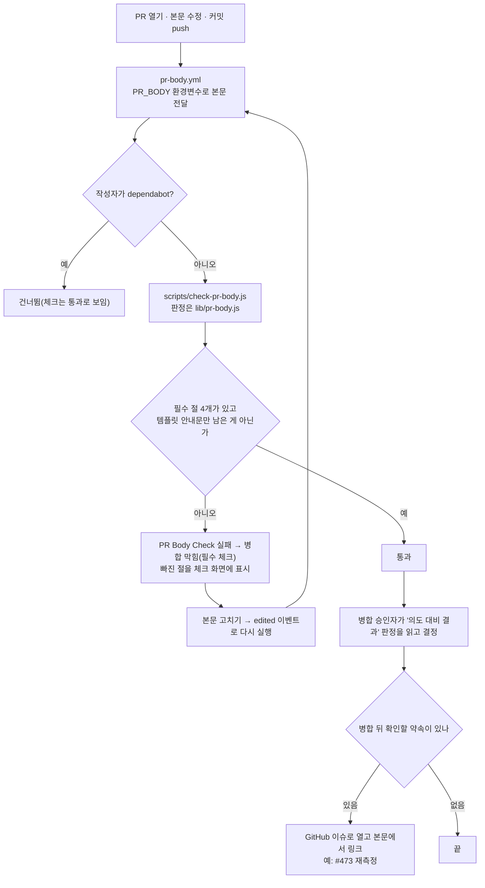

# Link-Sphere FE — PR 본문 필수 절 검사와 "의도 대비 결과" (2026-11-01)

> **문서 성격**: 독립 기능 문서(서사형)
>
> **대상 독자**: 이 레포에 PR을 여는 사람과 AI 에이전트, 그리고 PR 체크가 "PR Body Check"에서 빨개져 이유를 찾는
> 개발자.
>
> **읽고 나면**: PR 본문에 어떤 절을 어떻게 채워야 하는지, 검사가 무엇을 보고 무엇을 안 보는지, 왜 이런 검사를
> 두었는지(업계 사례 조사 포함) 안다. 검사 규칙을 바꾸려면 어디를 고치는지도 안다.
>
> **마지막 검토**: 2026-11-01

## 1. 쉬운 설명

병원 진료 기록을 생각해보자. 기록에는 환자가 처음 호소한 증상, 의사가 한 처치, 그 처치로 나아졌는지, 다음에 무엇을
볼지가 적힌다. 다음 의사는 진료실에 없었어도 이 기록만 보고 "처음 문제가 해결됐나"를 판단한다. 마지막 처치 하나만
적혀 있으면 그 판단을 할 수 없다.

이 레포의 PR 본문이 그 진료 기록이다. 특히 여러 번 질문과 수정을 오간 작업에서는 마지막에 고친 것만 적기 쉽다.
그래서 PR 본문에 **원래 요청과 의도를 적고, 항목마다 무엇을 했고 결과가 어땠는지 판정하는 절**(`## 의도 대비 결과`)을
두고, 그 절과 요약·영향 범위·검증 절이 실제로 있는지 CI가 확인한다. 내용이 의도대로인지는 병합을 승인하는 사람이
본다 — CI는 빈칸이 없는지만 본다.

## 2. 전제 지식

GitHub PR과 Actions 워크플로는 안다고 가정한다.

가정하지 않는 것:

- plan mode 작업의 계획 파일과 `## 계획 대비 구현` 대조 → [`.claude/CLAUDE.md`](../.claude/CLAUDE.md) §11
- 이 레포 CI 게이트 전체와 필수 체크(규칙셋) → [`CI-CHECK-GATE.md`](./CI-CHECK-GATE.md) §6
- 이 검사를 만들게 된 작업 → [`E2E-FLAKY.md`](./E2E-FLAKY.md), PR #472

## 3. 사용한 도구·기술

**기능 자체를 이루는 것**

- **GitHub PR 템플릿**(`.github/pull_request_template.md`) — 새 PR 본문을 미리 채운다. 필수 절의 이름과 안내문의 정본
- **GitHub Actions** `pull_request` 이벤트(`opened`·`edited`·`synchronize`·`reopened`)
- **Node.js 스크립트** — 외부 패키지 없이 본문을 줄 단위로 읽어 판정

**구현·검증 과정에서 쓴 도구**

- **Vitest** — 판정 규칙 단위 테스트(`src/test/scripts/pr-body.test.ts`)
- **`gh pr list`** — 최근 병합 PR 30개 본문을 받아 새 규칙을 돌려 봄(§9)
- **조사 서브에이전트** — 업계 사례 원문 수집(§5.1)

## 4. 왜 만들었나

2026-11-01 e2e flaky 대응 작업(#472)은 질문·승인·정정을 여러 번 오갔다. 그 끝에 보낸 마지막 보고가 직전 정정과 CI
결과만 담아, 사용자는 "이 작업이 무엇을 했고 의도대로 됐는지" 알 수 없었다. 사용자는 조각난 문서만으로는 나중에도
전체를 이해하기 어렵다고 짚고, 업계는 같은 고민을 어떻게 풀었는지 물었다.

레포를 보니 "의도 → 결과" 장치는 plan mode 작업에만 있었다.

| 작업 종류      | 의도 기록              | 결과 대조                                   |
| -------------- | ---------------------- | ------------------------------------------- |
| plan mode      | `docs/plans/<날짜>.md` | PR 본문 `## 계획 대비 구현` + 대조 에이전트 |
| plan mode 아님 | 없음(대화에만)         | 없음                                        |

PR 템플릿은 있었지만 강제하지 않았다. 2026-11-01 직접 측정한 최근 병합 PR 30개(#443~#472)를 보면 다음과 같았다.

- 의도와 결과를 대조하는 절이 없는 PR이 19개(#472는 병합 뒤 본문을 고쳐 지금은 있다)
- 절 이름이 "Summary"·"요약", "Test plan"·"검증"·"검증 (로컬)"로 제각각
- 영향 범위·검증 절이 아예 없는 PR도 있었다(#454·#461·#462 등)

## 5. 구조

### 5.1 업계는 어떻게 하나

아래 인용은 2026-11-01 조사 서브에이전트가 원문을 받아 옮긴 것을 번역했다. 확인 수준이 낮은 출처는 그 자리에 적었다.

**변경 설명에 무엇을 담나.** 확인한 대형 프로젝트는 모두 "왜, 무슨 문제인가"를 요구했고, 상당수는 검증 방법도 요구했다.

> 외부 자료 없이도 설명을 이해할 수 있게 하라. 메일링 리스트 아카이브나 버그의 URL을 주는 것에 더해, 제출한 패치에
> 이르게 된 논의의 요점을 요약하라. (번역)
>
> — Linux kernel, "Submitting patches", https://docs.kernel.org/process/submitting-patches.html

> CL은 리뷰 중에 크게 바뀔 수 있다. 제출 전에 설명을 다시 읽어, 설명이 여전히 CL이 하는 일을 반영하는지 확인할
> 가치가 있다. (번역)
>
> — Google Engineering Practices, https://google.github.io/eng-practices/review/developer/cl-descriptions.html

- [OpenStack](https://web.archive.org/web/20260207003716/https://wiki.openstack.org/wiki/GitCommitMessages)(아카이브본):
  _"리뷰어가 원래 문제가 무엇이었는지 이해하고 있다고 가정하지 마라"_ (번역).
- 검증 절: React 템플릿은 "어떻게 테스트했나" 절에 _"비워 두면 PR이 닫힐 가능성이 매우 높다"_ (번역,
  [템플릿](https://raw.githubusercontent.com/facebook/react/main/.github/PULL_REQUEST_TEMPLATE.md))고 쓴다. Phabricator는
  테스트 계획을 _"변경의 동작을 검증하려고 한 일을 기록한 반복 가능한 단계 목록"_ (번역,
  [문서](https://secure.phabricator.com/book/phabricator/article/differential_test_plans/))으로 정의하고 기본 필수 칸으로
  둔다(설정 `differential.require-test-plan-field`의 기본값이 켜짐 — [phacility/phabricator](https://github.com/phacility/phabricator)의
  Differential 설정 소스).

**도구로 강제하나.** 강제하는 곳은 소수이고, 모두 얕다 — 칸이 있는지, 길이, 안내문이 남았는지, 특정 블록이 채워졌는지.

| 사례                                                                                                                                                                                               | 강제 방식                                                                                                                                                                                     |
| -------------------------------------------------------------------------------------------------------------------------------------------------------------------------------------------------- | --------------------------------------------------------------------------------------------------------------------------------------------------------------------------------------------- |
| GitHub 자체                                                                                                                                                                                        | 없음 — _"이슈 폼은 PR에는 지원되지 않는다"_ (번역, [GitHub Docs](https://docs.github.com/en/communities/using-templates-to-encourage-useful-issues-and-pull-requests/syntax-for-issue-forms)) |
| [Danger](https://raw.githubusercontent.com/danger/danger/master/Dangerfile)·[GitLab](https://gitlab.com/gitlab-org/ruby/gems/gitlab-dangerfiles/-/raw/master/lib/danger/rules/metadata/Dangerfile) | 본문 5자 미만이면 실패                                                                                                                                                                        |
| [edk2](https://raw.githubusercontent.com/tianocore/edk2/master/.github/pull_request_template.md)                                                                                                   | 147자 미만이거나 템플릿 안내문 줄이 남으면 실패(필수 체크인지는 확인 못 함)                                                                                                                   |
| [Kubernetes](https://raw.githubusercontent.com/kubernetes-sigs/prow/main/pkg/plugins/releasenote/releasenote.go)                                                                                   | 본문의 release-note 블록이 비면 라벨을 붙이고, 그 라벨이 있으면 병합 봇이 병합하지 않음                                                                                                       |

내용이 의도대로인지를 CI가 판정하는 곳은 없었다. OpenStack은 그 역할을 _"이 문서는 이점을 알려 주는 당근이 되려
하고, Gerrit 코드 리뷰를 하는 누구든 채찍 역할을 할 수 있다"_ (번역)고 사람에게 둔다.

**AI 에이전트 회사들은.** 의도는 작업 전에 적고(GitHub Copilot은 이슈에 _"좋은 해결책이 어떤 모습인지에 대한 완전한
수용 기준"_ (번역, [GitHub Docs](https://docs.github.com/en/copilot/tutorials/coding-agent/get-the-best-results))을 적게
한다), 결과에는 증거를 붙이고(Claude Code 문서: _"증거를 요구하라 — 실행한 명령과 그 출력, 또는 스크린샷"_ (번역,
[best practices](https://code.claude.com/docs/en/best-practices))), 최종 판단은 PR에서 사람이 한다. 같은 문서는
_"Claude가 한 일에 대한 요약"_ 을 비결정적인 쪽에, _"브랜치 보호, 병합을 승인하는 사람"_ 을 마지막 말을 하는 쪽에
둔다(번역). 공식 문서가 아닌 커뮤니티 글이지만 우리와 같은 실패도 보고돼 있다 — _"에이전트에게 마지막으로 'README를
갱신해'라고 하면 제목과 설명에는 'README를 갱신함'만 남는다"_ (번역,
[GitHub 커뮤니티](https://github.com/orgs/community/discussions/189633)).

**여러 PR에 걸친 경위는.** 주류는 "의도 문서 동결 + 트래킹 이슈 + 마지막 PR 보고"다. Python은 결론 난 제안서를
_"살아 있는 명세가 아니라 역사적 문서"_ 로 보고 _"기대 동작의 공식 문서는 다른 곳에서 관리해야 한다"_ 고 쓴다(번역,
[PEP 1](https://peps.python.org/pep-0001/)) — `docs/plans`(동결)와 기능 문서(현재 동작)를 나눈 이 레포와 같은 모양이다.
Kubernetes는 flaky 테스트마다 이슈를 하나 열고 _"변경이 병합된 뒤에도 그 flake 이슈를 열어 두고 다시 나타나는지
지켜보는 것이 신중하다"_ (번역, [Kubernetes 가이드](https://raw.githubusercontent.com/kubernetes/community/master/contributors/devel/sig-testing/flaky-tests.md))고
쓴다. 포스트모템 문서는 큰 장애 전용이다(PagerDuty: _"모든 주요 장애(Sev-2/1)에 포스트모템을 한다"_ (번역,
[PagerDuty](https://postmortems.pagerduty.com/what_is/))).

### 5.2 고른 것과 택하지 않은 것

| 안                                                           | 결정                             | 이유                                                                                                                                       |
| ------------------------------------------------------------ | -------------------------------- | ------------------------------------------------------------------------------------------------------------------------------------------ |
| PR 본문 필수 절 + 존재 검사, 병합 전 전체 기준으로 다시 쓰기 | **채택**(2026-11-01 사용자 결정) | 업계 모양(템플릿 + 얕은 검사 + 사람 판정)과 같다. 1인 레포라 사람 리뷰어의 "채찍"이 약해 존재 검사가 그 자리를 일부 메운다(우리 판단)      |
| 필수 체크로 건다(병합 차단)                                  | **채택**(같은 날 사용자 결정)    | Kubernetes처럼 빈 칸이면 병합을 막는다. 걸지 않으면 빨간 체크만 뜨고 병합은 돼, 템플릿만 있던 때처럼 지나칠 수 있다                        |
| 병합 뒤 남는 약속은 GitHub 이슈로                            | **채택**(같은 날, 첫 사례 #473)  | Kubernetes flake 이슈 관행. 메모리에만 있던 재측정 약속이 GitHub에서 보이게 된다                                                           |
| 규칙만 두고 강제하지 않기                                    | 택하지 않음                      | 대형 프로젝트의 주류지만 사람 리뷰어가 강제하는 구조다. 이 레포에서 템플릿만으로는 30개 중 19개가 빠졌다(§4)                               |
| 작업마다 포스트모템식 작업 기록 문서 신설                    | 택하지 않음                      | 선례가 없다 — 포스트모템은 장애 전용, Kubernetes 설계 문서는 flaky 수정을 대상에서 뺀다. PR 본문·기능 문서와 같은 사실이 세 곳에 생긴다    |
| 대화의 마지막 보고를 턴 끝 훅으로 검사                       | 보류                             | Claude Code Stop 훅은 마지막 메시지를 받아 결정적으로 검사할 수 있지만 매 턴 돈다. claude-base 턴 끝 훅 판정(2026-11-11 예정) 때 함께 본다 |
| 내용이 의도대로인지 모델이 판정                              | 택하지 않음                      | 업계에 CI 선례가 없고, 판정은 승인자의 몫이다                                                                                              |

### 5.3 검사 규칙

필수 절은 네 개다: `## 요약`, `## 영향 범위`, `## 의도 대비 결과` 또는 `## 계획 대비 구현`, `## 검증`.

- **절로 보는 제목**: 이름과 같거나, 이름 뒤에 공백·괄호로 덧붙인 `## ` 제목(`## 검증 (로컬)`). `## 요약하면`은 아니다.
- **절의 범위**: 그 제목부터 다음 `# `·`## ` 제목 전까지. `###` 이하는 절 안의 내용이다. 코드 블록 안의 `#` 줄(셸 주석 등)은
  제목으로 보지 않는다.
- **비었다고 보는 것**: HTML 주석을 지운 뒤, 남은 줄이 모두 기호만 있는 줄(`-`, `- [ ]`, 표 구분선·빈 표 행)이거나 템플릿에
  있는 줄 그대로(`원래 요청:`, 표 머리글 등)일 때.
- **안 보는 것**: 표의 판정 칸에 무엇을 적었는지, 의도와 결과가 맞는지, 원래 요청이 정확한지. 승인자가 본다.

## 6. 상태 모델

해당 없음 — 검사는 저장하는 상태가 없고, 매 이벤트마다 그 시점의 본문만 본다.

## 7. 운영 파라미터

| 값                    | 위치                                | 뜻                                                                                                                                                                                                                                                                                                                                                                                                                 |
| --------------------- | ----------------------------------- | ------------------------------------------------------------------------------------------------------------------------------------------------------------------------------------------------------------------------------------------------------------------------------------------------------------------------------------------------------------------------------------------------------------------ |
| 필수 절 목록          | `scripts/lib/pr-body.js:9`          | `REQUIRED_SECTIONS` — 이름 목록과 실패 메시지에 붙는 안내                                                                                                                                                                                                                                                                                                                                                          |
| "기호만 있는 줄" 기준 | `scripts/lib/pr-body.js:22`         | `SYMBOLS_ONLY`                                                                                                                                                                                                                                                                                                                                                                                                     |
| 실행 이벤트           | `.github/workflows/pr-body.yml:12`  | `opened`·`edited`(본문·제목 수정)·`synchronize`(새 커밋에도 결과를 붙이려고)·`reopened`                                                                                                                                                                                                                                                                                                                            |
| dependabot 건너뛰기   | `.github/workflows/pr-body.yml:24`  | 본문 형식을 우리가 정하지 않는 PR                                                                                                                                                                                                                                                                                                                                                                                  |
| 시간 제한             | `.github/workflows/pr-body.yml:26`  | 5분(보통 수 초)                                                                                                                                                                                                                                                                                                                                                                                                    |
| 필수 체크 여부        | GitHub 규칙셋 "Main Branch Protect" | 필수 체크다(2026-11-01 사용자 결정) — 절이 빠지면 본문을 고칠 때까지 병합이 막힌다. dependabot PR은 job을 건너뛰고, 조건으로 건너뛴 job은 _"'Success'로 보고된다"_ (번역, [GitHub Docs](https://docs.github.com/en/pull-requests/collaborating-with-pull-requests/collaborating-on-repositories-with-code-quality-features/troubleshooting-required-status-checks), 요약 모델을 거쳐 받은 문구)고 해 막히지 않는다 |

## 8. 코드 지도와 자주 하는 수정

| 하고 싶은 것                 | 어떻게                                                                                                                                                                                                       |
| ---------------------------- | ------------------------------------------------------------------------------------------------------------------------------------------------------------------------------------------------------------ |
| PR을 열기 전에 미리 검사     | `pnpm check:pr-body <본문 파일>` — `gh pr create --body-file`에 넘길 파일 그대로                                                                                                                             |
| 체크가 빨개졌다              | 체크 화면의 오류 주석에 빠진 절이 나온다. 본문을 고치면 `edited` 이벤트로 다시 돈다                                                                                                                          |
| 필수 절을 더하거나 빼기      | `scripts/lib/pr-body.js:9`의 `REQUIRED_SECTIONS`, 템플릿 `.github/pull_request_template.md`, 이 문서 §5.3, `.claude/CLAUDE.md` §11을 함께 고친다. 테스트는 `src/test/scripts/pr-body.test.ts`                |
| 템플릿 안내문 바꾸기         | `.github/pull_request_template.md`만 고치면 된다 — 검사는 템플릿 파일을 읽어 "안내문 그대로인 줄"을 판정한다                                                                                                 |
| 필수 체크에서 빼기(되돌리기) | 규칙셋 "Main Branch Protect"의 필수 체크에서 `pr-body`를 뺀다(`CI-CHECK-GATE.md` §6 "main 규칙셋" 행). 워크플로에 경로 필터를 넣지 않는다 — 워크플로째 건너뛰면 필수 체크가 "대기 중"으로 남아 병합이 막힌다 |

## 9. 검증 결과

- **단위 테스트** 9개 통과 — 채운 본문 통과, 템플릿 그대로·빈 본문 실패, `계획 대비 구현` 인정, 덧붙인 제목 인정, 빈 표,
  주석만 있는 절, 코드 블록 안 `#` 줄, 비슷한 제목 구분.
- **지난 PR에 돌려 보기**(직접 측정, 2026-11-01): 최근 병합 PR 30개(#443~#472) 중 5개 통과, 25개 실패. 실패 중 18개는
  의도·결과 절이 없었고, 나머지 7개는 옛 템플릿의 영어 절 이름(Summary·Test plan)만 걸렸다.
- **#474 자신**(2026-11-01): 처음 열 때 PR Body Check 통과(job 5초,
  [run 41288954264](https://github.com/BAECHAN/link-sphere_FE_NEW/actions/runs/41288954264)). 본문에서 `## 검증` 절을 일부러
  지우자 그 체크만 다시 돌아 `"## 검증" 절이 없습니다`로 실패했고
  ([run 41288999135](https://github.com/BAECHAN/link-sphere_FE_NEW/actions/runs/41288999135)), 그동안 CI 워크플로는 다시
  돌지 않았다. 되돌리자 다시 통과했다.

## 10. 시행착오

### 10.1 외부 URL 안의 `src/` 경로를 문서 검사가 레포 경로로 읽었다 (2026-11-01)

§5.1에 Phabricator 설정 소스를 phacility/phabricator 저장소의 `src` 폴더 아래 PHP 파일 원문 주소로 링크했더니
`pnpm check:docs`가 "존재하지 않는 경로"로 실패했다. `scripts/check-docs.js`의 경로 검사는 줄 안의 `src/…확장자` 토큰을
URL 안에서도 잡는다. 검사기를 고치지 않고 저장소 주소와 설정 이름(`differential.require-test-plan-field`)으로 출처를 남겼다.
외부 저장소 파일을 링크할 때 같은 일이 생기면 같은 방법을 쓴다.

## 11. 남은 것

- **대화의 마지막 보고**: PR 본문만 검사한다. 대화 답변을 같은 틀로 쓰는지는 규칙(`.claude/CLAUDE.md` §11)에 기대고, 턴 끝 훅
  검사는 2026-11-11 무렵 claude-base 턴 끝 훅 판정 때 함께 본다.
- **BE 레포**: 같은 검사가 없다.
- **내용의 질**: 판정 칸이 사실과 맞는지는 검사하지 못한다.

## 12. 용어 사전

- **필수 절** — PR 본문에 반드시 있어야 하는 `## ` 제목과 그 아래 내용. 이 검사의 대상 네 개(§5.3).
- **의도 대비 결과** — plan mode를 거치지 않은 작업의 PR 본문 절. 원래 요청과, 사용자가 답하거나 승인한 시점의 의도를
  항목별로 적고 한 일·결과와 증거·판정을 단다.
- **계획 대비 구현** — plan mode 작업의 같은 자리 절. 커밋한 계획 파일과 diff, 그리고 대화 요약(넘겼으면)을 대조한
  결과(`.claude/CLAUDE.md` §11).
- **판정** — 의도 항목마다 붙이는 "됐음" / "이탈(이유)" / "아직 모름(언제 어떻게 확인하나)".
- **템플릿 안내문** — `.github/pull_request_template.md`에 미리 들어 있는 줄. 그대로 남아 있으면 빈 칸으로 본다.
- **필수 체크** — 통과해야 main에 병합할 수 있는 CI 결과. GitHub 규칙셋에서 정한다.

## 13. 관련 문서

- [`.claude/CLAUDE.md`](../.claude/CLAUDE.md) §11 — 계획 대비 구현과 의도 대비 결과 규칙
- [`CI-CHECK-GATE.md`](./CI-CHECK-GATE.md) — CI 게이트 전체와 필수 체크
- [`E2E-FLAKY.md`](./E2E-FLAKY.md) — 이 검사를 만들게 된 작업의 경위
