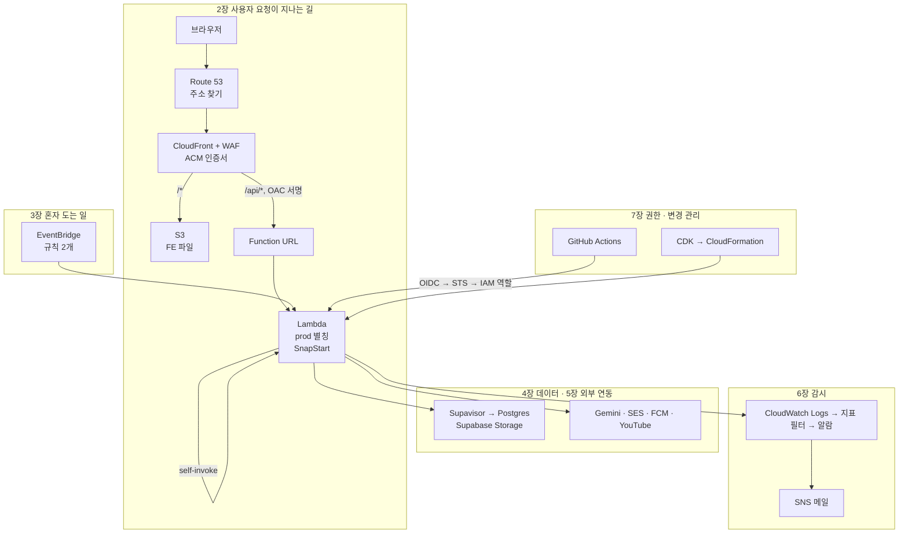

# 서비스 용어 사전

> **문서 성격**: 레퍼런스 — 이 프로젝트가 실제로 쓰는 클라우드·외부 서비스와 거기 딸린 말을 뜻과 함께 모았다. 설정값과
> 절차의 정본은 각 항목 끝에 링크한 문서다.
>
> **대상 독자**: 운영 문서나 AWS 콘솔, 알람 메일에서 처음 보는 서비스 이름을 만난 개발자. 클라우드 경험이 없어도 읽을 수
> 있게 썼다.
>
> **읽고 나면**: 요청 하나가 어떤 서비스를 거치는지 설명할 수 있고, 어떤 용어를 만나도 뜻과 우리가 쓰는 자리, 더 볼 문서를
> 바로 찾을 수 있다.
>
> **마지막 검토**: 2026-11-07

코드 용어(FSD, 3-Layer API 등)는 [`ONBOARDING.md` §7](./ONBOARDING.md#7-공통-용어)을, 한 기능에만 나오는 말은 그 기능 문서 끝의
"용어 사전"을 본다.

**읽는 법**

- 큰 항목은 같은 순서로 쓴다: 한 줄 비유 → 무엇인가 → 우리는 → 없으면 → 알아 둘 것 → 다른 선택지 → 정본. 적을 내용이 없거나 따로 적지 않은 줄은 뺐다.
- 따옴표 이탤릭에 `(번역)`이 붙은 문장은 공식 문서를 옮긴 것이다. "우리는" 줄은 이 프로젝트의 설정이다.
- 자주 바뀌는 값(메모리, 요금, 모델 버전 등)은 적지 않고 정본 링크로 보낸다.
- `infra` 다음에 적은 경로(예: infra `README.md`)는 비공개 저장소 `link-sphere-infra` 안의 파일이라 링크를 달지 않았다. FE 저장소의 `infra/` 폴더와는 다르다.

---

## 1. 지도와 찾아보기

### 서비스 지도

사용자 요청, 예약 실행, 감시, 변경 관리가 각각 어떤 서비스를 지나는지 보여 준다. 묶음 제목의 장 번호가 이 문서의 장이다.



### 찾아보기

- **공통**: [리전](#리전)
- **요청이 지나는 길**: [Route 53](#route-53) · [ALIAS 레코드](#route-53) · [ACM](#acm) · [CloudFront](#cloudfront) ·
  [오리진](#cloudfront) · [캐시 동작](#cloudfront) · [무효화](#cloudfront) · [CloudFront Functions](#cloudfront-functions) ·
  [OAC](#oac) · [WAF](#waf) · [Web ACL](#waf) · [S3](#s3) · [Lambda](#lambda) · [콜드 스타트](#lambda) · [동시 실행](#lambda) ·
  [SnapStart](#snapstart) · [버전과 별칭](#버전과-별칭) · [Function URL](#function-url)
- **혼자 도는 일**: [EventBridge](#eventbridge) · [워밍 핑](#워밍-핑) · [self-invoke](#self-invoke) · [잡](#잡)
- **데이터**: [Supabase](#supabase) · [Postgres](#postgres) · [pgvector](#pgvector) · [Supavisor](#supavisor) · [RLS](#rls) ·
  [Supabase Storage](#supabase-storage) · [백업과 RPO](#백업과-rpo)
- **외부 연동**: [Gemini](#gemini) · [FCM](#fcm) · [VAPID](#vapid) · [SES](#ses) · [DKIM](#ses) ·
  [YouTube Data API](#youtube-data-api)
- **감시**: [CloudWatch](#cloudwatch) · [지표 필터](#cloudwatch) · [알람](#cloudwatch) · [SNS](#sns) ·
  [CloudWatch RUM](#cloudwatch-rum) · [업타임 점검](#업타임-점검) · [이슈 알림](#이슈-알림) · [drift](#drift) ·
  [CloudTrail](#cloudtrail) · [Cost Explorer](#cost-explorer)
- **권한·변경 관리**: [IAM](#iam) · [권한 경계](#iam) · [STS](#sts) · [OIDC](#oidc) · [CDK](#cdk) ·
  [CloudFormation](#cloudformation) · [CloudShell](#cloudshell) · [GitHub Actions](#github-actions) ·
  [룰셋·GitHub App·Dependabot·GitHub Pages](#github-부가-기능)
- **안 쓰는 것**: [API Gateway, SQS, DynamoDB 등](#8-안-쓰는-것)

### 리전

**AWS 데이터센터를 지역별로 묶은 단위다.** 같은 이름의 리소스도 리전이 다르면 별개이고, 콘솔에서 리전이 다르면 안 보인다.

| 리전                  | 두는 것                                                                                | 이유                                                                                                               |
| --------------------- | -------------------------------------------------------------------------------------- | ------------------------------------------------------------------------------------------------------------------ |
| 도쿄 `ap-northeast-1` | Lambda, EventBridge 규칙, 로그·알람, SNS, SES, RUM 수집, 배포·백업 버킷, CDK 운영 단계 | BE와 Supabase DB를 같은 도쿄에 둬 응답을 빠르게 한다(App Runner 시절 기록). Lambda로 옮길 때 다시 고른 기록은 없다 |
| 서울 `ap-northeast-2` | FE 정적 파일 버킷, CDK 시험 단계                                                       | 시험 단계를 운영과 다른 리전에 둔다. 계정은 같아서 IAM은 공유하고 이름 접미사 `-test`로 구분한다                   |
| 버지니아 `us-east-1`  | CloudFront용 ACM 인증서, WAF Web ACL, RUM 로더 주소, Cost Explorer API                 | CloudFront에 붙이는 것과 비용 조회가 이 리전으로 고정돼 있다                                                       |

---

## 2. 요청이 지나는 길

### Route 53

**인터넷 주소록이다.** `linksphere.click`이라는 이름을 실제로 접속할 곳으로 바꿔 준다.

- **무엇인가**: [AWS 문서](https://docs.aws.amazon.com/Route53/latest/DeveloperGuide/Welcome.html)는 _"고가용성이며 확장 가능한 도메인 이름 시스템(DNS) 웹 서비스"_ (번역)라고 쓴다. 도메인 등록, DNS 라우팅, 상태 확인 세 기능이 있다.
- **우리는**: `linksphere.click`의 등록기관이자 호스팅 존이다. 도메인과 `www`를 ALIAS 레코드로 CloudFront에 연결했고, SES가 쓰는 DKIM 레코드도 여기 있다. 상태 확인 기능은 쓰지 않는다.
- **없으면**: 사이트와 API가 이름 해석부터 실패한다. 2026-10-14에는 등록자 이메일 미확인으로 도메인이 정지돼 약 4시간 동안 전체가 멈췄다.
- **정본**: [DEPLOY "커스텀 도메인"](./DEPLOY.md#커스텀-도메인-수동-관리--적용-완료-2026-09-29)

| 말           | 뜻                                                                                                                                                                                                                                                                                     |
| ------------ | -------------------------------------------------------------------------------------------------------------------------------------------------------------------------------------------------------------------------------------------------------------------------------------- |
| 호스팅 존    | 한 도메인의 DNS 레코드를 모아 둔 곳                                                                                                                                                                                                                                                    |
| ALIAS 레코드 | Route 53 고유 레코드로 CloudFront 같은 AWS 리소스를 가리킨다. 다른 도메인 이름을 가리키는 CNAME과 달리 도메인 최상위(`linksphere.click` 자체)에도 쓸 수 있다([AWS 문서](https://docs.aws.amazon.com/Route53/latest/DeveloperGuide/resource-record-sets-choosing-alias-non-alias.html)) |

### ACM

**HTTPS 자물쇠에 쓰는 인증서를 발급하는 곳이다.**

- **무엇인가**: [AWS 문서](https://docs.aws.amazon.com/acm/latest/userguide/acm-overview.html)는 _"공개 및 비공개 SSL/TLS X.509 인증서와 키의 생성, 저장, 갱신을 처리한다"_ (번역)고 쓴다.
- **우리는**: `linksphere.click`과 `www`를 담은 인증서 하나를 DNS 검증으로 받아 CloudFront에 붙였다.
- **없으면**: 브라우저가 우리 도메인의 HTTPS 연결을 신뢰할 수 없다.
- **알아 둘 것**: CloudFront에 붙일 인증서는 `us-east-1`에서 발급해야 한다.
- **정본**: [DEPLOY "커스텀 도메인"](./DEPLOY.md#커스텀-도메인-수동-관리--적용-완료-2026-09-29)

### CloudFront

**모든 요청이 처음 도착하는 정문이다.** 경로를 보고 FE 파일 창고로 보낼지 BE로 보낼지 정하고, 파일은 사용자 가까이에 캐시한다.

- **무엇인가**: [AWS 문서](https://docs.aws.amazon.com/AmazonCloudFront/latest/DeveloperGuide/Introduction.html)는 _"정적 및 동적 웹 콘텐츠를 엣지 로케이션이라는 전 세계 데이터센터 네트워크를 통해 사용자에게 더 빠르게 전달하는 웹 서비스"_ (번역)라고 쓴다.
- **우리는**: 배포 하나를 쓴다. 기본 동작은 S3(`Managed-CachingOptimized`), `/api/*`는 Lambda(`Managed-CachingDisabled`, 캐시 안 함)로 보낸다. 그래서 FE와 BE가 같은 도메인을 쓴다.
- **없으면**: 사이트와 API 입구가 함께 사라진다.
- **알아 둘 것**:
  - CloudFront 자체의 정액 요금제 중 무료 단계(Free)를 쓴다. AWS 프리티어, Supabase Free와는 별개다. 이 단계에서는 표준 접근 로그와 응답 헤더 정책을 쓸 수 없다.
  - 설정은 CDK 밖에 있어 콘솔·CLI로 바꾼다. 저장해 둔 설정 사본 `infra/cloudfront/snapshot.json`과 매일 비교해 어긋나면 이슈를 연다([drift](#drift)). 이 사본은 SnapStart 스냅샷과 무관하다.
- **정본**: [SYSTEM-ARCHITECTURE §1](./SYSTEM-ARCHITECTURE.md#1-시스템-컨텍스트), [DEPLOY "설정 스냅샷과 차이 검사"](./DEPLOY.md#cloudfront-설정-스냅샷과-차이-검사), [CACHE-STRATEGY](./CACHE-STRATEGY.md)

| 말        | 뜻                                                                                                                                                                                                                                           |
| --------- | -------------------------------------------------------------------------------------------------------------------------------------------------------------------------------------------------------------------------------------------- |
| 배포      | _"CloudFront에 콘텐츠를 어디서 전달할지, 전달을 어떻게 추적하고 관리할지 알려 주는 설정"_ (번역, [AWS 문서](https://docs.aws.amazon.com/AmazonCloudFront/latest/DeveloperGuide/distribution-overview.html))                                  |
| 오리진    | CloudFront가 콘텐츠를 가져오는 원본. 우리는 S3와 Lambda Function URL 둘이다                                                                                                                                                                  |
| 캐시 동작 | 경로 패턴별 처리 규칙. 요청 경로를 나열된 순서대로 비교해 처음 일치한 규칙을 적용하고, 기본 동작(`*`)은 항상 마지막이다([AWS 문서](https://docs.aws.amazon.com/AmazonCloudFront/latest/DeveloperGuide/DownloadDistValuesCacheBehavior.html)) |
| 무효화    | 만료 전에 엣지 캐시에서 파일을 지우는 일. 다음 요청 때 오리진에서 새로 받는다([AWS 문서](https://docs.aws.amazon.com/AmazonCloudFront/latest/DeveloperGuide/Invalidation.html)). FE 배포 워크플로가 수행한다                                 |

### CloudFront Functions

**정문에서 도는 아주 작은 JavaScript다.** 서버까지 가기 전에 요청과 응답을 살짝 고친다.

- **무엇인가**: [AWS 문서](https://docs.aws.amazon.com/AmazonCloudFront/latest/DeveloperGuide/cloudfront-functions.html)는 _"JavaScript로 작성하는 경량 함수로, 지연 시간에 민감한 대규모 CDN 사용자 정의에 쓴다"_ (번역)고 쓴다.
- **우리는**: 함수 2개를 쓴다.
  - `link-sphere-spa-fallback`(요청 때): 앱 경로를 `/index.html`로, 앱 경로가 아닌 확장자 없는 경로를 `/404.html`로 바꾼다.
  - `link-sphere-spa-status`(응답 때): `/404.html` 응답의 상태를 404로 바꾸고, `/index.html`·`/404.html`에 `Cross-Origin-Embedder-Policy` 헤더를 붙여 외부 썸네일 요청에서 쿠키를 뺀다.
- **없으면**: S3에는 `/post/123` 같은 파일이 없으므로 새로고침이나 링크로 들어온 화면이 깨진다.
- **정본**: [DEPLOY "CloudFront Function"](./DEPLOY.md#cloudfront-function-수동-관리), 코드 [`infra/cloudfront-functions/`](../infra/cloudfront-functions/)

### OAC

**CloudFront가 원본에 보여 주는 통행증이다.** CloudFront를 거친 요청에만 서명이 붙어, 원본을 직접 두드린 요청은 거절된다.

- **무엇인가**: Origin Access Control의 줄임말이다. [AWS 문서](https://docs.aws.amazon.com/AmazonCloudFront/latest/DeveloperGuide/private-content-restricting-access-to-lambda.html)는 _"Lambda 함수 URL 오리진에 대한 접근을 제한하기 위해"_ (번역) OAC를 제공한다고 쓴다.
- **우리는**: S3용과 Lambda용(`link-sphere-api-lambda-oac`) 2개이고, 모든 요청에 서명한다.
- **없으면**: 원본을 직접 불러 WAF를 건너뛸 수 있다.
- **알아 둘 것**: OAC 때문에 API 요청에 제약이 세 가지 생겼다.
  - 로그인 토큰은 `Authorization` 대신 `X-Access-Token`으로 보낸다. OAC가 `Authorization`을 자기 서명으로 덮어쓰기 때문이다.
  - GET이 아닌 요청에는 본문 해시를 `x-amz-content-sha256`에 싣는다. 공식 문서는 _"Lambda는 서명되지 않은 페이로드를 지원하지 않는다"_ (번역)고 쓴다. 코드는 [`client.ts`](../src/shared/api/client.ts)다.
  - 본문이 있는 DELETE는 올바른 해시를 넣어도 403이다. 그래서 회원 탈퇴와 FCM 토큰 해제는 POST로 옮겼다.
- **정본**: [DEPLOY "OAC"](./DEPLOY.md#cloudfront-origin-access-control-oac), [BE DEPLOY](https://github.com/BAECHAN/link-sphere_BE_NEW/blob/main/docs/DEPLOY.md) 5-1장

### WAF

**정문 앞 검문소다.** 위험해 보이는 요청이나 한 IP에서 지나치게 많이 오는 요청을 막는다.

- **무엇인가**: [AWS 문서](https://docs.aws.amazon.com/waf/latest/developerguide/waf-chapter.html)는 _"보호되는 웹 애플리케이션 리소스로 전달되는 HTTP(S) 요청을 모니터링할 수 있게 해 주는 웹 애플리케이션 방화벽"_ (번역)이라고 쓴다.
- **우리는**: Web ACL 하나에 규칙 4개를 이 순서로 건다. `AWS-AWSManagedRulesAmazonIpReputationList`(평판 나쁜 IP) → `AWS-AWSManagedRulesCommonRuleSet`(일반 공격, `CrossSiteScripting_BODY`만 Count) → `AWS-AWSManagedRulesKnownBadInputsRuleSet`(알려진 악성 입력) → `RateLimit-PerIP`(IP별 요청 수).
- **없으면**: 공격성 요청과 몰아치는 요청이 그대로 Lambda까지 간다.
- **알아 둘 것**:
  - 차단 응답은 BE가 만든 JSON이 아니라 CloudFront의 HTML 403이다. FE는 이를 `EDGE_BLOCKED`로 분류한다. Free 요금제라 응답 코드를 429로 바꿀 수 없다.
  - 공통 규칙의 `SizeRestrictions_BODY`가 8KB가 넘는 본문을 막는다. 그래서 댓글에 앱 자체 바이트 상한이 있다. 이 규칙을 푸는 데는 조건이 있으니 [DEPLOY](./DEPLOY.md#cloudfront-waf-수동-관리)를 먼저 읽는다.
- **정본**: [DEPLOY "CloudFront WAF"](./DEPLOY.md#cloudfront-waf-수동-관리), [BE TRAFFIC-MANAGEMENT](https://github.com/BAECHAN/link-sphere_BE_NEW/blob/main/docs/TRAFFIC-MANAGEMENT.md) 8-1장

| 말               | 뜻                                                                                                                                                                                                           |
| ---------------- | ------------------------------------------------------------------------------------------------------------------------------------------------------------------------------------------------------------ |
| Web ACL          | 규칙을 모아 하나의 리소스(우리는 CloudFront)에 붙이는 묶음. 최근 AWS 문서는 "보호 팩"이라고도 부른다                                                                                                         |
| 관리형 규칙 그룹 | _"AWS와 AWS Marketplace 판매자가 작성하고 유지 관리하는, 미리 정의된 즉시 사용 가능한 규칙들의 모음"_ (번역, [AWS 문서](https://docs.aws.amazon.com/waf/latest/developerguide/waf-managed-rule-groups.html)) |
| 속도 제한 규칙   | 들어오는 요청을 세어 너무 빠른 요청을 제한하는 규칙([AWS 문서](https://docs.aws.amazon.com/waf/latest/developerguide/waf-rule-statement-type-rate-based.html)). `RateLimit-PerIP`가 이것이다                 |
| Block / Count    | Block은 실제로 막고, Count는 세기만 한다. `RateLimit-PerIP`는 Count로 관찰한 뒤 Block으로 바꿨다                                                                                                             |

### S3

**파일 창고다.** 폴더 대신 버킷에 파일(객체)을 담는다.

- **무엇인가**: [AWS 문서](https://docs.aws.amazon.com/AmazonS3/latest/userguide/Welcome.html)는 _"확장성, 데이터 가용성, 보안, 성능이 뛰어난 객체 스토리지 서비스"_ (번역)라고 쓴다. 버킷은 객체를 담는 컨테이너이고, 객체는 파일과 그 메타데이터다.
- **우리는**: 운영에 쓰는 버킷은 3개다. 콘솔에는 CDK용, 시험 단계, 정리 후보 버킷이 더 보인다.
  - FE 정적 파일 버킷(서울): CloudFront가 읽는다.
  - `link-sphere-lambda-deploy`: BE 배포 파일을 둔다.
  - `link-sphere-db-backup`: DB·이미지 백업을 둔다.
- **없으면**: 화면 파일, BE 배포 경로, 백업이 사라진다.
- **알아 둘 것**: 사용자가 올린 이미지는 S3가 아니라 [Supabase Storage](#supabase-storage)에 있다.
- **정본**: [DEPLOY](./DEPLOY.md), [SYSTEM-ARCHITECTURE §2](./SYSTEM-ARCHITECTURE.md#2-배포-파이프라인)

### Lambda

**요청이 올 때만 깨어나 일하는 서버다.** 서버를 켜 두고 관리하지 않아도 되고, 쓴 만큼만 낸다.

- **무엇인가**: [AWS 문서](https://docs.aws.amazon.com/lambda/latest/dg/welcome.html)는 _"서버리스 컴퓨팅 서비스로, 서버를 프로비저닝하거나 관리하지 않고 코드를 실행할 수 있게 한다"_ (번역)고 쓴다. 프로비저닝은 서버나 리소스를 마련해 준비하는 일이다.
- **우리는**: 함수 `link-sphere-api` 하나가 Spring Boot BE 전체를 돌린다. 요청은 `LambdaHandler`가 받아 MockMvc로 앱에 넘긴다. MockMvc는 원래 Spring 테스트 도구인데, init 워밍업이 Lambda Web Adapter와 충돌해 어댑터를 없앤 2026-07-25부터 운영 요청도 이 경로로 받는다.
- **없으면**: API 전체가 멈춘다.
- **알아 둘 것**:
  - 응답을 돌려주면 실행 환경이 얼어붙어 뒤에 남은 작업이 멈춘다. 그래서 [self-invoke](#self-invoke)를 쓴다.
  - 최근 AWS 문서는 일반 함수를 "Event Function"이라고 부른다. API와 CLI는 그대로 `function`이다.
- **정본**: [BE DEPLOY](https://github.com/BAECHAN/link-sphere_BE_NEW/blob/main/docs/DEPLOY.md) "Lambda 실행 구조", [BE PERFORMANCE](https://github.com/BAECHAN/link-sphere_BE_NEW/blob/main/docs/PERFORMANCE.md)

| 말          | 뜻                                                                                                                                                                                                                                                                                 |
| ----------- | ---------------------------------------------------------------------------------------------------------------------------------------------------------------------------------------------------------------------------------------------------------------------------------- |
| 실행 환경   | 함수 코드가 도는 격리된 칸. Init(준비) → Invoke(실행) → Shutdown(종료)을 거친다([AWS 문서](https://docs.aws.amazon.com/lambda/latest/dg/lambda-runtime-environment.html))                                                                                                          |
| 콜드 스타트 | 요청을 받았을 때 코드를 내려받고 환경을 새로 준비하는 시작 단계. 이어서 초기화 코드까지 돌아 응답이 그만큼 늦어진다(같은 문서)                                                                                                                                                     |
| 웜 스타트   | 끝난 뒤 얼려 둔 실행 환경을 다시 쓰는 것. 초기화를 다시 하지 않아 빠르다(같은 문서)                                                                                                                                                                                                |
| 동시 실행   | 한 번에 처리 중인 요청 수. 최대치에 닿으면 추가 요청이 429로 실패한다([AWS 문서](https://docs.aws.amazon.com/lambda/latest/dg/scaling-behavior.html)). 한도 값은 [BE TRAFFIC-MANAGEMENT](https://github.com/BAECHAN/link-sphere_BE_NEW/blob/main/docs/TRAFFIC-MANAGEMENT.md) 7-2장 |

### SnapStart

**부팅이 끝난 상태를 사진 찍어 두고, 다음부터는 사진에서 깨어나는 기능이다.** Spring처럼 부팅이 느린 앱의 콜드 스타트를 줄인다.

- **무엇인가**: [AWS 문서](https://docs.aws.amazon.com/lambda/latest/dg/snapstart.html)는 함수 버전을 게시할 때 _"초기화된 실행 환경의 메모리와 디스크 상태 스냅샷"_ (번역)을 찍어 두고, 새 실행 환경을 처음부터 초기화하지 않고 그 스냅샷에서 재개한다고 쓴다.
- **우리는**: 게시된 버전에만 켠다(`PublishedVersions`). 배포 때 버전을 발행하면 스냅샷이 만들어진다.
- **없으면**: 콜드 스타트마다 Spring이 처음부터 부팅한다. 수치는 BE PERFORMANCE를 본다.
- **알아 둘 것**:
  - `$LATEST`에는 스냅샷이 없다. 그래서 워밍 핑과 self-invoke가 모두 `prod` 별칭을 부른다.
  - DB 연결은 스냅샷에 넣지 않는다. 체크포인트 직전에 닫고 복원 뒤 다시 맺으며, 그 과정에서 겪은 문제는 BE DEPLOY 시행착오 8·9에 있다.
- **정본**: [BE DEPLOY](https://github.com/BAECHAN/link-sphere_BE_NEW/blob/main/docs/DEPLOY.md) "SnapStart 동작 흐름", [BE PERFORMANCE](https://github.com/BAECHAN/link-sphere_BE_NEW/blob/main/docs/PERFORMANCE.md) 4·6장

### 버전과 별칭

**버전은 찍어 둔 사진이고, 별칭은 지금 쓸 사진을 가리키는 책갈피다.** 책갈피만 옮기면 배포와 되돌리기가 끝난다.

- **무엇인가**: [버전](https://docs.aws.amazon.com/lambda/latest/dg/configuration-versions.html)은 게시 시점의 코드와 설정 복사본이고 게시 뒤에는 코드를 바꿀 수 없다. [별칭](https://docs.aws.amazon.com/lambda/latest/dg/configuration-aliases.html)은 _"업데이트할 수 있는 함수 버전 포인터"_ (번역)다.
- **우리는**: 배포마다 새 버전을 발행하고, 그 버전을 직접 호출해 검증을 통과해야 별칭 `prod`를 옮긴다. 사용자 요청, EventBridge, self-invoke 모두 `prod`를 부른다.
- **없으면**: 망가진 배포가 검증 없이 곧바로 사용자에게 닿는다.
- **정본**: [BE DEPLOY](https://github.com/BAECHAN/link-sphere_BE_NEW/blob/main/docs/DEPLOY.md) "배포 흐름", [LAMBDA-CONFIG-ROLLBACK](https://github.com/BAECHAN/link-sphere_BE_NEW/blob/main/docs/LAMBDA-CONFIG-ROLLBACK.md)

| 말        | 뜻                                                                                             |
| --------- | ---------------------------------------------------------------------------------------------- |
| `$LATEST` | 아직 게시하지 않은 작업본. 코드를 올리면 덮어써진다. 버전을 지정하지 않고 호출하면 여기로 간다 |
| `prod`    | 우리 운영 별칭. 지금 사용자에게 나가는 버전을 가리킨다                                         |
| 승격      | 검증을 통과한 버전으로 `prod`를 옮기는 일. 검증이 실패하면 `prod`는 이전 버전에 남는다         |

### Function URL

**Lambda 함수에 붙이는 전용 HTTP 주소다.** 별도 API 서버 없이 함수를 URL로 부를 수 있다.

- **무엇인가**: [AWS 문서](https://docs.aws.amazon.com/lambda/latest/dg/urls-configuration.html)는 _"함수 URL은 Lambda 이벤트 함수 전용 HTTP(S) 엔드포인트다"_ (번역)라고 쓴다. 주소는 `https://<url-id>.lambda-url.<region>.on.aws` 형식이고, 별칭이나 `$LATEST`에만 붙일 수 있다.
- **우리는**: `link-sphere-api`의 `prod` 별칭에 붙어 있다. 인증은 `AWS_IAM`, 호출 모드는 `BUFFERED`다. CloudFront가 OAC로 서명한 요청만 통과하고, 직접 부르면 403이다.
- **없으면**: CloudFront가 BE로 요청을 넘길 입구가 없다.
- **알아 둘 것**: 직접 호출 403은 정상이다. 상태 확인은 CloudFront 주소로 한다.
- **다른 선택지**: API Gateway. 우리는 쓰지 않으며 둘을 비교한 기록은 레포 문서에 없다.
- **정본**: [BE DEPLOY](https://github.com/BAECHAN/link-sphere_BE_NEW/blob/main/docs/DEPLOY.md) 5·5-1장, infra `lib/baseline-stack.ts`

| 말                | 뜻                                                                                                                                                                                                           |
| ----------------- | ------------------------------------------------------------------------------------------------------------------------------------------------------------------------------------------------------------ |
| `AWS_IAM`         | 호출자가 요청을 AWS 서명 방식(SigV4)으로 서명해야 하고 Lambda는 서명이 일치할 때만 처리한다([AWS 문서](https://docs.aws.amazon.com/lambda/latest/dg/urls-invocation.html)). 반대인 `NONE`은 인증 없이 받는다 |
| `BUFFERED`        | 기본 호출 모드. 응답이 다 만들어진 뒤 한 번에 보내고 최대 6MB다([AWS 문서](https://docs.aws.amazon.com/AWSCloudFormation/latest/TemplateReference/aws-resource-lambda-url.html))                             |
| `RESPONSE_STREAM` | 응답을 준비되는 대로 흘려보내는 호출 모드. 우리는 쓰지 않는다(같은 문서)                                                                                                                                     |

---

## 3. 혼자 도는 일

사용자 요청이 없어도 시간이 되거나 앞선 작업이 끝나면 도는 일이다.

### EventBridge

**정해진 시각이 되면 다른 서비스를 대신 불러 주는 알람 시계다.**

- **무엇인가**: [AWS 문서](https://docs.aws.amazon.com/eventbridge/latest/userguide/eb-rules.html)는 _"규칙은 처리를 위해 어떤 이벤트를 어떤 타깃으로 보낼지 지정한다"_ (번역)고 쓴다. 규칙이 "언제"를, 타깃이 "누구를"을 정한다.
- **우리는**: 규칙 2개가 `prod` 별칭을 부른다.
  - `link-sphere-api-warmup`: `rate(5 minutes)`로 [워밍 핑](#워밍-핑)을 보낸다.
  - `link-sphere-feed-crawl`: `cron(0 22 */4 * ? *)`로 약 4일마다(UTC 22시, 한국 오전 7시) 잡 3개를 부른다. 탈퇴 만료 정리, RSS 수집, 고아 이미지 정리다.
- **없으면**: 콜드 스타트가 늘고, RSS 글이 안 들어오고, 정리 작업이 멈춘다.
- **알아 둘 것**:
  - 뒤쪽 잡 3개는 규칙을 공유해 주기를 따로 바꿀 수 없다.
  - 일(day) 필드가 `*/4`라서 월말에는 간격이 4일보다 짧아질 수 있다.
  - CDK 시험 단계(서울)에서는 규칙이 꺼져 있다.
- **다른 선택지**: EventBridge Scheduler. [AWS 문서](https://docs.aws.amazon.com/eventbridge/latest/userguide/eb-create-rule-schedule.html)는 우리가 쓰는 예약 규칙을 _"EventBridge의 레거시 기능"_ (번역)이라 부르고 Scheduler 사용을 권장한다. 그 페이지에 지원 종료 일정은 없다(2026-11-07 확인).
- **정본**: [BE DEPLOY](https://github.com/BAECHAN/link-sphere_BE_NEW/blob/main/docs/DEPLOY.md) 6·8장, [BE RSS-FEED-BOT](https://github.com/BAECHAN/link-sphere_BE_NEW/blob/main/docs/RSS-FEED-BOT.md), infra `lib/baseline-stack.ts`

| 말            | 뜻                                                                                                                                                                     |
| ------------- | ---------------------------------------------------------------------------------------------------------------------------------------------------------------------- |
| 타깃          | 규칙이 부르는 대상. 우리는 Lambda `prod` 별칭이다. 규칙 하나에 최대 5개까지 둔다([AWS 문서](https://docs.aws.amazon.com/eventbridge/latest/userguide/eb-targets.html)) |
| `rate()`      | 일정한 간격. `rate(값 단위)` 형식이다                                                                                                                                  |
| `cron()`      | 특정 시각. 분, 시, 일, 월, 요일, 연도 6칸이고 시간대는 UTC다([AWS 문서](https://docs.aws.amazon.com/eventbridge/latest/userguide/eb-scheduled-rule-pattern.html))      |
| 입력(`input`) | 타깃에 넘기는 내용. 워밍 핑은 HTTP 요청 모양을, 잡은 `linksphereJob` 필드를 넘긴다                                                                                     |

### 워밍 핑

**식지 않게 5분마다 살짝 깨우는 호출이다.**

- **우리는**: EventBridge가 `prod` 별칭으로 `/api/actuator/health` 요청을 보내 실행 환경 하나를 살려 두고 DB 연결도 데워 둔다.
- **없으면**: 한동안 요청이 없던 뒤의 첫 사용자가 콜드 스타트를 겪는다.
- **알아 둘 것**: 실행 환경 하나만 유지한다. 동시 요청이 늘면 초과분은 콜드 스타트를 겪는다.
- **정본**: [BE DEPLOY](https://github.com/BAECHAN/link-sphere_BE_NEW/blob/main/docs/DEPLOY.md) 6장

### self-invoke

**Lambda가 자기 자신을 한 번 더 불러 뒷일을 맡기는 방식이다.** 사용자에게는 먼저 응답하고, 오래 걸리는 일은 새 호출에서 한다.

- **무엇인가**: 비동기 호출을 자기에게 쓰는 것이다. 비동기 호출에서 [호출자는 응답을 기다리지 않고](https://docs.aws.amazon.com/lambda/latest/dg/invocation-async.html), Lambda가 이벤트를 큐에 넣은 뒤 처리한다.
- **우리는**: `LambdaSelfInvoker`가 `InvocationType.EVENT`로 `prod` 별칭을 부른다. AI 분석, 댓글 후처리, 피드 글 처리에 쓴다.
- **없으면**: 응답을 돌려주는 순간 실행 환경이 얼어 AI 분석 같은 뒷일이 멈추거나, 사용자가 그 일이 끝날 때까지 기다려야 한다.
- **알아 둘 것**: 실패하면 [기본으로 2번 더 재시도하고, 그래도 안 되면 이벤트를 버린다](https://docs.aws.amazon.com/lambda/latest/dg/invocation-async-error-handling.html). 우리는 DLQ(실패한 메시지를 모으는 큐)가 없어 AI 분석 상태가 `PENDING`(대기 중)에 남을 수 있고, 빠진 데이터를 나중에 채우는 백필 도구로 복구한다.
- **다른 선택지**: SQS. [BE TRAFFIC-MANAGEMENT](https://github.com/BAECHAN/link-sphere_BE_NEW/blob/main/docs/TRAFFIC-MANAGEMENT.md) 11장에 후보로만 있다.
- **정본**: [BE AI-ASYNC-PROCESSING](https://github.com/BAECHAN/link-sphere_BE_NEW/blob/main/docs/AI-ASYNC-PROCESSING.md) 2장, [BE-ARCHITECTURE](https://github.com/BAECHAN/link-sphere_BE_NEW/blob/main/docs/BE-ARCHITECTURE.md)

### 잡

**HTTP 요청이 아닌 내부 작업 한 건이다.** 이벤트의 `linksphereJob` 필드로 일반 요청과 구분한다.

| 잡                    | 누가 시작하나                 | 하는 일                                 |
| --------------------- | ----------------------------- | --------------------------------------- |
| `ai-analysis`         | 글 등록·수정 뒤 self-invoke   | Gemini 요약·태그·임베딩                 |
| `comment-postprocess` | 댓글 등록·수정 뒤 self-invoke | FCM 알림, 링크 미리보기                 |
| `feed-item`           | `feed-crawl`이 self-invoke    | 피드 항목을 글로 등록                   |
| `feed-crawl`          | EventBridge                   | RSS 피드를 읽어 `feed-item`으로 나눈다  |
| `account-purge`       | EventBridge                   | 탈퇴 유예가 끝난 계정 정리              |
| `orphan-image-gc`     | EventBridge                   | 어디에도 쓰이지 않는 업로드 이미지 정리 |

정본은 [BE-ARCHITECTURE](https://github.com/BAECHAN/link-sphere_BE_NEW/blob/main/docs/BE-ARCHITECTURE.md)의 잡 표다.

---

## 4. 데이터

### Supabase

**Postgres와 파일 저장소를 대신 운영해 주는 서비스다.** AWS가 아니라 별도 회사의 서비스다.

- **무엇인가**: [Supabase 문서](https://supabase.com/docs/guides/database/overview)는 _"모든 Supabase 프로젝트에는 Postgres 추상화가 아니라 완전한 Postgres 데이터베이스가 제공된다"_ (번역)고 쓴다.
- **우리는**: Free 요금제로 DB와 이미지 저장소를 쓴다.
- **없으면**: 글, 회원, 댓글, 첨부 이미지가 모두 사라진다.
- **알아 둘 것**:
  - Free 요금제는 자동 백업이 없어 [직접 백업](#백업과-rpo)한다.
  - 공유 풀러만 쓸 수 있다([Supavisor](#supavisor)).
  - FE는 Supabase SDK를 쓰지 않고, BE가 발급한 서명 URL로 `fetch` 업로드한다.
- **정본**: [BE DEPLOY](https://github.com/BAECHAN/link-sphere_BE_NEW/blob/main/docs/DEPLOY.md) 4·12·13장

### Postgres

**이 프로젝트의 관계형 데이터베이스다.**

- **무엇인가**: [PostgreSQL 소개](https://www.postgresql.org/about/)는 _"SQL 언어를 사용하고 확장하는 강력한 오픈소스 객체-관계형 데이터베이스 시스템"_ (번역)이라고 쓴다.
- **우리는**: Supabase가 운영하는 Postgres 17을 쓴다. 앱은 HikariCP 연결 풀로 Supavisor를 거쳐 붙는다.
- **없으면**: 글, 회원, 댓글을 저장할 곳이 없어 API 대부분이 멈춘다.
- **알아 둘 것**: 운영 DB 임시 조회는 앱 계정이 아니라 읽기 전용 계정으로 한다.
- **정본**: [BE DEPLOY](https://github.com/BAECHAN/link-sphere_BE_NEW/blob/main/docs/DEPLOY.md) 12장, BE 스키마 덤프 `db/schema.sql`

### pgvector

**Postgres에 벡터 저장과 비슷한 것 찾기를 더하는 확장이다.**

- **무엇인가**: [pgvector README](https://github.com/pgvector/pgvector)는 _"Postgres를 위한 오픈소스 벡터 유사도 검색 확장"_ (번역)이라고 쓴다.
- **우리는**: [Gemini](#gemini) 임베딩을 저장해 키워드와 의미를 함께 보는 하이브리드 검색에 쓴다.
- **없으면**: 키워드가 정확히 맞지 않는 글은 찾기 어려워진다.
- **정본**: [BE README](https://github.com/BAECHAN/link-sphere_BE_NEW#readme)

### Supavisor

**DB 연결을 여럿이 나눠 쓰게 하는 Supabase의 공유 풀러다.** Lambda 실행 환경이 여러 개 떠도 실제 DB 연결은 적게 유지한다.

- **무엇인가**: [Supabase 문서](https://supabase.com/docs/guides/database/connecting-to-postgres/pooling-and-limits)는 여러 클라이언트가 적은 수의 DB 연결을 공유하게 하는 공유 풀러로 설명한다.
- **우리는**: 용도별로 연결 방식을 나눈다.

| 방식          | 포트 | 쓰는 곳                                          | 특징                                                                                                                                                                                                                                                                                                     |
| ------------- | ---- | ------------------------------------------------ | -------------------------------------------------------------------------------------------------------------------------------------------------------------------------------------------------------------------------------------------------------------------------------------------------------- |
| 트랜잭션 모드 | 6543 | 앱(Lambda)                                       | 트랜잭션이 끝나면 연결을 풀에 돌려준다. `SET`이나 세션 단위 advisory lock(앱이 직접 거는 DB 잠금)을 내 다음 요청에 이어 쓸 수 없고, prepared statement(미리 준비해 재사용하는 쿼리)를 꺼야 한다(`prepareThreshold=0`). [Supabase 문서](https://supabase.com/docs/guides/database/connecting-to-postgres) |
| 세션 모드     | 5432 | 임시 조회 `adhoc_readonly`, 백업 `backup_reader` | 클라이언트 연결이 유지되는 동안 실제 연결 하나를 잡는다                                                                                                                                                                                                                                                  |
| 직접 연결     | 5432 | 쓰지 않음                                        | 풀러를 거치지 않는다. IPv4 주소를 더하는 애드온이 없으면 IPv6로만 붙는다                                                                                                                                                                                                                                 |

- **없으면**: 앱이 6543으로 DB에 붙는 경로가 끊겨 DB를 쓰는 API가 멈춘다.
- **알아 둘 것**:
  - 6543은 서버 연결을 돌려 쓰고 세션 상태를 초기화하지 않아, 세션 설정을 걸면 같은 연결을 받은 다른 요청에 샌다. 2026-10-05 `SET default_transaction_read_only = on`이 1분 동안 Lambda 쓰기 6건을 500으로 만들었다. 임시 조회는 `.claude/CLAUDE.md` 규칙대로 읽기 전용 계정으로 한다.
  - PgBouncer는 Supabase에서 Pro 이상의 전용 풀러라([Supabase 문서](https://supabase.com/docs/guides/database/connecting-to-postgres/pooling-and-limits)) Free 요금제인 우리는 쓸 수 없다. BE DEPLOY 시행착오 8의 PgBouncer 표기는 Supavisor로 읽는다.
- **정본**: [BE DEPLOY](https://github.com/BAECHAN/link-sphere_BE_NEW/blob/main/docs/DEPLOY.md) 4·12장

### RLS

**테이블 안에서 행 단위로 볼 수 있는 사람을 정하는 Postgres 기능이다.** Row Level Security의 줄임말이다.

- **무엇인가**: [PostgreSQL 문서](https://www.postgresql.org/docs/17/ddl-rowsecurity.html)는 정책이 없으면 _"기본 거부 정책이 사용되어 어떤 행도 보이거나 수정될 수 없다"_ (번역)고 쓴다. 테이블 소유자, 수퍼유저, `BYPASSRLS` 역할은 보통 이를 우회한다.
- **우리는**: 공개 테이블 전부 RLS를 켜고 정책을 두지 않았다. 일반 접근은 다 막히므로 임시 조회 계정과 백업 계정에 `BYPASSRLS`를 줬다.
- **없으면**: Supabase가 자동으로 여는 API로 테이블이 노출될 수 있다. [Supabase 문서](https://supabase.com/docs/guides/database/postgres/row-level-security)가 이 경로를 설명한다.
- **정본**: [BE DEPLOY](https://github.com/BAECHAN/link-sphere_BE_NEW/blob/main/docs/DEPLOY.md) 12장, BE 스키마 덤프 `db/schema.sql`

### Supabase Storage

**사용자가 올린 이미지를 두는 파일 저장소다.**

- **무엇인가**: [Supabase 문서](https://supabase.com/docs/guides/storage)는 _"세밀한 접근 제어와 최적화된 전달을 갖춘, 모든 크기의 파일을 관리하는 견고하고 확장 가능한 솔루션"_ (번역)이라고 쓴다.
- **우리는**: 공개 버킷 `comments`에 댓글 이미지와 아바타를 둔다.
- **없으면**: 댓글 이미지와 아바타를 올리거나 보여 줄 수 없다.
- **알아 둘 것**: 이미지 변환은 [공식 문서](https://supabase.com/docs/guides/storage/serving/image-transformations)상 Pro 이상의 기능인데 Free인 우리에게서 지금은 동작한다(2026-10-28 확인). 그래서 FE는 변환이 실패하면 원본 주소로 다시 받는다.
- **정본**: [COMMENT](./COMMENT.md), [BE DEPLOY](https://github.com/BAECHAN/link-sphere_BE_NEW/blob/main/docs/DEPLOY.md) 11·13장, 코드 [`upload.api.ts`](../src/shared/api/upload.api.ts), [`supabaseImage.ts`](../src/shared/lib/image/supabaseImage.ts)

| 말          | 뜻                                                                                                                                                                                                         |
| ----------- | ---------------------------------------------------------------------------------------------------------------------------------------------------------------------------------------------------------- |
| 서명 URL    | 추가 인증 없이 파일을 올릴 수 있는 임시 주소. 유효 시간은 2시간이다([Supabase 문서](https://supabase.com/docs/reference/javascript/storage-from-createsigneduploadurl)). BE가 발급하고 FE가 직접 `PUT`한다 |
| 이미지 변환 | 원본(`/object/public/`) 대신 `/render/image/public/` 주소로 크기를 줄여 받는 기능                                                                                                                          |
| 고아 이미지 | 올렸지만 댓글 본문과 회원 아바타 어디에서도 참조하지 않는 파일. `orphan-image-gc` 잡이 지운다                                                                                                              |

### 백업과 RPO

**DB와 이미지를 매일 복사해 두는 일이다.**

- **우리는**: BE `db-backup.yml`이 하루 한 번 DB를 덤프해 빈 컨테이너에 복원해 보고, 이미지와 함께 S3 `link-sphere-db-backup`에 둔다. 실패하면 `db-backup` 이슈가 열린다.
- **없으면**: DB가 망가지거나 이미지를 잘못 지웠을 때 되돌릴 길이 없다. Supabase Free 요금제는 자동 백업이 없고 고아 이미지 정리는 되돌릴 수 없다.
- **RPO**: 복구 시점 목표. 사고가 났을 때 잃어도 되는 최대 시간이다. 우리는 하루 한 번이라 최대 24시간 치를 잃을 수 있다.
- **정본**: [BE DEPLOY](https://github.com/BAECHAN/link-sphere_BE_NEW/blob/main/docs/DEPLOY.md) 13장

---

## 5. 외부 연동

### Gemini

**글을 읽고 요약·태그를 달아 주는 Google의 AI다.** 프로젝트가 쓰는 유일한 AI 제공자다.

- **무엇인가**: [Gemini API 임베딩 문서](https://aistudio.google.com/docs/embeddings)는 콘텐츠의 임베딩을 생성하는 모델을 제공하며, 이를 의미 기반 검색·분류·클러스터링에 쓴다고 설명한다.
- **우리는**: BE `GeminiService.kt`가 REST로 직접 호출한다. `generateContent`로 요약·태그를, `embedContent`로 임베딩을 만든다. 모델 이름은 그 파일이 정본이다. FE의 `history.yml`도 커밋 이력을 정리할 때 Gemini를 쓴다.
- **없으면**: 새 글의 AI 요약·태그·의미 검색이 멈춘다.
- **알아 둘 것**: [공식 문서](https://aistudio.google.com/docs)는 2026년 6월 기준 Interactions API가 기본 인터페이스이고 generateContent API는 _"레거시로 간주된다"_ (번역)고 쓴다. 지원은 계속되고 종료 날짜는 적혀 있지 않다(2026-11-07 확인).
- **정본**: [BE AI-ASYNC-PROCESSING](https://github.com/BAECHAN/link-sphere_BE_NEW/blob/main/docs/AI-ASYNC-PROCESSING.md)

| 말     | 뜻                                                                        |
| ------ | ------------------------------------------------------------------------- |
| 임베딩 | 글의 의미를 숫자 목록(벡터)으로 바꾼 것. 값이 가까우면 뜻이 비슷한 글이다 |

### FCM

**앱이 꺼져 있어도 알림을 보내 주는 Google의 푸시 서비스다.**

- **무엇인가**: [Firebase 문서](https://firebase.google.com/docs/cloud-messaging)는 _"메시지를 안정적으로 보낼 수 있게 해 주는 크로스 플랫폼 메시징 솔루션"_ (번역)이라고 쓴다. Firebase Cloud Messaging의 줄임말이다.
- **우리는**: 댓글·답글 웹 푸시에 쓴다. BE는 Admin SDK로 보내고, FE는 `firebase` 패키지와 서비스 워커 `public/firebase-messaging-sw.js`로 받는다.
- **없으면**: 브라우저를 닫아 둔 사용자는 새 댓글 알림을 받지 못한다.
- **알아 둘 것**: FE는 `getToken`으로 토큰을 받는다. [공식 문서](https://firebase.google.com/docs/cloud-messaging/js/client)는 이 토큰 API를 deprecated로 표시하고 _"향후 릴리스에서 제거될 예정"_ (번역)이라며 `register`와 Firebase Installation ID를 대체로 안내한다. 설치된 firebase 12.10.0의 공개 타입에는 `register`·`onRegistered`가 아직 없다(2026-11-07 확인).
- **정본**: [FCM-PUSH-NOTIFICATION](./FCM-PUSH-NOTIFICATION.md), 코드 [`fcm.ts`](../src/shared/lib/firebase/fcm.ts)

| 말          | 뜻                                                                       |
| ----------- | ------------------------------------------------------------------------ |
| 서비스 워커 | 페이지가 닫혀 있어도 브라우저가 뒤에서 돌리는 스크립트. HTTPS에서만 동작 |
| FCM 토큰    | 이 브라우저로 알림을 보내기 위한 주소. BE가 `fcm_tokens`에 저장한다      |

### VAPID

**웹 푸시를 보내는 서버가 자기가 누구인지 밝히는 키 쌍이다.**

- **무엇인가**: [RFC 8292](https://datatracker.ietf.org/doc/html/rfc8292)는 _"애플리케이션 서버가 푸시 서비스에 자신을 자발적으로 식별할 수 있는 방법"_ (번역)을 정의한다.
- **우리는**: FE가 빌드할 때 `VITE_FIREBASE_VAPID_KEY`로 받아 `getToken`에 넘긴다.
- **없으면**: 브라우저가 푸시 구독을 만들 수 없어 알림 토큰을 받지 못한다.
- **알아 둘 것**: 공개용 키지만 파일에 넣거나 커밋하기 전에 사용자에게 묻는다. `.env.example`에 실제 값을 넣었다가 키를 교체한 일이 있었다(#301).
- **정본**: [FCM-PUSH-NOTIFICATION](./FCM-PUSH-NOTIFICATION.md)

### SES

**우리 도메인 이름으로 메일을 보내는 AWS 서비스다.**

- **무엇인가**: [AWS 문서](https://docs.aws.amazon.com/ses/latest/dg/Welcome.html)는 _"사용자 자신의 이메일 주소와 도메인으로 이메일을 보내고 받을 수 있게 해 주는, 쉽고 비용 효율적인 이메일 플랫폼"_ (번역)이라고 쓴다.
- **우리는**: BE `MailService`가 비밀번호 재설정과 이메일 인증 메일을 `noreply@linksphere.click`으로 보낸다.
- **없으면**: 비밀번호를 찾을 수 없고 이메일 인증을 끝낼 수 없다.
- **정본**: [BE DEPLOY](https://github.com/BAECHAN/link-sphere_BE_NEW/blob/main/docs/DEPLOY.md) 9장

| 말        | 뜻                                                                                                                                                                                                                        |
| --------- | ------------------------------------------------------------------------------------------------------------------------------------------------------------------------------------------------------------------------- |
| DKIM      | _"특정 도메인에서 왔다고 주장하는 이메일이 실제로 그 도메인 소유자가 승인한 것인지 확인하도록 설계된 이메일 보안 표준"_ (번역, [AWS 문서](https://docs.aws.amazon.com/ses/latest/dg/send-email-authentication-dkim.html)) |
| Easy DKIM | DNS 레코드만 추가하면 SES가 나가는 메일에 DKIM 서명을 자동으로 붙이는 방식([AWS 문서](https://docs.aws.amazon.com/ses/latest/dg/send-email-authentication-dkim-easy.html))                                                |

### YouTube Data API

**YouTube 영상 정보를 프로그램으로 받아 오는 Google API다.**

- **무엇인가**: [YouTube 문서](https://developers.google.com/youtube/v3/getting-started)는 YouTube와 상호작용하는 애플리케이션을 만드는 개발자를 위한 API로 소개한다.
- **우리는**: 글로 등록한 YouTube 링크의 영상 설명을 가져와 AI 분석 재료로 쓴다. BE `YoutubeVideoClient.kt`가 호출한다.
- **없으면**: YouTube가 Lambda에서 온 요청에는 영상 페이지 내용을 비워 보내 설명을 얻기 어렵고, 그 글의 AI 요약 재료가 부족해진다.
- **정본**: [BE AI-ASYNC-PROCESSING](https://github.com/BAECHAN/link-sphere_BE_NEW/blob/main/docs/AI-ASYNC-PROCESSING.md) 5.7장

---

## 6. 감시

### CloudWatch

**AWS 안의 기록과 숫자를 모아 보여 주고, 이상하면 알리는 곳이다.**

- **무엇인가**: [AWS 문서](https://docs.aws.amazon.com/AmazonCloudWatch/latest/monitoring/WhatIsCloudWatch.html)는 _"AWS 리소스와 AWS에서 실행하는 애플리케이션을 실시간으로 모니터링"_ (번역)하는 도구들을 제공한다고 쓴다.
- **우리는**: 로그 그룹 `/aws/lambda/link-sphere-api`에 BE 로그가 한 줄 JSON으로 쌓인다. 알람 3개가 앱 500(`link-sphere-api-app-5xx`), 함수 오류(`link-sphere-api-errors`), 호출 제한(`link-sphere-api-throttles`)을 본다.
- **없으면**: 장애를 사용자 신고로만 알게 된다.
- **알아 둘 것**: 앱 500 알람이 보는 지표는 지표 필터 `app-5xx`가 만든다. 알람은 CDK 코드에 있지만 이 필터는 그 범위 밖이라 CLI로 만들었다. 알람이 누락 데이터를 정상으로 처리하므로(`notBreaching`), 필터가 지워지면 500이 나도 알람이 울리지 않을 수 있다.
- **정본**: [BE TRAFFIC-MANAGEMENT](https://github.com/BAECHAN/link-sphere_BE_NEW/blob/main/docs/TRAFFIC-MANAGEMENT.md) 8-2장, [BE DEPLOY](https://github.com/BAECHAN/link-sphere_BE_NEW/blob/main/docs/DEPLOY.md) "운영 로그 읽기"

| 말               | 뜻                                                                                                                                                                                                                 |
| ---------------- | ------------------------------------------------------------------------------------------------------------------------------------------------------------------------------------------------------------------ |
| Logs             | 로그를 모으고 저장하는 기능. 로그 그룹은 같은 보존·감시·접근 설정을 공유하는 로그 스트림의 묶음이다([AWS 문서](https://docs.aws.amazon.com/AmazonCloudWatch/latest/logs/Working-with-log-groups-and-streams.html)) |
| Logs Insights    | 쌓인 로그를 쿼리로 대화형 검색·분석하는 기능([AWS 문서](https://docs.aws.amazon.com/AmazonCloudWatch/latest/logs/AnalyzingLogData.html))                                                                           |
| 지표             | 시간에 따라 쌓이는 숫자. `AWS/Lambda`의 `Errors`처럼 AWS가 주는 것과 우리가 만든 `LinkSphere/App5xx`가 있다                                                                                                        |
| 지표 필터        | 로그에서 패턴을 찾아 지표로 바꾸는 규칙. 만든 뒤 들어온 로그만 센다([AWS 문서](https://docs.aws.amazon.com/AmazonCloudWatch/latest/logs/MonitoringLogData.html))                                                   |
| 알람             | 지표를 감시해 기준을 넘으면 알리는 규칙. 상태는 `OK`, `ALARM`, `INSUFFICIENT_DATA` 셋이다([AWS 문서](https://docs.aws.amazon.com/AmazonCloudWatch/latest/monitoring/AlarmThatSendsEmail.html))                     |
| 누락 데이터 처리 | 지표가 안 들어올 때 알람이 어떻게 볼지 정하는 설정. `notBreaching`은 정상으로 본다([AWS 문서](https://docs.aws.amazon.com/AmazonCloudWatch/latest/monitoring/alarms-and-missing-data.html))                        |

### SNS

**한 번 보내면 구독자에게 전달해 주는 AWS 게시판이다.**

- **무엇인가**: [AWS 문서](https://docs.aws.amazon.com/sns/latest/dg/welcome.html)는 _"게시자(생산자)에서 구독자(소비자)로 메시지 전달을 제공하는 완전 관리형 서비스"_ (번역)라고 쓴다. 게시자는 토픽으로 메시지를 보낸다.
- **우리는**: CloudWatch 알람이 토픽 `link-sphere-alerts`로 보내면 메일 구독 하나로 전달된다.
- **없으면**: 알람이 울려도 사람에게 닿지 않는다.
- **알아 둘 것**: SNS는 알람 전달용이고, 서비스 메일은 [SES](#ses)가 보낸다.
- **정본**: [BE TRAFFIC-MANAGEMENT](https://github.com/BAECHAN/link-sphere_BE_NEW/blob/main/docs/TRAFFIC-MANAGEMENT.md) 8-2장

### CloudWatch RUM

**실제 방문자의 브라우저에서 속도와 오류를 수집하는 기능이다.** Real User Monitoring의 줄임말이다.

- **무엇인가**: [AWS 문서](https://docs.aws.amazon.com/AmazonCloudWatch/latest/monitoring/CloudWatch-RUM.html)는 _"실제 사용자 세션에서 웹 및 모바일 애플리케이션 성능에 대한 클라이언트 측 데이터를 거의 실시간으로 수집하고 볼 수 있는"_ (번역) 기능이라고 쓴다.
- **우리는**: 수집 단위인 App Monitor `link-sphere-post`에 오류와 성능을 모은다. FE 코드는 `index.html`의 스니펫뿐이고, Cognito 없이 [리소스 기반 정책](#iam)으로 수집한다.
- **없으면**: 실사용자 체감 속도와 브라우저 오류를 알 수 없다.
- **정본**: [RUM](./RUM.md)

### 업타임 점검

**사이트와 API가 응답하는지 주기적으로 찔러 보는 직접 만든 감시다.**

- **우리는**: FE `uptime-check.yml`이 사이트와 `/api/actuator/health`를 확인하고, 실패하면 `uptime` 이슈를 연다.
- **없으면**: 저절로 풀리지 않는 장애를 늦게 안다. 2026-10-14 도메인 정지 때 자동으로 알아챈 장치가 없었다.
- **알아 둘 것**: 10분 간격으로 예약돼 있지만 GitHub 예약 실행이라 실제로는 하루 몇 번만 돈다. 몇 분 단위 감시가 아니다.
- **정본**: [DEPLOY "업타임 감시"](./DEPLOY.md#업타임-감시)

### 이슈 알림

**예약 검사가 실패하면 GitHub 이슈를 열어 알리는 방식이다.** 라벨을 보면 어떤 검사인지 안다.

| 라벨                  | 무엇이 실패했나                            | 워크플로                                               |
| --------------------- | ------------------------------------------ | ------------------------------------------------------ |
| `uptime`              | 사이트·API 무응답                          | FE `uptime-check.yml`                                  |
| `db-backup`           | DB·이미지 백업                             | BE `db-backup.yml`                                     |
| `deploy-drift`        | `prod` 별칭이 최신이 아님                  | BE `prod-alias-drift-check.yml`                        |
| `cloudfront-drift`    | CloudFront 설정 차이                       | FE `cloudfront-drift-check.yml`                        |
| `openapi-drift-check` | 운영 API 스펙과 커밋된 `openapi.json` 차이 | FE `openapi-drift-check.yml`                           |
| `iac-drift`           | AWS 설정이 CDK와 다름                      | infra `drift-check.yml`(비공개 저장소에 이슈가 열린다) |

라벨은 각 워크플로가 정한다. 감시 전체 그림은 [SYSTEM-ARCHITECTURE §5](./SYSTEM-ARCHITECTURE.md)에 있다.

### drift

**실제 상태가 기록과 달라진 것이다.** 누가 콘솔에서 몰래 바꾸면 코드만 봐서는 모른다.

- **무엇인가**: [CloudFormation 문서](https://docs.aws.amazon.com/AWSCloudFormation/latest/UserGuide/using-cfn-stack-drift.html)는 드리프트 감지가 _"스택의 실제 구성이 예상 구성과 다른지"_ (번역) 알려 준다고 쓴다.
- **우리는**: 이 말을 네 군데에 쓴다.

| 비교 대상                             | 검사                            |
| ------------------------------------- | ------------------------------- |
| `prod` 별칭 ↔ 최신 발행 버전          | BE `prod-alias-drift-check.yml` |
| CloudFront·WAF 실제 ↔ 스냅샷          | FE `cloudfront-drift-check.yml` |
| 운영 API 스펙 ↔ 커밋된 `openapi.json` | FE `openapi-drift-check.yml`    |
| CDK 코드 ↔ 스택 ↔ 실제 AWS 설정       | infra `drift-check.yml`         |

- **없으면**: 이 검사들이 없으면 설정이 기록과 달라져도 문제가 터질 때까지 알 수 없다.
- **알아 둘 것**: CDK 쪽 검사는 코드에 적은 속성만 비교한다. 코드 밖 리소스와 SnapStart 설정, SNS 구독은 이 검사로 잡히지 않는다.
- **정본**: [DEPLOY "AWS 설정 코드화(CDK)"](./DEPLOY.md#aws-설정-코드화cdk--변경은-pr로-2026-11-06), [DEPLOY "차이 검사"](./DEPLOY.md#cloudfront-설정-스냅샷과-차이-검사)

### CloudTrail

**AWS 계정에서 누가 언제 무엇을 바꿨는지 남는 감사 기록이다.**

- **무엇인가**: [AWS 문서](https://docs.aws.amazon.com/awscloudtrail/latest/userguide/cloudtrail-user-guide.html)는 _"AWS 계정의 운영 및 위험 감사, 거버넌스, 규정 준수를 지원하는 AWS 서비스"_ (번역)라고 쓴다. 관리 이벤트의 지난 90일 기록은 계정을 만들면 자동으로 볼 수 있다.
- **우리는**: 설정이 왜 바뀌었는지 찾을 때 이 90일 기록을 읽는다.
- **없으면**: 콘솔에서 바꾼 사람과 시각을 추적할 수 없다.
- **정본**: 전용 문서는 없다. 쓴 사례는 [DEPLOY "AWS 설정 코드화(CDK)"](./DEPLOY.md#aws-설정-코드화cdk--변경은-pr로-2026-11-06)와 [BE DEPLOY](https://github.com/BAECHAN/link-sphere_BE_NEW/blob/main/docs/DEPLOY.md)의 "보존 설정이 빠져 있었다"에 있다.

### Cost Explorer

**AWS 청구액을 서비스별로 보는 도구다.**

- **무엇인가**: [AWS 문서](https://docs.aws.amazon.com/cost-management/latest/userguide/ce-what-is.html)는 _"비용과 사용량을 보고 분석할 수 있게 해 주는 도구"_ (번역)라고 쓴다.
- **우리는**: 실제 청구액을 확인할 때 쓴다.
- **없으면**: 어느 서비스에서 요금이 나가는지 나눠 보기 어렵다.
- **알아 둘 것**: 콘솔에서 보는 것은 무료이지만 API는 요청마다 요금이 붙는다(같은 문서).
- **정본**: [BE PERFORMANCE](https://github.com/BAECHAN/link-sphere_BE_NEW/blob/main/docs/PERFORMANCE.md) 8장

---

## 7. 권한과 변경 관리

### IAM

**누가 AWS에서 무엇을 할 수 있는지 정하는 곳이다.**

- **무엇인가**: [AWS 문서](https://docs.aws.amazon.com/IAM/latest/UserGuide/introduction.html)는 _"AWS 리소스에 대한 액세스를 안전하게 제어하도록 돕는 웹 서비스"_ (번역)라고 쓴다.
- **우리는**: 로컬 작업용 사용자 `link-sphere-user`는 조회만 된다. CI는 `link-sphere-fe-deploy`·`link-sphere-be-deploy` 역할을 맡아 배포한다. Lambda도 자기 역할로 다른 서비스를 부른다.
- **없으면**: 권한을 나눌 수 없어 키 하나가 새면 계정 전체가 위험해진다.
- **정본**: [DEPLOY "AWS IAM 권한 요구사항"](./DEPLOY.md#aws-iam-권한-요구사항), [BE DEPLOY](https://github.com/BAECHAN/link-sphere_BE_NEW/blob/main/docs/DEPLOY.md) 1장

| 말               | 뜻                                                                                                                                                                                                                                  |
| ---------------- | ----------------------------------------------------------------------------------------------------------------------------------------------------------------------------------------------------------------------------------- |
| 사용자           | 사람이나 프로그램 하나에 대응하는 계정. 장기 액세스 키를 가질 수 있다                                                                                                                                                               |
| 역할             | 필요한 쪽이 잠시 맡는 권한 묶음. 장기 키가 없고 맡을 때 임시 자격 증명을 받는다([AWS 문서](https://docs.aws.amazon.com/IAM/latest/UserGuide/id_roles.html))                                                                         |
| 정책             | 허용하거나 막을 동작을 적은 문서                                                                                                                                                                                                    |
| 리소스 기반 정책 | 사용자가 아니라 리소스 쪽에 붙여 누가 쓸 수 있는지 정하는 정책                                                                                                                                                                      |
| 권한 경계        | 역할이나 사용자가 가질 수 있는 최대 권한을 정하는 상한선. 그 자체로 권한을 주지는 않는다([AWS 문서](https://docs.aws.amazon.com/IAM/latest/UserGuide/access_policies_boundaries.html)). CDK가 만드는 역할에 걸어 권한 상승을 막는다 |

### STS

**잠깐 쓰고 버리는 AWS 자격 증명을 발급하는 곳이다.**

- **무엇인가**: [AWS 문서](https://docs.aws.amazon.com/IAM/latest/UserGuide/id_credentials_temp.html)는 _"신뢰할 수 있는 사용자에게 AWS 리소스 접근을 제어할 수 있는 임시 보안 자격 증명을 생성하고 제공하는 서비스"_ (번역)라고 쓴다.
- **우리는**: GitHub Actions가 [OIDC](#oidc) 토큰을 내고 역할의 임시 자격 증명을 받는다.
- **없으면**: GitHub Actions가 AWS 권한을 받지 못해 배포가 멈춘다.
- **알아 둘 것**: 도쿄 리전 STS 창구가 켜져 있어야 한다. 꺼져 있어 첫 전환이 실패한 적이 있다.
- **정본**: [DEPLOY "AWS IAM 권한 요구사항"](./DEPLOY.md#aws-iam-권한-요구사항)

### OIDC

**비밀번호를 맡겨 두지 않고, 그때그때 신분증을 보여 임시 권한을 받는 방식이다.**

```text
GitHub Actions ── "이 저장소·브랜치의 워크플로입니다"(토큰) ──▶ STS
                                                                │ 조건 확인
GitHub Actions ◀── 그 역할의 임시 자격 증명 ───────────────────┘
```

- **무엇인가**: OpenID Connect의 줄임말이다. [GitHub 문서](https://docs.github.com/en/actions/concepts/security/openid-connect)는 _"워크플로가 클라우드 제공자로부터 단기 토큰을 직접 교환할 수 있게 한다"_ (번역)고 쓴다.
- **우리는**: GitHub 저장소에 AWS 장기 키를 두지 않는다. AWS IAM에 GitHub을 토큰 발급자(공급자)로 등록하고, 토큰의 `sub` 항목(어느 저장소·브랜치인지 담긴 값)으로 역할을 맡을 수 있는 쪽을 제한한다.
- **없으면**: 장기 키를 GitHub Secret에 넣어 두어야 하고, 새면 지울 때까지 계속 쓸 수 있다.
- **정본**: [BE DEPLOY](https://github.com/BAECHAN/link-sphere_BE_NEW/blob/main/docs/DEPLOY.md) 1장, [DEPLOY "AWS IAM 권한 요구사항"](./DEPLOY.md#aws-iam-권한-요구사항)

### CDK

**AWS 설정을 코드로 적는 도구다.** 콘솔에서 누르는 대신 PR로 바꾸고 기록을 git에 남긴다.

- **무엇인가**: [AWS 문서](https://docs.aws.amazon.com/cdk/v2/guide/home.html)는 _"클라우드 인프라를 코드로 정의하고 AWS CloudFormation을 통해 프로비저닝하는 오픈 소스 소프트웨어 개발 프레임워크"_ (번역)라고 쓴다.
- **우리는**: 비공개 저장소 `link-sphere-infra`에 코드가 있다. PR을 병합하면 서울 시험 단계를 거쳐 도쿄 운영 단계에 배포된다.
- **없으면**: 설정 변경이 콘솔에서 일어나 누가 왜 바꿨는지 git에 남지 않는다.
- **알아 둘 것**:
  - **코드 안**: Lambda 설정, Function URL, EventBridge 규칙, 알람, SNS, 로그 그룹, IAM, 배포·백업 버킷.
  - **코드 밖**: CloudFront, WAF, ACM, Route 53, FE 버킷, SES, RUM, 지표 필터 `app-5xx`. 이쪽은 콘솔이나 CloudShell로 바꾼다.
  - Lambda 메모리·타임아웃은 PR만으로 바꾸지 못한다. 코드에 없는 환경변수가 `$LATEST`에서 지워지기 때문이다.
- **정본**: [DEPLOY "AWS 설정 코드화(CDK)"](./DEPLOY.md#aws-설정-코드화cdk--변경은-pr로-2026-11-06), infra `README.md`·`docs/PLAYBOOK.md`

| 말           | 뜻                                                                                                                                                                       |
| ------------ | ------------------------------------------------------------------------------------------------------------------------------------------------------------------------ |
| L1 construct | CloudFormation 리소스 하나에 그대로 대응하는 가장 낮은 수준의 코드 블록. 이름이 `Cfn`으로 시작한다([AWS 문서](https://docs.aws.amazon.com/cdk/v2/guide/constructs.html)) |
| 단계(stage)  | 같은 코드를 배포하는 환경. 우리는 시험(서울)과 운영(도쿄) 둘이다                                                                                                         |

### CloudFormation

**CDK 밑에서 실제로 AWS 리소스를 만드는 엔진이다.**

- **무엇인가**: [AWS 문서](https://docs.aws.amazon.com/AWSCloudFormation/latest/UserGuide/Welcome.html)는 _"AWS 리소스를 모델링하고 설정하도록 돕는 서비스"_ (번역)로, 템플릿을 만들면 리소스를 프로비저닝하고 구성한다고 쓴다.
- **우리는**: CDK 코드가 템플릿으로 바뀌어 스택 `link-sphere-baseline`(운영)에 적용된다. 운영 스택에는 종료 보호를 걸었다.
- **없으면**: CDK 코드를 실제 AWS 리소스로 만들 수 없다.
- **정본**: [DEPLOY "AWS 설정 코드화(CDK)"](./DEPLOY.md#aws-설정-코드화cdk--변경은-pr로-2026-11-06)

| 말        | 뜻                                                                                                                                                                                                          |
| --------- | ----------------------------------------------------------------------------------------------------------------------------------------------------------------------------------------------------------- |
| 스택      | 함께 만들고 함께 지우는 리소스 묶음                                                                                                                                                                         |
| 템플릿    | 만들 리소스를 적은 파일                                                                                                                                                                                     |
| 종료 보호 | 스택을 실수로 지우지 못하게 막는 설정                                                                                                                                                                       |
| `Retain`  | 스택을 지워도 리소스를 남기는 설정([AWS 문서](https://docs.aws.amazon.com/AWSCloudFormation/latest/TemplateReference/aws-attribute-deletionpolicy.html)). 운영 리소스 전부에 걸어 실수로 지워지지 않게 한다 |

### CloudShell

**AWS 콘솔 안에서 바로 여는 터미널이다.**

- **무엇인가**: [AWS 문서](https://docs.aws.amazon.com/cloudshell/latest/userguide/welcome.html)는 _"AWS Management Console에서 직접 시작할 수 있는, 브라우저 기반의 사전 인증된 셸"_ (번역)이라고 쓴다.
- **우리는**: 로컬 키가 조회 전용이라 코드 밖 리소스 변경, Lambda 잡 수동 실행, 급한 별칭 되돌리기를 여기서 한다.
- **없으면**: 로컬 키로 못 바꾸는 설정을 콘솔 화면에서 하나씩 눌러 바꿔야 한다.
- **정본**: infra `README.md`

### GitHub Actions

**push나 정해진 시각에 맞춰 스크립트를 돌려 주는 GitHub 기능이다.**

- **무엇인가**: [GitHub 문서](https://docs.github.com/en/actions/get-started/understand-github-actions)는 _"빌드, 테스트 및 배포 파이프라인을 자동화할 수 있게 해 주는 지속적 통합 및 지속적 배포(CI/CD) 플랫폼"_ (번역)이라고 쓴다. `.github/workflows/`의 YAML 파일 하나가 워크플로 하나다.
- **우리는**: FE·BE·infra 세 저장소에서 PR 검사, 배포, 릴리즈, 예약 감시, 백업을 돌린다.
- **없으면**: 배포와 검사와 예약 감시를 사람이 손으로 해야 한다.
- **알아 둘 것**: 예약 실행은 제시간을 보장하지 않는다. 실제 간격은 [DEPLOY "업타임 감시"](./DEPLOY.md#업타임-감시)에 기록이 있다.
- **정본**: [`.github/workflows/`](../.github/workflows/), [DEPLOY](./DEPLOY.md), [CI-CHECK-GATE](./CI-CHECK-GATE.md)

### GitHub 부가 기능

| 말                                                                                                                                  | 뜻                                                         | 우리는                                                                                                           |
| ----------------------------------------------------------------------------------------------------------------------------------- | ---------------------------------------------------------- | ---------------------------------------------------------------------------------------------------------------- |
| [룰셋](https://docs.github.com/en/repositories/configuring-branches-and-merges-in-your-repository/managing-rulesets/about-rulesets) | 브랜치와 태그를 다루는 방식을 제어하는 이름 붙은 규칙 목록 | FE·BE `main`에 `Main Branch Protect`를 건다. infra는 비공개 무료 저장소라 못 쓰고 배포 잡이 병합 커밋을 확인한다 |
| [GitHub App](https://docs.github.com/en/apps/overview)                                                                              | GitHub 기능을 확장하는 도구                                | `link-sphere-history-bot`이 자동 이력 커밋을 올린다. FE 룰셋의 유일한 우회 주체다                                |
| [Dependabot](https://docs.github.com/en/code-security/dependabot/dependabot-version-updates/about-dependabot-version-updates)       | 의존성을 최신으로 유지하는 자동 PR                         | 세 저장소에서 매달 액션 버전을 올린다. BE는 Gradle, infra는 npm도 포함한다                                       |
| [GitHub Pages](https://docs.github.com/en/pages/getting-started-with-github-pages/what-is-github-pages)                             | 저장소 파일로 웹사이트를 게시하는 정적 호스팅              | Storybook과 Swagger UI를 올린다                                                                                  |

---

## 8. 안 쓰는 것

이 프로젝트가 쓰지 않는 서비스다. 옛 문서나 후보 목록, 다른 자료에서 만날 수 있어 뜻과 상태만 적었다.

| 말                                                                                                                                                                                                           | 뜻                                                   | 우리 상태                                                                                                                                                                                                                           |
| ------------------------------------------------------------------------------------------------------------------------------------------------------------------------------------------------------------ | ---------------------------------------------------- | ----------------------------------------------------------------------------------------------------------------------------------------------------------------------------------------------------------------------------------- |
| [API Gateway](https://docs.aws.amazon.com/apigateway/latest/developerguide/welcome.html)                                                                                                                     | REST·HTTP·WebSocket API를 만들고 운영하는 서비스     | 안 쓴다. [Function URL](#function-url)이 입구다                                                                                                                                                                                     |
| [SQS](https://docs.aws.amazon.com/AWSSimpleQueueService/latest/SQSDeveloperGuide/welcome.html)·[DLQ](https://docs.aws.amazon.com/AWSSimpleQueueService/latest/SQSDeveloperGuide/sqs-dead-letter-queues.html) | 메시지 큐와, 처리 못한 메시지를 따로 모으는 큐       | 안 쓴다. [BE TRAFFIC-MANAGEMENT](https://github.com/BAECHAN/link-sphere_BE_NEW/blob/main/docs/TRAFFIC-MANAGEMENT.md) 11장에 후보로만 있다                                                                                           |
| [DynamoDB](https://docs.aws.amazon.com/amazondynamodb/latest/developerguide/Introduction.html)                                                                                                               | AWS의 NoSQL 데이터베이스                             | 안 쓴다                                                                                                                                                                                                                             |
| [Secrets Manager](https://docs.aws.amazon.com/secretsmanager/latest/userguide/intro.html)                                                                                                                    | 비밀값을 저장하고 교체하는 서비스                    | 앱은 안 쓰고 Lambda 환경변수를 쓴다. 청구서에 소액이 찍힌 기록이 있지만([BE PERFORMANCE](https://github.com/BAECHAN/link-sphere_BE_NEW/blob/main/docs/PERFORMANCE.md) 8장) 무엇 때문인지 **미확인**이다(로컬 키는 조회 권한이 없다) |
| [Parameter Store](https://docs.aws.amazon.com/systems-manager/latest/userguide/systems-manager-parameter-store.html)                                                                                         | 이름 붙은 설정값 저장소                              | 안 쓴다. 다음 프로젝트 후보로만 언급된다                                                                                                                                                                                            |
| [예약 동시성](https://docs.aws.amazon.com/lambda/latest/dg/configuration-concurrency.html)                                                                                                                   | 함수 하나에 동시 실행 칸을 떼어 주는 설정            | 안 쓴다. 계정 한도가 낮아 설정할 수 없었다(2026-10-02 측정)                                                                                                                                                                         |
| [프로비저닝 동시성](https://docs.aws.amazon.com/lambda/latest/dg/provisioned-concurrency.html)                                                                                                               | 실행 환경을 미리 데워 두는 설정                      | 안 쓴다. [SnapStart](https://docs.aws.amazon.com/lambda/latest/dg/snapstart.html)와 함께 쓸 수 없다                                                                                                                                 |
| [App Runner](https://docs.aws.amazon.com/apprunner/latest/dg/what-is-apprunner.html)                                                                                                                         | 컨테이너를 바로 웹앱으로 배포하는 서비스             | 옛 배포 방식이다. BE [`DEPLOY-WHEN-APP-RUNNER.md`](https://github.com/BAECHAN/link-sphere_BE_NEW/blob/main/docs/DEPLOY-WHEN-APP-RUNNER.md)는 보관 문서다. AWS 문서에는 신규 고객에게 더 이상 열려 있지 않다고 적혀 있다             |
| [Lambda Web Adapter](https://github.com/aws/aws-lambda-web-adapter)                                                                                                                                          | 일반 웹 프레임워크를 Lambda에서 돌리게 하는 도구     | 2026-07-25 502 장애의 원인이라 제거했다([BE PERFORMANCE](https://github.com/BAECHAN/link-sphere_BE_NEW/blob/main/docs/PERFORMANCE.md) 5장)                                                                                          |
| [Sentry](https://docs.sentry.io/product/)                                                                                                                                                                    | 오류 추적 서비스                                     | 안 쓴다. 브라우저 오류는 [RUM](#cloudwatch-rum), 서버 오류는 [CloudWatch](#cloudwatch)가 맡는다                                                                                                                                     |
| [AWS Budgets](https://docs.aws.amazon.com/cost-management/latest/userguide/budgets-managing-costs.html)                                                                                                      | 비용 한도를 정하고 추적하는 기능                     | 문서상 미적용이다. 절차는 [BE TRAFFIC-MANAGEMENT](https://github.com/BAECHAN/link-sphere_BE_NEW/blob/main/docs/TRAFFIC-MANAGEMENT.md) 8-3장에 있다                                                                                  |
| [Cognito](https://docs.aws.amazon.com/cognito/latest/developerguide/what-is-amazon-cognito.html)                                                                                                             | 웹·모바일 앱용 ID 플랫폼                             | 안 쓴다. 인증은 BE가 직접 하고([AUTH](./AUTH.md)), RUM은 리소스 정책으로 수집한다                                                                                                                                                   |
| [VPC](https://docs.aws.amazon.com/vpc/latest/userguide/what-is-amazon-vpc.html)·[NAT](https://docs.aws.amazon.com/vpc/latest/userguide/vpc-nat-gateway.html)                                                 | 격리된 가상 네트워크와, 그 안에서 밖으로 나가는 관문 | 프로젝트에서 쓰지 않는다. 2026년 7월 청구서의 VPC 요금은 컨테이너 시절 잔재로 추정된다([BE PERFORMANCE](https://github.com/BAECHAN/link-sphere_BE_NEW/blob/main/docs/PERFORMANCE.md) 8장)                                           |

---

## 9. 관련 문서

- [`ONBOARDING.md`](./ONBOARDING.md) — 처음 왔다면 여기서 시작. 코드 용어는 §7
- [`SYSTEM-ARCHITECTURE.md`](./SYSTEM-ARCHITECTURE.md) — 시스템 구조와 배포 파이프라인 그림
- [`DEPLOY.md`](./DEPLOY.md) — FE 배포, CloudFront, WAF, 도메인, 업타임 감시
- [BE `docs/DEPLOY.md`](https://github.com/BAECHAN/link-sphere_BE_NEW/blob/main/docs/DEPLOY.md) — Lambda, EventBridge, SES, DB 접속, 백업
- [BE `docs/TRAFFIC-MANAGEMENT.md`](https://github.com/BAECHAN/link-sphere_BE_NEW/blob/main/docs/TRAFFIC-MANAGEMENT.md) — WAF 제한, 앱 한도, 알람
- [`RUM.md`](./RUM.md), [`CACHE-STRATEGY.md`](./CACHE-STRATEGY.md), [`FCM-PUSH-NOTIFICATION.md`](./FCM-PUSH-NOTIFICATION.md) — 서비스 쪽 말이 많은 기능 문서
