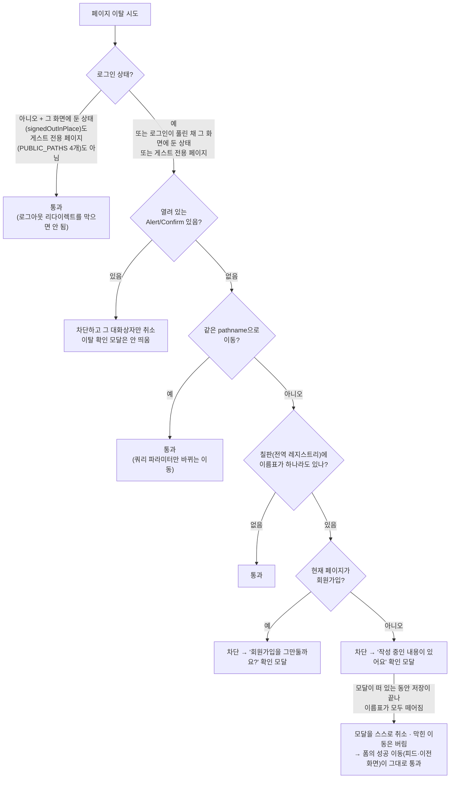

# 폼 이탈 방지 (Unsaved Changes Guard)

> **문서 성격**: 독립 기능 문서(서사형)
>
> **대상 독자**: 이 레포 FE를 처음 보거나 오랜만에 돌아온 개발자.
>
> **읽고 나면**: "dirty"·"전역 레지스트리"가 정확히 무엇을 가리키는지 알고, 새 폼에
> 이 가드를 붙이거나 이탈 판정 조건을 바꿀 수 있다.
>
> **마지막 검토**: 2026-10-28

게시글 등록/수정, 댓글·답글 작성, 댓글 수정, 회원가입 폼에서 저장하지 않은 입력이 있는
상태로 페이지를 벗어나려 하면 한 번 막습니다. 앱 내 이동은 확인 모달, 새로고침·탭 닫기는
브라우저 기본 경고로 처리됩니다.

설계 배경(react-router 단일 blocker 제약, 전역 레지스트리를 택한 이유)은
[DECISIONS.md](./DECISIONS.md)를 참고하세요. 이 문서는 "지금 어떻게 동작하는가"만
다룹니다.

## 1. 쉬운 설명

한 화면에 댓글 폼·답글 폼·수정 폼이 동시에 여러 개 열려 있을 수 있다. 이걸
하나씩 "저장 안 한 입력이 있나요?"라고 따로따로 물어보는 대신, **칠판에
이름표를 붙이는 방식**을 쓴다 — 입력 중인 폼은 각자 자기 이름표(**"dirty
키"**)를 칠판(**"전역 레지스트리"**, Zustand 스토어)에 붙이고, 입력을
지우거나 제출하면 이름표를 뗀다. 페이지를 나가려 할 때는 이 칠판을 한 번만
보면 된다 — **이름표가 하나라도 붙어 있으면** 어느 폼인지 몰라도 무조건
막는다.



## 2. 전제 지식

React Router의 `useBlocker`(단일 라우트 blocker만 등록 가능하다는 제약)와
Zustand 기본 개념은 안다고 가정한다.

가정하지 않는 것:

- **왜** 전역 레지스트리 방식을 택했는지(react-router가 blocker를 여러 개
  동시에 등록하지 못하는 제약과 그 대안 비교) → [DECISIONS.md](./DECISIONS.md).
  이 문서는 "지금 어떻게 동작하는가"만 다룬다
- 처음 나오는 용어(dirty 키, 전역 레지스트리 등) → §12 용어 사전

## 3. 사용한 도구·기술

**기능 자체를 이루는 것**

- **Zustand** — dirty 키를 전역으로 들고 있는 스토어(§6)
- **React Router `useBlocker`** — 앱 내 네비게이션을 가로채는 유일한 지점
- **`beforeunload` 이벤트** — 새로고침·탭 닫기용 브라우저 기본 경고
- **`shared/ui/elements/dialog/alert`** — 확인 모달(Alert/Confirm) 공용 컴포넌트
- **`RouterEvents`**(`shared/lib/router/router-events.ts`) — 저장 중 떠났는지 판정(`useHasLeftPage`,
  §5 "저장 요청 중 이탈")이 React가 커밋하기 전의 라우터 위치를 읽는 곳

**구현·검증 과정에서 쓴 도구**

- **Vitest + `createMemoryRouter`(데이터 라우터)** — `useBlocker`는 데이터 라우터에서만 동작해
  `MemoryRouter` 컴포넌트로는 가드를 띄울 수 없다(§9)
- **MSW 응답 붙잡기** — 핸들러 안에서 Promise를 붙잡아 "확인창이 떠 있는 동안 응답이 온다" 같은
  경합을 결정적으로 재현한다

## 4. 왜 만들었나

댓글·게시글 작성 중 실수로 뒤로가기나 다른 메뉴를 눌러 입력을 통째로 잃는
사고를 막기 위해 만들었다. 여러 폼이 동시에 열릴 수 있는 화면 구조상, 폼마다
따로 이탈을 감시하는 대신 하나의 판단 지점으로 모았다(§5).

## 5. 구조

### `shouldBlockNavigation` 판정 순서

§1 순서도가 실제로 `useUnsavedChangesGuard.ts`의 `shouldBlockNavigation`
함수 하나에 그대로 대응한다. 순서가 중요하다:

1. **로그인 상태가 아니면 통과 — 단 로그인이 풀린 채 쓰던 화면에 둔 상태(`useAuthStore`의
   `signedOutInPlace`)이거나, 현재 페이지가 게스트 전용 페이지(`PUBLIC_PATHS`, `route-paths.ts`:
   로그인·회원가입·비밀번호 찾기·비밀번호 재설정 4개 경로)면 예외.**
   로그아웃 시 `ProtectedRoute`의 강제 리다이렉트까지 막으면 폼에(또는 열린
   대화상자에) 갇힌다 — 이 위험은 로그인이 필요한 페이지에서만 있고, `PUBLIC_PATHS`
   4곳은 원래도 `GuestGuard`라 비로그인 전용이라 갇힐 인증 자체가 없다(2026-09-29,
   `isGuestOnlyPage` 추가 — 회원가입 폼 이탈 확인을 붙이려면 이 예외가 먼저 필요했다).
   `signedOutInPlace`는 로그인이 만료되거나 쓰는 중에 다른 탭이 로그아웃해 **화면을 떠나지 않고
   그 자리에 로그인 창을 띄운** 상태다([AUTH.md](./AUTH.md) §8-I). 이 동안에는 강제 리다이렉트가
   없으므로 평소처럼 막는다 — 막지 않으면 로그인 창을 닫고 다른 메뉴를 누를 때 쓰던 글이 확인 없이
   사라진다(2026-10-28, `docs/plans/2026-10-28-keep-writing-in-place.md` 결정 5). 보호 화면에서 로그인
   없이 창을 닫으면 `ProtectedRoute`가 `/post`로 한 번 보내는데, 이 이동도 이 확인창에 막혀 "계속
   작성"을 고르면 로그아웃 상태로 그 화면에 남는다.
2. **열려 있는 Alert/Confirm이 있으면 차단하되, 이탈 확인 모달은 띄우지
   않고 그 대화상자만 취소 처리한다.** Alert/Confirm은 브라우저 히스토리에
   묶여 있지 않아 뒤로가기가 그대로 페이지를 이동시켜버린다 — 북마크
   페이지처럼 쿼리 파라미터만 바뀌는 이동도 잡아야 해서 이 검사가
   pathname 비교보다 먼저 온다.
3. **같은 pathname으로의 이동이면 통과.** 쿼리 파라미터만 바뀌는 이동(예:
   북마크 페이지의 폴더 전환)까지 막으면 과도하다.
4. **여기까지 왔으면 dirty 키 존재 여부로 최종 판단.** 하나라도 있으면
   차단하고 현재 페이지가 회원가입이면 전용 문구("회원가입을 그만둘까요?"), 아니면
   "작성 중인 내용이 있어요" 확인 모달을 띄운다.

차단됐을 때의 두 갈래(대화상자 취소 vs. 이탈 확인 모달)는 `useEffect`
안에서 분기한다 — Alert/Confirm 때문에 막힌 경우엔 그 대화상자를
`cancelAlert`로 취소 처리하고 이동 자체는 없었던 일로 되돌리며(`blocker.reset()`),
아니면 이탈 확인 모달을 새로 연다.

세 번째 갈래는 판정이 아니라 **모달이 떠 있는 동안** 생긴다. 가드는 dirty 스토어를 구독하다가
자기가 띄운 이탈 확인 모달이 열려 있는데 이름표가 모두 떼어지면(저장 성공 → `clearNow()`, 또는
폼이 닫혀 언마운트) 그 모달을 `cancelAlert`로 스스로 취소한다 — "입력한 내용이 사라져요"라는
모달의 전제가 사라졌기 때문이다. 막혔던 이동은 `blocker.reset()`으로 버려지고, 이어지는 폼의 성공
이동은 평소 규칙대로 통과한다. 이 구독이 없으면 그 성공 이동이 "열린 Alert" 규칙(2번)에 다시
막혀, "계속 작성"이 저장 뒤 이동을 버리는 버그가 있었다(§10 2026-10-21).

**왜 회원가입 전용 문구를 따로 뒀나.** [NN/g(Jakob Nielsen)](https://www.nngroup.com/articles/confirmation-dialog/)는
_"너무 자주 외치면 사람들은 질문에 주의를 기울이지 않게 되고, 확인창은 오류를 막는 힘을
잃는다"_ (번역)고 경고한다 — 그래서 회원가입은 폼이 하나뿐이라 "회원가입을 그만둘까요?"처럼
그 페이지 맥락에 맞는 구체적인 문구를 쓴다(pathname이 `/auth/sign-up`인지로 판정).

**"Sign In" 링크는 이메일이 이미 가입된 것으로 확인됐을 때만 확인창을 생략한다**
(`useSignUp.ts`의 `onLoginLinkClick` — `emailCheck.isDuplicate`가 아니면 그냥 return해
일반 네비게이션으로 흘려보낸다). 그 외(단순 입력 중)엔 이 링크도 다른 이탈 경로와 똑같이
확인창이 뜬다. [Cloudscape — Communicating unsaved changes](https://cloudscape.design/patterns/general/unsaved-changes/)는
_"페이지의 버튼·링크로 데이터가 사라지는 동작을 하려 할 때 페이지 내 모달을 띄운다"_ (번역)고
하는데, 이메일 중복이 아니면 이 원칙을 그대로 따르고, 중복으로 확인된 경우에만 로그인하려는
의도가 이미 명확하다고 보고 예외를 둔다(2026-09-29 실사용 피드백으로 두 차례 조정 — §10 참고).

**로그인 페이지 이메일 자동 채움(prefill)**: 회원가입 폼에서 로그인 페이지로 건너가는 두
경로(위 "Sign In" 링크, 그리고 §5의 "회원가입만 갖는 예외"에서 다루는 가입 성공 후
"메일함을 확인해주세요" 화면의 "로그인하러 가기" 버튼) 모두 `location.state`로 이메일을
함께 넘긴다 — `useLogin.ts`가 `location.state.email`(있으면 저장된 이메일보다 우선)을
폼 기본값으로 쓴다. "Sign In" 링크는 이메일 중복이 확인됐을 때만 넘기고(`loginLinkState`,
아직 입력 중이면 어떤 이메일로 로그인할지 알 수 없으므로), "로그인하러 가기" 버튼은
가입에 실제로 쓴 이메일을 항상 넘긴다(`postSignupLoginState`).

### 폼별 dirty 판정 기준

| 폼             | 언제 "작성 중"으로 잡히나                                                                       | 코드 위치             |
| -------------- | ----------------------------------------------------------------------------------------------- | --------------------- |
| 게시글 등록    | URL·제목·관심분야·북마크(폴더)·공개설정 중 하나라도 기본값에서 바뀌면                           | `useCreatePost.ts`    |
| 게시글 수정    | 위와 동일(원래 게시글 값 대비)                                                                  | `useUpdatePost.ts`    |
| 댓글/답글 작성 | 공백이 아닌 글자를 한 글자라도 쓰거나, 텍스트 없이 스크린샷만 붙여넣어도 잡힘                   | `useCreateComment.ts` |
| 댓글 수정      | 수정 시작 시점 원본과 비교해 텍스트가 다르거나, 새 이미지를 붙였거나, 기존 이미지 개수가 바뀌면 | `useUpdateComment.ts` |
| 회원가입       | 닉네임·이메일·비밀번호 중 하나라도 입력되면(제출 요청 중엔 잠깐 dirty로 안 잡는다 — §6)         | `useSignUp.ts`        |

### 이탈 방법별 동작

| 이탈 방법                                                                                                      | 동작                                                                                                                                                                                                                                                         |
| -------------------------------------------------------------------------------------------------------------- | ------------------------------------------------------------------------------------------------------------------------------------------------------------------------------------------------------------------------------------------------------------ |
| 사이드바·탭바·뒤로가기 등 앱 내 이동                                                                           | 확인 모달: "작성 중인 내용이 있어요" / 취소="계속 작성" / 확인="나가기"                                                                                                                                                                                      |
| 새로고침·탭 닫기·주소창 직접 이동                                                                              | 브라우저 기본 이탈 경고(앱 모달 아님)                                                                                                                                                                                                                        |
| 열려 있는 Alert/Confirm이 있는 상태에서 이동 시도                                                              | 그 대화상자만 취소되고 이동은 없었던 일이 됨(§5의 2번) — 이탈 확인 모달은 안 뜸                                                                                                                                                                              |
| 같은 pathname 안에서의 이동(쿼리만 변경)                                                                       | 검사 없이 통과(§5의 3번)                                                                                                                                                                                                                                     |
| 모달에서 "계속 작성" 클릭                                                                                      | 이동 취소, 폼 값 그대로 유지                                                                                                                                                                                                                                 |
| 모달에서 "나가기" 클릭                                                                                         | 이동 진행                                                                                                                                                                                                                                                    |
| 저장 요청 중 앱 내 이동                                                                                        | 확인 모달이 뜬다(요청은 계속 진행) — 아래 "저장 요청 중 이탈"                                                                                                                                                                                                |
| 모달이 떠 있는 동안 저장 성공                                                                                  | 모달이 저절로 닫히고 폼의 성공 동작대로(등록 → 피드, 수정 → 들어온 화면)                                                                                                                                                                                     |
| 저장 응답 전에 "나가기"                                                                                        | 떠난 화면에 그대로 머문다. 성공은 성공 토스트, 실패는 에러 토스트로 알린다                                                                                                                                                                                   |
| 로그인이 풀린 채 그 화면에 둔 상태에서 이동                                                                    | 로그인 상태와 같다 — 확인 모달이 뜬다(§5의 1번, [AUTH.md](./AUTH.md) §8-I)                                                                                                                                                                                   |
| 쓰는 중에 이 탭에서 직접 로그아웃                                                                              | 먼저 확인창: "로그아웃하면 작성 중인 내용이 사라져요" / 취소="계속 작성" / 확인="로그아웃" → 확인하면 모든 이름표를 떼고 로그아웃한 뒤 `/post`(`useDelayedLogout.ts`)                                                                                        |
| 로그인이 풀린 채 둔 화면에서 다른 회원으로 바뀜                                                                | 쓰는 중이거나 보호 화면이면 확인 없이 모든 이름표를 떼고 `/post` — 이전 회원의 글을 새 회원에게 보이지 않게(`useLeaveOnMemberChange.ts`, [AUTH.md](./AUTH.md) §8-I). 평소대로 로그아웃한 뒤 비로그인으로 새로 쓴 글은 다른 계정으로 로그인해도 버리지 않는다 |
| 공개 화면에서 쓰는 중에 갱신이나 다른 탭 로그인 받아들이기가 다른 계정의 쿠키로 거절됨(409 `SESSION_MISMATCH`) | 이 탭만 로그아웃한 뒤 확인 없이 모든 이름표를 떼고 `/post`(`AuthUtil.signOutForOtherAccount`, [AUTH.md](./AUTH.md) §8-B·§8-H)                                                                                                                                |

### 저장 요청 중 이탈 (게시글 등록·수정)

게시글 폼은 응답을 기다리는 동안에도 dirty라 그 사이의 이탈 시도에 모달이 뜬다. 모달과 응답이
겹치는 세 경우를 이렇게 정했다(2026-10-21 사용자 결정):

| 겹치는 경우               | 동작                                                                                 | 코드                                                            |
| ------------------------- | ------------------------------------------------------------------------------------ | --------------------------------------------------------------- |
| 모달이 떠 있는 동안 성공  | 모달을 닫고 폼의 평소 성공 이동이 이긴다(가려던 곳이 아니라 피드·들어온 화면)        | `useUnsavedChangesGuard.ts`의 `cancelConfirmWhenNothingUnsaved` |
| 응답 전에 "나가기" → 성공 | 떠난 화면을 덮어쓰지 않는다. 성공 토스트는 mutation의 `meta.successMessage`가 띄운다 | `useCreatePost.ts`·`useUpdatePost.ts`의 `hasLeftPage()`         |
| 응답 전에 "나가기" → 실패 | 안내할 폼이 없으니 `toast.error(resolution.message)`로 대신 알린다                   | 같은 곳                                                         |

- **"떠났는가"는 마운트 여부만으로 판단하지 않는다.** "나가기" 직후 라우터 위치는 바로 바뀌지만,
  `v7_startTransition` 때문에 다음 화면이 청크·데이터로 suspend하는 동안엔 이전 폼이 마운트된 채
  남는다(정지 구간). 그래서 `useHasLeftPage`(`shared/hooks/useHasLeftPage.ts`)는 언마운트 **또는**
  라우터의 최신 경로(`RouterEvents.getLocation()`)가 폼 경로와 다르면 떠난 것으로 본다. key가 아니라
  경로를 비교하는 이유는 같은 화면 위 오버레이(`useHistoryOverlay`, 북마크 폴더 선택)가 같은 경로에
  새 key를 push하기 때문이다.
- **댓글 수정에도 첫 줄 규칙이 적용된다** — 댓글 수정 저장 중 뜬 모달은 수정이 성공해 폼이 닫히면
  저절로 닫히고 상세 화면에 머문다(사용자가 받아들인 부수 효과).
- **근거 수준**: 위 동작은 이 레포의 선례 — 이탈 없이 성공하면 모달 없이 피드로 간다는 e2e 계약
  (`e2e/post-create.spec.ts`의 "등록 중..." 테스트), 요청 중 폼이 닫히면 토스트로 대신 알리는 댓글 폼
  (`useCreateComment.ts`의 `isMountedRef`) — 에 맞춘 것이고, 다른 제품 사례 조사는 하지 않았다.

**버튼 강조**: "계속 작성"이 채움(primary)이고 오른쪽에 있으며, "나가기"가 outline이고
왼쪽에 있다(연 순간 포커스도 "계속 작성"에 간다) — 반사적으로 눌러도 안전한 쪽이 눌리게
하기 위해서다. 이건 [Alert.tsx](../src/shared/ui/elements/dialog/alert/Alert.tsx)의 `emphasis`
옵션 기본값(`'cancel'`, 생략 시 적용)을 이 가드가 그대로 쓰고 있는 것이다 — **모든 confirm
공통 규칙이 아니다.** 삭제·탈퇴처럼 메뉴에서 직접 선택해야만 뜨는 확인창이나, 공개 설정
토글처럼 어느 방향도 위험하지 않은 확인창은 `emphasis: 'confirm'`으로 반대(확인=채움·오른쪽)로
켠다 — 전체 규칙표는 [FE-ARCHITECTURE.md](./FE-ARCHITECTURE.md) §10 참고. 근거와 검토한 대안
(Apple HIG의 destructive 빨강, 현행 유지 등)은 [DECISIONS.md](./DECISIONS.md) 2026-09-29
항목(팔로업 포함) 참고.

### 의도적으로 막지 않는 경우

| 상황                                                             | 이유                                                                                                                                                                  |
| ---------------------------------------------------------------- | --------------------------------------------------------------------------------------------------------------------------------------------------------------------- |
| 등록/수정 정상 제출 성공 후 이동                                 | 응답 성공 직후 dirty 해제(`clearNow`, §6)하고 이동 → 모달 안 뜸(저장 대기 중 이탈은 확인창이 뜨고, 그 사이 성공하면 확인창이 닫힌다 — 위 "저장 요청 중 이탈")         |
| 로그아웃 상태(그 화면에 둔 상태가 아닌 경우)                     | `ProtectedRoute`의 강제 리다이렉트를 막으면 폼에 갇히므로 아예 검사 안 함(§5의 1번). 로그인 만료·쓰는 중 다른 탭 로그아웃은 화면을 떠나지 않으므로 여기에 들지 않는다 |
| 다른 회원으로 바뀜·`SESSION_MISMATCH`·직접 로그아웃 확인 뒤 이동 | 쓰던 글을 버리기로 한 이동이라 `clearAllUnsavedChanges()`로 이름표를 먼저 모두 떼고 보낸다 — 남겨 두면 이 확인창이 그 이동을 막는다                                   |
| 답글 폼 "취소", 댓글 수정 "취소" 같은 폼 내부 버튼               | 페이지 이동이 아니라 가드 대상이 아님 → 즉시 닫힘                                                                                                                     |
| 아무것도 입력 안 한 상태                                         | 애초에 dirty가 아니므로 모달 안 뜸                                                                                                                                    |
| 같은 pathname 안에서의 이동                                      | §5의 3번 — 북마크 페이지의 폴더 전환 등                                                                                                                               |
| 회원가입 - 이메일 중복 확인된 상태의 "Sign In" 링크              | 로그인하려는 의도가 이미 명확해 확인창 없이 바로 이동(§5 참고) - 클릭 시 dirty 해제                                                                                   |

### 동시에 여러 폼이 열려 있을 때

상세 페이지엔 댓글 폼 + 답글 폼 + 수정 폼이 동시에 여러 개 뜰 수 있다. **이 중
하나라도 작성 중이면 페이지 이탈이 막힌다.** (예: 최상단 댓글은 다 써놓고 다른
댓글의 답글 폼은 비워둔 채 나가려 해도 최상단 초안 때문에 모달이 뜬다 — 전역
레지스트리 방식이라 등록된 키가 전부 비어야 이동이 허용된다.)

## 6. 상태 모델

### `useUnsavedChangesStore`(`src/shared/store/unsavedChanges.store.ts`)

이 기능 전체가 이 스토어 하나다 — §1의 "칠판"이자 §5에서 반복 언급되는
"전역 레지스트리"의 실체.

| 필드/함수        | 타입                    | 역할                                                  |
| ---------------- | ----------------------- | ----------------------------------------------------- |
| `dirtyKeys`      | `Set<string>`           | 지금 "저장 안 한 입력이 있다"고 등록된 폼 키들의 집합 |
| `markDirty(key)` | `(key: string) => void` | 키를 집합에 추가                                      |
| `markClean(key)` | `(key: string) => void` | 키를 집합에서 제거                                    |

모듈 레벨 헬퍼(React 렌더를 구독하지 않는 시점 — 라우터 blocker 판정,
`beforeunload`에서 씀):

- `hasUnsavedChanges(): boolean` — `dirtyKeys.size > 0`
- `clearUnsavedChanges(key: string): void` — 특정 키를 즉시(동기) 해제.
  제출 직후 navigate처럼 effect 클린업을 기다릴 수 없을 때 쓴다
- `clearAllUnsavedChanges(): void` — 등록된 키를 **모두** 즉시(동기) 해제(2026-10-28). 쓰던 글을 버리고
  화면을 옮겨야 할 때 그 이동을 이 가드가 막지 않게 한다 — 로그인이 풀린 채 둔 화면에서 다른 회원으로 바뀜
  (`useLeaveOnMemberChange.ts`), 공개 화면에서 쓰는 중 `SESSION_MISMATCH`(`AuthUtil.signOutForOtherAccount`,
  `auth.util.ts`), 직접 로그아웃 확인(`useDelayedLogout.ts`)

**가드도 이 스토어를 구독한다** — `useUnsavedChangesGuard`가 `useUnsavedChangesStore.subscribe`로
변경을 받아, 자기가 띄운 모달(`confirmIdRef`에 id를 둔다. `openConfirm`이 id를 돌려주지 않아 띄운
직후 `getOpenAlertId()`로 읽는다)이 열려 있는데 `dirtyKeys`가 비면 그 모달을 취소한다(§5 세 번째
갈래). 선택자 구독이 아니라 `subscribe`인 이유: zustand는 `set` 안에서 리스너를 동기로 부르므로
_"모든 변경마다 동기로 실행된다"_ (번역, [zustand README](https://github.com/pmndrs/zustand#readingwriting-state-and-reacting-to-changes-outside-components)),
`clearNow()` 바로 다음 줄의 `navigate`보다 먼저 모달이 닫힌다. 렌더 뒤에 도는 선택자 + effect면
그 `navigate`가 먼저 다시 막힌다.

### `useUnsavedChanges(key, isDirty)`(`src/shared/hooks/useUnsavedChanges.ts`)

폼이 자기 dirty 상태를 레지스트리에 등록하는 훅. **"dirty 키"**란 이 훅의
첫 번째 인자로, 폼 인스턴스를 구분하는 문자열이다 — 실제 호출부 5곳의 값:

| 폼             | 키                                                     |
| -------------- | ------------------------------------------------------ |
| 게시글 등록    | `'post-create'`                                        |
| 게시글 수정    | `` `post-update:${postId}` ``                          |
| 댓글/답글 작성 | `` `comment-create:${postId}:${parentId ?? 'root'}` `` |
| 댓글 수정      | `` `comment-update:${comment.id}` ``                   |
| 회원가입       | `'auth-signup'`                                        |

**회원가입만 갖는 예외** — 두 번째 인자를 `isDirty && !isPending && !isSubmitted`
3개 조건의 AND로 준다(`useSignUp.ts`). **정정(2026-09-29)**: 가입 성공 시 로그인
페이지로 곧장 `navigate`하지 않는다 — `onSubmit`이 `createMember` 성공 직후
`clearNow()`로 dirty를 동기 해제하고 `setIsSubmitted(true)`만 호출해, 같은 페이지
안에서 폼 대신 "메일함을 확인해주세요" 화면(`SignUpForm.tsx`의 `isSubmitted` 분기,
`TEXTS.auth.signup.checkEmailTitle`/`checkEmailDescription`)으로 전환한다. 이 화면의
"로그인하러 가기" 버튼을 눌러야 비로소 `/auth/login`으로 이동한다.

- `!isPending`이 없으면 제출 요청 중에도 폼이 여전히 dirty라 판정돼 그 사이의
  이탈 시도(거의 없지만)가 막힌다 — 요청이 실패하면 `isPending`이 다시 `false`로
  돌아오면서 조건이 다시 `true`가 돼 effect가 자동으로 재등록한다.
- `!isSubmitted`가 없으면 다른 문제가 생긴다 — 이 훅은 렌더마다 반응형으로 다시
  평가되므로, `onSubmit`의 `clearNow()`가 지운 직후에도 `form.formState.isDirty`
  자체는 여전히 `true`라(폼 값은 안 지웠으므로) 바로 다음 렌더의 effect가 그걸 보고
  다시 등록해버린다. 그 결과 브라우저 `beforeunload` 경고가 살아있는 채로 "메일함을
  확인해주세요" 화면에 남는 버그로 실제 재현됐다 — `isSubmitted`를 조건에 넣어 화면이
  전환된 뒤에는 폼이 dirty여도 재등록하지 않도록 막는다.

```typescript
export function useUnsavedChanges(key: string, isDirty: boolean) {
  // isDirty가 true면 markDirty(key), false면 markClean(key)를 레이아웃 effect(useLayoutEffect)로
  // 동기화하고, 언마운트 시에는 항상 markClean(key)(작성 중이던 폼이 사라지면 이름표도 뗀다)
  // ...
  return { clearNow: () => clearUnsavedChanges(key) };
}
```

등록은 `useEffect`가 아니라 `useLayoutEffect`로 한다 — 화면이 그려지기 전에 등록돼야, 화면이 바뀐
직후(예: 가입 실패 뒤 버튼이 다시 눌러짐)의 뒤로가기·링크 이동도 가드가 막는다(§10 2026-10-13).

`clearNow`는 제출 성공 직후처럼 "지금 즉시" 해제해야 할 때 동기 호출한다
(§5 "의도적으로 막지 않는 경우").

## 7. 운영 파라미터

해당 없음 — 이 기능에는 주기·건수·타임아웃 같은 운영 파라미터가 없다.

## 8. 코드 지도와 자주 하는 수정

```
src/
├── shared/
│   ├── store/
│   │   └── unsavedChanges.store.ts       # §6 — dirty 키 레지스트리(Zustand)
│   └── hooks/
│       ├── useUnsavedChanges.ts          # §6 — 폼이 자기 dirty 상태를 등록하는 훅
│       ├── useUnsavedChangesGuard.ts     # §5 — RootLayout에서 1회만 도는 전역 가드
│       └── useHasLeftPage.ts             # §5 "저장 요청 중 이탈" — 응답 뒤 떠났는지 판정
├── shared/lib/router/router-events.ts    # useHasLeftPage가 읽는 라우터 최신 위치
├── app/routes/layouts/RootLayout.tsx     # 가드 마운트 지점(앱 전체 1곳)
├── app/hooks/useLeaveOnMemberChange.ts   # 다른 회원으로 바뀌면 쓰는 중이거나 보호 화면일 때 clearAllUnsavedChanges → /post
├── widgets/layout/navbar/hooks/useDelayedLogout.ts # 쓰는 중 직접 로그아웃이면 먼저 확인(TEXTS.unsavedChanges.logout)
├── shared/store/auth.store.ts            # signedOutInPlace — §5의 1번 예외(로그인이 풀린 채 그 화면에 둠)
├── shared/ui/elements/dialog/alert/alert.store.ts # §5의 Alert/Confirm 우선 차단 분기가
│                                                    # 참조하는 getOpenAlertId 출처
├── shared/config/texts.ts                # TEXTS.unsavedChanges.* — 확인 모달 문구(.signup은 회원가입 전용, .logout은 직접 로그아웃 확인)
├── shared/config/route-paths.ts          # PUBLIC_PATHS — §5의 "게스트 전용 페이지" 판정 출처
├── features/post/create/hooks/useCreatePost.ts
├── features/post/update/hooks/useUpdatePost.ts
├── features/comment/create/hooks/useCreateComment.ts
├── features/comment/update/hooks/useUpdateComment.ts
└── features/auth/signup/hooks/useSignUp.ts
```

### 자주 하는 수정

| 하고 싶은 것                    | 방법                                                                                                                                                                               |
| ------------------------------- | ---------------------------------------------------------------------------------------------------------------------------------------------------------------------------------- |
| 새 폼에 이 가드를 붙이려면      | 폼 훅 안에서 `const { clearNow } = useUnsavedChanges('폼을-구분할-고유-키', isDirty)` 호출 + 제출 성공 직후 `clearNow()` 호출(§6 표의 키 네이밍 패턴을 따른다)                     |
| 이탈 확인 모달 문구 변경        | `TEXTS.unsavedChanges.*`(`shared/config/texts.ts`)                                                                                                                                 |
| 특정 상황을 검사에서 제외       | `useUnsavedChangesGuard.ts`의 `shouldBlockNavigation`에 §5 순서대로 분기 추가(순서가 중요 — 로그인 상태 검사보다 먼저 오면 안 됨)                                                  |
| 저장 뒤 이동하는 새 폼          | 응답을 기다린 뒤 `useHasLeftPage()`의 반환 함수로 떠났는지 먼저 본다 — 떠났으면 이동하지 않고, 실패는 토스트로(§5 "저장 요청 중 이탈", `useCreatePost.ts` 참고)                    |
| 쓰던 글을 버리고 옮기는 새 경로 | 이동 전에 `clearAllUnsavedChanges()`를 부른다(§6, 선례 `useLeaveOnMemberChange.ts`·`useDelayedLogout.ts`·`AuthUtil.signOutForOtherAccount`) — 안 부르면 이 가드가 그 이동을 막는다 |

## 9. 검증 결과

**e2e** — 댓글 폼은 `e2e/unsaved-changes.spec.ts`(PUSH·POP 이동, "계속 작성"/"나가기" 분기)가,
회원가입 폼은 `e2e/signup-unsaved-changes.spec.ts`(전용 문구, 이메일 중복 여부에 따른
"Sign In" 링크 분기, 뒤로가기 차단, 제출 실패 후 재등록)가 각각 통합 테스트로 커버한다
(2026-09-29). 게시글 등록은 `e2e/post-create.spec.ts`가 "이탈 없이 성공하면 모달 없이 피드로
간다"만 본다. (정정, 2026-10-21: 이 절은 전에 `unsaved-changes.spec.ts`가 "댓글/게시글 폼"을
커버한다고 적었지만, 그 스펙은 댓글 폼만 연다.)

**유닛 테스트(2026-10-21)** — 데이터 라우터(`createMemoryRouter`) + 실제 가드 + 실제 확인 모달 +
응답을 붙잡는 MSW로 저장 중 이탈 경합을 재현한다. 고치기 전 RED 10회, 고친 뒤 전부 GREEN을 확인했다.

| 파일                                                          | 다루는 것                                                                                                             |
| ------------------------------------------------------------- | --------------------------------------------------------------------------------------------------------------------- |
| `src/shared/hooks/useUnsavedChangesGuard.test.tsx`            | 모달이 떠 있는 동안 이름표가 모두 떼어져야(하나만이면 유지) 모달을 닫고 막힌 이동을 버린다                            |
| `src/features/post/create/hooks/useCreatePost.guard.test.tsx` | 모달 중 성공(탭·뒤로) → 피드, "계속 작성" 뒤 성공, 모달 중 실패, "나가기" 뒤 성공·실패, 정지 구간, 같은 경로 오버레이 |
| `src/features/post/update/hooks/useUpdatePost.guard.test.tsx` | 모달 중 성공(탭·뒤로) → 들어온 화면, "나가기" 뒤 성공(한 칸 더 뒤로 가지 않음)·실패                                   |

경계 확인: 구독 콜백의 `hasUnsavedChanges()` 조건을 잠시 빼면 가드 테스트의 중간 단언이, `useHasLeftPage`를
마운트 여부만 보게 바꾸면 정지 구간 테스트가 실패하는 것을 확인했다.

**로그인이 풀린 상태(2026-10-28)** — `useUnsavedChangesGuard.test.tsx`의 "로그인이 풀린 상태" `describe`가
`signedOutInPlace` 동안에는 로그아웃 상태여도 막고, 그 표시가 없는 로그아웃 상태면 지금처럼 막지 않는 것을 고정한다.
`ProtectedRoute.test.tsx`(보호 화면에서 창을 닫으면 확인창 → "계속 작성"이면 그 자리에 남음),
`useDelayedLogout.test.tsx`(직접 로그아웃 확인), `useLeaveOnMemberChange.test.tsx`(쓰는 중이거나 보호 화면에서 다른
회원이면 이름표를 모두 떼고 `/post`, 평소 로그아웃 뒤 비로그인으로 새로 쓴 글은 그대로), `auth.util.test.ts`의
`applySessionMismatch`(공개 화면에서 쓰는 중이면 `/post`), `useAuthEpochSync.test.tsx`(다른 탭의 로그인을 받아들이려다
다른 계정이라 거절되면 같은 처리)와 e2e `auth-tab-sync.spec.ts`의 "쓰는 중에 다른 탭에서 로그아웃"·`logout.spec.ts`의 "쓰는 중에 로그아웃"이
이 가드와 맞물린 흐름을 본다(목록과 확인 내용은 [AUTH.md](./AUTH.md) §9).

## 10. 시행착오

**2026-09-29, 회원가입 페이지 "Sign In" 링크 두 개 → 하나로.** 처음 배포했을 때는
이메일 중복 안내 바로 아래에 확인창을 생략하는 전용 링크를 하나 더 두고, 하단
"이미 계정이 있으신가요? Sign In" 푸터 링크는 그대로 가드 대상으로 남겨뒀다(§5의
Cloudscape 인용도 그 전용 링크만 겨냥한 것이었다). 실사용 중 사용자가 두 링크가
똑같이 "Sign In"이라 어느 쪽을 눌렀는지 구분하지 못했고, 하단 링크를 누르고 나서야
확인창이 뜨는 걸 보고 "이메일 중복이면 가드 안 하기로 하지 않았냐"고 되물었다 —
실제로는 의도대로 동작했지만(하단 링크는 원래도 가드 대상), 화면에 똑같이 생긴
두 링크를 두고 하나만 다르게 동작시킨 것 자체가 혼란의 원인이었다. 전용 링크를
없애고 하단 링크 하나만 남긴 뒤, 그 하나가 항상 확인창을 생략하도록 바꿨다 —
페이지에 "Sign In" 링크가 하나뿐이면 링크마다 다른 규칙을 만들 필요가 없다.

**정정(같은 날, 몇 시간 뒤).** "항상 생략"으로 바꾼 뒤 실사용 확인 결과, 이메일 중복이
아닌 일반적인 입력 중 상태에서도 "Sign In"을 누르면 조용히 입력이 사라지는 게 오히려
문제였다 — 로그인하려는 의도가 명확한 건 "이메일이 이미 가입돼 있다"는 걸 확인한
경우뿐이고, 단순히 폼을 채우다 실수로 누른 경우까지 의도가 명확하다고 볼 근거는
없었다. 링크는 하나로 유지하되, 그 하나의 동작을 `emailCheck.isDuplicate` 조건으로
다시 나눴다 — 중복 확인 시에만 생략, 그 외엔 뒤로가기와 동일하게 확인창. "링크
개수를 하나로 줄인 것"과 "그 링크의 확인창 생략 조건"은 서로 다른 결정이었는데,
처음엔 이 둘을 한 번에 바꿔서 결과적으로 두 번 고치게 됐다.

**2026-10-13, 가드가 화면보다 늦게 켜지던 e2e flaky.** CI e2e가 재시도(`retries: 2`)로만
통과한 경우를 세 보니 최근 성공 run 40건 중 3건이었고, 테스트는 두 개였다.
`signup-unsaved-changes.spec.ts`의 "가입 요청이 실패한 뒤 뒤로가기를 누르면 확인창이 다시
뜬다"(뒤로가기 뒤 확인창이 없음)와 `dialog-outside-click.spec.ts`의 로그인 모달 "비밀번호를
입력했으면 바깥을 눌러도 그대로 있다"(바깥 클릭 뒤 모달이 사라짐)다. 둘 다 가드 상태를
`useEffect`로 반영하고 있었다.

- `useEffect`는 화면을 그린 뒤에 돈다. 그래서 화면은 이미 "준비됨"으로 보이는데 가드는 아직
  꺼져 있는 틈이 생긴다. 예를 들어 버튼이 다시 눌러지는 화면은 떴는데 `markDirty`는 아직 안
  돌았거나, 입력은 보이는데 `dismissOnOutsideClick`은 아직 `true`인 상태다. Playwright는 그 틈에
  다음 동작을 한다.
- **재현(직접 측정)**: 두 스펙에 CPU 6배 스로틀(`Emulation.setCPUThrottlingRate`)을 임시로 넣고
  각 30회 돌렸다. 로그인 모달은 30회 중 26회가 바깥 클릭 직후 `toBeVisible()`에서 실패했다.
  회원가입은 6배·20배에서 모두 통과했고, 12워커 병렬에서도 과부하로 앞 단계가 타임아웃 났을 뿐
  확인창 단계 실패는 없었다. 그래서 회원가입 쪽은 재현하지 못했고, 같은 구조라는 코드 근거로 함께 고쳤다.
- **고침**: `useUnsavedChanges`의 등록과 `useLogin`의 `reportInputDirty`를 `useLayoutEffect`로
  바꿨다. 화면을 그리기 전에 돌고 그 안의 상태 변경도 그리기 전에 처리된다
  ([react.dev useLayoutEffect](https://react.dev/reference/react/useLayoutEffect)). 같은 스로틀 조건에서
  두 테스트 각 30회 모두 통과했다.
- 같은 PR에서 `playwright.config.ts`에 `failOnFlakyTests: !!process.env.CI`를 켰다. 재시도로만
  통과한 테스트가 다시 숨지 않게 하려는 것이다(`docs/TESTING.md` "CI 연동").

**2026-10-21, 저장 중 떠나려다 "계속 작성"을 누르면 등록 뒤 이동이 사라지던 문제.** 모바일에서
등록 중 탭이나 뒤로가기를 누르면 모달이 떴고, "계속 작성"을 누른 뒤 직접 나가 보니 그제야 목록에
반영된 것처럼 보였다는 제보였다. 실제로는 등록이 모달이 떠 있는 동안 이미 끝났고, 그 뒤의 자동 이동을
"계속 작성"이 버린 것이었다(목록 캐시엔 새 글이 이미 있었다). 설치본 소스로 따라간 경로(react-router
6.30.3, @remix-run/router 1.23.2):

- 성공 처리는 `clearNow()` → `navigate('/post')`인데, `shouldBlockNavigation`은 "열린 Alert가 있으면
  막는다"(§5 2번)를 dirty보다 먼저 본다 → 그 이동이 다시 막힌다
- 이미 막힌 blocker를 또 막으면 새 목적지로 덮어쓴다(`router.js`의 `navigate` 1852-1879행, 상태 전이표
  3008행이 blocked→blocked 허용). `blocker.state`는 그대로 `'blocked'`라 모달을 띄우는 effect가 다시
  돌지 않고 같은 모달이 남는다 → "계속 작성"의 `reset()`이 `/post` 이동을 버리고, "나가기"는 탭한
  곳이 아니라 `/post`로 갔다
- 함께 찾은 것: 응답 전에 "나가기"로 떠나면 언마운트된 폼의 `navigate`가 그대로 실행돼(react-router
  `dist/index.js`의 `useNavigateStable` 895-918행 — `activeRef`를 되돌리지 않는다) 떠난 화면이 피드로
  바뀌었고(수정 폼은 `navigate(-1)`로 한 칸 더 뒤로), 실패는 아무 안내가 없었다

**고침**: §5 세 번째 갈래(가드가 dirty 스토어를 구독해 모달을 스스로 취소)와 `useHasLeftPage`(§5
"저장 요청 중 이탈"). 검토했다 버린 안:

- 차단 규칙 2번에 "가드 자신의 모달이고 dirty가 없으면 통과" 예외를 넣는 안 — 성공 이동은 통과하지만,
  다음 화면이 suspend하는 동안 남은 낡은 모달에서 "나가기"를 누르면 이미 IDLE로 돌아간 blocker를
  proceeding으로 바꾸려다 라우터 invariant(3008행)가 throw할 수 있고, 문서화된 판정 순서도 바뀐다
- "떠났는가"를 `isMountedRef`(댓글 폼 선례)만으로 보는 안 — "나가기" 직후 다음 화면이 suspend하는 동안엔
  폼이 마운트된 채라 놓친다. 유닛 테스트로 그 구간이 실제로 있음을 확인했다(라우터는 이미 탭에 가
  있는데 폼이 아직 보인다). 판정을 마운트 여부만으로 바꾸면 그 테스트만 실패한다
- 데이터 라우터를 쓰는 유닛 테스트를 새로 만들었다(§9) — 기존 훅 테스트는 `useNavigate`·`useGoBack`을
  mock해 "호출됐다"만 봐서 이 버그를 볼 수 없었다

## 11. 남은 것

- 댓글 폼(`useCreateComment`·`useUpdateComment`)의 `isMountedRef`도 같은 정지 구간을 가진다 — 상세에서
  떠나는 중 실패하면 곧 사라질 폼에 안내가 남아 묻힌다
- 저장 중 입력칸이 잠기지 않아(`CreatePostForm.tsx`는 버튼만 막는다) 그 사이 고친 내용이 성공 뒤 비워진다
- 이동이 막힌 렌더가 커밋된 뒤 모달을 띄우는 effect가 돌기 전(한 프레임 정도)에 응답이 오면, 목적지 화면에
  의미 없는 모달이 뜰 수 있다 — 누르면 닫히고, 이번에는 대응하지 않았다
- 실제 브라우저의 비동기 popstate 복원은 메모리 히스토리로 재현되지 않는다 — 필요하면 게시글 폼 e2e를 추가한다
- 로그인이 풀린 채 그 화면에 둔 상태(§5의 1번)는 글을 보관하지 않는다 — 이 확인창에서 "나가기"를 고르면 그 글은
  사라지고, "나중에 이어 쓰기"는 없다([DECISIONS.md](./DECISIONS.md) 2026-10-28, 남은 한계 전체는
  [AUTH.md](./AUTH.md) §11 항목 11)

**정정, 2026-09-29**(이 절에 남겨 둔 옛 기록): 이전 버전은 이 절에 "인증 강화
계획 FE Phase 5가 배포되면 `navigate('/auth/login')`이 없어질 가능성이 있다"는 미래형
항목을 적어뒀으나, 그 Phase 5는 이미 배포돼 있었다 — `useSignUp.ts`는 이미 `navigate`
없이 `isSubmitted` 상태로 전환하고, 우려했던 재등록 문제도 이미 `!isSubmitted` 조건으로
막혀 있다(§6 참고). 미래 리스크가 아니라 이미 해소된 과거 항목이라 이 절에서 제거했다.

## 12. 용어 사전

- **dirty(키)** — "저장하지 않은 입력이 있다"는 상태 그 자체, 또는 그
  상태를 표시하려고 폼이 레지스트리에 등록하는 문자열 키. 이 문서 전체에서
  가장 많이 쓰이지만 지금까지 정의되지 않았던 용어 — §6 표가 실제 키 값이다
- **전역 레지스트리** — `useUnsavedChangesStore`(§6)를 가리키는 표현. 폼마다
  따로 감시하지 않고 모든 폼의 dirty 여부를 한 곳에 모아두는 방식이라
  "전역"이라 부른다
- **`clearNow`** — `useUnsavedChanges`가 반환하는 함수. 특정 키를
  effect 클린업을 기다리지 않고 즉시 해제한다(§6)
- **`ProtectedRoute`** — 인증이 필요한 라우트를 감싸 비로그인 접근을
  리다이렉트하는 컴포넌트. §5의 "로그인 상태가 아니면 통과" 분기가 이
  리다이렉트를 막지 않기 위한 것이다. 로그인이 풀린 채 그 화면에 둔 동안(`signedOutInPlace`)에는
  리다이렉트하지 않고 화면을 남긴다
- **`signedOutInPlace`** — `useAuthStore`의 값. 로그인이 만료되거나 쓰는 중에 다른 탭이 로그아웃했지만 화면을
  떠나지 않고 그 자리에 로그인 창을 띄운 상태다. 이 값이 있으면 로그아웃 상태여도 이 가드가 평소처럼 막는다
  (§5의 1번, 상세는 [AUTH.md](./AUTH.md) §8-I)
- **`clearAllUnsavedChanges`** — 등록된 dirty 키를 모두 즉시 해제하는 모듈 헬퍼(§6). 쓰던 글을 버리기로 한
  이동(다른 회원으로 바뀜, 공개 화면의 `SESSION_MISMATCH`, 직접 로그아웃 확인)이 이 가드에 막히지 않게 한다
- **blocker** — react-router `useBlocker`가 돌려주는 객체. 이동을 막으면 `state`가 `'blocked'`가 되고
  `proceed()`(막힌 이동 진행)·`reset()`(막힌 이동 버림)을 갖는다. 모달의 "나가기"·"계속 작성"이 각각 이 둘을 부른다
- **정지 구간** — 라우터 위치는 이미 바뀌었는데 `v7_startTransition` 때문에 다음 화면이 suspend해 React가
  아직 이전 화면을 보여주는 사이. 자세한 설명은 `shared/lib/router/router-events.ts` 머리말
- **`useHasLeftPage`** — 응답을 기다린 뒤 그 사이 화면을 떠났는지(언마운트 또는 라우터 경로가 바뀜) 돌려주는
  함수를 주는 훅(§5 "저장 요청 중 이탈")
