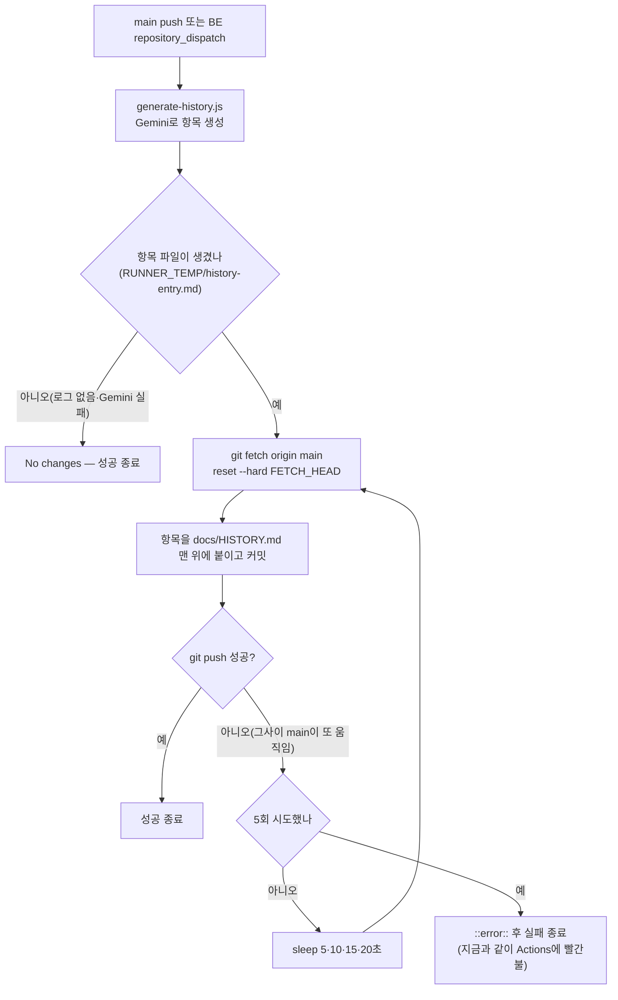

# Gemini History Updater push 경합 재시도

> push가 거절되면 최신 main을 다시 받아 생성해 둔 항목을 맨 위에 다시 얹고 재push한다(최대 5회).

## Context

### 무슨 일이 있었나

PR #338 병합(11:20:07Z) 직후 `Gemini History Updater`(`.github/workflows/history.yml`)의
`Commit & Push` 스텝이 `! [rejected] main -> main (fetch first)`로 실패했다. 그 결과
**#338 항목이 `docs/HISTORY.md`에 영영 빠졌다**(CHANGELOG에는 정상 기록됨). 프론트 배포·Storybook
배포·Auto Release는 성공했다.

### 재현 절차 (실측 타임라인, `git log origin/main`·`gh run view 38241986010`)

| 시각(UTC) | 사건                                                                           |
| --------- | ------------------------------------------------------------------------------ |
| 11:20:07  | #338 병합 → History Updater 시작(체크아웃 → pnpm install → Gemini 호출 ≈ 30초) |
| 11:20:33  | **#339 병합** — main이 앞으로 감                                               |
| 11:20:42  | History Updater가 옛 main 위에 커밋한 채 push → 거절                           |

### 근본 원인

- push 직전에 최신 main을 받지 않는다(`history.yml:44-54`). 실행 시간(≈30초) 안에 main에 다른
  push가 들어오면 무조건 거절된다.
- 거절되면 재시도가 없고, 다음 실행은 자기 push 범위(`BEFORE_SHA..CURRENT_SHA`,
  `generate-history.js:33`)만 보므로 **놓친 항목은 복구되지 않는다**.
- 경합 상대는 두 종류다 — ① 사용자의 연속 PR 병합(#338의 경우) ② 같은 워크플로의 다른 실행
  (BE `repository_dispatch`와 FE push가 겹칠 때, 둘 다 `docs/HISTORY.md` 맨 위에 붙임).

### 빈도 (`gh run list --workflow "Gemini History Updater" --limit 200`, 09-16~10-12)

- 200건 중 22건 실패(11%). 확인한 실패 사유:
  - **경합 거절 11건**(09-21~10-12, 9건 로그 확인·2건 미확인) — 이번 수정 대상
  - `GH013` 규칙셋 위반 11건(09-20 한정) — 규칙셋 `Main Branch Protect`가 09-20 20:20Z에
    갱신된 뒤로 0건. 현재 규칙셋은 필수 체크 목록이 비어 봇 push를 허용하고 `non_fast_forward`
    (force push 금지)만 걸려 있다 → 재발 아님, 이번 범위 밖
- 실패한 실행의 PR(#280·#263·#259·#231·#161·#156·#152·#338 등)은 전부 HISTORY.md에 없다.

### 흐름 (수정 후)

## 판단이 필요했던 항목

| 항목                         | 결정                                                                                               | 근거·기각한 대안                                                                                                                                                                                                                                                                                                                                                      |
| ---------------------------- | -------------------------------------------------------------------------------------------------- | --------------------------------------------------------------------------------------------------------------------------------------------------------------------------------------------------------------------------------------------------------------------------------------------------------------------------------------------------------------------- |
| 재발 방지 방식               | push 거절 시 최신 main을 받아 **항목을 다시 얹고** 재push, 최대 5회                                | `concurrency`만으로는 못 막는다 — 이번 충돌 상대는 히스토리 실행이 아니라 PR #339 병합이었다. `git pull --rebase`는 상대가 다른 히스토리 실행이면 둘 다 파일 1행에 끼워 넣어 충돌한다(`generate-history.js:122-123`이 맨 위에 붙이는 구조). force push는 규칙셋 `non_fast_forward`가 막고, 막히지 않더라도 남의 커밋을 지운다                                         |
| Gemini 재호출                | 생성한 항목을 `RUNNER_TEMP` 파일로 남겨 재시도마다 재사용                                          | 재시도마다 다시 부르면 무료 쿼터를 쓰고 매번 다른 문장이 나온다                                                                                                                                                                                                                                                                                                       |
| 스크립트 역할                | `generate-history.js`는 항목만 파일로 쓰고, HISTORY.md에 붙이는 일은 워크플로 재시도 루프가 맡는다 | 붙이는 곳이 두 군데(스크립트·루프)면 첫 시도에 두 번 붙는다. 스크립트를 그대로 두고 줄 수 차이로 항목을 잘라내는 방법도 있으나 "맨 위에 붙인다"는 암묵 전제에 기대 취약하다                                                                                                                                                                                           |
| `client_payload.source` 보간 | run 스크립트 안 `${{ }}` 직접 보간 대신 step `env`로 받기                                          | 고치는 줄에 포함된다. 같은 값을 이미 스크립트 step이 env로 받는 선례(`history.yml:43`)                                                                                                                                                                                                                                                                                |
| `concurrency` 추가           | 넣지 않음 (2026-10-12 사용자 결정)                                                                 | 재시도만으로 두 경합을 다 처리한다. 넣으면(`queue: max`, [GitHub 문서](https://docs.github.com/en/actions/writing-workflows/choosing-what-your-workflow-does/control-the-concurrency-of-workflows-and-jobs)) 히스토리 실행끼리 겹치지 않아 항목 순서가 항상 시간순이 되지만, Gemini 호출이 멈추면 뒤 실행이 전부 대기한다. 대가: 드물게 같은 날 안 항목 순서가 뒤바뀜 |
| 유실분 보충                  | #338만, 병합 후 기존 `repository_dispatch` 경로로 (2026-10-12 사용자 결정)                         | 코드 추가 없음, 날짜 헤더가 오늘 = #338 병합일이라 왜곡 없음, 새 재시도 로직의 실전 첫 검증 겸용. 전부 보충은 스크립트가 실행 당일 날짜를 헤더에 찍어(`generate-history.js:89`) 과거 항목 날짜가 틀어지고 날짜 지정 경로를 새로 만들어야 해 기각. 나머지 21건은 CHANGELOG에 기록이 있다                                                                               |

## 세부 계획

작업 위치: 새 워크트리(`EnterWorktree`, 진입 전 `git log origin/main..main` 비어 있음 확인 완료),
진입 직후 `cp ../../../.env . && pnpm install`.

| 위치                                                      | 변경 내용                                                                                                                                                                                                                                                                                                                                                                                      |
| --------------------------------------------------------- | ---------------------------------------------------------------------------------------------------------------------------------------------------------------------------------------------------------------------------------------------------------------------------------------------------------------------------------------------------------------------------------------------- |
| `scripts/generate-history.js:121-123`                     | HISTORY.md를 읽어 맨 위에 붙이던 부분을 `fs.writeFileSync(process.env.HISTORY_ENTRY_FILE, \`${aiResponse}\n\n\`)`로 교체                                                                                                                                                                                                                                                                       |
| `.github/workflows/history.yml:36-43` (스크립트 step env) | `HISTORY_ENTRY_FILE: ${{ runner.temp }}/history-entry.md` 추가                                                                                                                                                                                                                                                                                                                                 |
| `.github/workflows/history.yml:44-54` (`Commit & Push`)   | step `env`에 `ENTRY_FILE`·`SOURCE_LABEL` 추가. 항목 파일이 없거나 비면 `No changes to commit`으로 종료. 있으면 위 순서도대로 `fetch → reset --hard FETCH_HEAD → 맨 위에 붙이기 → git commit -m ... -- docs/HISTORY.md → git push origin HEAD:main`을 최대 5회 반복, 모두 실패하면 `::error::` 후 `exit 1`. 커밋 메시지 형식(`docs: auto-update history by Gemini (FE\|BE) [skip ci]`)은 그대로 |
| `CHANGELOG.md` `[Unreleased]`                             | `fix` 항목 추가(`changelog-release` skill 형식, #327 `fix(infra)` 선례)                                                                                                                                                                                                                                                                                                                        |
| `docs/plans/2026-10-12-history-push-retry.md` (신규)      | 이 계획 스냅샷(§11)                                                                                                                                                                                                                                                                                                                                                                            |

## 영향 범위

- **HISTORY.md 쓰기**: 정상 경로(첫 push 성공)는 지금과 결과가 같다. 재시도 시 항목은 최신 main
  위에 붙으므로 다른 사람·다른 실행의 커밋을 지우지 않는다(force push 없음).
- **중복 가능성**: push가 실제로는 반영됐는데 응답만 실패로 오는 경우 재시도가 같은 항목을 한 번
  더 붙일 수 있다 — 네트워크 오류 한정이라 별도 방어는 두지 않는다.
- **순서**: 히스토리 실행 두 개가 겹쳐 늦게 재시도한 쪽이 위로 올라가면 같은 날 안에서 순서가 뒤바뀔
  수 있다(concurrency 미도입의 대가, 사용자 승인).
- **다른 워크플로**: `deploy.yml`·`release.yml`·`doc-drift-check.yml`은 건드리지 않는다. 봇 커밋은
  여전히 `[skip ci]`이고 history.yml `paths`에 `docs/`가 없어 자기 자신을 다시 트리거하지 않는다.
- **BE 레포**: dispatch payload 형식(`logs`·`source`) 그대로 → BE 변경 없음.
- **문서**: README·ONBOARDING·VERSION-COMPATIBILITY 등은 "자동 생성, 직접 편집 금지"만 서술해 갱신 불필요.
- **이 PR 자체의 트리거**: `.github/`·`scripts/`는 history.yml `paths`에 없어 병합해도 History Updater가
  돌지 않는다 → 실전 첫 검증은 다음 `src/` 병합 또는 아래 보충 dispatch.

## 검증 방법

1. `actionlint .github/workflows/history.yml` — 문법·표현식·shellcheck
2. `pnpm check` — ESLint·Prettier(스크립트 파일)
3. **로컬 경합 재현**(scratchpad): bare 저장소 + 클론 2개로 ① "다른 PR 병합" 커밋 ② "다른 히스토리
   실행"의 HISTORY.md 맨 위 추가를 먼저 push해 둔 뒤, history.yml에서 `Commit & Push`의 `run`
   블록을 그대로 추출해 `bash -e`로 실행 → origin main에 두 커밋이 모두 남고 내 항목이 맨 위에
   있으며 종료 코드 0인지 확인. 항목 파일이 없을 때 `No changes to commit`으로 0 종료하는지도 확인
4. PR CI green 확인(`gh pr checks`), §11에 따라 fresh general-purpose subagent로 계획 대비 구현 대조 →
   PR 본문 `## 계획 대비 구현`
5. 병합은 사용자 지시 후. 병합 뒤 #338 보충 dispatch로 실전 확인:
   `gh api repos/BAECHAN/link-sphere_FE_NEW/dispatches --method POST -f event_type=be-history-update -f 'client_payload[source]=FE' -f 'client_payload[logs]=- feat(interaction): 좋아요 토글 응답 likeCount로 캐시 교정 (#338)'`
   → 해당 run이 success이고, `origin/main`의 HISTORY.md 맨 위에 `(FE)` 헤더와 #338 PR 링크 항목이 생겼는지 확인
   (main에 봇 커밋 1개가 생긴다 — 사용자 승인됨)

## 남은 것

- 유실 22건 중 #338을 뺀 21건(FE 17·BE 4)은 보충하지 않는다(사용자 결정). 해당 FE PR은 CHANGELOG에 기록이 있다.
- 경합 재시도 경로(push 거절 → 재시도 성공)는 로컬 재현으로만 검증된다 — 실전에서 그 경로를 타는 건
  다음 연속 병합 때다. 그때 run 로그에서 재시도 흔적을 한 번 확인하면 충분하다.
