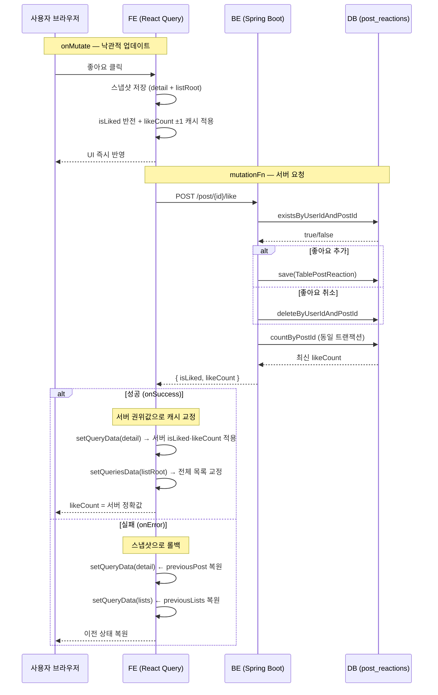

# 좋아요 토글 응답에 likeCount 추가 및 FE 캐시 교정

## Context

현재 `POST /post/{postId}/like` 응답은 `{ isLiked: boolean }` 만 반환한다.
FE는 `onSuccess`를 빈 함수로 두고 낙관적 ±1 추정값을 그대로 유지한다.
이로 인해 두 유저가 동시에 같은 게시글을 볼 때 각자 다른 likeCount 기반으로
±1을 적용해 최대 3분(staleTime)간 실제 DB 값과 어긋날 수 있다.

업계 표준(Medium, DEV.to 등 소규모 앱)은 토글 응답에 변경 후의 권위 상태를
`{ isLiked, likeCount }` 형태로 반환해 클라이언트가 즉시 교정하는 방식이다.
방향 B(onSettled invalidation)는 추가 GET 요청이 발생하고, 방향 C(denormalized
count 컬럼)는 현 규모에서 과도한 투자이므로, 방향 A(응답 확장 + 교정)를 채택한다.

**현재 코드베이스의 일관성 문제**: `useUpdatePostMutation.onSuccess`는 서버 응답으로
캐시를 덮어쓰는데, `useLikePostMutation.onSuccess`만 빈 함수다.

---

## 변경 범위

```
BE 3파일 변경 → codegen 재생성 → FE 3~4파일 변경
```

---

## 구현 계획

### 1. BE: PostLikeResponse DTO 추가

파일: `link-sphere_BE_NEW/src/main/kotlin/com/example/linksphere/domain/post/PostDTO.kt`

```kotlin
data class PostLikeResponse(
    val isLiked: Boolean,
    val likeCount: Int,
)
```

`PostStats`·`PostUserInteractions` 등과 같은 파일에 추가.
`BookmarkFoldersResponse`가 BookmarkFolderDTO.kt에 있는 선례와 동일한 패턴.

---

### 2. BE: InteractionService.togglePostLike() 반환 타입 변경

파일: `link-sphere_BE_NEW/.../interaction/InteractionService.kt`

```kotlin
@Transactional
fun togglePostLike(postId: UUID, userId: UUID): PostLikeResponse {
    assertPostVisible(postId, userId)
    val exists = postReactionRepository.existsByUserIdAndPostId(userId, postId)
    val isLiked = if (exists) {
        postReactionRepository.deleteByUserIdAndPostId(userId, postId)
        false
    } else {
        postReactionRepository.save(TablePostReaction(userId = userId, postId = postId))
        true
    }
    // 동일 트랜잭션 내 COUNT — insert/delete가 반영된 정확값
    val likeCount = postReactionRepository.countByPostId(postId).toInt()
    return PostLikeResponse(isLiked = isLiked, likeCount = likeCount)
}
```

`countByPostId()`는 기존 메서드 재사용 (이미 `PostReactionRepository`에 존재).

---

### 3. BE: InteractionController.likePost() 반환 타입 변경

파일: `link-sphere_BE_NEW/.../interaction/InteractionController.kt`

```kotlin
@PostMapping("/post/{postId}/like")
fun likePost(...): ApiResponse<PostLikeResponse> {
    val result = interactionService.togglePostLike(postId, userId)
    return ApiResponse(200, if (result.isLiked) "좋아요 성공" else "좋아요 취소 성공", result)
}
```

`@Operation` description도 `data: {"isLiked": boolean, "likeCount": number}` 로 업데이트.

---

### 4. BE: 단위 테스트 추가

파일: `link-sphere_BE_NEW/.../interaction/InteractionServiceTest.kt`

- "좋아요 추가 시 `PostLikeResponse(isLiked=true, likeCount=N)` 반환" 테스트
- "좋아요 취소 시 `PostLikeResponse(isLiked=false, likeCount=N-1)` 반환" 테스트
- `verify(postReactionRepository).countByPostId(postId)` 호출 검증

---

### 5. OpenAPI codegen 재생성

BE 앱 실행 후 FE 루트에서:

```bash
npm run codegen:fetch   # /api/v3/api-docs → openapi.json 갱신
npm run codegen         # openapi.json → openapi.gen.ts 재생성
```

재생성 후 `openapi.gen.ts`에 `PostLikeResponse: { isLiked: boolean; likeCount: number }` 스키마 생성 확인.

---

### 6. FE: interaction.api.ts 응답 타입 업데이트

파일: `link-sphere_FE_NEW/src/entities/interaction/api/interaction.api.ts`

```typescript
// codegen 후 생성된 타입으로 교체
toggleLikePost: async (postId: string) => {
  return await apiClient.post<components['schemas']['PostLikeResponse']>(
    API_ENDPOINTS.post.togglePostLike(postId),
    {}
  );
},
```

---

### 7. FE: useLikePostMutation onSuccess 구현

파일: `link-sphere_FE_NEW/src/entities/interaction/api/interaction.queries.ts`

```typescript
onSuccess: ({ isLiked: serverIsLiked, likeCount: serverLikeCount }) => {
  // detail 캐시 교정
  queryClient.setQueryData<Post>(postKeys.detail(postId), (cached) => {
    if (!cached) return cached;
    return {
      ...cached,
      userInteractions: { ...cached.userInteractions, isLiked: serverIsLiked },
      stats: { ...cached.stats, likeCount: serverLikeCount },
    };
  });

  // 모든 목록 캐시 교정 (listRoot 접두사 매칭)
  queryClient.setQueriesData<InfiniteData<PostListResponse>>(
    { queryKey: postKeys.listRoot },
    (oldData) => {
      if (!oldData) return oldData;
      return {
        ...oldData,
        pages: oldData.pages.map((page) => ({
          ...page,
          content: page.content.map((post) =>
            post.id === postId
              ? {
                  ...post,
                  userInteractions: { ...post.userInteractions, isLiked: serverIsLiked },
                  stats: { ...post.stats, likeCount: serverLikeCount },
                }
              : post
          ),
        })),
      };
    }
  );
},
```

선례: `useUpdatePostMutation.onSuccess`가 서버 응답 객체로 캐시를 덮어쓰는 방식과 동일.

---

### 8. FE: MSW 핸들러 수정

파일: `link-sphere_FE_NEW/src/mocks/handlers/post.handlers.ts` (또는 interaction 전용 핸들러 파일)

현재 `204 No Content` → `200 + body` 로 변경:

```typescript
http.post(url(API_ENDPOINTS.post.togglePostLike(':id')), () =>
  HttpResponse.json({
    status: 200,
    message: '좋아요 성공',
    data: { isLiked: true, likeCount: 11 },
    timestamp: new Date().toISOString(),
  })
),
```

`onSuccess`에서 `data`가 유효하게 들어와야 새 교정 로직이 동작한다.

---

### 9. FE: interaction.queries.test.ts 테스트 추가

파일: `link-sphere_FE_NEW/src/entities/interaction/api/interaction.queries.test.ts`

현재 파일은 `useBookmarkPostMutation` 롤백만 테스트 중. 추가:

- "서버가 likeCount=15를 반환하면 낙관적 ±1(11)이 15로 교정된다"
- "서버 에러 시 detail + 목록 스냅샷으로 롤백된다"

테스트 유틸 패턴은 같은 파일의 bookmark 테스트 참고.

---

## 변경 순서 (의존성)

```
1-4. BE 변경 (서로 독립, 병렬 가능)
5.   codegen:fetch → codegen (4 완료 후)
6-9. FE 변경 (5 완료 후, 서로 독립)
```

BE → codegen → FE 순서 필수. FE 먼저 작성하면 TypeScript 타입 에러 발생.



---

## 핵심 파일

- `link-sphere_BE_NEW/.../domain/post/PostDTO.kt`
- `link-sphere_BE_NEW/.../domain/interaction/InteractionService.kt`
- `link-sphere_BE_NEW/.../domain/interaction/InteractionController.kt`
- `link-sphere_BE_NEW/.../domain/interaction/InteractionServiceTest.kt`
- `link-sphere_FE_NEW/src/entities/interaction/api/interaction.api.ts`
- `link-sphere_FE_NEW/src/entities/interaction/api/interaction.queries.ts`
- `link-sphere_FE_NEW/src/mocks/handlers/` (post 또는 interaction 핸들러)
- `link-sphere_FE_NEW/src/entities/interaction/api/interaction.queries.test.ts`

---

## 이 계획에서 다루지 않는 것

- `useLikeCommentMutation`: 댓글 `CommentResponse`는 이미 `likeCount`를 포함해 반환 중
  → BE 토글 응답에 `likeCount`를 추가하면 동일 패턴으로 개선 가능하나, 이번 계획 범위 밖
- `posts` 테이블 `like_count` 컬럼 추가(방향 C): 현 규모에서 불필요, 트래픽 증가 시 재검토
- `onSettled` invalidation(방향 B): 방향 A 이후에도 특정 페이지에 보조 수단으로 추가 가능

---

## 검증 방법

1. **BE 단위 테스트**: `./gradlew test --tests "*.InteractionServiceTest"` — 새 테스트 통과 확인
2. **FE 단위 테스트**: `pnpm test src/entities/interaction/api/interaction.queries.test.ts` — 교정·롤백 시나리오 통과
3. **통합 검증 (브라우저)**:
   - 게시글 목록에서 좋아요 클릭 → likeCount 즉시 +1 (낙관적)
   - DevTools Network 탭: 토글 응답 body에 `{ isLiked, likeCount }` 확인
   - 동일 게시글 두 탭에서 열고 한쪽에서 좋아요 → 다른 탭에서도 좋아요 → 각 탭의 최종 count가 실제 DB 값과 일치하는지 (3분 staleTime 만료 후 refetch로 확인)
4. **타입체크**: `pnpm type-check` — codegen 결과 포함 타입 에러 없음
