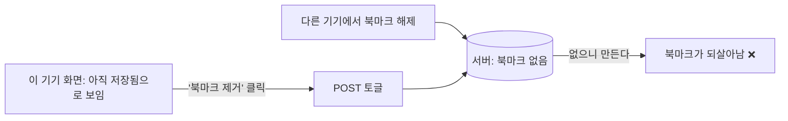
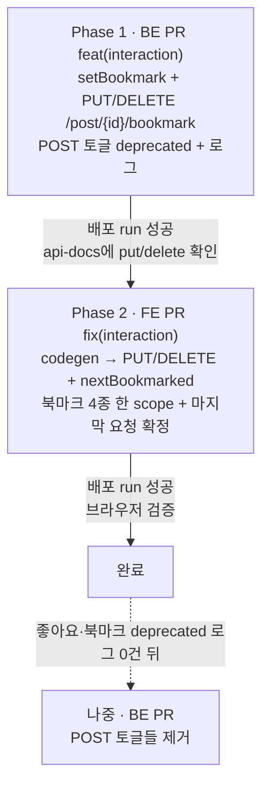

# 북마크 토글을 상태 지정형(PUT/DELETE)으로 전환하고 같은 글의 북마크 요청을 한 줄로

> 좋아요(BE #80·FE #351)와 같은 방식으로 북마크 토글 `POST /post/{id}/bookmark`를 `PUT`(저장)·`DELETE`(해제)로
> 바꾼다. FE는 "원하는 상태"를 보내고, 같은 글의 북마크 요청 4종(저장·해제·폴더 추가·제거·비우기)을 한 줄로
> 세워 마지막 요청에서만 화면을 확정한다.

## Context

### 근본 원인

토글은 "지금 상태의 반대"를 서버가 정한다. 화면이 서버보다 낡으면 누른 것과 반대 결과가 난다(좋아요 계획
`docs/plans/2026-10-13-like-concurrency.md` "남은 것"에 기록된 문제).

조사로 함께 드러난 것:

- **방향이 두 곳에서 따로 정해진다** — 다이얼로그(`useBookmarkFolders.ts:33-72`)는 화면 props로 "저장/제거"를
  고르고, `useBookmarkPostMutation`(`interaction.queries.ts:146-275`)은 캐시(`resolveCurrentBookmarkState`)로
  방향을 다시 계산한다. 둘이 어긋나면 "제거"를 눌렀는데 화면엔 저장으로 뜨고 서버는 지운다.
- **같은 글의 요청이 겹칠 수 있다** — 되돌리기 토스트(8초, `const.ts:30`)는 다이얼로그가 닫혀도 남는다. 되돌리기
  (`addBookmarkFolder` 또는 토글)가 진행 중일 때 다이얼로그를 다시 열어(400ms 가드) 행을 누르면 요청이 겹치고,
  늦게 도착한 쪽이 이긴다. 정정: 좋아요 계획은 "북마크는 같은 탭에서 동시 토글이 생기지 않는다"고 봤는데 이
  경로를 놓쳤다.
- **성공 응답을 버린다** — `onSuccess`는 `handleBookmarkToggleSuccess`(폴더 목록·폴더별 게시글 무효화)만 하고
  응답 `{isBookmarked}`를 쓰지 않아, 서버 결과가 낙관적 값과 다르면 상세·피드가 틀린 채 남는다.
- **`applyBookmarkToggleToPost`(`interaction.queries.ts:131-144`)는 무조건 ±1** — 이미 그 상태여도 수를 바꾼다.

### 사전 조사

- **BE 선례**
  - `addBookmarkFolder`는 "북마크 보장 + 소속 보장"이고 기존 폴더를 건드리지 않는다(`InteractionService.kt:115-134`).
  - `removeBookmarkFolder`·`clearBookmarkFolders`는 낡은 화면에서도 안전하게 누를 수 있도록 공개 여부를 확인하지 않는다(`:136-162`).
  - 폴더 소속은 북마크에 FK cascade로 묶여 있다(`create_bookmark_folder_items.sql:25-26`).
  - "켜면 폴더 초기화"라는 요구사항은 없다. Swagger의 "초기화"는 OFF의 효과를 말한 것이다.
- **FE 선례**
  - 좋아요 연타 패턴(`interaction.queries.ts` `useLikePostMutation`, `interaction.keys.ts`, `docs/FE-ARCHITECTURE.md` §11 "같은 대상의 연속 mutation").
  - 폴더 mutation 3개(`bookmark-folder.queries.ts:343-507`)는 `mutationKey`는 있지만 `scope`가 없다. 롤백은 `rollbackBookmarkFolderMutation`(:319-332), 성공 처리는 `handleBookmarkFolderChangeSuccess`(`bookmark-folder.keys.ts:90-95`, 상세·피드·폴더 전부 무효화)다.
- **화면에 보이는 수** — `post.stats.bookmarkCount`는 어디서도 렌더되지 않는다. 화면에 나오는 수는 폴더별 수뿐이다(`BookmarkFolderSelectDialog.tsx`, `FolderTree.tsx`, `MobileFolderList.tsx`).
- **"재조회 없이" 요구사항이 없다** — 북마크에는 좋아요(`e2e/like.spec.ts`)와 달리 이 요구사항이 없다. `e2e/bookmark.spec.ts`는 폴더 추가 뒤 목록 재조회를 기다린다.

## 판단이 필요했던 항목

| 항목                               | 결정                                                                                                                     | 근거·기각한 대안                                                                                                                                                                                     |
| ---------------------------------- | ------------------------------------------------------------------------------------------------------------------------ | ---------------------------------------------------------------------------------------------------------------------------------------------------------------------------------------------------- |
| API 계약                           | `PUT`/`DELETE /post/{postId}/bookmark` 추가, POST 토글은 deprecated + 호출 로그                                          | 좋아요와 같은 근거(RFC 9110 멱등, GitHub·X 선례 — `docs/DECISIONS.md` 2026-10-13 좋아요 항목). 기각: 토글 유지 + 의도 쿼리 파라미터(사실상 PUT/DELETE를 숨긴 것), FE만 수정(낡은 화면 반전이 그대로) |
| PUT이 이미 폴더에 저장된 글에 오면 | 폴더 유지(북마크 보장만) (2026-10-13 사용자 선택)                                                                        | `addBookmarkFolder`와 같은 방식이다. 낡은 화면이 다른 기기의 분류를 지우지 않는다. 기각: 미분류로 초기화("미분류" 행 의도엔 맞지만 다른 기기 분류가 말없이 사라짐)                                   |
| 응답 형태                          | 기존 `BookmarkFoldersResponse(postId, isBookmarked, folderIds)` 재사용                                                   | PUT 뒤 서버에 폴더가 있을 수 있어 `folderIds`가 FE 교정에 필요하다. 폴더 API와 같은 DTO다. `bookmarkCount`는 화면에 안 보여 넣지 않는다                                                              |
| DELETE의 공개 여부 확인            | 하지 않는다(PUT은 한다)                                                                                                  | `removeBookmarkFolder`·`clearBookmarkFolders`와 같은 이유다. 응답에 수가 없어 새는 정보가 없고, 비공개로 바뀐 글의 북마크도 지울 수 있어야 한다                                                      |
| 직렬화 범위                        | 같은 글의 북마크 요청 4종(저장·해제·폴더 추가·제거·비우기)을 한 scope로, 마지막 요청에서만 확정 (2026-10-13 사용자 선택) | "되돌리기 + 다시 열기"가 저장/해제와 폴더 요청을 섞기 때문이다. 기각: 저장·해제만(좋아요와 같은 범위, 위 빈틈이 남음)                                                                                |
| 방향을 정하는 곳                   | 호출부가 `mutate(nextBookmarked)`로 넘긴다. 상세·피드 캐시는 각 항목이 스스로 "그 상태로 만들기"(`setBookmarkOnPost`)    | 좋아요와 같다. 폴더 목록 수(공유 캐시 하나)만 `resolveCurrentBookmarkState`로 이전 상태를 읽어, 바뀔 때만 조정한다(어차피 성공 뒤 무효화)                                                            |
| 마지막 성공 시 교정                | 응답의 `isBookmarked`·`folderIds`로 상세·피드 패치 + 기존 `handleBookmarkToggleSuccess`                                  | 피드 전체를 무효화하면 불러온 모든 페이지를 다시 받는다. 화면에 보이는 값은 응답에 다 있다                                                                                                           |
| `handleBookmarkToggleSuccess` 이름 | 그대로 둔다(JSDoc만 갱신)                                                                                                | 글 작성(`post.queries.ts:119-122`)도 쓰고 문서 여러 곳이 인용한다. "북마크가 생기거나 없어졌다"는 의미는 그대로 맞다                                                                                 |
| 옛 토글 제거 시점                  | 이번엔 제거하지 않는다. 좋아요 토글과 함께 로그가 0건이 되면 제거                                                        | 화면을 이동하지 않은 옛 탭이 계속 쓴다. #79로 동시성에는 안전하다                                                                                                                                    |

### 뒤집힌 전제

| 발견                                                         | 그래서 바뀐 것                                                    |
| ------------------------------------------------------------ | ----------------------------------------------------------------- |
| 좋아요 계획은 "북마크는 같은 탭에서 동시 토글이 없다"고 봤다 | 되돌리기 토스트 경로로 겹친다. 북마크 요청 4종을 한 줄로 세운다   |
| 토글 ON이 폴더를 초기화한다는 Swagger 문구                   | 실제로는 OFF의 효과를 말한 것이었다. PUT은 폴더를 건드리지 않는다 |

### 위험 관리

- **배포 순서**: BE 먼저. 옛 BE는 같은 경로에 POST만 있어 PUT/DELETE가 실패한다(롤백 + 에러 토스트). 되돌릴 땐 FE부터 되돌린다.
- **204 응답 함정**: `apiClient`는 204를 `{}`로 바꾼다(`client.ts:324-325`). 새 `onSuccess`가 `folderIds`를 읽으므로, MSW·테스트 핸들러가 전부 JSON `BookmarkFoldersResponse`를 돌려줘야 한다. 그렇지 않으면 `bookmarkFolderIds: undefined`가 들어가 `.includes`가 깨진다.
- **처음 쓰는 경로 아님**: PUT은 좋아요(#351)로, DELETE는 폴더 API로 이미 OAC를 통과한다.

## 세부 계획

- 각 Phase는 `origin/main`에서 새 워크트리로 시작한다.
- 계획 파일은 `docs/plans/2026-10-13-bookmark-set-state.md`로 BE PR과 FE PR에 같은 이름으로 커밋한다.

### Phase 1 — BE (추가만, 계약 확장)

BE 경로는 `src/main/kotlin/com/example/linksphere/` 기준.

| 위치                                                    | 변경 내용                                                                                                                                                                                                                                                                                                                                                                                                          |
| ------------------------------------------------------- | ------------------------------------------------------------------------------------------------------------------------------------------------------------------------------------------------------------------------------------------------------------------------------------------------------------------------------------------------------------------------------------------------------------------ |
| `domain/interaction/InteractionService.kt`              | `setBookmark(postId, userId, bookmarked): BookmarkFoldersResponse` 추가. `true`면 `assertPostVisible` 뒤 `bookmarkRepository.insertIgnoreConflict`를 하고 `(postId, true, findFolderIdsByUserIdAndPostId)`를 반환한다. `false`면 공개 여부를 확인하지 않고 `bookmarkFolderItemRepository.deleteByUserIdAndPostId` → `bookmarkRepository.deleteByUserIdAndPostId`를 한 뒤 `(postId, false, emptyList())`를 반환한다 |
| `domain/interaction/InteractionController.kt`           | `@PutMapping`/`@DeleteMapping("/post/{postId}/bookmark")`(메서드명 `putPostBookmark`·`deletePostBookmark`, `ApiResponse<BookmarkFoldersResponse>`)를 추가하고 `@Operation`을 단다. 기존 `bookmarkPost`는 `deprecated = true`와 INFO 로그 `deprecated bookmark toggle called`를 단다. `@Tag` 설명도 갱신한다                                                                                                        |
| `src/test/.../interaction/InteractionServiceTest.kt`    | 테스트 추가: PUT은 삭제하지 않고 폴더도 건드리지 않음 / DELETE는 추가하지 않고 소속 → 북마크 순으로 지움 / PUT은 남의 비공개 글이면 404 / DELETE는 공개 여부를 확인하지 않음                                                                                                                                                                                                                                       |
| `src/test/.../interaction/InteractionControllerTest.kt` | PUT/DELETE 매핑·응답 형태(`folderIds` 포함) 테스트 추가                                                                                                                                                                                                                                                                                                                                                            |
| `README.md` Interaction 표                              | PUT/DELETE 행을 추가하고 토글에 deprecated를 표시한다                                                                                                                                                                                                                                                                                                                                                              |
| `CHANGELOG.md` `[Unreleased]` Added                     | 항목 추가(좋아요 PUT/DELETE 항목과 같은 형식)                                                                                                                                                                                                                                                                                                                                                                      |
| `docs/plans/2026-10-13-bookmark-set-state.md` (신규)    | 이 계획 스냅샷                                                                                                                                                                                                                                                                                                                                                                                                     |

### Phase 2 — FE (Phase 1 운영 확인 후)

| 위치                                                                                              | 변경 내용                                                                                                                                                                                                                                                                                                                                                                                                                                                                                                              |
| ------------------------------------------------------------------------------------------------- | ---------------------------------------------------------------------------------------------------------------------------------------------------------------------------------------------------------------------------------------------------------------------------------------------------------------------------------------------------------------------------------------------------------------------------------------------------------------------------------------------------------------------- |
| `src/shared/api/generated/openapi.json`·`openapi.gen.ts`                                          | `pnpm codegen:fetch && pnpm codegen`                                                                                                                                                                                                                                                                                                                                                                                                                                                                                   |
| `src/entities/interaction/model/interaction.dto.ts`                                               | `PostBookmarkResponse = Schemas['BookmarkFoldersResponse']` alias                                                                                                                                                                                                                                                                                                                                                                                                                                                      |
| `src/entities/interaction/api/interaction.api.ts`                                                 | `toggleBookmarkPost` → `bookmarkPost`(PUT, `undefined` 본문)·`unbookmarkPost`(DELETE)                                                                                                                                                                                                                                                                                                                                                                                                                                  |
| `src/entities/bookmark/folder/api/bookmark-folder.keys.ts`                                        | `bookmarkPostScope(postId)`(공유 scope id)와 `isLastPendingBookmarkMutation(queryClient, postId)`(`isMutating({ predicate: scope.id 일치 }) === 1`)를 추가한다. `handleBookmarkToggleSuccess`는 JSDoc만 갱신한다. `@x/interaction.ts`로 공개한다                                                                                                                                                                                                                                                                       |
| `src/entities/interaction/api/interaction.keys.ts`                                                | `interactionMutationKeys.bookmarkPost(postId)`, 마지막 실패 무효화 `handleBookmarkPostFailure`(상세·피드·폴더 목록·폴더별 게시글, `@x` 래퍼만)                                                                                                                                                                                                                                                                                                                                                                         |
| `src/entities/interaction/api/interaction.queries.ts` `useBookmarkPostMutation`                   | `mutationKey`, 공유 `scope`, `mutationFn(nextBookmarked)`. `onMutate`: 4개 cancel·스냅샷 → `setBookmarkOnPost`(이미 그 상태면 그대로, `applyBookmarkToggleToPost` 대체)로 상세·피드 → `next=false`면 폴더별 게시글에서 카드가 있는 곳마다 제거 → 폴더 목록 수는 `resolveCurrentBookmarkState`의 이전 상태가 `next`와 다를 때만 조정. `onSuccess`: 마지막일 때만 응답의 `isBookmarked`·`folderIds`로 상세·피드 패치 + `handleBookmarkToggleSuccess`. `onError`: 마지막일 때만 스냅샷 복원 + `handleBookmarkPostFailure` |
| `src/entities/bookmark/folder/api/bookmark-folder.queries.ts` 폴더 mutation 3개(add·remove·clear) | 같은 공유 `scope`를 추가한다. `onSuccess`·`onError`는 `isLastPendingBookmarkMutation`일 때만 기존 처리(`handleBookmarkFolderChangeSuccess`, `rollbackBookmarkFolderMutation`)를 한다                                                                                                                                                                                                                                                                                                                                   |
| `src/features/bookmark/toggle/hooks/useBookmarkFolders.ts`                                        | `selectUncategorized`: 저장 안 됨이면 `toggleBookmark(true)`, 폴더가 있으면 clear(그대로). `selectFolder`의 마지막 폴더 → `toggleBookmark(false)`. `removeBookmark` → 항상 `toggleBookmark(false)`(`isBookmarked` 확인 제거, 멱등). `restoreBookmark([])` → `toggleBookmark(true)`                                                                                                                                                                                                                                     |
| `src/mocks/handlers/post.handlers.ts`                                                             | 북마크 POST(204)를 PUT/DELETE(JSON `BookmarkFoldersResponse`)로 바꾼다                                                                                                                                                                                                                                                                                                                                                                                                                                                 |
| `src/entities/interaction/api/interaction.queries.test.ts`                                        | `beforeEach`의 북마크 핸들러를 PUT/DELETE(JSON)로, 기존 북마크 테스트 9개를 `mutate(true/false)`로 갱신한다. 추가 테스트: 해제→저장→해제 세 번(직렬화·마지막 확정), 낡은 화면 PUT 응답의 `folderIds`(X) 반영, 마지막이 아닌 성공은 무효화하지 않음, 마지막 실패는 4곳 무효화, 폴더 추가 직후 해제가 순서대로 나감(공유 scope). 요청 기록으로 핸들러 호출을 단언한다                                                                                                                                                    |
| `src/features/bookmark/toggle/ui/PostCardBookmarkFolderDialog.test.tsx`                           | 토글 핸들러 5곳을 PUT/DELETE(JSON)로 바꾼다. "제거 + 되돌리기" 테스트는 DELETE 1번 → PUT 1번으로 바꾼다                                                                                                                                                                                                                                                                                                                                                                                                                |
| `docs/BOOKMARK.md`                                                                                | §5 API 표·다이얼로그 행 표, §8 코드 지도, §9 테스트 수, §10 시행착오(이번 건), §11 남은 것                                                                                                                                                                                                                                                                                                                                                                                                                             |
| `docs/FE-ARCHITECTURE.md` §11                                                                     | "같은 대상의 연속 mutation"에 북마크 참조와 "여러 mutation이 한 scope를 공유할 때는 `predicate`로 센다" 한 줄                                                                                                                                                                                                                                                                                                                                                                                                          |
| `docs/DECISIONS.md`                                                                               | 2026-10-13 북마크 항목(PUT 폴더 유지, 4종 직렬화). 좋아요 항목의 "동시 토글 없음" 판단을 정정한다                                                                                                                                                                                                                                                                                                                                                                                                                      |
| `docs/POST.md`·`docs/VERSION-COMPATIBILITY.md`·`CHANGELOG.md`                                     | 테스트 수(이미 1 어긋남), BE 먼저 행, Fixed 항목                                                                                                                                                                                                                                                                                                                                                                                                                                                                       |
| `docs/plans/2026-10-13-bookmark-set-state.md` (신규)                                              | BE와 같은 파일                                                                                                                                                                                                                                                                                                                                                                                                                                                                                                         |

## 영향 범위

### CRUD 실패 지점

- **저장(PUT)**: `insertIgnoreConflict`라 동시·반복에도 멱등이다. 남의 비공개 글이면 404다. 기존 폴더는 그대로 둔다.
- **해제(DELETE)**: 소속 → 북마크 일괄 삭제라 0행이어도 예외가 없다(#79·#82). 비공개로 바뀐 글의 북마크도 지울 수 있다.
- **조회**: 피드·상세의 `isBookmarked`·`bookmarkFolderIds`는 마지막 응답으로 교정한다. 폴더 목록 수·폴더별 게시글은 성공 뒤 무효화한다.
- **동시 요청**: 같은 탭의 4종은 공유 scope로 클릭 순서대로 나간다. 여러 탭·기기는 멱등 API가 흡수한다.
- **cascade**: 북마크를 지우면 폴더 소속도 FK cascade로 지워진다. 마지막 폴더 해제 시 서버에 다른 폴더 B가 있으면 B도 지워진다(기존 토글과 같음, "남은 것").

### 기존 기능 회귀

| 깨질 수 있는 것                                                 | 소유 파일                                                                                                                      |
| --------------------------------------------------------------- | ------------------------------------------------------------------------------------------------------------------------------ |
| 북마크 토글 단위 테스트 9개(무인자 `mutate`, 204 핸들러)        | `interaction.queries.test.ts`                                                                                                  |
| 다이얼로그 테스트(토글 POST 핸들러, 호출 수 2)                  | `PostCardBookmarkFolderDialog.test.tsx`                                                                                        |
| 폴더 add·remove·clear의 성공·실패 처리가 "마지막 요청"으로 바뀜 | `bookmark-folder.queries.ts`, `bookmark-folder.queries.test.ts`                                                                |
| 글 작성의 북마크 성공 처리(`handleBookmarkToggleSuccess`)       | `post.queries.ts` — 이름·동작 그대로                                                                                           |
| 다이얼로그 흐름·토스트 문구                                     | `usePostCardBookmarkFolderDialog.ts` — 호출부 의미만 바뀌고 UI 흐름은 같다                                                     |
| 공유 파일 import 사용처                                         | 구현 전에 `pnpm graph:focus`로 `bookmark-folder.keys.ts`·`interaction.queries.ts`·`bookmark-folder.queries.ts` 사용처를 뽑는다 |
| 옛 FE 탭                                                        | deprecated POST 토글을 계속 쓴다(안전, 로그로 집계)                                                                            |

## 검증 방법

1. **BE**: `./gradlew ktlintCheck test`를 돌린다(새 서비스·컨트롤러 테스트, `SwaggerDocsCoverageTest`, `RepositoryDeleteRulesTest`).
2. **BE 배포 뒤**:
   - `https://linksphere.click/api/v3/api-docs`의 `/post/{postId}/bookmark`에 `put`·`delete`가 있는지 본다.
   - 로그인 없이 PUT·DELETE를 보내 BE 401까지 닿는지 본다.
3. **FE**:
   - `pnpm type-check`·`pnpm test`·`pnpm lint`·`pnpm check:deps`·`pnpm check:docs`·`pnpm test:e2e`를 돌린다.
   - 새 직렬화·마지막 확정 테스트는 조건(`isLastPendingBookmarkMutation`)을 꺼서 실패하는지 확인한다.
4. **브라우저 검증**(모킹 녹화, `browser-verification` skill):
   1. 다이얼로그에서 미분류 저장 → 제거 → 되돌리기
   2. 마지막 폴더 해제 → 되돌리기 직후 다시 열어 해제(요청이 순서대로 나가는지 화면 로그로)
   3. 낡은 화면(서버엔 폴더 X)에서 미분류 저장 → X로 교정
   4. 전부 실패 시 복구
5. **배포 확인**: 두 레포 배포 run이 그 SHA로 success인지 본다. 실패 run이 있었으면 경위를 보고한다.
6. **계획 대비 구현**: 각 PR 전에 fresh general-purpose 서브에이전트로 대조하고 PR 본문 `## 계획 대비 구현`에 적는다.

## 남은 것

- **낡은 화면에서 "미분류" 저장 토스트**: 실제로는 폴더 X에 남았는데 "미분류에 저장했어요"가 뜬다. 응답의 `folderIds`로 문구를 고를 수 있다.
- **마지막 폴더 해제 시 다른 기기가 추가한 폴더 B까지 지워짐**: 기존 토글과 같다. `removeBookmarkFolder(A)` 응답의 `folderIds`가 비었을 때만 DELETE하는 방식을 검토한다.
- **POST 토글 제거**: 좋아요·북마크 deprecated 호출 로그가 0건이 되면 BE PR로 함께 제거한다.
