# 배포 성공 시 열린 "배포 실패" 이슈 자동 종료 (#136 조치)

## Context

- **#136(run #243, 2026-09-20)의 실패 원인은 이미 해결됨.** `post.api.ts`의 `NProgress.done()`이 건
  `setTimeout(200ms)×2` → `NProgress.remove()`가 `usePostList.test.tsx`의 jsdom 정리 이후 발화해
  `ReferenceError: document is not defined` → Vitest Unhandled Error → exit 1(테스트 430개는 전부 pass).
  #138에서 `src/test/setup.ts:80-84` nprogress 전역 모킹으로 수정, `docs/TESTING.md` "자주 발생하는 문제" 11번에 기록.
- **재발 없음(2026-10-13 직접 조회)**: 수정 후 배포 워크플로 151회 = 성공 148·실패 0·취소 3(동시성 대기열).
  PR CI 실패 15건은 전부 e2e·Storybook a11y·lint·docs 단계, unit Unhandled Error 0건.
  같은 유형 후보 없음(nprogress import는 `post.api.ts` 하나, 나머지 타이머는 React effect 안이거나 document 미참조).
- **진짜 남은 문제 = 이슈 수명주기 공백.** `notify-failure` job(#134, 같은 날 도입)은 이슈를 만들기만 하고
  닫는 경로가 없다(`deploy.yml:178-193`). #138 본문에 `Closes #136`이 없어 22일간 열린 채 남았다.
- **사용자 결정(2026-10-13)**: A안 — 배포 성공 시 열린 "배포 실패:" 이슈를 자동으로 닫는다.
  (B: `Closes #N` 규칙만 — 기억 의존·재시도로 풀린 실패는 영영 안 닫힘 / C: 코멘트만 — 사람이 닫아야 해 반복)
- 타이머 누수 탐지(Vitest `detectAsyncLeaks`)는 도입하지 않음 — 설치된 4.0.17에 없고, 공식 문서가
  디버깅 전용이라 경고([docs](https://github.com/vitest-dev/vitest/blob/main/docs/config/detectasyncleaks.md)).

## 전체 흐름

```mermaid
flowchart TD
  P["main push / workflow_dispatch"] --> D["deploy job<br/>check·test·build·S3·invalidation·반영 검증"]
  D -->|실패| N["notify-failure job (기존)<br/>gh issue create '배포 실패: sha (run #N)'"]
  D -->|성공| C["close-resolved-failures job (신규)<br/>continue-on-error: true"]
  C --> Q["gh issue list --state open<br/>--author github-actions[bot]<br/>제목이 '배포 실패: '로 시작하는 것만"]
  Q --> X["각 이슈 gh issue close<br/>코멘트: 성공 커밋 sha + run 링크<br/>+ '재시도로만 통과했다면 다시 열 것'"]
  N -.다음 성공 배포에서.-> C
```

## 영향 범위 (§5)

- **CRUD**: 데이터 계약 변경 없음. 이슈만 대상 — 중복 닫기 없음(open만 조회), 사람이 만든 이슈는
  author(`github-actions[bot]`) + 제목 접두사 둘 다로 제외. 같은 봇의 다른 자동 이슈(#99 문서 점검 트래커,
  #331 OpenAPI 드리프트)는 제목 접두사가 달라 제외됨을 로컬에서 실측(결과: #136만 매칭).
- **회귀 후보**:
  - `deploy.yml` run 결론 — 닫기 job이 실패해도 `continue-on-error: true`라 run은 success 유지.
    `gh run list` 기반 배포 확인(CLAUDE.md Critical Rule)·`.claude/hooks/deploy-verify.mjs` 판정에 영향 없음.
  - 권한 분리 원칙(`DEPLOY.md` 9번: AWS job에 `issues: write`를 더하지 않음) — 신규 job에만 `issues: write`.
  - `notify-failure`는 `needs: deploy` + `if: failure()` 그대로 — 동작 변경 없음.
  - 문서: `docs/DEPLOY.md` 9번, `docs/BUILD-VERSION.md`(Mermaid·자주 하는 수정 표·§11 남은 것)가 현재 동작을 서술.
    구현 시 `grep -rn "notify-failure" docs README.md`로 다른 서술도 확인.

## 변경 내용

1. **`.github/workflows/deploy.yml`** — `notify-failure` 아래에 `close-resolved-failures` job 추가
   (`needs: deploy`, `if: success()`, job 단위 `continue-on-error: true`, `permissions: issues: write`).
   step은 `notify-failure`와 같은 형태(`GH_TOKEN`·`RUN_URL` env, `printf` 본문):
   `gh issue list --state open --author "github-actions[bot]" --json number,title --jq '... startswith("배포 실패: ") ...'`
   → `while read` 루프로 `gh issue close --comment`. 짧은 주석으로 이유(#136이 22일 방치) 남김.
   `continue-on-error` 동작은 GitHub 공식 문서로 확인하고 링크를 주석에 단다(§10).
2. **`docs/DEPLOY.md`** — 9번 "실패 시 알림" 다음에 "성공 시 실패 이슈 자동 종료" 설명 추가.
3. **`docs/BUILD-VERSION.md`** — Mermaid `M["배포 성공"]`에 닫기 job 노드 연결, "자주 하는 수정" 표에
   행 추가, §11 "notify-failure 실측 필요" 항목을 해소로 갱신(#136이 실제 생성된 증거), §10 시행착오에
   "#136 22일 방치 → 닫기 job 추가" 한 줄, "마지막 검토" 날짜 갱신.
4. **#136 코멘트** — 병합 전에 원인·수정(#138)·재발 없음 근거를 이슈에 남긴다(닫기는 신규 job이 실측으로).
5. **`docs/plans/2026-10-13-deploy-failure-issue-autoclose.md`** — 이 계획 스냅샷(§11).

- CHANGELOG 없음(`ci` 타입, 사용자 노출 동작 변화 없음). 커밋: `ci(deploy): 배포 성공 시 열린 배포 실패 이슈 자동 종료`.

## 실행 순서

1. `node -v`(v24) · `git worktree list` · `EnterWorktree` → `cp ../../../.env .` · `pnpm install`
2. 위 1~3·5 편집 → `pnpm check`(prettier가 yml·md 포함) · `pnpm check:docs` · (있으면) `actionlint`
3. 커밋(`git add -- <새 plan 파일>` 후 경로 지정 커밋) → push → PR(영향 범위 1~2줄, `## 계획 대비 구현`은
   fresh general-purpose subagent 대조 결과)
4. #136에 원인 코멘트(4번)
5. PR CI green 확인 → `gh pr merge <번호> --squash`
6. `deploy.yml`은 deploy 경로 필터에 없어 병합만으로 배포가 안 돈다 →
   `gh workflow run "Frontend Deploy (S3 + CloudFront)" --ref main`(현재 main을 그대로 재배포, 내용 변화 없음)
7. `gh run watch`로 deploy·close-resolved-failures 둘 다 success 확인 → `gh issue view 136`이 CLOSED + 자동 코멘트인지 확인
8. `ExitWorktree(keep)` 후 보고(문서 갱신 항목 별도 명시)

## 검증 방법

- 정적: `pnpm check`, `pnpm check:docs` 통과, actionlint(설치돼 있으면) 무경고.
- 필터 실측(완료): 로컬 `gh issue list --state open --author "github-actions[bot]" ... startswith("배포 실패: ")` → `#136`만.
- 실환경: 6~7단계 — 신규 job이 실제 러너에서 #136을 닫는 것 = 성공 경로 실측. run 결론이 success인지도 확인.

## 남은 것

- 실패 경로(닫기 job 자체가 실패할 때 run이 success로 남는지)는 의도적 실패 주입 없이는 실측 못 함 —
  공식 문서 근거로만 확인.
