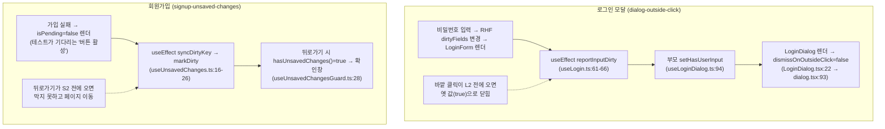

# e2e 숨은 flaky 2건 수정과 Playwright failOnFlakyTests

> 가드 상태(로그인 모달 바깥 클릭 막기, 이탈 가드 등록)를 `useEffect` 대신 `useLayoutEffect`로 반영해 화면보다 늦게 켜지는
> 틈을 없애고, CI에서 재시도로만 통과한 테스트를 실패로 처리한다.

## Context

link-sphere 후속 작업 ④("flaky 정리")를 조사한 결과(2026-10-13, 서브에이전트 2개 + 직접 측정)

- **요청에 적힌 두 증상은 이미 해결돼 있다.** Storybook a11y 리로드 16건은 #276(09-30, 깨진 이미지 경로 수정과 감시
  가드)으로 해결됐고, 이후 run 109건에서 재발 0건이다. vitest nprogress 타이머 2건은 #138(09-20, `src/test/setup.ts:80-84`
  전역 mock)으로 해결됐고, 이후 CI 313건·배포 159건에서 재발 0건이다. claude-base의 "flaky 4.7%"는 수정 전까지 포함한 누적치다.
- **숨은 flaky가 남아 있다.** 최근 성공 run 40건 중 3건(7.5%)에서 e2e 테스트 1개가 첫 시도에 실패하고 `retries: 2`로 통과했다.
  job이 초록이라 지금까지 집계되지 않았다.
  - `e2e/dialog-outside-click.spec.ts:86` "비밀번호를 입력했으면 바깥을 눌러도 그대로 있고, ESC로는 닫힌다"(10-12, 10-13)
  - `e2e/signup-unsaved-changes.spec.ts:148` "가입 요청이 실패한 뒤 뒤로가기를 누르면 확인창이 다시 뜬다"(10-05, 09-30)

사용자 결정(2026-10-13 질문 2개)

- 숨은 flaky 2개를 고친 뒤 CI에서 `failOnFlakyTests`를 켠다.
- 고치는 위치는 앱이다(`useLayoutEffect`). 테스트 대기 헬퍼는 쓰지 않는다.

### 근본 원인(코드 추적에 따른 가설, 구현 1단계에서 재현으로 확인)



`useEffect`는 화면을 그린 뒤에 돌아서, 화면이 이미 "준비됨"(입력 완료, 버튼 활성)으로 보여도 가드는 아직 꺼져 있는 틈이 생긴다.
`useLayoutEffect`는 화면을 그리기 전에 돌고, 그 안의 상태 변경도 그리기 전에 처리된다. 그래서 테스트(그리고 사용자)가 화면을 보고
다음 동작을 할 때는 가드가 이미 켜져 있다.

## 판단이 필요했던 항목

| 항목                     | 결정                                                                                                  | 근거·기각한 대안                                                                                                                                                                                                                                                                                                                                                                                                                                                                       |
| ------------------------ | ----------------------------------------------------------------------------------------------------- | -------------------------------------------------------------------------------------------------------------------------------------------------------------------------------------------------------------------------------------------------------------------------------------------------------------------------------------------------------------------------------------------------------------------------------------------------------------------------------------- |
| 범위                     | 숨은 flaky 2개 수정 + `failOnFlakyTests: !!process.env.CI`                                            | 사용자 결정. claude-base 테스트 기준 "flaky는 통과로 치지 않는다", 3라운드 후속 목록의 `failOnFlakyTests` 검토(`claude-base/docs/plans/2026-10-13-round3.md:222`), ⑥ 필수 체크의 선행 조건                                                                                                                                                                                                                                                                                             |
| 수정 위치                | 앱: `useLogin.ts`의 `reportInputDirty`, `useUnsavedChanges.ts`의 `syncDirtyKey`를 `useLayoutEffect`로 | 사용자 결정. react.dev는 `useLayoutEffect`를 _"브라우저가 화면을 다시 그리기 전에 실행되는 useEffect"_ (번역, [useLayoutEffect](https://react.dev/reference/react/useLayoutEffect))로 설명한다. 같은 문서가 성능상 `useEffect`를 권하지만, 여기서 하는 일은 값 하나 저장이라 비용이 작다. 레포 선례: `useUnsavedChangesGuard.ts`가 "읽는 쪽은 항상 최신 값을 본다"는 이유로 `useLayoutEffect`를 쓴다. 기각: 테스트에 한 프레임 대기 헬퍼(원인이 남아 같은 구조의 다른 테스트에서 재발) |
| `useUnsavedChanges` 영향 | 모든 폼의 이탈 가드 등록이 화면보다 먼저 일어난다. 해제(cleanup)도 레이아웃 단계로 당겨진다           | 저장소 값 하나를 쓰는 일이라 화면 변화는 없다. 사용하는 폼 전부에 같은 이점(입력 직후 바로 링크를 눌러도 막힘)                                                                                                                                                                                                                                                                                                                                                                         |
| 재현 테스트              | 단위 테스트로는 재현 불가 → e2e 반복 실행(CPU 스로틀)으로 수정 전 실패·수정 후 0건을 보인다           | RTL의 `act()`는 effect를 모두 비운 뒤 돌아와 `useEffect`와 `useLayoutEffect`를 구분하지 못한다                                                                                                                                                                                                                                                                                                                                                                                         |
| 브라우저 녹화            | 하지 않는다. e2e 반복 실행이 검증이다                                                                 | 눈에 보이는 동작은 바뀌지 않는다(가드가 켜지는 시점만 앞당겨짐)                                                                                                                                                                                                                                                                                                                                                                                                                        |
| 커밋·CHANGELOG           | `fix(shared): …`, `[Unreleased]` Fixed 항목 추가                                                      | 앱 동작(가드 시점)이 바뀌는 fix다(changelog-release skill)                                                                                                                                                                                                                                                                                                                                                                                                                             |

## 세부 계획

| 위치                                                               | 변경 내용                                                                                               |
| ------------------------------------------------------------------ | ------------------------------------------------------------------------------------------------------- |
| `src/shared/hooks/useUnsavedChanges.ts:16`                         | `useEffect` → `useLayoutEffect`, 이유 주석과 react.dev 링크                                             |
| `src/features/auth/login/hooks/useLogin.ts:61`                     | `useEffect` → `useLayoutEffect`(이 effect만), 이유 주석과 링크                                          |
| `playwright.config.ts`                                             | `failOnFlakyTests: !!process.env.CI` (`retries` 옆, 이유 주석: 재시도는 진단용으로 두고 flaky는 실패로) |
| `docs/UNSAVED-CHANGES-GUARD.md` §6 스니펫·§10 시행착오·마지막 검토 | 스니펫을 실제 소스와 맞추고, 이번 flaky와 원인·수정을 시행착오에 기록                                   |
| `docs/AUTH.md:403`                                                 | 바깥 클릭 전달이 레이아웃 effect라 화면보다 먼저 반영된다는 한 줄                                       |
| `docs/TESTING.md` "CI 연동"                                        | CI는 `retries: 2`로 다시 돌리되 재시도로만 통과하면 실패(`failOnFlakyTests`)한다는 설명                 |
| `docs/CI-CHECK-GATE.md` §6 e2e job 행·마지막 검토                  | `failOnFlakyTests` 반영                                                                                 |
| `CHANGELOG.md` `[Unreleased]`                                      | Fixed 항목(`shared` 스코프, 요약 72자 이내 + `<details>`)                                               |
| `docs/plans/2026-10-13-e2e-flaky-layout-effect.md` (신규)          | 이 계획 스냅샷 (§11)                                                                                    |

## 영향 범위 (§5)

- **CRUD**: 해당 없음.
- **기존 기능 회귀**
  - `useUnsavedChanges` 사용처 전체(폼 훅들). 구현 때 `pnpm graph:focus "src/shared/hooks/useUnsavedChanges.ts" --text`로 사용처를 뽑아
    PR에 적는다. 확인: unit 테스트 전체, e2e의 이탈 가드 스펙(`signup-unsaved-changes`, `unsaved-*`, `post-*`).
  - `useLogin` → `LoginForm`·`LoginDialog`. 확인: `LoginDialog.test.tsx`, `e2e/dialog-outside-click.spec.ts`, `guest-guard.spec.ts`.
  - `failOnFlakyTests` → CI e2e job. 다른 flaky가 있으면 PR이 빨개진다(필수 체크가 아니라 머지는 막히지 않는다).
  - react-hooks 린트(v7 recommended): 두 곳 모두 `setState` 직접 호출이 아니라 저장소 액션·부모 콜백 호출이다. 린트 결과로 확인한다.
- **문서**: 위 세부 계획의 문서들. `.claude/CLAUDE.md`는 10-21 판정 전 동결이라 고치지 않는다.

## 검증 방법

1. **수정 전 재현**(워크트리, 코드 변경 전): 두 스펙의 `beforeEach`에 임시로 CPU 스로틀을 넣는다.
   ```ts
   const cdp = await page.context().newCDPSession(page);
   await cdp.send('Emulation.setCPUThrottlingRate', { rate: 6 });
   ```
   `pnpm exec playwright test --project=chromium e2e/dialog-outside-click.spec.ts e2e/signup-unsaved-changes.spec.ts --repeat-each=30 --retries=0`
   - 실패가 나오면 실패 지점이 가설과 같은지 본다(바깥 클릭 뒤 대화상자 사라짐, 뒤로가기 뒤 확인창 없음).
   - 가설과 다른 실패면 멈추고 보고한다. 끝까지 재현되지 않으면 그 사실을 적고, 코드 근거로 진행한다.
2. **수정 후**: 같은 명령에서 실패 0건이어야 한다. 그다음 임시 스로틀을 되돌리고(`git diff`에 스펙 변경이 없어야 함) 일반 조건으로 한 번 더 돌린다.
3. **완료 조건**: `pnpm type-check`, `pnpm test`, `pnpm lint`, `pnpm check`, `pnpm check:docs`, `pnpm test:e2e`(전체).
4. **CI**: `gh pr checks`로 e2e job이 `failOnFlakyTests` 아래에서 통과하는지 확인한다. mutation job 댓글(바뀐 `.ts` 2개)도 확인해 보고한다.
5. 머지는 승인 뒤, 머지 뒤 배포 워크플로 성공을 확인하고 보고한다.

## 남은 것

- 그 밖의 과거 e2e flaky(09-30 ⋮ 메뉴 항목 타임아웃, 09-11 목록 재조회 횟수)는 그 뒤 재시도 없이 통과하고 있다.
  `failOnFlakyTests`가 켜지면 재발 시 바로 드러난다.
- claude-base `docs/METRICS.md`의 flaky 수치를 "수정 이후" 기준으로 다시 잴지는 사용자가 정한다.
