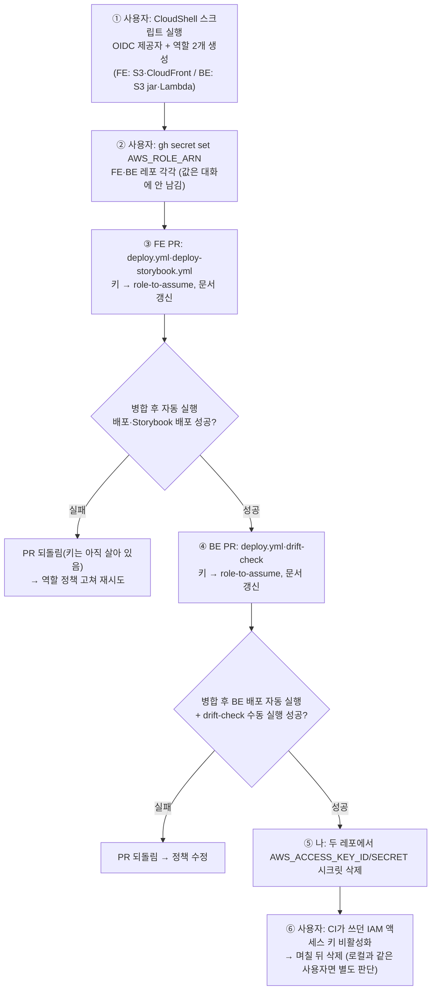

# GitHub Actions → AWS 인증을 영구 키에서 OIDC로 전환 (FE·BE)

## 0. 현재 상황 (2026-10-13 확인)

- **4개 워크플로가 IAM 사용자 영구 키(`AWS_ACCESS_KEY_ID`/`AWS_SECRET_ACCESS_KEY` 시크릿)를 쓴다.**
  - FE `deploy.yml`(S3 cp/sync·CloudFront 무효화), FE `deploy-storybook.yml`(S3 `storybook/` 접두사·무효화)
  - BE `deploy.yml`(S3 jar 업로드·Lambda 코드 갱신·버전 발행·호출 검증·alias 승격·URL 조회)
  - BE `prod-alias-drift-check.yml`(6시간마다 Lambda alias·버전 조회)
- FE `deploy.yml:22`에 "AWS OIDC 인증을 위해 필수"라는 주석이 달린 `id-token: write`가 첫 커밋부터 있지만,
  실제로 OIDC를 쓴 적은 없다. `docs/HISTORY.md`도 "OIDC 적용"으로 잘못 적혀 있다(자동 생성 문서라 고치지 않음).
- 키 시크릿 생성일: FE 2026-02-19, BE 2026-03-05. 두 키가 같은 IAM 사용자의 것인지는 모른다.
- 로컬 프로필 `link-sphere-user`·`c-bae` 둘 다 IAM 권한이 없다(`iam:ListOpenIDConnectProviders` AccessDenied).
  → AWS 쪽 설정은 사용자가 콘솔 권한으로 해야 한다.
- BE `docs/DEPLOY.md` "IAM 사용자 생성"의 최소 권한 정책에는 실제 워크플로가 쓰는
  `lambda:GetFunctionUrlConfig`(deploy)와 `lambda:ListVersionsByFunction`(drift check)이 빠져 있다.
- BE Variables: `AWS_REGION=ap-northeast-1`, `AWS_S3_BUCKET=link-sphere-lambda-deploy`,
  `LAMBDA_FUNCTION_NAME=link-sphere-api`. FE는 버킷·배포 ID를 Secret으로 둔다.
- 선례: BE에 역할 ARN을 Secret으로 둔 `AWS_APP_RUNNER_ROLE_ARN`이 있다(App Runner 시절, 지금은 미사용).
- 근거(공식): GitHub [OIDC in AWS](https://docs.github.com/en/actions/how-tos/secure-your-work/security-harden-deployments/oidc-in-aws)
  — 제공자 URL `https://token.actions.githubusercontent.com`, audience `sts.amazonaws.com`,
  신뢰 정책 `sub` = `repo:<owner>/<repo>:ref:refs/heads/<branch>`, job에 `id-token: write`.
  AWS CLI `create-open-id-connect-provider`는 `--url`만 필수(thumbprint 생략 가능).
  `role-duration-seconds` 기본 1시간 — BE 배포는 3~4분이라 충분.

**사용자 결정(2026-10-13)**: AWS 설정은 CloudShell 스크립트(부록 A)로, 역할 ARN은 GitHub Secret `AWS_ROLE_ARN`으로.

## 1. 전체 흐름



키는 마지막(⑤⑥)에만 지운다 — CLAUDE.md 키 교체 순서(새 방식 반영 → 배포 확인 → 옛 값 삭제).

## 2. 세부 계획

### 2-1. AWS (사용자, CloudShell — 스크립트는 내가 작성해 대화로 전달)

- OIDC 제공자: 없으면 `aws iam create-open-id-connect-provider --url https://token.actions.githubusercontent.com --client-id-list sts.amazonaws.com`
- 역할 `link-sphere-fe-deploy`
  - 신뢰: `aud`=`sts.amazonaws.com`, `sub`=`repo:BAECHAN/link-sphere_FE_NEW:ref:refs/heads/main` (StringEquals)
  - 권한(인라인): `s3:ListBucket`(버킷), `s3:PutObject`·`s3:DeleteObject`(버킷/\*), `cloudfront:CreateInvalidation`(배포 ARN)
    — FE `docs/DEPLOY.md` "AWS IAM 권한 요구사항"의 목록 그대로
  - 버킷·배포 ID는 스크립트가 CloudFront 별칭 `linksphere.click`에서 찾아 쓴다 → 값이 대화로 오가지 않는다.
    찾은 값은 CloudShell 화면에만 출력해 사용자가 눈으로 확인
- 역할 `link-sphere-be-deploy`
  - 신뢰: `sub`=`repo:BAECHAN/link-sphere_BE_NEW:ref:refs/heads/main` (push·수동 실행·예약 실행 모두 main 기준)
  - 권한: BE 문서의 최소 권한 정책 + `lambda:GetFunctionUrlConfig`·`lambda:ListVersionsByFunction`
    (S3 `link-sphere-lambda-deploy/*` Put/Get, Lambda `function:link-sphere-api*`)
- 마지막에 역할 ARN 2개와, 정리 단계용으로 IAM 사용자별 액세스 키 "마지막 사용 시각·서비스"를 출력(읽기만)

### 2-2. FE (워크트리, PR 1)

- `.github/workflows/deploy.yml`: `aws-access-key-id`/`aws-secret-access-key` → `role-to-assume: ${{ secrets.AWS_ROLE_ARN }}`.
  워크플로 단위 `id-token: write`는 이미 있음(주석 유지 — 이제 사실이 된다)
- `.github/workflows/deploy-storybook.yml`: 같은 교체 + `permissions`에 `id-token: write` 추가
- 문서: `docs/DEPLOY.md`(5단계 인증·Storybook 인증·Secrets 표·IAM 권한 절을 역할·신뢰 조건으로),
  `docs/SYSTEM-ARCHITECTURE.md`(FE·BE Secrets 행 — BE 행은 BE PR 병합 뒤 같은 날 갱신하거나 FE PR에서 함께, 아래 실행 전략 참고)
- `docs/plans/2026-10-13-github-oidc-aws.md`: 이 계획 스냅샷(§11)
- 두 워크플로 모두 자기 파일이 경로 필터에 있어 병합 직후 자동 실행 → 그 자체가 실측

### 2-3. BE (워크트리, PR 2 — FE 성공 확인 후)

- `.github/workflows/deploy.yml`: 같은 교체 + 워크플로 단위 `permissions: { id-token: write, contents: read }` 추가
  (지금은 permissions 블록이 없어 기본 토큰 권한 — `GITHUB_TOKEN`을 쓰는 스텝이 없어 축소해도 영향 없음)
- `.github/workflows/prod-alias-drift-check.yml`: 같은 교체 + 기존 `issues: write` 옆에 `id-token: write`
- 문서: BE `docs/DEPLOY.md`("IAM 사용자 생성" → "OIDC 역할", 정책에 빠진 2개 권한 반영, Secrets 표)
- BE 배포는 자기 파일이 경로 필터에 있어 병합 직후 자동 실행 → 같은 코드로 새 버전 발행·검증·prod 승격까지 한 번 돈다.
  drift-check는 `workflow_dispatch`로 1회 실행

## 실행 전략

- FE 먼저, BE 나중 — 문제가 나도 한쪽에서 멈춘다. 각 단계 실패 시 PR 되돌림으로 즉시 복구(키가 살아 있는 동안).
- `docs/SYSTEM-ARCHITECTURE.md`의 BE Secrets 행은 FE 레포 파일이므로, BE 병합·검증 뒤 FE에 작은 문서 PR로 갱신
  (FE PR 시점엔 BE가 아직 키를 쓰므로 미리 바꾸면 사실과 어긋난다).
- 키 삭제(⑤⑥)는 4개 워크플로 모두 OIDC로 성공한 뒤에만. IAM 키 비활성화는 사용자가 출력된 "마지막 사용" 정보로
  CI 전용 사용자인지 확인하고 진행 — 로컬 `link-sphere-user`와 같은 키라면 로컬 CLI가 끊기므로 그때 다시 판단.

## 검증 방법

- 정적: `actionlint`, `pnpm check:docs`(FE), BE CI.
- FE: 병합 후 자동 실행된 `Frontend Deploy`·`Storybook Deploy` run이 success이고 "Configure AWS credentials" 스텝 로그에
  역할 assume 성공이 찍히는지(`gh run view --log`), 배포 반영 검증 스텝 통과.
- BE: 병합 후 `Deploy to AWS Lambda` success(prod 승격 포함), `prod-alias-drift-check` 수동 실행 success.
- 정리 후: 두 레포 `gh secret list`에 `AWS_ACCESS_KEY_*` 없음, 이후 한 번 더 배포가 OIDC로 성공.

## 부록 A. CloudShell 스크립트 (AWS 콘솔 → CloudShell에 붙여넣기)

여러 번 실행해도 안전하다(있으면 건너뛰거나 갱신). 액세스 키 ID·시크릿은 출력하지 않는다.

```bash
set -euo pipefail
ACCOUNT_ID=$(aws sts get-caller-identity --query Account --output text)
OIDC_HOST=token.actions.githubusercontent.com
PROVIDER_ARN="arn:aws:iam::${ACCOUNT_ID}:oidc-provider/${OIDC_HOST}"

# 1) GitHub OIDC 제공자 (있으면 건너뜀)
if aws iam get-open-id-connect-provider --open-id-connect-provider-arn "$PROVIDER_ARN" >/dev/null 2>&1; then
  echo "OIDC 제공자: 이미 있음"
else
  aws iam create-open-id-connect-provider --url "https://${OIDC_HOST}" --client-id-list sts.amazonaws.com >/dev/null
  echo "OIDC 제공자: 생성함"
fi

# 2) FE 배포 대상 — CloudFront 별칭 linksphere.click에서 찾는다
DIST_ID=$(aws cloudfront list-distributions \
  --query "DistributionList.Items[?Aliases.Quantity > \`0\` && contains(Aliases.Items, 'linksphere.click')].Id | [0]" --output text)
if [ -z "$DIST_ID" ] || [ "$DIST_ID" = "None" ]; then echo "linksphere.click 배포를 못 찾음"; exit 1; fi
ORIGIN=$(aws cloudfront get-distribution-config --id "$DIST_ID" \
  --query "DistributionConfig.Origins.Items[?contains(DomainName, '.s3.')].DomainName | [0]" --output text)
if [ -z "$ORIGIN" ] || [ "$ORIGIN" = "None" ]; then echo "S3 원본을 못 찾음"; exit 1; fi
FE_BUCKET=${ORIGIN%%.s3.*}
echo "FE 대상: CloudFront=$DIST_ID, S3=$FE_BUCKET (GitHub 시크릿 CLOUDFRONT_DISTRIBUTION_ID·S3_BUCKET_NAME과 같은지 눈으로 확인)"

# 3) BE 배포 대상 — BE 레포 Variables와 같은 값
REGION=ap-northeast-1
BE_BUCKET=link-sphere-lambda-deploy
BE_FUNC=link-sphere-api

trust() {
  cat <<JSON
{"Version":"2012-10-17","Statement":[{"Effect":"Allow","Principal":{"Federated":"${PROVIDER_ARN}"},"Action":"sts:AssumeRoleWithWebIdentity","Condition":{"StringEquals":{"${OIDC_HOST}:aud":"sts.amazonaws.com","${OIDC_HOST}:sub":"repo:$1:ref:refs/heads/main"}}}]}
JSON
}

upsert_role() { # $1=역할 이름, $2=owner/repo, $3=권한 정책 JSON
  if aws iam get-role --role-name "$1" >/dev/null 2>&1; then
    aws iam update-assume-role-policy --role-name "$1" --policy-document "$(trust "$2")"
  else
    aws iam create-role --role-name "$1" --assume-role-policy-document "$(trust "$2")" \
      --description "GitHub Actions OIDC - $2 (main)" >/dev/null
  fi
  aws iam put-role-policy --role-name "$1" --policy-name deploy --policy-document "$3"
  echo "$1 ARN: $(aws iam get-role --role-name "$1" --query Role.Arn --output text)"
}

upsert_role link-sphere-fe-deploy BAECHAN/link-sphere_FE_NEW "$(cat <<JSON
{"Version":"2012-10-17","Statement":[
 {"Effect":"Allow","Action":"s3:ListBucket","Resource":"arn:aws:s3:::${FE_BUCKET}"},
 {"Effect":"Allow","Action":["s3:PutObject","s3:DeleteObject"],"Resource":"arn:aws:s3:::${FE_BUCKET}/*"},
 {"Effect":"Allow","Action":"cloudfront:CreateInvalidation","Resource":"arn:aws:cloudfront::${ACCOUNT_ID}:distribution/${DIST_ID}"}]}
JSON
)"

upsert_role link-sphere-be-deploy BAECHAN/link-sphere_BE_NEW "$(cat <<JSON
{"Version":"2012-10-17","Statement":[
 {"Effect":"Allow","Action":["s3:PutObject","s3:GetObject"],"Resource":"arn:aws:s3:::${BE_BUCKET}/*"},
 {"Effect":"Allow","Action":["lambda:UpdateFunctionCode","lambda:PublishVersion","lambda:CreateAlias","lambda:UpdateAlias",
   "lambda:GetAlias","lambda:GetFunction","lambda:GetFunctionConfiguration","lambda:InvokeFunction",
   "lambda:GetFunctionUrlConfig","lambda:ListVersionsByFunction"],
  "Resource":["arn:aws:lambda:${REGION}:${ACCOUNT_ID}:function:${BE_FUNC}","arn:aws:lambda:${REGION}:${ACCOUNT_ID}:function:${BE_FUNC}:*"]}]}
JSON
)"

# 4) 정리 단계용 — 활성 액세스 키의 사용자·생성일·마지막 사용(키 ID는 출력하지 않음)
#    GitHub 시크릿 생성일: FE AWS_ACCESS_KEY_ID 2026-02-19, BE 2026-03-05 — 생성일이 맞는 키가 CI 키일 가능성이 높다
echo "--- 활성 액세스 키 (사용자 / 생성일 / 마지막 사용 / 서비스)"
for u in $(aws iam list-users --query 'Users[].UserName' --output text); do
  aws iam list-access-keys --user-name "$u" --query 'AccessKeyMetadata[?Status==`Active`].[AccessKeyId,CreateDate]' --output text |
  while read -r k created; do
    aws iam get-access-key-last-used --access-key-id "$k" \
      --query "['$u', '$created', AccessKeyLastUsed.LastUsedDate, AccessKeyLastUsed.ServiceName]" --output text
  done
done
```

실행 후 사용자가 할 일: 로컬 터미널에서 `gh secret set AWS_ROLE_ARN -R BAECHAN/link-sphere_FE_NEW`(프롬프트에 FE ARN 붙여넣기),
`gh secret set AWS_ROLE_ARN -R BAECHAN/link-sphere_BE_NEW`(BE ARN). 4)의 출력은 사용자·날짜·서비스만 있으니 대화에 붙여도 된다.

## 남은 것

- BE의 미사용 시크릿 `APP_RUNNER_SERVICE_ARN`·`AWS_APP_RUNNER_ROLE_ARN` 정리는 이번 범위 밖(언급만).
- BE 워크플로의 액션 SHA 고정(FE #344와 같은 작업)은 별도 결정 대기.
