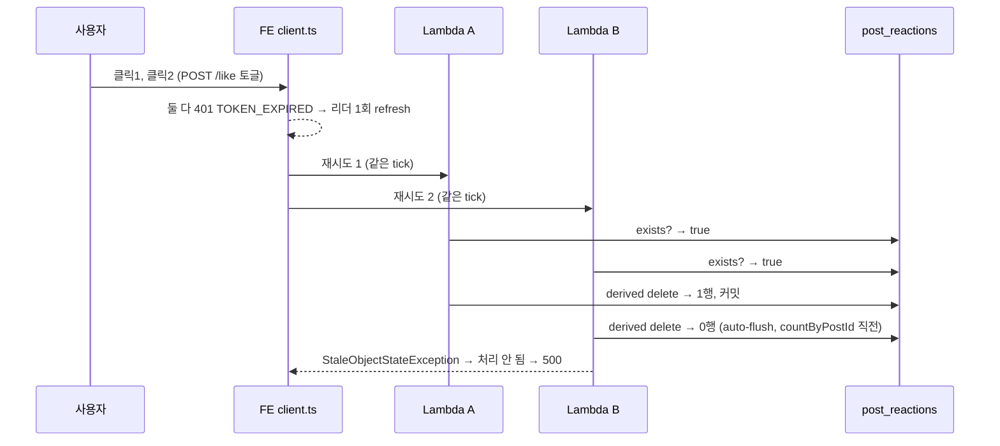
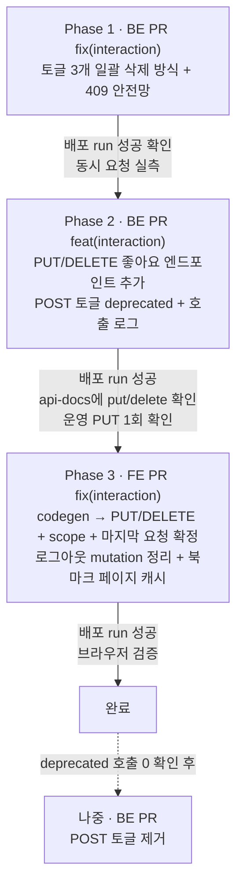

# 좋아요 동시 요청 500 수정과 상태 지정형 API 전환

> 같은 글에 좋아요 요청이 동시에 닿으면 500이 나던 문제를 BE 핫픽스로 먼저 없애고, 좋아요 API를
> 토글(POST)에서 상태 지정형(PUT/DELETE)으로 바꾼 뒤, FE는 같은 대상의 요청을 한 줄로 세워
> "마지막 클릭 = 서버 값"이 되게 한다.

## Context

### 근본 원인 (운영 로그로 확정)

2026-10-13 18:17:24 KST 운영 Lambda 로그(`/aws/lambda/link-sphere-api`, 요청 `a308fd98…`)에서
확인했다. 좋아요를 연달아 누른 사용자의 두 요청이 모두 401 `TOKEN_EXPIRED`를 받았다. FE 토큰
갱신 큐(`src/shared/api/client.ts` `handleTokenExpired`)는 갱신이 끝나면 대기하던 요청과 리더
요청을 같은 tick에 재시도하고, 그래서 두 요청이 서로 다른 Lambda 인스턴스에서 동시에 실행됐다.

- 예외: `ObjectOptimisticLockingFailureException`, 원인은 `StaleObjectStateException`이다. 위치는
  BE `InteractionService.togglePostLike`의 `countByPostId` 호출(origin/main `:39`) 전 auto-flush다.
- Hibernate 공식 javadoc은 이 예외가 _"존재하지 않는 행을 삭제하거나 수정하려 할 때도 발생한다"_
  (번역, [StaleStateException](https://docs.hibernate.org/orm/6.6/javadocs/org/hibernate/StaleStateException.html))고
  쓴다. `@Version`이 없어도 난다.
- Spring Data JPA 공식 문서는 `deleteBy…`가 _"쿼리를 실행한 뒤 반환된 엔티티를 하나씩 삭제한다"_
  (번역, [Spring Data JPA](https://docs.spring.io/spring-data/jpa/reference/jpa/query-methods.html))고 설명한다.
  이 엔티티 단위 삭제가 행 수를 검사한다.
- `GlobalExceptionHandler`는 `DataIntegrityViolationException`만 409로 바꾸고(추가 쪽 경쟁), 이 예외는
  맨 끝의 `Exception` 처리로 떨어져 500이 된다.
- 같은 "확인하고 쓰기" 패턴이 `toggleCommentLike`, `toggleBookmark`에도 있다.
- BE `docs/AI-ASYNC-PROCESSING.md:273-275`에 따르면 같은 트랜잭션 안에서 flush 예외를 잡고 계속
  진행할 수 없다. 그래서 예외를 잡는 방식이 아니라 예외가 나지 않는 SQL로 바꾼다.

### FE 쪽에서 함께 드러난 문제

- 같은 글의 좋아요 mutation끼리 직렬화가 없다(`scope`·`mutationKey` 없음). 응답 순서대로
  `onSuccess`가 캐시를 덮어써 깜빡일 수 있고, `onError`는 저마다 자기 스냅샷으로 되돌린다.
- `LikePostButton.tsx:16-21`이 `mutateAsync`의 실패를 잡지 않아 콘솔에 `Uncaught (in promise)`가 남는다.
- 북마크 페이지(`BookmarkPage.tsx:31`)는 `bookmarkFolderKeys.posts` 캐시로 카드를 그린다. 좋아요
  mutation은 상세와 `postKeys.listRoot`만 고쳐서, 거기서는 지금도 좋아요가 화면에 반영되지 않는다(기존 버그).

### 사전 조사

- **선례**
  - BE `BookmarkRepository.insertIgnoreConflict`: 네이티브 `ON CONFLICT DO NOTHING` + `@Modifying`, `Int`를 반환한다.
  - BE `BookmarkFolderItemRepository`: `@Modifying` JPQL 일괄 DELETE, `Int`를 반환한다.
  - BE `POST`/`DELETE /bookmark/{postId}/folders/{folderId}`: 상태를 지정하는 멱등 쌍이다.
  - BE `InteractionServiceTest`: Mockito strict stubs를 쓴다.
  - BE `BookmarkFolderControllerTest`: `@WebMvcTest`를 쓴다.
  - FE `post.keys.ts`의 `postMutationKeys`.
  - FE `resolveCurrentBookmarkState`.
- **TanStack Query 5.90.16 설치 소스에서 확인한 것**
  - 순서를 기다리는 scoped mutation도 `pending`을 dispatch한 뒤 `onMutate`를 즉시 실행한다. `mutationFn`만 기다린다(`mutation.ts` `execute`).
  - `isMutating`은 `status: 'pending'`인 mutation을 센다(`queryClient.ts:116-120`).
  - `pending`인 mutation은 GC로 지워지지 않는다(`mutation.ts` `optionalRemove`).
- **FE `AuthUtil.clearAll`**: 쿼리만 지우고(`removeQueries`) mutation 캐시는 남긴다. refresh가 실패하면 `client.ts`가
  영원히 끝나지 않는 Promise를 반환하므로, 그 mutation은 `pending`으로 계속 남는다.
- **BE 운영 승격은 자동이다.** 5회 호출 검증을 통과하면 바로 승격된다(BE `docs/DEPLOY.md:15-19`).
- **이 경로에서 PUT은 처음이다.** BE에 `@PutMapping`이 없고 FE도 `apiClient.put`을 호출한 적이 없다.
  DELETE는 OAC 경로에서 이미 검증됐다(`bookmark-folder.api.ts`).

## 판단이 필요했던 항목

| 항목                               | 결정                                                                                                                                                                                  | 근거·기각한 대안                                                                                                                                                                                                                                                                                                                                                                                                                                                                                                                                                                                                                                                                                                                                                                                                                                                |
| ---------------------------------- | ------------------------------------------------------------------------------------------------------------------------------------------------------------------------------------- | --------------------------------------------------------------------------------------------------------------------------------------------------------------------------------------------------------------------------------------------------------------------------------------------------------------------------------------------------------------------------------------------------------------------------------------------------------------------------------------------------------------------------------------------------------------------------------------------------------------------------------------------------------------------------------------------------------------------------------------------------------------------------------------------------------------------------------------------------------------- |
| BE 동시성 처리 방식                | 토글은 "먼저 지워보고(일괄 DELETE) 0행이면 `INSERT … ON CONFLICT DO NOTHING`"으로 바꾼다                                                                                              | PostgreSQL 공식 문서(READ COMMITTED)는 _"첫 번째 갱신자가 커밋했다면, 두 번째 갱신자는 그 행이 삭제됐을 경우 무시한다"_ (번역, [Transaction Isolation](https://www.postgresql.org/docs/current/transaction-iso.html))고 쓴다. 검증 에이전트가 두 트랜잭션의 실행 순서(좋아요 상태에서 시작, 취소 상태에서 시작)를 하나씩 따져 예외가 없음을 확인했다. 기각: 예외를 서비스에서 잡기(같은 트랜잭션 안에서는 불가, BE `docs/AI-ASYNC-PROCESSING.md:273-275`), `SERIALIZABLE`(직렬화 오류가 새로 생기고 `MemberSessionRepository`가 READ COMMITTED를 전제로 한다)                                                                                                                                                                                                                                                                                                   |
| API 계약                           | 게시글·댓글 좋아요에 `PUT`/`DELETE /…/like`를 추가하고 POST 토글은 deprecated로 남긴다 (2026-10-13 사용자 선택: C안)                                                                  | RFC 9110 §9.2.2는 _"클라이언트는 비멱등 메서드 요청을 자동으로 재시도해서는 안 된다"_ (번역, [RFC 9110](https://www.rfc-editor.org/rfc/rfc9110.html#section-9.2.2))고 쓴다. 주요 서비스도 상태 지정형이다: GitHub 별표 `PUT`/`DELETE` ([문서](https://docs.github.com/en/rest/activity/starring)), X 좋아요 `POST`/`DELETE` ([문서](https://docs.x.com/x-api/users/like-post)), YouTube `rating=like\|none` ([문서](https://developers.google.com/youtube/v3/docs/videos/rate)). Porsche API 가이드라인은 _"`toggleSetting`이 아니라 `enable`과 `disable`이어야 한다 … 백엔드 상태가 프론트 표시와 어긋났을 때 더 안전하다"_ (번역·생략, [Porsche](https://devguidance.porsche.com/api-guidelines/general-principles/pureness))고 쓴다. 기각: A안(토글 유지). 낡은 탭·다른 기기에서 누른 것과 반대로 뒤집히고, 중간 요청이 실패하면 마지막 클릭 의도와 어긋난다 |
| 새 엔드포인트 메서드               | 같은 경로의 `PUT`(좋아요)과 `DELETE`(취소)                                                                                                                                            | 이 레포의 선례는 `POST`(추가)+`DELETE`인데, `POST /post/{id}/like`는 토글이 쓰고 있어 같은 경로에 둘 수 없다. PUT은 RFC 9110상 멱등이고 GitHub 선례가 있다                                                                                                                                                                                                                                                                                                                                                                                                                                                                                                                                                                                                                                                                                                      |
| 북마크 범위                        | BE 핫픽스(일괄 삭제 방식)만 적용. 상태 지정형 전환과 FE 직렬화는 하지 않는다                                                                                                          | 같은 탭에서는 다이얼로그가 요청 중에 잠기고(`useBookmarkFolderSelect.ts:65-94`), 되돌리기 토스트는 삭제 응답 뒤에야 뜬다(`usePostCardBookmarkFolderDialog.ts:148-153`). 그래서 동시 토글이 생기지 않는다. 다른 기기와 어긋나는 문제는 "남은 것"으로 넘긴다                                                                                                                                                                                                                                                                                                                                                                                                                                                                                                                                                                                                      |
| 연속 클릭 정책                     | 모든 클릭을 순서대로 반영한다. 화면은 즉시 바뀌고, 요청은 `scope`로 한 줄로 보낸다 (2026-10-13 사용자 선택)                                                                           | TanStack 공식 문서는 _"같은 `scope.id`를 공유하는 mutation은 시작된 순서대로 직렬 실행된다"_ (번역, [useMutation](https://tanstack.com/query/latest/docs/framework/react/reference/useMutation))고 쓴다. 기각: 요청 중 클릭 무시. 응답이 느릴 때 두 번째 클릭이 반응 없이 사라진다                                                                                                                                                                                                                                                                                                                                                                                                                                                                                                                                                                              |
| 화면 확정 규칙                     | 같은 글의 마지막 mutation(`isMutating({mutationKey}) === 1`)일 때만 확정한다. 성공하면 응답값을 반영한다. 실패하면 자기 스냅샷으로 즉시 되돌린 뒤 그 글 캐시를 무효화해 다시 조회한다 | TkDodo는 관련 mutation이 진행 중이면 _"`isMutating`이 1일 때만"_ (번역, [블로그](https://tkdodo.eu/blog/concurrent-optimistic-updates-in-react-query)) 반영하라고 권한다. 기각 1: 마지막 mutation의 스냅샷 복원만 하기. 연속 실패하면 서버와 어긋난다(검증 에이전트가 경우를 따져봤다). 기각 2: 연속 클릭 묶음마다 기준 상태를 따로 저장하기. 정확하지만 모듈 상태와 로그아웃 정리 코드가 늘어난다. 실패할 때만 다시 조회하는 비용이 더 작다                                                                                                                                                                                                                                                                                                                                                                                                                    |
| 다음 상태(`nextLiked`)를 정하는 곳 | 버튼이 prop `isLiked`의 반대를 넘긴다(`mutate(!isLiked)`)                                                                                                                             | 북마크 페이지 캐시(`bookmarkFolderKeys.postsRoot`)까지 낙관적으로 고치면 모든 렌더 위치에서 prop이 최신이다. 연속 클릭은 400ms 가드(`useClickGuard`)가 같은 프레임 안 중복을 막는다. 기각: 훅이 캐시 3곳을 뒤져 계산하기(`resolveCurrentBookmarkState`처럼). 필요가 없어진다                                                                                                                                                                                                                                                                                                                                                                                                                                                                                                                                                                                    |
| 로그아웃 시 mutation 정리          | `clearQueriesWithoutRefetch`에서 mutation 캐시도 비운다                                                                                                                               | 끝나지 않는 mutation이 `scope` 줄 맨 앞에 남으면 재로그인 뒤 그 글의 좋아요 요청이 영원히 나가지 않는다. `isMutating`이 1이 될 수도 없다                                                                                                                                                                                                                                                                                                                                                                                                                                                                                                                                                                                                                                                                                                                        |
| 동시성 예외 안전망                 | `ConcurrencyFailureException`(낙관적·비관적 락 실패, 데드락 포함)을 409로 바꾸는 핸들러를 추가한다 (2026-10-13 사용자 선택)                                                           | 같은 종류의 500이 아직 남은 경로가 있다: `batchDeleteBookmarks`의 `deleteAll`, 회원 탈퇴의 derived delete, 북마크 토글과 글 삭제 cascade 사이의 이론적 데드락. 그 경로를 일괄 삭제로 바꾸는 일은 이번 범위 밖이다                                                                                                                                                                                                                                                                                                                                                                                                                                                                                                                                                                                                                                               |
| 옛 POST 토글 제거 시점             | 이번엔 제거하지 않는다. deprecated 엔드포인트에 호출 로그를 남기고, 호출이 0이 된 뒤 별도 PR로 제거한다                                                                               | `useNewVersionReload.ts:24-41`은 화면을 이동할 때만 새로고침하므로, 이동하지 않는 탭은 옛 번들을 계속 쓴다. 토글은 핫픽스 뒤엔 동시성에도 안전해서 남겨둬도 해가 없다                                                                                                                                                                                                                                                                                                                                                                                                                                                                                                                                                                                                                                                                                           |
| 토큰 갱신 큐                       | 바꾸지 않는다                                                                                                                                                                         | RFC 9110 §15.5.2는 401을 _"요청이 적용되지 않았다"_ (번역, [RFC 9110](https://www.rfc-editor.org/rfc/rfc9110.html#section-15.5.2))는 뜻으로 정의한다. 재시도 자체는 정당하고, 겹치는 문제는 대상 단위(`scope`와 멱등 API)로 푼다. 큐 동작은 `client.test.ts` Case 1-1이 고정한다                                                                                                                                                                                                                                                                                                                                                                                                                                                                                                                                                                                |

### 뒤집힌 전제

| 발견                                                 | 그래서 바뀐 것                                                                      |
| ---------------------------------------------------- | ----------------------------------------------------------------------------------- |
| BE 운영 승격이 자동이었다(`docs/DEPLOY.md:15-19`)    | "수동 승격 후 FE"가 아니라 "배포 run 성공과 `/api/v3/api-docs` 확인 후 FE"로 바꿨다 |
| "마지막이면 자기 스냅샷 복원"은 연속 실패하면 틀린다 | 마지막 실패면 복원한 뒤 다시 조회하는 것으로 바꿨다                                 |
| 끝나지 않는 mutation이 `scope`를 막는다              | 로그아웃 시 mutation 캐시 정리를 추가했다                                           |
| 북마크 페이지 캐시는 좋아요가 고치지 않는다          | `postsRoot`도 낙관적 갱신·응답 반영·롤백 대상에 넣었다                              |
| 다른 세션의 좋아요 테스트 보강(#348)이 이미 병합됐다 | 충돌은 없다. 대신 그 테스트들을 상태 지정형에 맞춰 갱신해야 한다                    |

### 위험 관리

- **처음 쓰는 PUT 경로**: Phase 2를 배포한 뒤, FE PR을 병합하기 전에 `https://linksphere.click/api` 경유로
  PUT 한 번을 실제로 보내 확인한다. 실패하면 FE 전환을 멈춘다.
- **되돌리는 순서**: FE를 먼저 되돌린다. BE를 Phase 2 이전으로 되돌리면 PUT/DELETE가 POST 전용 경로에 닿는데,
  `HttpRequestMethodNotSupportedException`을 처리하는 곳이 없어 500이 된다.
- **OpenAPI 드리프트 이슈**: Phase 2를 배포하고 Phase 3을 병합하기 전까지 매일 cron이 FE 이슈를 연다. Phase 3에서
  `openapi.json`을 커밋하면 닫힌다.

## 세부 계획

각 Phase의 시작 상태:

- Phase 1·2는 BE `origin/main`에서 새 워크트리로 시작한다(로컬 `main`이 뒤처져 있다).
- Phase 3은 FE `origin/main`(#348 포함)에서 시작한다.
- 계획 파일은 `docs/plans/2026-10-13-like-concurrency.md`로 BE Phase 1 PR과 FE Phase 3 PR에 같은 이름으로 커밋한다
  (선례: `2026-09-29-oac-lockdown.md` 등 10건이 양쪽 레포에 같은 이름으로 있다).

### Phase 1 — BE 핫픽스 (계약 변경 없음)

BE 경로는 `src/main/kotlin/com/example/linksphere/`를 기준으로 줄여 쓴다.

| 위치                                                                                             | 변경 내용                                                                                                                                                                                                                                                                       |
| ------------------------------------------------------------------------------------------------ | ------------------------------------------------------------------------------------------------------------------------------------------------------------------------------------------------------------------------------------------------------------------------------- |
| `domain/interaction/PostReactionRepository.kt`                                                   | `deleteByUserIdAndPostId`를 `@Modifying @Query("DELETE FROM TablePostReaction r WHERE …")` + `Int` 반환으로 바꾼다(호출처는 토글뿐이다). `insertIgnoreConflict(userId, postId): Int`(네이티브 `ON CONFLICT DO NOTHING`)를 추가한다. 형태는 `BookmarkRepository.kt:29-36`과 같다 |
| `domain/interaction/CommentReactionRepository.kt`                                                | 위와 같다(`deleteByUserIdAndCommentId`, `insertIgnoreConflict`)                                                                                                                                                                                                                 |
| `domain/interaction/BookmarkRepository.kt`                                                       | `deleteByUserIdAndPostId`를 `@Modifying` 일괄 삭제 + `Int` 반환으로 바꾼다                                                                                                                                                                                                      |
| `domain/interaction/InteractionService.kt` `togglePostLike`·`toggleCommentLike`·`toggleBookmark` | `exists` 조회를 없앤다. 일괄 삭제 결과가 0이면 `insertIgnoreConflict`를 실행하고, `isLiked`/`isBookmarked`는 `삭제 행 수 == 0`으로 정한다. 공개 여부 확인과 삭제된 댓글 확인은 그대로 둔다. 북마크는 폴더 항목 일괄 삭제를 먼저 한 뒤 북마크를 일괄 삭제한다                    |
| `global/exception/GlobalExceptionHandler.kt`                                                     | `org.springframework.dao.ConcurrencyFailureException` 핸들러를 추가한다. 409, 새 코드 `CONCURRENT_UPDATE`, 기존 409 문구 톤을 따르고 WARN 로그를 남긴다                                                                                                                         |
| `src/test/.../interaction/InteractionServiceTest.kt`                                             | 토글 테스트를 다시 쓴다(삭제 1행이면 추가 안 함, 0행이면 추가). strict stubs라 남은 `existsBy…` stub(`:78`, `:97`, `:196`)을 지운다                                                                                                                                             |
| `src/test/.../exception/` (신규 또는 기존 핸들러 테스트)                                         | `ObjectOptimisticLockingFailureException`이 409 `CONCURRENT_UPDATE`가 되는지 확인한다(`BookmarkFolderControllerTest`의 `@WebMvcTest` 형태)                                                                                                                                      |
| `CHANGELOG.md` `[Unreleased]`                                                                    | Fixed 항목을 추가한다                                                                                                                                                                                                                                                           |
| `.claude/CLAUDE.md:586`                                                                          | 스타일 레퍼런스의 "`exists → delete/save → boolean`" 설명을 새 패턴으로 고친다                                                                                                                                                                                                  |
| `docs/plans/2026-10-13-like-concurrency.md` (신규)                                               | 이 계획의 스냅샷                                                                                                                                                                                                                                                                |

### Phase 2 — BE 상태 지정형 엔드포인트 (추가만, 계약 확장)

| 위치                                                           | 변경 내용                                                                                                                                                                                                                                                                                                                                                   |
| -------------------------------------------------------------- | ----------------------------------------------------------------------------------------------------------------------------------------------------------------------------------------------------------------------------------------------------------------------------------------------------------------------------------------------------------- |
| `domain/interaction/InteractionService.kt`                     | `setPostLike(postId, userId, liked): PostLikeResponse`를 추가한다. 공개 여부를 확인하고, `insertIgnoreConflict` 또는 일괄 삭제를 실행한 뒤 `countByPostId`로 응답한다. `setCommentLike(commentId, userId, liked): Boolean`도 추가한다(댓글 없음과 삭제된 댓글 확인은 토글과 같다)                                                                           |
| `domain/interaction/InteractionController.kt`                  | `@PutMapping`/`@DeleteMapping("/post/{postId}/like")`(`ApiResponse<PostLikeResponse>`)과 `@PutMapping`/`@DeleteMapping("/comment/{commentId}/like")`(`{isLiked}`)를 추가한다. 각각 `@Operation` summary와 description을 단다. 기존 POST 토글 2개는 `@Operation(deprecated = true)`로 표시하고 호출될 때 INFO 로그(`deprecated like toggle called`)를 남긴다 |
| `src/test/.../interaction/InteractionServiceTest.kt`           | `setPostLike(true/false)`와 `setCommentLike`의 분기, 비공개 글 404 테스트를 추가한다                                                                                                                                                                                                                                                                        |
| `src/test/.../interaction/InteractionControllerTest.kt` (신규) | PUT/DELETE 매핑과 응답 형태를 확인한다(`BookmarkFolderControllerTest` 형태)                                                                                                                                                                                                                                                                                 |
| `README.md` 엔드포인트 표(`:215-227`)                          | PUT/DELETE 행을 추가하고 토글에 deprecated를 표시한다                                                                                                                                                                                                                                                                                                       |
| `CHANGELOG.md` `[Unreleased]`                                  | Added와 Deprecated 항목을 추가한다                                                                                                                                                                                                                                                                                                                          |

### Phase 3 — FE 전환 (Phase 2 운영 확인 후)

| 위치                                                                        | 변경 내용                                                                                                                                                                                                                                                                                                                                                                                                       |
| --------------------------------------------------------------------------- | --------------------------------------------------------------------------------------------------------------------------------------------------------------------------------------------------------------------------------------------------------------------------------------------------------------------------------------------------------------------------------------------------------------- |
| `src/shared/api/generated/openapi.json`, `openapi.gen.ts`                   | `pnpm codegen:fetch --from=prod && pnpm codegen`                                                                                                                                                                                                                                                                                                                                                                |
| `src/shared/config/api.ts:48-49`                                            | `togglePostLike` → `postLike`, `toggleCommentLike` → `commentLike`로 개명한다(경로는 같다)                                                                                                                                                                                                                                                                                                                      |
| `src/entities/interaction/model/interaction.dto.ts` (신규)                  | 생성 타입 alias를 둔다(`post.dto.ts`, `api.type.ts`의 `Unwrap` 형태)                                                                                                                                                                                                                                                                                                                                            |
| `src/entities/interaction/api/interaction.api.ts`                           | `likePost`(PUT)/`unlikePost`(DELETE)와 `likeComment`/`unlikeComment`를 만든다. `toggleBookmarkPost`는 그대로 둔다                                                                                                                                                                                                                                                                                               |
| `src/entities/interaction/api/interaction.keys.ts` (신규)                   | `interactionMutationKeys.likePost(postId)`·`likeComment(commentId)`(`post.keys.ts:6-11` 형태). 마지막 실패 시 다시 조회하는 `handleLikePostFailure`·`handleLikeCommentFailure`는 `postInvalidateQueries`·`bookmarkFolderInvalidateQueries`·`commentInvalidateQueries` 래퍼만 `@x`로 호출한다                                                                                                                    |
| `src/entities/interaction/api/interaction.queries.ts` `useLikePostMutation` | `mutationKey`와 `scope: { id }`를 추가한다. `mutationFn: (nextLiked) => …`. `onMutate`는 상세·`listRoot`·`bookmarkFolderKeys.postsRoot`를 `nextLiked`로 절대 설정한다(이미 그 상태면 수는 그대로). 스냅샷에 `postsRoot`를 추가한다. `onSuccess`와 `onError`는 `isMutating({mutationKey}) === 1`일 때만 처리하고, 성공이면 응답값을 3곳에 반영한다. 실패면 스냅샷을 복원한 뒤 `handleLikePostFailure`를 호출한다 |
| 같은 파일 `useLikeCommentMutation`                                          | 같은 패턴(`commentKeys.list(postId)` 대상). 응답값 반영은 하지 않는다(지금처럼 `onSuccess` 없음)                                                                                                                                                                                                                                                                                                                |
| `src/features/post/like/ui/LikePostButton.tsx:16-21`                        | `mutateAsync()` → `mutate(!isLiked)`                                                                                                                                                                                                                                                                                                                                                                            |
| `src/features/comment/like/ui/LikeCommentButton.tsx:31`                     | `mutate()` → `mutate(!isLiked)`                                                                                                                                                                                                                                                                                                                                                                                 |
| `src/shared/utils/auth.util.ts` `clearQueriesWithoutRefetch`                | `queryClient.getMutationCache().clear()`를 추가하고 그 이유를 주석에 쓴다                                                                                                                                                                                                                                                                                                                                       |
| `src/mocks/handlers/post.handlers.ts:85-96`, `comment.handlers.ts:66-69`    | POST 토글 핸들러를 PUT/DELETE 핸들러로 바꾼다                                                                                                                                                                                                                                                                                                                                                                   |
| `e2e/mocks/interaction.mock.ts`, `e2e/like.spec.ts`                         | 메서드별로 분기하고, 줄 번호를 인용한 주석을 갱신한다                                                                                                                                                                                                                                                                                                                                                           |
| `src/entities/interaction/api/interaction.queries.test.ts`                  | 기존 좋아요 테스트(#348)를 `nextLiked`에 맞춘다. 추가 테스트: 두 번째 요청은 첫 응답 뒤에 나간다 / 첫 응답이 와도 두 번째가 남아 있으면 화면을 덮어쓰지 않는다 / 경우 (a)~(d) / 북마크 페이지 캐시 반영. 핸들러가 실제로 호출됐는지 단언한다(`onUnhandledRequest: 'warn'` 때문에 경로가 어긋나도 롤백 테스트가 통과할 수 있다)                                                                                  |
| `src/shared/utils/auth.util.test.ts`                                        | `clearAll` 뒤 mutation 캐시가 비는지 확인한다                                                                                                                                                                                                                                                                                                                                                                   |
| `docs/FE-ARCHITECTURE.md` §11                                               | "같은 대상의 연속 mutation"(`scope` + 마지막 요청에서 확정 + 실패 시 다시 조회) 절을 추가한다                                                                                                                                                                                                                                                                                                                   |
| `docs/POST.md` §5, `docs/COMMENT.md` 좋아요 절                              | 새 동작과 낡은 줄 번호를 갱신한다                                                                                                                                                                                                                                                                                                                                                                               |
| `docs/AUTH.md` §11                                                          | 갱신 큐가 재시도를 한꺼번에 내보내는 점과 대상 단위 해결, 로그아웃 시 mutation 정리 항목을 추가한다                                                                                                                                                                                                                                                                                                             |
| `docs/VERSION-COMPATIBILITY.md`                                             | 계약 변경 행을 추가한다                                                                                                                                                                                                                                                                                                                                                                                         |
| `docs/DECISIONS.md`                                                         | 토글 → 상태 지정형 결정과 기각한 대안(A안, 요청 중 클릭 무시)을 기록한다                                                                                                                                                                                                                                                                                                                                        |
| `CHANGELOG.md` `[Unreleased]`                                               | Fixed 항목(동시 클릭, 북마크 페이지 좋아요, 콘솔 에러)을 추가한다                                                                                                                                                                                                                                                                                                                                               |
| `docs/plans/2026-10-13-like-concurrency.md` (신규)                          | 이 계획의 스냅샷(BE와 같은 파일)                                                                                                                                                                                                                                                                                                                                                                                |

## 영향 범위

### CRUD 실패 지점

- **좋아요(추가)**
  - 같은 사용자의 동시 PUT은 `ON CONFLICT DO NOTHING`으로 멱등이다.
  - `countByPostId`는 같은 트랜잭션의 쓰기를 본다. 관리 중인 엔티티가 없어 flush·clear 옵션은 필요 없다.
  - 글이 동시에 삭제되면 FK 위반이 되어 기존 409 `DUPLICATE_RESOURCE`로 간다(문구가 어울리지 않음, "남은 것").
- **좋아요 취소(삭제)**: 동시 DELETE는 0행이고 예외가 없다. DELETE에서도 공개 여부 확인을 유지한다(응답의 `likeCount`가 비공개 글 정보를 흘리지 않게).
- **조회**
  - 피드·상세의 좋아요 수와 상태 계산(`PostResponseAssembler`)은 바뀌지 않는다.
  - FE는 마지막 요청 응답만 반영한다. 중간 응답은 반영하지 않는다.
- **cascade**: 글·댓글 삭제 시 반응이 함께 지워지는 동작은 바뀌지 않는다. 북마크 토글은 폴더 항목 → 북마크 순서를 유지한다.
- **동시 요청**
  - 같은 탭에서는 `scope`가 직렬화한다.
  - 여러 탭·기기에서는 BE 일괄 삭제 방식과 멱등 API가 흡수한다. 마지막으로 커밋된 의도가 이긴다.

### 기존 기능 회귀

| 깨질 수 있는 것                                                               | 소유 파일                                                                                               |
| ----------------------------------------------------------------------------- | ------------------------------------------------------------------------------------------------------- |
| 토글 단위 테스트(strict stubs)                                                | BE `InteractionServiceTest.kt`                                                                          |
| 좋아요 낙관적 업데이트 테스트(#348)가 지금의 토글을 전제함                    | FE `interaction.queries.test.ts`                                                                        |
| e2e 좋아요 시나리오, 항상 `isLiked: true`를 돌려주는 모킹                     | FE `e2e/like.spec.ts`, `e2e/mocks/interaction.mock.ts`                                                  |
| MSW 좋아요 핸들러(POST)                                                       | FE `post.handlers.ts`, `comment.handlers.ts`                                                            |
| 세션 만료 시 진행 중이던 다른 mutation 표시(예: 글 작성 로딩 토스트)가 사라짐 | FE `auth.util.ts`, `PostMutationLoadingToast.tsx`(`useIsMutating`)                                      |
| `auth.util.ts`·`interaction.queries.ts`·`api.ts`를 import하는 모든 곳         | 구현 전에 `pnpm graph:focus "<경로>" --text`로 사용처를 뽑아 이 표에 반영한다                           |
| 낡은 FE 탭은 계속 POST 토글을 호출함                                          | Phase 1 뒤에는 안전하고, deprecated 로그로 집계한다                                                     |
| 토글을 서술한 문서                                                            | BE `README.md:215-227`·`.claude/CLAUDE.md:586`, FE `docs/POST.md`·`docs/COMMENT.md`·`openapi.json` 설명 |
| 북마크 다이얼로그 테스트                                                      | `PostCardBookmarkFolderDialog.test.tsx` — 북마크는 POST를 유지하므로 영향 없음(확인만)                  |

### 데이터 계약과 배포 순서

1. **Phase 1 배포 후**: 계약 변경이 없다. 옛 FE도 그대로 동작한다.
2. **Phase 2 배포 후**: 엔드포인트가 추가되기만 한다. 옛 FE도 정상이다. 드리프트 이슈가 열린다(예상된 일).
3. **Phase 3 배포 후**: FE가 PUT/DELETE를 쓴다. 이동하지 않은 탭은 토글을 계속 쓰는데, 안전하다.
4. **되돌릴 때**: FE를 먼저 되돌린다(위험 관리 참고).

## 검증 방법

1. **BE (Phase 1·2)**
   - `./gradlew ktlintCheck test`로 `InteractionServiceTest`, 새 컨트롤러·핸들러 테스트, `SwaggerDocsCoverageTest`, `ArchitectureRulesTest`를 돌린다.
2. **BE 동시성 실측 (실 DB 테스트 환경이 없어 CI로는 못 한다)**
   - 각 Phase를 배포한 뒤 로그인된 브라우저 탭에서 같은 글에 병렬 요청 10개를 보낸다.
     - Phase 1: POST 토글
     - Phase 2: PUT·DELETE를 섞어서
   - 모두 2xx인지, CloudWatch `/aws/lambda/link-sphere-api`에 `Unhandled exception`이 0건인지, 최종 좋아요 수가 실제 행 수와 같은지 확인한다.
   - 운영 데이터(본인 계정의 좋아요)를 건드리므로, 실행 직전에 대상 글과 계정을 사용자에게 확인한다.
3. **Phase 2 계약 확인**
   - `https://linksphere.click/api/v3/api-docs`의 `/post/{postId}/like`에 `put`과 `delete`가 있는지 본다.
   - `https://linksphere.click/api` 경유로 PUT을 1회 보내 성공하는지 본다(OAC 경로 첫 PUT).
4. **FE (Phase 3)**
   - `pnpm type-check`, `pnpm test`(`interaction.queries.test.ts`, `auth.util.test.ts`, 바뀌지 않은 `client.test.ts` 포함)
   - `pnpm lint`, `pnpm check:deps`, `pnpm check:docs`, `pnpm test:e2e`
5. **브라우저 검증** (`browser-verification` skill)
   - 피드·상세·북마크 페이지에서 좋아요를 빠르게 연타하는 장면을 녹화한다.
   - 네트워크 탭에서 PUT/DELETE가 한 줄로 나가는지, 마지막 클릭 상태로 끝나는지 본다.
   - 요청 실패를 주입했을 때 원래대로 돌아오는지 본다.
6. **배포 확인**
   - 각 PR이 병합된 뒤 두 레포의 배포 워크플로 run이 그 커밋 SHA로 success인지 `gh run list`로 확인한다.
   - 실패 run이 있었으면 그 경위를 보고에 함께 쓴다.
7. **계획 대비 구현 (§11)**
   - 각 PR을 열기 전에 fresh general-purpose 서브에이전트에게 이 계획과 diff를 대조시킨다.
   - 결과는 PR 본문 `## 계획 대비 구현`에 적는다.

## 남은 것

- **POST 토글 제거**: deprecated 호출 로그가 일정 기간 0건이면 별도 BE PR로 제거한다(그때 기간을 정한다).
- **북마크 상태 지정형 전환**: 다른 기기에서 이미 해제한 북마크를 낡은 화면에서 "해제"하면 토글이라 다시 생긴다.
- **엔티티 단위 삭제가 남은 경로**: `BookmarkFolderService.batchDeleteBookmarks`의 `deleteAll`, 회원 탈퇴의 derived `deleteByUserId`.
  이번 안전망으로 500 대신 409가 되지만, 일괄 삭제로 바꾸는 일은 남는다.
- **FK 위반 문구**: 글이 동시에 삭제되면 409 `DUPLICATE_RESOURCE`("이미 존재하는 항목입니다")가 나가 사용자에게 맞지 않는 문구가 보인다.
- **실 DB 테스트 환경 없음**: 동시성 회귀를 CI로 잡을 수 없다(Testcontainers 등은 별도 검토).
- **댓글 좋아요 응답에 `likeCount` 없음**: 서버 값 교정이 안 된다(기존과 같음).
- **BE `CHANGELOG.md`에 #74(likeCount 응답 추가) 항목이 빠져 있다**: 이번 작업과 별개로 언급만 해둔다.
