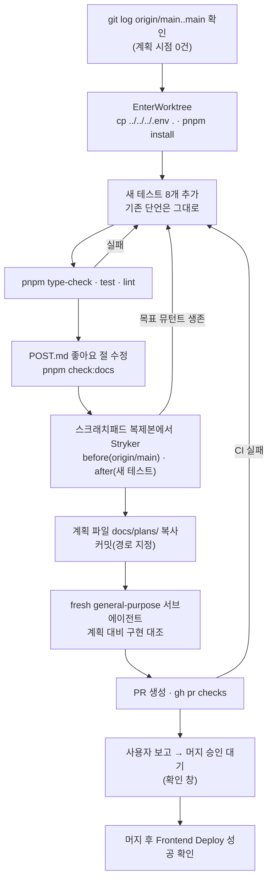

# 좋아요 낙관적 업데이트 테스트 보강

> `interaction.queries.ts`의 좋아요 낙관적 업데이트가 테스트로 지켜지지 않는 공백을 메운다 —
> 서버 응답 전 중간 상태와 실패 롤백을 요구 기준으로 단언하고, 같은 파일에 Stryker를 다시 돌려 전후를 보인다.

## Context

2026-10-13 공통 베이스 3라운드에서 FE 로직 파일 8개에 StrykerJS를 한 번 돌렸다(claude-base
`docs/METRICS.md` "뮤테이션 1회 측정", 직접 측정). `src/entities/interaction/api/interaction.queries.ts`는
221개 중 59개가 살아남았고 45개는 테스트가 닿지 않았다. `onMutate`를 통째로 비워도, `likeCount + 1`을
`- 1`로 바꿔도, `isLiked` 반전을 없애도 단위 테스트가 통과했다. 기존 좋아요 테스트 두 개
(`interaction.queries.test.ts:325`, `:363`)는 **최종값만** 본다. 성공하면 서버 값(15)이 낙관적 값을
덮어쓰고, 실패하면 원래 값(10)이 남아 `onMutate`가 아무것도 안 해도 결과가 같다.

#338에서 중간값 단언이 실패하자 지운 것은, MSW가 즉시 응답해 `waitFor`가 중간값(11)을 보기 전에
15로 교정됐기 때문으로 추정한다(지운 코드는 PR 커밋 3개 어디에도 남아 있지 않아 확인 불가). 그래서
이번에는 응답을 붙잡아 두는 핸들러로 중간 상태를 결정적으로 관측한다.

사용자 결정(2026-10-13 질문): 범위는 **사용자가 꼽은 목록 + 같은 훅 안 연관 뮤턴트**,
문서는 **`docs/POST.md` 좋아요 절을 함께 수정**.

## 판단이 필요했던 항목

| 항목                       | 결정                                                                                                                                                                            | 근거·기각한 대안                                                                                                                                                                                                                                                                                                             |
| -------------------------- | ------------------------------------------------------------------------------------------------------------------------------------------------------------------------------- | ---------------------------------------------------------------------------------------------------------------------------------------------------------------------------------------------------------------------------------------------------------------------------------------------------------------------------- |
| 범위                       | 좋아요 훅 전체 + 북마크 200~211·243~244줄                                                                                                                                       | 사용자 선택. 북마크 가드(176·184·197·218·233), 폴더 게시글 롤백(256~257), 댓글 좋아요 훅(263~306, 45개 전부 미커버)은 "남은 것"으로                                                                                                                                                                                          |
| 중간 상태 관측             | 중간값만 볼 땐 `delay('infinite')`, 중간값→최종값 흐름은 직접 푸는 gate                                                                                                         | 선례: `comment.queries.test.ts:61`(`delay('infinite')`), `useCreateComment.test.tsx:322`(resolver로 응답 해제), `useSearchParamsDraft.test.tsx:20`(`createGate`). 시간 지연(`delay(10)`)은 경쟁이 남아 기각                                                                                                                  |
| gate 헬퍼                  | 테스트 파일 안 지역 함수 `createResponseGate()` (2회 사용)                                                                                                                      | CLAUDE.md §2 — 같은 파일 지역 함수 추출은 허용, 공통 유틸 승격은 안 함                                                                                                                                                                                                                                                       |
| 데이터 없는 목록 캐시 재현 | `queryClient.prefetchInfiniteQuery`에 실패하는 `queryFn`을 줘서 데이터 없이 error 상태인 목록 쿼리를 만든다                                                                     | 실제로 있을 수 있는 상황(피드 조회 실패 뒤 상세에서 좋아요)이고, 끝나는 시점이 정해져 있다. 레포에 선례는 없음. 대기 중인 fetch로 만드는 방식은 `cancelQueries`의 revert와 얽혀 기각                                                                                                                                         |
| 죽이지 않을 뮤턴트         | 등가: 107줄 `true`, 107·110줄 옵셔널 체이닝(북마크 247~256도 같음). 의미 약함: meta 33·137줄, 필터 `{}` 35·36·41·139~150줄                                                      | 등가 근거: `setQueryData`는 업데이터 결과가 `undefined`면 아무것도 안 한다(`@tanstack/query-core@5.90.16` `src/queryClient.ts:200-203`), `onMutate`는 언제나 context를 반환. meta: 테스트 QueryClient에 전역 토스트 핸들러가 없고 정책은 `error-toast.test.ts:26`이 검증. 필터: 범위만 넓어질 뿐 요구 사항으로 단언하기 애매 |
| 기대값 출처                | 요구 사항(사용자가 보는 결과)으로 쓴다 — "+1·반전", "다른 글·다른 상호작용 값 유지", "그 카드만 제거·총개수 -1", "그 글이 없는 폴더 캐시는 그대로", "성공하면 폴더 캐시 재검증" | 사용자 지시. 현재 구현 줄을 그대로 옮긴 단언은 쓰지 않는다                                                                                                                                                                                                                                                                   |
| CHANGELOG                  | 갱신 안 함                                                                                                                                                                      | `test`·`docs` 커밋은 대상 아님(CLAUDE.md "릴리즈노트" 절: feat/fix/perf/동작 바뀌는 refactor만)                                                                                                                                                                                                                              |

## 세부 계획

| 위치                                                                     | 변경 내용                                                                                                                                                                              |
| ------------------------------------------------------------------------ | -------------------------------------------------------------------------------------------------------------------------------------------------------------------------------------- |
| `src/entities/interaction/api/interaction.queries.test.ts` (상단 import) | `msw`에서 `delay` 추가                                                                                                                                                                 |
| 같은 파일 (지역 함수, 신규)                                              | `createResponseGate()` — `{ wait: Promise<void>, release(): void }`                                                                                                                    |
| 같은 파일 `describe('useLikePostMutation')` (기존 2개 뒤에 추가)         | **L1** 응답 전: 상세·목록의 그 글만 likeCount 10→11, isLiked false→true. isBookmarked·bookmarkFolderIds 유지, 목록의 다른 글은 그대로 (`delay('infinite')`)                            |
| 〃                                                                       | **L2** 이미 좋아요한 글은 응답 전 10→9, isLiked true→false (`delay('infinite')`)                                                                                                       |
| 〃                                                                       | **L3** gate: 중간값 11/true 단언 → 해제 → 상세·목록 15/true, 다른 글은 그대로                                                                                                          |
| 〃                                                                       | **L4** gate + 500: 중간값 11/true 단언 → 해제 → 상세·목록 10/false로 복원                                                                                                              |
| 〃                                                                       | **L5** 상세 캐시 없이 목록에만 있는 글: 성공(`isSuccess`), 목록 15/true, 상세 캐시는 여전히 `undefined`                                                                                |
| 〃                                                                       | **L6** 데이터 없는 error 상태 목록 쿼리가 있어도 상세 좋아요가 성공하고 15/true                                                                                                        |
| 같은 파일 `describe('useBookmarkPostMutation')` (기존 테스트 뒤에 추가)  | **B1** 해제: 폴더 A 캐시(2페이지, 0페이지 [다른 글1], 1페이지 [대상, 다른 글2], 총 3)에서 대상만 빠지고 두 페이지 모두 총 2. 대상이 없는 폴더 B 캐시(총 1)는 `toEqual(원본)`           |
| 〃                                                                       | **B2** 성공 시 `getQueryState(bookmarkFolderKeys.list)`와 `getQueryState(bookmarkFolderKeys.posts(FOLDER_A))`의 `isInvalidated`가 true(선례 `post.queries.test.ts:83-96`)              |
| `docs/POST.md:349`                                                       | `interaction.queries.ts:28-78` → 현재 범위, onSuccess 교정 설명 추가                                                                                                                   |
| `docs/POST.md:355-356`                                                   | "성공 시 무효화도 하지 않는다(`onSuccess: () => {}`)" → 성공 응답의 `isLiked`·`likeCount`로 detail·모든 피드 목록 캐시를 교정(무효화·재조회 없음, #338)                                |
| `docs/POST.md:432`                                                       | 코드 지도의 줄 범위 갱신                                                                                                                                                               |
| `docs/POST.md:456`                                                       | 같은 명령을 다시 실행해 날짜·파일·테스트 수 갱신(직접 실행)                                                                                                                            |
| `docs/POST.md:471`                                                       | "(7) 전부 북마크 토글 테스트다. 좋아요 mutation 단위 테스트는 없고" → 실제 개수와 좋아요 테스트가 덮는 내용(응답 전 ±1·반전, 서버 값 교정, 실패 롤백, 상세 캐시 없음·목록 데이터 없음) |
| `docs/POST.md:537-539`                                                   | 둘째 문장(성공 응답 `isLiked`를 안 씀)에 "정정:"을 붙여 #338로 해소됐다고 적는다. "실패가 무음" 항목은 그대로 둔다                                                                     |
| `docs/POST.md:10`                                                        | 마지막 검토 → 2026-10-13                                                                                                                                                               |
| `docs/plans/2026-10-13-like-optimistic-tests.md` (신규)                  | 이 계획 파일 스냅샷 (§11)                                                                                                                                                              |

뮤턴트 ↔ 테스트 대응(예상):

| 줄                                                         | 뮤턴트                                            | 죽이는 테스트 |
| ---------------------------------------------------------- | ------------------------------------------------- | ------------- |
| 15·17·19·23                                                | userInteractions·stats `{}`, 반전 제거, `+1`→`-1` | L1            |
| 22 (미커버)                                                | `-1`→`+1`                                         | L2            |
| 34 / 45 false·블록 / 46 / 49 / 51 / 52 true·`oldData`      | onMutate·상세·목록 갱신 제거                      | L1, L3, L4    |
| 45 true                                                    | 상세 없음에도 토글 시도(예외)                     | L5            |
| 52 false (+52:25 미커버)                                   | 데이터 없는 목록에서 예외                         | L6            |
| 60 true / false / `!==`                                    | 다른 글까지·아무 글도·대상 빼고 토글              | L1            |
| 70 false (+70:22)                                          | onSuccess 상세 가드 제거(예외)                    | L5            |
| 84 false (+84:25)                                          | onSuccess 목록 가드 제거(예외)                    | L6            |
| 93 true                                                    | onSuccess에서 다른 글까지 서버 값                 | L3            |
| 200 `every` / 201 `every` / 201 true / 203 false (+203:28) | 포함 판정 오류                                    | B1            |
| 210 화살표·false / 211 `Math.min`                          | 다른 카드까지 제거, 총개수 0                      | B1            |
| 243 블록 / 244 호출                                        | 무효화 제거                                       | B2            |

## 영향 범위 (§5)

- **CRUD**: 해당 없음 — 프로덕션 코드와 데이터 계약을 바꾸지 않는다.
- **기존 기능 회귀**: 테스트 파일 하나에 테스트만 추가한다. 기존 단언 9개 테스트는 건드리지 않는다.
  MSW 핸들러는 `server.use`로 테스트마다 덮어쓰고 `src/test/setup.ts:12-13`의 `resetHandlers`로 되돌아간다.
  `delay('infinite')`로 대기 중인 요청이 테스트 끝에 남는 것은 선례(`comment.queries.test.ts:61`)와 같다.
- **import 사용처**: 테스트 파일은 다른 곳에서 import하지 않으므로 graph 조회가 필요 없다.
- **문서**: `docs/POST.md` 좋아요 절과 §9·§11. `BOOKMARK.md:586`·`:595`의 테스트 개수는 날짜가 붙은
  이력이라 고치지 않는다.
- **배포**: `src/**`가 바뀌므로 머지하면 `deploy.yml`이 돈다(`deploy.yml:4-18`). 번들 산출물은 변하지 않는다.

## 검증 방법

1. 새 테스트가 현재 코드에서 통과: `pnpm test src/entities/interaction/api/interaction.queries.test.ts`
2. 완료 조건: `pnpm type-check`, `pnpm test`, `pnpm lint` 통과. 문서를 고쳤으니 `pnpm check:docs`도 실행한다.
3. 뮤테이션 전후(직접 측정, METRICS.md와 같은 방식):
   - 이 세션 스크래치패드 `…/e7be9f10-…/scratchpad/fe-mut`에 FE를 `git clone`하고 `pnpm install --frozen-lockfile`을
     실행한다. 복제본에서만 `pnpm add -D @stryker-mutator/core@10.0.0 @stryker-mutator/vitest-runner@10.0.0`을
     설치하고, FE에는 커밋하지 않는다.
   - 이전 복제본(`…/e6920043-…/scratchpad/fe-mut`)의 `vitest.stryker.config.ts`를 그대로 쓰고,
     `stryker.config.json`은 `mutate`만 `interaction.queries.ts` 하나로 줄인다. 나머지 설정은 같다(`perTest`, 동시 실행 4,
     `plugins` 명시, `ignoreStatic` 없음 — 기준선과 맞춤).
   - before: 복제본 그대로(origin/main) → `reports/before.json`. after: 워크트리의 새 테스트 파일을 복사해 →
     `reports/after.json`.
   - 뮤턴트를 (줄:열, mutator, 치환) 키로 맞춰 상태 전이 표를 만든다. 목표 뮤턴트가 살아 있으면 테스트를 보강한다.
4. test-guard 훅: 단언이 늘기만 하므로 확인 창이 뜨지 않아야 한다. 뜨면 멈추고 보고한다.
5. PR: `gh pr checks <번호>`로 CI 결과를 확인하고 보고한다. 머지는 사용자 승인 뒤(확인 창) 한다.
   머지 뒤에는 `gh run list --branch main --workflow "Frontend Deploy (S3 + CloudFront)"`로 그 SHA가
   success인지 확인하고 보고한다.

**최종 보고에 포함**: 뮤테이션 전후 표(대상 뮤턴트별 Survived/NoCoverage→Killed), 살아남은 것 중
등가·무의미 판정과 이유, 문서 갱신 항목("docs/POST.md 좋아요 절을 …로 갱신함").

## 남은 것

- 이번 범위 밖 공백(별도 PR 후보): 북마크 가드 176·184·197·218·233줄과 폴더 게시글 롤백 256~257줄,
  **댓글 좋아요 훅 263~306줄은 45개 전부 미커버**. `docs/COMMENT.md:304`·`:445`의 줄 범위(226-271)도 낡았다
  (지금 263-308).
- claude-base `docs/METRICS.md`에 재측정 결과를 덧붙일지는 이 PR과 별개다(사용자가 정한다).
- 작업 ②~⑥은 각각 계획을 세워 승인받은 뒤 진행한다.
