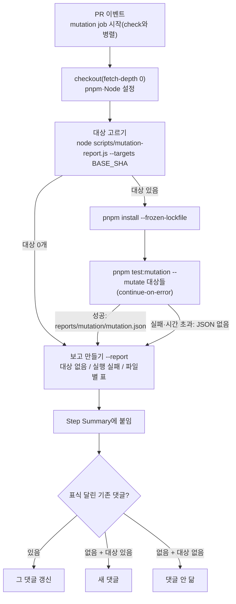

# FE CI 뮤테이션 비차단 보고

> PR마다 바뀐 로직 파일(과 테스트만 바뀐 경우 그 짝 원본 파일)에 StrykerJS를 돌려,
> 살아남은 뮤턴트를 PR 댓글과 Step Summary로 보여 준다. 머지는 막지 않는다.

## Context

2026-10-13 claude-base 3라운드 결정(`~/project/claude-base/docs/DECISIONS.md` "3라운드" 표의 "뮤테이션 테스트" 행):
_FE PR마다 바뀐 로직 파일만 대상으로 하는 비차단 보고_. 1회 측정에서 가장 중요한 로직(좋아요 낙관적
업데이트)이 테스트로 지켜지지 않는 것이 드러났고(FE #348로 보강), 가끔 하는 수동 측정으로는 공백이 생기는
시점(PR)에 보이지 않기 때문이다.

사용자 결정(2026-10-13 질문)

- 테스트 파일만 바꾼 PR도 같은 폴더의 짝 원본(`x.test.ts(x)` → `x.ts`)을 대상에 넣는다. #338처럼 단언을
  지운 PR은 테스트 파일만 바뀌는데, 그 약화가 점수 하락으로 보이게 하려는 것이다.
- 대상은 `.ts`만이다. 로직은 `hooks/`(.ts)에, `ui/`(.tsx)에는 JSX만 둔다는 규칙(FE-ARCHITECTURE §6)과 맞고,
  className·문구 뮤턴트 같은 잡음을 피한다.

## 판단이 필요했던 항목

| 항목                  | 결정                                                                                                                                                                                                                                    | 근거·기각한 대안                                                                                                                                                                                                                                                                                                                                                                   |
| --------------------- | --------------------------------------------------------------------------------------------------------------------------------------------------------------------------------------------------------------------------------------- | ---------------------------------------------------------------------------------------------------------------------------------------------------------------------------------------------------------------------------------------------------------------------------------------------------------------------------------------------------------------------------------- |
| 대상 선별             | PR이 바꾼(삭제 제외) `src/**/*.ts` 중 테스트·스토리·`.d.ts`·`src/mocks/`·`src/test/`·`src/shared/api/generated/`를 뺀 것 + 바뀐 `*.test.ts(x)`의 같은 폴더 짝 `*.ts`(있을 때)                                                           | 사용자 결정 2개. 비교 방식은 `scripts/dep-graph.js:465-470`(`git diff --name-only --diff-filter=d <base> -- src`, 머지 커밋 기준)을 따른다                                                                                                                                                                                                                                         |
| 범위 단위             | 파일 전체(줄 범위 아님)                                                                                                                                                                                                                 | 결정 문구가 "바뀐 로직 파일". Stryker는 `파일:줄-줄`도 받지만, 파일 단위여야 그 파일에 원래 있던 공백도 PR 작성자에게 보인다                                                                                                                                                                                                                                                       |
| unit 전용 vitest 설정 | unit 프로젝트 설정 객체를 `vitest.unit.ts`로 빼고, `vitest.config.ts`와 새 `vitest.stryker.config.ts`가 같이 쓴다                                                                                                                       | Stryker vitest 러너는 프로젝트를 고를 옵션이 없고(`@stryker-mutator/vitest-runner` `vitest-test-runner.js:74-83`), Browser Mode를 지원하지 않는다(공식 문서 Limitations). `vitest.config.ts`를 import하는 방식은 `storybookTest()`가 import 시점에 Storybook 프리셋을 로드해서(`addon-vitest` `index.js:2385`) 기각했다. 설정을 복사해 두는 방식은 한쪽만 바뀌면 어긋나서 기각했다 |
| Stryker 설치          | devDependency로 커밋(`@stryker-mutator/core`·`vitest-runner` 10.0.0 고정) + `test:mutation` 스크립트                                                                                                                                    | 러너 peer가 core와 같은 버전을 요구한다. CI에서 즉석 설치하면 `--frozen-lockfile`과 충돌하고 pnpm 플러그인 해석이 불안정하다. 대가: 모든 잡의 `pnpm install`이 조금 커진다(구현 때 실측해 보고)                                                                                                                                                                                    |
| Stryker 설정          | `stryker.config.json`: `testRunner: vitest`, `plugins` 명시(pnpm 필수, 공식 troubleshooting), `vitest.configFile`, `ignoreStatic: true`, `reporters: [clear-text, json]`, `thresholds.break: null`                                      | `break: null`이면 점수와 관계없이 exit 0이다. `ignoreStatic`은 사용자 지시. 동시 실행·timeout은 기본값을 쓴다(① 측정에서 timeout 0건)                                                                                                                                                                                                                                              |
| 비차단 방식           | 별도 `mutation` 잡, Stryker·보고 스텝에 `continue-on-error: true`, `timeout-minutes: 20`                                                                                                                                                | 선례: ci.yml "PR 영향 그래프" 스텝. 별도 잡이라 `check`(3분 반) 시간을 늘리지 않는다. 필수 체크가 꺼져 있어(보류 결정) 실패해도 머지를 막지 않는다                                                                                                                                                                                                                                 |
| 보고 위치·형식        | Step Summary + PR 댓글 하나(표식 주석으로 찾아 갱신, 대상이 있을 때만 새로 단다). 파일별 표(뮤턴트·죽음·살아남음·안 닿음·점수) + 파일별 접힌 목록(줄, mutator, 원래 코드 → 치환). 파일당 목록 상한을 둬 댓글 크기 제한을 넘지 않게 한다 | 선례: "PR 영향 그래프" 댓글 방식. Stryker 기본 reporter에는 한국어 요약이 없어 `scripts/mutation-report.js`로 JSON을 바꾼다(형태 선례 `scripts/dep-graph.js`: ESM, `execFileSync`, 모드별 `main()`)                                                                                                                                                                                |
| CHANGELOG             | 갱신 안 함                                                                                                                                                                                                                              | `ci:` 커밋은 대상 아님(선례 #342·#344·#345에 항목 없음)                                                                                                                                                                                                                                                                                                                            |

## 세부 계획

| 위치                                                 | 변경 내용                                                                                                                                                                                          |
| ---------------------------------------------------- | -------------------------------------------------------------------------------------------------------------------------------------------------------------------------------------------------- |
| `package.json`                                       | devDependencies에 `@stryker-mutator/core`·`@stryker-mutator/vitest-runner` 10.0.0, 스크립트 `"test:mutation": "stryker run"`                                                                       |
| `pnpm-lock.yaml`                                     | 위 설치 반영                                                                                                                                                                                       |
| `stryker.config.json` (신규)                         | 위 "Stryker 설정"                                                                                                                                                                                  |
| `vitest.unit.ts` (신규)                              | unit 프로젝트 `test` 설정 객체와 공통 `plugins`·`resolve.alias`를 export                                                                                                                           |
| `vitest.config.ts`                                   | unit 프로젝트와 공통 부분을 `vitest.unit.ts`에서 가져온다(동작 동일). storybook 프로젝트·coverage는 그대로                                                                                         |
| `vitest.stryker.config.ts` (신규)                    | 공통 부분 + unit `test` 설정만 쓰는 단일 설정                                                                                                                                                      |
| `tsconfig.node.json`                                 | `include`에 새 루트 파일 2개 추가                                                                                                                                                                  |
| `.gitignore`                                         | `reports/`, `.stryker-tmp/`                                                                                                                                                                        |
| `eslint.config.js` 전역 ignores                      | `'**/.stryker-tmp/**'`(실행이 중단되면 남는 샌드박스 복사본)                                                                                                                                       |
| `scripts/mutation-report.js` (신규)                  | `--targets <base>`: 대상 파일 목록 출력. `--report <json> <targets 파일>`: 대상 없음 / 실행 실패 / 파일별 표+접힌 목록 Markdown 출력                                                               |
| `.github/workflows/ci.yml`                           | `mutation` 잡 추가(PR 이벤트만, 위 Mermaid 흐름, 권한 `contents: read`·`pull-requests: write`, 기존 잡과 같은 SHA 고정 액션, Stryker 스텝에 `VITE_API_BASE_URL: http://localhost`)                 |
| `docs/TESTING.md`                                    | "뮤테이션 테스트(PR 비차단 보고)" 절 신설(무엇인지, 대상 규칙, 보고 읽는 법, 로컬 실행 `pnpm test:mutation --mutate <파일>`, 한계: 등가 뮤턴트·`.tsx` 제외·Browser Mode 미지원), 목차, 마지막 검토 |
| `docs/CI-CHECK-GATE.md` §6                           | "뮤테이션 보고 job" 행 추가, Node 버전 행 "3개 job" → "4개 job", 마지막 검토                                                                                                                       |
| `docs/plans/2026-10-13-mutation-ci-report.md` (신규) | 이 계획 스냅샷 (§11)                                                                                                                                                                               |

## 영향 범위 (§5)

- **CRUD**: 해당 없음 — 앱 코드와 데이터 계약을 바꾸지 않는다.
- **기존 기능 회귀**
  - `vitest.config.ts` 재구성 → `pnpm test`·`test:coverage`·`test:storybook`. unit 테스트 수(지금 115개 파일 1274개)가 그대로인지,
    CI e2e 잡의 Storybook 테스트가 통과하는지로 확인한다.
  - devDependency 추가 → 모든 CI 잡과 `deploy.yml`의 설치 시간. 머지하면 `package.json` 변경으로 배포 워크플로가 돈다(`deploy.yml:4-18`).
    번들에는 들어가지 않는다(`src`가 import하지 않음, `check:deps`의 `not-to-dev-dep` 규칙이 지킨다).
  - `.gitignore`·ESLint ignore 추가 → `pnpm check`. Prettier 3은 `.gitignore`도 읽으므로 `reports/`가 format 검사에서 빠진다(구현 때 버전 확인).
  - CI `concurrency`(같은 브랜치 새 push 시 이전 실행 취소)는 새 잡에도 적용된다.
- **사용자 노출**: 로직 파일을 바꾼 PR마다 댓글이 하나 생긴다.
- **문서**: `docs/TESTING.md`, `docs/CI-CHECK-GATE.md`. `.claude/CLAUDE.md`의 테스트 환경 표는 10-21 판정 전 동결이라 고치지 않는다.

## 검증 방법

1. 로컬(워크트리): `pnpm test:mutation --mutate src/entities/interaction/api/interaction.queries.ts`가 ① 재측정 결과(죽음 151·살아남음 30·안 닿음 40)와 같은지, `ignoreStatic` 때문에 달라지면 그 차이를 보고한다. 시간도 잰다.
2. `--targets`: 이 브랜치 HEAD 기준(src 변경 없음 → 빈 목록), `8e32fe8`(① 머지 전) 기준(테스트만 바뀜 → `interaction.queries.ts`가 짝으로 잡히는지)으로 확인한다.
3. `--report`: 1번 JSON과 "JSON 없음", "대상 없음" 세 경우의 출력을 확인한다.
4. 완료 조건: `pnpm type-check`, `pnpm test`(1274개 그대로), `pnpm lint`, `pnpm check`(format·deps 포함), `pnpm check:docs`.
5. CI 실경로 검증
   - 이 PR은 src를 바꾸지 않아 "대상 없음" 경로만 돈다.
   - 그래서 **검증용 임시 커밋**(`src/shared/utils/auth.util.test.ts`에 주석 한 줄, 단언 변화 없음)을 push해 짝 원본 `auth.util.ts`가 대상이 되는지, 잡 시간과 댓글 내용을 확인한다.
   - 그다음 그 커밋을 빼고 `--force-with-lease`로 push해 댓글이 "대상 없음"으로 갱신되는지 확인한다. 이 경위는 PR 본문에 적는다.
6. `gh pr checks`로 전체 CI를 확인하고 보고한다. 머지는 승인 뒤(확인 창), 머지 뒤 배포 워크플로 성공을 확인하고 보고한다.

## 남은 것

- Dependabot은 github-actions만 보므로 Stryker 버전은 수동으로 올린다.
- 바뀐 줄 위의 뮤턴트만 따로 표시하는 개선은 이번에 넣지 않는다.
- BE(Kotlin)는 제외한다(claude-base 결정: 무료 도구는 잡음이 크고, 변경분 실행은 유료).
- `.claude/CLAUDE.md` 테스트 환경 표에 이 잡을 적는 일은 10-21 판정 뒤로 미룬다.
