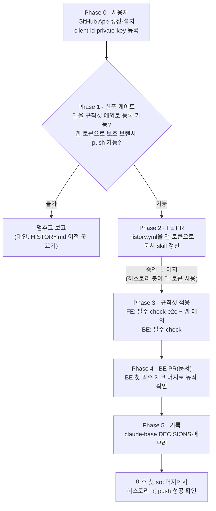

# 필수 체크 켜기 (FE check·e2e, BE check, 사람 예외 없음, 히스토리 봇은 GitHub App 토큰)

> main에 필수 CI 체크를 걸어 빨간 PR이 머지되지 않게 한다. 사람(관리자 = Claude가 쓰는 계정)에게는 예외를 두지 않는다.
> main에 직접 push하는 유일한 자동화인 FE 히스토리 봇은 사용자 소유 GitHub App 토큰으로 바꾸고, 그 앱만 예외로 둔다.

## Context

- 지금 CI는 참고용이다. 최근 FE 머지 150건 중 1건(#232, 09-28)이 e2e 실패 상태로 머지됐다. BE는 77건 중 0건이다.
- 선행 조건은 모두 확인됐다(2026-10-13).
  - flaky 정리: ④, FE #354, `failOnFlakyTests`.
  - `GITHUB_TOKEN`은 개인 계정 레포의 규칙셋 예외로 등록할 수 없다(HTTP 422).
  - 예외 없음이면 서버가 `--admin` 머지까지 막는다.
  - 근거: claude-base `docs/RESEARCH.md` §7.5, 커밋 `c89f612`·`ae37141`.
- 사용자 결정(2026-10-13 질문): 결정 1 = FE `check`·`e2e`, BE `check`. 결정 2 = GitHub App 토큰. 결정 3 = 사람 예외 없음.
- 현재 규칙셋
  - FE "Main Branch Protect"(id 23733613): 삭제 금지, 강제 push 금지, 체크 목록이 빈 필수 체크 규칙, 예외 없음.
  - BE "Main Branch Protect"(id 25000908): 삭제 금지, 강제 push 금지, 예외 없음.



## 판단이 필요했던 항목

| 항목        | 결정                                                                                                                                                                                       | 근거·기각한 대안                                                                                                                                                                                   |
| ----------- | ------------------------------------------------------------------------------------------------------------------------------------------------------------------------------------------ | -------------------------------------------------------------------------------------------------------------------------------------------------------------------------------------------------- |
| 필수 체크   | FE `check`·`e2e`, BE `check`. 출처를 GitHub Actions(`integration_id: 15368`)로 고정한다. `strict`(최신 main 기준 재실행 요구)는 끈다                                                       | 사용자 결정. 출처를 고정하면 다른 앱이 같은 이름의 상태를 올려 통과시키지 못한다. `strict`를 켜면 squash 머지 전에 매번 브랜치를 갱신해야 해서 끈다(지금 FE 규칙셋도 false)                        |
| 사람 예외   | 없음                                                                                                                                                                                       | 사용자 결정. 서버가 빨간 PR 머지·직접 push·`gh api` 머지를 모두 막는다(실측)                                                                                                                       |
| 히스토리 봇 | 사용자 소유 GitHub App(권한 Contents: read and write만, 이 레포에만 설치)의 설치 토큰으로 push. 그 앱만 FE 규칙셋 예외("항상 허용")                                                        | 사용자 결정. 토큰은 `actions/create-github-app-token`(v3.3.0, SHA `64ab729a…`로 고정, #344 규칙)으로 매 실행마다 짧은 수명으로 받는다. 기각: HISTORY.md 이전(main 문서가 멈춤), 봇 끄기(이력 끊김) |
| 키 처리     | 개인 키는 사용자가 `gh secret set HISTORY_APP_PRIVATE_KEY < 파일.pem`으로 직접 등록한다. Client ID는 레포 Variable `HISTORY_APP_CLIENT_ID`로 등록한다. 값은 대화·파일·커밋에 남기지 않는다 | CLAUDE.md "키처럼 보이는 값은 묻고, 대화에 노출하지 않는다". 규칙셋 등록에 필요한 숫자 App ID는 앱 이름(slug)만 받아 `gh api /apps/<slug>`로 공개 정보에서 얻는다                                  |
| 적용 순서   | 봇을 먼저 앱 토큰으로 바꿔 머지하고 나서 규칙셋을 켠다                                                                                                                                     | 반대로 하면 그 사이 다른 세션이 src PR을 머지할 때 히스토리 항목이 유실된다(09-20 같은 거절)                                                                                                       |
| 실측 게이트 | 앱 예외 등록과 앱 토큰 push를 `probe/*` 브랜치에서 먼저 확인한다. 안 되면 멈춘다                                                                                                           | `GITHUB_TOKEN` 거절 문구가 "ruleset source나 owner 조직에 속한 앱이어야 한다"였다. 사용자 소유 앱은 될 것으로 보지만 실측 전까지는 추정이다                                                        |
| 릴리즈 절차 | FE changelog skill 3단계를 "릴리즈 PR"(#340 방식)로 고친다. BE `.claude/CLAUDE.md:627`도 같은 문제이지만 10-21 판정 전 동결이라 고치지 않는다                                              | 동결 지시를 지킨다. 그동안 누가 그 절차대로 main에 직접 push해도 서버가 `GH013`으로 거절할 뿐이라 안전하게 실패한다. 10-21 뒤 고친다("남은 것")                                                    |
| 기록        | claude-base `docs/DECISIONS.md`에 새 결정 항목(3라운드의 "필수 체크 보류"를 이어받음). FE `docs/CI-CHECK-GATE.md`·`docs/DEPLOY.md`, BE `docs/CI-CHECK-GATE.md`                             | 3라운드 결정이 claude-base에 있다. 실제로 대안을 비교했고 레포 운영 방식을 바꾼다                                                                                                                  |

## 세부 계획

### Phase 0 — 사용자가 GitHub 화면에서 할 일 (제가 대신할 수 없는 단계)

1. GitHub → Settings → Developer settings → GitHub Apps → **New GitHub App**
   - 이름 예: `link-sphere-history-bot`, Homepage URL: FE 레포 주소
   - Webhook: **Active 체크 해제**
   - Repository permissions: **Contents: Read and write**(나머지는 없음)
   - Where can this GitHub App be installed: **Only on this account**
2. 만든 뒤 앱 페이지에서 **Generate a private key**(.pem 파일이 내려받아짐)
3. **Install App** → `link-sphere_FE_NEW` 하나만 선택
4. 터미널에서 직접 실행(값이 대화에 나오지 않게):
   ```bash
   gh secret set HISTORY_APP_PRIVATE_KEY -R BAECHAN/link-sphere_FE_NEW < ~/Downloads/<내려받은 파일>.pem
   gh variable set HISTORY_APP_CLIENT_ID -R BAECHAN/link-sphere_FE_NEW   # 프롬프트에 앱 페이지의 Client ID 입력
   ```
5. 앱 이름(slug)만 알려 준다. .pem 파일은 안전한 곳에 보관하거나 지운다

### Phase 1 — 실측 게이트 (FE, `probe/*`만 대상)

| 단계 | 내용                                                                                                                                                       | 기대                                            |
| ---- | ---------------------------------------------------------------------------------------------------------------------------------------------------------- | ----------------------------------------------- |
| 1-1  | `gh api /apps/<slug>`로 App ID를 얻는다. `gh secret list`·`gh variable list`로 이름만 확인한다(값은 보지 않음)                                             |                                                 |
| 1-2  | `probe/target` 브랜치와 임시 규칙셋을 만든다(대상 `refs/heads/probe/target`, 필수 체크 `probe-check`). 예외에 앱(`Integration`, App ID, `always`)을 넣는다 | 등록 성공. 실패하면 응답 원문을 기록하고 멈춘다 |
| 1-3  | `probe/source` 브랜치에 임시 워크플로를 올린다(`on: push: branches: [probe/source]`). 이 워크플로는 앱 토큰을 받아 `probe/target`에 빈 커밋을 push한다     | push 성공(`Bypassed rule violations`)           |
| 1-4  | 정리: 임시 규칙셋, `probe/target`·`probe/source`(원격·추적 ref)를 지운다                                                                                   | 규칙셋은 "Main Branch Protect" 하나만 남는다    |

### Phase 2 — FE PR (워크트리)

| 위치                                                            | 변경 내용                                                                                                                                                                                                                                                                                                                                                                                                      |
| --------------------------------------------------------------- | -------------------------------------------------------------------------------------------------------------------------------------------------------------------------------------------------------------------------------------------------------------------------------------------------------------------------------------------------------------------------------------------------------------- |
| `.github/workflows/history.yml`                                 | 체크아웃 앞에 `actions/create-github-app-token@64ab729a6294000f5aa4a4bc0b73d1f32bc45510 # v3.3.0` 스텝(`client-id: ${{ vars.HISTORY_APP_CLIENT_ID }}`, `private-key: ${{ secrets.HISTORY_APP_PRIVATE_KEY }}`, `permission-contents: write`). 체크아웃에 `token: ${{ steps.app-token.outputs.token }}`. 잡 `permissions`는 `contents: read`로 줄인다. 이유 주석(필수 체크·`GITHUB_TOKEN`은 예외 불가·앱만 예외) |
| `docs/DEPLOY.md` "환경 변수 및 Secrets 설정"                    | Secret `HISTORY_APP_PRIVATE_KEY`, Variable `HISTORY_APP_CLIENT_ID` 행. 앱 이름·권한·설치 범위, 키 교체 순서(새 키 생성 → 시크릿 갱신 → 다음 실행 확인 → 옛 키 삭제)                                                                                                                                                                                                                                            |
| `docs/CI-CHECK-GATE.md` §6                                      | "main 규칙셋" 행: 삭제·강제 push 금지, 필수 체크 `check`·`e2e`(GitHub Actions 출처), 사람 예외 없음, 히스토리 앱만 예외, 확인 명령. 마지막 검토 날짜                                                                                                                                                                                                                                                           |
| `.claude/skills/changelog-release/SKILL.md` "릴리즈 시점" 3단계 | `git push origin main` → 릴리즈 커밋을 PR로 올려 머지(필수 체크 때문에 직접 push는 거절된다)                                                                                                                                                                                                                                                                                                                   |
| `docs/plans/2026-10-13-required-checks.md` (신규)               | 이 계획 스냅샷                                                                                                                                                                                                                                                                                                                                                                                                 |

커밋 `ci(history): …`(CHANGELOG 없음). fresh general-purpose 서브에이전트로 계획 대비 구현을 대조한다. CI를 확인한 뒤 **사용자 승인 후 머지**한다.
이 PR은 `src/**`를 바꾸지 않아 머지해도 히스토리 봇·배포가 돌지 않는다.

### Phase 3 — 규칙셋 적용 (PR 머지 직후)

| 레포        | 변경                                                                                                                                                                                                                   |
| ----------- | ---------------------------------------------------------------------------------------------------------------------------------------------------------------------------------------------------------------------- |
| FE 23733613 | `required_status_checks`: `[{context: check, integration_id: 15368}, {context: e2e, integration_id: 15368}]`, `strict: false`. `bypass_actors`: `[{actor_type: Integration, actor_id: <App ID>, bypass_mode: always}]` |
| BE 25000908 | 규칙 추가 `required_status_checks`: `[{context: check, integration_id: 15368}]`, `strict: false`. 예외 없음                                                                                                            |

확인: 두 레포의 `gh api …/rules/branches/main`. 문제가 생기면 되돌리는 법은 해당 규칙셋 `PUT`으로 필수 체크 규칙을 빼는 것이다(문서에 적는다).

### Phase 4 — BE PR (워크트리, 문서)

| 위치                                                 | 변경 내용                                                                         |
| ---------------------------------------------------- | --------------------------------------------------------------------------------- |
| BE `docs/CI-CHECK-GATE.md` §5                        | "main 브랜치 규칙셋" 행에 필수 체크 `check`(GitHub Actions 출처, 2026-10-13) 추가 |
| BE `docs/plans/2026-10-13-required-checks.md` (신규) | 이 계획 스냅샷(BE §8)                                                             |

PR을 열면 필수 체크가 끝나기 전 상태가 `BLOCKED`, 통과 뒤 `CLEAN`으로 바뀌는지 기록한다. 이것이 BE 필수 체크의 첫 실동작 확인이다. fresh Explore 서브에이전트로 대조한 뒤, **사용자 승인 후 머지**한다.

### Phase 5 — 기록

- claude-base `docs/DECISIONS.md`에 "필수 체크 켬" 항목을 추가하고 커밋한다(결정 3개, 기각한 대안, 실측 근거 링크).
- link-sphere 메모리를 갱신한다.

## 영향 범위 (§5)

- **모든 PR 머지**: FE는 `check`·`e2e`가, BE는 `check`가 초록이어야 머지된다. flaky가 나면 재실행할 때까지 막힌다.
  필수 체크가 아닌 잡(`lighthouse`·`mutation`)은 실패해도 머지를 막지 않는다.
- **직접 push**: 사람·Claude 모두 main 직접 push가 거절된다. 릴리즈도 PR로 한다.
  - FE: skill을 고친다.
  - BE: CLAUDE.md 동결 중이라 10-21 뒤에 고친다. 그 전에 따라 하면 `GH013`으로 거절될 뿐이다.
- **히스토리 봇**: 앱 토큰으로 push한다. 커밋 메시지에 `[skip ci]`가 그대로라 앱 토큰 push가 다른 워크플로를 연쇄로 돌리지 않는다
  (`GITHUB_TOKEN`과 달리 앱 토큰 push는 워크플로를 트리거할 수 있어 이 표시가 중요하다).
- **Dependabot PR**: 필수 체크가 돌아야 머지된다(지금도 CI가 돈다).
- **보안**: 새 장기 비밀은 앱 개인 키 하나다. 앱 권한은 이 레포의 Contents 쓰기뿐이다.
- **문서**: FE `DEPLOY.md`·`CI-CHECK-GATE.md`·changelog skill, BE `CI-CHECK-GATE.md`, claude-base `DECISIONS.md`. `.claude/CLAUDE.md`(FE·BE)는 고치지 않는다.

## 검증 방법

1. Phase 1의 등록·push 결과 원문.
2. Phase 2 PR의 CI 통과, 서브에이전트 대조 결과(PR 본문 `## 계획 대비 구현`).
3. Phase 3 뒤 두 레포 `rules/branches/main`에 `required_status_checks`가 보이는지. FE 예외 목록에 앱만 있는지.
4. Phase 4 BE PR의 `BLOCKED` → `CLEAN` 전환과 머지 성공.
5. 이후 첫 FE src 머지에서 "Gemini History Updater"가 앱 토큰으로 push에 성공하는지(run 로그). 그 전에 다른 세션이 머지하면 그 run으로 확인한다.

## 남은 것

- BE `.claude/CLAUDE.md:627` 릴리즈 절차(직접 push)를 10-21 판정 뒤 PR 방식으로 고친다.
- FE `docs/DEPLOY.md` Secrets 표에 `GEMINI_API_KEY`가 빠져 있다(기존 누락, 이번 범위 밖이라 언급만).
