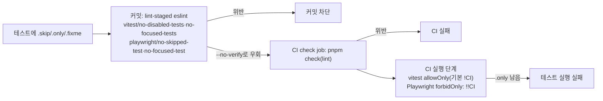

# 테스트 건너뛰기·단독 실행을 린트로 막고 Playwright forbidOnly 설정

> vitest·Playwright 테스트에서 `.skip`·`.only`·`.fixme`가 커밋·CI를 통과하지 못하게 한다. 정당한 예외는
> 그 줄의 `eslint-disable-next-line … -- 이유`로만 남긴다.

## Context

claude-base 3라운드 테스트 기준은 "건너뛰기 금지"를 정했고, 장치로는 test-guard 훅(테스트 편집에서 단언이 줄거나
skip류가 늘면 확인 창)만 켜 두었다. 훅은 Claude가 편집할 때만 돈다. 사람이 쓴 코드나 다른 경로로 들어온 skip·only는
막지 못한다. link-sphere 후속 작업 ③은 이 빈틈을 린트와 러너 설정으로 메우는 일이다.

현재 상태(조사)

- skip·only는 1곳뿐이다: `e2e/dropdown-menu-scroll.mobile.spec.ts:55`의 조건부
  `test.skip(!baselineScrolled, '…')`. CI 헤드리스에서 합성 터치 스크롤이 동작하지 않는 환경 문제다(#178).
- vitest는 `allowOnly` 기본값이 `!process.env.CI`라서 CI에서 `.only`가 있으면 이미 실패한다
  ([vitest 문서 allowOnly](https://vitest.dev/config/allowonly)).
- Playwright는 `forbidOnly`가 설정돼 있지 않아 CI에서도 `.only`가 통과한다(`playwright.config.ts`).
- e2e 파일은 `tseslint.configs.recommended`만 받는다. e2e 전용 ESLint 블록이 없다.

사용자 결정(2026-10-13 질문): Playwright의 조건부 skip도 막고, 정당한 예외는 그 줄에 disable 주석과 이유를 단다.

## 판단이 필요했던 항목

| 항목                    | 결정                                                                                                                | 근거·기각한 대안                                                                                                                                                                        |
| ----------------------- | ------------------------------------------------------------------------------------------------------------------- | --------------------------------------------------------------------------------------------------------------------------------------------------------------------------------------- |
| 조건부 skip             | 막는다(`allowConditional` 끔). 기존 1곳은 `eslint-disable-next-line playwright/no-skipped-test -- 이유`             | 사용자 결정. 레포 선례는 #321(react-hooks 규칙: 정당한 예외만 그 줄에 disable과 이유). `allowConditional: true`는 `test.skip(true, '…')`처럼 사실상 무조건인 skip도 통과시켜서 기각했다 |
| `fixme`                 | 막는다(`disallowFixme: true`)                                                                                       | test-guard 훅이 `.fixme`도 건너뛰기로 센다(`claude-base/lib/test-patterns.mjs:16-17`). 둘이 어긋나지 않게 맞춘다                                                                        |
| 켜는 규칙               | 플러그인마다 두 개만: `vitest/no-focused-tests`·`no-disabled-tests`, `playwright/no-focused-test`·`no-skipped-test` | recommended 묶음은 요청 범위 밖이고, 기존 테스트에 새 위반을 대량으로 만든다                                                                                                            |
| `.only` 자동 수정       | `vitest/no-focused-tests`의 `fixable: false`                                                                        | lint-staged가 `eslint --fix`를 돌려서, 자동 수정이 켜져 있으면 커밋할 때 `.only`가 말없이 지워진다. 막고 알리는 쪽이 낫다                                                               |
| 심각도                  | 전부 `error`                                                                                                        | `--max-warnings 0`이라 warn도 실패지만, 의도를 분명히 하려고 error로 쓴다                                                                                                               |
| vitest `allowOnly`      | 설정하지 않는다                                                                                                     | 기본값이 이미 `!process.env.CI`다                                                                                                                                                       |
| Playwright `forbidOnly` | `!!process.env.CI`                                                                                                  | 사용자 지시. 로컬에서 디버깅용 `.only`는 허용한다(린트가 커밋 전에 막는다)                                                                                                              |
| 커밋 타입·CHANGELOG     | `build(lint):`, CHANGELOG 없음                                                                                      | 선례 #315(ESLint 플러그인 추가, `build(lint)`, 항목 없음)                                                                                                                               |

## 세부 계획

| 위치                                                  | 변경 내용                                                                                                                                                                                                       |
| ----------------------------------------------------- | --------------------------------------------------------------------------------------------------------------------------------------------------------------------------------------------------------------- |
| `package.json`·`pnpm-lock.yaml`                       | devDependencies `@vitest/eslint-plugin` 1.6.27, `eslint-plugin-playwright` 2.12.1(`.npmrc` `save-exact=true`)                                                                                                   |
| `eslint.config.js`                                    | 두 플러그인 import. 블록 2개 추가: `files: ['src/**/*.{test,spec}.{ts,tsx}']` → vitest 규칙 2개, `files: ['e2e/**/*.ts']` → playwright 규칙 2개(`no-skipped-test`에 `disallowFixme: true`). 블록 위에 이유 주석 |
| `playwright.config.ts`                                | `forbidOnly: !!process.env.CI` (`retries` 옆, 이유 주석)                                                                                                                                                        |
| `e2e/dropdown-menu-scroll.mobile.spec.ts:55` 위       | `// eslint-disable-next-line playwright/no-skipped-test -- <CI 헤드리스에서 합성 터치 스크롤이 동작하지 않는 환경 문제>`                                                                                        |
| `docs/TESTING.md` "테스트 강제 실행"                  | "건너뛰기·단독 실행 금지" 소절: 막는 규칙, 예외 표기법, CI 실행 단계의 `allowOnly`·`forbidOnly`                                                                                                                 |
| `docs/plans/2026-10-13-test-skip-only-lint.md` (신규) | 이 계획 스냅샷 (§11)                                                                                                                                                                                            |

## 영향 범위 (§5)

- **CRUD**: 해당 없음.
- **기존 기능 회귀**
  - 새 규칙이 기존 테스트에 걸리는가 → 위반은 e2e 1곳뿐이고, 그곳에는 disable 주석을 단다.
    `reportUnusedDisableDirectives`가 warn이고 `--max-warnings 0`이라, 주석이 실제로 쓰이지 않으면 lint가 실패한다.
    그래서 lint 통과가 곧 규칙 발동의 증거다.
  - `forbidOnly` → CI e2e job. `.only`가 없으면 동작이 같다.
  - `.claude/hooks/*.test.mjs`(node:test)는 새 블록의 `files`에 걸리지 않는다.
  - 의존성 추가 → 모든 job의 install. 머지하면 `package.json` 변경으로 배포 워크플로가 돈다. 번들은 바뀌지 않는다.
- **문서**: `docs/TESTING.md`. `.claude/CLAUDE.md`는 10-21 판정 전 동결이라 고치지 않는다.

## 검증 방법

1. 규칙 발동: `eslint --stdin --stdin-filename`으로 파일을 만들지 않고 확인한다.
   - `src/x.test.ts`: `it.only`, `it.skip`, `describe.skip`, `xit` → 각각 에러여야 한다.
   - `e2e/x.spec.ts`: `test.only`, `test.skip('…', fn)`, 본문 안 `test.skip(cond, '이유')`, `test.fixme` → 각각 에러여야 한다.
   - 대조로 `it.todo`, 평범한 `test`는 통과해야 한다.
2. `forbidOnly` 값: `CI=1 pnpm exec playwright test --list --reporter=json`의 `config.forbidOnly`가 true인지, `CI` 없이 false인지 확인한다(임시 파일 없이).
3. 완료 조건: `pnpm type-check`, `pnpm test`, `pnpm lint`, `pnpm check`, `pnpm check:docs`.
4. PR: `gh pr checks`로 CI(e2e job 포함)를 확인하고 보고한다. 머지는 승인 뒤, 머지 뒤 배포 워크플로 성공을 확인하고 보고한다.

## 남은 것

- `.claude/CLAUDE.md`에 "테스트 건너뛰기 금지"를 린트 강제 규칙으로 적는 일은 10-21 판정 뒤 claude-base 6라운드와 함께 한다.
