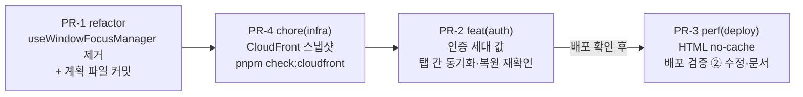
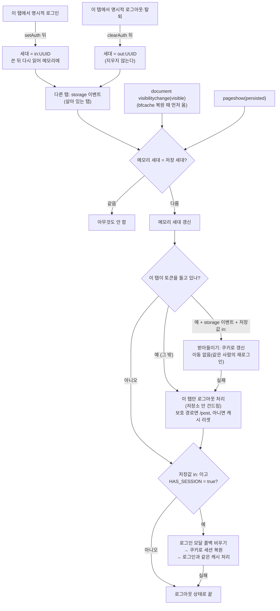

# 캐시 전략 후속 — HTML no-cache(bfcache)·포커스 훅 제거·CloudFront 스냅샷

> 요약: `docs/CACHE-STRATEGY.md` §11 "남은 것" 5개를 진행한다. 사용자 결정(2026-10-14 AskUserQuestion)은
> ① 안전장치를 만든 뒤 HTML을 `no-cache`로, ② `useWindowFocusManager` 제거, ③ CloudFront 설정 스냅샷 +
> 차이 검사(우선 로컬). ④ 실기기 측정은 ②로 위험이 사라져 남은 것으로 두고, ⑤ Storybook 주석은 고친다.
> PR 4개: PR-1(포커스 훅) → PR-4(CloudFront) → PR-2(인증 세대) → PR-3(HTML 헤더 전환).

## Context

### 계기

2026-10-14 캐시 전략 작업(#366~#372)을 마친 뒤 사용자가 "남은 곳 진행"을 요청했다. 남은 것은 문서 §11에
기록한 5개다. 조사 결과를 공유하고 세 가지를 결정받았다(아래 "사용자 결정").

### 조사 결과 (2026-10-14, 직접 측정·조회)

| 항목                | 사실                                                                                                                                                                                                                                               | 근거                                                                                                                                                  |
| ------------------- | -------------------------------------------------------------------------------------------------------------------------------------------------------------------------------------------------------------------------------------------------- | ----------------------------------------------------------------------------------------------------------------------------------------------------- |
| bfcache 실측        | 운영 `/post` → `/version` → 뒤로. A 운영 그대로(no-store): 복원 안 됨(`masked`·`response-cache-control-no-store`·`…-with-js-network-request`). B 가로채기+no-store(대조군): A와 같음. **C 가로채기+`no-cache`: 복원됨(`pageshow.persisted=true`)** | Playwright Chromium 143, `--disable-back-forward-cache` 제거, 스크래치패드 `bfcache-probe.cjs`                                                        |
| 복원 때 이벤트 순서 | `resume` → `visibilitychange(visible)` → `pageshow(persisted)`                                                                                                                                                                                     | 같은 환경 node 인라인 측정                                                                                                                            |
| API 응답            | `cache-control: no-cache, no-store, max-age=0, must-revalidate`(Spring 기본)                                                                                                                                                                       | `curl` 운영 `/api/post`                                                                                                                               |
| Chrome 규칙         | _"no-store 페이지가 fetch·XHR을 보내 그 응답이 no-store면 그 페이지도 bfcache에서 내보낸다"_ (번역) — HTML이 no-store일 때만 해당. 같은 문서: no-store 페이지는 쿠키가 바뀌면 내보낸다                                                             | [Chrome](https://developer.chrome.com/docs/web-platform/bfcache-ccns)                                                                                 |
| 지금의 보호         | 로그아웃(쿠키 변경) 뒤 뒤로가기로 로그인 화면이 복원되지 않는 건 Chrome의 no-store 규칙 덕. `no-cache`로 바꾸면 이 보호가 없어진다                                                                                                                 | 위 문서                                                                                                                                               |
| 탭 간 동기화        | 없음. 다른 탭은 다음 인증 요청에서 TOKEN_EXPIRED → refresh 실패 → `/auth/login`                                                                                                                                                                    | `client.ts:202-226`, BE `MemberSessionService.kt:195`                                                                                                 |
| 인증 호출 지점      | `setAuth`/`clearAuth`가 로그인·앱 시작 복원·토큰 갱신·갱신 실패에 모두 쓰인다 → 세대 값은 **호출 지점**에서 써야 한다. 명시적 로그인 `auth.queries.ts:36`, 로그아웃 `:92`·`:94-95`, 탈퇴 `account.queries.ts:131`                                  | 탐색 에이전트                                                                                                                                         |
| `restoreAuth`       | 렌더 시점 토큰으로 조기 반환(`useAuth.ts` `if (accessToken && isAuthenticated) return true`) → 이벤트 핸들러에서 그대로 부르면 복원이 건너뛰어진다                                                                                                 | `useAuth.ts:65-90`                                                                                                                                    |
| 새로고침            | 폼이 더럽혀져 있으면 `location.reload()`가 브라우저 이탈 확인창을 띄운다                                                                                                                                                                           | `useUnsavedChangesGuard.ts:31-37`                                                                                                                     |
| 포커스 훅           | `focusManager.setFocused(boolean)` 한 번 뒤로는 `visibilityState`를 보지 않는다                                                                                                                                                                    | `@tanstack/query-core@5.90.16` `focusManager.ts` `isFocused()`                                                                                        |
| TanStack v5         | _"window focus 재조회는 더 이상 focus 이벤트를 듣지 않고 visibilitychange만 쓴다"_ (번역). 근거 PR은 iframe·`alert`/`confirm`·DevTools·파일 선택 창에서 focus가 잘못 발생하는 문제를 든다                                                          | [이전 가이드](https://tanstack.com/query/latest/docs/framework/react/guides/migrating-to-v5), [PR #4805](https://github.com/TanStack/query/pull/4805) |
| CloudFront          | 배포 1개(별칭 2), 오리진 2(OAC), 비헤이비어 2(기본·`/api/*`, 정책 전부 AWS 관리형), Function 2(LIVE 코드가 레포 파일과 **바이트 단위로 같음**), WAF 4규칙. 로컬 IAM 사용자는 전부 읽기 가능, 배포 역할은 `CreateInvalidation`뿐                    | AWS 읽기 전용 조회                                                                                                                                    |
| 마스킹 대상         | 버킷 이름(오리진 Id·DomainName·TargetOriginId), 계정 ID(ARN), Lambda URL 호스트, 인증서·WAF ARN, OAC ID, `CallerReference`. 버킷 이름은 레포 어디에도 없다(시크릿 `S3_BUCKET_NAME`)                                                                | 같은 조회                                                                                                                                             |

### 사용자 결정 (2026-10-14)

| 질문                      | 결정                                                                          |
| ------------------------- | ----------------------------------------------------------------------------- |
| ① HTML 헤더               | 안전장치(인증 세대 값으로 탭 간 동기화 + 복원 시 재확인) 후 `no-cache`로 전환 |
| ② `useWindowFocusManager` | 제거(TanStack v5 기본으로)                                                    |
| ③ CloudFront              | 스냅샷 + 차이 검사, 우선 로컬 실행                                            |

## 전체 흐름

PR-2의 재확인 흐름(이 계획의 핵심):

## 판단이 필요했던 항목

| 항목                                                    | 결정                                                                                                                                                                                                                                                                                                     | 근거·기각한 대안                                                                                                                                                                                                                                                                                                                                                                      |
| ------------------------------------------------------- | -------------------------------------------------------------------------------------------------------------------------------------------------------------------------------------------------------------------------------------------------------------------------------------------------------- | ------------------------------------------------------------------------------------------------------------------------------------------------------------------------------------------------------------------------------------------------------------------------------------------------------------------------------------------------------------------------------------- |
| 세대 값을 바꾸는 때                                     | 명시적 로그인·로그아웃·탈퇴 3곳만. 토큰 갱신, 앱 시작 복원, 갱신 실패·401 정리, 비밀번호 변경에서는 바꾸지 않는다                                                                                                                                                                                        | `setAuth`/`clearAuth` 안에 넣으면 갱신 때마다 바뀐다. 암묵적 정리에서 바꾸면 한 탭의 네트워크 오류가 모든 탭을 로그아웃시킨다. 비밀번호 변경은 같은 브라우저 쿠키가 새 계열로 바뀌어 다른 탭이 다음 갱신에서 그대로 따라온다(BE `MemberSessionService.kt:195`)                                                                                                                        |
| 세대 값의 모양                                          | 로그인 `in:<UUID>`, 로그아웃·탈퇴 `out:<UUID>`. 키를 지우지 않는다                                                                                                                                                                                                                                       | **기각: 로그아웃 때 키 삭제** — 배포 전에 로그인한 사용자(키 없음)는 로그아웃해도 null → null이라 다른 탭·bfcache 페이지가 변화를 못 본다(설계 검토 지적)                                                                                                                                                                                                                             |
| 쓰기 순서                                               | 로그인: `setAuth`(HAS_SESSION=true) **뒤** 세대 기록. 로그아웃: `clearAuth`(HAS_SESSION 삭제) **뒤** 세대 기록. 쓴 뒤 **다시 읽은 값**으로 메모리를 맞춘다                                                                                                                                               | 다른 탭이 이벤트를 받을 때 HAS_SESSION이 이미 최종값이어야 한다. 저장이 실패하면(`LocalStorageUtil`이 예외를 삼킴) 메모리·저장이 둘 다 그대로라 동기화가 꺼질 뿐 혼자 로그아웃되지 않는다. 쓴 탭에는 storage 이벤트가 오지 않으므로 이 경로가 그 탭의 메모리를 갱신하는 유일한 길이다                                                                                                 |
| 다른 탭·복원 때 반응                                    | 새로고침하지 않고 그 자리에서 처리                                                                                                                                                                                                                                                                       | **기각: `location.reload()`** — 작성 중인 폼이 있으면 이탈 확인창이 뜨고, 취소하면 이전 사용자 화면이 그대로 남는다. 제자리 처리는 지금의 로그아웃 분기(`auth.queries.ts:91-96`)와 같은 형태다                                                                                                                                                                                        |
| 살아 있는 탭이 로그인 이벤트를 받고 토큰을 들고 있을 때 | 내보내지 않고 받아들인다(쿠키로 갱신, 이동 없음)                                                                                                                                                                                                                                                         | 다른 탭에서 로그인이 일어났다는 건 그 탭이 로그아웃 상태였다는 뜻이다. 명시적 로그아웃이었다면 이 탭은 이미 `out:` 이벤트를 받아 로그아웃됐다. 그래서 이 경우는 조용히 세션을 잃은 탭에서 같은 사람이 다시 로그인한 것이다. 내보내면 작성 중이던 폼이 사라진다(설계 검토 지적). bfcache·visible 경로는 중간에 로그아웃이 있었는지 알 수 없으므로 엄격하게(로그아웃 처리 뒤 복원) 한다 |
| 이 탭만 로그아웃                                        | 스토어에 메모리 전용 `clearLocalAuth()` 추가                                                                                                                                                                                                                                                             | 기존 `clearAuth`는 HAS_SESSION·LAST_AVATAR를 지워 다른 탭이 만든 세션 플래그를 깨뜨린다. 기존 함수 시그니처는 그대로 두고 새 액션만 더한다                                                                                                                                                                                                                                            |
| 복원 호출                                               | `restoreAuth`를 그대로 부르지 않는다(조기 반환). 스토어 현재 값으로 `authApi.refresh()` → `setAuth` → 로그인과 같은 캐시 처리(에러 캐시 리셋 + 전체 무효화, `auth.keys.ts`에 핸들러로). FCM 재등록은 하지 않는다(로그인한 탭이 했다). 앱 시작 복원이 진행 중이면(`!isAuthResolved`) 복원은 그쪽에 맡긴다 | `handleAuthRestoreSuccess`는 글 목록만 무효화해서(`auth.keys.ts:10-12`), 그 자리 복원 뒤에는 비로그인으로 받아 둔 상세·댓글·좋아요 여부가 3분간 남는다(설계 검토 지적)                                                                                                                                                                                                                |
| 복원 실패                                               | 이 탭만 로그아웃 상태로 둔다(전역 HAS_SESSION은 안 건드림)                                                                                                                                                                                                                                               | `restoreAuth`를 본뜨면 실패 때 `clearAuth`가 다른 탭의 세션 플래그까지 지운다 — "암묵적 정리에서는 전역 값을 바꾸지 않는다"와 어긋남                                                                                                                                                                                                                                                  |
| 로그인 모달                                             | 복원 전에 `loginDialog.store`의 `onSuccess`·`pendingAction`을 비운다                                                                                                                                                                                                                                     | 비우지 않으면 이 탭에서 열려 있던 로그인 모달의 재개 동작(좋아요 등)이 다른 탭의 로그인으로 실행된다(`useLoginDialog.ts:33-41,64-71`, 설계 검토 지적). 스토어가 `shared/store`라 entities에서 import 가능                                                                                                                                                                             |
| 테스트 격리                                             | `AuthEpochUtil.reset()`을 두고 `src/test/setup.ts` afterEach에서 부른다                                                                                                                                                                                                                                  | 모듈 메모리가 테스트 사이에 남는다. 이 유틸은 `storage.util`만 import해 `setup.ts`에서 불러도 mock 순서 문제(`logout-grace.util.ts:64-74`)가 없다                                                                                                                                                                                                                                     |
| 진행 중 요청과의 경합                                   | 이번 범위에서 `client.ts`는 고치지 않는다                                                                                                                                                                                                                                                                | 다른 탭에서 계정이 바뀌면, 옛 토큰으로 나간 요청이 TOKEN_EXPIRED → 새 쿠키로 갱신 → **새 계정으로 재실행**될 수 있다. 이건 지금도 있는 문제다(옛 탭이 무기한 남아 있어 오히려 더 넓다). 동기화가 이 구간을 "이벤트 순간 진행 중인 요청"으로 줄인다. 근본 수정(인증 세대 캡처 후 응답 때 비교)은 전송 계층 변경이라 남은 것으로 따로 다룬다                                            |
| 확인 시점                                               | `storage` 이벤트 + `document`의 `visibilitychange(visible)` + `pageshow(persisted)`                                                                                                                                                                                                                      | 실측: 복원 때 `visibilitychange`가 `pageshow`보다 먼저 와서, `pageshow`만 보면 React Query 재조회가 옛 토큰으로 먼저 나간다. `document` 리스너는 TanStack의 `window` 리스너(버블 단계)보다 먼저 실행된다. `pageshow`는 `visibilitychange`가 안 오는 브라우저 대비(같은 함수라 두 번 와도 두 번째는 할 일 없음)                                                                        |
| 다른 탭의 로그인 반영                                   | 반영한다(위 "쿠키로 세션 복원")                                                                                                                                                                                                                                                                          | 복원·동기화 뒤 상태를 "새로 연 탭과 같은 상태"로 맞춘다. 여러 탭이 동시에 갱신해도 BE의 재사용 유예 10초(`REUSE_LEEWAY`, `MemberSessionService.kt:48`) 안이라 안전하다                                                                                                                                                                                                                |
| 배포 검증 ②                                             | `no-cache`가 있어야 통과, `no-store`가 있으면 실패(bfcache 회귀)                                                                                                                                                                                                                                         | 바꾸지 않으면 매 배포 실패한다(`deploy.yml:166-174`)                                                                                                                                                                                                                                                                                                                                  |
| 새 배포 감지                                            | `useAppVersionCheck`에 `pageshow(persisted)` 트리거 추가(5분 간격 유지)                                                                                                                                                                                                                                  | Chromium은 복원 때 `visibilitychange`로 이미 걸리지만, 다른 브라우저 대비. 비용은 리스너 하나                                                                                                                                                                                                                                                                                         |
| CloudFront 스냅샷                                       | `infra/cloudfront/snapshot.json`(마스킹), `pnpm check:cloudfront`(비교, `--write`로 갱신). Function은 LIVE 코드와 `infra/cloudfront-functions/*.js`를 바이트 비교                                                                                                                                        | 선례: `scripts/prune-old-assets.js`(AWS CLI 호출) + `scripts/lib/prune-assets.js`(순수 로직·테스트). CI 정기 실행은 배포 역할에 읽기 권한이 필요해 이번엔 하지 않는다(사용자 결정 "우선 로컬")                                                                                                                                                                                        |
| 스냅샷 커밋                                             | 커밋 전에 마스킹된 파일을 사용자에게 보여주고 확인받는다                                                                                                                                                                                                                                                 | Critical Rule "키처럼 보이는 값은 커밋 전에 묻는다"                                                                                                                                                                                                                                                                                                                                   |

## 세부 계획

### 공통 (PR마다)

1. `git log origin/main..main` 확인 → `EnterWorktree` → `cp ../../../.env . && pnpm install`.
2. `.gitmessage`·`changelog-release` skill 확인. React 훅 변경은 react.dev 해당 문서 링크를 주석에 남긴다.
3. PR 전 fresh general-purpose 서브에이전트로 계획 대비 구현 대조 → PR 본문 `## 계획 대비 구현`.
4. 병합 후 배포 run success 확인 → 워크트리·로컬 브랜치 정리.
5. 이 계획은 PR-1에서 `docs/plans/2026-10-14-cache-strategy-followups.md`로 커밋한다.

### PR-1 `refactor(query)`: `useWindowFocusManager` 제거

| 위치                                           | 변경                                                         |
| ---------------------------------------------- | ------------------------------------------------------------ |
| `src/shared/hooks/useWindowFocusManager.ts`    | `git rm`                                                     |
| `src/app/providers/QueryProvider.tsx:1,12`     | import·호출 제거                                             |
| `eslint.config.js:1174-1175`                   | 허용 목록의 이 파일 항목·주석 제거                           |
| `src/shared/hooks/useAppVersionCheck.ts:16-21` | "useWindowFocusManager를 따랐고" 서술 정정                   |
| `docs/NEW-VERSION-RELOAD.md:217`               | 선례 언급 정정                                               |
| `docs/CACHE-STRATEGY.md` §11                   | "React Query 포커스 감지" 항목 해소, ④ 실기기 항목 문구 갱신 |
| `CHANGELOG.md` `[Unreleased]` Changed          | 1항목                                                        |

### PR-4 `chore(infra)`: CloudFront 스냅샷과 차이 검사

| 위치                                                  | 변경                                                                                                                                                                                                                      |
| ----------------------------------------------------- | ------------------------------------------------------------------------------------------------------------------------------------------------------------------------------------------------------------------------- |
| `scripts/lib/cloudfront-snapshot.js` + `.d.ts` (신규) | 순수 로직: 배포 설정 정규화(ETag 제거, Function 연결 정렬, 관리형 정책 ID → 이름), 마스킹(버킷·계정 ID·Lambda URL·ARN·OAC ID·CallerReference → `<BUCKET>` 등), WAF 규칙 요약, 두 스냅샷의 차이 목록                       |
| `scripts/check-cloudfront-drift.js` (신규)            | 별칭 `linksphere.click`으로 배포를 찾고 설정·정책 이름·Function LIVE 코드(임시 파일로 받아 stdout 메타데이터와 분리)·WAF를 읽어 스냅샷을 만든 뒤 커밋된 파일과 비교. 다르면 차이를 출력하고 exit 1, `--write`면 파일 갱신 |
| `infra/cloudfront/snapshot.json` (신규)               | 마스킹된 현재 설정(커밋 전 사용자 확인)                                                                                                                                                                                   |
| `src/test/scripts/cloudfront-snapshot.test.ts` (신규) | 가짜 설정으로 마스킹·정렬·차이 검사(선례 `prune-assets.test.ts`의 상대 import eslint-disable)                                                                                                                             |
| `package.json`                                        | `check:cloudfront` 스크립트(`pnpm check`에는 넣지 않는다 — AWS 자격증명 필요)                                                                                                                                             |
| `docs/DEPLOY.md`                                      | "CloudFront 설정 스냅샷과 차이 검사" 절 신설, 수동 관리 절차(Function·도메인·WAF)마다 "바꾼 뒤 `pnpm check:cloudfront --write`" 한 줄                                                                                     |
| `docs/CACHE-STRATEGY.md` §7·§11                       | 조회 명령 옆에 스크립트 안내, "코드가 아니다" 항목 갱신                                                                                                                                                                   |
| `.github/workflows/deploy-storybook.yml:81`           | ⑤ "Pretendard 정적 서브셋" → 지금 구성(버전 경로의 dynamic subset)으로 정정                                                                                                                                               |
| `CHANGELOG.md`                                        | `infra` 1항목                                                                                                                                                                                                             |

### PR-2 `feat(auth)`: 인증 세대 값 — 탭 간 동기화와 복원 재확인

| 위치                                                          | 변경                                                                                                                                                                                                                                            |
| ------------------------------------------------------------- | ----------------------------------------------------------------------------------------------------------------------------------------------------------------------------------------------------------------------------------------------- |
| `src/shared/config/storage-keys.ts`                           | `AUTH.EPOCH` = `linksphere:auth:epoch`                                                                                                                                                                                                          |
| `src/shared/utils/auth-epoch.util.ts` + 테스트 (신규)         | `AuthEpochUtil`(§23 클래스): 모듈 로드 때 저장값을 메모리에 읽음, `markLogin()`(`in:<UUID>`)·`markLogout()`(`out:<UUID>`) — 둘 다 쓴 뒤 다시 읽어 메모리에, `isStale()`, `acknowledge()`, `isLoginEpoch()`, `reset()`(테스트용)                 |
| `src/test/setup.ts`                                           | afterEach에 `AuthEpochUtil.reset()`                                                                                                                                                                                                             |
| `src/shared/store/auth.store.ts`                              | 메모리 전용 `clearLocalAuth()` 액션 추가                                                                                                                                                                                                        |
| `src/shared/utils/auth.util.ts`                               | 다른 곳에서 바뀐 로그아웃을 이 탭에 반영하는 메서드(`clearLocalAuth` + 보호 경로면 `clearQueriesWithoutRefetch`+`/post` 이동, 아니면 `clearQueries`)                                                                                            |
| `src/entities/auth/api/auth.keys.ts`                          | 다른 탭 세션을 받아들인 뒤의 캐시 처리 핸들러(로그인 `onSuccess`의 에러 캐시 리셋 + 전체 무효화와 같은 내용)                                                                                                                                    |
| `src/entities/auth/hooks/useAuthEpochSync.ts` + 테스트 (신규) | 위 흐름도의 재확인. `storage`(세대 키·`clear()`)·`document` `visibilitychange`(visible)·`pageshow`(persisted) 리스너. 복원 전 `loginDialog.store`의 `onSuccess`·`pendingAction` 비우기, 앱 시작 복원 중이면 복원 생략, 실패 시 이 탭만 로그아웃 |
| `src/app/providers/AuthProvider.tsx`                          | `useAuthEpochSync()` 마운트(`useAppInitialization` 옆, 라우터 밖 — 이동은 `NavigationService`)                                                                                                                                                  |
| `src/entities/auth/api/auth.queries.ts:36`·`:92-95`           | 로그인 `setAuth` 뒤 `markLogin()`, 로그아웃 정리 뒤 `markLogout()` + 테스트                                                                                                                                                                     |
| `src/entities/account/api/account.queries.ts:131`             | 탈퇴 `clearAll` 뒤 `markLogout()` + 기존 테스트 보강                                                                                                                                                                                            |
| `e2e/auth-tab-sync.spec.ts` (신규)                            | 같은 컨텍스트의 두 페이지: 한쪽 로그아웃 → 다른 쪽 로그아웃 상태, 보호 경로면 `/post`로 이동. 한쪽 로그인 → 다른 쪽 복원                                                                                                                        |
| `docs/AUTH.md`                                                | §6 상태 모델(세대 키), §8에 "탭 간 동기화와 bfcache 복원 재확인" 절, §11, 마지막 검토                                                                                                                                                           |
| `CHANGELOG.md`                                                | Added 1항목                                                                                                                                                                                                                                     |

### PR-3 `perf(deploy)`: HTML `no-cache` 전환 (PR-2 배포 확인 후)

| 위치                                                                                                              | 변경                                                                                                                                                    |
| ----------------------------------------------------------------------------------------------------------------- | ------------------------------------------------------------------------------------------------------------------------------------------------------- |
| `.github/workflows/deploy.yml:117-127`                                                                            | `index.html`·`404.html`을 `no-cache`로, 주석 갱신(`version.json`·SW는 `no-store` 유지)                                                                  |
| `deploy.yml:166-174` (배포 반영 검증 ②)                                                                           | `no-cache` 필수, `no-store` 있으면 실패                                                                                                                 |
| `src/shared/hooks/useAppVersionCheck.ts` + 테스트                                                                 | `pageshow(persisted)` 트리거                                                                                                                            |
| `src/shared/utils/build-info.util.ts:1-2`                                                                         | "index.html과 같은 이유로 no-store" 서술 정정                                                                                                           |
| `docs/CACHE-STRATEGY.md`                                                                                          | §1 표·Mermaid, §5.3, §5.9, §5.10(전환 결정·실측·안전장치 링크로 재작성), §6, §7, §8(진단 2단계·레시피), §9(재측정 추가), §10(행 추가), §11, 마지막 검토 |
| `docs/BUILD-VERSION.md:45-46,53,99-100`, `docs/DEPLOY.md:70-72,83,421,695-704`, `docs/SYSTEM-ARCHITECTURE.md:150` | HTML 헤더 서술                                                                                                                                          |
| `CHANGELOG.md`                                                                                                    | Changed 1항목                                                                                                                                           |

## 영향 범위 (§5)

**CRUD 실패 지점**: 서버 데이터·API 계약 변경 없음. 새 localStorage 키 1개(`linksphere:auth:epoch`, 민감정보 아님 — `in:`/`out:` + 무작위 UUID).

- 기존 사용자(키 없음): 메모리·저장 둘 다 `null`로 같아 아무 일도 없다. 첫 명시적 로그인·로그아웃부터 기록되고, 로그아웃도 값을 쓰므로 그때부터 다른 탭·bfcache 페이지가 알아챈다.
- 테스트 전역 설정(`src/test/setup.ts`)에 정리 한 줄이 더해진다.

**기존 기능 회귀 후보**

- **로그인**(`auth.queries.ts:36`, 인라인 모달 로그인 포함): 세대 기록이 추가될 뿐 기존 순서(토큰 → 에러 캐시 리셋 → invalidate → FCM)는 그대로.
- **로그아웃**(`auth.queries.ts:82-107`): 다른 탭이 보호 경로(`isProtectedPath`)에서 작성 중이던 폼은 `/post` 이동으로 사라진다. 지금도 그 탭은 다음 제출에서 401 → 로그인 화면이라 결과는 비슷하지만, 시점이 "제출할 때"에서 "로그아웃 즉시"로 앞당겨진다. 이동 가드는 비로그인이면 건너뛴다(`useUnsavedChangesGuard`).
- **앱 시작 복원**(`useAppInitialization.ts:50`): 세대를 쓰지 않는다. 새 탭을 열어도 다른 탭에 이벤트가 가지 않는다.
- **토큰 갱신·실패**(`client.ts:186-226,309`): 손대지 않는다.
- **GuestGuard**(`routes/index.tsx:86-96`): 로그인 페이지를 연 탭은 다른 탭이 로그인하면 복원 뒤 로그인 페이지에서 밀려난다(의도).
- **여러 탭 동시 복원**: 로그인 직후 N개 탭이 같은 쿠키로 동시에 갱신 → BE 재사용 유예 10초 안이라 계열 폐기 없음.
- **React Query**: PR-1 이후 포커스 판단이 TanStack 기본(`visibilitychange`)으로 바뀐다 — 데스크톱에서 두 창을 나란히 띄우고 오갈 때는 재조회되지 않는다(사용자 승인). 파일 선택 창을 닫을 때의 재조회는 사라진다.
- **배포 검증**: PR-3에서 ②를 같이 바꾸지 않으면 매 배포 실패 — 같은 PR에 묶는다.
- **CloudFront 스크립트**: 읽기 전용 호출만 한다(`get-*`·`list-*`). `pnpm check`·CI에는 들어가지 않는다.
- **Storybook 주석**: `deploy-storybook.yml` 변경은 그 워크플로 경로 필터에 걸려 Storybook 배포가 한 번 돈다(동작 변화 없음).

**배포 순서**: PR-2(세대 기록·재확인)가 운영에 나간 뒤 PR-3(헤더 전환). 반대로 하면 bfcache가 켜진 채 보호 장치가 없는 구간이 생긴다.

## 검증 방법

**모든 PR**: `pnpm type-check`·`pnpm test`·`pnpm lint`·`pnpm check:deps`·`pnpm check:docs`.

**PR-1**: 프로덕션 빌드 + Playwright로, 3분(staleTime)을 `page.clock`으로 넘긴 뒤 ⓐ `visibilitychange` hidden→visible이면 API 재조회가 나가고 ⓑ `focus`만이면 안 나가는지 요청 수로 확인.

**PR-4**: `pnpm check:cloudfront`가 현재 운영과 차이 0으로 끝나는지, 스냅샷의 한 값을 일부러 바꾸면 그 경로를 짚어 exit 1인지 확인. 커밋 전 `infra/cloudfront/snapshot.json` 전문을 사용자에게 보여주고 마스킹 확인.

**PR-2**

- 단위: 세대 유틸(쓰기 실패 시 메모리 불변 포함), 동기화 훅(storage `out:` → 로그아웃·보호 경로 이동 / storage `in:`+토큰 → 받아들이기·이동 없음 / visible·pageshow persisted + 토큰 → 로그아웃 뒤 복원 / 변화 없음 no-op / 앱 시작 복원 중 → 복원 생략 / 복원 실패 → HAS_SESSION 유지 / 로그인 모달 콜백 비움), 로그인·로그아웃·탈퇴의 세대 기록.
- e2e: `auth-tab-sync.spec.ts`(커밋).
- 브라우저 녹화(`browser-verification` skill, 모킹 녹화): bfcache를 켠 Chromium + `no-cache` HTML 미리보기에서 ① `/bookmark`(로그인) → `/version` → 다른 탭에서 로그아웃 → 뒤로가기 → `/post` 로그아웃 상태 ② 같은 흐름에서 다른 탭이 다른 계정으로 로그인 → 뒤로가기 → 새 계정 상태 ③ 복원 직후 이전 사용자 화면이 몇 프레임 보이는지 영상 프레임으로 확인(보이면 대응을 사용자와 정한다) ④ 로그인 상태 페이지가 bfcache에 들어가는지(`notRestoredReasons`) 측정해 보고.

**PR-3**

- 배포 후: `curl -sI https://linksphere.click/index.html`이 `no-cache`(no-store 없음), 배포 검증 ② 통과.
- 운영 bfcache 재측정: 스크래치패드 프로브의 A(가로채기 없음)가 `persisted=true`로 바뀌는지.
- 새 배포 감지: `pageshow(persisted)` 테스트, 열린 탭 새로고침 회귀 없음(기존 테스트).

## 남은 것

- **다른 탭에서 계정이 바뀐 순간 진행 중이던 요청이 새 계정으로 재실행될 수 있음**(기존 문제, 설계 검토에서 발견): 옛 토큰 요청 → TOKEN_EXPIRED → 새 쿠키로 갱신 → 재시도(`client.ts:186-226`). PR-2가 구간을 줄이지만 없애지는 않는다. 근본 수정은 요청·갱신 시작 때 인증 세대를 캡처해 응답 때 다르면 버리는 것으로, 전송 계층 변경이라 별도로 판단한다.
- **CloudFront 차이 검사의 CI 정기 실행**: 배포 역할 `link-sphere-fe-deploy`에 `cloudfront:GetDistributionConfig`·`GetFunction`·`GetCachePolicy`·`GetOriginRequestPolicy`·`ListDistributions`·`wafv2:GetWebACL`·`ListWebACLs` 읽기 권한을 추가해야 한다(사용자가 CloudShell 스크립트 실행, `docs/plans/2026-10-13-github-oidc-aws.md` 부록 A). 그 뒤 `openapi-drift-check.yml` 형태로 붙인다.
- **쓰이지 않는 OAC 3개**(테스트 버킷용 2개 포함): 이 배포에 붙지 않았다. 지울지는 사용자 결정.
- **실기기 측정**: PR-1로 "focus가 안 와서 재조회가 안 되는" 위험은 사라지고, 새 배포 감지는 `focus`·`visibilitychange`·`pageshow`를 모두 듣는다. 모바일 실기기에서의 확인은 여전히 없다(사용자 기기 필요).
- **Safari·Firefox의 bfcache**: 측정은 Chromium만 했다.
