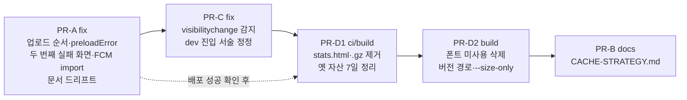

# 배포 후 옛 화면이 남는 네 군데 — 버그·배포 산출물 정리 + 개념 문서

> 요약: Threads 글이 정리한 "옛 버전이 남는 네 군데(정적 파일·HTML·열린 탭·Service Worker)"를
> 업계 표준과 우리 구현에 대조했다. 그 과정에서 찾은 문제를 PR 4개로 고친 뒤, 고친 뒤의
> 사실로 개념 문서 `docs/CACHE-STRATEGY.md`를 쓴다(PR 5개).

## Context

### 계기

사용자가 [2weekhun의 Threads 글](https://www.threads.com/@2weekhun/post/Dec8KBXkzYM)(카드 8장 +
작성자 해설 8개)을 공유하고 세 가지를 요청했다.

- 글과 업계 표준, 우리 방식을 비교한 표
- 개선안
- 이 문서만 봐도 개념과 우리 적용 상태를 알 수 있는 문서

이후 "남은 것도 진행할 수 있게 준비하자"는 요청으로 범위를 넓혔다.

글의 결론은 옛 화면을 본다는 신고가 오면 캐시부터 지우지 말고, 옛 버전이 남은 곳을 먼저
가려내라는 것이다. 남을 수 있는 곳은 ① 정적 파일 ② HTML ③ 이미 열린 탭 ④ Service Worker다.

### 조사 결과 (2026-10-14, 직접 측정·조회 포함)

| 영역             | 업계 표준                                                                                                                                                         | 우리 현재 (근거)                                                                                                                                                 | 판정                     |
| ---------------- | ----------------------------------------------------------------------------------------------------------------------------------------------------------------- | ---------------------------------------------------------------------------------------------------------------------------------------------------------------- | ------------------------ |
| ① JS·CSS         | 해시 파일명 + 1년 캐시 ([web.dev](https://web.dev/articles/http-cache), [MDN](https://developer.mozilla.org/en-US/docs/Web/HTTP/Reference/Headers/Cache-Control)) | `vite.config.ts:92-102`, `deploy.yml:101-102`. 운영 헤더 조회로 일치 확인                                                                                        | ✅                       |
| ① 폰트           | 해시 없는 파일은 장기 캐시하지 않음                                                                                                                               | `public/fonts` 14MB·116개 중 실제 사용은 dynamic-subset CSS 1개 + woff2 92개(3.0MB). 해시 없이 1년 캐시하고, 미사용 약 11MB까지 매 배포 다시 올림                | ⚠️                       |
| ② HTML           | MDN·Vite는 `no-cache` 권장. web.dev는 `no-store`가 bfcache를 막는다고 함                                                                                          | `no-cache, no-store, must-revalidate`(`deploy.yml:84`). Chrome 154 실측으로 bfcache 미복원, 사유 `response-cache-control-no-store`·`…-with-js-network-request`   | △ 의도적 유지(아래 결정) |
| CDN              | AWS는 무효화보다 해시 파일명 우선 ([AWS](https://docs.aws.amazon.com/AmazonCloudFront/latest/DeveloperGuide/Invalidation.html))                                   | AWS API 조회: `Managed-CachingOptimized`(Min 1·Default 86400·Max 31536000), Function 2개, `CustomErrorResponses` 없음. 배포마다 `/*` 무효화                      | ✅                       |
| 배포 원자성      | _"모든 변경이 올라가기 전에는 아무것도 공개되지 않는다"_ (번역, [Netlify](https://docs.netlify.com/site-deploys/overview/))                                       | run 38515585972 로그: `index.html` 05:17:27.14, 그 HTML이 가리키는 entry 청크 05:17:48.78 → **21.6초 공백**                                                      | ❌                       |
| ③ 열린 탭        | 불일치 감지 → 다음 전체 이동 때 새로고침, 옛 자산 기본 1일 보존 ([Vercel](https://vercel.com/docs/skew-protection))                                               | 포커스 시 감지 → 다음 라우트 이동 때 새로고침. 감지 트리거는 `focus` 하나(`useAppVersionCheck.ts:69`). 옛 assets는 무기한 누적(14,679개·119MB, entry 청크 624개) | ✅ / ⚠️                  |
| 청크 실패 리스너 | Vite 공식 이벤트는 `vite:preloadError` ([Vite](https://vite.dev/guide/build))                                                                                     | `main.tsx:12`는 `vite:preload-error`를 듣는다. 설치된 Vite 6.4.1은 `vite:preloadError`만 보낸다                                                                  | ❌                       |
| 두 번째 실패     | —                                                                                                                                                                 | `AppErrorFallback.tsx:43-44`: 재시도 여부와 무관하게 항상 스피너                                                                                                 | ❌                       |
| ④ SW             | 설치·대기·활성화 생명주기 ([web.dev](https://web.dev/articles/service-worker-lifecycle))                                                                          | 푸시 전용. fetch 핸들러·Cache API 없음                                                                                                                           | ✅ 해당 없음             |
| 배포 산출물      | —                                                                                                                                                                 | `stats.html`(번들 분석)이 운영에서 200으로 공개됨. `.gz` 5,997개·28.7MB는 CloudFront `Compress: true` 때문에 한 번도 서빙되지 않음                               | ⚠️                       |
| 문서             | —                                                                                                                                                                 | `DEPLOY.md:52`·`:645`, `NEW-VERSION-RELOAD.md:97`이 05-23(`46727dc`) 이후 사실과 다름. dev 진입 스크립트 서술도 엇갈림(`/src/main.tsx` 대 실제 `/@vite/client`)  | ❌                       |

### 무엇이 문제이고, 계획대로 하면 어떻게 바뀌나

| #   | 문제 (지금)                                                | 사용자가 겪는 일                                                   | 계획 후                                                            | PR  |
| --- | ---------------------------------------------------------- | ------------------------------------------------------------------ | ------------------------------------------------------------------ | --- |
| 1   | HTML을 자산보다 먼저 업로드                                | 배포 중 21.6초 사이에 들어오면 흰 화면, 자동 복구 없음             | 자산 → … → HTML 순서라 공백 0                                      | A   |
| 2   | 청크 실패 리스너 이름 오타                                 | CSS 프리로드 실패 시 일반 에러 화면                                | JS·CSS 실패 모두 1회 자동 새로고침                                 | A   |
| 3   | 두 번째 청크 실패 시 스피너 무한                           | 안내도 버튼도 없이 로딩만 돎                                       | 기존 "문제가 발생했어요" + 홈 버튼                                 | A   |
| 4   | FCM `import()`가 try 밖                                    | 처리되지 않은 rejection(RUM 노이즈)                                | 실패를 잡아 로그만 남김. 새로고침 정책은 2번을 따름                | A   |
| 5   | 문서 드리프트                                              | 문서대로 수동 배포하면 옛 청크가 지워져 열린 탭이 403              | 문서·수동 명령이 실제와 일치                                       | A·C |
| 6   | 감지 트리거가 `focus` 하나                                 | 앱 전환 후 복귀처럼 `focus`가 안 오면 감지가 늦어질 수 있음 [추론] | `visibilitychange`(visible)도 감지                                 | C   |
| 7   | `stats.html` 공개, 쓰지 않는 `.gz` 업로드                  | 의존성 구조 노출. 업로드 시간과 버킷 낭비                          | CI 빌드에서 둘 다 만들지 않음 → `--delete` sync가 운영 사본 제거   | D1  |
| 8   | 옛 자산 무기한 누적                                        | 체감 없음. 버킷이 계속 커짐(월 약 25MB)                            | 현재 빌드에 없고 7일 넘은 assets·fonts를 배포 후 삭제              | D1  |
| 9   | 폰트에 해시 없이 1년 캐시 + 미사용 11MB를 매 배포 재업로드 | 폰트를 바꾸면 최대 1년간 옛 폰트                                   | 미사용 삭제, `/fonts/pretendard-1.3.9/`로 버전 경로, 재업로드 중단 | D2  |
| 10  | 개념이 문서 3곳에 흩어짐                                   | 옛 화면 신고 시 원인 좁히기가 어려움                               | `CACHE-STRATEGY.md` 진단 체크리스트                                | B   |

1번 발생 확률(CloudWatch `AWS/CloudFront Requests` 직접 조회):

- 그 배포가 있던 05:17 1분 동안 요청은 0건이었다.
- 최근 7일 하루 요청은 654~6,491건(API 포함)이다.
- 지금은 확률이 낮다. 다만 걸리면 자동 복구가 없고, 배포가 잦다(run #410).

### 사용자 결정 (2026-10-14, AskUserQuestion 2회)

| 질문                | 결정                                             |
| ------------------- | ------------------------------------------------ |
| 작업 범위           | 문서 + 버그 3건 → 이후 "남은 것도 진행"으로 확대 |
| 두 번째 실패 화면   | 기존 에러 화면 재사용                            |
| HTML 헤더           | `no-store` 유지                                  |
| 폰트                | 미사용 삭제 + 버전 경로                          |
| 옛 자산 보존 기간   | **7일**                                          |
| `.gz` 압축 플러그인 | 제거                                             |

## 판단이 필요했던 항목

| 항목              | 결정                                                                                                                                                                                            | 근거·기각한 대안                                                                                                                                                                                                                                                                                                                                                                                                                              |
| ----------------- | ----------------------------------------------------------------------------------------------------------------------------------------------------------------------------------------------- | --------------------------------------------------------------------------------------------------------------------------------------------------------------------------------------------------------------------------------------------------------------------------------------------------------------------------------------------------------------------------------------------------------------------------------------------- |
| PR 순서           | A → C → D1 → D2 → B                                                                                                                                                                             | **D1이 A 뒤인 이유**: 7일 정리는 지워진 청크를 요청한 탭이 1회 새로고침으로 복구된다는 전제가 필요하고, 그 복구를 A가 고친다. **B가 마지막인 이유**: 고친 뒤의 사실로 한 번만 쓰기 위해서다. squash 머지라 PR 하나가 main 커밋 하나다                                                                                                                                                                                                         |
| 업로드 순서       | assets → fonts → 그 외(`--delete`) → SW → `index.html`·`404.html` → `version.json`                                                                                                              | Netlify 원자적 배포 원칙. `version.json`은 "배포 완료" 신호라 맨 끝이고, 검증 스텝 ①이 이 sha를 기다린다                                                                                                                                                                                                                                                                                                                                      |
| 리로드 판단 공유  | 신규 `shared/utils/chunk-reload.util.ts`의 `ChunkReloadUtil`(§23 클래스). 모듈 범위 "이번 페이지에서 리로드를 걸었다" 플래그를 둔다                                                             | 리스너가 살아나면 같은 페이지 수명 안에서 리스너가 키를 먼저 세운다. 그러면 `AppErrorFallback`이 "재시도 소진"으로 오판해 에러 화면이 깜빡인다. **기각 1**: 각자 sessionStorage만 본다(깜빡임). **기각 2**: 리스너 `preventDefault`(JS 청크 자체 실패는 여전히 경계로 감). 같은 로직이 이미 2곳에 중복돼 있다                                                                                                                                 |
| `preventDefault`  | 호출하지 않는다                                                                                                                                                                                 | Vite 문서 예시와 같게 둔다. 경계가 렌더돼도 in-flight 플래그로 스피너가 뜬다                                                                                                                                                                                                                                                                                                                                                                  |
| FCM 실패 처리     | `requestAndRegisterFcmToken`은 `import()`를 try 안으로, `useFcmForegroundMessage`의 `subscribe()`에는 catch. `unregisterFcmToken`은 호출부(`auth.queries.ts:99`)가 이미 catch하므로 그대로 둔다 | 최소 변경. A 이후에는 이 청크 실패도 `vite:preloadError`로 1회 새로고침된다. 전역 정책과 일관된다                                                                                                                                                                                                                                                                                                                                             |
| 감지 트리거       | `focus` 유지 + `visibilitychange`(visible) 추가. 기존 5분 간격 제한이 중복을 막는다                                                                                                             | TanStack Query v5는 _"window focus refetching이 더 이상 focus 이벤트를 듣지 않고 visibilitychange만 쓴다"_ (번역, [TanStack](https://tanstack.com/query/latest/docs/framework/react/guides/migrating-to-v5)). `focus`를 빼지 않는 이유는 데스크톱 창 전환(가시성 변화 없음)도 계속 잡기 위해서다. 폴링은 기존 결정(주석 `:15`)대로 하지 않는다                                                                                                |
| HTML 헤더         | `no-store` 유지. 측정 결과와 재검토 조건을 문서에 기록                                                                                                                                          | 전환하면 bfcache 복원(모바일 `_self` 링크 복귀)을 얻는다. 대신 Chrome의 _"쿠키가 바뀌면 bfcache에서 내보낸다"_ (번역, [Chrome](https://developer.chrome.com/docs/web-platform/bfcache-ccns)) 보호를 잃는다. access token이 메모리에만 있고 탭 간 로그아웃 동기화가 없어, 로그아웃 뒤 뒤로가기로 로그인 화면이 복원될 수 있다. 앱은 이미 전체 재로드 후 목록 위치를 복원한다(`useWindowGridVirtualizer.ts:353` `pagehide` 스냅샷). 사용자 결정 |
| stats.html        | CI(`process.env.CI`)에서는 visualizer를 끈다. 로컬 빌드는 유지                                                                                                                                  | `PERFORMANCE.md:92`가 로컬 `dist/stats.html`을 쓴다. CI에서 안 만들면 `--delete` sync(제외 목록에 없음)가 운영 사본 2개를 자동 삭제한다                                                                                                                                                                                                                                                                                                       |
| `.gz`             | `vite-plugin-compression` 제거 + 고아 코드 정리                                                                                                                                                 | CloudFront `Compress: true`(AWS 조회)가 압축하므로 `.gz`는 서빙되지 않는다. 플러그인은 첫 커밋부터 있었고 근거 기록이 없다                                                                                                                                                                                                                                                                                                                    |
| 옛 자산 정리 방식 | 배포 반영 검증 성공 **뒤** 스텝에서 "현재 `dist/`에 없고 LastModified가 7일 넘은" `assets/`·`fonts/` 객체를 `delete-objects`(1,000개씩)로 삭제                                                  | sync는 수정 시각 기준이라 매 배포 현재 파일을 전부 다시 올린다(로그 222 = 93+118+4+7). **기각: S3 lifecycle(날짜만 봄)**. 배포가 7일 끊기면 지금 쓰는 파일까지 지운다. 현재 빌드 목록 대조가 2차 안전장치다(폰트는 D2 이후 재업로드하지 않음). 기존 IAM `s3:DeleteObject`·`ListBucket`으로 충분하다(`DEPLOY.md:249`). 첫 실행 예상: 7일 넘은 assets 13,307개·111MB                                                                            |
| 폰트              | `public/fonts/pretendard-1.3.9/`에 dynamic-subset CSS와 woff2 92개만 남기고 나머지(static 8.9MB, variable/woff2 2.0MB, `pretendardvariable.css`)는 삭제. 폰트 sync는 `--size-only`              | 버전이 바뀌면 경로가 바뀌어 캐시가 깨진다(수동 cache busting). **기각 1: Vite 해시화**. 19개 preload와 로딩 순서가 바뀌어 Lighthouse 재측정이 필요하다. **기각 2: 유지**. 사용자 결정                                                                                                                                                                                                                                                         |
| 새 문서           | `docs/CACHE-STRATEGY.md`, 독립 기능 문서(13절)                                                                                                                                                  | 기존 3개 문서를 묶는 상위 개념 문서. 사실은 링크하고 복제하지 않는다(SSOT)                                                                                                                                                                                                                                                                                                                                                                    |

### 위험 관리

- **A**: `--delete` sync를 앞으로 옮겨도 제외 목록이 같아 지우는 대상은 같다. 리스너가 살아나면 지금껏 없던 리로드(CSS 실패 포함)가 생긴다. 의도한 동작이고 루프 가드는 그대로다.
- **D1 정리 스텝**:
  - 먼저 로컬에서 같은 선별 로직을 `--dry-run`(읽기 전용)으로 돌려 삭제 목록에 현재 빌드 파일이 0개인지 확인한 뒤 머지한다.
  - `dist/assets`가 비어 있으면 스텝을 중단한다.
  - 7일보다 오래 열린 탭이 지워진 청크를 요청하면 A의 1회 새로고침으로 복구된다.
- **D2**: 옛 `/fonts/web/...`는 바로 지우지 않는다. 재업로드가 멈춘 뒤 7일이 지나면 D1 스텝이 지운다. 그 사이 옛 HTML을 들고 있는 탭도 폰트를 받는다.

## 세부 계획

### 공통 준비 (PR마다)

1. `git log origin/main..main` 확인 → `EnterWorktree` → `cp ../../../.env . && pnpm install`.
2. `.gitmessage`, `changelog-release` skill을 읽는다. React 변경이 있으면 react.dev 해당 문서를 조회하고 링크를 주석에 남긴다.
3. PR 전에 fresh general-purpose subagent가 이 계획과 diff를 대조하고, 결과를 PR 본문 `## 계획 대비 구현`에 적는다.
4. 머지 후 `gh run watch`로 배포 success를 확인한다.
5. 이 계획 파일은 PR-A에서 `docs/plans/2026-10-14-cache-strategy.md`로 커밋한다. 이후 PR은 같은 파일을 링크한다.

### Phase 1 — PR-A `fix`: 배포 원자성과 청크 실패 복구

| 위치                                                                          | 변경 내용                                                                                                                                                                                                                       |
| ----------------------------------------------------------------------------- | ------------------------------------------------------------------------------------------------------------------------------------------------------------------------------------------------------------------------------- |
| `.github/workflows/deploy.yml:80-120`                                         | "업로드 순서" 결정대로 재배열하고 순서가 왜 중요한지 주석을 단다. 명령·헤더·제외 목록은 그대로                                                                                                                                  |
| `src/shared/utils/chunk-reload.util.ts` (신규) + `.test.ts`                   | `ChunkReloadUtil.reloadOnce()`: 키 없음 → 키 기록 + in-flight + `reload()` 후 true, in-flight → true, 이전 로드에서 시도함 → false. `hasRetried()`. 키는 기존 `chunkReloadKey`. 테스트는 `vi.resetModules()`로 모듈 상태를 격리 |
| `src/main.tsx:10-18`                                                          | 이벤트 이름을 `vite:preloadError`로 바꾸고 본문은 `ChunkReloadUtil.reloadOnce()`. 고아 import 정리                                                                                                                              |
| `src/shared/ui/elements/AppErrorFallback.tsx:23-45` + `.test.tsx` (신규)      | 스피너 조건 = 서버 에러 ∨ in-flight ∨ (청크 에러 ∧ 미시도). 재시도 소진이면 일반 `ErrorLayout`. 테스트: 첫 실패 → 스피너 + reload 1회 / 키 선설정 → `TEXTS.errors.unexpected.title` / 5xx → `replace`                           |
| `AppErrorFallback.stories.tsx`                                                | "청크 재시도 소진" 스토리 추가(`beforeEach`로 키 설정·정리). 기존 주석 갱신                                                                                                                                                     |
| `src/shared/lib/firebase/fcm.ts:39-46`, `useFcmForegroundMessage.ts:26-29,57` | `import()` 실패를 잡아 `console.error`(기존 `[FCM]` 접두사 형식)                                                                                                                                                                |
| `docs/DEPLOY.md:50-58`, `:620-649`                                            | 업로드 순서, assets 보존을 반영. 수동 명령도 같은 순서로 바꾸고 `assets/*`·`fonts/*`를 `--delete`에서 제외                                                                                                                      |
| `docs/NEW-VERSION-RELOAD.md` §4, 검토일                                       | "삭제된 구 청크" 정정, 리스너 경로 반영                                                                                                                                                                                         |
| `docs/SYSTEM-ARCHITECTURE.md:150`                                             | 배포 단계 셀의 업로드 순서                                                                                                                                                                                                      |
| `CHANGELOG.md` `[Unreleased]` Fixed                                           | skill 포맷                                                                                                                                                                                                                      |

### Phase 2 — PR-C `fix`: 새 버전 감지 트리거

| 위치                                                     | 변경 내용                                                                                                                                                                                                            |
| -------------------------------------------------------- | -------------------------------------------------------------------------------------------------------------------------------------------------------------------------------------------------------------------- |
| `src/shared/hooks/useAppVersionCheck.ts:11-72`           | `document` `visibilitychange`(visible일 때만) 리스너를 추가하고 같은 `checkDeployedVersion`을 부른다. cleanup도 함께. effect 이름과 주석을 "포커스·가시성 복귀"로 갱신. `:16` dev 진입 서술을 `/@vite/client`로 정정 |
| `useAppVersionCheck.test.ts`                             | visible → 확인 / hidden → 무시 / focus와 visible이 연달아 와도 1회(스로틀)                                                                                                                                           |
| `docs/NEW-VERSION-RELOAD.md` §1 Mermaid·§3·§5·§8, 검토일 | 트리거 2종, dev 진입 정정, "자주 하는 수정" 표                                                                                                                                                                       |
| `CHANGELOG.md` `[Unreleased]`                            | 항목 1개(분류는 skill 기준)                                                                                                                                                                                          |

### Phase 3 — PR-D1 `ci`/`build`: 배포 산출물 정리

| 위치                                                                                                                     | 변경 내용                                                                                                                                                                                              |
| ------------------------------------------------------------------------------------------------------------------------ | ------------------------------------------------------------------------------------------------------------------------------------------------------------------------------------------------------ |
| `vite.config.ts:57-62`                                                                                                   | `process.env.CI`가 있으면 visualizer를 끈다                                                                                                                                                            |
| `vite.config.ts:50-55`, `package.json`(`vite-plugin-compression`), lockfile                                              | 압축 플러그인을 제거한다                                                                                                                                                                               |
| `scripts/inject-csp.js:8-11,102-106`                                                                                     | 고아가 된 `index.html.gz` 삭제 로직·주석 제거                                                                                                                                                          |
| `deploy.yml:116`                                                                                                         | `--exclude "version.json.gz"` 제거                                                                                                                                                                     |
| `scripts/prune-old-assets.js` (신규, 기존 `scripts/` node ESM 선례) + 테스트                                             | `aws s3api list-objects-v2`(assets/·fonts/) → "7일 초과 ∧ 현재 `dist/`에 없음" 선별 → `delete-objects` 1,000개씩. `--dry-run`, 빈 `dist/assets` 중단, 삭제 건수 로그. 선별은 순수 함수로 분리해 테스트 |
| `deploy.yml` (신규 스텝, "배포 반영 검증" 뒤)                                                                            | 위 스크립트 실행. 보존 일수는 상수 7                                                                                                                                                                   |
| `docs/DEPLOY.md`(워크플로 단계·수동 배포), `SYSTEM-ARCHITECTURE.md:150`, `PERFORMANCE.md:92`(로컬에서만 생성된다는 사실) | 반영                                                                                                                                                                                                   |

### Phase 4 — PR-D2 `build`: 폰트

| 위치                                                                                                      | 변경 내용                                                                                                                                        |
| --------------------------------------------------------------------------------------------------------- | ------------------------------------------------------------------------------------------------------------------------------------------------ |
| `public/fonts/web/**` → `public/fonts/pretendard-1.3.9/`                                                  | `pretendard-dynamic-subset.css` + `woff2-dynamic-subset/`(92개)만 옮긴다. CSS의 상대 `url(./woff2-dynamic-subset/…)`은 그대로. 나머지는 `git rm` |
| `index.html:57-185`                                                                                       | preload 19개 + stylesheet 1개의 경로                                                                                                             |
| `scripts/compute-font-preload-chunks.js:20,124`                                                           | CSS 경로와 출력 href                                                                                                                             |
| `src/app/globals.css:360-366`, `.claude/skills/design-tokens/SKILL.md:193`, `docs/PERFORMANCE.md` 폰트 절 | 경로·설명. `DECISIONS.md`의 옛 경로는 append-only 기록이라 두기                                                                                  |
| `deploy.yml:104-105`                                                                                      | 폰트 sync에 `--size-only`. "폰트를 바꿀 땐 디렉터리 버전을 올린다" 주석                                                                          |

### Phase 5 — PR-B `docs`: `docs/CACHE-STRATEGY.md`

| 위치                                                               | 변경 내용            |
| ------------------------------------------------------------------ | -------------------- |
| `docs/CACHE-STRATEGY.md` (신규)                                    | 아래 13절            |
| `README.md` `## 문서`, `docs/ONBOARDING.md:94`                     | 등록, 기능 지도 링크 |
| `NEW-VERSION-RELOAD.md`·`BUILD-VERSION.md`·`DEPLOY.md` "관련 문서" | 상위 개념 문서 링크  |

**13절 구성**

- **머리 인용구**: 문서 성격, 대상 독자, 읽고 나면, 마지막 검토.
- **§1 쉬운 설명**: 글의 비유 "입구(HTML)가 옛날이면 새 파일이 있어도 못 간다" + Mermaid(배포 순서 → CloudFront → HTML·자산 → 열린 탭 감지 → 청크 실패 복구 → 7일 정리, SW 분기).
- **§2 전제 지식**: MDN HTTP 캐시와 먼저 읽을 문서.
- **§3 사용한 도구·기술.**
- **§4 왜 만들었나**: Threads 글이 계기.
- **§5 구조**: 네 군데 + 배포 원자성 + 청크 안전망 + 산출물 정리. 각각 "개념 → 업계 표준(번역 인용) → 우리 구현(`파일:줄`) → 판정"으로 쓴다. 고친 뒤 기준 비교표를 싣고, HTML `no-store` 유지 결정은 측정·기각 사유·재검토 조건(탭 간 로그아웃 동기화와 `pageshow` 재검증이 생기면)까지 적는다.
- **§6 상태 모델**: 옛 버전이 남는 자리를 계층별로(브라우저 캐시, 엣지, S3 객체, sessionStorage 키 2종, `useAppVersionStore`).
- **§7 운영 파라미터**: 파일별 Cache-Control, CloudFront TTL(조회 명령), 감지 간격 5분, 보존 7일.
- **§8 코드 지도와 자주 하는 수정**: 진단 체크리스트와 레시피(새 public 파일, 폰트 교체, HTML 헤더 변경 시 검증 스텝 동반).
- **§9 검증 결과**: 21.6초 → 0, bfcache 측정, 정리 전후 버킷 크기.
- **§10 시행착오**: 03-02 → 03-14 → 05-23 → 07-28 → 08-10 → 10-14.
- **§11 남은 것.**
- **§12 용어 사전**: Cache Busting, no-cache·no-store·immutable, 재검증, entry 청크, version skew, 원자적 배포, bfcache, 무효화, 최소 TTL.
- **§13 관련 문서.**

## 영향 범위 (§5)

**CRUD 실패 지점**: 해당 없음(데이터 계약 무변경). 단, D1은 S3 객체를 **영구 삭제**한다. 대상은 7일 넘었고 현재 빌드에 없는 assets·fonts뿐이고, 삭제 전 dry-run으로 검증한다.

**기존 기능 회귀 후보**

- **`deploy.yml`**
  - 검증 스텝 4종은 업로드가 끝난 뒤 돌아서 순서와 무관하다.
  - Storybook 제외(`:119-120`)는 유지한다. 정리 스텝은 `storybook/`을 건드리지 않는다(prefix를 assets/·fonts/로 한정).
  - `concurrency`(취소 안 함) 덕에 정리 스텝 도중 다음 배포가 끼어들지 않는다.
- **`AppErrorFallback`**: import처는 `src/app/App.tsx:4`, `src/app/routes/RouteErrorBoundary.tsx:3`, 스토리다(grep). `pnpm graph:focus`가 importer 0으로 나와 구현 때 `pnpm graph --text`로 재확인한다. 일반 에러·5xx 경로는 테스트로 고정한다.
- **`chunkReloadKey`**: 형식 무변경이라 기존 세션 키와 호환된다.
- **`useAppVersionCheck`**: 마운트 지점(`RootLayout.tsx:29`) 1곳. `useWindowFocusManager`(React Query용 focus/blur)는 건드리지 않는다.
- **FCM**: `auth.queries.ts:55,195`, `useAuth.ts:82`의 `void requestAndRegisterFcmToken()`은 시그니처가 같다.
- **빌드**:
  - `.gz`를 없애면 `dist`에 `.gz`가 없다. 그러면 `--delete` sync의 `version.json.gz` 제외가 고아가 되므로 함께 제거한다.
  - `inject-csp.js`의 CSP 해시 계산은 영향이 없다(gz 삭제 블록만 제거).
- **폰트**:
  - `index.html` preload 19개 경로가 하나라도 틀리면 해당 조각이 두 번 받아진다. 빌드 후 `dist/index.html`의 경로가 모두 `dist/fonts/pretendard-1.3.9/`에 존재하는지 확인한다.
  - CSP `font-src 'self'`는 그대로 충족한다.
- **문서**: `DEPLOY.md`의 "배포 반영 검증하는 법"(`no-store` 확인)은 헤더 유지로 그대로 둔다. `CHANGELOG.md`·`DECISIONS.md`의 과거 서술은 고치지 않는다.

## 검증 방법

**모든 PR**: `pnpm type-check`, `pnpm test`, `pnpm lint`, `pnpm check:deps`, `pnpm check:docs`(문서 변경 시).

**PR-A**

- 브라우저 확인(`browser-verification` skill, `pnpm build && pnpm preview`, Playwright `route.abort()`):
  - ① lazy 청크를 막고 이동 → 1회 새로고침
  - ② 다시 막고 같은 경로 → 에러 화면 + 홈 버튼
  - ③ CSS 프리로드를 막음 → 1회 새로고침
- 녹화본을 `open -a Cursor`로 연다.
- 배포 후 run 로그에서 마지막 `upload: dist/assets` 시각이 `upload: dist/index.html`보다 앞서는지 측정한다(21.6초 → 0 이하).

**PR-C**

- 새 테스트를 통과시킨다.
- preview에서 탭 전환 → 복귀 시 `/index.html` 요청이 나가는지 Network로 확인한다(5분 간격 제한은 테스트에서만 우회).

**PR-D1**

- 머지 전: 로컬 `pnpm build` 후 `node scripts/prune-old-assets.js --dry-run`(읽기 전용)을 돌린다. 삭제 후보 수와, 현재 빌드 파일이 0개 포함됐는지 확인한다.
- 배포 후:
  - `curl -s -o /dev/null -w '%{http_code}' https://linksphere.click/stats.html`이 200이 아니어야 한다.
  - `aws s3 ls --recursive --summarize`로 객체 수·용량 감소(예상 assets 약 13,300개·111MB 감소)를 확인한다.
  - run 로그에 `.gz` 업로드가 0건이어야 한다.
  - 사이트 주요 페이지가 정상이어야 한다.

**PR-D2**

- `dist/index.html`의 폰트 경로 21개가 모두 실제 파일인지 스크립트로 확인한다.
- preview Network 탭에서 폰트 200·404 0건을 확인한다.
- 다음 배포 run 로그에서 폰트 업로드가 0건(`--size-only`)이어야 한다.

**PR-B**: 자기 리뷰 4문항(정의 없는 용어, 이 문서만으로 수정 가능한지, 정본 중복, 스니펫과 소스 일치). Mermaid가 GitHub에서 렌더되는지 확인한다.

## 남은 것

새 문서 §11에 기록한다.

- **HTML `no-cache` 전환**: 재검토 조건은 탭 간 로그아웃 동기화 + `pageshow`(persisted) 인증·버전 재확인이 생길 때다. 측정 방법은 `performance.getEntriesByType('navigation')[0].notRestoredReasons`이고, 2026-10-14 Chrome 154 기준 결과를 기록한다. Playwright Chromium은 bfcache가 꺼져 있어 측정에 쓸 수 없다.
- **`useWindowFocusManager`가 `focus`/`blur`로 React Query `focusManager`를 덮어쓰는 것**: TanStack v5 기본(`visibilitychange`)과 다르다. 이번 범위 밖이고 별도 판단이 필요하다.
- **CloudFront 설정이 IaC가 아니다(콘솔·CLI 수동)**: 캐시 정책 값은 문서에 조회 명령과 함께 기록만 한다.
