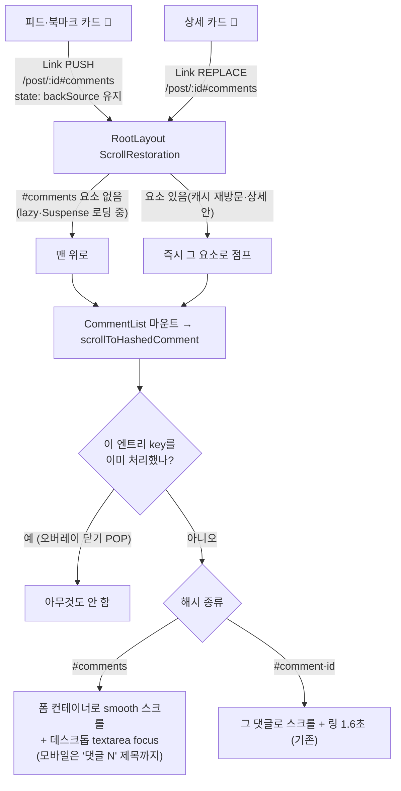

# 카드 💬 아이콘 → 상세의 댓글 작성 영역으로 스크롤

> 목록·북마크·상세 카드의 댓글 아이콘을 누르면 `/post/:id#comments`로 이동하고, 기존 해시 이동 effect가 댓글 작성 폼으로 스크롤한다. 데스크톱에서는 포커스까지 준다.

## Context

**문제.** 피드와 북마크의 `PostCard` 💬 아이콘([PostCard.tsx:355](../../src/widgets/post/post-card/ui/PostCard.tsx#L355))은 `/post/:id`로만 링크한다. 그래서 상세 페이지 맨 위에 도착하고, 댓글을 쓰려면 직접 내려가야 한다. 사용자는 "기존 스크롤 이동 기능"을 재사용해 댓글 입력 위치로 보내 달라고 요청했다.

**재사용할 기존 기능(조사 결과).**

- `scrollToHashedComment`([CommentList.tsx:37-66](../../src/widgets/comment/comment-list/ui/CommentList.tsx#L37-L66)): `location.hash`로 대상을 찾아 `scrollIntoView({smooth, start})`하고 1.6초 동안 링으로 강조한다. 선례는 "내 댓글" 카드(`MyCommentCard.tsx:29`)와 FCM 알림의 `#comment-<id>`다.
- `ScrollToCommentFormButton`([ScrollToCommentFormButton.tsx:79-84](../../src/widgets/comment/comment-list/ui/ScrollToCommentFormButton.tsx#L79-L84)): 데스크톱에서 `formContainerRef`로 스크롤한 뒤 `commentFormRef.focus()`(preventScroll)를 부른다. 컨테이너에는 이미 `scroll-mt-(--navbar-height)`가 있다(CommentList.tsx:71).

**코드 추적으로 찾은 함정(실측은 구현 중에 한다).**

- `useHistoryOverlay.open()`은 `pathname+search`로만 push해서 해시가 빠진다([useHistoryOverlay.ts:21](../../src/shared/hooks/useHistoryOverlay.ts#L21)). 이미지 뷰어, 북마크 폴더 창, 로그인 창, 사이드바가 모두 이 경로를 쓴다.
- 그래서 오버레이를 닫는 POP에서 해시가 `'' → '#…'`로 되살아나고, 지금의 effect가 다시 돌아 대상 위치로 튕긴다. 이 문제는 "내 댓글"의 `#comment-<id>` 경로에도 이미 있다.
- 💬 경로는 이용 빈도가 훨씬 높아서, 같은 effect에 엔트리 단위 가드를 넣는다.

## 판단이 필요했던 항목

| 항목                                  | 결정                                                                    | 근거·기각한 대안                                                                                                                                                                                                                                                                                                                                                                                                                                                        |
| ------------------------------------- | ----------------------------------------------------------------------- | ----------------------------------------------------------------------------------------------------------------------------------------------------------------------------------------------------------------------------------------------------------------------------------------------------------------------------------------------------------------------------------------------------------------------------------------------------------------------- |
| 이동 신호                             | URL 해시 `#comments`                                                    | 기존 해시 이동 effect와 선례(MyCommentCard·FCM)를 그대로 재사용한다. 기각: `location.state` 신호. 새 메커니즘이 생기고, 오버레이 닫기 POP에서 다시 실행되는 문제도 똑같이 생긴다                                                                                                                                                                                                                                                                                        |
| 데스크톱 도착 동작                    | 스크롤 + 입력창 포커스                                                  | 사용자 선택(2026-10-14). 플로팅 버튼과 같은 동작이다. 기각: 스크롤만 하기, 링 강조(시각 변경이라 시안이 필요)                                                                                                                                                                                                                                                                                                                                                           |
| 모바일 도착 동작                      | "댓글 N" 제목까지 스크롤하고 하단 바는 접힌 채로 둔다                   | 사용자 선택. 모바일에는 인라인 폼이 없어 `commentFormRef`가 null이고 focus는 no-op이 된다. 기각: 시트 자동 펼침. 댓글을 덮고, iOS 키보드 동작도 검증하지 않았다                                                                                                                                                                                                                                                                                                         |
| 상세 카드 💬                          | 같이 바꾸고 `replace={isDetail}`를 준다                                 | 사용자 선택. PUSH로 하면 `useGoBack`의 `navigate(-1)`이 `/post/:id`로 돌아가 뒤로가기를 두 번 눌러야 한다. 지금도 같은 URL Link는 REPLACE(state undefined)라서 돌아가기 라벨 동작은 지금과 같다                                                                                                                                                                                                                                                                         |
| 오버레이 닫기 후 다시 스크롤되는 문제 | 처리한 엔트리의 `location.key`를 ref에 기억해 두고, 같은 key면 건너뛴다 | 히스토리 엔트리 key는 POP으로 돌아와도 같다. 새로고침이나 다른 페이지에서 뒤로 돌아오는 경우는 컴포넌트가 다시 마운트돼 ref가 비므로 지금처럼 다시 스크롤한다. 기각 ①: `navigationType === POP`이면 건너뛰기. 새로고침도 POP(key가 history.state에 남음)이라 `#comment-<id>`를 새로고침했을 때의 재스크롤이 사라진다. 기각 ②: `useHistoryOverlay`가 해시를 유지하기. ScrollRestoration이 PUSH마다 해시 요소로 즉시 점프한다(`react-router-dom/dist/index.js` 1321-1328) |
| 강조 타이머 cleanup 제거              | `clearTimeout` cleanup을 없애고 타이머가 항상 링을 지운다               | `StrictMode`(main.tsx:24)는 effect를 두 번 실행한다. 두 번째 실행을 ref가 건너뛰면, 첫 실행의 타이머가 cleanup에서 취소돼 링이 남는다                                                                                                                                                                                                                                                                                                                                   |
| 앵커 id 상수 위치                     | `entities/comment/config/comment.const.ts`                              | widgets/post와 widgets/comment 슬라이스끼리는 직접 import하지 않는다(FE-ARCHITECTURE §26). 그래서 둘 다 내려다보는 entities에 둔다                                                                                                                                                                                                                                                                                                                                      |

**사용자가 체감하는 부수효과(승인 대상).**

- 주소창에 `#comments`가 남는다. 공유 버튼은 `origin + /post/:id`로 링크를 만들어서(usePostCard.ts:102) 해시가 붙지 않는다.
- 첫 방문처럼 로딩이 있으면 맨 위에서 부드럽게 스크롤한다. 캐시가 있는 재방문이나 상세 안에서 💬을 누를 때는 ScrollRestoration이 먼저 **즉시 점프**한다. 네이티브 앵커와 같은 동작이고, 코드 추적 결과라 구현 후 실측한다.

## 세부 계획

| 위치                                                          | 변경 내용                                                                                                                                                                                                                                                                                                                                                                                                                                                                                                   |
| ------------------------------------------------------------- | ----------------------------------------------------------------------------------------------------------------------------------------------------------------------------------------------------------------------------------------------------------------------------------------------------------------------------------------------------------------------------------------------------------------------------------------------------------------------------------------------------------- |
| `src/entities/comment/config/comment.const.ts` (추가)         | `export const COMMENT_SECTION_ANCHOR_ID = 'comments';`와 JSDoc(카드 💬 → CommentList 스크롤)                                                                                                                                                                                                                                                                                                                                                                                                                |
| `src/widgets/post/post-card/ui/PostCard.tsx:355`              | 💬 Link의 `to`를 `` `/post/${post.id}#${COMMENT_SECTION_ANCHOR_ID}` ``로 바꾸고 `replace={isDetail}`를 추가한다. 제목 링크는 바꾸지 않는다                                                                                                                                                                                                                                                                                                                                                                  |
| `src/widgets/comment/comment-list/ui/CommentList.tsx:71`      | 폼 컨테이너 div에 `id={COMMENT_SECTION_ANCHOR_ID}`를 붙인다                                                                                                                                                                                                                                                                                                                                                                                                                                                 |
| `src/widgets/comment/comment-list/ui/CommentList.tsx:37-66`   | `scrolledEntryKeyRef` 추가, deps는 `[location.hash, location.key]`. 순서: 해시 없음이나 처리한 key면 return → 대상 없으면 return → ref에 key 기록 → `#comments`면 `scrollIntoView({smooth,start})` + `commentFormRef.current?.focus()` 후 return → 아니면 기존 링 강조(타이머 cleanup은 제거). 주석은 기존 블록 아래에 이유만 짧게 단다                                                                                                                                                                     |
| `e2e/comment-icon-scroll.spec.ts` (신규, 데스크톱)            | ① 피드 💬 → URL `#comments`, 작성 textarea 포커스, 폼 컨테이너가 뷰포트 상단에 있음 ② 북마크 페이지 💬 → 같은 결과 ③ 상세 카드 💬 → `#comments` + 포커스, 돌아가기를 한 번 누르면 피드 ④ 회귀: `#comments`로 도착 → 맨 위로 스크롤 → 오버레이(북마크 폴더 창) 열고 닫기 → scrollY가 그대로 ⑤ `#comment-<id>` 직접 진입 → 그 댓글이 뷰포트 안에 있음(기존 동작 유지). 상세가 화면보다 길도록 긴 description과 댓글 여러 개를 모킹한다. 셋업 선례: `e2e/post-card-click-area.spec.ts`, `e2e/bookmark.spec.ts` |
| `e2e/comment-icon-scroll.mobile.spec.ts` (신규)               | 피드 💬 → "댓글 N" 제목이 navbar 바로 아래에 오고, 하단 바는 접힌 채(트리거 버튼 보임)                                                                                                                                                                                                                                                                                                                                                                                                                      |
| `docs/COMMENT.md`                                             | "해시 이동" 문단(≈338줄)에 `#comments`(카드 💬, 데스크톱 포커스, 모바일 제목)와 엔트리 key 가드를 추가하고 줄 번호를 갱신한다. 용어 사전의 "해시 이동"을 갱신하고, 마지막 검토를 2026-10-14로 바꾼다                                                                                                                                                                                                                                                                                                        |
| `docs/POST-DETAIL-BACK-NAVIGATION.md` §6(≈131줄)              | "상세 자신의 제목 링크"에 상세 카드 💬(REPLACE)도 같은 처리라는 걸 한 구절 덧붙인다                                                                                                                                                                                                                                                                                                                                                                                                                         |
| `CHANGELOG.md` `[Unreleased]`                                 | feat 항목(changelog-release skill 형식)                                                                                                                                                                                                                                                                                                                                                                                                                                                                     |
| `docs/plans/2026-10-14-comment-icon-scroll-to-form.md` (신규) | 이 계획의 스냅샷(§11)                                                                                                                                                                                                                                                                                                                                                                                                                                                                                       |

진행 순서: `git log origin/main..main` 확인 → `EnterWorktree` → `.env` 복사 + `pnpm install` → 위 변경 → 검증 → 브라우저 녹화 → 커밋, PR, CI 확인 → fresh subagent로 계획 대비 구현을 대조해 PR 본문에 기록한다.

## 영향 범위 (§5)

- **CRUD:** 데이터 변경이 없다(조회 화면 내비게이션만 바뀐다).
- **PostCard를 import하는 곳**(`pnpm graph:focus` 실측): `pages/post/index.tsx`(피드), `pages/bookmark/BookmarkPage.tsx`, `pages/post/PostDetailPage.tsx`. 세 곳 모두 의도한 대상이다.
- **CommentList를 import하는 곳:** `PostDetailPage.tsx` 하나.
- **comment.const.ts:** 새 export만 추가하므로 기존 import 7곳은 영향이 없다.
- **회귀 후보와 그 소유 파일:**
  - 돌아가기 라벨(`usePostDetail.ts` `useBackLabel`): 목록에서 들어오면 다른 pathname으로의 PUSH라 지금처럼 다시 계산한다. 상세 💬은 지금도 REPLACE라 변화가 없다. 확인 대상 `e2e/post-detail-back-label.spec.ts`, `post-detail-back(.mobile).spec.ts`
  - "내 댓글"·FCM 해시 이동(`CommentList.tsx`): 오버레이를 닫아도 다시 스크롤·강조하지 않게 되는 것만 달라진다. 새로고침이나 뒤로가기로 다시 진입하면 지금처럼 다시 스크롤한다
  - 카드 클릭 영역(`e2e/post-card-click-area.spec.ts`): Link 위치와 클래스가 그대로라 영향이 없다
  - 스크롤 리셋(`e2e/scroll-reset-on-navigation(.mobile).spec.ts`): 해시가 없는 이동은 그대로다
  - `ScrollToCommentFormButton`: 같은 ref를 쓰고 변경은 없다. 도착 직후 폼이 화면 안이라 버튼은 숨겨진다
- **문서:** `COMMENT.md`와 `POST-DETAIL-BACK-NAVIGATION.md`는 갱신한다. `FCM-PUSH-NOTIFICATION.md`와 COMMENT.md §11의 "이미 보고 있으면 스크롤 안 됨"은 원인(캐시에 새 댓글이 없음)이 그대로라 바꾸지 않는다. BE 문서는 영향이 없다.

## 검증 방법

1. `pnpm type-check` → `pnpm test` → `pnpm lint` · `pnpm check:deps` → `pnpm check:docs`
2. 새 e2e 두 파일과 관련 기존 스펙(`post-card-click-area`, `post-detail-back-label`, `post-detail-back(.mobile)`, `scroll-reset-on-navigation(.mobile)`, `comment`, `my-comments`)을 `pnpm test:e2e`로 돌린다
3. **헛테스트 확인(변이):**
   - ref 가드를 빼면 ④가 실패해야 한다(오버레이 문제의 실측 재현을 겸한다)
   - `replace={isDetail}`를 빼면 ③의 "한 번에 피드"가 실패해야 한다
   - 해시를 빼면 ①·②가 실패해야 한다
4. **browser-verification skill로 녹화:** 데스크톱 피드 💬, 북마크 💬, 상세 💬(즉시 점프 여부 실측), 이미지 뷰어 열고 닫기, 모바일 피드 💬. 녹화 파일을 짧은 이름으로 복사해 `open -a Cursor`로 연다
5. PR CI가 green인지 확인한다

## 남은 것

- 즉시 점프와 부드러운 스크롤이 경우마다 다르다(캐시 유무, 상세 안 클릭). 녹화로 실측한 뒤 거슬리면 따로 논의한다. 해시를 쓰는 한 react-router ScrollRestoration이 먼저 처리하므로, 바꾸려면 신호 방식을 바꿔야 한다.
