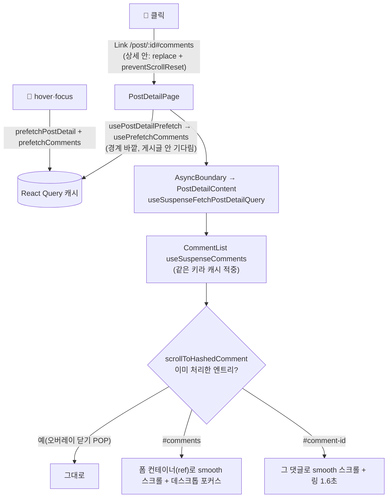

# 💬 도착 스크롤 방식 확정 + 상세 댓글 동시 요청 + 💬 hover 미리 받기

> 💬 이동을 브라우저 기본 부드러운 스크롤로 확정한다. 상세 페이지가 댓글을 게시글과 동시에 요청하게 하고, 💬에 마우스를 올리면 게시글과 댓글을 미리 받는다. 모두 지금 PR(#comments 스크롤)에 함께 넣는다(사용자 결정, 2026-10-14).

## Context

**문제.** 💬을 누르고 댓글 폼에 도착하기까지 오래 걸린다는 사용자 피드백(2026-10-14)이 있었다. 즉시 이동(`auto`)으로 바꿨더니, 이번엔 "갑자기 댓글이 보이면 당황할 수 있다, 화면이 확 바뀌면 거부감이 든다"는 피드백이 왔다. 그래서 스크롤 방식과 속도를 따로 풀었다.

**측정**(직접 측정: dev 서버, Playwright chromium, 목 응답, API당 300ms, 3회 반복, 클릭부터 도착까지)

| 방식                             | hover 0.4초 후 클릭 | 바로 클릭 |
| -------------------------------- | ------------------- | --------- |
| 브라우저 smooth, 순차 요청(이전) | 약 1.15초           | 약 1.18초 |
| + ① 동시 요청                    | 약 0.86초           | 약 0.88초 |
| + ① + ② 💬 hover 미리 받기       | **약 0.53초**       | 약 0.81초 |
| 참고: 즉시 이동, 미리 받기 없음  | —                   | 약 0.74초 |

**스크롤 시안 비교**(녹화로 나란히 비교함)

- A 즉시: 0ms
- B 직접 만든 250ms: 216~234ms
- C 브라우저 기본: 데스크톱 416ms, 모바일 500ms

**근거**

- [NN/g, Laubheimer 2020 — 애니메이션의 역할](https://www.nngroup.com/articles/animation-purpose-ux/): 부드러운 스크롤은 콘텐츠가 한 페이지 안에 있고 페이지의 어디에 있는지를 보여준다
- [NN/g, Laubheimer 2020 — 애니메이션 지속시간](https://www.nngroup.com/articles/animation-duration/): 100–400ms가 적절하고, 400ms는 아주 느림
- [Bootstrap 5.3 접근성 문서](https://getbootstrap.com/docs/5.3/getting-started/accessibility/): 브라우저 기본 `scroll-behavior: smooth`를 쓰고, 모션 줄이기 설정을 존중한다
- [Tailwind `scroll-smooth`](https://tailwindcss.com/docs/scroll-behavior): 브라우저 기본을 켜는 유틸리티다
- [caniuse](https://caniuse.com/css-scroll-behavior): Safari 15.4부터 지원, 전체 97.1%
- [GSAP ScrollToPlugin](https://gsap.com/docs/v3/Plugins/ScrollToPlugin/): 지속시간을 정하는 건 라이브러리 몫이다
- [TanStack Query 프리페치 가이드](https://github.com/tanstack/query/blob/main/docs/framework/react/guides/prefetching.md): suspense 경계 바깥에서 `usePrefetchQuery`를 쓴다

## 판단이 필요했던 항목

| 항목                               | 결정                                                                                           | 근거·기각한 대안                                                                                                                                                                                                                                                                                                                |
| ---------------------------------- | ---------------------------------------------------------------------------------------------- | ------------------------------------------------------------------------------------------------------------------------------------------------------------------------------------------------------------------------------------------------------------------------------------------------------------------------------- |
| 스크롤 방식                        | C 브라우저 기본 `smooth`                                                                       | 사용자 선택. 업계 표준(Bootstrap·Tailwind)이고 기존 플로팅 버튼·내 댓글 이동과 같은 방식이다. 기각 A 즉시: "화면이 확 바뀌면 거부감"(사용자), NN/g의 위치 파악 근거. 기각 B 직접 만든 250ms: 💬 하나만 방식이 달라지고, 브라우저에 없는 지속시간 옵션을 손으로 구현하게 된다                                                    |
| `#comments`를 DOM id가 아닌 신호로 | 컨테이너에서 `id`를 빼고 ref로 찾는다. 상수는 `COMMENT_SECTION_HASH = '#comments'`             | id가 있으면 react-router `ScrollRestoration`이 먼저 즉시 점프해(캐시 재방문·상세 안 클릭) 애니메이션이 안 보인다(시안 녹화로 확인)                                                                                                                                                                                              |
| 상세 안 💬                         | `replace` + `preventScrollReset`                                                               | id가 없으면 ScrollRestoration이 REPLACE에 맨 위로 올렸다가 다시 내려온다                                                                                                                                                                                                                                                        |
| ① 동시 요청                        | `PostDetailPage`(경계 바깥)에서 `usePrefetchComments`                                          | TanStack 공식 패턴. 측정상 약 0.3초 단축. 기각: `useSuspenseQueries`(게시글이 댓글까지 기다리며 막힘), 라우터 loader(선례 없음)                                                                                                                                                                                                 |
| ② hover 미리 받기                  | 💬 링크의 `onMouseEnter`·`onFocus`에서 게시글 + 댓글                                           | 제목 링크(`handlePrefetchDetail`, onMouseEnter+onFocus)를 선례로 따른다. 측정상 hover 시 약 0.53초. **제목·카드 hover는 지금처럼 게시글만 받는다**: 제목 링크의 `::after`가 카드 전체를 덮어 카드 위를 지나가기만 해도 발동하므로, 댓글까지 받으면 hover로 생기는 요청이 두 배가 된다. 💬 hover는 댓글을 보려는 의도가 분명하다 |
| 프리페치 정의                      | `comment.queries.ts`에 `prefetchComments(queryClient, postId)`와 `usePrefetchComments(postId)` | 선례 `prefetchPostDetail`(post.queries.ts, "동일 키/queryFn")을 따른다. `queryOptions` 추출은 하지 않는다(레포에 사용처 0곳)                                                                                                                                                                                                    |
| 404 글의 재시도                    | 기본값 유지                                                                                    | `useSuspenseComments`와 옵션을 똑같이 둔다. 비용은 보이지 않는 404 요청 2번                                                                                                                                                                                                                                                     |
| 모션 줄이기                        | 이번 범위 밖                                                                                   | 기존 smooth 호출 전체가 미대응이다(`motion-ux` skill에 기록). 별도 PR                                                                                                                                                                                                                                                           |

## 세부 계획

| 위치                                                   | 변경 내용                                                                                                                                                                                                                    |
| ------------------------------------------------------ | ---------------------------------------------------------------------------------------------------------------------------------------------------------------------------------------------------------------------------- |
| `src/entities/comment/config/comment.const.ts`         | `COMMENT_SECTION_ANCHOR_ID` → `COMMENT_SECTION_HASH = '#comments'`로 바꾸고, JSDoc에 "DOM id가 아닌 신호인 이유"를 적는다                                                                                                    |
| `src/widgets/comment/comment-list/ui/CommentList.tsx`  | 시안 코드(variant·애니메이션 함수) 삭제. `#comments`면 `formContainerRef`, 아니면 `querySelector`로 대상을 찾는다. 둘 다 `smooth`로 스크롤하고, `#comments`는 포커스한 뒤 return, 나머지는 링. 컨테이너 `id` 제거. 주석 갱신 |
| `src/widgets/post/post-card/ui/PostCard.tsx`           | 💬 Link: `to={/post/${id}${COMMENT_SECTION_HASH}}`, `replace={isDetail}`, `preventScrollReset={isDetail}`, `onMouseEnter`·`onFocus={handlePrefetchDetailWithComments}`                                                       |
| `src/widgets/post/post-card/hooks/usePostCard.ts`      | `handlePrefetchDetailWithComments`(게시글 + 댓글) 추가                                                                                                                                                                       |
| `src/entities/comment/api/comment.queries.ts`          | `prefetchComments`, `usePrefetchComments`                                                                                                                                                                                    |
| `src/pages/post/hooks/usePostDetail.ts`                | `usePostDetailPrefetch()` export                                                                                                                                                                                             |
| `src/pages/post/PostDetailPage.tsx`                    | 경계 바깥에서 `usePostDetailPrefetch()`                                                                                                                                                                                      |
| `e2e/comment-icon-scroll(.mobile).spec.ts`             | 상수 이름 변경, 위치 측정을 "댓글 N" 제목 기준으로 바꾼다                                                                                                                                                                    |
| `e2e/post-detail-comment-prefetch.spec.ts` (신규)      | ① 게시글 응답을 1초 늦춰도 그 전에 댓글 요청이 나가고 총 1회인지 ② 💬 hover만으로 게시글·댓글 요청이 나가는지 ③ 제목 hover는 게시글만 받는지                                                                                 |
| `docs/COMMENT.md`                                      | 해시 이동 절: 스크롤 방식 결정 표(A/B/C, 근거·측정), 신호 방식. §5 목록: 동시 요청·hover                                                                                                                                     |
| `docs/POST.md` 프리페치                                | 💬 hover, 상세 동시 요청                                                                                                                                                                                                     |
| `docs/POST-DETAIL-BACK-NAVIGATION.md`                  | 상세 💬의 `preventScrollReset`                                                                                                                                                                                               |
| `CHANGELOG.md`                                         | 기존 `comment` 항목 수정(smooth) + `perf` 항목 추가                                                                                                                                                                          |
| `docs/plans/2026-10-14-comment-scroll-speed.md` (신규) | 이 계획의 스냅샷                                                                                                                                                                                                             |

## 영향 범위 (§5)

- **CRUD:** 조회 시점만 바뀐다. 작성·수정·삭제는 같은 키(`commentKeys.list`)를 갱신한다.
- **요청 수:**
  - 정상 글: 변화 없음
  - 💬 hover 후 클릭하지 않으면: 게시글 1회 + 댓글 1회(3분 staleTime 동안은 재요청 없음)
  - 삭제·비공개 글: 보이지 않는 404 2회. 화면과 토스트는 변화 없음(`skipNotFound`)
  - 잘못된 형식의 id: 토스트가 2개 뜰 수 있다(실측해 기록)
- **import하는 곳(실측):**
  - PostCard: 피드·북마크·상세
  - CommentList, usePostDetail: `PostDetailPage` 하나
  - usePostCard: PostCard 하나
- **회귀 확인:**
  - `PostDetailPage.test.tsx`
  - `e2e/post-detail-not-found.spec.ts`(댓글 요청이 abort → `NetworkError` → 토스트 없음)
  - `post-card-click-area`(💬 링크 hover 핸들러 추가)
  - `post-detail-back-label`, `scroll-reset-on-navigation`, `comment*`, `my-comments`

## 검증 방법

1. `pnpm type-check` → `pnpm test` → `pnpm lint` · `pnpm check:deps` → `pnpm check:docs` → `pnpm format:check`
2. 전체 `pnpm test:e2e`
3. 변이 확인. 아래를 하나씩 빼면 해당 테스트가 실패해야 한다.
   - `usePostDetailPrefetch()` 호출
   - 💬 `onMouseEnter`
   - `preventScrollReset`(상세 안 클릭이 맨 위로 튀는지)
   - 엔트리 가드
4. `verify-speed`·`verify-variants`로 다시 측정한다(C 기준 수치가 표와 맞는지)
5. 잘못된 형식의 id(`/post/abc`)로 토스트 개수를 실측한다
6. browser-verification으로 최종 녹화(피드·북마크·상세·모바일·오버레이)
7. PR CI → fresh subagent로 계획 대비 구현을 대조한다. 계획 파일 두 개(`2026-10-14-comment-icon-scroll-to-form.md`, `2026-10-14-comment-scroll-speed.md`)를 함께 대조한다

## 남은 것

- 모션 줄이기(`prefers-reduced-motion`) 대응: 기존 smooth 호출 전체. 별도 PR
- `#comment-<id>`(내 댓글·알림)에도 hover 미리 받기를 넣을지
- 운영 환경의 실제 API 왕복 시간과 실제 hover 체류 시간은 측정하지 않았다
