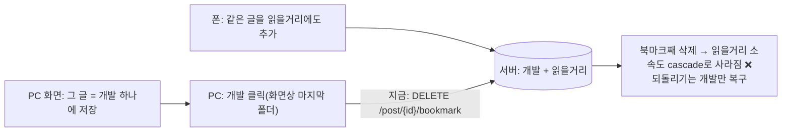
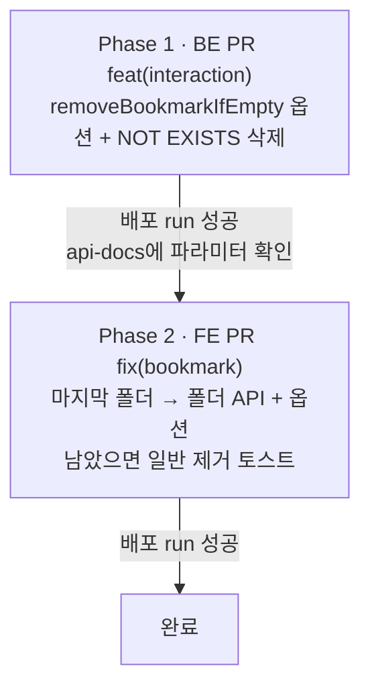

# 마지막 폴더를 빼도 다른 기기가 추가한 폴더는 지키기 — 서버가 실제 소속으로 판단

> 다이얼로그에서 "마지막 폴더"를 빼면 지금은 북마크째 해제(`DELETE /post/{id}/bookmark`)한다. 화면이 낡았으면
> 다른 기기가 그사이 추가한 폴더까지 말없이 지워진다. 폴더 제거 API에 "비면 북마크도 삭제" 옵션을 더해, 서버가
> 실제 남은 소속을 보고 한 문장으로 판단하게 한다(2026-10-14 사용자 선택: B안).

## Context

### 문제

- "마지막 폴더"는 화면이 아는 소속 개수(`bookmarkFolderIds.length === 1`)로만 판단한다(`useBookmarkFolders.ts`의 `selectFolder`).
- 북마크를 지우면 소속은 FK `ON DELETE CASCADE`로 함께 지워진다(BE `create_bookmark_folder_items.sql`의 `fk_bookmark_folder_items_bookmark`).
- 폴더 하나만 빼는 API(`DELETE /bookmark/{postId}/folders/{folderId}`)는 이미 있다. 이 API는 남은 실제 `folderIds`를 돌려준다(BE `InteractionService.removeBookmarkFolder`).

### 사전 조사

- **BE 선례**
  - 조건부 쓰기를 한 문장으로 하는 네이티브 SQL: `BookmarkRepository.insertIgnoreConflict`(`ON CONFLICT DO NOTHING`).
  - 소속이 없는 북마크를 고르는 `NOT EXISTS`: `countUncategorizedByUserId`.
  - 기본값 있는 쿼리 파라미터: `CommentController`의 `@RequestParam(defaultValue = "0") page`.
- **BE 테스트는 실제 DB 없이 돈다.** H2·Testcontainers가 없어서 새 SQL은 기존 테스트로 검증되지 않는다(4번 항목이 이 공백을 다룬다). 그래서 이번에는 로컬 Postgres 컨테이너로 따로 확인한다.
- **FE 선례**
  - 저장·해제 mutation `useBookmarkPostMutation`(`interaction.queries.ts`)이 해제 시 화면을 즉시 바꾼다. 아이콘 끄기, 폴더별 게시글에서 카드 빼기, 폴더 수 조정을 하고, 마지막 요청에서 응답으로 교정한다(`applyServerBookmarkToPost`).
  - 폴더 제거 mutation `useRemoveBookmarkFolderMutation`은 소속만 빼는 낙관적 업데이트라, 북마크가 사라질 때 아이콘을 즉시 끄지 못한다.
  - `useRemoveBookmarkFolderMutation`을 쓰는 곳은 `useBookmarkFolders.ts` 하나다(`git grep`).
- **FE `apiClient.delete(endpoint, data?, options?)`는 `options.searchParams`를 받는다**(`client.ts`). 빈 `{}` 본문은 ESLint가 막으므로 `undefined`로 넘긴다.

## 판단이 필요했던 항목

| 항목                         | 결정                                                                                                                                                                | 근거·기각한 대안                                                                                                                                                                                                                                                                                                                                                                              |
| ---------------------------- | ------------------------------------------------------------------------------------------------------------------------------------------------------------------- | --------------------------------------------------------------------------------------------------------------------------------------------------------------------------------------------------------------------------------------------------------------------------------------------------------------------------------------------------------------------------------------------- |
| 고치는 위치                  | BE에 옵션 추가 (2026-10-14 사용자 선택)                                                                                                                             | 서버가 실제 상태로 판단해 요청 1번에 정확하다. 기각: FE만(폴더 제거 → 비었으면 해제, 요청 2번에 화면 깜빡임), 그대로 두기                                                                                                                                                                                                                                                                     |
| API 형태                     | 기존 `DELETE /bookmark/{postId}/folders/{folderId}`에 `removeBookmarkIfEmpty`(기본 `false`) 쿼리 파라미터                                                           | 옵션이 없으면 지금 동작("그 폴더에서만 제거") 그대로라 다른 사용처가 안전하다. 기각: 새 엔드포인트(같은 자원에 대한 같은 동작이 둘로 갈림), 기존 동작 자체를 바꾸기(계약 변경)                                                                                                                                                                                                                |
| 서버 판단 방식               | 소속 삭제 뒤 `DELETE FROM bookmarks … WHERE NOT EXISTS (소속)` 네이티브 SQL 한 문장                                                                                 | 확인과 삭제 사이에 다른 요청이 끼어들 틈을 없앤다. "개수 조회 → 0이면 삭제" 두 단계는 그 틈이 생긴다. JPQL 대신 네이티브인 건 DML 안의 상관 서브쿼리를 테스트 없이 확신하기 어려워서고, 선례(`insertIgnoreConflict`)도 네이티브다                                                                                                                                                             |
| FE 요청을 보내는 곳          | `useBookmarkPostMutation`의 변수를 `boolean \| { lastFolderId: string }`로 넓힌다. 마지막 폴더면 새 API 함수 `interactionApi.unbookmarkPostFromLastFolder`를 부른다 | 해제의 즉시 반영·같은 줄 직렬화·마지막 요청 확정·실패 롤백을 그대로 재사용한다. 다른 폴더가 남았으면 마지막 성공 응답(`isBookmarked: true, folderIds: [B]`)으로 교정되고, 폴더 목록·폴더별 게시글은 기존 `handleBookmarkToggleSuccess`가 무효화한다. 기존 호출 `mutate(true/false)`는 그대로다. 기각: `useRemoveBookmarkFolderMutation`에 옵션 추가(아이콘이 재조회 전까지 켜진 채 남는 회귀) |
| 다른 폴더가 남았을 때 토스트 | 기존 "개발 폴더에서 제거했어요."만 띄운다(설명·되돌리기 없음). 새 문구는 없다                                                                                       | 실제 결과가 "그 폴더에서만 빠짐"이고, 마지막이 아닌 폴더를 뺄 때와 같은 결과라 같은 토스트를 쓴다                                                                                                                                                                                                                                                                                             |
| 북마크까지 지워졌을 때       | 지금과 같다: "개발 폴더에서 제거했어요." + "마지막 폴더라서 북마크도 함께 제거했어요." + 되돌리기(폴더 A 다시 추가)                                                 | 동작 변화 없음                                                                                                                                                                                                                                                                                                                                                                                |

### 위험 관리

- **배포 순서: BE 먼저.** 옛 BE는 모르는 쿼리 파라미터를 무시한다. 그래서 FE만 먼저 나가면 마지막 폴더를 빼도 북마크가 미분류로 남는다. 에러는 아니지만 동작이 달라진다. 되돌릴 땐 FE부터 되돌린다.
- **동시성:** 북마크 행 삭제와 다른 요청의 소속 추가가 정확히 겹치면 Postgres 잠금 순서에 따라 결과가 갈릴 수 있다. 확인과 삭제를 한 문장으로 묶어 그 틈을 최소로 줄인 것이지, 완전한 직렬화는 아니다(같은 탭 안의 요청은 FE scope가 직렬화한다).
- **SQL 검증 공백:** BE 테스트는 mock이다. 로컬 Docker Postgres로 SQL을 따로 확인한다. Docker Desktop이 지금 꺼져 있어 구현 때 켠다.

## 세부 계획

- 각 Phase는 `origin/main`에서 새 워크트리로 시작한다.
- 계획 파일은 `docs/plans/2026-10-14-last-folder-keeps-others.md`로 BE·FE PR에 같은 이름으로 커밋한다.

### Phase 1 — BE

| 위치                                                            | 변경 내용                                                                                                                                                                                                                                                          |
| --------------------------------------------------------------- | ------------------------------------------------------------------------------------------------------------------------------------------------------------------------------------------------------------------------------------------------------------------ |
| `domain/interaction/BookmarkRepository.kt`                      | `deleteIfNoFolderItems(userId, postId): Int` 추가(`@Modifying` 네이티브: `DELETE FROM bookmarks b WHERE b.user_id = :userId AND b.post_id = :postId AND NOT EXISTS (SELECT 1 FROM bookmark_folder_items i WHERE i.user_id = b.user_id AND i.post_id = b.post_id)`) |
| `domain/interaction/InteractionService.kt`                      | `removeBookmarkFolder(postId, folderId, userId, removeBookmarkIfEmpty: Boolean = false)`: 소속 삭제 뒤 옵션이 참이면 `deleteIfNoFolderItems`를 부른다. 응답 계산은 그대로(삭제 뒤 실제 `isBookmarked`·`folderIds`). KDoc 갱신                                      |
| `domain/interaction/InteractionController.kt`                   | `removeBookmarkFolder`에 `@RequestParam(defaultValue = "false") removeBookmarkIfEmpty: Boolean`을 추가하고 `@Operation` 설명을 갱신한다                                                                                                                            |
| `src/test/.../InteractionServiceTest.kt`                        | 옵션 참이면 소속 삭제 → `deleteIfNoFolderItems` 순서로 부름(`inOrder`). 옵션 거짓이면 부르지 않음(기존 "마지막 폴더여도 북마크 유지" 테스트 유지). 다른 소속이 남은 응답이면 `isBookmarked: true` 그대로 반환                                                      |
| `src/test/.../InteractionControllerTest.kt`                     | 쿼리 파라미터가 서비스로 전달되는지, 생략하면 `false`인지                                                                                                                                                                                                          |
| `README.md` Interaction 표, `CHANGELOG.md` `[Unreleased]` Added | 옵션 추가 기록                                                                                                                                                                                                                                                     |
| `docs/plans/2026-10-14-last-folder-keeps-others.md`(신규)       | 이 계획 스냅샷                                                                                                                                                                                                                                                     |

### Phase 2 — FE (Phase 1 운영 확인 후)

| 위치                                                                            | 변경 내용                                                                                                                                                                                    |
| ------------------------------------------------------------------------------- | -------------------------------------------------------------------------------------------------------------------------------------------------------------------------------------------- |
| `src/shared/api/generated/openapi.json`·`openapi.gen.ts`                        | `pnpm codegen:fetch && pnpm codegen`                                                                                                                                                         |
| `src/entities/interaction/api/interaction.api.ts`                               | `unbookmarkPostFromLastFolder(postId, folderId)` 추가: `apiClient.delete(API_ENDPOINTS.bookmark.postFolder(postId, folderId), undefined, { searchParams: { removeBookmarkIfEmpty: true } })` |
| `src/entities/interaction/api/interaction.queries.ts` `useBookmarkPostMutation` | 변수 `boolean \| { lastFolderId: string }`. 객체면 `nextBookmarked = false`로 같은 낙관적 해제를 하고 `mutationFn`만 새 API를 부른다. 나머지(`onSuccess` 응답 교정·`onError` 롤백)는 그대로  |
| `src/features/bookmark/toggle/hooks/useBookmarkFolders.ts`                      | `selectFolder`의 마지막 폴더 → `setBookmark({ lastFolderId: folderId })`. `selectFolder`가 서버 응답을 돌려준다                                                                              |
| `src/features/bookmark/toggle/hooks/usePostCardBookmarkFolderDialog.ts`         | 마지막 폴더 응답의 `isBookmarked`가 참이면(다른 소속이 남음) 일반 제거 토스트만 띄우고, 거짓이면 지금처럼 설명과 되돌리기를 붙인다                                                           |
| `src/mocks/handlers/bookmark-folder.handlers.ts`                                | 필요하면 폴더 제거 핸들러가 `removeBookmarkIfEmpty`에 맞는 JSON 응답을 돌려주게 한다                                                                                                         |
| `src/entities/interaction/api/interaction.queries.test.ts`                      | 마지막 폴더 해제는 폴더 API에 `removeBookmarkIfEmpty=true`로 나간다. 화면은 즉시 해제되고, 다른 소속이 남은 응답이면 `[B]`로 교정된다                                                        |
| `src/features/bookmark/toggle/ui/PostCardBookmarkFolderDialog.test.tsx`         | "마지막 폴더" 테스트의 핸들러를 폴더 API로 바꾸고 쿼리 파라미터를 단정한다. 새 테스트: 다른 소속이 남은 응답이면 설명·되돌리기 없는 일반 토스트                                              |
| `docs/BOOKMARK.md`                                                              | §5 API 표(옵션)·다이얼로그 행 표(마지막 폴더), §9 테스트 수, §10 이번 건, §11에서 항목 제거                                                                                                  |
| `docs/VERSION-COMPATIBILITY.md`·`CHANGELOG.md`                                  | BE 먼저 행, Fixed + Notes                                                                                                                                                                    |
| `docs/plans/2026-10-14-last-folder-keeps-others.md`(신규)                       | BE와 같은 파일                                                                                                                                                                               |

## 영향 범위

### CRUD 실패 지점

- **삭제(소속):** 기존과 같다. 일괄 DELETE라 0행이어도 예외가 없다.
- **삭제(북마크, 옵션):** 남은 소속이 없을 때만 지운다. 이미 북마크가 없으면 0행이다(예외 없음, 멱등). 공개 여부는 확인하지 않는다(폴더 제거와 같은 이유).
- **조회:** 응답 `isBookmarked`·`folderIds`는 삭제 뒤 실제 값이다. FE는 마지막 요청에서 이 값으로 상세·피드를 교정한다. 폴더 목록 수·폴더별 게시글은 성공 뒤 무효화한다.
- **동시 요청:** 같은 탭은 공유 scope로 직렬화된다. 다른 기기와의 겹침은 한 문장 판단으로 틈을 최소화한다(위험 관리).
- **cascade:** 옵션으로 북마크를 지울 때는 남은 소속이 없으니 cascade로 사라질 소속도 없다.

### 기존 기능 회귀

| 깨질 수 있는 것                                       | 소유 파일                                                                                     |
| ----------------------------------------------------- | --------------------------------------------------------------------------------------------- |
| 옵션 없는 폴더 제거(마지막이 아닌 폴더 빼기)          | BE `InteractionService.removeBookmarkFolder` — 기본값 `false`로 동작 그대로. 기존 테스트 유지 |
| 북마크 제거 행·미분류 재탭 해제(`setBookmark(false)`) | FE `useBookmarkFolders.ts` — 계속 `DELETE /post/{id}/bookmark`                                |
| 저장·해제 연타·직렬화 테스트                          | FE `interaction.queries.test.ts` — 변수 타입이 넓어질 뿐 `mutate(true/false)`는 그대로        |
| 마지막 폴더 되돌리기                                  | FE `restoreFolder` → 폴더 추가. 그대로                                                        |
| 옛 FE 탭                                              | 계속 `DELETE /post/{id}/bookmark`를 쓴다(동작은 전과 같음)                                    |

## 검증 방법

1. **BE**
   - `./gradlew ktlintCheck test`를 돌린다(새 서비스·컨트롤러 테스트, `RepositoryDeleteRulesTest`, `SwaggerDocsCoverageTest`).
   - Docker Desktop을 켜고 `postgres:16` 컨테이너에 `bookmarks`·`bookmark_folders`·`bookmark_folder_items`(FK cascade 포함)를 만든다. 새 SQL을 네 경우로 실행한다: 소속 0개면 삭제 1행, 다른 소속이 있으면 0행(북마크·소속 유지), 북마크 없음이면 0행, 다른 사용자 행은 건드리지 않음.
2. **BE 배포 뒤**:
   - 배포 run이 success인지 본다.
   - `https://linksphere.click/api/v3/api-docs`의 `/bookmark/{postId}/folders/{folderId}` delete에 `removeBookmarkIfEmpty`가 있는지 본다.
3. **FE**:
   - `pnpm type-check`·`pnpm test`·`pnpm check`·`pnpm check:docs`·`pnpm test:e2e`를 돌린다.
   - 새 다이얼로그 테스트는 수정 전 코드에서 실패하는지 먼저 확인한다.
4. **브라우저 검증**(모킹 녹화, 승인 후 커밋). 화면 하단 요청 로그로 확인한다.
   1. 마지막 폴더 해제(서버도 그 폴더 하나뿐) → 북마크 해제 + 되돌리기.
   2. 화면은 "개발"만, 서버엔 "개발 + 읽을거리"인 상태에서 "개발" 해제 → 북마크 유지, "읽을거리" ✓, 일반 제거 토스트.
5. **배포 확인 / 계획 대비 구현**
   - 두 레포 배포 run이 success인지 본다.
   - 각 PR 전에 fresh general-purpose 서브에이전트로 계획과 diff를 대조한다.

## 남은 것

- 4번 Testcontainers를 도입하면, 이번 SQL 검증(지금은 로컬 컨테이너로 1회)을 상시 테스트로 옮긴다.
- 옛 `POST` 토글 제거는 호출 로그가 0건이 되면 따로 한다.
