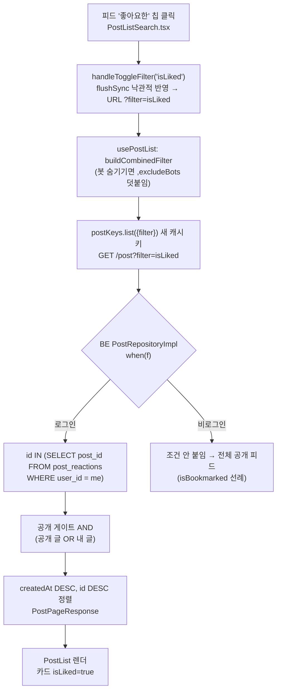
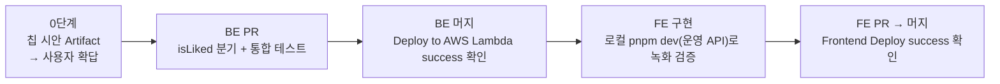

# 피드 범위 필터에 "좋아요한" 칩 추가

> 좋아요한 글을 다시 찾을 방법이 없던 빈 곳을, 기존 "북마크한"·"내가 작성한" 칩과 같은 방식의
> `filter=isLiked` 하나로 메운다. "내 댓글" 페이지와 북마크 페이지는 건드리지 않는다.

## Context

사용자 제안: "내 댓글" 목록을 좋아요·북마크까지 포함한 "내 활동 히스토리"로 확장하면 어떨까.

조사로 확인한 현황:

- **좋아요한 글을 다시 찾을 방법이 앱에 없다.** BE에 목록 API가 없고, `GET /post`의 `filter`도
  `isBookmarked`/`isMyPosts`/`isPrivate`/`excludeBots`만 처리한다(BE `PostRepositoryImpl.kt:190-253`,
  origin/main). 2026-09-14 "내 댓글" 계획도 같은 이유로 좋아요를 범위에서 뺐다
  (`docs/plans/2026-09-14-my-comments.md:11`).
- **북마크는 이미 해결돼 있다.** `/bookmark` 전용 페이지(폴더, "최신 북마크순" 정렬)와 피드 칩
  "북마크한"이 둘 다 있다.
- **"히스토리"는 지금 남아 있는 것만 가능하다.** `post_reactions.created_at`·`bookmarks.created_at`은
  있지만, 취소하면 행을 바로 지운다(hard delete). 이력·알림 테이블도 없다. 원글을 지우면 관련
  댓글·좋아요·북마크가 FK cascade로 함께 사라진다.

**의도한 결과**: 로그인 사용자가 피드에서 "좋아요한" 칩을 켜면 자기가 좋아요한 글만 보인다.
다른 칩과 AND로 조합되고, 초기화 버튼과 "조건 N개" 표시에도 잡힌다.



## 판단이 필요했던 항목

| 항목                | 결정                                                        | 근거·기각한 대안                                                                                                                                                                                                                                                                                                                  |
| ------------------- | ----------------------------------------------------------- | --------------------------------------------------------------------------------------------------------------------------------------------------------------------------------------------------------------------------------------------------------------------------------------------------------------------------------- |
| 확장 구조           | **C. 피드 칩만 추가** (사용자 선택)                         | A(내 활동 페이지에 댓글/좋아요 탭)는 탭 컴포넌트를 새로 만들고 좋아요 목록 API도 새로 만들어야 한다. B(통합 타임라인)는 BE에서 세 테이블을 합쳐야 한다. 시각 타입이 다르고(`bookmarks`만 timestamptz), 복합 PK라 동점 처리가 필요하며, 가시성 게이트도 3곳에 넣어야 한다. 비용이 커서 기각했다. 선례 조사는 아래 "근거 선례" 참고 |
| 북마크              | `/bookmark` 그대로 (사용자 선택)                            | 활동 목록에 넣으면 같은 목록이 두 곳에 생긴다                                                                                                                                                                                                                                                                                     |
| 취소 이력           | 만들지 않음 (사용자: "피드 칩만 넣으면 필요 없어 보임")     | 이벤트 로그를 만들려면 새 테이블과 쓰기 경로 변경이 필요하다                                                                                                                                                                                                                                                                      |
| 정렬                | 글 작성순(피드 기존 정렬 그대로)                            | C안을 고를 때 감수한 점이다. 좋아요한 시각순으로 하려면 별도 API가 필요하다(A안)                                                                                                                                                                                                                                                  |
| 좋아요 취소 시 카드 | **① 그대로**(사용자 선택). 좋아요 캐시 코드는 바꾸지 않는다 | "북마크한" 칩과 같은 동작이다. 하트만 꺼진 채 남아 있다가 다음 재조회 때 빠진다. ②(isLiked 목록만 stale 표시)와 ③(즉시 재조회로 제거)은 기각했다                                                                                                                                                                                  |
| 비로그인            | BE에서 조건을 붙이지 않는다(전체 공개 피드)                 | `isBookmarked`·`isMyPosts` 선례(`PostRepositoryImpl.kt` `if (currentUserId != null)`)다. FE 칩도 기존 칩처럼 로그아웃 상태에서 숨기지 않는다                                                                                                                                                                                      |
| 칩 위치·색          | **0단계 시안으로 결정**(§9, 반영 전 승인)                   | 아래 "시안 후보"                                                                                                                                                                                                                                                                                                                  |
| DECISIONS.md        | 새 항목을 만들지 않고 `docs/SEARCH.md`에 근거를 남긴다      | 칩 하나는 되돌리기 쉽다. DECISIONS 기준(대안 비교 + 되돌리기 어려움)을 충족하지 않는다                                                                                                                                                                                                                                            |

### 시안 후보 (0단계 Artifact로 나란히 비교 → AskUserQuestion으로 확답)

- 위치: ⓐ "북마크한" 바로 뒤(개인 반응끼리 묶음) / ⓑ 맨 끝
- 활성 색: 남은 토큰 `success`, `destructive` 중에서 고른다. 좋아요 버튼이 켜졌을 때 이미
  `text-destructive`를 쓴다(`LikePostButton.tsx:32`). 시안은 실제 `FilterChip`
  클래스와 `globals.css` 토큰으로 라이트·다크 모두 만든다.

### 근거 선례 (§8, §10)

- 한 목록에 섞는 방식 — [Google 내 활동](https://support.google.com/accounts/answer/7028918):
  _"Google 활동 데이터는 최신 항목부터 개별 항목으로 나열된다"_ (번역).
  [Facebook 활동 로그](https://www.facebook.com/help/289066827791446):
  _"활동 로그를 사용하면 회원님이 Facebook에서 공유하는 콘텐츠를 검토하고 관리할 수 있습니다."_
  둘 다 수십 종류의 활동을 "검토·관리"하는 목적이라 우리 상황과는 다르다.
- 종류별로 나누는 방식 — [YouTube "You" 탭](https://support.google.com/youtube/answer/9209643)은
  시청 기록, 재생목록, 좋아요 표시한 동영상, 내 동영상을 각각 별도 섹션으로 둔다.
  Reddit 프로필 탭(Upvoted/Saved 등)은 [제3자 글](https://www.guidingtech.com/see-upvoted-and-downvoted-posts-on-reddit)
  기준이고, 공식 문서는 확인하지 못했다(재검증 필요).
- C안(필터 칩)은 이 레포 자체 선례를 따른다. `isBookmarked` 칩(`905f5e9`), `isMyPosts`·`isPrivate`
  칩(`0ce51d4`), BE `excludeBots` 필터(`bc44321`)가 같은 형태다.

### 위험 관리

- **배포 순서: BE 먼저 배포가 필수다.** BE `when`에 `else`가 없어서 모르는 값을 조용히 무시한다.
  FE가 먼저 나가면 "좋아요한" 칩이 전체 피드를 보여준다. `excludeBots`(무시돼도 무해)와 달리
  결과가 틀려진다.
- **`SCOPE_FILTERS` 누락 함정**: 키를 빠뜨리면 이 칩만 켜진 상태에서 초기화가 무시되고 개수 표시도
  안 뜬다(`usePostListSearch.ts:21-23`, 초기화의 `appliedCount === 0` early return). 단위 테스트로 막는다.

## 세부 계획



### 0단계 — 시안 (코드 수정 전)

Artifact 한 장에 위 "시안 후보"를 나란히 놓는다. 위치는 2안, 색은 2안, 라이트·다크 둘 다 보여준다.
사용자가 고른 뒤에만 FE 칩 코드를 쓴다. BE 작업은 시안 결과와 무관하므로 병행해도 된다.

### 백엔드 (`link-sphere_BE_NEW`, 로컬 main이 origin/main보다 약 23커밋 뒤처져 있음 → origin/main 기준 워크트리)

| 위치                                                                    | 변경 내용                                                                                                                                                                                                                                                                                                                                                                  |
| ----------------------------------------------------------------------- | -------------------------------------------------------------------------------------------------------------------------------------------------------------------------------------------------------------------------------------------------------------------------------------------------------------------------------------------------------------------------- |
| `…/domain/post/PostRepositoryImpl.kt` `when (f)` (`:191-253` 사이)      | `"isLiked" ->` 분기 추가. `isBookmarked`(`:192-215`)와 같은 형태로 `if (currentUserId != null)` 안에서 `TablePostReaction` IN 서브쿼리(`userId = currentUserId`, `select(postId)`)를 만든다. import 추가                                                                                                                                                                   |
| `src/test/kotlin/…/domain/post/PostRepositoryIntegrationTest.kt` (신규) | `@PostgresIntegrationTest`(`support/PostgresIntegrationTest.kt`) 기반으로, 시드 방식은 `BookmarkRepositoryIntegrationTest.kt:119-127`의 `JdbcTemplate`을 본뜬다. 케이스: ① 내 좋아요 글만 나온다(다른 사용자의 좋아요는 빠진다) ② 내가 좋아요한 남의 비공개 글은 빠진다 ③ 비로그인(`currentUserId=null`)이면 필터가 무시된다. `findPosts`를 실제 DB로 검증하는 첫 테스트다 |
| `CHANGELOG.md` `[Unreleased] > Added`                                   | `post` 스코프로 "`GET /post` `filter=isLiked`(내가 좋아요한 글만)" 항목을 추가하고, FE 의존과 BE 먼저 배포를 함께 적는다(`bc44321` 선례)                                                                                                                                                                                                                                   |
| `docs/plans/2026-10-14-liked-filter-chip.md` (신규)                     | 이 계획 파일의 스냅샷(§11, 9월 "내 댓글"처럼 양쪽 레포에 커밋)                                                                                                                                                                                                                                                                                                             |

### 프론트엔드 (`link-sphere_FE_NEW`)

| 위치                                                                   | 변경 내용                                                                                                                                                                                                  |
| ---------------------------------------------------------------------- | ---------------------------------------------------------------------------------------------------------------------------------------------------------------------------------------------------------- |
| `src/widgets/post/post-list/hooks/usePostListSearch.ts:8`              | `SCOPE_FILTERS`에 `'isLiked'`를 추가한다. `:101-103` 패턴으로 `isClickedLiked`를 만들어 반환값(`:139-151`)에 넣는다                                                                                        |
| `src/widgets/post/post-list/ui/PostListSearch.tsx:47-72`               | `FilterChip` 하나를 추가한다(`label={TEXTS.buttons.likedOnly}`, `onClick={() => handleToggleFilter('isLiked')}`). 위치와 `activeClassName`은 0단계 결정을 따른다                                           |
| `src/shared/config/texts.ts:63-67`                                     | `buttons.likedOnly: '좋아요한'` (`bookmarkOnly` 옆)                                                                                                                                                        |
| `src/widgets/post/post-list/ui/PostListSearch.test.tsx`                | 케이스 추가: "좋아요한" 칩을 켜면 URL `filter`에 `isLiked`가 들어간다. 개수 표시가 1이 된다. 초기화하면 비워진다(`SCOPE_FILTERS` 함정 회귀 방지)                                                           |
| `src/shared/ui/elements/FilterChip.stories.tsx:33-62` `ActiveVariants` | 새 칩 색 변형을 추가해 Storybook a11y 대비 검사 대상에 넣는다                                                                                                                                              |
| `usePostList.ts:23`, `:43`, `e2e/post-list-filters.spec.ts:8` 주석     | "범위 칩 3개" → "4개"(이번 변경으로 틀려지는 주석만)                                                                                                                                                       |
| `docs/SEARCH.md`                                                       | 범위 필터 설명에 `isLiked`를 추가한다. 위 "판단이 필요했던 항목"의 근거(C안 선택, 선례, 취소 시 카드 유지)를 짧게 적고 계획 파일을 링크한다. "마지막 검토" 날짜를 갱신한다                                 |
| `docs/POST.md` §11 "남은 것"                                           | 기존 문제를 기록한다(이번에 고치지 않음). 좋아요·북마크 mutation의 `setQueriesData`가 모든 목록 캐시의 신선도를 리셋한다. 그래서 범위 필터 목록이 최대 3분간 옛 상태일 수 있다("북마크한"·"좋아요한" 공통) |
| `CHANGELOG.md` `[Unreleased]`                                          | `changelog-release` skill 형식으로 Added 항목을 넣고, Notes에 "BE `filter=isLiked` 필요, **BE 먼저 배포**"를 적는다. `docs/VERSION-COMPATIBILITY.md` 행은 릴리즈 시점에 같은 skill 절차로 추가한다         |
| `docs/plans/2026-10-14-liked-filter-chip.md` (신규)                    | 이 계획의 스냅샷 (§11)                                                                                                                                                                                     |

재사용하는 것: `FilterChip`(`shared/ui/elements/FilterChip.tsx`), `handleToggleFilter`/`toggleFilter`
(`usePostListSearch.ts:53-63`, `usePostList.ts:62-81`). API·키·쿼리 레이어(`post.api.ts`, `post.keys.ts`,
`post.queries.ts`)는 `filter` 문자열을 그대로 흘려보내므로 수정하지 않는다. OpenAPI 스펙(`filter: string`)과
codegen 결과도 바뀌지 않는다.

## 영향 범위 (§5)

**CRUD**: 읽기 전용 필터다. 생성·수정·삭제 경로는 없다.

- 가시성: 공개 게이트(`공개 글 OR 내 글`, `PostRepositoryImpl.kt:257-266`)가 항상 AND로 붙어서, 남의 비공개 글은 새지 않는다(통합 테스트 ②)
- count·페이지네이션: count 쿼리도 같은 `buildPredicates`를 쓰고 `countDistinct`라서 개수가 맞는다
- 동시 요청: 해당 없음

**기존 기능 회귀 후보**:

- 범위 칩 개수와 초기화: `usePostListSearch.ts`. 단위 테스트로 확인한다
- 기존 칩 3개의 동작: `PostListSearch.tsx`. 기존 테스트 `PostListSearch.test.tsx`·`usePostList.test.tsx`가 그대로 통과해야 한다
- 캐시 키: 새 `filter` 문자열은 새 키를 만들 뿐이라 기존 키와 겹치지 않는다
- MSW: `post.handlers.ts:9-20`가 `filter`를 무시하므로 기존 테스트에 영향이 없다
- e2e: `post-list-filters.spec.ts`는 주석만 바뀐다
- 구 BE: `isLiked`를 무시해 전체 피드를 돌려준다 → 배포 순서로 막는다
- `texts.ts`는 여러 곳에서 import하지만 키만 추가한다. `PostListSearch`를 쓰는 곳은 `pages/post/index.tsx:39` 한 곳이다(구현 전 `pnpm graph:focus "src/widgets/post/post-list/ui/PostListSearch.tsx" --text`로 재확인)

**데이터 계약**: OpenAPI 형태는 바뀌지 않는다. 다만 `filter`가 받는 값의 의미가 하나 늘어서, 위 배포 순서가 필수다.

## 검증 방법

BE 워크트리:

```bash
./gradlew ktlintCheck test integrationTest   # integrationTest는 Docker(testcontainers) 필요
```

FE 워크트리:

```bash
pnpm type-check && pnpm test && pnpm lint && pnpm check:deps && pnpm check:docs
pnpm test:e2e e2e/post-list-filters.spec.ts
```

기능 검증. BE 배포가 끝난 뒤, FE `pnpm dev`(운영 API)로 진행하고 `browser-verification` skill로 녹화한다.

1. 로그인 → 글 몇 개에 좋아요 → "좋아요한" 칩 → 좋아요한 글만 보이는지
2. "내가 작성한"과 함께 켜기 → 교집합만 보이는지, "조건 2개" 표시
3. 초기화 → 칩이 꺼지고 전체 피드로 돌아오는지
4. 칩이 켜진 상태에서 좋아요 취소 → 카드가 남고 하트만 꺼지는지(결정 ①)
5. 다크 모드에서 칩 색 확인

배포 확인:

- BE: 머지 후 "Deploy to AWS Lambda (SnapStart)" run이 success인지 확인한다
- FE: 머지 후 `gh run list --branch main --workflow "Frontend Deploy (S3 + CloudFront)"`에서 그 SHA가 success인지 확인한다

PR 전 절차(§11):

- fresh general-purpose subagent에게 커밋된 계획 파일과 diff를 대조하게 한다
- 결과는 PR 본문 `## 계획 대비 구현` 섹션에 적는다(BE·FE PR 각각)

## 남은 것

- 범위 필터 목록 캐시가 좋아요·북마크 때마다 신선도가 리셋되는 문제는 고치지 않고 `POST.md` §11에 기록만 한다("북마크한" 칩에도 있음)
- 좋아요한 시각순 정렬, "내 활동" 페이지(A안)는 필요해지면 별도 API와 함께 다시 검토한다
- 그냥 둔 것(언급만): BE `PostRepository.kt:33-35`의 "실 DB 테스트 인프라가 없어"라는 낡은 주석, FE `docs/COMMENT.md:324`의 줄 번호 어긋남(실제 84-104)

## 작업 수칙

- FE·BE 각각 `EnterWorktree`로 격리하고, 들어가기 전에 `git log origin/main..main`으로 미푸시 커밋을 확인한다
- 부트스트랩: FE는 `cp ../../../.env . && pnpm install`, BE는 BE `.claude/CLAUDE.md` 절차를 따른다
- `git add`는 새 파일에만 쓴다. 커밋은 `git commit -m … -- <경로>`로 한다. PR 수정은 amend + `--force-with-lease`로 한다. 머지는 `--squash`로 한다
- 병합과 배포 확인이 끝나면 워크트리와 로컬 브랜치를 정리한다(2026-10-14 사용자 결정)
