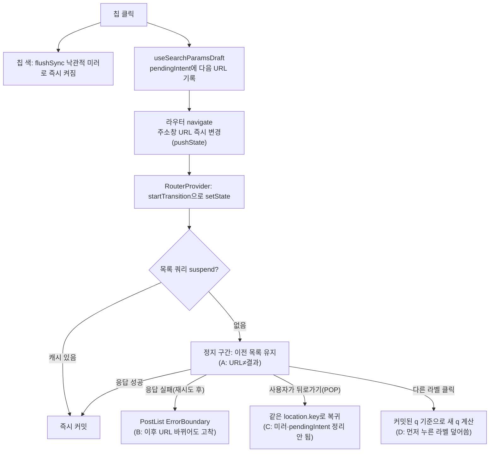

# 피드 검색 필터: 정지 구간 버그 3건 수정 (에러 고착·뒤로가기 칩 고착·라벨 연속 클릭 유실)

> 이 PR에서는 B·C·D 버그만 고친다. A(정지 구간의 로딩 표시)는 조사만 기록하고, 다음 단계에서 A1·A2를 미리보기로 비교한 뒤 별도 계획으로 진행한다.

## Context

사용자 제보: 검색 필터에서 라벨이나 "북마크한"을 눌렀을 때 URL은 바뀌었는데 검색 결과가 그대로인 경우가 가끔 있었다.
조사 결과, 제보한 증상 자체는 설계상 동작(A)이고, 비슷하게 보이는 실제 버그 3건(B·C·D)이 따로 있었다.
사용자는 B·C·D 수정을 선택했고, A는 업계 조사를 거쳐 "A1·A2를 나란히 미리보기"로 진행하기로 했다(2026-10-14 대화).

### 재현 절차 (2026-10-14, 운영 linksphere.click, Playwright `page.route`로 응답만 지연/실패 주입)

| 건  | 절차                                          | 관찰                                                                                                                          |
| --- | --------------------------------------------- | ----------------------------------------------------------------------------------------------------------------------------- |
| A   | `@디자인` 클릭, 응답 4초 지연                 | 0.2·1.5·3·3.9초 모두 URL `?q=@디자인`인데 첫 카드는 이전 목록 그대로, 5.5초에 교체. 지연을 넣지 않아도 0.3초 시점엔 이전 목록 |
| B   | `@DevOps` 응답만 503                          | 에러 문구 → 라벨 해제(`/post`)·다른 라벨(`@프론트엔드`)로 바꿔도 "포스트를 불러오는 중 오류가 발생했어요." 그대로             |
| C   | `@모바일` 클릭(3초 지연) → 0.5초 뒤 뒤로가기  | URL `/post`, 목록도 전체 목록인데 `@모바일` 칩은 계속 켜져 있음                                                               |
| D   | `@데이터` → 0.4초 뒤 `@라이프스타일`(지연 중) | 최종 `?q=@라이프스타일`, 칩도 하나만 남음                                                                                     |

A가 얼마나 자주·오래 생기는지(직접 측정: CloudWatch Logs Insights, `/aws/lambda/link-sphere-api`, 최근 7일 `REPORT` 8,198건):

- 콜드스타트 183건(2.2%), 콜드일 때 restore p50 660ms + 첫 요청 p90 2.0초
- 전체 p99 1.4초
- 단, 크롤링 cron 같은 백그라운드 호출이 섞인 수치다.

### 근본 원인

- **A**: `RouterProvider.tsx:21` `v7_startTransition: true`와 `useSuspenseInfiniteQuery`가 함께 쓰여서, 응답이 올 때까지 React가 이전 화면을 유지한다. 주소창은 라우터가 먼저 바꾼다. `docs/DECISIONS.md` 2026-09-14 항목에서 로딩 UI는 범위에서 뺐다.
- **B**: `PostList.tsx:29` `AsyncBoundary`에 `resetKeys`가 없다. react-error-boundary는 리셋 전까지 fallback을 유지한다.
- **C**: 뒤로가기(POP)는 같은 history 항목으로 돌아가므로 `location.key`도 같다. 그래서 두 곳이 정리되지 않는다.
  - `usePostListSearch.ts:48,75`의 렌더 중 미러 동기화: 커밋된 값이 한 번도 안 바뀌었으니 돌지 않는다.
  - `useSearchParamsDraft.ts:48`의 pending 폐기 effect도 돌지 않는다.
  - 코드 추적상, 이 때문에 다음 범위 칩 클릭 때 취소했던 필터가 되살아날 수 있다(추론, 실측 안 함).
- **D**: `usePostListSearch.ts:119` `toggleCategoryTagInSearch`가 pending이 아니라 커밋된 `searchQuery`로 새 q를 만들고, `setSearch`로 q를 통째로 덮어쓴다. 09-14 수정은 updater가 draft를 읽는 `toggleFilter`만 고쳤다.

## 판단이 필요했던 항목

| 항목                    | 결정                                                                                                                                                                          | 근거·기각한 대안                                                                                                                                                                                                                                                                                                                 |
| ----------------------- | ----------------------------------------------------------------------------------------------------------------------------------------------------------------------------- | -------------------------------------------------------------------------------------------------------------------------------------------------------------------------------------------------------------------------------------------------------------------------------------------------------------------------------- |
| 범위                    | B·C·D만 이 PR. A는 조사 결과만 SEARCH.md "남은 것"에 기록                                                                                                                     | 사용자 선택. A는 §9에 따라 미리보기 승인이 먼저다                                                                                                                                                                                                                                                                                |
| B: 리셋 방법            | `AsyncBoundary`에 선택 prop `resetKeys` 추가 + 목록 파라미터(q·filter·hideBots)를 키로, `onReset`에 `useQueryErrorResetBoundary().reset`                                      | **기각: 목록을 `key`로 리마운트** — DECISIONS.md(가상화 리마운트 항목)에서 이미 기각(스켈레톤 깜빡임, 스냅샷 복원 충돌). **reset을 같이 거는 이유**: 안 걸면 실패했던 같은 키로 돌아왔을 때 TanStack이 `retryOnMount=false`로 막아 다시 에러가 난다(선례: `App.tsx`의 `QueryErrorResetBoundary`+`onReset`)                       |
| B: AsyncBoundary 수정   | 선택 prop 추가만(기존 사용처는 동작 불변)                                                                                                                                     | CLAUDE.md "시그니처 변경 금지"에 해당하는지 경계선이다. 기존 호출부는 바뀌지 않는 추가형 prop이라 진행하고, 최종 보고에 명시한다                                                                                                                                                                                                 |
| C: 뒤로가기 신호        | 라우터 구독(`router.subscribe`)을 주입받는 공용 모듈 `RouterEvents.onPop`                                                                                                     | **기각: raw `popstate` 리스너** — DECISIONS.md 뒤로가기 정책의 "금지 사항"에 "raw `popstate` 리스너 의존"이 있다. **기각: `useLocation`/`useNavigationType` 변화 감지** — 초기 진입(POP) 후 POP으로 돌아오면 key·type이 모두 같아 신호가 없다. 주입 방식 선례: `shared/lib/router/navigation.ts` `NavigationService.setNavigate` |
| C: POP 때 pendingIntent | 비운다(null)                                                                                                                                                                  | 대안은 "되돌아간 URL로 갈아끼우기". 그게 더 나은 경우는 "로딩 중 오버레이를 열고 닫은 뒤 다른 칩 클릭"이라는 1초 미만 창 안의 4단계 조합뿐이라, 단순한 쪽을 택한다(§2)                                                                                                                                                           |
| D: 계산 위치            | `usePostListParams`에 `toggleSearchTag(tag)` 신설. `updateSearchParams` updater 안에서 `draft.get('q')`로 토글하고 결과 q를 반환한다. `setSearch`는 쓰는 곳이 없어지므로 제거 | 09-14 `toggleFilter`와 같은 형태(draft 기준)다. 칩 미러는 반환된 q로 `flushSync` 갱신(순서: navigate → flushSync). 미러가 즉시 켜지는지는 테스트로 고정한다                                                                                                                                                                      |

## 세부 계획

| 위치                                                       | 변경 내용                                                                                                                                                                                                                                                                                                                                                                                |
| ---------------------------------------------------------- | ---------------------------------------------------------------------------------------------------------------------------------------------------------------------------------------------------------------------------------------------------------------------------------------------------------------------------------------------------------------------------------------- |
| `src/shared/ui/elements/AsyncBoundary.tsx`                 | `resetKeys?: unknown[]` 선택 prop을 받아 `ErrorBoundary`에 전달. JSDoc 한 줄                                                                                                                                                                                                                                                                                                             |
| `src/widgets/post/post-list/hooks/usePostList.ts`          | (1) `usePostListParams`에 `toggleSearchTag(tag): string` 추가, `setSearch` 제거. (2) 신규 export `usePostListErrorReset()` → `{ resetKeys: [searchQuery, currentFilter, hideBots], onReset: reset }`(`useQueryErrorResetBoundary`, hooks/ 안이라 린트 허용)                                                                                                                              |
| `src/widgets/post/post-list/ui/PostList.tsx`               | `usePostListErrorReset()` 호출 → `AsyncBoundary`에 `resetKeys`·`onReset` 전달                                                                                                                                                                                                                                                                                                            |
| `src/shared/lib/router/router-events.ts` (신규)            | `RouterEvents.setSource(router)`: `router.subscribe`를 1회 구독(재호출 시 이전 구독 해제), location이 바뀌고 `historyAction === 'POP'`이면 리스너 호출. `RouterEvents.onPop(listener) → unsubscribe`, 테스트용 `resetRouterEvents()`. 타입은 react-router-dom의 `Location`·`NavigationType`로 최소 구조 타입을 선언한다(`@remix-run/router` 직접 import 금지 — check:deps 미선언 패키지) |
| `src/app/providers/RouterProvider.tsx`                     | `NavigationService.setNavigate` 옆에 `RouterEvents.setSource(router)`                                                                                                                                                                                                                                                                                                                    |
| `src/shared/hooks/useSearchParamsDraft.ts`                 | effect로 `RouterEvents.onPop(() => { pendingIntent = null; })` 구독. 모듈 주석에 POP 처리 한 줄                                                                                                                                                                                                                                                                                          |
| `src/widgets/post/post-list/hooks/usePostListSearch.ts`    | (1) effect로 `RouterEvents.onPop(location => …)` 구독해 `optimisticFilters`·`optimisticCategoryTags`를 되돌아간 URL로 맞춘다(react.dev "Synchronizing with Effects" 이벤트 구독 링크를 주석에). (2) `toggleCategoryTagInSearch`를 `toggleSearchTag('@'+label)` → `flushSync(미러 갱신)`으로 교체                                                                                         |
| `src/test/setup.ts`                                        | afterEach에 `resetRouterEvents()`                                                                                                                                                                                                                                                                                                                                                        |
| `src/widgets/post/post-list/hooks/usePostList.test.tsx`    | 시나리오 추가: (D) 로딩 중 라벨 2개 연속 클릭 → 두 칩 즉시 활성 + 최종 q에 둘 다. (C) `createMemoryRouter`+`RouterProvider`(v7_startTransition)+`RouterEvents.setSource`로 칩 클릭(게이트 대기) → `router.navigate(-1)` → 칩 꺼짐, 이어서 "내가 작성한" 클릭 → `filter=isMyPosts`만, q 없음                                                                                              |
| `src/widgets/post/post-list/ui/PostList.test.tsx` (신규)   | (B) 라벨 요청 500 → 에러 문구 → 라벨 해제 시 에러 해제 + 목록/빈 상태 렌더 → 같은 라벨을 다시 누르면(핸들러 성공으로 교체) 재요청돼 결과 표시                                                                                                                                                                                                                                            |
| `docs/SEARCH.md`                                           | §5 다이어그램·본문의 `setSearch` → `toggleSearchTag`, §6 `pendingIntent` 행에 "POP이면 폐기", §8 코드 지도 행 추가, §10 시행착오에 이번 제보·재현·B/C/D 원인, §11 남은 것에 A 조사 결과(§10 인용 형식, 번역)와 "A1·A2 미리보기 후 결정", 마지막 검토 날짜                                                                                                                                |
| `docs/POST.md:169` 부근                                    | PostList 에러 상태가 검색 조건이 바뀌면 풀린다는 서술 추가, 줄 번호 갱신                                                                                                                                                                                                                                                                                                                 |
| `CHANGELOG.md`                                             | `[Unreleased]` Fixed 3건(changelog-release skill 형식)                                                                                                                                                                                                                                                                                                                                   |
| `docs/plans/2026-10-14-post-filter-pending-bugs.md` (신규) | 이 계획 스냅샷(§11)                                                                                                                                                                                                                                                                                                                                                                      |

## 영향 범위 (§5)

**CRUD**: 쓰기 없음. 목록 조회만 영향을 받는다.

- B 이후 에러 → 조건 변경 시 새 키로 재조회(스켈레톤은 `DelayedFallback` 500ms 뒤)
- 같은 키로 돌아오면 `reset`으로 재요청
- 페이지네이션·카운트 변화 없음

**기존 기능 회귀 후보** (`pnpm graph:focus --text` 실측):

- `AsyncBoundary.tsx` ← `PostDetailPage.tsx`, `CommentList.tsx`, `MyCommentList.tsx`, `PostList.tsx`(+`App.tsx`). 선택 prop이라 미사용처는 동작 불변
- `useSearchParamsDraft.ts` ← `useBookmarkPage.ts`, `useBookmarkSearch.ts`, `useNavbarSearch.ts`, `NavbarSearch.tsx`, `usePostCard.ts`, `usePostList.ts`. POP 때 pending이 비워지는 것 외에는 불변이다. 북마크는 suspense가 아니라 pending 창이 거의 없다
- `usePostList.ts` ← `usePostListSearch.ts`, `PostList.tsx`. `setSearch` 제거로 반환 객체에서 빠지지만 다른 소비처는 없다(grep 확인)
- 테스트:
  - `useSearchParamsDraft.test.tsx`: MemoryRouter라 POP 소스가 없어 불변
  - `usePostList.test.tsx` 시나리오 B: 라벨+범위 칩 누적. `toggleSearchTag` 경로로 계속 통과해야 함
  - `PostListSearch.test.tsx` "외부 변경 동기화": 렌더 중 동기화 유지
- 문서: SEARCH.md의 `setSearch` 서술(§5), POST.md:169. DECISIONS.md는 append-only라 손대지 않음

## 검증 방법

1. 워크트리:
   - `git log origin/main..main`이 비었음을 확인했다(2026-10-14).
   - `EnterWorktree` 후 `cp ../../../.env . && pnpm install`, `node -v` v24 확인.
2. `pnpm type-check` → `pnpm test`(신규 B·C·D 테스트 포함) → `pnpm lint` → `pnpm check:deps` → `pnpm check:docs`.
3. 브라우저 검증(browser-verification skill, 녹화):
   - 로컬 dev에서 이 세션과 같은 Playwright `page.route` 지연/실패 주입으로 재현표 4건을 다시 돌린다.
   - B 복구, C 칩 꺼짐, D 두 라벨 유지, A는 그대로(의도)를 확인한다.
   - D는 클릭 0.2초 시점에 두 칩이 모두 켜지는지도 본다(미러 순서 확인).
4. §11: 커밋한 계획 파일과 diff를 fresh general-purpose 서브에이전트에 대조시켜, PR 본문 `## 계획 대비 구현`에 반영한다.
5. squash 병합 후 `gh run list --branch main --workflow "Frontend Deploy (S3 + CloudFront)"`로 해당 SHA가 success인지 확인한 뒤 보고한다.

## 남은 것

- **A 로딩 표시**: 이 PR 병합 후 A1(필터 카드 스피너, 늦을 때만)·A2(목록 흐리게+스피너)를 실제 Tailwind 클래스·토큰으로 만든 미리보기 페이지에 나란히 올린다. 사용자가 고르면 별도 계획·PR로 진행한다.
  - A2는 이 PR의 `RouterEvents`를 "최신 위치 구독"으로 넓혀 재사용할 수 있다.
  - 결정 근거(NN/g·React·Primer·Polaris·Carbon·Baymard)는 그때 DECISIONS.md에도 남긴다(대안 비교가 있으므로).
- 이번 수정 대상이 아닌 같은 계열: 헤더 검색창(`useNavbarSearch`)도 로딩 중 뒤로가기 시 입력값이 남는다. 사용자가 직접 타이핑한 값이라 그대로 둔다.
