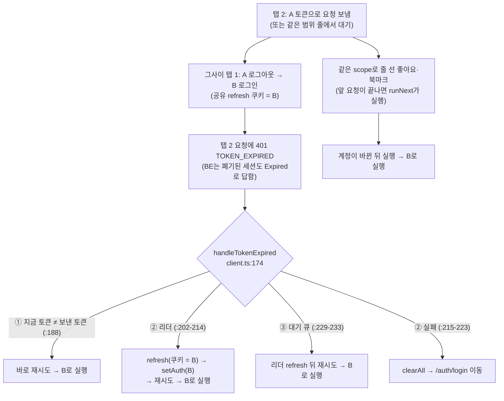
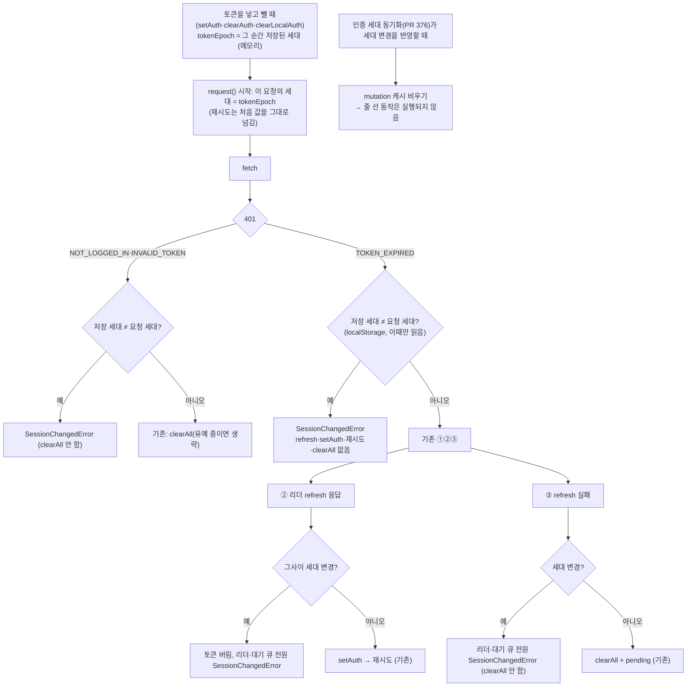

# 계정이 바뀐 순간 진행 중이던 요청이 새 계정으로 재실행되는 문제 수정

> 요약: 요청마다 "이 탭 토큰이 속한 인증 세대"를 기억해 두고, 401을 받았을 때 저장된 세대가 달라져 있으면
> (다른 탭·같은 탭의 명시적 로그인·로그아웃) 갱신·재시도·로그인 화면 이동 없이 전용 에러로 끝낸다. 세대가
> 바뀔 때 줄 서 있던 mutation도 버린다. PR 1개.

## Context

### 계기

2026-10-14 캐시 전략 후속 작업(#376 인증 세대 동기화)의 설계 검토에서 찾은 **기존** 결함이다. `docs/AUTH.md`
§11-10에 "범위 밖, 별도 판단"으로 남겼고, 사용자가 "진행해 1번"으로 요청했다.

### 무엇이 문제인가 (코드 추적, `origin/main`)

- BE `MemberSessionService.checkAccessToken`: 폐기된(`revokedAt`) 세션의 access 토큰도 `Expired`로 응답한다 —
  다른 탭의 refresh 회전을 조용히 회복시키려는 의도. 주석은 _"진짜 로그아웃이면 refresh 쿠키도 함께 죽어 결국
  로그인 화면으로 수렴"_ 을 가정하지만, 그 사이 새 로그인이 있으면 쿠키는 새 계정의 것이라 refresh가 성공한다.
- 결과: A가 누른 좋아요·댓글 등이 **B 계정으로 실행**된다. #376이 다른 탭의 변화를 즉시 반영해 구간을 줄였지만
  없애지 못했다.
- 같은 탭 로그아웃도 ②실패 경로에 걸릴 수 있다(추정, 재현 테스트로 확인): 진행 중이던 요청이 `TOKEN_EXPIRED` →
  refresh(쿠키 없음) 실패 → `clearAll()`이 `/post`로 옮겨진 사용자를 `/auth/login`으로 다시 보낸다.
- 이 탭의 인라인 로그인 직전에 비로그인으로 보낸 요청이 로그인 뒤 `NOT_LOGGED_IN`으로 돌아오면 `:307`의
  `clearAll()`이 방금 한 로그인을 지운다(설계 검토에서 발견, 재현 테스트로 확인).

## 설계

### 판단이 필요했던 항목

| 항목                   | 결정                                                                                                                                                                                                                                                                                                                                                                       | 근거·기각한 대안                                                                                                                                                                                                                                                                                                                                                                                                                                                                  |
| ---------------------- | -------------------------------------------------------------------------------------------------------------------------------------------------------------------------------------------------------------------------------------------------------------------------------------------------------------------------------------------------------------------------- | --------------------------------------------------------------------------------------------------------------------------------------------------------------------------------------------------------------------------------------------------------------------------------------------------------------------------------------------------------------------------------------------------------------------------------------------------------------------------------- |
| 요청의 세대를 무엇으로 | **이 탭 토큰이 속한 세대**(`AuthEpochUtil`의 메모리 `tokenEpoch`). 토큰을 넣고 뺄 때(`setAuth`·`setAccessToken`·`clearAuth`·`clearLocalAuth`) 그 순간의 저장 세대로 맞춘다. 401일 때만 localStorage의 저장 세대와 비교                                                                                                                                                     | **기각: 요청 시작 때 localStorage를 읽기** — 다른 탭이 세대를 쓴 직후~이 탭이 맞추기 전(#376 받아들이기 refresh 대기 포함)에 시작한 요청이 "새 세대 + 옛 토큰"으로 잡혀 원래 버그가 남는다(설계 검토 지적). **기각: 메모리 카운터만** — 다른 탭 변화를 storage 이벤트 처리 전에는 모른다. 토큰을 넣을 때마다 맞춰도 안전한 이유: 계정이 바뀔 수 있는 `setAuth`(client.ts의 회전)는 아래 C2 확인을 통과해야만 불리고, 통과했다면 저장 세대가 요청 세대와 같아 맞춰도 값이 그대로다 |
| #376과의 관계          | #376의 "세대 **쓰기**는 호출부에서만"은 그대로. 이번 것은 저장값을 **읽어 메모리에 기억**만 한다                                                                                                                                                                                                                                                                           | 쓰기를 `setAuth`에 넣으면 토큰 갱신마다 세대가 바뀐다(#376이 기각한 것)                                                                                                                                                                                                                                                                                                                                                                                                           |
| 바뀌었을 때 결과       | 전용 에러 `SessionChangedError`(`common.type.ts`, `NetworkError`와 같은 형태)로 reject. 대기 큐 전원도 함께                                                                                                                                                                                                                                                                | **기각: 영원히 pending** — 공개 경로 반영(`clearQueries`)은 mutation 캐시를 안 비워 같은 scope의 다음 요청을 막고 낙관적 업데이트도 롤백되지 않는다                                                                                                                                                                                                                                                                                                                               |
| 줄 서 있던 mutation    | #376 동기화가 세대 변경을 반영할 때(이 탭 로그아웃 처리·받아들이기 모두) mutation 캐시를 비운다 — 줄 선 동작은 실행되지 않는다                                                                                                                                                                                                                                             | 앞 요청이 끝나면 `runNext`가 같은 scope 목록에서 다음을 꺼내는데(query-core `mutationCache.ts:177-186`), `clear()`가 그 목록을 비운다(`:190-196`). **기각: 클릭 때 세대를 variables에 실어 mutationFn마다 확인** — scope mutation 6곳을 모두 고쳐야 한다                                                                                                                                                                                                                          |
| 토스트                 | `SessionChangedError` 판정을 `meta.errorMessage`보다 먼저. 로그아웃 유예 중(`LogoutGraceUtil`, 같은 탭 로그아웃·다른 탭 로그아웃 반영 모두 켜짐)이면 조용히, 조회는 조용히, 그 밖의 mutation은 _"로그인 상태가 바뀌어서 처리되지 않았어요. 다시 시도해 주세요."_(새 TEXTS 키). `manualErrorHandling` mutation(댓글·글 작성, 계정 수정 등)은 각자 실패 문구를 그대로 띄운다 | 결과적으로 새 문구는 "다른 탭에서 같은 사람이 다시 로그인해 이 탭이 받아들인" 경우에만 보인다 — 로그아웃 반영 경로는 유예로 조용하다. 문구는 "보내지 않았어요"가 아니라 "처리되지 않았어요"(보냈지만 거절됨 — 설계 검토 지적). 수동 처리 mutation 7곳에 분기를 넣는 건 범위 밖                                                                                                                                                                                                    |
| 재시도 정책            | `SessionChangedError`는 쿼리 재시도 안 함(`retry-policy.ts`)                                                                                                                                                                                                                                                                                                               | 다시 보내도 같은 결과 — 동기화가 새 인증으로 다시 불러온다                                                                                                                                                                                                                                                                                                                                                                                                                        |
| 감수하는 것            | 다른 탭에서 **같은 계정으로** 다시 로그인한 순간 진행 중이던 요청도 실패로 끝난다(지금은 A로 회복됨)                                                                                                                                                                                                                                                                       | 토큰이 불투명해 A→A와 A→B를 가릴 수 없다(BE `checkAccessToken`은 해시로만 조회). 사용자가 다시 누르면 된다                                                                                                                                                                                                                                                                                                                                                                        |
| 세대 키가 없는 사용자  | null = null이면 "안 바뀜" → 기존 동작                                                                                                                                                                                                                                                                                                                                      | 첫 명시적 로그인·로그아웃부터 보호된다(#376과 같은 전제)                                                                                                                                                                                                                                                                                                                                                                                                                          |

## 세부 계획 (PR 1개, `fix(auth)`)

| 위치                                                                    | 변경                                                                                                                                                                                                                                                                                                                                                                                                                        |
| ----------------------------------------------------------------------- | --------------------------------------------------------------------------------------------------------------------------------------------------------------------------------------------------------------------------------------------------------------------------------------------------------------------------------------------------------------------------------------------------------------------------- |
| `src/shared/utils/auth-epoch.util.ts` + 테스트                          | `current()`(저장값), 메모리 `tokenEpoch`와 `tokenEpoch()`·`bindToken()`(지금 저장값으로 맞춤). `markLogin`/`markLogout`도 다시 읽은 값으로 맞춤. `reset()`에 포함                                                                                                                                                                                                                                                           |
| `src/shared/store/auth.store.ts`                                        | `setAuth`·`setAccessToken`·`clearAuth`·`clearLocalAuth`가 상태를 바꾼 뒤 `AuthEpochUtil.bindToken()`                                                                                                                                                                                                                                                                                                                        |
| `src/shared/types/common.type.ts`                                       | `SessionChangedError`                                                                                                                                                                                                                                                                                                                                                                                                       |
| `src/shared/api/client.ts`                                              | `request()`가 세대를 받거나 `tokenEpoch()`로 잡아 재시도에 그대로 넘김. C1(TOKEN_EXPIRED 진입)·C2(refresh 응답 뒤)·C4(refresh 실패)·C5(NOT_LOGGED_IN/INVALID_TOKEN). 대기 큐를 `{재시도, 취소}` 쌍으로 바꿔 C2·C4에서 전원 취소. try 안에서 던진 `SessionChangedError`는 catch에서 그대로 다시 던짐                                                                                                                         |
| `src/shared/utils/auth.util.ts`                                         | 세대 변경 반영 때 쓰는 mutation 캐시 비우기(공개 경로 분기에도 적용, 보호 경로는 이미 비움)                                                                                                                                                                                                                                                                                                                                 |
| `src/entities/auth/hooks/useAuthEpochSync.ts`                           | 받아들이기(adopt) 시작 때도 mutation 캐시 비우기                                                                                                                                                                                                                                                                                                                                                                            |
| `src/shared/lib/react-query/config/error-toast.ts` + 테스트             | 위 토스트 결정                                                                                                                                                                                                                                                                                                                                                                                                              |
| `src/shared/lib/react-query/config/retry-policy.ts` + 테스트            | 재시도 안 함                                                                                                                                                                                                                                                                                                                                                                                                                |
| `src/shared/config/texts.ts`                                            | `messages.error.sessionChanged`(`texts-conventions` skill 확인)                                                                                                                                                                                                                                                                                                                                                             |
| `src/shared/api/client.test.ts`                                         | Case 7: ① 바뀐 토큰 + 세대 변경 → 재시도 없음 / C1 → refresh 0회·`setAuth` 없음 / C2 → 토큰 버림, 리더·대기 요청 전원 `SessionChangedError` / C4 → `clearAll` 없음 / 같은 탭 로그아웃 중 진행 요청 → `/auth/login` 이동 없음(먼저 지금 코드로 재현) / 인라인 로그인 직전 비로그인 요청의 `NOT_LOGGED_IN` → 로그인 유지(먼저 재현) / 받아들이기 대기 중 옛 토큰 요청 → 재실행 없음 / 세대 그대로면 Case 1-x·2-x 그대로(기존) |
| `src/entities/auth/hooks/useAuthEpochSync.test.tsx`·`auth.util.test.ts` | 세대 변경 반영 때 줄 선 mutation이 실행되지 않음                                                                                                                                                                                                                                                                                                                                                                            |
| `docs/AUTH.md`                                                          | §8-B에 세대 확인, §8-H 연결, §6 `tokenEpoch` 행, §11-10 해소, 마지막 검토                                                                                                                                                                                                                                                                                                                                                   |
| `CHANGELOG.md`                                                          | Fixed 1항목                                                                                                                                                                                                                                                                                                                                                                                                                 |

## 영향 범위 (§5)

**CRUD 실패 지점**: 서버 데이터·API 계약 변경 없음. 바뀌는 것은 "다른 계정으로 실행되던 요청이 실행되지 않는 것".

- 생성·수정·삭제: 세대가 바뀐 순간 진행 중이던 것과 줄 서 있던 것은 실행되지 않는다(롤백, 위 토스트 규칙).
- 조회: 조용히 실패하고 #376 동기화가 새 인증으로 다시 불러온다.

**기존 기능 회귀 후보**

- **정상 토큰 갱신·다른 탭 회전 회복**(Case 1·1-1·1-2·1-3): 세대가 안 바뀌어 그대로 — 기존 테스트가 고정.
- **refresh 실패 → 로그인 화면**(Case 2·2-1)·**세션 무효 → 로그인 화면**(Case 3·4): 세대가 안 바뀌면 그대로.
- **토큰을 넣는 모든 경로**: 로그인(`auth.queries.ts`, `setAuth` 뒤 `markLogin`), 앱 시작 복원(`useAuth.restoreAuth`),
  비밀번호 변경(`auth.queries.ts`), 회전(`client.ts`), 받아들이기(`useAuthEpochSync`) — 모두 `setAuth`를 거쳐
  `tokenEpoch`가 맞춰진다. 하나라도 빠지면 그 탭은 다음 만료부터 갱신이 막히므로, 스토어 액션 안에서 맞춘다.
- **mutation 캐시 비우기**: 세대 변경 반영 때만. 진행 중 mutation의 promise·전역 onError는 그대로 돈다
  (query-core가 캐시 참조를 들고 있음).
- `client.ts`·`auth.store.ts`는 거의 모든 기능이 import — 동작 변화는 401 + 세대 변경일 때와 세대 변경 반영
  순간뿐이다(`pnpm graph:focus`로 사용처 확인).
- `src/test/setup.ts`의 `AuthEpochUtil.reset()`이 `tokenEpoch`도 비운다.

## 검증 방법

- 단위: 위 Case 7과 동기화·유틸·토스트·재시도 테스트, 기존 `client.test.ts` 전부.
- e2e(`e2e/auth-tab-sync.spec.ts`): 탭 B의 요청 응답을 늦춰 둔 사이 탭 A에서 로그아웃·다른 계정 로그인 →
  그 요청이 `TOKEN_EXPIRED`를 받아도 `/auth/refresh` 호출·원래 요청 재전송이 없는지 요청 기록으로 단정.
- `pnpm type-check`·`pnpm test`·`pnpm lint`·`pnpm check:deps`·`pnpm check:docs`, fresh 서브에이전트 계획 대조.

## 남은 것

- 세대가 바뀐 순간 진행 중이던 요청이 **401 없이 성공**한 경우는 A가 실제로 한 동작이라 정상이다.
- 서버 쪽 보완(요청에 "보낸 세션" 표식을 실어 BE가 다른 계정 쿠키로의 갱신 뒤 재시도를 거부)은 BE 계약 변경이라
  다루지 않는다.
