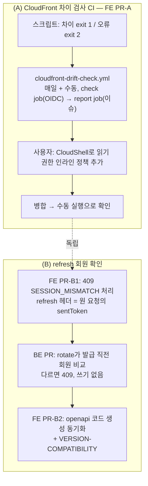

# 남은 두 가지: CloudFront 차이 검사를 CI로, refresh 때 BE가 다른 계정 갱신을 거절

> 요약: (A) 로컬에서만 돌던 `check:cloudfront`를 매일 도는 GitHub Actions 워크플로로 옮기고 차이가 있으면 이슈를
> 연다 — 배포 역할에 읽기 권한 7개를 사용자가 CloudShell로 추가한다. (B) refresh 요청의 `X-Access-Token`(원 요청이
> 보낸 토큰)과 refresh 쿠키의 회원이 다르면 BE가 새 토큰을 발급하지 않고 409 `SESSION_MISMATCH`로 답하고, FE는
> 그 탭만 로그아웃한다. PR 4개(FE A → FE B1 → BE → FE B2).

## 0. 현재 상황

### 계기

#381 마무리 보고의 "나중에 할 수 있는 것" 두 가지를 사용자가 "진행"으로 요청했다(2026-10-15).

### (A) CloudFront 차이 검사 — 사실

- `scripts/check-cloudfront-drift.js`는 AWS CLI로 읽기 호출 7종을 한다: `cloudfront:ListDistributions`(L38)·
  `GetDistributionConfig`(L149)·`GetCachePolicy`(L60)·`GetOriginRequestPolicy`(L69)·`DescribeFunction`(L99)·
  `GetFunction`(L85)·`wafv2:GetWebACL`(L133, us-east-1). 배포 ID는 별칭으로 찾아 시크릿이 필요 없다.
- 차이와 AWS 오류가 **둘 다 exit 1**이라(L203-213) CI가 구분하지 못한다.
- `docs/plans/2026-10-14-cache-strategy-followups.md:208`에 적은 필요 권한 목록은 틀렸다(`DescribeFunction` 빠짐,
  쓰지 않는 `ListWebACLs` 포함). 그 계획서는 append-only라 고치지 않고 이번 계획과 DEPLOY.md에 바른 목록을 적는다.
- 배포 역할 `link-sphere-fe-deploy`의 신뢰 조건은 `repo:BAECHAN/link-sphere_FE_NEW:ref:refs/heads/main`뿐(IAM
  ListRoles로 확인) → PR CI에선 못 맡고, main의 예약·수동 실행만 된다.
- 로컬 키 `link-sphere-user`는 `iam:ListRolePolicies`조차 거부된다(실측) → 역할 권한은 **사용자가 CloudShell로**
  추가한다(`docs/plans/2026-10-13-github-oidc-aws.md` 부록 A와 같은 방식).
- 선례: FE `openapi-drift-check.yml`(매일 cron + 수동, 차이면 라벨 이슈 열고 해소되면 닫음), BE
  `prod-alias-drift-check.yml`(배포와 같은 OIDC 역할에 조회 권한 추가, 6시간 cron). `issues: write`는 AWS 자격증명을
  다루는 job과 분리한다(`docs/DEPLOY.md:105-107`, `deploy.yml`의 `notify-failure`).

### (B) refresh 회원 확인 — 사실 (BE는 GitHub main e068b5d 기준)

- `POST /auth/refresh`는 쿠키만 읽는다(`AuthController.kt:81-88`). FE는 refresh에도 지금 토큰을 `X-Access-Token`에
  싣는다(`isAuthEndpoint`가 refresh를 제외하지 않음, `client.ts:143-166`).
- `MemberSessionService.rotate`(`:99-131`): 조회 → 만료 확인 → `consumeRefreshIfActive`(조건부 UPDATE, `:110`) →
  0행이면 재사용 유예/탐지(`revokeFamily`는 REQUIRES_NEW) → `issueInFamily`(`:130`).
- `findByAccessTokenHash`는 만료·폐기와 상관없이 행을 돌려주고, 세션 행은 지워지지 않는다 → 만료된 토큰으로도 회원을
  알 수 있다. 회전 실패는 일부러 `INVALID_REFRESH_TOKEN` 하나로 통일한다(`:50-54`).
- #381 뒤에 남은 틈: ① 업데이트 전 번들로 열린 탭(세대를 안 씀) ② localStorage 쓰기 실패 ③ **새로 찾음**: #376의
  "새 세션 받아들이기"(`useAuthEpochSync.ts`, 토큰을 든 살아 있는 탭이 다른 탭의 로그인을 받으면 이동 없이 쿠키 세션을
  받아들임)는 같은 사람이라고 가정한다 — 다른 계정이면 화면·폼을 그대로 둔 채 조용히 그 계정이 된다.

## 1. 전체 계획

## 2. 세부 계획

### (A) FE PR-A `ci(infra)` — CloudFront 차이 검사를 매일 CI로

| 위치                                                 | 변경                                                                                                                                                                                                                                                                                                                                                                                                                                                                                                                            |
| ---------------------------------------------------- | ------------------------------------------------------------------------------------------------------------------------------------------------------------------------------------------------------------------------------------------------------------------------------------------------------------------------------------------------------------------------------------------------------------------------------------------------------------------------------------------------------------------------------- |
| `scripts/check-cloudfront-drift.js`                  | 차이는 exit 1, AWS·설정 오류는 exit 2로 나눈다. 머리 주석의 "로컬에서만" 서술 갱신                                                                                                                                                                                                                                                                                                                                                                                                                                              |
| `.github/workflows/cloudfront-drift-check.yml`(신규) | `schedule` 매일 1회(UTC, openapi 검사와 다른 시각) + `workflow_dispatch`. **check job**(`id-token: write`·`contents: read`): checkout → setup-node(`.nvmrc`) → `configure-aws-credentials`(배포와 같은 SHA·`secrets.AWS_ROLE_ARN`) → 스크립트 실행, 출력은 `$GITHUB_STEP_SUMMARY`에도, exit 1이면 `drift=true`, exit 2면 job 실패. **report job**(`issues: write`, AWS 없음): 라벨 `cloudfront-drift`로 차이면 이슈 열기(이미 열려 있으면 생략, 본문에 실행 링크), 해소면 닫기 — BE `prod-alias-drift-check.yml`의 gh 스텝 형태 |
| `docs/DEPLOY.md`                                     | "CloudFront 설정 스냅샷과 차이 검사" 절: 로컬 전용 → 매일 CI + 이슈, IAM 권한 표에 읽기 정책 추가, **CloudShell 스크립트**(별도 인라인 정책 `cloudfront-drift-read`로 넣어 기존 `deploy` 정책을 덮어쓰지 않음. 계정 ID는 `sts get-caller-identity`로 구함)                                                                                                                                                                                                                                                                      |
| `CHANGELOG.md`                                       | Changed `infra` 1항목                                                                                                                                                                                                                                                                                                                                                                                                                                                                                                           |

- 읽기 정책: `cloudfront:GetDistributionConfig`(그 배포)·`GetCachePolicy`·`GetOriginRequestPolicy`·`DescribeFunction`·
  `GetFunction`(function/_)·`ListDistributions`(`_`— 목록 API라 리소스 지정 불가),`wafv2:GetWebACL`(us-east-1 global
  webacl/\*). 모두 읽기.
- 오탐이 날 수 있는 때: `spa-fallback.js`를 고친 PR이 병합되고 Function을 수동 배포하기 전(`docs/DEPLOY.md:457-460`)
  — 이 경우 이슈는 "수동 배포하라"는 알림으로 맞다.

### (B-1) FE PR-B1 `fix(auth)` — 불일치 응답 처리 (BE보다 먼저 배포)

| 위치                                          | 변경                                                                                                                                                                                                                                                                                                                                                                                                                                                                                |
| --------------------------------------------- | ----------------------------------------------------------------------------------------------------------------------------------------------------------------------------------------------------------------------------------------------------------------------------------------------------------------------------------------------------------------------------------------------------------------------------------------------------------------------------------- |
| `src/shared/config/error-code.ts`             | `SESSION_MISMATCH`                                                                                                                                                                                                                                                                                                                                                                                                                                                                  |
| `src/shared/api/client.ts`                    | ① 리더의 refresh 호출(`:234`)에 원 요청의 `sentToken`을 `X-Access-Token`으로 명시(로컬 로그아웃 뒤 늦게 온 401이 헤더 없이 갱신돼 새 계정으로 재실행되는 구멍 차단). ② 리더 catch: 세대 분기 다음에 `SESSION_MISMATCH`면 — 지금 토큰이 `sentToken`과 같을 때만 `AuthUtil`의 불일치 반영을 1번 → 대기 요청 전원 `SessionChangedError` 취소 → `SessionChangedError` throw(clearAll 없음). ③ `:158-166` 주석("refresh는 헤더를 안 읽어 무해") 갱신                                     |
| `src/shared/utils/auth.util.ts`               | 불일치 반영 함수: `applySignOutFromElsewhere()`(이 탭 토큰만 지움, 보호 경로면 `/post`, 공유 세션 플래그는 남김 → 새로고침하면 쿠키 주인 계정으로 복원) + 안내 토스트 1번(중복 방지 id). **이 탭에서 바로 새 계정으로 바꾸지 않는다** — 세대가 안 바뀌어 C1·줄 선 mutation 확인이 못 막아, 옛 토큰으로 나간 늦은 401이 `:217`로 새 계정 재시도된다(Plan 검토 H2)                                                                                                                    |
| `src/entities/auth/hooks/useAuthEpochSync.ts` | 받아들이기(adopt) 실패 원인이 `SESSION_MISMATCH`면 로그아웃 처리 후 `adoptSessionFromCookie(…, clearLocalAuth)`로 쿠키 주인 계정 복원(두 번째 refresh엔 토큰이 없어 헤더 없음) + 안내 토스트 — 지금 bfcache "엄격" 분기와 같은 동작. 세대가 바뀐 경로라 기존 요청은 C1·줄 확인이 막는다                                                                                                                                                                                             |
| `src/shared/config/texts.ts`                  | 안내 문구 2개(로그아웃만 / 계정이 바뀜) — `texts-conventions` skill                                                                                                                                                                                                                                                                                                                                                                                                                 |
| 테스트                                        | `client.test.ts` Case 8: 409 → SessionChangedError·로그인 이동 없음·토큰 null·세션 플래그 유지·보호 경로면 `/post` / 대기 요청 reject / refresh 헤더 = sentToken / **로컬 로그아웃 뒤 늦은 401이 새 계정으로 재실행되지 않음(지금 코드로 먼저 재현)** / 세대도 바뀐 경우는 기존 분기. "요청 헤더" 그룹에 refresh 헤더 고정. `useAuthEpochSync.test.tsx`: 헤더 있으면 409·없으면 200 MSW로 다른 계정 → 이동 후 새 토큰, 같은 계정 → 그대로. `e2e/auth-tab-sync.spec.ts` +1(가능하면) |
| `docs/AUTH.md`                                | §8-B(불일치 분기·mermaid), §8-C(부트스트랩 refresh엔 헤더 없음), §8-H(adopt 실패 분기), §9 Case 8, §11-2("이제 BE가 헤더를 읽는다 — refresh를 `isAuthEndpoint`에 넣지 말 것"), §11-10(서버 보완 해소, #381 감수 사항 완화는 보류 사유와 함께 기록)                                                                                                                                                                                                                                  |
| `CHANGELOG.md`·`docs/plans/`                  | Fixed 1항목("BE 배포 후 동작"), 이 계획 스냅샷                                                                                                                                                                                                                                                                                                                                                                                                                                      |

### (B-2) BE PR `feat(auth)` — refresh 회원 확인

| 위치                                                 | 변경                                                                                                                                                                                                                                                                                                                                                                                                                                                                                                                                                                                               |
| ---------------------------------------------------- | -------------------------------------------------------------------------------------------------------------------------------------------------------------------------------------------------------------------------------------------------------------------------------------------------------------------------------------------------------------------------------------------------------------------------------------------------------------------------------------------------------------------------------------------------------------------------------------------------- |
| `global/exception/SessionMismatchException.kt`(신규) | RuntimeException(롤백에 기대므로)                                                                                                                                                                                                                                                                                                                                                                                                                                                                                                                                                                  |
| `GlobalExceptionHandler.kt`                          | 409 `SESSION_MISMATCH` — 선례 `COMMENT_DELETED`·`CONCURRENT_UPDATE`                                                                                                                                                                                                                                                                                                                                                                                                                                                                                                                                |
| `MemberSessionService.kt`                            | `rotate(raw, accessTokenHint: String? = null)`. **비교 위치는 consume·유예 판정 뒤, `issueInFamily`(`:130`) 바로 앞** — consume 앞에 두면 탈취된(이미 회전된) refresh에 다른 계정 토큰을 붙여 재사용 탐지(`revokeFamily`)를 피하고 "토큰이 살아 있다"는 정보가 샌다. 예외는 같은 트랜잭션이라 consume UPDATE도 롤백된다(주석으로 남김). 힌트가 비었거나 행이 없으면 건너뜀. 비교는 `memberId`(계열 아님 — 같은 계정 재로그인·비밀번호 변경은 계열이 바뀜). 로그엔 쿠키 계열만, 힌트 쪽 회원은 남기지 않음. `:50-54` 주석에 이 코드는 "성공했을 요청"에서만 나와 통일 원칙과 충돌하지 않음을 덧붙임 |
| `AuthService.kt`·`AuthController.kt`                 | `@RequestHeader("X-Access-Token", required = false)` 전달, `@Operation` 설명에 409 추가                                                                                                                                                                                                                                                                                                                                                                                                                                                                                                            |
| 테스트                                               | `MemberSessionServiceTest`(Mockito, `findByAccessTokenHash`는 `SecureToken.hash(hint)` 값으로 stub): 다른 회원 → 예외·발급 없음 / 같은 회원 다른 계열 → 발급 / 힌트 행 없음·null·빈 값 → 발급 / 유예 경로 + 다른 회원 → 예외 / **유예 밖 재사용 + 다른 회원 → 기존대로 revokeFamily + INVALID(탐지 우회 불가 고정)** / 만료 쿠키 → INVALID·힌트 조회 없음. `AuthControllerTest`: 헤더 전달·없으면 null·409 코드·Set-Cookie 없음                                                                                                                                                                    |
| 문서                                                 | `.claude/CLAUDE.md` 예외 표, `README.md` 엔드포인트 표, `CHANGELOG.md`("FE #B1 먼저 배포" 명시), `docs/plans/` 같은 계획 스냅샷                                                                                                                                                                                                                                                                                                                                                                                                                                                                    |

### (B-3) FE PR-B2 `chore` — BE 배포 확인 뒤

`pnpm codegen:fetch && pnpm codegen`(openapi.json·openapi.gen.ts), `docs/VERSION-COMPATIBILITY.md` 행 추가 — 선례 BE
`docs/plans/2026-10-12-refresh-reuse-leeway.md`.

## 판단이 필요했던 항목

| 항목                                                         | 결정                                                                                   | 근거·기각한 대안                                                                                                                                  |
| ------------------------------------------------------------ | -------------------------------------------------------------------------------------- | ------------------------------------------------------------------------------------------------------------------------------------------------- |
| 검사 주기                                                    | **매일 1회 + 수동**(사용자 결정)                                                       | 6시간(BE 선례)은 실행 4배, CloudFront 설정은 자주 안 바뀜                                                                                         |
| 권한을 어디에                                                | 기존 배포 역할에 **별도 인라인 정책**                                                  | BE 선례(같은 역할에 조회 권한). 별도 역할은 신뢰 정책·시크릿이 늘고, 기존 `deploy` 정책을 덮어쓰는 부록 A 스크립트와 섞이지 않게 정책 이름을 분리 |
| 차이·오류 구분                                               | 종료 코드 1/2                                                                          | 이슈는 차이에만, 권한·네트워크 오류는 워크플로 실패(GitHub 알림)로                                                                                |
| BE 비교 위치                                                 | `issueInFamily` 직전                                                                   | consume 앞은 재사용 탐지 우회·정보 노출(Plan 검토 H3)                                                                                             |
| 상태 코드·코드                                               | 409 `SESSION_MISMATCH`                                                                 | 쿠키는 유효하고 두 자격이 충돌 — 재로그인 처방이 아님. `INVALID_REFRESH_TOKEN` 재사용은 지금 FE가 `clearAll`로 다른 탭의 세션 플래그까지 지움     |
| 불일치 탭 처리                                               | 그 탭만 로그아웃, 새로고침하면 쿠키 주인으로 복원 / adopt 경로는 로그아웃 후 바로 복원 | 요청 경로에서 바로 새 계정으로 바꾸면 늦은 401이 새 계정으로 재시도됨(H2). adopt 경로는 세대가 바뀌어 C1이 막아 안전                              |
| 안내 토스트                                                  | **1번 띄움**(사용자 결정)                                                              | 로그아웃 반영 유예가 `SessionChangedError` 토스트를 조용히 하므로 이유 없는 로그아웃이 된다                                                       |
| 배포 순서                                                    | FE B1 → BE → FE B2                                                                     | BE 먼저면 지금 FE가 409를 몰라 `clearAll`(로그인 화면 + 공유 세션 플래그 삭제)                                                                    |
| #381 감수 사항 완화(같은 계정 재로그인 땐 진행 중 요청 성공) | **보류**, AUTH.md에 사유 기록                                                          | "확인됨" 여부를 알리는 BE 계약 추가, adopt와 refresh 중복, 줄 선 요청은 여전히 실패, Case 7 재작성 — 이득에 비해 큼                               |

## 영향 범위 (§5)

**CRUD**: 서버 데이터 변경 없음. (B)는 다른 계정으로 실행되던 요청이 실행되지 않는 것뿐 — refresh가 409를 내면
새 행 INSERT도 consume UPDATE도 롤백.

**회귀 후보**

- 정상 refresh(같은 회원·헤더 없음·부트스트랩·비밀번호 변경 뒤): BE 테스트로 고정, FE Case 1~7 그대로.
- 동시 refresh·재사용 유예(BE #71): 유예 경로도 비교를 거침 — 같은 회원이면 그대로.
- 다른 기기 전체 로그아웃: 비교 전에 consume 실패 → 지금처럼 `INVALID_REFRESH_TOKEN`.
- `client.ts`·`auth.util.ts`·`useAuthEpochSync.ts`는 사용처가 많다 — 구현 전 `pnpm graph:focus`로 확인. 동작 변화는
  409를 받을 때뿐.
- BE 배포 뒤 업데이트 전 번들 탭은 409를 몰라 `clearAll`로 간다(일시적, CHANGELOG에 기록).
- (A) 워크플로는 새 파일이고, 스크립트는 종료 코드만 달라진다(로컬 `pnpm check:cloudfront`에서 오류가 1→2).

**데이터 계약**: refresh 응답에 409가 추가되고 선택 헤더를 읽는다. 배포 순서는 위 표.

## 실행 전략

- 레포마다 워크트리(`EnterWorktree`, 진입 전 `git log origin/main..main` 확인, FE는 `.env` 복사 + `pnpm install`).
- 순서: FE PR-A(→ 사용자 CloudShell → 병합 → 수동 실행 확인) → FE PR-B1(병합·배포 확인) → BE PR(병합·배포·로그 확인) →
  FE PR-B2.
- 각 PR: 검증 명령, fresh 서브에이전트 계획 대조(`## 계획 대비 구현`), CI, squash 병합, 배포 확인, 워크트리 정리.
- **사용자가 할 일**: CloudShell에서 정책 추가 스크립트 1번 실행(DEPLOY.md에 준비, PR-A 리뷰 때 안내).

## 검증 방법

- (A) 로컬 `pnpm check:cloudfront` → exit 0(차이 없음), 없는 프로필로 실행 → exit 2. 병합 뒤 `gh workflow run
cloudfront-drift-check.yml` → check·report 성공, 이슈 없음. 차이 경로(이슈 열기)는 main에서만 역할을 맡을 수 있어
  일부러 만들지 않는다 — report job은 BE 선례와 같은 스텝이라 코드로 확인.
- (B) BE `./gradlew test`(위 테스트), FE `pnpm type-check`·`test`·`lint`·`check:deps`·`check:docs`, Case 8의 늦은 401
  재현은 지금 코드로 먼저 실패 확인, 새 테스트는 고친 코드를 빼면 실패하는지 대조.
- BE 배포 뒤: 배포 워크플로 success, CloudWatch Logs에서 refresh 오류율·`SESSION_MISMATCH` 발생 건수 확인(읽기 전용).
  운영에서 두 계정으로 직접 확인하는 건 비밀번호 입력이 필요해 사용자 선택 사항.

## 남은 것

- #381 감수 사항(같은 계정 재로그인 순간 진행 중 요청 실패) 완화 — 보류(위 표).
- 이 확인은 클라이언트가 헤더를 보내야 동작하는 정합성 장치이지 보안 경계가 아니다(헤더를 빼면 건너뜀).
- localStorage 쓰기가 실패하는 탭이 같은 탭에서 다른 계정으로 명시적으로 로그인하면, 그 전 토큰으로 나간 늦은
  401이 `client.ts:217`(토큰이 바뀌었으면 바로 재시도)로 새 계정 재시도될 수 있다 — 원래 있던 문제, 이번 범위 밖.
- CloudFront 검사의 차이 경로(이슈 열기)는 운영에서 실제로 차이가 생길 때 처음 확인된다.
