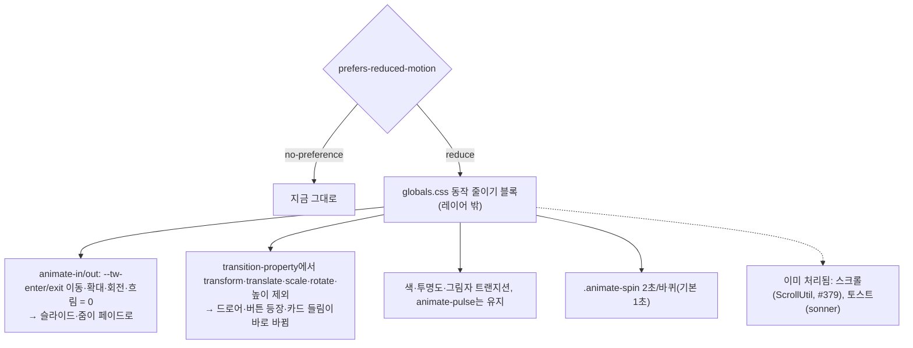

# 동작 줄이기 — CSS 애니메이션·트랜지션에서 움직임만 빼기

> 기기에서 "동작 줄이기"(`prefers-reduced-motion: reduce`)를 켠 사용자에게는 슬라이드·확대·회전 같은 **움직임만 빼고**, 페이드·색 변화는 유지하고, 로딩 스피너는 절반 속도로 돌린다. `globals.css` 한 곳에서 처리한다(사용자 결정 2026-10-15: 방식 A, 스피너 "유지하되 느리게").

## Context

**문제.** 코드로 하는 스크롤은 #379에서 대응했지만(`ScrollUtil.getBehavior()`), CSS 애니메이션·트랜지션은 대응이 0건이다(`motion-ux` skill에 미해결로 기록). 동작 줄이기를 켠 사용자에게도 다이얼로그 확대 등장, 모바일 하단 시트·사이드바 슬라이드, 버튼 등장(이동+확대) 등이 그대로 나간다. WCAG 2.3.3(AAA) 미충족이다.

**조사 결과**(main 기준, Explore 2회)

| 분류                   | 수  | 대표 위치                                                                                                                                                                                                                                                                                                                                                                                                                                 |
| ---------------------- | --- | ----------------------------------------------------------------------------------------------------------------------------------------------------------------------------------------------------------------------------------------------------------------------------------------------------------------------------------------------------------------------------------------------------------------------------------------- |
| 움직임(이동·확대·회전) | 21  | `dialog.tsx:124`·`alert-dialog.tsx:75`(zoom), `SheetDialogContent.tsx:26`(하단 슬라이드), `dropdown-menu.tsx:238,295`·`select.tsx:113`·`tooltip.tsx:21`(slide+zoom), `Sidebar.tsx:146`(드로어), `ScrollToTop.tsx:57`·`ScrollToCommentFormButton.tsx:94`(이동+확대 등장), `PostCard.tsx:99,285`(hover 들림·썸네일 확대), `switch.tsx:20`, `select.tsx:68`, `Navbar.tsx:134-135`(테마 아이콘 회전), `PostList.tsx:85`(당겨서 새로고침 높이) |
| 페이드                 | 11  | 다이얼로그 배경, `CommentItem.tsx:51`, `SpinnerOverlay.tsx:31`                                                                                                                                                                                                                                                                                                                                                                            |
| 색·그림자              | 24  | `button.tsx:8`(`transition-all`), 입력창 포커스 링                                                                                                                                                                                                                                                                                                                                                                                        |
| 필수 상태 표시         | 16  | `animate-spin` 13곳(`spinner.tsx:10` + `Loader2` 직접 사용 12곳), `skeleton.tsx:7`(`animate-pulse`), NProgress 막대                                                                                                                                                                                                                                                                                                                       |

- 패키지에서 직접 확인(2026-10-15): `node_modules/tw-animate-css/dist/tw-animate.css`의 `@keyframes enter/exit`는 `translate3d(var(--tw-enter-translate-x,0),…)scale3d(var(--tw-enter-scale,1),…)rotate(…)`와 `blur(…)`를 쓰고, Tailwind v4의 `transition-transform`은 `transition-property: transform, translate, scale, rotate`로 만들어진다. `--animate-spin`은 `spin 1s linear infinite`(`tailwindcss/theme.css:390`).
- `tw-animate-css`(유일하게 로드되는 애니메이션 라이브러리)의 `animate-in/out`은 `enter`/`exit` 키프레임이 `--tw-enter-*`/`--tw-exit-*` 변수(이동·확대·회전·흐림·투명도)를 읽는 구조다. 변수는 `@property … inherits:false`이고, 수정자 클래스(`zoom-in-95`, `slide-in-from-*`)는 utilities 레이어에 있다. 그래서 **레이어 밖 규칙으로 요소마다 이동·확대 변수만 덮으면 페이드만 남는다.**
- Tailwind v4의 `translate-*`·`scale-*`·`rotate-*`는 `translate`·`scale`·`rotate` 개별 속성을 쓰고, `transition-transform`은 이것들을 트랜지션 대상으로 잡는다. 트랜지션 대상에서 이 속성들을 빼면 움직임이 애니메이션 없이 바로 바뀐다.
- sonner(토스트)는 라이브러리가 이미 대응한다. Radix는 자체 애니메이션이 없다(`data-state` 클래스뿐). Presence는 `animationend`를 기다리는데, 페이드가 남으므로 정상적으로 언마운트된다.
- `src`에 `transitionend`·`animationend`에 의존하는 코드는 없다. 퇴장 타이머(`ScrollToTop` 200ms 등)는 `setTimeout`이고 페이드가 남아 그대로 맞는다.

**근거**

- [Val Head, Smashing Magazine 2020](https://www.smashingmagazine.com/2020/09/design-reduced-motion-sensitivities/): 동작 줄이기는 움직임을 없애는 게 아니라 줄이는 것이다. 색 페이드·투명도·작은 크기 변화는 문제가 될 가능성이 낮고, 큰 이동·확대·회전은 페이드로 바꾼다.
- [WCAG C39](https://www.w3.org/WAI/WCAG22/Techniques/css/C39): 필수가 아닌 움직임은 끈다.
- [Bootstrap 5.3](https://getbootstrap.com/docs/5.3/getting-started/accessibility/): 트랜지션은 끄고 스피너 같은 의미 있는 애니메이션은 느리게 한다.

## 판단이 필요했던 항목

| 항목                                            | 결정                                                                              | 근거·기각한 대안                                                                                                                                                                                                  |
| ----------------------------------------------- | --------------------------------------------------------------------------------- | ----------------------------------------------------------------------------------------------------------------------------------------------------------------------------------------------------------------- |
| 적용 방식                                       | `globals.css` 끝, 레이어 밖에 `@media (prefers-reduced-motion: reduce)` 블록 하나 | 사용자 선택. 앞으로 만드는 컴포넌트에도 자동으로 적용된다. 기각 B(21곳에 `motion-reduce:`): 수정이 많고 새 컴포넌트에서 빠뜨린다. 기각 C(전부 0초 리셋): 페이드·스피너까지 사라져 "줄이기≠없애기" 근거와 어긋난다 |
| 무엇을 뺄까                                     | 이동·확대·회전·흐림만 뺀다. 투명도·색·그림자는 둔다                               | Val Head 근거. 다이얼로그·시트·드롭다운·툴팁은 페이드로 바뀐다                                                                                                                                                    |
| 트랜지션 처리                                   | `transition-property`를 색·투명도·그림자 목록으로 고정한다(`!important`)          | 클래스(`transition-all`)와 인라인 style(NProgress 막대, 당겨서 새로고침 높이)을 함께 덮으려면 `!important`가 필요하다. 트랜지션 시간이 0인 요소는 영향이 없다                                                     |
| 작은 hover 변화(카드 들림·썸네일 105%·누름 95%) | 없애지 않고 애니메이션만 없앤다(바로 바뀜)                                        | 근거상 작은 크기 변화는 위험이 낮다. 지우면 상태 피드백이 사라진다                                                                                                                                                |
| 스피너                                          | 유지하되 2초/바퀴                                                                 | 사용자 선택. Bootstrap 방식. 상태를 알리는 필수 애니메이션(WCAG C39 "필수")                                                                                                                                       |
| `animate-pulse`(스켈레톤)                       | 유지                                                                              | 투명도만 바뀐다                                                                                                                                                                                                   |
| 검증 범위                                       | CSS 규칙 자체를 e2e로 확인 + 녹화로 보통/줄이기 비교                              | jsdom 단위 테스트는 CSS를 적용하지 않는다                                                                                                                                                                         |

## 세부 계획

| 위치                                                       | 변경 내용                                                                                                                                                                                                                                                                                                                                                                                                                                                   |
| ---------------------------------------------------------- | ----------------------------------------------------------------------------------------------------------------------------------------------------------------------------------------------------------------------------------------------------------------------------------------------------------------------------------------------------------------------------------------------------------------------------------------------------------- |
| `src/app/globals.css` 끝(NProgress 덮어쓰기 뒤, 레이어 밖) | `@media (prefers-reduced-motion: reduce) { *, ::before, ::after { --tw-enter-translate-x/y: 0; --tw-enter-scale: 1; --tw-enter-rotate: 0; --tw-enter-blur: 0; (exit도 같게); transition-property: color, background-color, border-color, outline-color, text-decoration-color, fill, stroke, opacity, box-shadow !important; } .animate-spin { animation-duration: 2s; } }` + 근거 주석(링크)                                                               |
| `e2e/reduced-motion.spec.ts` (신규)                        | `emulateMedia({ reducedMotion })` 두 상태 비교. ① 다이얼로그(비로그인 좋아요 → 로그인 모달, `guest-guard.spec.ts` 모킹 재사용) 내용의 `--tw-enter-scale`: reduce면 `1`, 보통이면 `0.95` ② Esc로 닫으면 정상으로 사라짐(Presence 언마운트) ③ 게시글 카드의 `transitionProperty`: reduce면 `transform`·`translate` 없음, 보통이면 있음 ④ 페이지에 `animate-spin` 요소를 넣고 `animationDuration`: reduce면 `2s`, 보통이면 `1s`(로딩 타이밍에 기대지 않으려고) |
| `.claude/skills/motion-ux/SKILL.md`                        | "prefers-reduced-motion — 스크롤만 대응" 절을 "전역 대응"으로 바꾼다. 새 코드 규칙: 이동·확대는 `tw-animate-css`나 Tailwind `transform` 트랜지션으로 만들면 자동 처리되고, **새 `@keyframes`를 직접 만들면** 동작 줄이기 처리를 같이 넣는다                                                                                                                                                                                                                 |
| `docs/FE-ARCHITECTURE.md` §25                              | "CSS 애니메이션·트랜지션은 아직 대응하지 않았다" 문장을 갱신한다                                                                                                                                                                                                                                                                                                                                                                                            |
| `CHANGELOG.md`                                             | `shared` Changed 항목                                                                                                                                                                                                                                                                                                                                                                                                                                       |
| `docs/plans/2026-10-15-reduced-motion-css.md` (신규)       | 이 계획 스냅샷                                                                                                                                                                                                                                                                                                                                                                                                                                              |

진행 순서: 워크트리 → globals.css → e2e(변이로 실패 확인) → 녹화(보통/줄이기 나란히: 다이얼로그, 모바일 하단 시트, 모바일 사이드바, 맨 위로 버튼, 스피너) → **사용자 확인** → 문서 → 커밋·PR·CI → 계획 대비 구현 대조(fresh subagent).

## 영향 범위 (§5)

- **동작 줄이기를 켠 사용자에게만** 바뀐다. 기본(no-preference) 화면은 그대로다.
- 단위 테스트(jsdom)는 CSS를 적용하지 않아 영향이 없다. 기존 e2e는 기본 상태(no-preference)라 영향이 없다. #379의 `comment-icon-scroll.spec.ts` 동작 줄이기 테스트는 스크롤 동작만 보므로 그대로 통과해야 한다.
- Radix 팝업·다이얼로그: 페이드가 남아 `animationend`로 정상 언마운트된다(e2e ②로 확인).
- 퇴장 타이머(`ScrollToTop`·`ScrollToCommentFormButton` 200ms, `Alert` 300ms): 페이드는 그대로라 타이머와 맞는다.
- 데이터·API 변경 없음.

## 검증 방법

1. `pnpm type-check`·`lint`·`check:deps`·`check:docs`·`format:check`·`pnpm test`
2. 새 e2e + 전체 `pnpm test:e2e`
3. 변이 확인: 블록의 변수 덮기 / `transition-property` / 스피너 속도를 하나씩 빼면 ①·③·④가 각각 실패
4. browser-verification 녹화(보통 | 동작 줄이기 나란히): 다이얼로그 열기, 모바일 하단 시트, 모바일 사이드바, 맨 위로 버튼 등장, 스피너 → 사용자 확인 후 커밋
5. PR CI → fresh subagent로 계획 대비 구현 대조 → PR 본문 `## 계획 대비 구현`

## 남은 것

- `motion-ux` skill의 실측 현황 표(2026-09-22 기준 수치)와 `TRANSITION_MS` 줄 번호(`ScrollToTop.tsx:11`, `ScrollToCommentFormButton.tsx:10`이 맞음)는 이미 낡았다. 이번 범위에서는 고치지 않고 기록만 한다.
- 쓰이지 않는 `tailwindcss-animate` 의존성(`package.json:130`)은 범위 밖이다.
