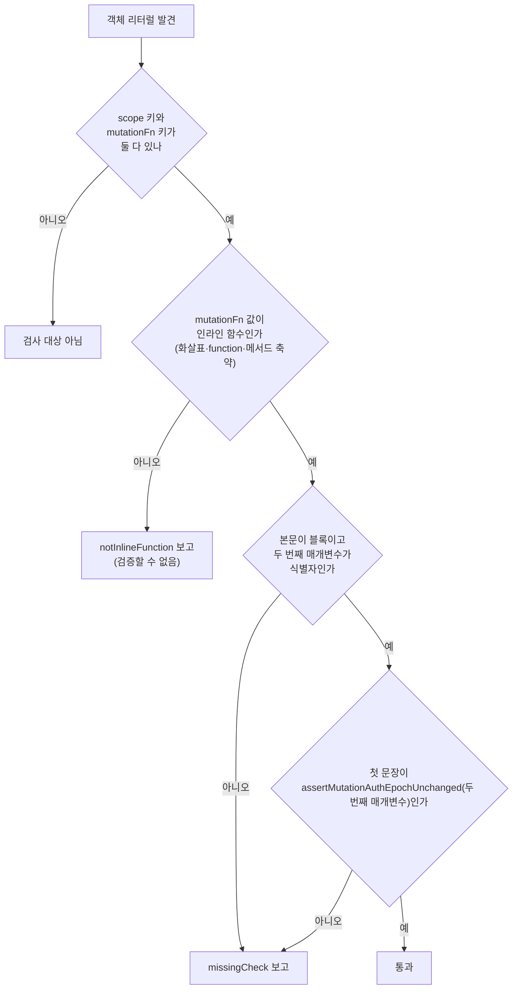
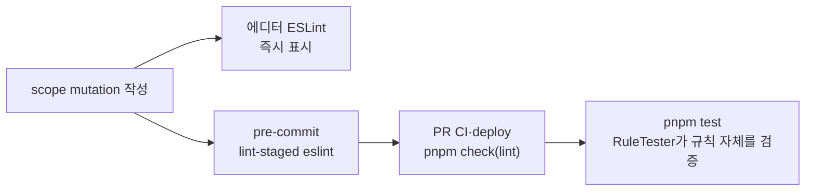

# scope mutation의 인증 세대 확인 누락을 린트로 막기

> `scope`로 줄 서는 mutation이 `mutationFn` 첫 줄에서 `assertMutationAuthEpochUnchanged(context)`를 부르지 않으면
> ESLint 커스텀 규칙이 pre-commit·CI에서 막는다. 규칙은 RuleTester 테스트로 "지금 6곳 통과 / 빠뜨린 예 실패"를 고정한다.

## Context

FE #391·#381에서 같은 `scope`로 줄 서는 mutation이 누른 순간의 인증 세대를 확인하게 했다.

- 기록: 전역 `MutationCache` `onMutate` → `rememberMutationAuthEpoch` (`src/shared/lib/react-query/config/queryClient.ts:67`)
- 확인: `assertMutationAuthEpochUnchanged(context)` (`src/shared/lib/react-query/config/mutation-auth-epoch.ts`)를 `mutationFn` 첫 줄에서 부른다
- 지금 6곳: `interaction.queries.ts`(좋아요 글·댓글, 북마크 저장), `bookmark-folder.queries.ts`(폴더 추가·빼기·비우기). 모두 `(x: T, context) => { assert…(context); … }` 모양이다

이 규칙은 `docs/FE-ARCHITECTURE.md` §11 "같은 대상의 연속 mutation" 6번에 문서로만 있다. 빠뜨리면 줄에서 기다리는 사이 다른
계정이 됐을 때 그 요청이 새 계정으로 나간다. 리뷰에 기대지 않고 커밋 단계에서 막는 게 목표다.

조사로 확인한 사실:

- pre-commit(`.husky/scripts/pre-commit`)은 `pnpm type-check` + `lint-staged`(staged 파일에 `eslint --fix`)뿐이다. `pnpm test`는 pre-push(`.husky/scripts/pre-push`)와 CI에서만 돈다
- 커스텀 규칙 16개(`custom-query-rules` 3, `custom-tailwind` 5 등)가 전부 `eslint.config.js` 안에 인라인으로 있고, 규칙 자체를 검증하는 테스트는 0개다
- `src/` 밖 JS를 vitest로 검증하는 선례: `scripts/lib/prune-assets.js` + 직접 쓴 `.d.ts` → `src/test/scripts/prune-assets.test.ts`(상대 경로 import + `custom-import/no-relative-import-except-styles` disable 주석)
- 설치된 `@tanstack/react-query` 5.90.16에 `mutationOptions`가 있다 → `useMutation(likeOptions(id))`로 바꾸면 호출 이름(`useMutation`)으로 찾는 규칙은 빠져나간다
- src의 `useMutation` 호출 27곳(테스트 제외)은 전부 인라인 객체 리터럴을 받는다. 테스트 아닌 파일에서 `scope`를 쓰는 곳은 위 6곳뿐이다(테스트는 `getMutationCache().build(client, { mutationFn, scope })`)

### 규칙이 검사하는 순서



### 막히는 지점



## 판단이 필요했던 항목

### 검사 방식 비교 (요청 사항)

| 기준                    | ESLint 커스텀 규칙 (채택)          | 소스 스캔 테스트                                                 | `useScopedMutation` 래퍼 + raw `scope` 금지  |
| ----------------------- | ---------------------------------- | ---------------------------------------------------------------- | -------------------------------------------- |
| 막는 시점               | 에디터 · pre-commit · CI           | pre-push · CI만 (pre-commit은 테스트를 안 돌린다)                | 래퍼 안에서 구조적으로 강제                  |
| 정확도                  | AST로 "첫 문장·인자 이름"까지 확인 | TS 컴파일러 API로 직접 파싱해야 함(정규식은 여러 줄 객체에 취약) | 모양 검사가 필요 없음                        |
| 선례                    | `custom-*` 규칙 16개               | `storage-keys.test.ts`, `cloudfront-functions.test.ts`           | 없음                                         |
| 기존 코드 변경          | 없음                               | 없음                                                             | 6곳 수정 + 제네릭 4개 전달하는 새 공용 훅    |
| "빠뜨린 예 실패" 테스트 | ESLint 내장 `RuleTester`           | 같은 테스트 파일의 픽스처 문자열                                 | —                                            |
| 그래도 필요한 것        | —                                  | —                                                                | raw `useMutation`의 `scope`를 막을 린트 규칙 |

결론: **ESLint 규칙.** 요청한 "pre-commit에서 막기"를 충족하는 안은 이것뿐이다. 소스 스캔은 pre-commit에 테스트를 더해야 하고,
래퍼는 결국 린트 규칙이 하나 더 필요한 데다 기존 6곳과 제네릭 타입까지 바꾼다.

### 세부 결정

| 항목             | 결정                                                                                              | 근거·기각한 대안                                                                                                                                                                                                                                                                                         |
| ---------------- | ------------------------------------------------------------------------------------------------- | -------------------------------------------------------------------------------------------------------------------------------------------------------------------------------------------------------------------------------------------------------------------------------------------------------- |
| 검사 대상 식별   | `scope`와 `mutationFn` 키를 함께 가진 객체 리터럴(문자열 키 `'scope'` 포함)                       | 기각: `useMutation(` 호출만 보기 — 요청 문구엔 더 가깝지만 `mutationOptions()`·`setMutationDefaults`로 옮기면 빠져나간다. 두 키를 함께 가진 객체는 mutation 옵션 말고는 없다                                                                                                                             |
| 통과 조건        | 본문 **첫 문장**이 `assertMutationAuthEpochUnchanged(<mutationFn의 두 번째 매개변수>)`            | §11 6번이 "첫 줄"이라고 쓴다. 기각: "본문 어딘가에서 호출" — 요청을 보낸 뒤에 불러도 통과해 확인이 의미 없어진다. 인자 이름까지 보는 이유: 다른 context 값을 넘기면 기록이 없어 확인이 조용히 건너뛰어진다(`mutation-auth-epoch.ts`의 `has` 가드)                                                        |
| 인라인 아닌 함수 | `mutationFn: sendLike`처럼 참조면 별도 메시지(`notInlineFunction`)로 막는다                       | 정적으로 확인할 수 없어서. 지금 6곳은 전부 인라인이라 영향 없음                                                                                                                                                                                                                                          |
| 규칙 본체 위치   | `scripts/lib/scope-mutation-auth-epoch-rule.js`(+ `.d.ts`)로 빼고 `eslint.config.js`가 import한다 | **기존 선례(전부 인라인)에서 벗어난다.** 인라인이면 테스트가 설정 파일 전체(플러그인 9개)를 불러와야 하고 타입 선언도 없다. 위치·형태는 `prune-assets.js` + `.d.ts` + `src/test/scripts/` 선례를 그대로 따른다. 규칙 모듈은 아무것도 import하지 않는다(dependency-cruiser가 scripts/lib 안까지 따라간다) |
| 테스트 도구      | ESLint 내장 `RuleTester` + `typescript-eslint` 파서(둘 다 이미 devDependency)                     | 기각: `@typescript-eslint/rule-tester` 추가 — 새 의존성이 필요 없다. `src/test/**`는 `not-to-dev-dep` 예외(`.dependency-cruiser.cjs`)                                                                                                                                                                    |
| 테스트 환경      | jsdom 그대로(`@vitest-environment node` 지정 안 함)                                               | node로 바꾸면 모든 파일에 도는 `src/test/setup.ts`가 `window`·`Element`를 참조해 깨진다. `RuleTester`는 vitest 전역 `describe`/`it`을 쓴다                                                                                                                                                               |
| 실제 6곳 검증    | 두 파일 원본 = valid, 확인 줄을 지운 사본 = **지운 줄 수만큼** `missingCheck`                     | 지운 사본이 실패해야 "규칙이 실제 코드 모양을 보고 있다(헛통과 아님)"가 증명된다. 기각: 오류 수를 3으로 고정 — 같은 파일에 네 번째 scope mutation이 생기면 테스트가 깨진다. 대신 지운 줄 수 ≥ 1을 따로 확인한다                                                                                          |

## 세부 계획

작업 순서:

```
1. git log origin/main..main 확인 → EnterWorktree → cp ../../../.env . && pnpm install
   (로컬 node_modules에 #350의 @vitest/eslint-plugin이 없어 지금은 eslint 실행 자체가 실패한다)
2. 규칙 모듈·타입 선언 작성 → verify: 테스트 통과
3. eslint.config.js 등록 → verify: pnpm lint 통과(6곳 포함 전체), stdin 재현으로 실패 확인
4. 문서 갱신 → verify: pnpm check:docs
```

| 위치                                                             | 변경 내용                                                                                                                                                                                                                                                                                                                                                                                                                                                                                                                                     |
| ---------------------------------------------------------------- | --------------------------------------------------------------------------------------------------------------------------------------------------------------------------------------------------------------------------------------------------------------------------------------------------------------------------------------------------------------------------------------------------------------------------------------------------------------------------------------------------------------------------------------------- |
| `scripts/lib/scope-mutation-auth-epoch-rule.js` (신규)           | `ObjectExpression` 방문자. 위 순서도대로 판정. `meta.type: 'problem'`, 메시지 2개(`missingCheck`: 첫 줄에서 부르라는 안내 + §11 6번 링크 / `notInlineFunction`: 인라인 함수로 쓰라는 안내). 보고 위치는 `mutationFn` 속성. 머리말에 위치를 뺀 이유(테스트)와 선례(`prune-assets.js`)를 적는다                                                                                                                                                                                                                                                 |
| `scripts/lib/scope-mutation-auth-epoch-rule.d.ts` (신규)         | `import type { Rule } from 'eslint'` → `export const scopeMutationAuthEpochRule: Rule.RuleModule`. 머리말은 `prune-assets.d.ts`와 같은 형식                                                                                                                                                                                                                                                                                                                                                                                                   |
| `eslint.config.js`                                               | 위 모듈 import → `customQueryRulesPlugin.rules`에 `'scope-mutation-auth-epoch'` 추가. 새 블록: `files: ['src/**/*.{ts,tsx}']`, `ignores: ['**/*.test.{ts,tsx}', 'src/test/**', 'src/mocks/**']`, `'custom-query-rules/scope-mutation-auth-epoch': 'error'`. 블록 위 주석에 이유(§11 6번, 문서로만 있던 규칙)를 기존 블록 형식으로 적는다                                                                                                                                                                                                      |
| `src/test/scripts/scope-mutation-auth-epoch-rule.test.ts` (신규) | `RuleTester({ languageOptions: { parser: tseslint.parser } })`, `RuleTester.describe/it`을 vitest 것으로 지정. **valid**: scope 없음 / 화살표+첫 줄 확인 / 메서드 축약 / 매개변수 이름이 `ctx` / `async` 함수 / 실제 두 파일 원본(`name` 지정). **invalid**: 확인 없음 / 요청 뒤에 확인 / 다른 인자로 확인 / context 매개변수 없음 / 식 본문 화살표 / `mutationFn` 참조(`notInlineFunction`) / `mutationOptions({...})` 안 / 문자열 키 `'scope'` / 실제 두 파일에서 `assertMutationAuthEpochUnchanged(\w+);` 줄을 지운 사본(지운 수만큼 오류) |
| `docs/FE-ARCHITECTURE.md` §2 규칙 표                             | `custom-query-rules/scope-mutation-auth-epoch` 행 추가 — `scope`+`mutationFn` 객체에서 첫 줄 확인 누락, 구현은 `scripts/lib/scope-mutation-auth-epoch-rule.js`, §11 참고                                                                                                                                                                                                                                                                                                                                                                      |
| `docs/FE-ARCHITECTURE.md` §11 "같은 대상의 연속 mutation" 6번    | "ESLint `custom-query-rules/scope-mutation-auth-epoch`가 강제한다(pre-commit·CI)" 한 문장 추가                                                                                                                                                                                                                                                                                                                                                                                                                                                |
| `docs/plans/2026-10-15-scope-mutation-auth-epoch-lint.md` (신규) | 이 계획 스냅샷(§11 append-only)                                                                                                                                                                                                                                                                                                                                                                                                                                                                                                               |

커밋: `build(lint): scope mutation의 인증 세대 확인 누락을 린트로 막음` (#350 선례와 같은 타입). `build`라 CHANGELOG 대상이 아니다.

## 영향 범위

- **CRUD 실패 지점**: 해당 없음. 런타임 코드·데이터 계약을 바꾸지 않는다(정적 검사와 테스트만 추가). 배포 순서 문제 없음
- **기존 6곳**: 통과해야 한다 → 테스트의 valid 케이스 + `pnpm lint`
- **scope 없는 `useMutation` 21곳**: 검사 대상이 아니다 → `pnpm lint`로 확인
- **테스트의 `build(client, { mutationFn, scope })`** (`mutation-auth-epoch.test.ts`, `auth.util.test.ts`): 블록 `ignores`로 제외
- **`customQueryRulesPlugin` 공유**: 3개 블록이 같은 객체를 쓰지만 규칙을 켜는 건 새 블록뿐이라 영향 없음. 새 rule key라 flat config 덮어쓰기 문제도 없다
- **공용 모듈 수정 없음**: `mutation-auth-epoch.ts`·`queryClient.ts`는 안 건드린다 → `pnpm graph` 불필요
- **에디터**: import한 규칙 모듈이 바뀌어도 ESLint 서버가 다시 읽지 않는다 → 재시작해야 반영
- **배포**: 테스트 파일이 `deploy.yml` paths(`src/**`)에 걸려 병합 후 배포가 돈다(번들 변화 없음) → 성공을 확인한 뒤 보고
- **알려진 한계**: 옵션을 변수·스프레드로 넘기면(`useMutation(options)`, `{ ...base, scope }`에서 `mutationFn`이 base에 있음) 못 잡는다. 지금 0건이고 FE-ARCHITECTURE 표 행에 적는다

## 검증 방법

1. `pnpm type-check` — 테스트의 `RuleTester`·`tseslint.parser` 타입과 `.d.ts` 해석
2. `pnpm test` — 새 테스트 전체 통과. 특히 실제 파일 사본의 오류 수가 지운 줄 수(지금 파일당 3)와 같은지
3. `pnpm lint` · `pnpm check:deps` — 6곳 포함 전체 통과, 새 import가 의존성 규칙 위반 없음
4. pre-commit 경로 재현(파일 수정 없이): `sed '/assertMutationAuthEpochUnchanged(context);/d' src/entities/interaction/api/interaction.queries.ts | pnpm exec eslint --stdin --stdin-filename src/entities/interaction/api/interaction.queries.ts` → 실제 설정으로 `custom-query-rules/scope-mutation-auth-epoch` 오류 3건이 나오는지
5. `pnpm check:docs` — FE-ARCHITECTURE 수정분
6. PR 전 §11 대조: fresh general-purpose 서브에이전트에 계획 파일과 diff를 주고 PR 본문 `## 계획 대비 구현` 작성
7. 병합 후 `gh run list --branch main --workflow "Frontend Deploy (S3 + CloudFront)"`로 성공 확인 → 워크트리 정리

## 남은 것

- 변수·스프레드로 넘긴 옵션은 못 잡는다(위 알려진 한계). 실제로 생기면 그때 "scope 객체는 인라인으로" 규칙을 더할지 정한다
- 다른 커스텀 규칙 16개도 테스트가 없다. 이번 PR은 새 규칙만 다루고, 기존 규칙을 같은 방식으로 옮길지는 범위 밖이다
