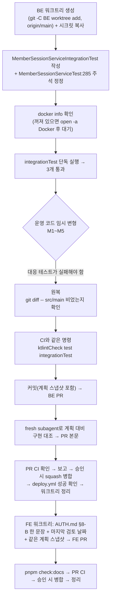

# refresh 회원 불일치 롤백 통합 테스트 (BE) + AUTH.md 한 문장 (FE)

> BE #97의 `SessionMismatchException`이 rotate 트랜잭션을 롤백해 앞의 refresh 소비까지 되돌린다는 가정을 실제 Postgres로 고정한다.

## Context (Motivation)

- BE #97(`05d714c`)의 `MemberSessionService.rotate`(`MemberSessionService.kt:105-137`)는 `consumeRefreshIfActive`(조건부 UPDATE)와
  재사용 판정을 마친 뒤, 발급 직전에 `assertSameMember`(`:153-160`)를 부른다. 회원이 다르면 `SessionMismatchException`(RuntimeException,
  KDoc에 "롤백에 기댄다"고 명시)을 던지고, 같은 트랜잭션이 롤백돼 소비도 되돌아간다고 **가정**한다. `MemberSessionServiceTest:274-288`은
  Mockito라 `save`가 호출되지 않았다는 것만 보고, 실제 롤백은 확인하지 않는다.
- 롤백이 실제로 안 되면 사용자가 겪는 일: 쿠키 행은 revoke됐는데 새 행이 없다. 그러면 다음 refresh(쿠키 주인의 다른 탭, 또는 FE 안내대로
  새로고침)가 재사용 탐지에 걸려 계열 전체가 폐기되고, 쿠키 주인 계정까지 로그아웃된다. FE `docs/AUTH.md` §8-B의 "새로고침하면 쿠키 주인
  계정으로 복원"이 이 롤백을 전제로 하지만, 문서에 그렇게 적혀 있지는 않다.
- `revokeFamily`의 REQUIRES_NEW(`MemberSessionRepository.kt:55-65`, "PR #42 리뷰에서 실측 확인")도 자동 테스트가 없다.
- 상황: BE 로컬 `main` = `origin/main` = #97, push 안 된 커밋 없음. 통합 테스트 인프라는 #91(`@PostgresIntegrationTest`), 선례는 #91·#96.

## 판단이 필요했던 항목

| 항목            | 결정                                                                                                | 근거·기각한 대안                                                                                                                                                                                                                                                                                                                                                                                                                                                                                                                                       |
| --------------- | --------------------------------------------------------------------------------------------------- | ------------------------------------------------------------------------------------------------------------------------------------------------------------------------------------------------------------------------------------------------------------------------------------------------------------------------------------------------------------------------------------------------------------------------------------------------------------------------------------------------------------------------------------------------------ |
| 테스트 단위     | **`rotate` 직접 호출** (2026-10-15 사용자 선택)                                                     | 검증되지 않은 가정은 "rotate 안의 DB 트랜잭션 동작" 하나다. 409 매핑·쿠키를 건드리지 않음·헤더 전달은 DB와 무관하고 이미 `AuthControllerTest.kt:552-599`가 고정한다. 기각: `AuthService.refresh` 경유(운영의 바깥 경계 `AuthService.kt:168`까지 보지만, 같은 REQUIRED 전파의 2줄 래퍼라 얻는 게 적고 MockitoBean 4개가 늘어난다). 기각: MockMvc(웹과 실 DB를 함께 띄운 선례가 없고 `@SpringBootTest`는 레포에 0개라 시크릿·외부 설정이 필요하다. standalone으로 하면 mock이 8개 안팎으로 늘어 실제 상황에서 멀어진다. 보안 필터는 어느 쪽이든 못 본다) |
| 테스트 트랜잭션 | 클래스에 `@Transactional(propagation = Propagation.NOT_SUPPORTED)`, `@AfterEach`에서 `members` 삭제 | `@DataJpaTest` 기본값(테스트 전체를 트랜잭션 하나로 감싸고 롤백)으로는 ① rotate가 그 트랜잭션에 참여해 롤백이 테스트 끝까지 미뤄져 거짓 실패한다 ② 다시 refresh하면 `revokeFamily`(REQUIRES_NEW)가 테스트 트랜잭션의 행 잠금을 기다리다 멈춘다(`MemberSessionService.kt:117` 주석의 교착) ③ 커밋 전 시드를 REQUIRES_NEW 쪽에서 못 본다. 선례 `ReactionRepositoryIntegrationTest.kt:55-87`(NOT_SUPPORTED + members 삭제). `member_sessions`는 `fk_member_sessions_member ON DELETE CASCADE`(schema.sql:825)                                             |
| 서비스 빈       | 테스트 클래스에 `@Import(MemberSessionService::class)`                                              | `@DataJpaTest`는 `@Service`를 띄우지 않는다. 기존 통합 테스트 4개는 모두 저장소 테스트라 첫 서비스 통합 테스트다. `PostgresIntegrationTest.kt`는 바꾸지 않는다                                                                                                                                                                                                                                                                                                                                                                                         |
| 시드 방법       | `members`는 `jdbc` INSERT, 세션은 실제 `memberSessionService.createSession()`                       | 실제 해시·계열 생성 경로를 그대로 쓴다. 시각 조작(`revoked_at`·`access_expires_at`)만 `jdbc` UPDATE                                                                                                                                                                                                                                                                                                                                                                                                                                                    |
| 시각 값         | SQL `now()`가 아니라 JVM `Timestamp.from(Instant.now().minusSeconds(60))`                           | rotate가 JVM `Instant.now()`와 비교하므로 Docker VM 시계와 어긋날 여지를 없앤다. 60초는 `REUSE_LEEWAY`(10초) 밖으로 충분히 멀다                                                                                                                                                                                                                                                                                                                                                                                                                        |
| 힌트 토큰 상태  | 시나리오 1의 힌트 access를 만료시킨다                                                               | 실제로 refresh에 실리는 건 `TOKEN_EXPIRED`를 받은 토큰이다(AUTH.md §8-B "만료·폐기된 토큰도 행이 남아 있어 조회됩니다"). 만료 토큰이면 비교를 건너뛰게 바뀌는 회귀(M5)를 잡는다                                                                                                                                                                                                                                                                                                                                                                        |
| 검증 방법       | 로컬 실행 + 운영 코드 임시 변형으로 실패 확인                                                       | #96과 같다. 처음부터 통과만 하는 테스트를 걸러낸다                                                                                                                                                                                                                                                                                                                                                                                                                                                                                                     |
| FE 문서         | AUTH.md §8-B "BE가 하는 것" 항목에 한 문장 추가, 별도 FE PR (2026-10-15 사용자 선택)                | "새로고침하면 복원"의 전제를 문서에 드러낸다. 기각: 테스트 주석에서 링크만 거는 안                                                                                                                                                                                                                                                                                                                                                                                                                                                                     |

## 세부 계획 — BE

| 위치                                                                                               | 변경 내용                                                                                                                                                                                                                                                                                                                                                                                                                                |
| -------------------------------------------------------------------------------------------------- | ---------------------------------------------------------------------------------------------------------------------------------------------------------------------------------------------------------------------------------------------------------------------------------------------------------------------------------------------------------------------------------------------------------------------------------------- |
| `src/test/kotlin/com/example/linksphere/domain/auth/MemberSessionServiceIntegrationTest.kt` (신규) | `@PostgresIntegrationTest` + `@Import(MemberSessionService::class)` + 클래스에 NOT_SUPPORTED. `JdbcTemplate`·`MemberSessionService` 주입. 회원 `memberA`·`memberB`(인스턴스마다 `UUID.randomUUID()`). `@BeforeEach`에서 members INSERT, `@AfterEach`에서 members DELETE(cascade). 헬퍼: `revokedAt(rawRefresh)`, `rowCount(memberId)`, `familyOf(rawRefresh)`, 시각 UPDATE. 클래스 주석에 NOT_SUPPORTED를 쓴 이유와 FE AUTH.md §8-B 링크 |
| `src/test/kotlin/com/example/linksphere/domain/auth/MemberSessionServiceTest.kt:285`               | 바꾸기 전: "새 행이 없다 - 앞서 한 소비(consumeRefreshIfActive)는 예외로 트랜잭션이 롤백돼 되돌아간다". 바꾼 뒤: 같은 문장 끝에 "(실제 롤백은 MemberSessionServiceIntegrationTest가 Postgres에서 확인한다)"                                                                                                                                                                                                                              |
| `docs/plans/2026-10-15-session-mismatch-rollback-integration-test.md` (신규)                       | 이 계획 파일의 스냅샷(BE CLAUDE.md §8)                                                                                                                                                                                                                                                                                                                                                                                                   |

### 테스트

| #   | 이름(선례처럼 한글 백틱)                                                           | 준비 → 실행 → 단언                                                                                                                                                                                                                                                                                                                                                                   |
| --- | ---------------------------------------------------------------------------------- | ------------------------------------------------------------------------------------------------------------------------------------------------------------------------------------------------------------------------------------------------------------------------------------------------------------------------------------------------------------------------------------ |
| ①   | `다른 회원 힌트로 거절되면 소비가 롤백돼 같은 쿠키로 다시 갱신할 수 있다`          | `cookie = createSession(B)`, `hint = createSession(A)`, hint의 `access_expires_at`을 과거로 → `rotate(cookie.refresh, hint.access)`가 `SessionMismatchException` → `revokedAt(cookie.refresh) == null`, `rowCount(B) == 1`(새 행 없음) → `rotate(cookie.refresh)`(힌트 없이) 성공 → `checkAccessToken(새 access) == Valid(B, cookie 계열)`, `rowCount(B) == 2`                       |
| ②   | `같은 회원의 다른 계열 힌트면 쿠키의 계열로 발급한다`                              | `cookie = createSession(A)`, `hint = createSession(A)`(다른 계열) → `rotate(cookie.refresh, hint.access)` 성공 → `checkAccessToken(새 access) == Valid(A, cookie 계열)`, `revokedAt(cookie.refresh) != null`(소비가 커밋됨)                                                                                                                                                          |
| ③   | `유예 밖 재사용이면 다른 회원 힌트여도 계열 폐기가 커밋되고 InvalidTokenException` | `stolen = createSession(B)` → `rotated = rotate(stolen.refresh)`(정상 회전) → stolen 행의 `revoked_at`을 60초 전으로, `hint = createSession(A)` → `rotate(stolen.refresh, hint.access)`가 `InvalidTokenException` → `revokedAt(rotated.refresh) != null`(바깥 롤백에도 REQUIRES_NEW 폐기가 남음), `rowCount(B) == 2`(새 행 없음), `revokedAt(hint.refresh) == null`(A 세션은 그대로) |

409 응답 자체는 서비스 단위에서는 `SessionMismatchException`으로 확인한다. HTTP 매핑은 `GlobalExceptionHandler.kt:162`이 하고,
`AuthControllerTest`의 `refresh는 SessionMismatchException이면 409 SESSION_MISMATCH를 반환하고 쿠키를 건드리지 않는다`가 이미 고정하고 있다.

## 세부 계획 — FE (BE 병합 뒤)

| 위치                                                                         | 변경 내용                                                                                                                                                                                                                 |
| ---------------------------------------------------------------------------- | ------------------------------------------------------------------------------------------------------------------------------------------------------------------------------------------------------------------------- |
| `docs/AUTH.md` §8-B "BE가 하는 것" 항목(:308-310)                            | 끝에 한 문장 추가: 거절할 때는 앞서 한 refresh 소비도 함께 되돌려 쿠키가 그대로 유효하다. 아래 "새로고침하면 쿠키 주인 계정으로 복원"이 이 동작에 기댄다(BE `MemberSessionServiceIntegrationTest`가 실제 Postgres로 고정) |
| `docs/AUTH.md:6`                                                             | `마지막 검토`를 실제로 고친 날짜로 바꾼다                                                                                                                                                                                 |
| `docs/plans/2026-10-15-session-mismatch-rollback-integration-test.md` (신규) | BE와 같은 스냅샷(#97 선례: FE와 BE에 같은 파일)                                                                                                                                                                           |

## 영향 범위

- **CRUD**: 운영 코드 변경 없음. 테스트는 커밋되는 쓰기를 하므로(NOT_SUPPORTED) `@AfterEach` 삭제가 빠지면 같은 컨텍스트를 쓰는 다른 테스트에
  행이 남는다. 회원 id가 테스트마다 무작위라 충돌하지는 않지만, 선례처럼 반드시 정리한다.
- **기존 기능 회귀**: `@Import`가 붙어 테스트 컨텍스트 키가 달라진다. 그래서 `integrationTest`에서 Postgres 컨테이너가 하나 더 뜬다(몇 초
  늘어남). 다른 통합 테스트 클래스는 영향이 없다. `MemberSessionServiceTest`는 주석만 바뀐다.
- **배포**: BE `deploy.yml` 경로 필터가 `src/**`라 병합하면 Lambda 배포가 돈다(내용은 테스트뿐). 병합 후 run 성공을 확인한다. FE는 `docs/`만
  바뀌는데, FE `deploy.yml` 경로 필터(`src/**`·`public/**` 등)에 `docs/`가 없어 배포가 돌지 않는다. 병합 확인으로 끝낸다.
- **CHANGELOG**: BE는 `test`, FE는 `docs` 커밋이라 대상이 아니다.

## 검증 방법

1. BE 워크트리: `git -C <BE> worktree add .claude/worktrees/session-mismatch-it -b test/session-mismatch-rollback origin/main` 후 그 경로로 이동한다.
   EnterWorktree는 BE에 안 된다(메모리 `cross-repo-be-worktree-from-fe-session`). `application-secret.yml`·`firebase-service-account.json`을 복사한다.
2. Docker: `docker info`로 확인한다. 꺼져 있으면 `open -a Docker`를 실행하고 Monitor로 성공할 때까지 기다린다.
3. `./gradlew integrationTest --tests 'com.example.linksphere.domain.auth.MemberSessionServiceIntegrationTest' --no-daemon` → 3개 통과.
4. 운영 코드 임시 변형(커밋하지 않음. 하나씩 적용 → 실행 → 원복):

   | 변형                                                                                                 | 실패해야 하는 테스트                                              |
   | ---------------------------------------------------------------------------------------------------- | ----------------------------------------------------------------- |
   | M1 `rotate`의 `@Transactional` → `@Transactional(noRollbackFor = [SessionMismatchException::class])` | ① (`revoked_at`이 남고, 다시 refresh하면 `InvalidTokenException`) |
   | M2 `revokeFamily`에서 `@Transactional(propagation = REQUIRES_NEW)` 제거                              | ③ (rotated 행이 살아 있음)                                        |
   | M3 `assertSameMember`를 `consumeRefreshIfActive` 앞으로 이동                                         | ③ (`SessionMismatchException`, 계열 폐기 안 됨)                   |
   | M4 `assertSameMember`가 `memberId` 대신 `familyId`를 비교                                            | ②                                                                 |
   | M5 `assertSameMember`에서 힌트 access가 만료면 건너뜀                                                | ①                                                                 |

   끝나면 `git diff -- src/main`이 비어 있는지 확인한다. 변형별로 실패한 테스트 이름을 PR 본문에 남긴다.

5. CI와 같은 명령: `./gradlew ktlintCheck test integrationTest --no-daemon`.
6. 커밋 `test(auth): refresh 회원 불일치 거절 시 소비가 롤백되는지 실제 Postgres로 검증`(`.gitmessage` 형식, 새 파일은 `git add -- <파일>`, 나머지는 경로 지정 커밋) → push → PR.
7. fresh general-purpose subagent에게 `docs/plans/2026-10-15-session-mismatch-rollback-integration-test.md`와 diff를 주고 대조를 맡긴다 → PR 본문 `## 계획 대비 구현`.
8. PR CI(`integrationTest` 포함) 성공을 확인하고 보고한다. 병합은 사용자 승인 후 → `deploy.yml` run 성공 확인 → 워크트리·로컬 브랜치 정리.
9. FE: `git log origin/main..main`으로 push 안 된 커밋이 없는지 확인 → `EnterWorktree` → `cp ../../../.env .` + `pnpm install` → AUTH.md 수정 → `pnpm check:docs` → 커밋
   `docs(auth): refresh 회원 불일치 거절 시 쿠키가 유효하게 남는 이유 명시` → PR → 계획 대비 구현 대조 → CI 확인 → 승인 시 병합 → 정리.

## 남은 것

- 보안 필터(`SessionAuthenticationFilter`)를 거치는 진짜 end-to-end(만료 토큰 헤더로 `/auth/refresh`가 막히지 않는지)는 이번 범위 밖이다. 코드로는
  `Expired`면 요청 속성만 남기고 통과하며 `/auth/refresh`는 `SecurityConfig.kt:44`에서 permitAll이다(읽어서 확인했고 테스트는 없다).
- Docker는 이번 작업 때문에 켜는 것이라 끝난 뒤에도 그대로 둔다. 끌지는 사용자가 정한다.
