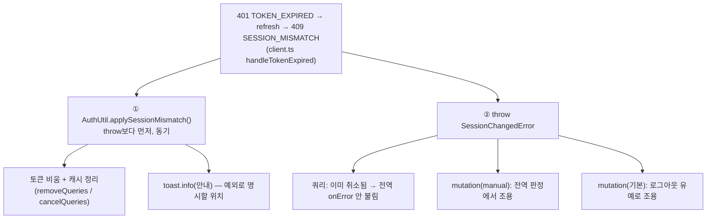

# SESSION_MISMATCH 안내 토스트 — 토스트 단일 소유 원칙에 예외 명시

## Context

FE #391에서 refresh가 409 `SESSION_MISMATCH`면 `AuthUtil.applySessionMismatch`(`src/shared/utils/auth.util.ts:104-107`)가
이 탭만 로그아웃하고 `toast.info`(id `'session-mismatch'`)를 띄운다. 이 함수는 `client.ts:276`(handleTokenExpired catch)에서
동기로 불려, `.claude/CLAUDE.md:644` "transport 레이어(`shared/api/client.ts`)는 UI 토스트를 띄우지 않는다"와 겹친다.
#391 PR 본문 "확인이 필요한 점"으로 남겨 둔 것을 정리한다.

**사용자 결정(2026-10-15)**: (a) 규칙에 예외를 명시한다. 코드는 바꾸지 않는다. (b-1) "스토어 표시 + AuthProvider 훅" 이동안은
채택하지 않았다 — 안내가 시작되는 곳은 그대로 transport이고 토스트 호출만 한 틱 뒤로 옮겨져 소유가 실제로 바뀌지 않으며, 새
상태·훅·테스트만 늘어난다.

### 결정 근거 (대화에서 확인한 사실)

- **규칙의 목적**: `fc012c7e`(2026-06-28) "에러 토스트 중복 제거" — client.ts·전역 핸들러·개별 hook이 **같은 에러**에 각자
  토스트를 띄워 두 번 뜨던 버그. 바로 다음 커밋 `e5e2526d`가 규칙으로 명문화. 이 안내는 info이고 id로 중복 방지, 늦은 401은
  `client.ts:275` 확인으로 재표시 없음, 같은 순간의 `SessionChangedError` 에러 토스트는 로그아웃 유예로 꺼짐(`error-toast.ts:70-73`).
- **전역 핸들러는 이 안내를 띄울 수 없다**: `applySessionMismatch`가 throw보다 먼저 캐시를 정리한다. 쿼리는
  `removeQueries`(silent cancel)·`cancelQueries`(revert cancel)로 취소돼 query-core 5.90.16 `query.ts:568-583`에서
  `#cache.config.onError`(`:590`)에 닿기 전에 빠진다. mutation은 `manualErrorHandling`이나 로그아웃 유예로 조용하다(코드 읽기로
  확인, 실행 재현은 안 함).
- **선례**: 인증 정리 중 UI 부수 효과는 이미 transport 경로에 있다(`clearAll()` → `NavigationService.navigate`). 인증 상태 변경
  안내는 정리하는 코드가 띄운다(`useAuthEpochSync.ts:79` `switchedToOtherAccount`).



## 변경 내용 (문서 2곳 + 계획 스냅샷, 코드 변경 없음)

### 1. `.claude/CLAUDE.md:644` — 예외를 하위 bullet로 추가

기존 bullet은 그대로 두고 바로 아래에 붙인다(범위를 좁혀 transport에 에러 토스트가 다시 들어오는 선례가 되지 않게):

```markdown
- transport 레이어(`shared/api/client.ts`)는 UI 토스트를 띄우지 않는다 — 인증 정리·throw만.
  - **예외**: 인증 상태가 바뀌어 이 탭을 정리할 때의 안내(`toast.info`) 토스트는 `AuthUtil`이 띄운다
    (`applySessionMismatch` — refresh 409 `SESSION_MISMATCH`). 그 정리가 throw보다 먼저 캐시를 취소·삭제해 전역
    핸들러에서는 이 안내가 뜰 수 없다(`docs/AUTH.md` §8-B "토스트 위치"). 중복 방지 `id`를 붙이고, 에러 토스트는
    이 예외에 들지 않는다 — 여전히 전역 핸들러만 띄운다.
```

### 2. `docs/AUTH.md` §8-B "토스트 위치" bullet(`:324-328`) 다시 쓰기 + 머리말 `마지막 검토` → `2026-10-15`

"규칙과 겹칩니다" → "규칙에 예외로 명시했습니다"로 바꾸고, 전역 핸들러로 못 옮기는 이유를 manualErrorHandling만이 아니라
캐시 정리 순서(쿼리 취소 → onError 미호출)까지 적는다. 규칙의 목적(2026-06-28 `fc012c7e` 에러 토스트 중복)도 한 줄로 남긴다.
AUTH.md는 경어체(`~합니다`)라 그 문체를 따른다.

### 3. `docs/plans/2026-10-15-session-mismatch-toast-exception.md` — 이 계획 스냅샷(§11)

## 영향 범위 (§5)

- **코드·CRUD**: 변경 없음. 런타임 동작·테스트 단언(`client.test.ts` Case 8-1의 `toastInfo`) 그대로.
- **옛 동작을 단정하는 문서**: AUTH.md §8-B "토스트 위치"(이번에 갱신). `docs/plans/2026-10-15-drift-ci-and-refresh-guard.md`와
  #391 PR 본문은 append-only/과거 기록이라 두고, 새 계획 파일이 이어받는다.
- **건드리지 않는 것**: `docs/FE-ARCHITECTURE.md` §13(transport 규칙 문구가 없음), `client.ts:389` 주석(NOT_LOGGED_IN 분기라
  여전히 맞음), `auth.util.ts` JSDoc, CHANGELOG(docs 전용 커밋).

## 실행 순서

1. `git log origin/main..main` 확인(계획 시점 비어 있음) → `EnterWorktree` → `cp ../../../.env .` → `pnpm install`
2. 위 1·2 편집 → `pnpm check:docs`, `pnpm exec prettier --check .claude/CLAUDE.md docs/AUTH.md docs/plans/<새 파일>`
3. 계획 파일을 `docs/plans/`로 복사, `.gitmessage` 읽고 `docs(config): ...` 한 커밋(새 계획 파일은 `git add -- <파일>` 후
   경로 지정 커밋)
4. fresh general-purpose 서브에이전트에 계획 파일 + diff 대조 → PR 본문 `## 계획 대비 구현`
5. push → PR 생성 → CI 통과 확인 후 보고. 병합은 사용자 확인 뒤(docs 전용이라 배포 워크플로가 안 돌 수 있음 — 병합 뒤
   `gh run list`로 확인하고, 안 돌았으면 런타임 변경이 없어 배포 불필요함을 보고), 병합 확인 뒤 워크트리 정리

## 검증 방법

- `pnpm check:docs` 통과(CLAUDE.md·AUTH.md가 가리키는 경로·줄 번호)
- Prettier 검사 통과(lint-staged와 같은 포맷)
- PR CI(`ci.yml`) 전부 green, "docs/plans 불변성 확인" 스텝 통과(새 파일만 추가)
- 서브에이전트 대조 결과에 "계획에 없던 변경" 없음
