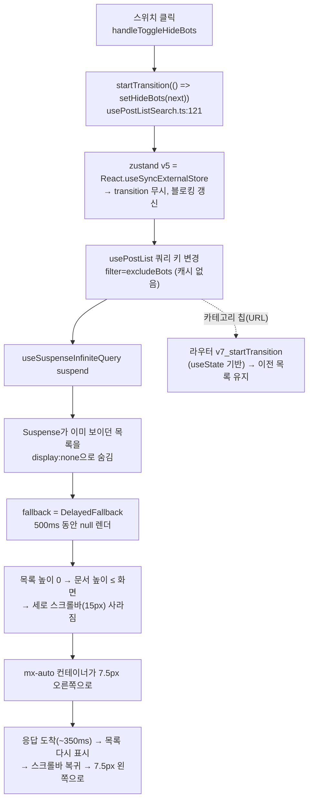

# 봇 글 숨기기 토글 시 피드가 좌우로 7.5px 흔들리는 문제

> 봇 숨기기 store 값을 `useDeferredValue`로 늦춰, 다른 필터 칩처럼 "이전 목록 유지 + 늦으면 적용 중 표시"로 바꾼다.

## Context

### 증상

봇 글 숨기기 스위치를 누르면 피드 전체가 살짝 오른쪽으로 갔다가 왼쪽으로 돌아온다.

### 재현 절차 (2026-10-16 직접 측정)

운영(`https://linksphere.click/post`)에서 토글 직후 DOM 변경마다 레이아웃 값을 기록했다
(Playwright 6개 시나리오 + 사용자 Chrome 1회, `requestAnimationFrame`/`MutationObserver` 샘플링).

| 시나리오                              | 목록 숨김(`display:none`) | 문서 높이                     | 비고                                         |
| ------------------------------------- | ------------------------- | ----------------------------- | -------------------------------------------- |
| A. 봇 숨기기 OFF→ON, 캐시 없음        | 37~337ms                  | 7147 → **900(=화면)** → 3207… | 요청 30ms·응답 348ms와 정확히 겹침           |
| B·C. 봇 숨기기 재토글, 캐시 있음      | 없음                      | 변화 없음                     | 요청 없음                                    |
| D. 카테고리 칩 켜기, 캐시 없음 (대조) | **없음**                  | 7147 → 3163(줄기만)           | 같은 "새 조회"인데 목록이 안 숨겨짐          |
| F. A와 같음 + 1500px 내린 상태        | 11~161ms                  | 9884 → 900                    | `scrollY` 1500 → **0** → 1500 (튐)           |
| 사용자 Chrome (스크롤바 15px)         | 9~354ms                   | 7147 → 929(=화면)             | 스크롤바 15→0→15, 제목 x 528.5→**536**→528.5 |

### 근본 원인

1. `usePostListSearch.ts:116-125`는 store 갱신을 `startTransition`으로 감싸 "스켈레톤으로 떨어지지 않게" 했다고 주석에 적었다.
2. 하지만 zustand v5는 `React.useSyncExternalStore`로 구독한다(`node_modules/zustand/esm/react.mjs:6`).
   [react.dev useSyncExternalStore 주의 사항](https://react.dev/reference/react/useSyncExternalStore#caveats)은
   _"외부 store의 변경은 non-blocking Transition으로 표시할 수 없어 가장 가까운 Suspense fallback을 띄운다"_ (번역)고 쓴다.
3. 그래서 `usePostList.ts:165`의 `hideBots`가 바뀌면 쿼리 키가 동기적으로 바뀌고 `PostList.tsx`의 `AsyncBoundary`가 이미 보이던 목록을 숨긴다(측정: `display:none` 확인).
4. fallback인 `DelayedFallback`은 처음 500ms(`LOADING_INDICATOR_DELAY_MS`) 동안 `null`이다. 응답이 그 전에 오면 스켈레톤은 안 보이고 목록 자리만 비는데, 이때 문서가 화면보다 짧아져 스크롤바가 사라진다.
5. `AppLayout.tsx:61`의 `container max-w-6xl mx-auto`가 중앙 정렬이라, 스크롤바 폭(15px)의 절반만큼 좌우로 움직인다.

추정(검증 안 함): 2026-09-06 도입 당시 "스켈레톤이 안 뜬다"는 확인은 `startTransition`이 아니라 `DelayedFallback`의 500ms 지연 덕분이었을 가능성이 크다. `docs/DECISIONS.md:2685`도 "이미 해결돼 있다(수동 QA로만 확인)"고 적었다.

발생 조건: 바꾸려는 조건의 목록이 캐시에 없을 때만(페이지 진입 후 첫 토글, 또는 gcTime 5분 뒤). 가로 흔들림은 일반 스크롤바(Windows, 마우스 연결 macOS 등)에서만 보이고, 오버레이 스크롤바 기기에서도 목록이 ~0.3초 비고, 스크롤을 내린 상태면 위치가 튄다.

## 판단이 필요했던 항목

| 항목                                                | 결정                                                                       | 근거·기각한 대안                                                                                                                                                                                                                                                                                                                                                          |
| --------------------------------------------------- | -------------------------------------------------------------------------- | ------------------------------------------------------------------------------------------------------------------------------------------------------------------------------------------------------------------------------------------------------------------------------------------------------------------------------------------------------------------------- |
| 고칠 지점                                           | `usePostList`에서 store 값을 `useDeferredValue`로 늦춰 쿼리 키에 쓴다      | [react.dev useDeferredValue](https://react.dev/reference/react/useDeferredValue)는 _"새 값으로 인한 백그라운드 갱신이 suspend하면 fallback 대신 이전 값을 데이터가 올 때까지 보여 준다"_ (번역)고 쓴다. 기각: `scrollbar-gutter: stable`(가로 흔들림만 가리고 목록 공백·스크롤 튐은 남음, 짧은 페이지에도 오른쪽 여백 상시) / store를 React state·context로 이전(범위 큼) |
| 봇 토글에도 "적용 중" 표시                          | 붙인다 (`usePostListApplying`에 `hideBots !== deferredHideBots` 신호 추가) | 고치면 이전 목록이 남는데, 응답이 늦을 때 아무 표시가 없으면 "눌렀는데 반응 없음"이 된다. URL 칩과 동작을 맞추고 `docs/SEARCH.md` §11 남은 것 1번을 해소. 기각: 표시 없이 두기                                                                                                                                                                                            |
| `usePostListSearch`의 낙관적 미러·`startTransition` | 제거하고 스위치는 store 값을 직접 쓴다                                     | `startTransition`은 효과가 없고, 미러는 그것 때문에 생긴 우회다. store 갱신이 동기라 스위치는 미러 없이도 즉시 반응한다. 틀린 주석을 남기면 같은 오해가 재발한다                                                                                                                                                                                                          |

## 세부 계획

| 위치                                                                              | 변경 내용                                                                                                                                                                                                               |
| --------------------------------------------------------------------------------- | ----------------------------------------------------------------------------------------------------------------------------------------------------------------------------------------------------------------------- |
| `src/widgets/post/post-list/hooks/usePostList.ts:165` (`usePostList`)             | `hideBots`를 `useDeferredValue(useHideBotsStore(...))`로 받아 `buildCombinedFilter`에 넘긴다. 주석에 react.dev 두 링크                                                                                                  |
| `src/widgets/post/post-list/hooks/usePostList.ts:134-156` (`usePostListApplying`) | `hideBots`와 그 deferred 값이 다르면 적용 중으로 본다(URL 판정과 OR). JSDoc의 "봇 글 숨기기는 … 잡히지 않는다" 문장 수정                                                                                                |
| `src/widgets/post/post-list/hooks/usePostListSearch.ts:105-125`                   | `optimisticHideBots`·`prevHideBots` 미러와 `flushSync`/`startTransition` 제거, `handleToggleHideBots`는 `setHideBots(!hideBots)`. 반환 키 `optimisticHideBots` → `hideBots`. 쓰지 않게 된 `startTransition` import 정리 |
| `src/widgets/post/post-list/ui/PostListSearch.tsx:19,96`                          | 반환 키 변경 반영                                                                                                                                                                                                       |
| `src/widgets/post/post-list/ui/PostList.test.tsx`                                 | 회귀 테스트 추가(`:220` 선례 형태): 봇 토글 + `excludeBots` 응답 지연 시 ① 이전 목록이 `toBeVisible()`로 남아 있다 ② 0.5초 뒤 "적용 중" 표시, 응답 후 걷힘 ③ 빠른 응답이면 표시 없음                                    |
| `docs/SEARCH.md` §5(175줄)·§10 시행착오·§11 남은 것·마지막 검토                   | 봇 토글 판정 서술 갱신, 위 측정·원인을 시행착오에 추가, 남은 것 1번 삭제                                                                                                                                                |
| `docs/POST.md:180`                                                                | `usePostList.ts` 줄 번호 갱신                                                                                                                                                                                           |
| `CHANGELOG.md` `[Unreleased]`                                                     | Fixed 항목 추가(`changelog-release` skill 형식)                                                                                                                                                                         |

## 영향 범위 (§5)

- **CRUD**: 목록 조회(read)만. 쓰기 없음. 쿼리 키·API 파라미터는 그대로(`filter=excludeBots`)라 캐시·무효화 경로 변화 없음.
- **사용처**(`pnpm graph:focus --text`): `usePostList.ts` ← `PostList.tsx`, `usePostListSearch.ts` / `usePostListSearch.ts` ← `PostListSearch.tsx`. `PostList`는 피드(`pages/post/index.tsx`)에서만 렌더.
- **회귀 후보**:
  - `PostListSearch.test.tsx:106,144` — 스위치 토글·외부 변경 추종 테스트(미러 제거 후에도 통과해야 함)
  - `e2e/post-list-filters.spec.ts:56` — 스위치 `data-state`와 API 파라미터 검사(동작 불변)
  - `usePostListErrorReset`의 `resetKeys`는 즉시 값 `hideBots`를 계속 쓴다 — 에러 상태에서 토글하면 경계가 리셋되고 그 렌더는 이전(deferred) 키로 다시 그려진 뒤 새 키로 넘어간다. 테스트 `PostList.test.tsx:103` 계열과 같은 흐름인지 구현 때 확인
  - 오류 응답: 새 키 조회가 실패하면 deferred 렌더에서 에러 경계로 간다(지금과 같음)

## 검증 방법

1. 새 회귀 테스트를 먼저 작성해 **수정 전 실패**(①이 `display:none`으로 실패)를 확인 → 수정 후 통과
2. `pnpm type-check` → `pnpm test` → `pnpm lint`·`pnpm check:deps` → `pnpm check:docs`
3. 로컬 dev + 사용자 Chrome(스크롤바 15px)에서 이번 `MutationObserver` 측정 스크립트 재실행:
   스크롤바 폭 15 유지, 제목 x 고정, `listHidden` 항상 false, 문서 높이가 화면 이하로 안 떨어짐. 1500px 내린 상태에서 `scrollY` 유지
4. DevTools 네트워크 지연으로 응답을 늦춰 "결과를 불러오는 중" 표시 확인, 카테고리 칩 동작 회귀 없음 확인
5. `browser-verification` skill로 토글 전후 녹화

## 남은 것

- 같은 함정의 다른 사례: `useSuspense*`를 쓰는 파일 중 zustand store(`Store(`)도 읽는 곳은 `usePostList.ts` 하나뿐이다(grep 확인).
  store 값이 prop으로 넘어가 다른 파일의 suspense 쿼리 키가 되는 간접 경로까지는 확인하지 않았다.
