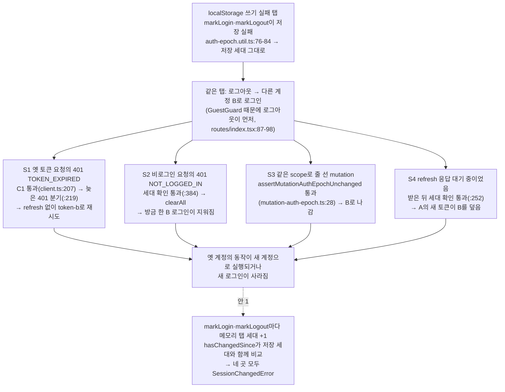

# localStorage에 쓰지 못하는 탭에서 같은 탭 로그인·로그아웃도 인증 세대로 알아채기

> 요약: localStorage 쓰기가 실패하는 탭은 같은 탭에서 명시적으로 로그인·로그아웃해도 인증 세대가 바뀌지 않는다. 그래서
> 옛 토큰으로 보낸 요청이 새 계정으로 실행되거나(S1·S3·S4), 방금 한 로그인이 지워진다(S2). 먼저 4가지를 테스트로
> 재현하고, 재현되면 `AuthEpochUtil`에 메모리 "탭 안 세대"를 더해 `hasChangedSince`가 함께 비교하게 고친다.
> FE PR 1개.

## Context

### 계기

`docs/plans/2026-10-15-drift-ci-and-refresh-guard.md`의 "남은 것" 셋째 항목이다. 사용자가 고치기 전에 재현 테스트로
실제로 일어나는지부터 확인하길 원했다(2026-10-16). 범위는 S1~S4 모두 재현하고, 재현되면 안 1(메모리 탭 세대)로
고친다 — 사용자가 고른 것이다.

### 가설 (코드 추적, 아직 재현 전)

- 저장이 실패하면 `write()`가 다시 읽은 값(옛 값)으로 메모리를 맞춘다(`auth-epoch.util.ts:76-84`). 그래서
  `hasChangedSince`가 계속 false다.
- BE의 409 `SESSION_MISMATCH` 확인(10-15)은 refresh를 거칠 때만 작동한다. S1(refresh를 건너뜀)·S2·S3(401·refresh
  없음)에는 닿지 않는다. 그래서 `docs/AUTH.md:1069-1073`이 "localStorage 쓰기 실패"까지 해소됐다고 적은 것은 같은 탭
  경우엔 틀렸다.
- **정정**: "로그아웃 요청 자체가 TOKEN_EXPIRED를 받아 refresh로 다시 로그인된다"는 일어나지 않는다. BE
  `/auth/logout`이 permitAll이다(BE `SecurityConfig.kt:45`, 직접 확인).
- **빈도**: 옛 토큰 요청(또는 refresh)이 서버에 가 있는 몇 초 안에 로그아웃과 다른 계정 로그인을 끝내야 한다. 드물다.
  테스트는 경로가 열려 있음을 보여줄 뿐 빈도를 보여주지 않는다.

### 재현 절차

공통: `vi.spyOn(Storage.prototype, 'setItem')`이 던지게 해서 처음부터 쓰기가 실패하는 탭을 만든다. 선례는
`auth-epoch.util.test.ts:47-56`이다. `LocalStorageUtil.setItem`은 이 예외를 삼킨다(`storage.util.ts`). 같은 탭의
계정 전환은 실제 호출 순서대로 흉내 낸다: `clearAuth()` → `markLogout()` → `setAuth('token-b')` → `markLogin()`
(`auth.queries.ts:37-38`, `:93-102`, 선례 Case 7-5·7-6).

| 테스트        | 장면                                                                       | 지금 코드에서 예상하는 실패                                      |
| ------------- | -------------------------------------------------------------------------- | ---------------------------------------------------------------- |
| Case 9-1 (S1) | token-a로 보낸 댓글이 서버에 있는 동안 계정 전환 → 401 `TOKEN_EXPIRED`     | resolve됨, 보낸 토큰 `['token-a','token-b']`(B로 재실행)         |
| Case 9-2 (S2) | 비로그인으로 보낸 댓글이 서버에 있는 동안 B로 로그인 → 401 `NOT_LOGGED_IN` | `ApiError`, 토큰 null, `/auth/login` 이동(방금 한 로그인 지워짐) |
| Case 9-3 (S4) | token-a의 401 → refresh 대기 중 계정 전환 → refresh 200(`token-a2`)        | resolve됨, 스토어 토큰 `token-a2`(B를 덮음)                      |
| S3 (mutation) | 같은 scope 줄에서 기다리는 사이 `markLogout()`·`markLogin()`               | 줄 선 mutation이 `send`됨(resolve `'sent'`)                      |

재시도된 요청에는 MSW가 성공을 돌려준다. 401을 돌려주면 재시도 상한(`client.ts:226-230`)에서 영원히 끝나지 않는
Promise가 돼, 깔끔한 실패 대신 타임아웃이 난다.

### 근본 원인

인증 세대가 localStorage 값 하나뿐이다. 같은 탭의 명시적 로그인·로그아웃을 알아채는 길이 그 값이 실제로 저장됐을 때만
열린다.

## 판단이 필요했던 항목

| 항목                | 결정                                                                                                                  | 근거·기각한 대안                                                                                                                                                                                                                                                                                                                                                        |
| ------------------- | --------------------------------------------------------------------------------------------------------------------- | ----------------------------------------------------------------------------------------------------------------------------------------------------------------------------------------------------------------------------------------------------------------------------------------------------------------------------------------------------------------------- |
| 재현 범위           | **S1~S4 모두**(사용자 결정)                                                                                           | S1만 재현하면 안 1이 S2~S4까지 바꾸는 근거가 테스트로 남지 않는다                                                                                                                                                                                                                                                                                                       |
| 고칠 방법           | **안 1 메모리 탭 세대**(사용자 결정)                                                                                  | 안 2(늦은 401 분기만): S1만 막는다. 카운터를 `request()`·`handleTokenExpired`·대기 재시도 클로저로 넘겨야 해서 `client.ts` 수정이 오히려 많다. 안 3(토큰 계보, refresh로 보내 BE 409에 맡김): 비밀번호 변경(`auth.queries.ts:198`) 뒤 늦은 401이 refresh를 불러 회전이 연쇄로 일어나고 로그아웃될 수 있다. B의 대기 요청까지 끝내며, S2~S4는 남는다. 안 4(문서만): 기각 |
| 세대 값의 모양      | `ofToken()`이 `{ stored, inTab }` 객체(타입 `AuthEpoch`)를 돌려준다. 공개 static 2개의 시그니처가 바뀐다(사용자 승인) | 불투명 문자열(`${stored}\|${n}`)로 하면 `client.ts`는 안 고쳐도 되지만, 문자열 인코딩이 숨은 규약이 된다. 어차피 `auth-epoch.util.test.ts`의 값 비교는 다시 써야 한다                                                                                                                                                                                                   |
| 탭 세대를 넣는 곳   | `hasChangedSince`에만 넣는다. `isStale`·`knownEpoch`·`acknowledge`에는 넣지 않는다                                    | 넣으면 쓰기 실패 탭이 자기 로그인을 다른 탭의 변화로 보고 `useAuthEpochSync`(`:56`)가 스스로 로그아웃시킨다. `write()` 주석(`:78-81`)이 막으려던 것이다                                                                                                                                                                                                                 |
| 탭 세대를 바꾸는 때 | `write()`(markLogin·markLogout)에서만 +1. refresh·`bindToken`·부트스트랩은 바꾸지 않는다                              | refresh가 바꾸면 Case 1-3(늦은 401은 refresh 없이 재시도)이 깨진다                                                                                                                                                                                                                                                                                                      |
| 저장 정상 탭        | 동작 변화 없음                                                                                                        | 탭 세대가 바뀌는 때는 저장값도 새 UUID로 바뀐다. 그래서 결과가 같다                                                                                                                                                                                                                                                                                                     |

## 세부 계획

### 1단계 — 재현 (고치기 전 코드)

| 위치                                                            | 변경 내용                                                                                                                                                                                                                                                                                                                               |
| --------------------------------------------------------------- | --------------------------------------------------------------------------------------------------------------------------------------------------------------------------------------------------------------------------------------------------------------------------------------------------------------------------------------- |
| `src/shared/api/client.test.ts` (Case 8 뒤)                     | `describe('Case 9: 인증 세대를 저장하지 못하는 탭 (localStorage 쓰기 실패)')`. beforeEach에서 `Storage.prototype.setItem` 스파이가 던지게 하고, afterEach에서 `mockRestore()` 한다(설정에 `restoreMocks`가 없다, 선례는 Case 8의 `toastInfo`). 같은 탭 계정 전환 헬퍼 1개. it 3개(9-1·9-2·9-3)를 단다. 단언은 고친 뒤의 기대값으로 쓴다 |
| `src/shared/lib/react-query/config/mutation-auth-epoch.test.ts` | it 1개를 추가한다: 쓰기 실패 + 줄에서 기다리는 사이 `markLogout()`·`markLogin()` → `SessionChangedError`, `send` 미호출. 기존 `startQueuedPair`를 재사용하고 afterEach에서 `vi.restoreAllMocks()` 한다                                                                                                                                  |

`pnpm test`로 두 파일을 돌려 4개가 위 표의 증상으로 실패하는지 기록한다(PR 본문에 실을 출력). **S1이 재현되지 않으면
멈추고 보고한다. 형제(S2~S4) 중 재현되지 않는 것이 있어도 고치기 전에 보고한다.**

### 2단계 — 수정 (안 1)

| 위치                                                                    | 변경 내용                                                                                                                                                                                                                                                                                                                                                                                                                                   |
| ----------------------------------------------------------------------- | ------------------------------------------------------------------------------------------------------------------------------------------------------------------------------------------------------------------------------------------------------------------------------------------------------------------------------------------------------------------------------------------------------------------------------------------- |
| `src/shared/utils/auth-epoch.util.ts`                                   | `export interface AuthEpoch { stored: string \| null; inTab: number }`과 모듈 변수 `inTabEpoch = 0`을 추가한다. `write()`에서 +1, `ofToken()`은 `{ stored: tokenEpoch, inTab: inTabEpoch }`, `hasChangedSince(epoch: AuthEpoch)`는 저장값 또는 탭 세대가 다르면 true, `reset()`은 0으로 되돌린다. 머리 주석에 탭 안 세대와 "isStale에는 넣지 않는다"를 적고, 호출부 순서(setAuth 다음 markLogin, clearAuth 다음 markLogout) 불변식도 적는다 |
| `src/shared/api/client.ts:205`, `:315`                                  | `authEpoch` 매개변수 타입을 `AuthEpoch`로 바꾼다. 같은 줄의 기존 import에 `type AuthEpoch`를 더한다(줄 수 유지 — AUTH.md가 `client.ts:123/124/219/374`를 가리킨다). 분기 로직은 바꾸지 않는다                                                                                                                                                                                                                                               |
| `src/shared/lib/react-query/config/mutation-auth-epoch.ts:10`, `:23-31` | WeakMap 값 타입을 `AuthEpoch`로 바꾼다. `has` + `?? null`을 `get` 결과가 없으면 return으로 바꾼다                                                                                                                                                                                                                                                                                                                                           |
| `src/shared/utils/auth-epoch.util.test.ts`                              | `ofToken()`을 문자열과 비교하던 단언(L60-64, L70-81, L84-86, L94)을 `.stored`나 `hasChangedSince`로 고친다. 추가: "저장이 실패해도 이 탭의 로그인·로그아웃은 `hasChangedSince`가 알아챈다", "`bindToken`(refresh)만으로는 탭 세대가 바뀌지 않는다". 기존 L47-56(쓰기 실패해도 `isStale` false)은 그대로 둔다                                                                                                                                |
| `docs/AUTH.md`                                                          | §8-B "인증 세대가 바뀐 뒤 돌아온 401"에 탭 안 세대 항목을 추가하고, 의사코드 주석과 mermaid의 "요청 세대" 노드도 고친다. SESSION_MISMATCH 절 첫 문단(:298-301)은 BE 확인이 다른 탭 경우를 맡는다고 고친다. §9 표에 Case 9 행을 넣고 줄 범위와 "12 Case" 수를 고친다. §11-10(:1069-1073) 정정과 2026-10-16 해소 문단, §12 용어 사전("탭 안 세대", `tokenEpoch` 항목)도 고친다. "마지막 검토" 날짜를 갱신한다                                 |
| `CHANGELOG.md`                                                          | `[Unreleased]` Fixed 1항목(`changelog-release` skill)                                                                                                                                                                                                                                                                                                                                                                                       |
| `docs/plans/2026-10-16-in-tab-auth-epoch.md` (신규)                     | 이 계획의 스냅샷(§11)                                                                                                                                                                                                                                                                                                                                                                                                                       |

수정 뒤 4개가 통과하는지 확인한다. 그다음 `hasChangedSince`의 탭 세대 비교를 잠깐 빼서 4개가 다시 실패하는지
대조하고(고친 코드에 기대는 테스트인지 확인), 원래대로 되돌린다.

## 영향 범위 (§5)

**CRUD**: 서버 데이터 계약은 바뀌지 않는다. 바뀌는 건 쓰기 실패 탭에서 같은 탭 계정 전환을 사이에 둔 요청이
새 계정으로 **실행되지 않게** 되는 것뿐이다. 다음 요청들은 이제 `SessionChangedError`로 끝난다: 댓글·좋아요 등 생성·삭제
요청(S1·S3), 조회(S2의 401은 clearAll 대신 이 에러), refresh 결과(S4).

**사용자가 체감하는 변화(쓰기 실패 탭만)**: 계정 전환 순간 진행 중이던 요청이 실패로 끝난다. mutation에는 _"로그인
상태가 바뀌어서 처리되지 않았어요. 다시 시도해 주세요."_ 토스트가 뜨거나(로그아웃 유예가 끝난 뒤라면), 각자의 실패
문구가 뜬다(`manualErrorHandling`). 쓰기 정상 탭의 Case 7과 같은 동작이다.

**회귀 후보** (`auth-epoch.util.ts` import처: `auth.store.ts`·`client.ts`·`mutation-auth-epoch.ts`·`auth.queries.ts`·
`account.queries.ts`·`useAuthEpochSync.ts` + 테스트 — grep 결과이고, 구현 전 `pnpm graph:focus` 출력으로 다시 확인)

- Case 1-1·1-2·1-3·8은 사이에 markLogin·markLogout이 없어 영향이 없다. Case 7은 매번 저장값이 바뀌어 결과가 같다.
- `useAuthEpochSync`는 `isStale`·`acknowledge`·`isLoginEpoch`만 쓰고, 이 함수들은 바뀌지 않는다.
- 로그아웃의 `clearQueries` → `resetQueries`가 `clearAuth`와 `markLogout` 사이에 queryFn을 동기로 부를 수 있다. 이
  요청의 `NOT_LOGGED_IN`은 쓰기 실패 탭에서도 `SessionChangedError`가 된다(지금은 `ApiError`). 쓰기 정상 탭과 같고,
  로그아웃 유예 중이라 토스트도 없다. (Plan 에이전트가 query-core 5.90.16 소스로 추적했다. 구현 때 설치본
  `node_modules/@tanstack/query-core/package.json` 버전과 줄을 다시 확인해 PR에 남긴다.)
- `mutation-auth-epoch` 호출부 6곳(`bookmark-folder.queries.ts`·`interaction.queries.ts`)은
  `assertMutationAuthEpochUnchanged(context)`만 부르므로 바꿀 필요가 없다.
- `auth-epoch.util.test.ts`가 이전 계약(`ofToken()` = 저장 문자열)을 단정한다 → 위 표대로 다시 쓴다.
- 문서: AUTH.md §8-B·§9·§11-10·§12. `pnpm check:docs`가 줄 번호를 검사한다.

## 실행 전략

- `EnterWorktree`로 들어간다(진입 전 `git log origin/main..main` 비어 있음 확인함). 들어가서 `node -v`를 v24로 확인하고
  `cp ../../../.env .`, `pnpm install`을 한다.
- 1단계 재현 결과를 기록한 뒤 2단계로 간다. 재현 테스트와 수정은 같은 커밋·같은 PR에 넣는다. 실패하는 테스트만 따로
  올리면 pre-push·CI가 막는다.
- 커밋 전 `.gitmessage`를 읽는다. `fix(auth)` 커밋에 CHANGELOG를 포함한다.
- 계획 스냅샷을 커밋하고, fresh general-purpose 서브에이전트로 계획 대비 구현을 대조한다. PR 본문에는 `## 계획 대비 구현`과
  재현 출력을 넣는다. CI가 green인지 확인한다.
- 병합은 사용자 확인 뒤 `--squash`로 한다 → 배포 워크플로 success 확인 → 워크트리 정리.

## 검증 방법

- 1단계: `pnpm test src/shared/api/client.test.ts src/shared/lib/react-query/config/mutation-auth-epoch.test.ts` → 새 4개가
  위 표의 증상으로 실패하고, 기존 테스트는 통과한다.
- 2단계: 같은 명령이 전부 통과한다. 탭 세대 비교를 잠깐 빼면 새 4개만 다시 실패한다(되돌린 뒤 diff가 없는지 확인).
- 전체: `pnpm type-check` → `pnpm test` → `pnpm lint` → `pnpm check:deps` → `pnpm check:docs`.
- UI는 바뀌지 않아 브라우저 녹화는 하지 않는다. 쓰기 실패 탭을 e2e로 만드는 것(`addInitScript`로 `setItem` 덮기)은
  단위 테스트가 같은 경로를 덮으므로 하지 않는다.

## 남은 것

- 다른 탭에서 계정이 바뀐 경우(쓰기 실패 탭이나 업데이트 전 번들 탭)는 여전히 BE 409에만 기댄다. 그 409도 refresh를
  거쳐야 닿으므로, 다른 탭 전환 + 이 탭의 늦은 401(refresh를 건너뜀)은 이 탭의 토큰이 바뀌지 않는 한 일어나지 않는다.
  이 탭이 새 토큰을 받는 길(받아들이기)은 세대가 바뀐 경로라 C1이 막는다 — 새 틈은 아니고 기록만 한다.
- S4의 refresh 실패 변형(지금은 `client.ts:264` 확인이 통과해 clearAll로 B가 로그아웃)도 같은 수정으로 막히지만, 테스트는
  성공 변형 하나만 둔다.
