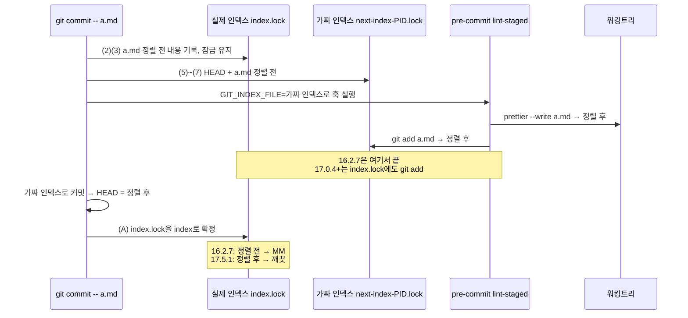

# 경로 지정 커밋 뒤 인덱스가 정렬 전 내용으로 남는 문제(MM) 해소

> lint-staged를 16.2.7 → 17.5.1로 올린다. 이 문제를 업스트림이 이미 고쳤다. 같은 증상을 재현하는
> 회귀 테스트를 CI에 붙인다. BE는 훅이 파일을 고치지 않아 변경하지 않는다.

## Context

### 무엇이 문제인가

FE 워크트리에서 새 파일을 `git add -- <파일>`한 뒤 `git commit -F <메시지> -- <경로...>`로 커밋했다. 그러면
pre-commit의 lint-staged(`prettier --write`)가 정렬한 결과는 HEAD와 워킹트리에 들어간다. 그런데 실제 인덱스에는
정렬 전 내용이 남아 `git status`가 `MM`이다. 2026-10-15 FE #398(커밋 051a10af)에서 대조 subagent가 발견했고,
그때는 `git restore --staged`로 손으로 정리했다(메모리 `path-commit-leaves-stale-index.md`).

이 순서(새 파일 add → 경로 지정 커밋)는 CLAUDE.md "메인 체크아웃에서 git add 금지" 절이 정한 정식 절차다.
bash-guard도 이 절차만 허용한다(`.claude/hooks/bash-guard.mjs:203-241`). 그래서 prettier가 고치는 커밋마다
문제가 다시 생긴다.

### 가설과 확인 결과

| 가설(요청 원문)                                  | 확인 결과                                                                                                                                                                               | 근거 종류                                                                               |
| ------------------------------------------------ | --------------------------------------------------------------------------------------------------------------------------------------------------------------------------------------- | --------------------------------------------------------------------------------------- |
| `git commit -- <paths>`는 임시 인덱스로 커밋한다 | **맞다.** git은 훅을 돌리기 **전에** 실제 인덱스(`index.lock`)에 경로의 워킹트리 내용(정렬 전)을 써 둔다. 훅은 따로 만든 가짜 인덱스 위에서 돌고, 커밋 뒤 실제 인덱스는 그대로 확정된다 | git 소스 주석(아래 인용)                                                                |
| lint-staged는 임시 인덱스와 워킹트리만 고친다    | **맞다(16.2.7).** 작업 뒤 `git add`를 한 번만 부르고 `GIT_INDEX_FILE`을 다루지 않는다. 그래서 그 add는 훅이 물려받은 가짜 인덱스에만 들어간다                                           | 직접 확인: `node_modules/lint-staged/lib/gitWorkflow.js:351`, `GIT_INDEX_FILE` 검색 0건 |
| 새 파일에서만 생기는가                           | **아니다(추론, 실측 전).** git의 (2)(3) 단계는 add 여부와 상관없이 경로의 워킹트리 내용을 실제 인덱스에 쓴다. 업스트림 17.0.4도 add 없는 경우를 고친 경우로 든다                        | git 소스, lint-staged 변경 이력. 검증 1단계에서 실측                                    |

> 부분 커밋. (0) 영향받는 경로 집합을 찾는다 (1) 실제 인덱스 파일에 잠금을 건다 (2) 주어진 경로로 the_index를
> 갱신한다 (3) the_index를 실제 인덱스에 쓴다(잠금은 유지) (4) 가짜 인덱스 파일에 잠금을 건다 (5) HEAD에서
> the_index를 다시 만든다 (6) (2)와 같은 방식으로 갱신한다 (7) 가짜 인덱스 파일에 쓴다 (…) 호출자는 잠긴 가짜
> 인덱스 위에서 훅을 돌리고 거기서 커밋을 만들어야 한다. 그다음 (A) 모두 잘되면 실제 인덱스를 확정한다 (…)
> (번역, 생략)
>
> — git 소스 `builtin/commit.c`의 `prepare_index()` 주석, https://github.com/git/git/blob/master/builtin/commit.c

공식 문서는 임시 인덱스를 언급하지 않는다. [git-commit 문서](https://git-scm.com/docs/git-commit)는 `--only`를
_"명령줄에 지정한 경로의 갱신된 작업 트리 내용으로 커밋을 만들고, 다른 경로에 스테이징된 내용은 무시한다"_
(번역)라고 설명하고, 경로를 주면 이것이 기본 동작이라고 쓴다. 다른 저장소도 같은 증상을 겪었다.

> `git commit -- <paths>`는 임시 인덱스로 커밋한다. 파일을 고쳐 쓰는 pre-commit 훅(그 저장소의 lint-staged)은
> 그 임시 인덱스에만 다시 스테이징해서, 실제 인덱스에는 훅 이전 내용이 남았다. (번역)
>
> — keiranholloway/biffo-template PR #2119, https://github.com/keiranholloway/biffo-template/pull/2119

[spec-kitty#5903](https://github.com/spec-kitty/spec-kitty/issues/5903)도 같은 원리로 생긴 `MM`을 보고한다.
다만 그 사례는 훅이 경로 **밖** 파일을 스테이징한 경우다.

### 근본 원인과 업스트림 수정

lint-staged 17.0.4([#1788](https://github.com/lint-staged/lint-staged/pull/1788), 2026-05-09)가 이 경우를
고쳤다. [변경 이력](https://github.com/lint-staged/lint-staged/blob/main/CHANGELOG.md)은 고친 경우로
_"`<file>`을 고친 뒤 명시적인 `git add` 없이 `git commit <pathspec>`으로 커밋한 경우"_ (번역)를 든다.
17.5.1 코드는 활성 인덱스가 기본 `index.lock`이 아닌 잠금 파일이면 그 `index.lock`에도 `git add`를 한 번 더 한다.

> 활성 인덱스 파일이 기본이 아닌 잠금 파일이면, `git add`를 명시적으로 하지 않고 경로를 지정해 커밋하는
> 중이다. 이 경우 기본 인덱스도 갱신해야 한다. 그러지 않으면 커밋한 뒤에 diff가 남는다. (번역)
>
> — lint-staged v17.5.1 `lib/gitWorkflow.js` 주석, https://github.com/lint-staged/lint-staged/blob/v17.5.1/lib/gitWorkflow.js

### BE 영향

BE `.githooks/pre-commit`은 `ktlintCheck`만 돌린다(`.githooks/pre-commit:47`, BE README "pre-commit 훅 연결").
검사만 하고 파일을 고치지 않으니 어긋날 내용이 없다. unstaged 변경을 잠시 숨기는 `git apply -R`/`git apply`는
워킹트리만 건드리고 인덱스는 건드리지 않는다. 그래서 BE는 바꾸지 않는다(조건은 "남은 것" 참고).

## 판단이 필요했던 항목

| 항목        | 결정                                                        | 근거·기각한 대안                                                                                                                                                                                                                                                                                                                                                                                                                                                                                            |
| ----------- | ----------------------------------------------------------- | ----------------------------------------------------------------------------------------------------------------------------------------------------------------------------------------------------------------------------------------------------------------------------------------------------------------------------------------------------------------------------------------------------------------------------------------------------------------------------------------------------------- |
| 해결 방식   | **lint-staged 업그레이드**                                  | 원인이 lint-staged에 있고 업스트림이 같은 증상을 고쳤다. 자체 코드가 0줄이다. 아래 비교표 참고                                                                                                                                                                                                                                                                                                                                                                                                              |
| 버전        | **17.5.1 정확 고정**(`.npmrc` `save-exact=true` 기본값대로) | 17.6.0([#1854](https://github.com/lint-staged/lint-staged/pull/1854))은 _"작업이 수정한 모든 추적 파일의 변경을 스테이징한다"_ (번역). main 코드는 작업 전후 **워킹트리 전체** diff를 비교한다. 그래서 같은 워크트리를 쓰는 다른 에이전트가 그 몇 초 사이에 고친 파일도 커밋에 섞일 수 있다(코드로 추론, 실측 아님). CLAUDE.md 커밋 규칙과 충돌한다. 17.0.0~17.0.3에는 경로 커밋 회귀가 있었다(#1782·#1788에서 수정). 그래서 17.6.0 직전 버전인 17.5.1을 쓴다. 17.5.1은 처음 스테이징된 파일만 다시 add한다 |
| 회귀 감지   | **임시 git 레포로 재현하는 `node:test` 테스트 + CI 스텝**   | 문서 규칙 대신 자동 검사로 막는다(메모리 `enforce-rules-with-checks-not-docs`). 나중에 누가 lint-staged를 올리거나 내려서 문제가 다시 생기면 CI가 잡는다. 형태는 `.claude/hooks/guards.test.mjs:22-43`(임시 디렉터리에 실제 git 레포·워크트리를 만드는 node:test)를 본뜬다                                                                                                                                                                                                                                  |
| 테스트 위치 | `.husky/scripts/`(지키는 훅 스크립트 옆), CI 스텝 신설      | 기존 "Claude 훅 회귀 테스트" 스텝에 끼우면 이름이 틀린 말이 된다. vitest `src/test/scripts/`는 jsdom 단위 테스트라 프로세스를 띄우는 선례가 없다                                                                                                                                                                                                                                                                                                                                                            |

### 해결 방식 비교

| 안                                                                                                | 원인 해결                                      | 사람의 수동 커밋                                                   | 다른 세션·워크트리                                                                                                                | 되돌리기 비용                      | 판정                                          |
| ------------------------------------------------------------------------------------------------- | ---------------------------------------------- | ------------------------------------------------------------------ | --------------------------------------------------------------------------------------------------------------------------------- | ---------------------------------- | --------------------------------------------- |
| **A. lint-staged 17.5.1**                                                                         | 근본(업스트림 수정)                            | 같은 pre-commit을 타므로 적용됨                                    | 워크트리마다 main 반영 + `pnpm install` 뒤부터 적용. 지금 남은 워크트리는 없다(`git worktree list`: main만)                       | package.json·lockfile 1커밋 revert | **채택**                                      |
| B. git post-commit 훅: 방금 커밋한 경로 중 `인덱스≠HEAD`이고 `워킹트리=HEAD`면 `restore --staged` | 증상 사후 정리. biffo-template #2119가 이 형태 | 적용됨                                                             | `core.hooksPath`가 메인 체크아웃 `.husky/_`를 가리켜, 중계 파일을 새로 만들고 메인 체크아웃까지 갱신해야 돈다(CI-CHECK-GATE §9.7) | 파일 삭제                          | 기각. 업스트림이 고친 것을 셸로 중복 구현한다 |
| C. Claude Code PostToolUse 훅(git commit 뒤 검사·경고)                                            | 감지만                                         | 적용 안 됨                                                         | Claude 세션만                                                                                                                     | 설정에서 제거                      | 기각. 범위가 좁다                             |
| D. add 전에 prettier를 먼저 돌리는 절차                                                           | 회피(문서 규칙)                                | 사람이 기억해야 함                                                 | 기억에 의존                                                                                                                       | 없음                               | 기각. 문서 규칙만 추가하는 안이다             |
| E. lint-staged `--fail-on-changes --no-revert`(16.2.7에 이미 있음)                                | 회피(훅이 고칠 게 있으면 커밋 실패)            | **고칠 게 있는 커밋이 한 번 실패해 다시 커밋해야 한다(체감 변화)** | 같음                                                                                                                              | 1줄                                | 기각. 사용자가 체감하는 동작이 바뀐다         |
| F. 워크트리에서 추적 파일 add 허용 + 경로 없는 커밋                                               | 경로 커밋 자체를 안 씀                         | —                                                                  | 같은 워크트리를 쓰는 에이전트끼리 인덱스가 섞인다. 2026-09-29 사용자 결정과 충돌                                                  | bash-guard 변경                    | 기각                                          |

### 보정된 전제

| 발견                                                                                                                                                                                                                                                                                      | 그래서 바뀐 것                                                        |
| ----------------------------------------------------------------------------------------------------------------------------------------------------------------------------------------------------------------------------------------------------------------------------------------- | --------------------------------------------------------------------- |
| "나중에 경로 없이 커밋하면 정렬 전 서식이 커밋된다"는 훅을 건너뛸 때(`--no-verify` 등)만 확실하다. 훅이 돌면 lint-staged가 그 파일을 다시 정렬해, 대개 빈 변경이 되거나 부분 스테이징 복원 충돌로 커밋이 막힐 것이다(추론, 미검증)                                                        | 고칠 이유는 그대로다. 대신 아래의 더 확실한 피해를 근거로 보탠다      |
| 워크트리 정리 규칙 ③은 `git status --porcelain`이 비어 있어야 한다. [git-worktree 문서](https://git-scm.com/docs/git-worktree)는 _"깨끗한 워크트리(미추적 파일도, 추적 파일 수정도 없는)만 지울 수 있다"_ (번역)라고 쓴다. 그래서 `MM`이 남으면 정리가 막히고 `--force`로 지우고 싶어진다 | 회귀 테스트가 "커밋 직후 `status --porcelain`이 빈다"를 직접 단정한다 |

## 세부 계획

| 위치                                                         | 변경 내용                                                                                                                                                                                                                                                                                                                                                                                                                                                                                                                                                                                        |
| ------------------------------------------------------------ | ------------------------------------------------------------------------------------------------------------------------------------------------------------------------------------------------------------------------------------------------------------------------------------------------------------------------------------------------------------------------------------------------------------------------------------------------------------------------------------------------------------------------------------------------------------------------------------------------ |
| `.husky/scripts/lint-staged-pathspec.test.mjs` (신규)        | `node:test`. 임시 디렉터리에 git 레포를 만들고, 이 레포 `package.json`의 `lint-staged` 설정을 그대로 복사한다. 훅 폴더(`-c core.hooksPath=<tmp>/hooks`)의 pre-commit은 `<레포>/node_modules/.bin/lint-staged`만 실행하고, PATH 앞에 `<레포>/node_modules/.bin`을 붙인다. 정렬이 필요한 md 표로 4가지를 확인한다: ① 새 파일 add → 경로 커밋 ② 기존 추적 파일을 add 없이 경로 커밋 ③ 링크드 워크트리에서 ① ④ 경로 밖에서 따로 스테이징한 새 파일은 커밋에 안 들어가고 `A`로 남는다. ①~③은 `status --porcelain`이 비어 있는지와 `HEAD:<파일>`이 입력과 다른지(훅이 실제로 돌았다는 증거)를 단정한다 |
| `package.json:121`, `pnpm-lock.yaml`                         | `pnpm add -D lint-staged@17.5.1` → `"lint-staged": "17.5.1"`                                                                                                                                                                                                                                                                                                                                                                                                                                                                                                                                     |
| `.github/workflows/ci.yml:81-84` 다음                        | "git 훅 회귀 테스트" 스텝 `node --test .husky/scripts/*.test.mjs` 추가(주석: 무엇을 지키는지 + 이 계획 파일 링크)                                                                                                                                                                                                                                                                                                                                                                                                                                                                                |
| `docs/CI-CHECK-GATE.md` §6                                   | 행 2개 추가: "lint-staged 버전"(17.5.1 고정, 17.6+ 재평가 조건), "git 훅 회귀 테스트"(스텝·파일)                                                                                                                                                                                                                                                                                                                                                                                                                                                                                                 |
| `docs/CI-CHECK-GATE.md` §7                                   | "lint-staged 버전 올리기" 행: 올리기 전에 회귀 테스트를 돌리고 17.6 이상의 스테이징 범위를 확인한다                                                                                                                                                                                                                                                                                                                                                                                                                                                                                              |
| `docs/CI-CHECK-GATE.md` §9.8 (신규)                          | 시행착오: 증상, 원인(git 소스·lint-staged 인용, 번역+링크), 해결, 기각한 대안 B~F 한 줄씩. 마지막 검토 날짜 갱신                                                                                                                                                                                                                                                                                                                                                                                                                                                                                 |
| `docs/plans/2026-10-16-lint-staged-pathspec-index.md` (신규) | 이 계획의 스냅샷(§11)                                                                                                                                                                                                                                                                                                                                                                                                                                                                                                                                                                            |
| 메모리 `path-commit-leaves-stale-index.md` (병합 뒤)         | "17.5.1(PR #N)로 해결됨"으로 고친다. 수동 정리 절차는 그 전에 갈라진 워크트리용으로만 남긴다                                                                                                                                                                                                                                                                                                                                                                                                                                                                                                     |

CLAUDE.md는 고치지 않는다. 커밋 규칙 자체는 그대로이고, 사라지는 것은 그 규칙의 부작용뿐이다. CHANGELOG도
생략한다. 사용자 기능 변경이 아닌 개발 도구 변경이다(선례: 훅 구조를 바꾼 #383도 CHANGELOG를 건드리지 않았다).
커밋 타입은 `.gitmessage`의 `build`(외부 의존성 변경)를 쓴다.

## 영향 범위

**커밋 경로별**(데이터 CRUD가 없는 작업이라 커밋 경로로 짚는다)

- 새 파일 add → 경로 커밋 / 기존 파일 경로 커밋: 고쳐진다(테스트 ①②③).
- 경로 없는 일반 커밋·`--amend`(경로 없이)·충돌 해결 마무리: 활성 인덱스가 기본 인덱스라 두 번째 add 조건에
  걸리지 않는다. 지금처럼 한 번만 add한다.
- 경로를 지정한 `--amend`: 경로 커밋과 같아서 고쳐진다.
- `git commit -a`: CLAUDE.md에서 금지라 대상이 아니다(업스트림 #1782가 별도로 고쳤다).
- `--no-verify`·`HUSKY=0`, CI의 자동 커밋: 훅이 돌지 않아 무관하다. CI는 `ignore-scripts=true`라 husky가
  설치되지 않는다(CI-CHECK-GATE §9.7).
- 경로 밖 스테이징: 17.5.1은 처음 스테이징된 파일만 다시 add한다(테스트 ④).

**기존 기능 회귀**

- `package.json:137-145` lint-staged 설정: 17.0.0의 주요 변경은 Node ≥22.22.1, git ≥2.32, `yaml` 선택 의존화다
  ([릴리스](https://github.com/lint-staged/lint-staged/releases/tag/v17.0.0)). JSON 설정이라 형식은 그대로 쓴다.
  Node 24.20.0(`.nvmrc`)과 로컬 git 2.39.5는 조건을 만족한다.
- `.husky/scripts/pre-commit:12-15`: 종료 코드만 본다. 17.1.0이 출력을 단순화(Listr2 제거)한 것은 영향이 없다.
- 백업 stash(`stash create` + `stash store`, 공유 stash 스택): 16.2.7과 같은 방식이라 새 위험이 아니다.
- `pnpm-lock.yaml` 의존성 교체: `pnpm check:deps`, 설치 시 `audit`(`.npmrc audit=true`)으로 확인한다.
- `deploy.yml` 경로 필터에 `package.json`·`pnpm-lock.yaml`이 있다. 병합하면 Frontend Deploy가 돌므로 결과를 확인한다.
- 메인 체크아웃에서 사람이 커밋하는 경우: `git pull` 뒤 `pnpm install`을 해야 17.5.1이 적용된다.
- `pnpm graph`는 해당 없다(src import 변경이 없다).

## 검증 방법

1. **재현(RED)**: 워크트리를 만든다(`git log origin/main..main`은 비어 있음을 확인함). `.env`를 복사하고
   `pnpm install`한 뒤, 16.2.7 상태에서 테스트만 먼저 추가해 `node --test .husky/scripts/lint-staged-pathspec.test.mjs`를
   돌린다. 기대: ①③ 실패(`MM`). **②의 결과로 "기존 파일에서도 생기는가"를 실측으로 확정한다.** ④ 통과.
2. **수정(GREEN)**: `pnpm add -D lint-staged@17.5.1` 뒤 다시 돌려 ①~④가 모두 통과하는지 본다.
3. **실제 상황 재현**: 이 계획을 `docs/plans/`로 복사한다 → `git add -- <계획 파일>` →
   `git commit -F <메시지> -- <경로...>`. 커밋 직후 `git status --short`가 비어 있는지 본다. prettier가 표를
   다시 정렬하는 md라 #398과 같은 조건이다.
4. `pnpm type-check` · `pnpm test` · `pnpm lint` · `pnpm check:deps` · `pnpm check:docs` ·
   `node --test .claude/hooks/*.test.mjs` 통과.
5. §11: fresh general-purpose subagent에게 계획 파일과 diff를 줘 대조시킨다 → PR 본문 `## 계획 대비 구현`.
6. PR CI(새 스텝 포함, ubuntu의 git에서도 ①~④ 통과) → squash 병합 →
   `gh run list --branch main --workflow "Frontend Deploy (S3 + CloudFront)"`로 그 SHA가 success인지 확인 →
   워크트리 정리 → 메모리 갱신.

## 남은 것

- **lint-staged 17.6 이상으로 올릴 때**: 작업 전후 diff로 스테이징 범위를 넓힌 동작(#1854)이 공유 워크트리에서
  남의 변경을 섞는지 먼저 확인한다. 회귀 테스트는 이것까지는 잡지 못한다(동시 편집은 결정적으로 재현하기 어렵다).
- **BE**: pre-commit을 `ktlintFormat`처럼 파일을 고치는 방식으로 바꾸면 같은 문제가 생긴다. 그때 이 문서를 참고한다.
- **수정 전에 갈라진 워크트리**: rebase하고 `pnpm install`하기 전까지는 16.2.7로 돈다. 지금은 해당 워크트리가 없다.
