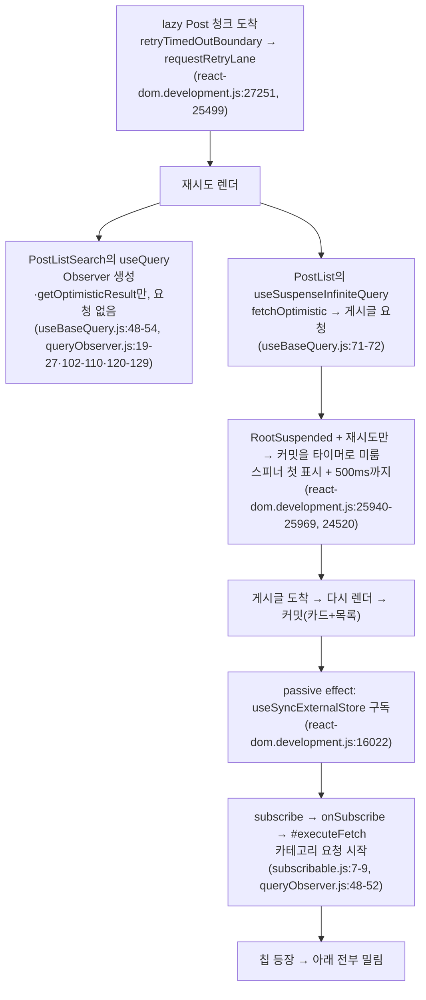

# 목록 필터 카드 카테고리 칩 레이아웃 시프트 제거 + 라이브러리 내부 동작 확인 지침

> 카테고리 요청이 게시글 응답 뒤로 밀리는 워터폴을 렌더 중 prefetch로 없애 필터 카드 아래 밀림을
> 제거한다. 그 진단에서 드러난 "라이브러리 내부 동작을 추론으로 제시한" 문제를 FE·BE §1 지침으로 막는다.

## Context

`/post` 목록의 필터 카드(`PostListSearch`)에서 카테고리 칩이 API 응답 후에야 그려져, 범위 필터 행과
목록 전체가 아래로 밀린다(사용자 제보, 2026-10-16).

### 재현 절차 (직접 측정, 2026-10-16)

레포의 Playwright(headless chromium)를 `node -e`로 띄워 운영 `https://linksphere.click/post`를 비로그인으로
열고, `addInitScript`로 `PerformanceObserver({ type: 'layout-shift', buffered: true })`와 MutationObserver를
붙였다. 화면 크기별 3회씩 측정했다.

| 화면     | CLS(매회 동일) | 밀린 요소·양                                                           |
| -------- | -------------- | ---------------------------------------------------------------------- |
| 390×844  | 0.0916         | `[aria-label=게시글 범위 필터]` 행·하단 행·목록 컨테이너 106px(칩 3줄) |
| 1280×900 | 0.0141         | 같은 요소 30px(칩 1줄)                                                 |

390px 1회 타임라인: 게시글 요청 595→1036ms, **검색 카드와 첫 게시글이 1086ms에 동시 DOM 등장**, 카테고리
요청 1084→1276ms, 칩 1277ms, 시프트 1283ms. 응답 지연을 걸어 보면(`page.route`) 게시글 +1500ms일 때 카드가
게시글 없이 먼저 커밋됐고(요청 시작 후 약 450ms), 카테고리는 그 커밋 직후에 요청됐다.

### 근본 원인 (설치본 소스 추적: react-dom 18.3.1, @tanstack/react-query·query-core 5.90.16)

- 운영 API에 두 요청을 동시에 보내면(curl 6회) 카테고리 98~217ms, 게시글 160~389ms로 카테고리가 매번 먼저
  끝난다 → 요청 순서만 바로잡으면 첫 커밋에 칩이 들어간다.
- 같은 부류의 선례: 상세 페이지 댓글 워터폴(2026-10-14) — `usePrefetchComments`
  (`src/entities/comment/api/comment.queries.ts:100`) + 페이지 훅 `usePostDetailPrefetch`
  (`src/pages/post/hooks/usePostDetail.ts:81`) + e2e `e2e/post-detail-comment-prefetch.spec.ts`.

## 판단이 필요했던 항목

| 항목               | 결정                                       | 근거·기각한 대안                                                                                                                                                                                                                                                                                                                                                                                                                                                                                                                                                                                                                                                           |
| ------------------ | ------------------------------------------ | -------------------------------------------------------------------------------------------------------------------------------------------------------------------------------------------------------------------------------------------------------------------------------------------------------------------------------------------------------------------------------------------------------------------------------------------------------------------------------------------------------------------------------------------------------------------------------------------------------------------------------------------------------------------------- |
| 해결 범위          | **prefetch만** (사용자 결정 2026-10-16)    | TanStack [Prefetching 가이드](https://tanstack.com/query/latest/docs/framework/react/guides/prefetching)의 "Suspense 경계 앞 `usePrefetchQuery`" 패턴 + 위 선례. 기각: ② 칩 스켈레톤 — 개수·라벨 너비를 몰라 모바일 줄 수를 못 맞추고, [NN/g](https://www.nngroup.com/articles/skeleton-screens/)는 1초 미만 로드엔 불필요·깜빡임이 거슬린다고 쓰며, [Viget 실험](https://viget.com/articles/a-bone-to-pick-with-skeleton-screens)에선 체감 대기가 가장 길었다(2.82s). ③ 카테고리까지 함께 표시 — 콜드 시 피드 전체가 0.9~2.8초 더 대기([Nielsen 1초 한계](https://www.nngroup.com/articles/response-times-3-important-limits/)), 실패가 피드로 번지지 않게 경계 추가 필요 |
| prefetch 호출 위치 | 페이지 훅(`pages/post/hooks/`)             | 선례 `usePostDetailPrefetch`와 같은 형태. pages는 `*.queries`를 `hooks/`에서만 import 가능(`custom-query-rules/no-entity-query-import-outside-hooks`). 기각: `usePostListSearch` 안 — 다른 세션 워크트리 `fix-hide-bots-layout-shift`가 이 파일·`PostListSearch.tsx`를 미커밋 상태로 수정 중이라 충돌 위험                                                                                                                                                                                                                                                                                                                                                                 |
| 지침 위치          | FE·BE `.claude/CLAUDE.md` §1 (사용자 결정) | 두 레포가 같은 §1 "실제 코드 경로를 추적한다" 문구를 공유하고, 그 문구는 우리 코드만 다뤄 라이브러리 내부가 빈틈이었다. 기각: FE만(BE 세션이 모름), 전역 CLAUDE.md(레포 이력 없음)                                                                                                                                                                                                                                                                                                                                                                                                                                                                                         |
| 지침 진행 순서     | 지침 PR 먼저, CLS 수정은 그 뒤             | 사용자 요청("그것부터 먼저 해결")                                                                                                                                                                                                                                                                                                                                                                                                                                                                                                                                                                                                                                          |

### 위험 관리

- **남는 경우(수용)**: 카테고리 요청이 콜드 인스턴스에 걸려 게시글보다 늦으면 지금처럼 밀린다. 근거 수치:
  `link-sphere-api` 최근 14일 호출 18,256건 중 스냅샷 복원 392건(2.1%, HTTP 외 호출 포함), 복원 시 응답
  p50 910ms·p90 2.77s(CloudWatch Logs Insights 직접 집계).
- **에러 토스트 중복 가능성**: prefetch는 실패를 삼키지만 QueryCache `onError`는 실패마다 호출된다. 재시도
  안 하는 실패(429·`EDGE_BLOCKED`, `retry-policy.ts`)가 커밋 전에 끝나면, `useQuery` 마운트 시 재요청이 또
  실패해 토스트가 2개 뜰 수 있다(5xx는 1회 재시도로 커밋 뒤까지 진행 중이라 구독이 합류 → 1개). 검증에서
  확인하고, 지금(1개)과 다르면 고치기 전에 사용자에게 보고한다.

## 세부 계획

### Phase 1 — 지침 (FE PR + BE PR, 병렬)

| 위치                                                                    | 변경 내용                                                                                                                                                                                                                                                                                                                                                                                                                                                                                                                                            |
| ----------------------------------------------------------------------- | ---------------------------------------------------------------------------------------------------------------------------------------------------------------------------------------------------------------------------------------------------------------------------------------------------------------------------------------------------------------------------------------------------------------------------------------------------------------------------------------------------------------------------------------------------- |
| FE `.claude/CLAUDE.md` §1 (기존 "실제 코드 경로를 추적" 불릿 바로 아래) | 새 불릿: 진단·설계 판단이 외부 라이브러리 내부 동작에 기대면 "추론"으로 표시하고 넘어가지 않고 **설치된 버전의 소스를 직접 따라가 확인한 뒤** 말한다. 버전은 설치본 `node_modules/<패키지>/package.json`으로, 근거는 파일·줄로 남긴다. 미니파이 빌드는 같은 패키지의 development 빌드·`build/modern`을 읽는다. 공식 문서·기억은 대신하지 못한다(2026-10-16 예: react.dev는 300ms라 쓰지만 설치된 18.3.1은 `FALLBACK_THROTTLE_MS = 500`). 끝내 못 따라가면 확인하지 못했다고 밝히고 확정처럼 쓰지 않는다. 계기 사례 한 줄 + `docs/SEARCH.md` §10 링크 |
| BE `.claude/CLAUDE.md` §1 (같은 위치)                                   | 같은 불릿을 BE 사정으로: 소스는 Gradle 캐시(`~/.gradle/caches/modules-2/files-2.1/`)의 `*-sources.jar`, 없으면 해당 버전 태그의 업스트림 소스를 **읽기만** 한다. 계기 사례는 FE PR 링크                                                                                                                                                                                                                                                                                                                                                              |
| 메모리 (`feedback` 1건 + `MEMORY.md` 한 줄)                             | "라이브러리 내부 동작은 추론으로 제시하지 말고 설치본 소스로 확인" — 승인 후 저장                                                                                                                                                                                                                                                                                                                                                                                                                                                                    |

BE 워크트리는 FE 세션에서 `git -C <BE> worktree add` 후 이동(메모리 "FE 세션에서 BE 워크트리 만들기" 절차).

### Phase 2 — CLS 수정 (FE PR, Phase 1 병합 후)

| 위치                                                     | 변경 내용                                                                                                                                                                                                                                                |
| -------------------------------------------------------- | -------------------------------------------------------------------------------------------------------------------------------------------------------------------------------------------------------------------------------------------------------- |
| `src/entities/category/api/category.queries.ts`          | `usePrefetchCategoryOptions()` 추가 — `usePrefetchQuery({ queryKey: categoryKeys.categoryOption, queryFn: () => categoryApi.fetchCategoryOption() })`, JSDoc은 `usePrefetchComments` 형태("동일 키/queryFn", 워터폴 이유)                                |
| `src/pages/post/hooks/usePostFeed.ts` (신규)             | `usePostFeedPrefetch()` — 피드 경계(PostList의 AsyncBoundary) 바깥에서 부른다는 JSDoc + `usePrefetchCategoryOptions()` 호출                                                                                                                              |
| `src/pages/post/index.tsx` `Post()`                      | `useProtectedNavigate()` 다음 줄에 `usePostFeedPrefetch();`                                                                                                                                                                                              |
| `e2e/post-list-category-prefetch.spec.ts` (신규)         | `post-detail-comment-prefetch.spec.ts` 형태. ① 게시글 목록 목 응답 200ms 지연(500ms 스로틀 안), 카테고리 즉시 → 첫 카테고리 요청 시각 < 게시글 응답 시각, 카테고리 요청 1회 ② `addInitScript` layout-shift 관찰 → 출처에 범위 필터 그룹이 든 시프트 합 0 |
| `docs/SEARCH.md`                                         | 머리말 "마지막 검토" 갱신, §8 코드 지도에 "필터 카드 카테고리 미리 받기" 행, §9 전후 CLS, §10 시행착오(타임라인·추적한 소스 경로와 버전·기각한 안·남는 경우)                                                                                             |
| `CHANGELOG.md` `[Unreleased]`                            | Fixed 항목(`changelog-release` skill 포맷)                                                                                                                                                                                                               |
| `docs/plans/2026-10-16-post-list-category-cls.md` (신규) | 이 계획 스냅샷(§11)                                                                                                                                                                                                                                      |

## 영향 범위 (§5)

- **CRUD**: 카테고리는 읽기 전용(R)만 해당. 같은 키·queryFn이라 페이지당 요청은 1회 그대로(`usePrefetchQuery`는
  캐시 상태가 없을 때만 요청, `useQuery`는 그 캐시를 읽음) — e2e ①에서 횟수 1을 단정. 실패 시 위 "에러 토스트
  중복 가능성" 확인.
- **기존 기능 회귀**
  - `useCategoryOptions`·`useFetchCategoryOptionQuery`(등록·수정 폼, 필터 카드 공유)는 시그니처·동작 그대로 —
    prefetch는 피드 페이지에서만 호출. 착수 전에 `pnpm graph:focus "src/entities/category/api/category.queries.ts" --text`로
    사용처를 다시 뽑는다.
  - `pages/post/index.tsx`에 훅 1줄 추가 — 렌더 순서·`renderFeedPost`·가상 스크롤 무관.
  - e2e mock `e2e/mocks/common.mock.ts` 주석("Post 페이지가 마운트마다 항상 호출")은 여전히 참.
  - 다른 세션 워크트리 `fix-hide-bots-layout-shift`와 코드 파일은 겹치지 않음. `docs/SEARCH.md` §10은 겹칠 수
    있어 병합 순서대로 rebase로 정리.
- 데이터 계약 변경 없음(BE 무변경, Phase 1 BE PR은 문서만).

## 검증 방법

1. **재현 먼저**: Phase 2 워크트리에서 e2e 스펙만 먼저 작성 → 수정 전 `pnpm test:e2e e2e/post-list-category-prefetch.spec.ts`가
   ①② 모두 실패하는지 3회 확인(②가 비결정적이면 ①만 남기고 PR에 사유 기록).
2. 수정 후 같은 스펙 통과 + 카테고리 응답 429·500 목으로 에러 토스트 개수 확인(지금과 같은 1개인지).
3. `pnpm type-check` → `pnpm test` → `pnpm lint`·`pnpm check:deps` → `pnpm check:docs`(Phase 1·2 모두 CLAUDE.md·docs 수정).
4. `browser-verification` skill 절차로 게시글 응답을 지연시킨 `/post` 첫 진입 녹화 — 칩이 카드와 함께 나타나는지.
5. §11: fresh general-purpose subagent에 계획 파일 + diff 대조 → PR 본문 `## 계획 대비 구현`.
6. 배포 후: 위 재현 절차 스크립트를 운영에 다시 실행(390×844·1280×900 각 3회) — 범위 필터 그룹 출처 시프트 0,
   카테고리 요청 시작 ≈ 게시글 요청 시작. `gh run list --workflow "Frontend Deploy (S3 + CloudFront)"`로 해당 SHA
   success 확인 후 보고, 병합·배포 확인되면 워크트리 정리.

## 남은 것

- 콜드 스타트로 카테고리가 늦는 경우의 밀림(수용). 실측에서 다시 보이면 칩 자리 확보(②)를 재검토.
- 등록·수정 폼의 관심 분야 체크박스도 같은 쿼리를 쓴다 — 같은 워터폴이 있는지는 이번 범위 밖(미측정).
- 지침은 문서 규칙이라 자동 검사는 없다(추론 여부는 lint로 잡을 수 없음).
