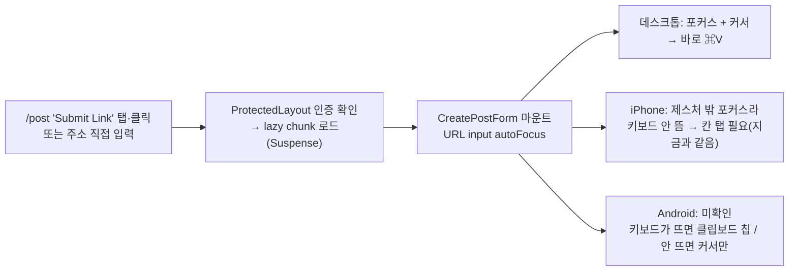

# 제출 페이지 진입 시 URL 칸 자동 포커스

> `/post/submit`에 들어오면 URL 칸에 바로 포커스를 줘, 데스크톱에서 클릭 없이 ⌘V로 붙여넣게 한다.

## Context

이 페이지에 오는 목적은 거의 언제나 "복사해 둔 링크 붙여넣기"다. 하지만 지금은 URL 칸을 한 번 클릭해야
붙여넣을 수 있다. 사용자가 데스크톱·모바일 모두에 적용하자고 제안했고(2026-10-15), 조사 결과를 본 뒤
"전부 적용"을 골랐다(같은 날 AskUserQuestion).

- URL 칸은 폼의 첫 칸이다(`src/features/post/create/ui/CreatePostForm.tsx:105-112`). `FormInput`은
  나머지 props를 `<input>`에 그대로 넘긴다(`src/shared/ui/elements/form/FormInput.tsx`, `{...props}`).
  그래서 `FormInput`은 고치지 않고, 호출하는 쪽에서 prop만 추가한다.
- react.dev는 `autoFocus`를 _"true면 React가 마운트 시 그 요소에 포커스를 준다"_ (번역,
  [input](https://react.dev/reference/react-dom/components/input))고 설명한다. 그래서 lazy+Suspense로 늦게
  마운트돼도, SPA 안에서 이동해도 동작한다.
- 레포 선례: `src/widgets/layout/navbar/ui/MobileNavbarSearch.tsx:48`,
  `src/features/comment/update/ui/CommentEditForm.tsx:81`이 같은 `autoFocus` prop을 쓴다.
  ESLint에 jsx-a11y `no-autofocus` 규칙은 없다.

## 판단이 필요했던 항목

| 항목                        | 결정                               | 근거·기각한 대안                                                                                                                                                                                                                                                                                                                                                                                                                                                                                                                                                                                                                                                                                                                                                                                                                                                                                                                                  |
| --------------------------- | ---------------------------------- | ------------------------------------------------------------------------------------------------------------------------------------------------------------------------------------------------------------------------------------------------------------------------------------------------------------------------------------------------------------------------------------------------------------------------------------------------------------------------------------------------------------------------------------------------------------------------------------------------------------------------------------------------------------------------------------------------------------------------------------------------------------------------------------------------------------------------------------------------------------------------------------------------------------------------------------------------- |
| 적용 범위                   | 데스크톱·모바일 전부               | HTML 표준이 정의한 autofocus의 용도가 이 경우다: _"페이지가 로드되자마자 요소에 포커스를 줘, 사용자가 직접 포커스를 옮기지 않고 바로 입력할 수 있게 한다"_ (번역, [WHATWG §6.6.7](https://html.spec.whatwg.org/multipage/interaction.html#the-autofocus-attribute)). 모바일은 효과가 작다. Apple WebKit 엔지니어는 _"사용자 제스처에 대한 응답이 아닌 프로그래밍 포커스로는 키보드를 올리지 않기를 원한다"_ (번역, [WebKit 195884](https://bugs.webkit.org/show_bug.cgi?id=195884), 2019)고 썼다. Android는 [WICG 글](https://discourse.wicg.io/t/how-should-browsers-treat-the-autofocus-attribute-on-mobile-devices/5238)(2021)이 _"포커스·커서는 생기지만 가상 키보드는 올라오지 않는다"_ (번역)고 했지만 지금 동작은 확인하지 못했다. 그래도 모바일에서 탭 수가 늘지는 않는다(최악이어도 지금과 같다). 기각: 데스크톱만(md 경계 `matchMedia` 조건, 약 8줄) — 사용자가 전부 적용을 골랐다. Android 키보드가 거슬리면 이 안으로 좁힌다(남은 것) |
| 구현 방식                   | URL `FormInput`에 `autoFocus` prop | 선례와 같은 방식이고 한 줄이다. 기각: `useCreatePost`의 effect에서 `form.setFocus('url')` — `useCreateComment.ts:132`처럼 조건부 포커스일 때 쓰는 형태라, 무조건 포커스하는 이번 경우엔 필요 없다                                                                                                                                                                                                                                                                                                                                                                                                                                                                                                                                                                                                                                                                                                                                                 |
| 접근성                      | 수용                               | MDN은 _"스크린 리더가 사용자를 경고 없이 그 칸으로 순간이동시키고, 라벨 앞 내용은 읽지 않는다"_ (번역, [MDN autofocus](https://developer.mozilla.org/en-US/docs/Web/HTML/Reference/Global_attributes/autofocus))고 경고한다. 이 페이지에서 건너뛰게 되는 건 카드 제목과 설명 두 줄이다. 페이지의 유일한 목적이 이 폼이라 받아들인다                                                                                                                                                                                                                                                                                                                                                                                                                                                                                                                                                                                                               |
| 수정 화면(`UpdatePostForm`) | 건드리지 않음                      | 요청 범위 밖이다. 수정할 때는 URL이 이미 채워져 있어 붙여넣기 목적이 아니다                                                                                                                                                                                                                                                                                                                                                                                                                                                                                                                                                                                                                                                                                                                                                                                                                                                                       |

## 세부 계획

| 위치                                                     | 변경 내용                                                                                                                          |
| -------------------------------------------------------- | ---------------------------------------------------------------------------------------------------------------------------------- |
| `src/features/post/create/ui/CreatePostForm.tsx:105-112` | URL `FormInput`에 `autoFocus`를 추가하고, iOS에서 키보드가 안 뜨는 이유를 한 줄 주석으로 단다(상세는 POST.md로 보낸다)             |
| `e2e/post-create.spec.ts`                                | 새 테스트: `/post/submit`에 진입하면 `getByLabel(/^URL/)`이 `toBeFocused()`                                                        |
| `e2e/post-create.mobile.spec.ts`                         | 같은 단언을 모바일 프로젝트(Pixel 5 에뮬레이션)에 추가한다. 포커스만 확인하고, 가상 키보드는 에뮬레이션되지 않는다                 |
| `docs/POST.md` "### 작성" 1번 근처                       | 진입 시 URL 칸 자동 포커스, 기기별 동작(iOS 키보드 안 뜸, Android 미확인)과 출처 링크를 적는다. 상단 `마지막 검토` 날짜도 갱신한다 |
| `CHANGELOG.md` `[Unreleased]`                            | `changelog-release` skill 형식으로 항목을 추가한다                                                                                 |
| `docs/plans/2026-10-16-submit-url-autofocus.md` (신규)   | 이 계획의 스냅샷(§11)                                                                                                              |

작업 순서: `git log origin/main..main` 확인 → `EnterWorktree` → `.env` 복사·`pnpm install` → 변경 → 검증 →
fresh subagent로 계획 대비 구현 대조 → PR(squash) → 배포 run 확인 → 워크트리 정리.

## 영향 범위

- **CRUD**: 데이터·API·캐시 변경이 없다.
- **포커스 링**: 텍스트 input은 프로그램 포커스에도 `:focus-visible`이 걸려, 진입 즉시 기존 포커스 링
  (`input.tsx`의 `focus-visible:ring-[3px]`)이 보인다. 새 스타일은 아니다.
- **검증 에러 노출**: 포커스한 뒤 아무것도 입력하지 않고 다른 곳을 눌러 blur돼도, `mode: 'onChange'`
  (`useCreatePost.ts:35`)라 에러가 뜨지 않아야 한다 → 브라우저로 확인한다.
- **이탈 가드**: `useUnsavedChanges`는 `isDirty` 기준이라 포커스만으로는 걸리지 않는다.
- **모바일 하단 등록 바**(`CreatePostForm.tsx:135-141`): Android에서 키보드가 뜨면 그 아래로 가려질 수
  있다. 다만 Enter로 제출되는 건 기존 mobile 스펙(`post-create.mobile.spec.ts` "Enter를 누르면 제출")이
  보장한다.
- **다른 포커스 주체**: 폴더 선택 창(Radix의 닫힘 시 트리거 복귀)과 모바일 검색(`MobileNavbarSearch`
  autoFocus)은 각자 열릴 때 포커스를 가져간다. URL 포커스는 마운트 한 번뿐이라 겹치지 않는다.
- **공용 파일**: `FormInput`·`Input`은 수정하지 않는다(호출부 prop만 추가). 그래서 `pnpm graph` 영향
  분석은 필요 없다.
- **기존 테스트**: e2e는 `.fill()`로 입력해 원래 포커스를 잡으므로 충돌이 없다.
  `useCreatePost.test.tsx`는 훅만 검사한다.

## 검증 방법

1. `pnpm type-check` → `pnpm lint` → `pnpm test` → `pnpm check:docs`(POST.md 수정)
2. `pnpm test:e2e e2e/post-create.spec.ts e2e/post-create.mobile.spec.ts`: 새 포커스 단언과 기존 스펙이
   모두 통과하는지
3. `browser-verification` skill로 녹화한다(데스크톱 뷰포트): `/post`에서 "Submit Link" 클릭 → URL 칸에
   커서 → 클릭 없이 붙여넣기 → 미리보기 카드 표시. 빈 채로 blur했을 때 에러가 뜨지 않는 것도 확인한다
4. 배포 후 `gh run list --branch main --workflow "Frontend Deploy (S3 + CloudFront)"`로 해당 SHA가
   success인지 확인한다

## 남은 것

- **실기기 확인(사용자)**: iPhone·Android에서 제출 페이지에 들어갔을 때 실제로 어떤지 본다. Android에서
  키보드가 바로 떠 거슬리면, 데스크톱만(md 경계 `matchMedia`)으로 좁힌다.
- iPhone에서도 탭 한 번에 붙여넣으려면 클립보드 API를 쓰는 "붙여넣기" 버튼이 필요하다. 별개 기능이라
  이번 범위에는 넣지 않았다.
