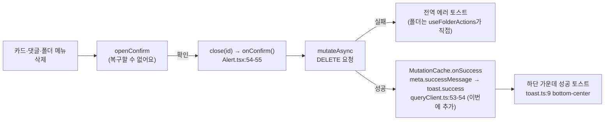

# 확인창을 거치는 삭제에 성공 토스트 복원

> 게시글·댓글·북마크 폴더 삭제가 성공하면 "~를 삭제했어요." 토스트를 띄운다. 2026-08-04에
> "목록에서 사라지는 게 피드백"이라며 뺀 판단을 사용자 관찰(삭제 뒤 다시 확인하게 됨)로 뒤집는다.

## Context

2026-08-04 커밋 `537ac2bf`(PR 없음, main 직접 커밋)가 "결과가 화면에 바로 보이는 액션"의 성공 토스트 8개를
한꺼번에 뺐다. 삭제 계열은 게시글(`postDeleted`)·폴더(`folderDeleted`)·북마크 제거(`bookmarkRemoved`)였다.
북마크 제거는 2026-09-11 #79에서 되돌리기와 함께 복원됐고, 게시글·폴더는 지금도 없다. 댓글 삭제 토스트는
처음부터 없었다. 판단 기준 정본은 `.claude/skills/texts-conventions/SKILL.md:92-131`이고, `:116`이
`postDeleted`/`folderDeleted`를 "목록에서 바로 사라짐"을 이유로 "불필요"로 분류한다.

사용자가 실제로 써 보니 삭제 뒤 결과가 눈에 안 들어와 한 번 더 확인하게 된다고 했다(2026-10-21). 코드를
따라가 보면 "사라지는 걸 본다"는 전제가 세 경우 모두 약하다.

| 삭제        | 확인창 | 화면 변화(코드 추적)                                                                                                               | 결과가 눈에 안 띄는 이유                                                                                                                                                                    |
| ----------- | ------ | ---------------------------------------------------------------------------------------------------------------------------------- | ------------------------------------------------------------------------------------------------------------------------------------------------------------------------------------------- |
| 게시글      | 있음   | 낙관적 제거(`post.queries.ts:292-334`). 상세에서 지우면 서버 성공 뒤 `/post`로 push(`usePostCard.ts:57-59`)                        | 확인 버튼을 누르면 `close(id)` 직후 `onConfirm()`이 돈다(`Alert.tsx:54-56`) — 카드가 사라지는 순간이 확인창이 닫히는 순간과 겹친다(추론, 미측정). 상세에서 지우면 사라지는 장면 자체가 없다 |
| 댓글        | 있음   | 낙관 없음, 재조회 뒤 행이 사라지거나 답글이 있으면 "삭제된 댓글입니다."로 남음(`comment.queries.ts:246-255`)                       | 확인창이 닫힌 뒤 재조회가 끝날 때까지 아무 변화가 없다                                                                                                                                      |
| 북마크 폴더 | 있음   | 낙관 없음, 무효화 재조회 뒤 사라짐(`bookmark-folder.queries.ts:164-175`). 보던 폴더면 먼저 "전체"로 이동(`useFolderTree.ts:35-39`) | 위와 같음                                                                                                                                                                                   |

이미 성공 토스트가 뜨는 삭제류: 북마크 제거·폴더에서 빼기(`usePostCardBookmarkFolderDialog.ts:97-175`,
일부는 8초 되돌리기), 회원 탈퇴(`account.queries.ts:131`). 성공 토스트를 단정하는 테스트는 삭제 3종 어디에도
없다(단위·e2e 모두). 테스트용 `createTestQueryClient`(`src/test/utils.tsx:20-30`)에는 `MutationCache` 핸들러가
없어 `meta.successMessage` 토스트는 e2e에서만 확인된다 — 선례 `e2e/post-update.spec.ts:92`.

## 판단이 필요했던 항목

| 항목           | 결정                                                                                                                                                                                                 | 근거·기각한 대안                                                                                                                                                                                                                                                                                                                                                           |
| -------------- | ---------------------------------------------------------------------------------------------------------------------------------------------------------------------------------------------------- | -------------------------------------------------------------------------------------------------------------------------------------------------------------------------------------------------------------------------------------------------------------------------------------------------------------------------------------------------------------------------- |
| 대상 범위      | 확인창(`openConfirm`)을 거치는 영구 삭제 3종: 게시글·댓글·북마크 폴더(2026-10-21 사용자 선택)                                                                                                        | 확인창이 "삭제된 데이터는 복구할 수 없어요"(`texts.ts:452-453`)라고 경고한 만큼 결과도 분명히 알린다. 좋아요 취소·최근 검색어 삭제·첨부 이미지 빼기는 제외 — 확인창이 없고, 그 자리에서 즉시 바뀌며, 다시 누르면 되돌아간다. 이것까지 토스트를 띄우면 잦은 조작마다 알림이 쌓인다. "게시글만"은 같은 이유가 댓글·폴더에 더 강하게(재조회 지연) 적용되므로 기각             |
| 띄우는 위치    | 세 mutation 모두 `meta.successMessage`(전역 `MutationCache`)                                                                                                                                         | entity 한 곳에 두면 모든 호출 지점(피드·상세·북마크 화면·내 댓글·모바일 폴더 목록)이 함께 덮인다. `useMutation` 레벨이라 상세에서 지운 뒤 navigate로 언마운트돼도 뜬다(CLAUDE.md "React Query 라이프사이클"). `postCreated`·`postUpdated`·`accountUpdated`와 같은 경로. `manualErrorHandling`은 에러 토스트만 끄므로(`error-toast.ts:73-75`) 폴더 쪽에 함께 둬도 충돌 없다 |
| 문구           | 정적 문구 `'포스트를 삭제했어요.'` / `'댓글을 삭제했어요.'` / `'폴더를 삭제했어요.'`                                                                                                                 | 해요체·능동형(`texts-conventions` 톤 규칙), 기존 `postCreated: '포스트를 생성했어요.'`와 같은 꼴. 폴더 이름을 넣는 함수형 키는 기각 — 직전 확인창 제목이 이미 폴더 이름을 보여 주고, `meta.successMessage`는 정적 문자열만 받는다(`FE-ARCHITECTURE.md` §15)                                                                                                                |
| 되돌리기       | 붙이지 않음                                                                                                                                                                                          | BE가 게시글을 하드 삭제하고 댓글 이미지까지 지운다(BE `PostService.kt:308-315`). 복구 API를 새로 만드는 일은 이번 요청 밖                                                                                                                                                                                                                                                  |
| 판단 기준 개정 | `texts-conventions` "성공 토스트 표시 기준"에 축 4 "확인창을 거친 영구 삭제"를 추가하고 `postDeleted`/`folderDeleted`를 "필요"로 옮긴다. 2026-09-21 재분류처럼 날짜 붙은 인용 블록으로 사유를 남긴다 | 다음에 삭제 기능을 만들 때 같은 판단을 반복하지 않게. `DECISIONS.md`에는 넣지 않는다 — 토스트는 되돌리기 쉬운 결정이라 적합성 기준(대안 비교 + 되돌리기 어려움)에 안 맞는다                                                                                                                                                                                                |

### 외부 근거 (§8·§10)

외부 근거는 엇갈린다. 이번 결정은 외부 근거보다 사용자 관찰에 기댄다는 점을 기준 문서에도 그대로 적는다.

- 반대 쪽: GitLab Pajamas는 _"동작의 결과가 이미 페이지에 보이거나 사용자가 할 일·알아야 할 것이 없으면
  토스트를 쓰지 않는다"_ (번역, [Pajamas Toast](https://design.gitlab.com/components/toast))고 쓴다. GitHub
  Primer도 단순한 작업은 _"성공을 알리는 2차 강화가 필요 없다"_ (번역,
  [Primer: Accessible notifications](https://primer.style/accessibility/toasts/))고 쓴다. 2026-08-04 판단과 같은 방향이다.
- 찬성 쪽: 같은 GitLab 안에서 마일스톤 삭제에 _"토스트가 삭제 성공을 강화해 준다"_ (번역)며 "Milestone deleted."
  토스트를 요청한 이슈가 있다([gitlab#477255](https://gitlab.com/gitlab-org/gitlab/-/issues/477255)). 구현 여부는
  페이지에서 확인하지 못했다. NN/g는 _"사용자는 상호작용이 성공했는지 알아야 한다"_ (번역,
  [Visibility of System Status](https://www.nngroup.com/articles/visibility-system-status/))고 쓰지만, 시각적
  변화만으로 충분한지까지는 말하지 않는다.
- 우리가 다른 결론을 내는 이유: 위 두 디자인 시스템의 전제는 "결과가 보인다"인데, 이 레포에서는 위 표처럼
  그 전제가 확인창 닫힘·navigate·재조회 지연 때문에 깨진다. 부수 효과로, sonner 컨테이너가
  `aria-live="polite"`(`node_modules/sonner/dist/index.mjs:1080-1086`, 2.0.7)라 스크린리더에도 삭제 결과가 읽힌다
  — `SKILL.md:129-131`이 남겨 둔 접근성 우려를 덜어 준다.

## 세부 계획

| 위치                                                              | 변경 내용                                                                                                                                                      |
| ----------------------------------------------------------------- | -------------------------------------------------------------------------------------------------------------------------------------------------------------- |
| `src/shared/config/texts.ts:455-477` `messages.success`           | `postDeleted`, `commentDeleted`, `folderDeleted` 키 추가(문구는 위 "문구" 결정)                                                                                |
| `src/entities/post/api/post.queries.ts:289-291`                   | `meta`에 `successMessage: TEXTS.messages.success.postDeleted` 추가(`537ac2bf`가 지운 한 줄을 되살림)                                                           |
| `src/entities/comment/api/comment.queries.ts:249-254`             | `meta: { successMessage: TEXTS.messages.success.commentDeleted }` 추가. 에러는 지금처럼 전역 기본 문구                                                         |
| `src/entities/bookmark/folder/api/bookmark-folder.queries.ts:170` | `meta: { manualErrorHandling: true, successMessage: TEXTS.messages.success.folderDeleted }`                                                                    |
| `e2e/post-delete.spec.ts:82-85` 부근                              | 삭제 뒤 `TEXTS.messages.success.postDeleted` 토스트가 보이는지 단정(선례 `post-update.spec.ts:92`)                                                             |
| `e2e/comment-delete.spec.ts:90` 부근                              | 같은 방식으로 `commentDeleted` 단정                                                                                                                            |
| `e2e/bookmark-folder-delete.spec.ts:108-118` 부근                 | 같은 방식으로 `folderDeleted` 단정                                                                                                                             |
| `.claude/skills/texts-conventions/SKILL.md:98-127`                | 축 4 추가, 표에서 `postDeleted`/`folderDeleted`를 "필요"로 옮기고 `commentDeleted` 추가, `2026-10-21 삭제 토스트 재분류` 인용 블록(위 외부 근거와 사용자 관찰) |
| `docs/POST.md:345`                                                | "성공 토스트는 없다(카드가 사라지는 것 자체가 피드백)" → `meta.successMessage`로 "포스트를 삭제했어요." 토스트가 뜬다, 사유는 SKILL.md 링크                    |
| `docs/COMMENT.md` 삭제 절, `docs/BOOKMARK.md` 폴더 삭제 절        | 성공 토스트 한 줄 추가(현재는 토스트 서술 자체가 없음 — 구현 때 절 위치 확인)                                                                                  |
| `docs/TESTING.md:820` 부근 e2e 표                                 | 세 spec 설명에 "성공 토스트" 추가                                                                                                                              |
| `CHANGELOG.md` `[Unreleased]`                                     | `changelog-release` skill 형식으로 항목 추가                                                                                                                   |
| `docs/plans/2026-10-21-delete-success-toast.md` (신규)            | 이 계획 스냅샷(§11)                                                                                                                                            |

## 영향 범위 (§5)

**CRUD 실패 지점** — 데이터 계약·API·캐시 동작은 바뀌지 않는다. 바뀌는 건 성공 후 토스트 한 개뿐이다.

- 삭제 실패: 성공 토스트는 `onSuccess`에서만 뜨므로 롤백·에러 토스트 경로는 그대로다.
- 동시 요청: 게시글 삭제는 낙관적 업데이트 중 실패하면 롤백되고 토스트가 없다. 여러 개를 빠르게 지우면
  토스트가 여러 개 쌓인다(sonner 기본 동작, 각 4초) — 확인창을 매번 거치므로 연속 삭제 빈도는 낮다.

**기존 기능 회귀**

- 공용 entity mutation 3개라 모든 호출 지점에 토스트가 생긴다. 구현 전에 `pnpm graph:focus`로 사용처를 뽑아
  다음 목록과 맞춘다: 게시글 `usePostDelete.ts` → `usePostCard.ts`(피드·상세·북마크 화면), 댓글
  `useDeleteComment.ts` → `CommentItem.tsx`(상세 댓글·내 댓글), 폴더 `useFolderActions.ts` → `useFolderTree.ts`(데스크톱)·
  `MobileFolderList.tsx:124`(모바일).
- 토스트 위치: 성공 토스트는 `bottom-center`이고 모바일에선 하단 탭바 위(`globals.css:471`). 상세 화면 하단
  댓글 입력 바(`MobileCommentBar.tsx:26-60`)가 오프셋을 덮어쓰므로, 모바일 상세에서 댓글을 지울 때 토스트가
  입력 바를 가리지 않는지 녹화로 확인한다.
- 기존 테스트: 삭제 성공 토스트가 "안 뜬다"고 단정하는 테스트는 없다(전수 조사). `bookmark-folder-delete.spec.ts:118`의
  `dialog`/`alertdialog` 0개 단정은 sonner 토스트가 dialog 역할이 아니라 영향 없다(구현 때 실행으로 확인).
- 문서·문구: `docs/POST.md:345`, `SKILL.md:116`이 옛 동작을 단정한다 → 세부 계획에서 갱신. BE 문서에는 FE 삭제
  토스트 서술이 없다(grep 확인).

## 검증 방법

1. 워크트리 생성(`git log origin/main..main` 확인 후) → `.env` 복사·`pnpm install`
2. `pnpm type-check` → `pnpm test` → `pnpm lint` → 통과
3. `pnpm test:e2e e2e/post-delete.spec.ts e2e/comment-delete.spec.ts e2e/bookmark-folder-delete.spec.ts` →
   새 토스트 단정 포함 통과(chromium + mobile-chrome)
4. `browser-verification` skill로 녹화: 피드 카드 삭제, 상세에서 삭제(→ 피드 이동 뒤 토스트), 댓글 삭제(모바일
   상세 포함), 폴더 삭제(데스크톱·모바일) — 토스트가 한 번씩만 뜨는지, 입력 바에 가리지 않는지
5. `pnpm check:docs` (문서 줄 번호 참조 갱신 확인)
6. PR → CI green → fresh subagent로 계획 대비 구현 대조(§11) → 병합 → 배포 워크플로 success 확인

## 남은 것

- 게시글·댓글 되돌리기: BE 소프트 삭제·복구 API가 필요해 이번 범위 밖.
- sonner 컨테이너 `aria-label`이 기본값 영어 `'Notifications'`다(`index.mjs:920`). 이번 변경과 무관해 언급만.
