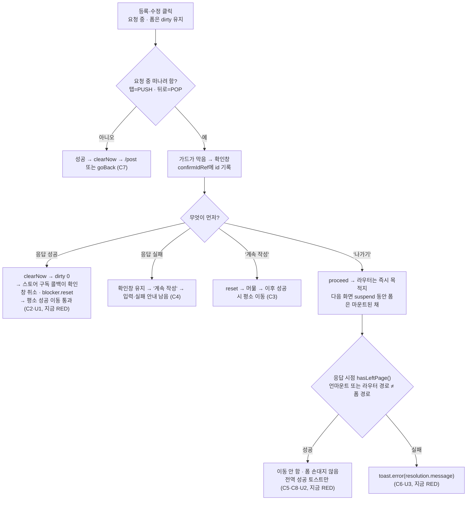

# 게시글 등록·수정 저장 중 이탈 — 확인창과 응답이 겹칠 때의 이동 버그 수정과 테스트

> 저장 요청이 도는 동안 떠나려다 뜬 확인창과 응답이 겹치면 성공 이동이 버려지거나(빈 폼에 갇힘) 엉뚱한
> 화면을 덮어쓴다. 재현 테스트를 먼저 쓰고(RED) 가드·두 훅을 고쳐 통과시킨다(GREEN). 한 PR.

## Context

### 증상 (사용자 제보, 모바일)

등록 중 떠나려 하면 "작성 중인 내용" 확인창이 뜬다 → "계속 작성"을 누른 뒤 직접 나가 보니 그제야 목록에 반영된 것처럼 보였다.
실제로는 **등록은 확인창이 떠 있는 동안 이미 끝났고, 성공 뒤 자동 이동을 "계속 작성"이 버린 것**이다(목록 캐시엔 이미 새 글이 있었다).

### 근본 원인 (설치본 소스로 확인: react-router(-dom) 6.30.3, @remix-run/router 1.23.2, query-core 5.90.16, zustand 5.0.10)

1. **모달 중 성공 → 이동이 다시 막힘.** 등록 폼은 요청 중에도 dirty(`useCreatePost.ts:38`). 성공하면 `clearNow(); onFormReset(); navigate('/post', {replace})`(`:114-117`)인데, 가드는 "열린 Alert가 있으면 막는다"를 먼저 본다(`useUnsavedChangesGuard.ts:22-24`). 막힌 상태에서 또 막으면 blocker가 새 목적지로 덮어써지고(`router.js:1852-1879`, blocked→blocked 허용 `:3008`) `blocker.state`는 그대로라 effect(deps `:93`)가 다시 안 돈다 → 같은 확인창이 남고 `onCancel`(`:90`)의 `reset()`이 `/post` 이동을 버린다. "나가기"면 탭한 곳이 아니라 `/post`로 간다. 수정 폼(`useUpdatePost.ts:133-135`, `goBack` = `navigate(-1)`)도 같다.
2. **"나가기" 뒤 응답 → 떠난 화면을 덮어씀.** 언마운트 뒤에도 `navigate`가 실행되고(`react-router/dist/index.js:895-918`, `activeRef`를 되돌리지 않음) `mutateAsync`도 끝까지 settle한다(`mutationObserver.js:56-61`). 성공하면 떠난 화면이 `/post`로 REPLACE되고(수정은 한 칸 더 뒤로), 실패는 `manualErrorHandling`이라 아무 안내가 없다.
3. **마운트 여부만으로는 "떠났는가"를 못 잡는 구간.** "나가기" 직후 라우터 위치는 동기로 바뀌지만(loader 없음 → `router.js:2233`) `v7_startTransition`이라 다음 화면이 청크·데이터로 suspend하는 동안 이전 폼이 마운트된 채 남는다(`withSuspense` `app/routes/index.tsx:71-77`가 같은 자리의 Suspense를 재사용). React transition이 이미 보이는 화면을 숨기지 않는다는 동작은 소스로 추적하지 않았고, C8 재현 테스트가 RED로 확인한다.

### 재현 절차

아래 "테스트" 표의 RED 항목들이 재현 절차다 — 데이터 라우터 + 실제 가드 + 실제 확인창 + 응답을 붙잡는 MSW로 각 경합을 결정적으로 만든다. 지금 단위 테스트는 `useNavigate`를 mock해 막힘을 못 보고(`useCreatePost.test.tsx:14-19`), 가드 유닛 테스트는 없고(`MemoryRouter`라 `useBlocker` 불가), e2e는 이탈 없이 성공만 본다(`e2e/post-create.spec.ts:39`).

### 고친 뒤의 흐름

## 판단이 필요했던 항목

| 항목                     | 결정                                                                                                                               | 근거·기각한 대안                                                                                                                                                                                                                                                                                                                                                                 |
| ------------------------ | ---------------------------------------------------------------------------------------------------------------------------------- | -------------------------------------------------------------------------------------------------------------------------------------------------------------------------------------------------------------------------------------------------------------------------------------------------------------------------------------------------------------------------------- |
| 범위                     | 테스트 + 수정을 한 PR로 (사용자 2026-10-21)                                                                                        | 기각: 테스트만 + `it.fails`(린트는 허용 — `@vitest/eslint-plugin` 1.6.27 `index.mjs:2770-2776`이 skip·x만 막음) — 사용자 체감 버그가 남는다                                                                                                                                                                                                                                      |
| 모달 중 성공             | 확인창을 닫고 **폼의 평소 성공 이동**이 이긴다(등록 `/post`, 수정 `goBack`) (사용자)                                               | e2e 계약(`post-create.spec.ts:39`)과 같다. 기각: "가려던 곳으로"(새 글을 토스트로만 확인), "모달 유지·버튼만 고침"(저장 뒤에도 "사라져요" 문구)                                                                                                                                                                                                                                  |
| "나가기" 뒤 응답         | 떠난 화면 유지. 성공은 기존 전역 토스트(`meta.successMessage`), 실패는 `toast.error` (사용자)                                      | 선례 `useCreateComment.ts:77-87,157-160`. 기각: 화면 유지만(실패가 묻힘), 지금처럼 `/post`                                                                                                                                                                                                                                                                                       |
| 수정 폼                  | 포함 (사용자)                                                                                                                      | 같은 구조, 떠난 뒤 `navigate(-1)`이라 더 나쁨                                                                                                                                                                                                                                                                                                                                    |
| 근거 수준                | 위 UX 결정은 레포 선례 기반, 외부 제품 리서치는 안 함                                                                              | 사용자에게 그 사실을 밝히고 고르게 했다(§7·§8). 기능 문서에 그대로 적는다                                                                                                                                                                                                                                                                                                        |
| 버그 1 수정 위치         | **F2**: 가드가 `useUnsavedChangesStore.subscribe`로 구독하다가, 자기 확인창이 떠 있는데 dirty가 0이 되면 그 확인창을 `cancelAlert` | zustand `setState`가 리스너를 동기로 부름(`vanilla.mjs:4-10`) → `clearNow()` 안에서 확인창이 닫혀 이어지는 `navigate`가 평소 규칙으로 통과. 차단 규칙 4단계 불변. 기각 F1(차단 규칙에 예외): 커밋 전 정지 구간에 낡은 확인창의 "나가기"가 IDLE→proceeding으로 invariant throw(`router.js:3008`) + 문서화된 규칙 변경. 기각: 선택자+effect(렌더 뒤라 `navigate`가 먼저 다시 막힘) |
| F2의 댓글 수정 부수 효과 | 받아들임 (사용자) — 댓글 수정 성공으로 dirty 0이 되면 확인창이 닫히고 상세에 머문다                                                | "작성 중인 내용이 다 사라지면 확인창을 거둔다" 단일 규칙. 기각: 키별 분기(규칙이 둘로 갈림)                                                                                                                                                                                                                                                                                      |
| "떠났는가" 판단          | 신규 `useHasLeftPage()`(shared): 언마운트 **또는** 라우터 최신 경로(`RouterEvents.getLocation()`) ≠ 폼 경로 (사용자: 보완)         | 선례 `usePostList.ts:157-164`(정지 구간 판정). 기각: isMountedRef만(Context 3의 구간), `location.key` 비교(폴더 선택 오버레이가 같은 경로에 새 key를 push — `useHistoryOverlay.ts:18-25` → 오판). 두 훅이 같은 판정을 써서 shared 훅으로 둔다(댓글 훅의 로컬 isMountedRef 중복 선례와 달리 판정이 2단이라)                                                                       |
| 테스트 파일 이름         | `<훅>.guard.test.tsx`                                                                                                              | 기존 파일은 `useNavigate`를 모듈 단위 mock(`useCreatePost.test.tsx:14-19`)이라 같은 파일 불가. kebab 이름은 `.tsx` PascalCase 규칙(`eslint.config.js:976-991`)에 걸리고, `use*` camelCase 규칙은 첫 점 앞만 본다                                                                                                                                                                 |
| 하네스                   | 파일마다 로컬                                                                                                                      | 겹치는 건 레이아웃 6줄 정도, 라우트·프로브는 파일마다 다름. 세 번째 사용처에서 `src/test/`로 승격(§2)                                                                                                                                                                                                                                                                            |

## 세부 계획

### 수정 코드

| 위치                                                      | 변경 내용                                                                                                                                                                                                                                                                                            |
| --------------------------------------------------------- | ---------------------------------------------------------------------------------------------------------------------------------------------------------------------------------------------------------------------------------------------------------------------------------------------------- |
| `src/shared/hooks/useUnsavedChangesGuard.ts:84-94`        | `confirmIdRef` 추가. `openConfirm` 직후 `confirmIdRef.current = getOpenAlertId()`(바로 위에서 열린 Alert 없음을 확인했으므로 방금 띄운 것). `onConfirm`·`onCancel`에서 먼저 `null`로 비움                                                                                                            |
| `src/shared/hooks/useUnsavedChangesGuard.ts` (새 effect)  | `useEffect(function cancelConfirmWhenNothingUnsaved() { return useUnsavedChangesStore.subscribe(() => { id 없거나 hasUnsavedChanges()면 return; cancelAlert(id) }) }, [cancelAlert])`. 주석에 react.dev useEffect "외부 시스템에 연결" + zustand subscribe 문서 링크(구현 때 context7로 조회해 확인) |
| `src/shared/hooks/useHasLeftPage.ts` (신규)               | `useLocation().pathname` + `isMountedRef`(`trackMounted` effect, 댓글 훅과 같은 형태). 반환 함수: 언마운트면 true, 아니면 `RouterEvents.getLocation()`이 null이 아니고 pathname이 다르면 true. JSDoc에 정지 구간 이유와 `router-events.ts` 참조                                                      |
| `src/features/post/create/hooks/useCreatePost.ts:92-117`  | `const hasLeftPage = useHasLeftPage()`. catch에서 `resolveSubmitError` 직후 `if (hasLeftPage()) { toast.error(resolution.message); return; }`. try 뒤 `clearNow()` **앞**에 `if (hasLeftPage()) { return; }`(새로 마운트된 같은 경로 폼의 키를 지우지 않게 clearNow보다 먼저)                        |
| `src/features/post/update/hooks/useUpdatePost.ts:115-135` | 위와 동일. `toast` import는 `@/shared/lib/toast/toast`                                                                                                                                                                                                                                               |

새 TEXTS 키 없음(`resolution.message` 재사용, `post.util.ts`의 field·form 둘 다 message 보유). 시그니처 변경 없음.

### 테스트 (모두 신규 파일)

공통 하네스: `createMemoryRouter([{ element: <GuardLayout/>(useUnsavedChangesGuard + <Outlet/> + <GlobalAlerts/>), children: [폼 라우트, '/post' 피드 스텁, '/bookmark' 탭 스텁] }], { initialEntries: ['/post', 폼 경로], initialIndex: 1 })`를 `QueryClientProvider` + `<RouterProvider future={{ v7_startTransition: true }}/>`로 렌더(운영 `RouterProvider.tsx`와 동일), `RouterEvents.setSource(router)`(선례 `usePostList.test.tsx:163`).

- 훅은 작은 프로브 컴포넌트로 실제 호출(`<form onSubmit>` + url/title 입력 + 제출 버튼 + `submitError` 표시) — 실제 훅·가드·확인창 버튼을 모두 거친다. `CreatePostForm`은 카테고리·폴더 대화상자까지 끌고 와 쓰지 않는다
- 인증 `useAuthStore.getState().setAuth(...)`(가드 규칙 1), 계정은 MSW 기본 `mockAccount`(emailVerified true). 수정은 `createTestQueryClient({ staleTime: Infinity })` + `postKeys.detail` 시드(`useUpdatePost.test.tsx`와 동일)
- 응답 붙잡기: MSW 핸들러 안 Promise + `waitFor(() => expect(gate.release).not.toBeNull())`(선례 `useCreateComment.test.tsx:321-355`)
- 확인창 버튼: `vi.useFakeTimers({ toFake: ['Date'] })` + `advanceTimersByTime(DOUBLE_CLICK_GUARD_MS)` 후 클릭(선례 `alert-dialog.test.tsx:53-90`). MSW와 섞여 불안정하면 실제 450ms 대기(`PostList.test.tsx:28,83`)
- 이동: 탭 `router.navigate('/bookmark')`, 뒤로 `router.navigate(-1)`, `act`는 `@testing-library/react`에서
- 초기화: `useAlertStore.setState({ alerts: [] })`, `useUnsavedChangesStore.setState({ dirtyKeys: new Set() })`, `vi.restoreAllMocks()`
- "나가기" 테스트는 `/bookmark`로 떠난다(`/post`로 가면 덮어쓰는 목적지와 같아 RED가 안 드러남)

| 파일                                                          | #     | 테스트 이름                                                                                                                                                                        | 수정 전                         |
| ------------------------------------------------------------- | ----- | ---------------------------------------------------------------------------------------------------------------------------------------------------------------------------------- | ------------------------------- |
| `src/shared/hooks/useUnsavedChangesGuard.test.tsx`            | G1    | 이탈 확인창이 떠 있는 동안 작성 중인 폼이 모두 해제되면 확인창을 닫고 막혔던 이동은 취소한다 (키 2개 → 하나 해제엔 유지 → 둘 다 해제에 닫힘·위치 그대로 → 다시 이동하면 통과)      | RED                             |
| `src/features/post/create/hooks/useCreatePost.guard.test.tsx` | C2 ×2 | (다른 탭을 눌러 / 뒤로가기로) 저장 중 떠나려다 뜬 확인창이 열린 채 등록이 성공하면 확인창이 닫히고 피드로 간다 (사전 조건: 확인창이 뜨고 `/post/submit`에 머묾)                    | RED                             |
| 〃                                                            | C3    | "계속 작성"으로 머문 뒤 등록이 성공하면 피드로 가고 새 글이 목록 맨 앞에 있다 (`gcTime: Infinity`, 목록 시드, 새 id 응답)                                                          | GREEN 고정                      |
| 〃                                                            | C4    | 확인창이 열린 채 등록이 실패하면 "계속 작성" 뒤에 입력과 실패 안내가 남는다 (429)                                                                                                  | GREEN 고정                      |
| 〃                                                            | C5    | 응답 전에 "나가기"로 떠났으면 등록이 성공해도 떠난 화면에 머문다                                                                                                                   | RED                             |
| 〃                                                            | C6    | 응답 전에 "나가기"로 떠났으면 등록 실패를 토스트로 알린다                                                                                                                          | RED                             |
| 〃                                                            | C7    | 떠나려 하지 않았으면 등록 성공 뒤 확인창 없이 피드로 간다                                                                                                                          | GREEN 고정                      |
| 〃                                                            | C8    | "나가기" 뒤 다음 화면을 불러오는 동안 등록이 성공해도 떠난 화면을 덮어쓰지 않는다 (`/bookmark`를 붙잡힌 `lazy`로 suspend → 폼이 아직 보이는지 먼저 단언 → 응답 → 위치 `/bookmark`) | RED (isMountedRef만으로도 RED)  |
| 〃                                                            | C9    | 저장 중 같은 경로 안에서 이동해도(폴더 선택 오버레이) 등록이 성공하면 피드로 간다                                                                                                  | GREEN 고정 (key 비교 기각 근거) |
| `src/features/post/update/hooks/useUpdatePost.guard.test.tsx` | U1 ×2 | (다른 탭 / 뒤로가기) 저장 중 떠나려다 뜬 확인창이 열린 채 수정이 성공하면 확인창이 닫히고 들어온 화면으로 돌아간다                                                                 | RED                             |
| 〃                                                            | U2    | 응답 전에 "나가기"로 떠났으면 수정이 성공해도 떠난 화면에 머문다                                                                                                                   | RED                             |
| 〃                                                            | U3    | 응답 전에 "나가기"로 떠났으면 수정 실패를 토스트로 알린다 (500)                                                                                                                    | RED                             |

### 문서

| 위치                                                      | 변경 내용                                                                                                                                                                                                                                                                                                                                                                                                                                    |
| --------------------------------------------------------- | -------------------------------------------------------------------------------------------------------------------------------------------------------------------------------------------------------------------------------------------------------------------------------------------------------------------------------------------------------------------------------------------------------------------------------------------- |
| `docs/UNSAVED-CHANGES-GUARD.md`                           | 마지막 검토 2026-10-21. §1 Mermaid에 "확인창이 떠 있는 동안 dirty 0 → 확인창 취소·막힌 이동 버림" 노드. §5에 세 번째 갈래, 이탈 방법별 동작 표에 행 추가. 157행 "저장 대기 중 이탈" 서술을 이번 결정으로 갱신(모달 중 성공 / 나간 뒤 응답 / 댓글 수정 부수 효과, 근거가 레포 선례라는 점). §6에 가드의 스토어 구독. §9 새 테스트 3파일, "유닛 테스트 없음" 삭제. §10 2026-10-21 시행착오(증상·소스 추적 경로·F1 기각·정지 구간). §11 남은 것 |
| `docs/POST.md`                                            | 등록·수정 흐름 서술과 "나가기면 실패가 안 보인다"는 대가 서술(이제 거짓)·테스트 목록 갱신 — 줄은 구현 때 확인                                                                                                                                                                                                                                                                                                                                |
| `docs/TESTING.md` "테스트 파일 위치 규칙"                 | 한 소스에 다른 하네스가 필요하면 `<소스>.<시나리오>.test.tsx`로 나눈다는 한 문장                                                                                                                                                                                                                                                                                                                                                             |
| `e2e/unsaved-changes.spec.ts:13-15`                       | "유닛 테스트 파일 자체가 없다" 주석 갱신(우리 변경으로 거짓이 됨)                                                                                                                                                                                                                                                                                                                                                                            |
| `CHANGELOG.md` `[Unreleased]` `### Fixed`                 | `changelog-release` skill 형식으로 한 항목(두 증상·원인·수정·댓글 수정 부수 효과·계획 링크)                                                                                                                                                                                                                                                                                                                                                  |
| `docs/plans/2026-10-21-post-submit-leave-guard.md` (신규) | 이 계획 스냅샷(§11, append-only)                                                                                                                                                                                                                                                                                                                                                                                                             |

고치지 않는 낡은 서술(언급만): `post.queries.test.ts:245-247`(fire-and-forget), `docs/DECISIONS.md:293`·`:4418-4420`(append-only).

## 영향 범위 (§5)

- **CRUD**: 등록 — 빈 폼에 갇힌 사용자의 재제출로 인한 중복 글 위험이 줄어듦(데이터 계약 변경 없음). 읽기 — 목록 앞 끼워넣기(`post.queries.ts:96-123`) 그대로. 수정 — `goBack`이 떠난 화면에서 한 칸 더 뒤로 가지 않음. 삭제 — 해당 없음
- **import 사용처**: 가드는 `RootLayout.tsx:28` 하나. 두 훅은 `CreatePostForm`·`UpdatePostForm`·`PostSubmitPage`·`PostEditPage`. 신규 훅은 두 훅만. 구현 때 `pnpm graph:focus "src/shared/hooks/useUnsavedChangesGuard.ts" --text`·`useHasLeftPage.ts`로 재확인
- **기존 테스트**: `useCreatePost.test.tsx`·`useUpdatePost.test.tsx`는 `MemoryRouter`라 `RouterEvents.getLocation()`이 null → 마운트 중엔 "안 떠남"이라 그대로 통과해야 함
- **e2e**: `unsaved-changes.spec.ts`(댓글 폼이 계속 dirty → F2 미발동), `signup-unsaved-changes.spec.ts`(요청 중 dirty 없음), `post-create*.spec.ts`, `post-update.spec.ts`, `post-create-folder-picker.spec.ts`, `bookmark-folder-delete.spec.ts`(가드 확인창 아님) — 차단 규칙 불변이라 영향 없을 것으로 예상, 실행으로 확인
- **로그아웃·세션 만료**: 폼 언마운트 때 F2가 IDLE blocker를 한 번 더 reset하는 무해한 중복만 생김
- **사용자 체감 변화**: 댓글 수정 성공 시 이탈 확인창이 저절로 닫힘(승인됨)

## 검증 방법

1. 시작: `git log origin/main..main` 확인 → `EnterWorktree` → `cp ../../../.env . && pnpm install` → `node -v`가 v24
2. 테스트만 추가 → `pnpm test src/shared/hooks/useUnsavedChangesGuard.test.tsx src/features/post` → verify: RED 10회(G1, C2×2, C5, C6, C8, U1×2, U2, U3), GREEN 4개(C3, C4, C7, C9)
3. F2 적용 → verify: G1·C2·U1 GREEN. 구독 콜백의 `hasUnsavedChanges()` 조건을 잠시 빼 G1 중간 단언이 실패하는지 확인 후 되돌림
4. `useHasLeftPage` + 두 훅 적용 → verify: 전부 GREEN. 판정을 잠시 isMountedRef만으로 바꿔 C8이 RED인지 확인 후 되돌림(정지 구간 테스트가 실제로 구간을 지키는지)
5. `pnpm type-check` → `pnpm test`(전체) → `pnpm lint` → `pnpm check:deps` → `pnpm format:check` → `pnpm check:docs`. 새 파일은 `--sequence.shuffle`로 스토어 누수 확인
6. e2e: `pnpm test:e2e e2e/unsaved-changes.spec.ts e2e/signup-unsaved-changes.spec.ts e2e/post-create.spec.ts e2e/post-create.mobile.spec.ts e2e/post-update.spec.ts e2e/post-create-folder-picker.spec.ts e2e/bookmark-folder-delete.spec.ts`
7. `browser-verification` skill: 모바일 뷰포트, POST·PUT은 `page.route`로 지연·모킹(운영 DB에 글을 만들지 않게). 녹화: 모달 중 성공(탭·뒤로) → 피드, "나가기" 후 성공 → 화면 유지 + 토스트, "나가기" 후 실패 → 에러 토스트
8. §11: 이 계획을 `docs/plans/`에 커밋 → fresh general-purpose 서브에이전트가 diff와 대조 → PR 본문 `## 계획 대비 구현`
9. PR CI green 확인 후 보고. 병합은 요청 시

## 남은 것

- 댓글 폼(`useCreateComment`·`useUpdateComment`)의 isMountedRef도 같은 정지 구간을 가진다(떠나는 중 실패하면 사라질 폼에 안내가 남아 묻힘) — 이번 범위 밖
- 봇 글 숨기기를 켠 사용자는 등록 뒤 목록 앞 끼워넣기가 안 되고 재조회만 된다(`post.queries.ts:101-104`) — 별개 문제
- 저장 중 입력칸이 잠기지 않아 그 사이 고친 내용이 성공 뒤 비워진다(`CreatePostForm.tsx:41,170`)
- 차단 커밋과 확인창 effect 사이 한 프레임 경합(응답이 그 사이 오면 목적지에 무의미한 확인창) — 기본안에 대응 없음
- 실제 브라우저의 비동기 popstate 복원은 메모리 히스토리로 재현되지 않는다 — 필요하면 e2e 1개 추가
