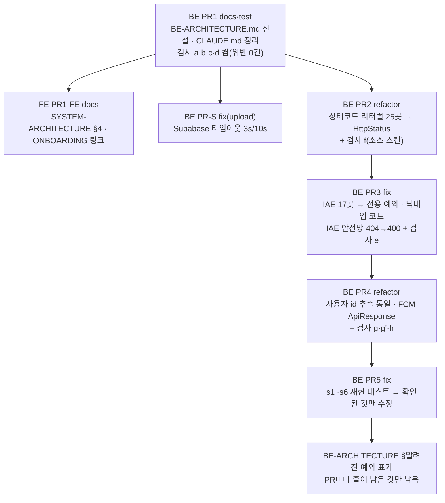

# BE 전체 점검: 파이프라인·패턴 정본화와 위반 정리

> 요약: BE의 요청 파이프라인과 반복 패턴을 새 레퍼런스 문서 `docs/BE-ARCHITECTURE.md`에 정본으로 모은다. CLAUDE.md는
> 한 줄 요약표와 링크만 남긴다(FE `FE-ARCHITECTURE.md` 선례). 규칙은 글이 아니라 ArchUnit·JUnit 검사로 강제한다.
> 지금 위반 0건인 규칙은 PR1에서 바로 켜고, 위반이 있는 규칙은 "수정 + 검사"를 한 PR에 묶어 차례로 켠다.
> PR 7개: BE PR1 → FE PR1-FE → BE PR-S → PR2 → PR3 → PR4 → PR5.

## 0. 현재 상황 (Context)

### 계기

사용자 요청(2026-10-24): _"백엔드 전체 점검 — 어떤 파이프라인·아키텍처로 구성돼 있고 위반은 없는지, 디자인 패턴을
체계화해 이후 개발도 그 패턴으로 진행할 수 있게"_. 패턴 체계화가 가장 중요한 목표다.

### 기준 커밋

- 조사는 로컬 `9a901ce`(#102) 기준으로 했다.
- 원격 main은 `f040d76`(#106)까지 4커밋 앞서 있다. 그중 결론에 영향을 주는 것은 둘이다.
  - #104: `GET /post*`가 `permitAll()` 대신 `.access{}`로 바뀌어 만료 토큰이면 401을 준다(`SecurityConfig.kt`).
  - #105: 406 핸들러가 추가돼 `GlobalExceptionHandler`의 핸들러가 28개가 됐다.
- 구현은 `origin/main` 기준 워크트리에서 하고, 착수할 때 아래 수치(위반 건수 등)를 다시 센다.

### 사실 — 파이프라인 (코드 추적)

- 진입점은 `LambdaHandler.handleRequest`(`LambdaHandler.kt:124`)이고 두 갈래로 나뉜다.
  - **`linksphereJob` 필드가 있으면** 보안 필터·MockMvc를 거치지 않고 Service 빈을 직접 호출한다(6종).
    - self-invoke(자기 자신을 비동기 호출) 3종: `ai-analysis`, `comment-postprocess`, `feed-item`
    - EventBridge 룰 1개(4일마다) 3종: `feed-crawl`, `account-purge`, `orphan-image-gc`
  - **없으면** 일반 HTTP 요청이다: `FunctionUrlOriginGuard` → MockMvc → `SessionAuthenticationFilter`(매 요청 DB 확인)
    → Controller → Service → Repository → `GlobalExceptionHandler`.
- 커밋 뒤 처리는 `@TransactionalEventListener(AFTER_COMMIT)` → `*JobDispatcher` → `LambdaSelfInvoker`(EVENT 호출, `prod`
  alias) 순서다(`PostAiService.kt:26-30`, `CommentPostProcessService.kt:32-36`).
- `tools/*Runner.kt` 7개는 `@Profile` 가드가 걸린 로컬 1회성 CLI다.

### 사실 — 자동 검사 현황

| 검사                                                         | 막는 것                    | 한계                                                     |
| ------------------------------------------------------------ | -------------------------- | -------------------------------------------------------- |
| `ArchitectureRulesTest.controllerMustNotDependOnRepository`  | Controller → `*Repository` | `..domain..`만 분석한다(infra의 FCM 컨트롤러는 제외)     |
| `ArchitectureRulesTest.servicesMustNotHaveCrossDomainCycles` | 도메인 Service 사이의 순환 | Service가 아닌 클래스를 경유한 양방향 의존은 잡지 못한다 |
| `RepositoryDeleteRulesTest`                                  | derived delete             | 상속받은 `delete(entity)` 호출은 검사하지 않는다         |
| `SwaggerDocsCoverageTest`                                    | `@Tag`·`@Operation` 누락   | —                                                        |

나머지 규칙은 CLAUDE.md 글로만 있고 이미 낡았다.

- 패키지 트리에 `feed/`·`upload/`·`infra/aws|mail|youtube`·`tools/`가 없다.
- 예외 코드표는 9개만 있고 20개 이상이 빠졌다.
- "코드 스타일 레퍼런스"의 Toggle 행은 #92에서 상태 지정형(set-state)으로 바뀌었다.
- 같은 표의 Controller 레퍼런스(`CommentController`)는 같은 문서 `:399-401`이 "레거시 예외"라고 부르는 파일이다.

### 사실 — 위반 (분류: 규칙 위반 / 방식 혼재 / 규칙이 낡음)

| 항목                                                                               | 건수           | 대표 위치                                                                                                                                                                                                       | 이번 처리                    |
| ---------------------------------------------------------------------------------- | -------------- | --------------------------------------------------------------------------------------------------------------------------------------------------------------------------------------------------------------- | ---------------------------- |
| ApiResponse·ResponseEntity 상태코드를 숫자로 씀                                    | 25             | `InteractionController.kt:31`, `FcmTokenController.kt:29`                                                                                                                                                       | PR2                          |
| `IllegalArgumentException` → 전부 404 `NOT_FOUND`(`GlobalExceptionHandler.kt:227`) | 17             | 빈 댓글 `CommentService.kt:168`이 400이 아니라 404, `InteractionService.kt:158`은 기존 `CommentNotFoundException`을 안 씀                                                                                       | PR3                          |
| 닉네임 수정 중복이 `DUPLICATE_MEMBER`(가입은 `DUPLICATE_NICKNAME`)                 | 1              | `MemberService.kt:84`                                                                                                                                                                                           | PR3                          |
| `Principal.name` 문자열 → 서비스에서 `UUID.fromString`                             | 5+5            | `AuthController.kt:128-193`, `AuthService.kt:183`                                                                                                                                                               | PR4                          |
| `@AuthenticationPrincipal` + 자체 파싱                                             | 6              | `CommentController.kt:15-18`                                                                                                                                                                                    | PR4                          |
| 인증 필수 엔드포인트인데 `Authentication?`                                         | 17             | `InteractionController`(12)·`BookmarkFolderController`(5)                                                                                                                                                       | PR4                          |
| `ResponseEntity<Void>` 반환 + 401 직접 반환                                        | 2              | `FcmTokenController.kt:27,43`                                                                                                                                                                                   | PR4                          |
| 컨트롤러 레이트리밋                                                                | 5              | `PostController.kt:25-26`에 봇 경로를 피하려는 의도가 적혀 있음                                                                                                                                                 | **규칙을 고침**(PR1)         |
| 다른 도메인 Repository를 직접 사용                                                 | 13개 클래스    | `ArchitectureRulesTest.kt:33-36`이 정상 패턴이라고 명시                                                                                                                                                         | **규칙을 고침**(PR1)         |
| 패키지 배치 예외                                                                   | 3              | Supabase가 `global/common`, FCM이 `infra`, global→domain 3쌍                                                                                                                                                    | **예외로 기록**(PR1)         |
| `@Transactional` 두 스타일                                                         | 5 vs 12 서비스 | `PostService.kt:22` vs `CommentService.kt:58`                                                                                                                                                                   | **공존 + 새 코드 규칙**(PR1) |
| 낡은 코드 주석                                                                     | 6              | "매일 퍼지"(`AccountDeletionService.kt:28`, `MemberRepository.kt:28`, 실제는 4일), `BookmarkFolderService.kt:117`, `GlobalExceptionHandler.kt:322`, `OrphanImageCleanupRunner.kt:15-17`, `LambdaHandler.kt:127` | PR1                          |

FE 영향은 확인했다.

- FE는 IAE가 내는 `NOT_FOUND` 코드를 쓰지 않고 404 상태값만 본다(`error-toast.ts:127`, `PostDetailPage.tsx:82`).
- 닉네임 중복은 409 상태값만 본다(`account.queries.ts:48`).
- BE `message`는 화면에 표시하지 않는다.

### 사실 — 라이브러리 소스로 확인·반박한 것 (Spring 6.2.14, Gradle 캐시의 유일한 버전)

- **확인**: `RestTemplate()`의 기본값은 `SimpleClientHttpRequestFactory`다(`HttpAccessor`). 이 팩토리는
  `connectTimeout`·`readTimeout`이 -1이면 타임아웃을 설정하지 않는다. 그래서 `SupabaseStorageService.kt:23`에는
  타임아웃이 없다.
- **확인(이미 알려진 문제)**: AFTER_COMMIT 리스너 예외는 `TransactionSynchronizationUtils.invokeAfterCompletion`이
  `catch (Throwable)` + `logger.error`로 삼킨다. 그래서 self-invoke가 실패하면 PENDING에 고착된다.
  `docs/AI-ASYNC-PROCESSING.md` §5.2에 기록돼 있고, 수동 backfill로 복구한다.
- **반박**: `DefaultRestClient.createResourceAccessException`은 URL에서 `?` 뒤를 잘라내고 메시지를 만든다.
  Gemini·YouTube API key가 예외 로그로 새지 않는다.

### 추정 (PR5에서 재현한 뒤에만 수정)

| #   | 의심                                                                                                                            | 근거                                                                   |
| --- | ------------------------------------------------------------------------------------------------------------------------------- | ---------------------------------------------------------------------- |
| s1  | 가입 인증 메일·비밀번호 재설정 메일이 토큰 INSERT 커밋 전에 나간다                                                              | `AuthService.kt:107-123`, `PasswordResetService.kt:54-69`              |
| s2  | `FcmService.sendToUser`(`@Transactional` + 예외 전부 흡수)가 바깥 트랜잭션을 rollback-only로 만들 수 있다 → 재시도 시 중복 푸시 | `FcmService.kt:22,71-76`, `LambdaHandler.kt:294`                       |
| s3  | 폴더 이름이 동시에 겹치면 `DUPLICATE_FOLDER_NAME`이 아니라 `DUPLICATE_RESOURCE`가 나간다                                        | `BookmarkFolderService.kt:58-108`, `schema.sql:534`                    |
| s4  | 상세 조회 응답의 조회수가 증가 전 값이다                                                                                        | `PostService.kt:194-203`, `PostRepository.kt:39-41`                    |
| s5  | 댓글을 수정해도 `updatedAt`이 갱신되지 않는다(`val`)                                                                            | `TableComment.kt:24-25`                                                |
| s6  | 가입 시 제약 위반 catch가 헛돈다. `@GeneratedValue` UUID라 INSERT가 커밋 때까지 미뤄진다                                        | `MemberService.kt:53-62`, `TableMember.kt:14`. Hibernate 소스는 미확인 |

## 1. 전체 계획

순서는 파일이 겹치기 때문에 정해졌다.

- PR2 → PR4: 같은 컨트롤러 메서드를 고친다.
- PR3 → PR4: `AccountDeletionService.kt:56-58`이 겹친다.
- PR3 → PR5: `CommentService`·`MemberService`가 겹친다.
- 모든 PR이 BE-ARCHITECTURE.md의 "알려진 예외" 표를 고치므로 **차례로 병합**한다.
- PR-S만 파일이 겹치지 않아 PR1 뒤 언제든 할 수 있다.

## 2. 세부 계획

### BE PR1 `docs(arch)` — 패턴 정본과 위반 0건 규칙 고정

**1) `docs/BE-ARCHITECTURE.md` 신설**

종류는 레퍼런스다. BE "문서 파일 위치"의 "레퍼런스(현재 해당 문서 없음)"을 이 문서로 채운다. 목차 형식은 FE
`FE-ARCHITECTURE.md`(헤더 인용 블록 + 번호 절)를 따른다.

- 헤더 인용 블록: 문서 성격 / 대상 독자(이 레포 BE를 처음 보거나 새 엔드포인트·도메인·배치 잡·외부 클라이언트를 추가하려는
  사람과 Claude) / 읽고 나면 / 마지막 검토
- §1 요청 파이프라인
  - Mermaid로 HTTP 경로, `linksphereJob` 6종, AFTER_COMMIT → self-invoke 연쇄, `tools/` CLI를 그린다.
  - 레이어·패키지 역할 표를 둔다. 파일 트리는 README `## 프로젝트 구조`가 정본이므로 옮기지 않고 링크한다. 그 트리의
    누락분은 README에서 고친다.
- §2 자동 검사 표: 규칙(테스트명) → 막는 것 → 파일. 아직 켜지 않은 e·f·g·g'·h는 "PRn에서 켬"으로 표기한다.
  줄 번호는 쓰지 않는다(FE §2 방식).
- §3 레이어 규칙과 허용 예외(사용자 결정 반영)
  - 컨트롤러 레이트리밋 허용: 사용자 요청 경로에만 한도를 걸고 봇은 Service를 직접 호출한다(`PostController.kt:25-26`).
    auth 계열은 Service에서 거는 기존 방식도 유지한다.
  - 다른 도메인 Repository 직접 사용 허용. 금지는 Service 순환뿐이다.
  - global → domain 허용 3쌍(SecurityConfig→SessionAuthenticationFilter, RateLimitService→AuthRateLimitRepository·
    TableAuthRateLimit), 패키지 위치 예외(Supabase, FCM).
  - 역할 접미사 표: `*Assembler`·`*Processor`·`*Dispatcher`·`*Client`·`*Validator`·`*Parser`·`*Extractor`, 그리고
    `object` 헬퍼와 `@Component` 헬퍼를 고르는 기준.
- §4 응답·에러 계약
  - `ApiResponse(HttpStatus.X.value(), …)`
  - 예외 선택 규칙: 입력 오류는 `InvalidInputException`, 대상 없음은 `*NotFoundException`, 불변조건 위반은
    `IllegalStateException`, IAE는 금지
  - 코드 표: 핸들러 28개 + 보안 4개. 정본은 `GlobalExceptionHandler.kt`이고 이 표는 파생본임을 명시한다.
- §5 인증
  - 정석 추출 방식(아래 PR4 패턴)
  - `Authentication?`는 `@SecurityRequirements`(공개 엔드포인트 표시)와 짝을 이룬다
  - permitAll은 경로를 하나씩 나열하고, 로그인 여부에 따라 응답이 달라지는 GET은 `.access{}`(#104)를 쓴다
  - `SecureToken`은 해시만 저장한다
- §6 트랜잭션
  - 두 스타일이 공존하며, **새 코드는 클래스 `readOnly` + 쓰기 메서드 `@Transactional`**(`PostService.kt:22`)
  - REQUIRES_NEW 독립 커밋(`RateLimitService.kt:26-83`)
  - rollback-only 함정(`MemberService.findByEmailOrNull` 주석)
  - `save()`의 flush 지연(s6 결과를 PR5에서 반영)
  - AFTER_COMMIT 예외는 삼켜진다
- §7 패턴 카탈로그: 각 항목마다 언제 쓰나 / 정석 `파일:줄` / 모양 5~10줄 / 안티패턴.
  - set-state + `insertIgnoreConflict`(`PostReactionRepository.kt:18-25`, `InteractionService.kt:30-43`)
  - 조건부 UPDATE 선점(`MemberSessionRepository.kt:27-37`)
  - upsert(`FcmTokenRepository.kt:28-48`)
  - 일괄 DELETE
  - REQUIRES_NEW
  - 커밋 후 self-invoke 잡(`PostAiService.kt:26-35` + `LambdaHandler` 잡 분기)
  - 배치 잡 형태(90초 마감 + 항목별 `runCatching`, `AccountPurgeService.kt`)
  - N+1 방지 배치 조립(`PostResponseAssembler.kt:41-104`)
  - offset 페이징(`Paging.kt`)
  - 비공개 글 404 게이트(`InteractionService.kt:150-153`)
  - 외부 클라이언트(RestClient + 명시 타임아웃 + null 폴백, AWS SDK는 `by lazy`, `YoutubeVideoClient.kt`)
  - companion 상수 + 근거 주석(`CommentService.kt:46-56`)
  - 엔티티 PK: 새 코드는 앱에서 만든 UUID. `@GeneratedValue`와 섞지 않는다
- §8 테스트 패턴
  - Mockito 단위(`InteractionServiceTest`)
  - `@WebMvcTest` + `@WithMockUser(username = <UUID>)`(`InteractionControllerTest`)
  - `@PostgresIntegrationTest`: 커밋 동작을 볼 땐 `NOT_SUPPORTED`(`MemberSessionServiceIntegrationTest`)
  - ArchUnit, 백틱 한국어 테스트명, `test`와 `integrationTest` 구분
- §9 알려진 예외 표: 위 위반 표에서 PR2~PR5로 처리할 항목. PR마다 줄인다.
- §10 체크리스트: 새 엔드포인트 / 새 도메인 / 새 예외 / 새 배치 잡 / 새 외부 클라이언트
- 마지막 절 "남은 것": 이번 범위 밖 항목(아래 `## 남은 것`)

**2) `.claude/CLAUDE.md` 정리**

- 다음 절은 BE-ARCHITECTURE.md로 옮기고, CLAUDE.md에는 FE CLAUDE.md "패턴 레퍼런스" 형태의 표(패턴 | 정본 § | 한 줄
  요약, 약 12행)만 남긴다.
  - 패키지 구조·네이밍, 응답 포맷, 파일 역할, 인증 처리, 예외 처리와 코드 표, DB/JPA, Repository, DTO, 새 도메인
    체크리스트, 코드 스타일 레퍼런스
  - 정석 컨트롤러 레퍼런스는 `CommentController` 대신 `LinkPreviewController`로 바꾼다. non-null 인증, ISE, `HttpStatus`,
    레이트리밋, 근거 주석이 달린 상수를 모두 갖췄다.
- Critical Rules는 남긴다.
  - 각 줄에 그 규칙을 강제하는 검사 이름을 덧붙인다.
  - "Controller에서 비즈니스 로직 금지"에 레이트리밋 예외를 명시한다.
- "문서 파일 위치"의 "레퍼런스(현재 해당 문서 없음)"를 정정한다.

**3) 그 밖의 문서·주석**

- `.claude/commands/new-domain.md:45-47`: 엔티티 템플릿에서 `@GeneratedValue`와 `UUID.randomUUID()`가 충돌한다. 앱에서
  만든 UUID 하나로 정리한다.
- `README.md`
  - `## 문서`에 BE-ARCHITECTURE.md를 등록한다.
  - `## API 엔드포인트`에 빠진 `GET /link-preview`를 추가한다.
  - `:204`의 "북마크" 오기를 고친다(댓글에는 북마크가 없다).
  - 프로젝트 구조 트리의 누락분을 채운다: `tools/`, 루트 파일 2개, `global/exception` 17개 등.
- 낡은 코드 주석 6곳(위 표)과 `docs/DEPLOY.md:42-43`의 잡 목록 누락을 정정한다.

**4) 검사 추가 — 새 테스트 클래스**

선례는 `RepositoryDeleteRulesTest`다. 앱 전체를 분석하고, 왜 그렇게 하는지 주석으로 밝힌다. 기존
`ArchitectureRulesTest`의 분석 범위는 넓히지 않는다. 넓히면 `ServiceOnlySliceAssignment`가 global·infra의 Service까지
한 슬라이스로 묶어 순환 판정이 틀어진다.

| 검사                                                                                            | 방식                                                                                      |
| ----------------------------------------------------------------------------------------------- | ----------------------------------------------------------------------------------------- |
| a. `@RestController`는 `Repository`에 할당 가능한 타입을 참조하지 않는다(앱 전체)               | ArchUnit                                                                                  |
| b. Repository 인터페이스와 `*RepositoryImpl`은 Throwable 생성자를 호출하지 않는다               | ArchUnit `callConstructorWhere`, SYNTHETIC origin 제외(Kotlin `$default`의 UOE 오탐 방지) |
| c. `global.exception`의 모든 Throwable에 `@ExceptionHandler`가 있다(자신 또는 같은 패키지 조상) | 리플렉션 JUnit                                                                            |
| d. global → domain 금지, 허용 3쌍만 예외                                                        | ArchUnit `layeredArchitecture().ignoreDependency`                                         |

검사마다 개수 하한선을 둔다(예: 분석한 컨트롤러가 9개 이상). 그래야 대상 0건으로 조용히 통과하는 일을 막는다
(`SwaggerDocsCoverageTest` 선례).

**5) 계획 스냅샷**: 이 파일을 `docs/plans/2026-10-25-be-architecture-audit.md`로 커밋한다. FE PR1-FE에도 같은 파일을
커밋한다(2026-10-15 drift 계획 선례).

### FE PR1-FE `docs` — BE 정본 연결

- `docs/SYSTEM-ARCHITECTURE.md` §4에 BE-ARCHITECTURE.md 링크와 self-invoke 잡 파이프라인 한 줄을 넣는다. 상세는 링크로
  대신한다.
- `docs/ONBOARDING.md`의 BE 읽기 경로(`:113`, `:121`)에 BE-ARCHITECTURE.md를 추가한다.
- 계획 스냅샷을 함께 커밋하고 `pnpm check:docs`를 돌린다.

### BE PR-S `fix(upload)` — Supabase 타임아웃

- 변경은 `SupabaseStorageService.kt:23` 한 줄이다.
  `RestTemplate(SimpleClientHttpRequestFactory().apply { setConnectTimeout(3s); setReadTimeout(10s) })`
- 값의 근거(판단값이며, 실측 지연 데이터는 없다)
  - 요청 경로 최악 13초 < CloudFront origin 30초(`AI-ASYNC-PROCESSING.md:10`)
  - 고아 이미지 GC 최악 90+13초 < Lambda 120초(`DEPLOY.md:201`)
- 전송 계층은 바꾸지 않는다. RestClient로 옮기면 호출부 3곳과 DELETE+본문 동작이 함께 바뀌어 회귀 범위가 커진다.
  §7 외부 클라이언트 패턴에는 "새 코드는 RestClient + 명시 타임아웃"을 적고, 이 파일은 알려진 예외로 남긴다.
- CHANGELOG `Fixed`(`upload`)

### BE PR2 `refactor(api)` — 상태코드 리터럴

- 대상: `ApiResponse(200|201, …)` 23곳(Comment·BookmarkFolder·Interaction)과 `ResponseEntity.status(401)` 2곳(FCM).
  `HttpStatus.X.value()`로 바꾼다. 본문의 status 값은 그대로다.
- 검사 f: `src/main/kotlin`을 재귀로 읽어 아래 정규식을 줄 단위로 보고하고, 스캔한 파일이 100개 이상이어야 통과하는
  하한선을 둔다. 소스 스캔 선례는 없어 새로 만든다.
  - `(ApiResponse|ErrorResponse)\(\s*(status\s*=\s*)?\d{3}`
  - `ResponseEntity\s*\.\s*status\(\s*\d{3}`
- 동작 변화가 없으므로 CHANGELOG는 쓰지 않는다.

### BE PR3 `fix(api)` — 에러 코드 정정 (결정: ISE·안전망 400·죽은 블록은 예외만 교체)

| 대상                                                                                                                                                           | 교체                                    | 변화                                                                                       |
| -------------------------------------------------------------------------------------------------------------------------------------------------------------- | --------------------------------------- | ------------------------------------------------------------------------------------------ |
| 빈 댓글·답글·수정(`CommentService.kt:168,237,378`)                                                                                                             | `InvalidInputException`                 | 404 → 400 `INVALID_INPUT`                                                                  |
| 답글 depth·다른 글의 부모(`:183,188,252`, 그중 `:180-191`은 HTTP로 도달할 수 없는 블록)                                                                        | `InvalidInputException`                 | 404 → 400. 죽은 블록은 지우지 않고 BE-ARCHITECTURE "남은 것"에 언급                        |
| 댓글 좋아요 대상 없음(`InteractionService.kt:158`)                                                                                                             | `CommentNotFoundException`              | code `NOT_FOUND` → `COMMENT_NOT_FOUND`(404 유지)                                           |
| 본인·작성자 회원 없음 9곳(`CommentService:201,265,432`, `PostService:46,324`, `MemberService:77`, `AccountDeletionService:58`, `PostResponseAssembler:90,112`) | `IllegalStateException`                 | 404 → 500. FK `ON DELETE CASCADE` + 앱은 회원을 지우지 않으므로 발생하지 않는 불변조건이다 |
| 카테고리 slug 없음(`CategoryService.kt:14`)                                                                                                                    | 새 `CategoryNotFoundException` + 핸들러 | code만 `CATEGORY_NOT_FOUND`로. FE는 이 엔드포인트를 호출하지 않음                          |
| 닉네임 수정 중복(`MemberService.kt:84`)                                                                                                                        | `DuplicateNicknameException`            | 409 `DUPLICATE_MEMBER` → `DUPLICATE_NICKNAME`                                              |
| IAE 안전망(`GlobalExceptionHandler.kt:227`)                                                                                                                    | 400 `INVALID_INPUT` + warn 로그         | 라이브러리 IAE(예: `page=-1`). FE는 음수 page를 보내지 않음                                |

- 검사 e: main 코드에서 IAE 생성자 호출을 금지한다(ArchUnit). `require()` 등 inline stdlib도 잡히는데, 정책상 맞다.
  지금 사용은 0건이다.
- 함께 고칠 것: Swagger 설명(`CommentController.kt:47-48,63-64`, `CategoryController.kt:25`), `MemberServiceTest:105-113`,
  BE-ARCHITECTURE §4 코드 표·§9 표.
- CHANGELOG `Changed`(`comment`·`category`·`member`)

### BE PR4 `refactor(auth)` — 사용자 id 추출 통일

**정석 방식(문서에 이미 있는 형태를 그대로 쓴다)**

- 필수 인증: `authentication: Authentication` + `authentication.getUserId() ?: throw IllegalStateException("User not authenticated")`
- 공개 엔드포인트: `Authentication?` + `@SecurityRequirements`

**바꿀 곳**

- `AuthController` 5곳: `principal: Principal`을 위 형태로 바꾼다.
  - `AuthService`의 `logoutAll`·`changePassword`·`getAccount`·`updateAccount`는 `userId: String` → `UUID`,
    `isNicknameAvailable`은 `String?` → `UUID?`로 바꾼다.
  - `AccountDeletionService.requestDeletion`은 `UUID`로 바꾼다.
  - 이 시그니처 변경은 사용자가 고른 "사용자 추출 통일" 범위에 들어간다.
- `CommentController`: 사설 확장 함수 2개를 지운다.
- Interaction(12)·BookmarkFolder(5): non-null로 바꾼다.
- `FcmTokenController`: `ApiResponse<Unit>`(`HttpStatus.OK`)로 바꾸고 401 분기는 ISE로 바꾼다. FE는 결과를 버리고,
  `client.ts:406-428`이 JSON 본문을 처리하므로 깨지지 않는다.

**검사**

- g: 컨트롤러에서 `Principal`·`@AuthenticationPrincipal` 파라미터를 금지한다. `getName()`은 `SecurityUtilsKt`에서만
  부를 수 있다. 정확한 타입으로 비교한다. `Authentication`이 `Principal`의 하위 타입이라 `assignableTo`로 짜면 모든
  `Authentication` 파라미터가 걸린다.
- g': `Authentication?`는 `@SecurityRequirements`가 붙은 엔드포인트에만 허용한다(kotlin-reflect JUnit). 지금 위반은
  정확히 17건이다.
- h: 매핑 메서드는 `ApiResponse<*>` 또는 `ResponseEntity<ApiResponse<*>>`만 반환한다(ArchUnit 제네릭 검사).

**테스트**

- `AuthControllerTest`: `@WithMockUser`의 기본 username `"user"` 5곳을 UUID로 바꾸고 mock 인자도 UUID로 맞춘다.
- `AuthServiceTest`, `AccountDeletionServiceTest`를 갱신한다.
- `CommentControllerTest`를 새로 만든다: 비로그인 `GET /post/{id}/comment`이 200, 인증 POST가 정상인지 확인한다.

**CHANGELOG** `Changed`(`fcm` 응답 형태). FE 쪽은 선택 사항으로 `pnpm codegen:fetch && pnpm codegen`.

### BE PR5 `fix` — 추정 버그 검증 → 확인된 것만 수정 (결정: s4는 +1 반영)

재현 틀은 `@PostgresIntegrationTest` + `@Transactional(propagation = NOT_SUPPORTED)`다(`MemberSessionServiceIntegrationTest`
선례). 재현에 실패한 항목은 고치지 않고 BE-ARCHITECTURE "남은 것"에 "검증했으나 재현 안 됨"으로 적는다.

| #   | 재현                                                                                                                | 확인되면                                                          | 선례                                                          |
| --- | ------------------------------------------------------------------------------------------------------------------- | ----------------------------------------------------------------- | ------------------------------------------------------------- |
| s6  | 같은 이메일을 JDBC로 넣은 뒤 `save(dup)`가 무예외인지, `flush()`에서 제약 이름이 담긴 예외가 나는지                 | `save` → `saveAndFlush`                                           | `PostAiService.kt:111-116`                                    |
| s3  | 폴더로 같은 재현                                                                                                    | `saveAndFlush` + 제약 이름 catch → `DuplicateFolderNameException` | 수정된 MemberService                                          |
| s1  | s6가 확인되면 트리거가 성립한다                                                                                     | 메일 발송을 `registerSynchronization(afterCommit)`으로            | `CommentService.kt:418-424`                                   |
| s2  | spring-tx 6.2.14 업스트림 `AbstractPlatformTransactionManager.commit` 추적 + spy repository가 던지게 한 통합 테스트 | `FcmService.sendToUser`를 `REQUIRES_NEW`로                        | `RateLimitService.kt:26-83`                                   |
| s4  | `findById` → `incrementViewCount` → 엔티티는 N, JDBC 값은 N+1                                                       | 응답에 증가 후 값을 반영(**사용자 승인 완료**)                    | `InteractionService.kt:39-41`(쓴 뒤 같은 트랜잭션에서 재조회) |
| s5  | 코드로 확정(`val`, 갱신 경로 없음, FE 표시 없음)                                                                    | `var` + 수정·삭제 시 갱신                                         | `TableBookmarkFolder.updatedAt`                               |

- 라이브러리 동작에 기대는 판정(s2, s6)은 BE CLAUDE.md §1에 따라 업스트림 태그 소스를 따라가 `파일:줄`을 남긴다.
- CHANGELOG `Fixed`는 항목별로 쓰고, `docs/AI-ASYNC-PROCESSING.md`의 댓글 잡 절을 갱신한다(s2).

## 판단이 필요했던 항목 (사용자 결정 2026-10-24~25)

| 항목                     | 결정                                                                               | 진 선택지와 이유                                                                                        |
| ------------------------ | ---------------------------------------------------------------------------------- | ------------------------------------------------------------------------------------------------------- |
| 범위                     | 단계 분할(PR1 문서 + 위반 0건 검사, 이후 종류별 "수정 + 검사")                     | 문서만 하면 위반이 계속 남고, 한 PR로 하면 리뷰·롤백 단위가 커진다                                      |
| 규칙과 코드가 어긋난 4곳 | 전부 규칙을 고친다(레이트리밋·타 도메인 Repository·패키지 예외·트랜잭션 두 스타일) | 코드를 옮기면 의도된 설계를 깨거나 고장 나지 않은 것을 리팩터링하게 된다(§3)                            |
| 수정 묶음                | 4개 전부(에러 코드·상태코드·사용자 추출·안정성)                                    | —                                                                                                       |
| IAE 안전망               | 400 `INVALID_INPUT`                                                                | 404 유지는 의미가 어긋난 채 남는다                                                                      |
| 불변조건 위반            | `IllegalStateException` → 500                                                      | `MemberNotFoundException`(404)은 "없음"이라는 잘못된 신호를 준다                                        |
| s4 조회수                | +1 반영                                                                            | 그대로 두면 상세와 목록의 숫자가 어긋난다                                                               |
| 도달 불가 블록           | 예외만 교체                                                                        | 지우면 `createComment` 시그니처가 바뀌어 범위가 커진다                                                  |
| 문서 위치                | `docs/BE-ARCHITECTURE.md` + CLAUDE.md 요약표(FE 선례)                              | CLAUDE.md에 그대로 두면 이미 낡은 상태가 반복된다. skill은 덜 불린다(메모리 `claude-md-split-findings`) |
| G3 패턴                  | 기존 문서 형태(인라인 `?: throw`)                                                  | `requireUserId()` 신설은 이미 맞는 23줄까지 건드려 §3과 PR2 충돌을 부른다                               |
| Supabase                 | RestTemplate 유지 + 팩토리 타임아웃                                                | RestClient 전환은 회귀 범위가 커 범위 밖으로 둔다                                                       |

## 영향 범위 (BE CLAUDE.md §5)

| PR   | CRUD 실패 지점                                                                                                                                               | 기존 기능 회귀 점검                                                                                                      |
| ---- | ------------------------------------------------------------------------------------------------------------------------------------------------------------ | ------------------------------------------------------------------------------------------------------------------------ |
| PR1  | main 동작 변화 없음(주석만)                                                                                                                                  | 새 검사가 현재 코드를 통과하는가(위반 0건 재확인). 기존 `ArchitectureRulesTest`는 건드리지 않음                          |
| PR-S | C: 업로드 서명 URL 발급 타임아웃 → 기존 catch가 500. D: 댓글·글 이미지 정리 타임아웃 → 로그만, 남은 파일은 GC가 회수. GC 목록 조회 타임아웃 → 잡이 일찍 실패 | `UploadServiceTest`, `OrphanImageGcServiceTest`                                                                          |
| PR2  | 없음(본문 status 값 동일)                                                                                                                                    | 컨트롤러 테스트의 `jsonPath("$.status")` 단정                                                                            |
| PR3  | C/U: 빈 댓글 400. R: 좋아요 대상 없음 code. 가입·수정: 닉네임 code                                                                                           | FE `comment.util.ts` fallback, `account.queries.ts:48`(409만 봄), `MemberServiceTest`, Swagger 문구                      |
| PR4  | 35곳의 소유권 검사가 그대로인가, 비로그인 댓글 조회, FCM 응답 본문                                                                                           | `AuthControllerTest` 5곳, FE `fcm.api.ts`·`client.ts`, #104의 `.access{}` 규칙과의 상호작용(비로그인은 null, 만료는 401) |
| PR5  | 가입 경합 code, 메일 발송 시점, FCM 중복·커넥션 풀(최대 5), 폴더 중복 code, 조회수 +1, `updated_at`                                                          | `PostDetailPage`의 조회수 표시, `AuthServiceTest`, `CommentPostProcessServiceTest`                                       |

데이터 계약 변화는 PR3(에러 코드)과 PR4(FCM 응답 본문)뿐이다. FE가 바뀌는 코드로 분기하지 않으므로 배포 순서 제약은
없다. FE `VERSION-COMPATIBILITY.md`는 릴리즈 때 확인한다.

## 실행 전략

- **워크트리**: FE 세션에서는 BE에 `EnterWorktree`를 쓸 수 없다(메모리 `cross-repo-be-worktree-from-fe-session`).
  1. FE 워크트리에 있으면 `ExitWorktree(keep)`로 나온다.
  2. `git -C <BE> fetch` → `git -C <BE> log origin/main..main` → `git -C <BE> worktree add -b <브랜치> <BE>/.claude/worktrees/<이름> origin/main`
  3. `application-secret.yml`·`firebase-service-account.json`을 메인 체크아웃에서 복사한다.
  4. `cd`로 워크트리에 들어간다.
     FE PR1-FE는 `EnterWorktree` → `cp ../../../.env .` → `pnpm install`.
- **PR마다 반복하는 절차**
  1. `.gitmessage`를 읽는다.
  2. 경로를 지정해 커밋한다(`git add`는 새 파일에만).
  3. PR을 만들고 CI 녹색을 확인한다.
  4. fresh general-purpose 서브에이전트에게 이 계획과 diff를 대조시켜 PR 본문에 `## 계획 대비 구현`을 적는다(BE §8).
  5. squash 병합한다.
  6. `deploy.yml` 성공(5회 연속 호출 검증 포함)을 확인한 뒤 보고한다.
  7. 워크트리와 로컬 브랜치를 정리한다.
- **계획 스냅샷**은 PR1과 PR1-FE에만 커밋한다(append-only). PR2~PR5는 같은 파일의 해당 절을 링크해 대조한다.
- **병합은 차례로** 한다. 다음 PR은 앞 PR 병합 뒤 `origin/main`에서 새로 가른다.

## 검증 방법

- PR마다 `./gradlew ktlintCheck test integrationTest`를 로컬과 CI에서 돌린다.
  - 새 검사가 대상 개수 하한선을 넘는지 확인한다.
  - 검사를 켜는 PR에서는 그 위반을 일부러 하나 넣었을 때 실패하는지 한 번 확인하고 되돌린다. 확인 범위는 디스크 파일에서
    `./gradlew test --tests <검사>`다.
- PR3·PR4: 바뀐 응답을 `@WebMvcTest`로 단정한다(400 `INVALID_INPUT`, `COMMENT_NOT_FOUND`, `DUPLICATE_NICKNAME`, FCM
  `ApiResponse` 본문, 비로그인 댓글 조회 200).
- PR5: 항목마다 재현 테스트가 수정 전에 실패하고 수정 후 통과하는 것을 보인다(§4).
- 배포 뒤: `gh run list --branch main --workflow "Deploy to AWS Lambda (SnapStart)"`로 그 SHA의 성공을 확인한다. PR3·PR4는 운영에서
  `curl`로 대표 오류 응답 1건씩 확인한다(빈 댓글 400 등, 인증이 필요한 건 사용자에게 요청).
- PR1·PR1-FE: `pnpm check:docs`(FE). BE 문서의 `파일:줄` 인용은 착수 시점 `origin/main`으로 다시 확인한다.

## 남은 것 (이번 범위 밖 — BE-ARCHITECTURE "남은 것"에 기록)

- **방식 혼재(통일 안 함)**
  - 응답 message 언어(FE가 표시하지 않음)
  - 실제 HTTP 201은 signup만 쓴다
  - DTO 이름 어순·suffix
  - 엔티티 ID 생성 4종·시간 타입(LocalDateTime/Instant)
  - 개수 세는 방식 3종
  - 커밋 후 처리 4종(인라인 `afterCommit` 3회 복붙 포함)
  - `@Valid` 사용 위치
  - Page DTO 수동 복제
  - 로거 선언 변형
  - 중복 상수(90초 마감 ×3, 이메일 정규화 ×4)
- **위험 후보(미검증)**
  - Lambda 응답 헤더가 이름당 첫 값만 남는다(`LambdaHandler.kt:246`, 여러 `Set-Cookie`에서 잠재 문제)
  - Lambda 안에서 Tomcat이 뜨는지(문서는 "소켓 없음")
  - `MultipartRequestParser`는 쓰는 엔드포인트가 없다
  - `findFirstByIsBotTrue`의 `@Query` 단건 조회
  - SSRF 검증 시점과 연결 시점의 DNS 해석 사이 틈(DNS rebinding)
  - 엔티티 `delete(entity)` 3곳(409 안전망에 기댐)
  - `deploy.yml`은 integrationTest를 돌리지 않는다
- **정리 후보**: 쓰지 않는 의존성 `spring-boot-starter-oauth2-client`·`jwt.secret` 키, 쓰지 않는 Repository 메서드 4개,
  HTTP로 도달할 수 없는 답글 depth 블록, 파일명 `PostAiService.kt`와 클래스명 `PostAIService` 불일치
